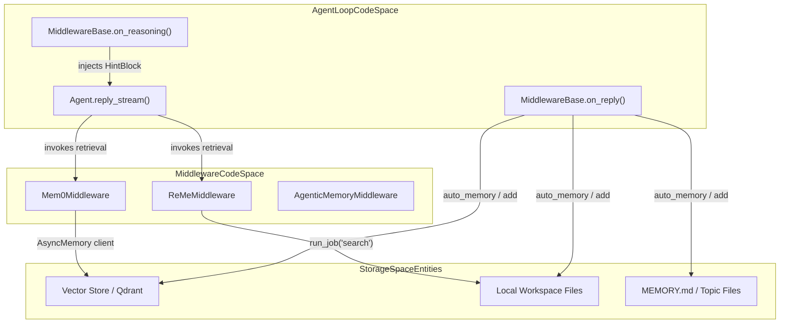
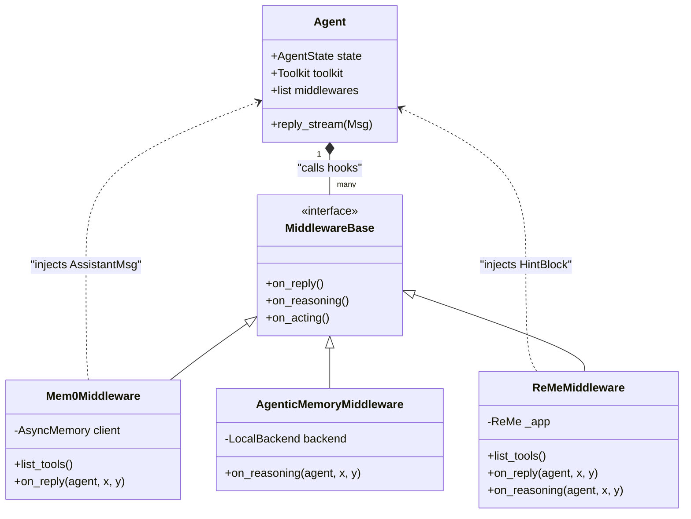

<!-- source: DeepWiki mcp.deepwiki.com · repo modelscope/agentscope · page 9.5 Long-term Memory · fetched 2026-10-27 -->

# Long-term Memory

<details>
<summary>Relevant source files</summary>

The following files were used as context for generating this wiki page:

- [examples/long_term_memory/mem0/README.md](examples/long_term_memory/mem0/README.md)
- [examples/long_term_memory/reme/README.md](examples/long_term_memory/reme/README.md)
- [examples/long_term_memory/reme/reme_demo.py](examples/long_term_memory/reme/reme_demo.py)
- [src/agentscope/middleware/_longterm_memory/_reme/_config.py](src/agentscope/middleware/_longterm_memory/_reme/_config.py)
- [src/agentscope/middleware/_longterm_memory/_reme/_middleware.py](src/agentscope/middleware/_longterm_memory/_reme/_middleware.py)
- [tests/reme_middleware_test.py](tests/reme_middleware_test.py)

</details>


Long-term memory in AgentScope 2.0 provides persistent storage for user preferences, past interactions, and durable facts that span across multiple sessions [src/agentscope/middleware/_longterm_memory/_reme/_middleware.py:1-32](). Unlike short-term context limited by model token windows, long-term memory allows agents to recall relevant historical information to maintain personalized and consistent behavior over time [src/agentscope/middleware/_longterm_memory/_reme/_middleware.py:1-32]().

AgentScope offers three distinct middleware implementations for long-term memory, each catering to different architectural needs and storage backends. As a parent overview, this page introduces the core backends. For granular implementation details, construction parameters, and examples, refer to the child pages:
- [Mem0 Middleware](#9.5.1) — `Mem0Middleware`: construction paths, modes, search/add memory tools, prompts, fallback logic, AgentScope adapter, OSS vs hosted, and the example.
- [ReMeMiddleware](#9.5.2) — `ReMeMiddleware`: file-based memory: parameters, retrieval modes, lazy init, write-back, concurrency, `HintBlock` injection, session isolation, `memory_search` tool, example.
- [AgenticMemoryMiddleware](#9.5.3) — `AgenticMemoryMiddleware`: Markdown-file-based memory: memory types, `MEMORY.md` index, topic frontmatter, agent-driven read/write, workspace-scoped persistence.

Sources: [src/agentscope/middleware/_longterm_memory/_reme/_middleware.py:1-32](), [src/agentscope/middleware/__init__.py:7-10]()

## Memory Backend Comparison

| Backend | Implementation Class | Storage Type | Control Mechanism | Key Feature |
|:---|:---|:---|:---|:---|
| **Mem0** | `Mem0Middleware` | Vector Database (Qdrant/Hosted) | Hybrid (Auto + Tools) | Production-grade, cross-session vector memory with an extraction pipeline [examples/long_term_memory/mem0/README.md:1-12]() |
| **ReMe** | `ReMeMiddleware` | Local Files (Markdown/JSON) | Hybrid (Auto + Tools) | In-process, file-based memory with automatic incremental write-back [src/agentscope/middleware/_longterm_memory/_reme/_middleware.py:4-18]() |
| **Agentic** | `AgenticMemoryMiddleware` | Markdown Files | Agent-Driven (Tools) | Self-managed memory where the agent explicitly reads/writes to a Markdown index [src/agentscope/middleware/_longterm_memory/_agentic_memory/_middleware.py:1-20]() |

Sources: [src/agentscope/middleware/_longterm_memory/_reme/_middleware.py:88-129](), [examples/long_term_memory/mem0/README.md:123-171](), [src/agentscope/middleware/__init__.py:7-10]()

## Architecture Overview

Long-term memory is integrated through the `MiddlewareBase` abstraction defined in `src/agentscope/middleware/_base.py` [src/agentscope/middleware/_base.py:13-25](). These middlewares wrap the agent execution loop, intercepting hooks such as `on_reply()`, `on_reasoning()`, and post-reply processing to execute retrieval and persistence operations.

### Diagram: Memory Middleware Logic Flow

Sources: [src/agentscope/middleware/_base.py:13-32](), [src/agentscope/middleware/_longterm_memory/_reme/_middleware.py:88-113](), [examples/long_term_memory/mem0/README.md:1-40]()

## Available Backends

### Mem0 Middleware
The `Mem0Middleware` integrates the `mem0` library, supporting both local OSS deployments via Qdrant and the hosted Mem0 Platform [examples/long_term_memory/mem0/README.md:1-12](). It uses internal adapters to bridge AgentScope chat and embedding models to `AsyncMemory` clients [examples/long_term_memory/mem0/README.md:43-94](). The middleware offers three construction paths, allowing for flexible configuration of models and `mem0_config` [examples/long_term_memory/mem0/README.md:41-94](). It supports `static_control`, `agent_control`, and `both` modes for memory retrieval and write-back [examples/long_term_memory/mem0/README.md:123-168]().

For detailed construction paths, modes (`static_control`, `agent_control`, `both`), and tool exposure, see [Mem0 Middleware](#9.5.1).

Sources: [examples/long_term_memory/mem0/README.md:1-42](), [src/agentscope/middleware/_longterm_memory/__init__.py:5]()

### ReMeMiddleware
`ReMeMiddleware` embeds the `reme-ai` application in-process, utilizing local file structures for zero-service deployment [src/agentscope/middleware/_longterm_memory/_reme/_middleware.py:4-18](). It listens to `on_reply` hooks to perform automatic incremental write-backs (`auto_memory`) while scoping sessions dynamically via `agent.state.session_id` [src/agentscope/middleware/_longterm_memory/_reme/_middleware.py:14-31](). The embedded ReMe app uses a minimal configuration focused on conversation memory lifecycle, including write-back, dream consolidation, and search [src/agentscope/middleware/_longterm_memory/_reme/_config.py:4-14](). Retrieval modes include `static_control`, `agent_control`, and `both` [src/agentscope/middleware/_longterm_memory/_reme/_middleware.py:163-167]().

For parameters, retrieval modes, background task coordination, and session isolation, see [ReMeMiddleware](#9.5.2).

Sources: [src/agentscope/middleware/_longterm_memory/_reme/_middleware.py:88-129](), [examples/long_term_memory/reme/README.md:1-33](), [src/agentscope/middleware/_longterm_memory/_reme/_config.py:4-14]()

### AgenticMemoryMiddleware
`AgenticMemoryMiddleware` provides a transparent Markdown-based memory architecture where the agent acts as the primary maintainer [src/agentscope/middleware/_longterm_memory/_agentic_memory/_middleware.py:1-20](). It relies on a `MEMORY.md` index file and topic-specific frontmatter documents within a workspace-scoped directory. The agent uses explicit tools to read, write, and manage its memory, making the memory system fully observable and controllable by the agent itself.

For operational mechanics, agent-driven read/write tool flows, and workspace persistence, see [AgenticMemoryMiddleware](#9.5.3).

Sources: [src/agentscope/middleware/_longterm_memory/_agentic_memory/_middleware.py:1-20](), [src/agentscope/middleware/_longterm_memory/__init__.py:4]()

## System Entity Mapping

This diagram maps architectural abstractions to concrete code classes and methods across the codebase, bridging natural language concepts to code entity space.

### Diagram: Code Entity Association

Sources: [src/agentscope/middleware/_base.py:13-30](), [src/agentscope/middleware/_longterm_memory/_reme/_middleware.py:88-129](), [src/agentscope/middleware/_longterm_memory/_mem0/_middleware.py:1-40]()

## Installation

Long-term memory backends require optional dependencies managed through project extras:

```bash
# For Mem0 backend
pip install "agentscope[memory-mem0]"

# For ReMe backend
pip install "agentscope[memory-reme]"
```

Sources: [examples/long_term_memory/mem0/README.md:19-30](), [examples/long_term_memory/reme/README.md:28-30]()

---

