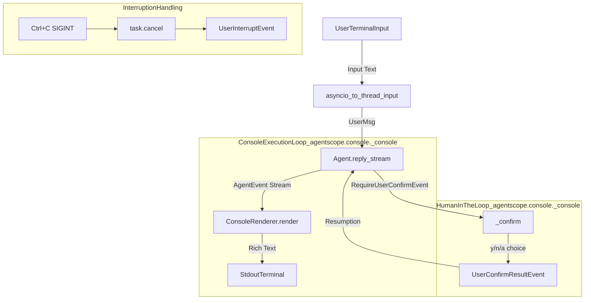
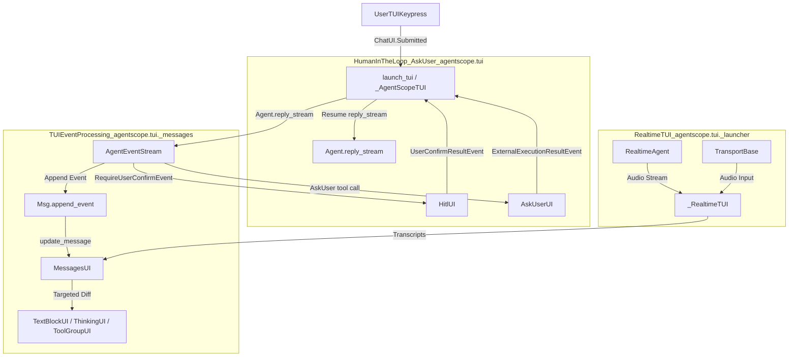

<!-- source: DeepWiki mcp.deepwiki.com · repo modelscope/agentscope · page 9.6 Terminal Console and TUI Interfaces · fetched 2026-10-27 -->

# Terminal Console and TUI Interfaces

<details>
<summary>Relevant source files</summary>

The following files were used as context for generating this wiki page:

- [examples/console/README.md](examples/console/README.md)
- [examples/console/main.py](examples/console/main.py)
- [examples/tui/README.md](examples/tui/README.md)
- [examples/tui/main.py](examples/tui/main.py)
- [src/agentscope/app/middleware/_protocol/_agui.py](src/agentscope/app/middleware/_protocol/_agui.py)
- [src/agentscope/app/middleware/_protocol/_base.py](src/agentscope/app/middleware/_protocol/_base.py)
- [src/agentscope/console/__init__.py](src/agentscope/console/__init__.py)
- [src/agentscope/console/_console.py](src/agentscope/console/_console.py)
- [src/agentscope/console/_renderer.py](src/agentscope/console/_renderer.py)
- [src/agentscope/tui/__init__.py](src/agentscope/tui/__init__.py)
- [src/agentscope/tui/_ask_user.py](src/agentscope/tui/_ask_user.py)
- [src/agentscope/tui/_chat.py](src/agentscope/tui/_chat.py)
- [src/agentscope/tui/_launcher.py](src/agentscope/tui/_launcher.py)
- [tests/agui_protocol_test.py](tests/agui_protocol_test.py)
- [tests/console_renderer_test.py](tests/console_renderer_test.py)
- [tests/console_test.py](tests/console_test.py)
- [tests/tui_test.py](tests/tui_test.py)

</details>


This page documents the terminal interface options in AgentScope 2.0: the line-based terminal console (`launch_console()` and `ConsoleRenderer`) and the rich, interactive Textual-based Terminal User Interface (TUI) package (`src/agentscope/tui`) [src/agentscope/console/__init__.py:1-20](), [src/agentscope/tui/__init__.py:1-20](). It details their architectures, streaming event models, human-in-the-loop (HITL) confirmation flows, keyboard-driven forms, and accompanying demo applications (`examples/console` and `examples/tui`) [src/agentscope/console/_console.py:99-169](), [examples/tui/README.md:1-28]().

Sources: [src/agentscope/console/__init__.py:1-20](), [src/agentscope/console/_console.py:99-169](), [src/agentscope/tui/__init__.py:1-20](), [src/agentscope/tui/_launcher.py:44-154]()

---

## Terminal Console Interface

The Terminal Console Interface provides a lightweight, line-based environment for interacting with agents directly from a terminal. It is designed for rapid prototyping, debugging, and testing of agent behaviors without the overhead of a full web service or custom UI development.

### Overview

The console system is centered around two primary classes defined in the `agentscope.console` package:
1.  **`ConsoleRenderer`**: A passive renderer in `src/agentscope/console/_renderer.py` that converts an `AgentEvent` stream into human-readable terminal output using the `rich` library [src/agentscope/console/_renderer.py:1-100]().
2.  **`launch_console()`**: An interactive chat loop defined in `src/agentscope/console/_console.py` that manages user input, tool-call confirmations, and interruption handling [src/agentscope/console/_console.py:99-169]().

Sources: [src/agentscope/console/_console.py:99-169](), [src/agentscope/console/_renderer.py:1-100]()

---

### ConsoleRenderer Implementation

The `ConsoleRenderer` acts as a consumer for the `Agent.reply_stream()` method. It processes events sequentially and handles the buffering of streaming tool calls to ensure output remains clean and legible [src/agentscope/console/_renderer.py:78-158]().

#### Verbosity Levels
The renderer supports three verbosity levels (defined as `Verbosity = Literal["quiet", "default", "debug"]`) to control the detail of information displayed [src/agentscope/console/_renderer.py:40-42]():

| Level | Description |
| :--- | :--- |
| `quiet` | Only displays the final streamed reply text and errors [src/agentscope/console/_renderer.py:133-133](). |
| `default` | Plus thinking, tool calls/results, hint blocks, token usage and human-in-the-loop notices [src/agentscope/console/_renderer.py:134-135](). |
| `debug` | Plus lifecycle events and other events invisible by default [src/agentscope/console/_renderer.py:136-137](). |

#### Key Rendering Logic
*   **Streaming Deltas**: `TextBlockDeltaEvent` and `ThinkingBlockDeltaEvent` are printed immediately as they arrive to provide real-time feedback [src/agentscope/console/_renderer.py:163-170]().
*   **Buffered Tool Calls**: To prevent interleaving during parallel execution, tool call arguments and results are buffered and printed as complete blocks only when their respective `EndEvent` is received [src/agentscope/console/_renderer.py:93-97]().
*   **Truncation**: Tool results can be truncated to a specific number of lines (via `max_tool_result_lines`) to prevent long logs from cluttering the terminal [src/agentscope/console/_console.py:108-144]().

Sources: [src/agentscope/console/_renderer.py:1-200](), [src/agentscope/console/_console.py:108-144]()

---

### Interactive Console Loop (`launch_console`)

The `launch_console()` function implements a full REPL (Read-Eval-Print Loop) for a single agent or a pipeline satisfying `PipelineProtocol` [src/agentscope/console/_console.py:105-169]().

#### Data Flow and Code Entity Mapping

Title: Console Interaction and Event Loop Architecture

Sources: [src/agentscope/console/_console.py:18-97](), [src/agentscope/console/_console.py:99-169]()

#### Tool-Call Confirmation Flow
When an agent attempts to execute a tool that requires permission (triggering a `RequireUserConfirmEvent`), the console enters a confirmation sub-loop via `_confirm()` [src/agentscope/console/_console.py:74-102]():
1.  **y (yes)**: Allows the specific tool call once [src/agentscope/console/_console.py:83-98]().
2.  **n (no)**: Denies the tool call [src/agentscope/console/_console.py:83-98]().
3.  **a (always)**: Accepts the tool call and automatically registers the `suggested_rules` in the agent's `PermissionEngine` [src/agentscope/console/_console.py:78-98]().

#### Interruption Handling
The console hooks into `signal.SIGINT` (Ctrl+C) using `loop.add_signal_handler` [src/agentscope/console/_console.py:51-54](). When triggered during a reply:
*   The current `reply_stream` task is cancelled via `task.cancel()` [src/agentscope/console/_console.py:50-53]().
*   The agent handles cancellation as long as `react_config.interruption_raise_cancelled_error` is false [src/agentscope/console/_console.py:25-28]().
*   If interrupted during a confirmation prompt, a `UserInterruptEvent` is generated to abort the parked reply [src/agentscope/console/_console.py:163-175]().

Sources: [src/agentscope/console/_console.py:18-102](), [src/agentscope/console/_console.py:105-175](), [tests/console_test.py:40-88]()

---

## Textual-Based TUI Package (`src/agentscope/tui`)

AgentScope provides an advanced, full-screen Terminal User Interface built on top of the `textual` library [src/agentscope/tui/__init__.py:1-20](). It supports live Markdown rendering, collapsible thinking sections, interactive tool-call confirmations, and a keyboard-first form engine for external execution (`AskUser`) [examples/tui/README.md:1-28]().

### Architecture and Module Layout

The TUI package (`src/agentscope/tui`) is decomposed into modular internal files:
*   **`__init__.py`**: Exposes public widgets (`ChatUI`, `MessagesUI`) and launchers (`launch_tui`, `launch_realtime_ui`), raising an informative ImportError if `textual` is missing [src/agentscope/tui/__init__.py:1-20]().
*   **`_launcher.py`**: Implements the standalone application (`_AgentScopeTUI`, `_RealtimeTUI`) and launchers like `launch_tui()`, managing serial reply streaming and event consumers [src/agentscope/tui/_launcher.py:44-189]().
*   **`_chat.py`**: Defines composable chat components including `ChatUI`, `ComposerUI`, and `HitlUI` (modal controls for pending tool interactions) [src/agentscope/tui/_chat.py:1-190]().
*   **`_messages.py`**: Provides the read-only history container `MessagesUI` and block widgets that efficiently consume delta updates without reordering or rebuilding unchanged blocks [src/agentscope/tui/_messages.py:1-100]().
*   **`_ask_user.py`**: Implements `AskUserUI`, a keyboard-driven form widget for rendering `AskUser` tool calls with single-select, multi-select, and `Other` text inputs [src/agentscope/tui/_ask_user.py:45-132]().

Sources: [src/agentscope/tui/__init__.py:1-20](), [src/agentscope/tui/_launcher.py:44-189](), [src/agentscope/tui/_chat.py:1-190](), [src/agentscope/tui/_ask_user.py:45-132]()

---

### Data Flow and TUI Execution Model

Title: TUI Event Processing and Component Architecture

Sources: [src/agentscope/tui/_launcher.py:44-189](), [tests/tui_test.py:74-90](), [examples/tui/README.md:1-161](), [src/agentscope/tui/_messages.py:1-100](), [src/agentscope/tui/_ask_user.py:45-132]()

#### Key TUI Components and Interactions

*   **`ChatUI`**: The main composite widget in `src/agentscope/tui/_chat.py` that combines `MessagesUI` for displaying history and `ComposerUI` for user input [src/agentscope/tui/_chat.py:1-190](). It emits `Submitted`, `Confirmed`, `ExternalExecutionSubmitted`, and `InterruptRequested` events [examples/tui/README.md:95-112]().
*   **`MessagesUI`**: Responsible in `src/agentscope/tui/_messages.py` for rendering a list of `Msg` objects. It efficiently updates individual messages and their content blocks by comparing message IDs and block IDs, avoiding full re-renders [src/agentscope/tui/_messages.py:1-100](), [tests/tui_test.py:111-144]().
    *   **`TextBlockUI`**: Renders `TextBlock` content, supporting streaming delta updates without rebuilding the widget [src/agentscope/tui/_messages.py:107-140]().
    *   **`ThinkingUI`**: Displays `ThinkingBlock` content in a collapsible widget, showing elapsed time [src/agentscope/tui/_messages.py:145-183]().
    *   **`ToolGroupUI`**: Manages the display of `ToolCallBlock` and `ToolResultBlock` within a message, ensuring correct ordering even when results arrive out of sequence [src/agentscope/tui/_messages.py:68-69](), [tests/tui_test.py:177-201]().
*   **`_AgentScopeTUI`**: The application class used by `launch_tui()` in `src/agentscope/tui/_launcher.py`. It serializes calls to `Agent.reply_stream()` to prevent concurrent modifications of the agent's context [src/agentscope/tui/_launcher.py:155-176](). It also handles the folding of `AgentEvent` streams into `Msg` objects for display [src/agentscope/tui/_launcher.py:93-135]().
*   **`_RealtimeTUI`**: A specialized launcher for `RealtimeAgent` interactions, handling continuous audio streams and displaying transcripts [src/agentscope/tui/_launcher.py:345-355]().
*   **Human-in-the-Loop (HITL)**: When a `RequireUserConfirmEvent` is received, the `HitlUI` replaces the composer, allowing the user to approve or deny tool calls using keyboard navigation [examples/tui/README.md:20-21]().
*   **`AskUser` Tool**: The `AskUserUI` widget in `src/agentscope/tui/_ask_user.py` provides a keyboard-driven form for `AskUser` tool calls, supporting single-select, multi-select, and free-text inputs, returning schema-valid structured metadata [src/agentscope/tui/_ask_user.py:45-132](), [examples/tui/README.md:24-26]().

Sources: [src/agentscope/tui/_launcher.py:44-189](), [src/agentscope/tui/_chat.py:1-190](), [src/agentscope/tui/_messages.py:1-100](), [src/agentscope/tui/_ask_user.py:45-132](), [tests/tui_test.py:111-144](), [tests/tui_test.py:177-201](), [examples/tui/README.md:1-161]()

---

## Demo Applications (`examples/console` and `examples/tui`)

### Console Demo (`examples/console`)
The console demo showcases interactive agent execution with tool usage and workspace integration. It launches a REPL using `launch_console()` [src/agentscope/console/_console.py:105-169]().

To run the console demo:
```bash
export DASHSCOPE_API_KEY=sk-...
python examples/console/main.py
```

Sources: [src/agentscope/console/_console.py:105-169]()

### TUI Demo (`examples/tui`)
The TUI demo (`examples/tui/main.py`) instantiates an Agent equipped with a `LocalWorkspace`, `AskUser` tool, skills, and model streaming, then launches the Textual interface [examples/tui/README.md:1-161](), [examples/tui/main.py:20-56]().

Controls in the TUI demo:
*   `Enter`: Sends the current message (`Shift+Enter` inserts a newline) [examples/tui/README.md:18]()
*   `Ctrl+C`: Interrupts the currently running reply [examples/tui/README.md:19]()
*   `↑`/`↓` and `Enter`: Navigate and confirm actions in HITL prompts or `AskUser` forms [examples/tui/README.md:20-24]()
*   `/exit`: Exits the TUI session [examples/tui/README.md:27]()

Sources: [examples/tui/README.md:1-161](), [examples/tui/main.py:1-56]()

---

