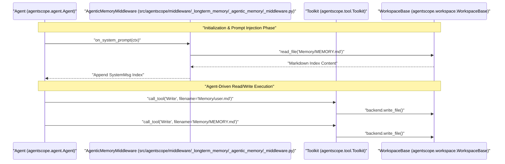
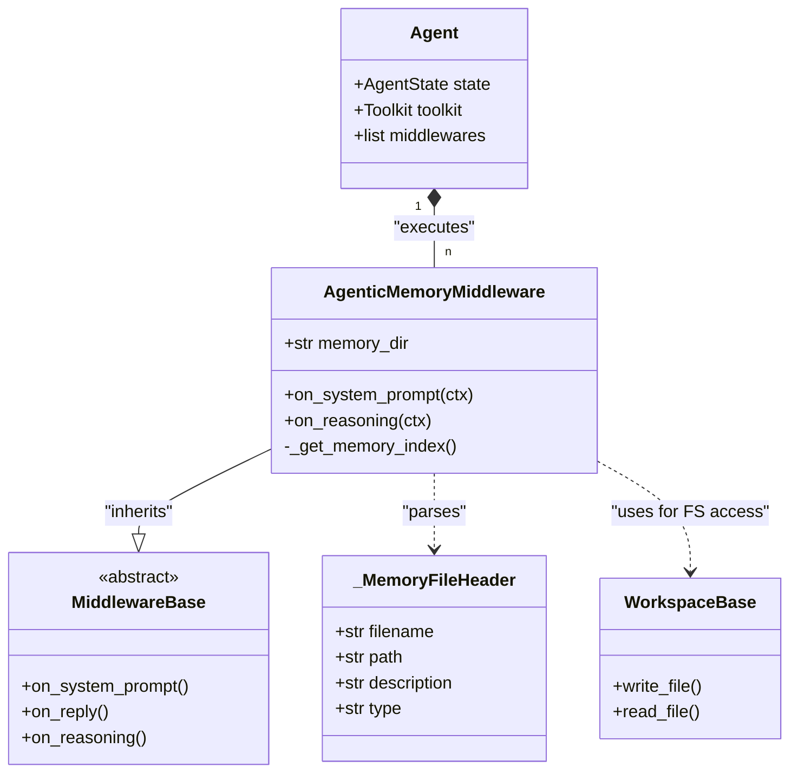

<!-- source: DeepWiki mcp.deepwiki.com · repo modelscope/agentscope · extra page AgenticMemoryMiddleware · fetched 2026-10-27 -->

# AgenticMemoryMiddleware

<details>
<summary>Relevant source files</summary>

The following files were used as context for generating this wiki page:

- [examples/pipeline/goal/README.md](examples/pipeline/goal/README.md)
- [examples/pipeline/goal/goal_pipeline.py](examples/pipeline/goal/goal_pipeline.py)
- [src/agentscope/middleware/_longterm_memory/_agentic_memory/_middleware.py](src/agentscope/middleware/_longterm_memory/_agentic_memory/_middleware.py)
- [src/agentscope/pipeline/_base.py](src/agentscope/pipeline/_base.py)
- [src/agentscope/pipeline/_goal_pipeline.py](src/agentscope/pipeline/_goal_pipeline.py)
- [tests/middleware_filesystem_memory_test.py](tests/middleware_filesystem_memory_test.py)
- [tests/pipeline_goal_test.py](tests/pipeline_goal_test.py)

</details>


`AgenticMemoryMiddleware` provides a markdown-file-based long-term memory system where durable records are stored directly within an agent's workspace. Unlike vector-database-backed memory middlewares, this architecture relies on the agent itself executing read and write operations via filesystem tools (`Read`, `Write`), ensuring complete transparency, human editability, and operating without external vector embedding dependencies [src/agentscope/middleware/_longterm_memory/_agentic_memory/_middleware.py:4-15]().

---

## 1. Overview and Data Flow

The middleware maintains a dedicated directory store within the agent workspace. It injects a high-level index file, `MEMORY.md`, into the system prompt, enabling the agent to inspect, query, and update long-term facts dynamically [src/agentscope/middleware/_longterm_memory/_agentic_memory/_middleware.py:4-7]().

### Core Components
*   **`MEMORY.md`**: An index file containing Markdown links and summaries pointing to individual topic files, injected into the system prompt via `on_system_prompt` [src/agentscope/middleware/_longterm_memory/_agentic_memory/_middleware.py:44-47]().
*   **Topic Files**: Markdown files containing durable records (e.g., user profiles, project context) prefixed with YAML frontmatter parsed by `_MemoryFileHeader` [src/agentscope/middleware/_longterm_memory/_agentic_memory/_middleware.py:28-43]().
*   **Agent-Driven Management**: The agent uses standard filesystem tools to manage its own memory base [src/agentscope/middleware/_longterm_memory/_agentic_memory/_middleware.py:44-57]().

### Diagram: Agentic Memory Data Flow (Natural Language to Code Entities)

Sources: [src/agentscope/middleware/_longterm_memory/_agentic_memory/_middleware.py:4-15](), [src/agentscope/middleware/_longterm_memory/_agentic_memory/_middleware.py:44-57]()

---

## 2. Memory Types and Schema

Long-term memory entries are categorized into discrete functional types to guide agent organization [src/agentscope/middleware/_longterm_memory/_agentic_memory/_middleware.py:59-148]().

| Memory Type | Description | When to Save |
| :--- | :--- | :--- |
| `user` | User role, goals, responsibilities, and knowledge levels [src/agentscope/middleware/_longterm_memory/_agentic_memory/_middleware.py:65-85](). | When discovering user preferences or expertise [src/agentscope/middleware/_longterm_memory/_agentic_memory/_middleware.py:78-80](). |
| `feedback` | Guidance on approach—what to avoid and what to repeat [src/agentscope/middleware/_longterm_memory/_agentic_memory/_middleware.py:98-120](). | Any time the user corrects your approach or confirms a non-obvious approach worked [src/agentscope/middleware/_longterm_memory/_agentic_memory/_middleware.py:106-112](). |
| `project` | Context about ongoing work, tasks, bugs, or initiatives [src/agentscope/middleware/_longterm_memory/_agentic_memory/_middleware.py:140-148](). | When learning who is doing what, why, or by when [src/agentscope/middleware/_longterm_memory/_agentic_memory/_middleware.py:145-148](). |

Sources: [src/agentscope/middleware/_longterm_memory/_agentic_memory/_middleware.py:59-148]()

### Topic File Frontmatter Schema
Topic files adhere to a structured YAML frontmatter format managed by `_MemoryFileHeader` [src/agentscope/middleware/_longterm_memory/_agentic_memory/_middleware.py:28-43]():

```markdown
---
name: <Short Title>
description: <One-line summary for retrieval evaluation>
type: <user | feedback | project | reference>
---

<Memory body content>
```
Sources: [src/agentscope/middleware/_longterm_memory/_agentic_memory/_middleware.py:28-43](), [src/agentscope/middleware/_longterm_memory/_agentic_memory/_middleware.py:59-64]()

---

## 3. Implementation Details

`AgenticMemoryMiddleware` inherits from `MiddlewareBase` and hooks into agent lifecycle methods (`on_system_prompt` and `on_reasoning`) [src/agentscope/middleware/_longterm_memory/_agentic_memory/_middleware.py:17-42]().

### Diagram: Code Entity Architecture (Natural Language to Code Entities)

Sources: [src/agentscope/middleware/_longterm_memory/_agentic_memory/_middleware.py:17-42](), [src/agentscope/middleware/_longterm_memory/_agentic_memory/_middleware.py:28-41]()

### Core Functions
1.  **System Prompt Injection**: Reads `MEMORY.md` via `WorkspaceBase` and appends it to the system instructions [src/agentscope/middleware/_longterm_memory/_agentic_memory/_middleware.py:44-47](). The `DEFAULT_MEMORY_INSTRUCTIONS` constant provides the initial prompt template, which includes details on memory types and how to use them [src/agentscope/middleware/_longterm_memory/_agentic_memory/_middleware.py:44-148]().
2.  **Relevance Selection**: During `on_reasoning`, the middleware can evaluate active topic headers and inject relevant snippets as `HintBlock` messages into the agent's context. This process involves a structured output call to the LLM to select relevant memory files based on the current conversation [src/agentscope/middleware/_longterm_memory/_agentic_memory/_middleware.py:20-20](). The `_MemorySelection` Pydantic model defines the expected structured output for this selection [src/agentscope/middleware/_longterm_memory/_agentic_memory/_middleware.py:200-203]().
3.  **Workspace Persistence**: All memory files are stored under a dedicated `memory_dir` within the agent's `WorkspaceBase` instance, ensuring durability across sessions. This directory is typically named `Memory` by default [src/agentscope/middleware/_longterm_memory/_agentic_memory/_middleware.py:44-48](). The `WorkspaceBase` abstraction handles the underlying filesystem operations, whether it's a `LocalWorkspace`, `DockerWorkspace`, `E2BWorkspace`, `OpenSandboxWorkspace`, `K8sWorkspace`, or `DaytonaWorkspace` [src/agentscope/workspace/_opensandbox/_opensandbox_workspace.py:123-124](), [src/agentscope/workspace/_k8s/_k8s_workspace.py:142-143](), [src/agentscope/workspace/_daytona/_daytona_workspace.py:146-147]().

Sources: [src/agentscope/middleware/_longterm_memory/_agentic_memory/_middleware.py:17-57](), [src/agentscope/middleware/_longterm_memory/_agentic_memory/_middleware.py:200-203](), [src/agentscope/workspace/_opensandbox/_opensandbox_workspace.py:123-124](), [src/agentscope/workspace/_k8s/_k8s_workspace.py:142-143](), [src/agentscope/workspace/_daytona/_daytona_workspace.py:146-147]()

---

## 4. Example Usage

To utilize `AgenticMemoryMiddleware`, configure the agent with standard file tools (`Read` and `Write`) alongside the middleware instance [src/agentscope/middleware/_longterm_memory/_agentic_memory/_middleware.py:44-57]().

```python
from agentscope.middleware import AgenticMemoryMiddleware
from agentscope.agent import Agent
from agentscope.tool import Toolkit

# Initialize memory middleware
memory_mw = AgenticMemoryMiddleware()

# Bind middleware and tools to the agent
agent = Agent(
    name="memory_assistant",
    model=model,
    toolkit=Toolkit(tools=["Read", "Write"]),
    middlewares=[memory_mw]
)
```
Sources: [src/agentscope/middleware/_longterm_memory/_agentic_memory/_middleware.py:17-57]()

---

