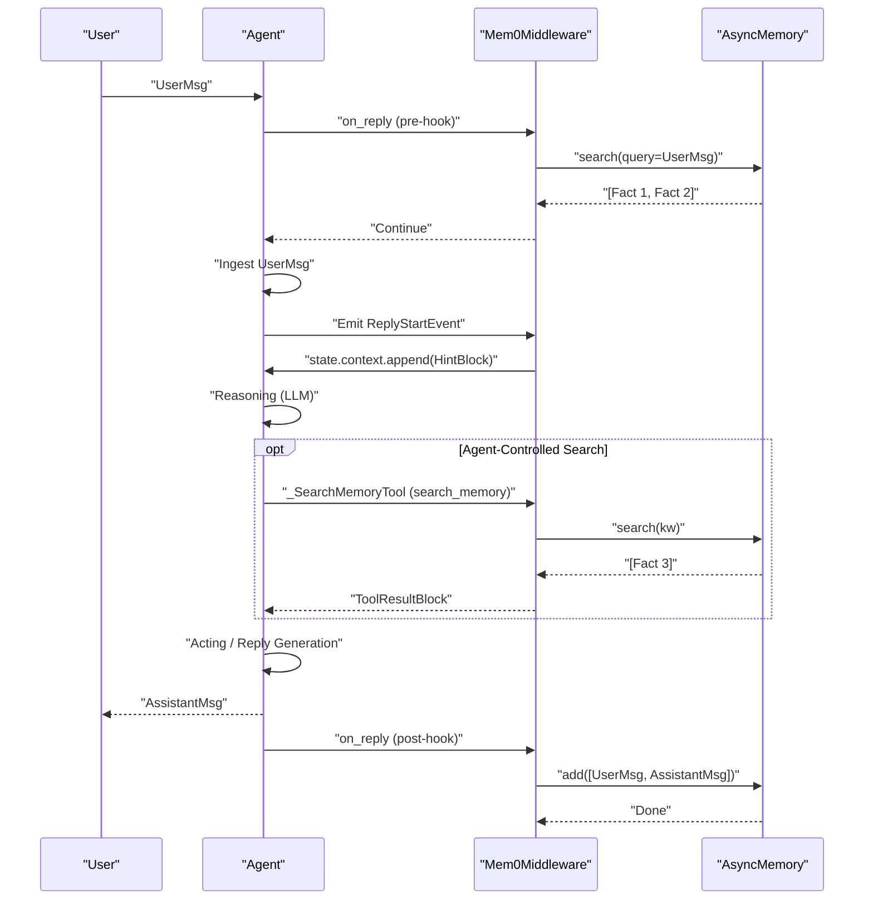
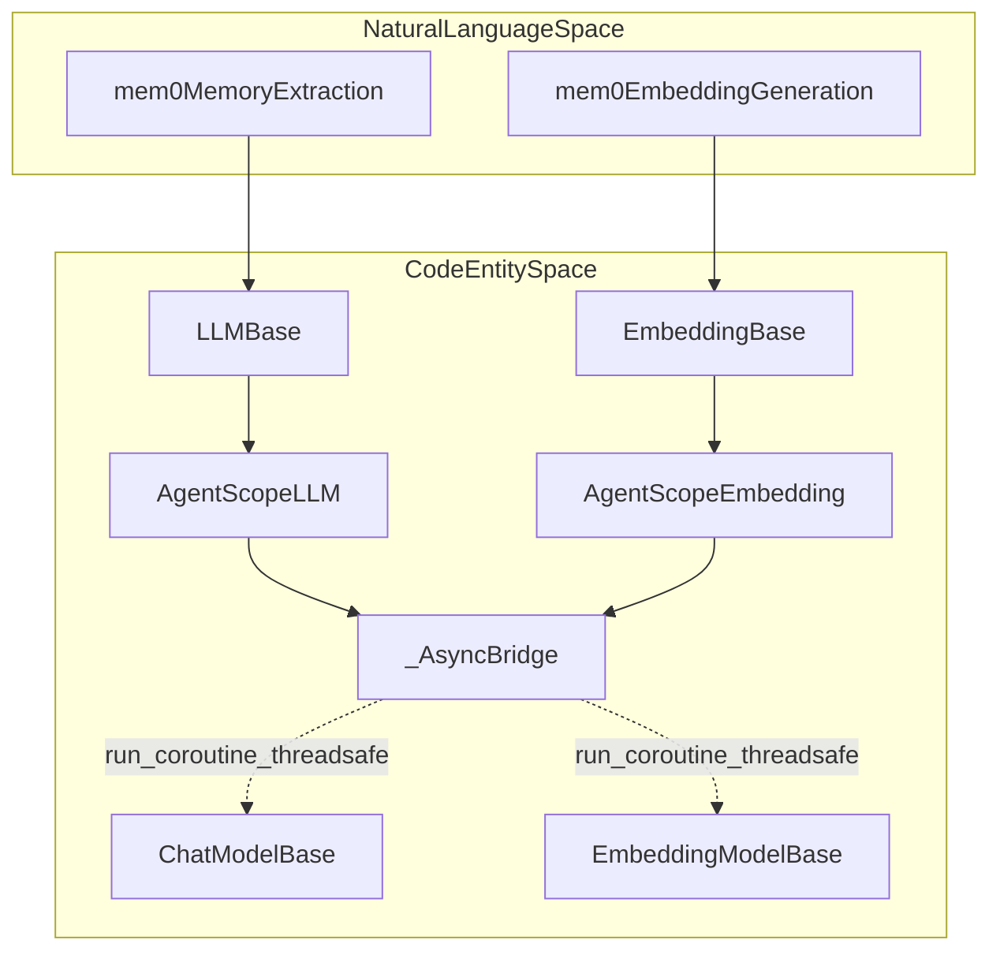

<!-- source: DeepWiki mcp.deepwiki.com · repo modelscope/agentscope · extra page Mem0 Middleware · fetched 2026-10-27 -->

# Mem0 Middleware

Relevant source files

The following files were used as context for generating this wiki page:

- [examples/long_term_memory/mem0/oss_demo.py](examples/long_term_memory/mem0/oss_demo.py)
- [src/agentscope/middleware/_longterm_memory/_mem0/__init__.py](src/agentscope/middleware/_longterm_memory/_mem0/__init__.py)
- [src/agentscope/middleware/_longterm_memory/_mem0/_agentscope_adapter.py](src/agentscope/middleware/_longterm_memory/_mem0/_agentscope_adapter.py)
- [src/agentscope/middleware/_longterm_memory/_mem0/_middleware.py](src/agentscope/middleware/_longterm_memory/_mem0/_middleware.py)
- [src/agentscope/middleware/_longterm_memory/_mem0/_tools.py](src/agentscope/middleware/_longterm_memory/_mem0/_tools.py)

## Purpose and Scope

The `Mem0Middleware` (`[examples/long_term_memory/mem0/README.md:34-37]()`) provides cross-session persistent memory for AgentScope agents, utilizing the [mem0](https://github.com/mem0ai/mem0) vector-based memory engine (`[examples/long_term_memory/mem0/README.md:3-5]()`). It retrieves relevant historical facts before reasoning and persists new insights after acting across independent sessions (`[examples/long_term_memory/mem0/README.md:5-8]()`).

Sources: `[examples/long_term_memory/mem0/README.md:3-37]()`

---

## Architecture and Data Flow

The middleware integrates into the agent execution lifecycle through the `on_reply` hook, supporting both open-source (`mem0.AsyncMemory`) and hosted (`mem0.AsyncMemoryClient`) backends (`[examples/long_term_memory/mem0/README.md:10-17]`, `[examples/long_term_memory/mem0/README.md:74-76]()`).

### Diagram: Memory Lifecycle and Execution Flow
The following sequence diagram illustrates the interaction between the `Agent`, `Mem0Middleware` (`[src/agentscope/middleware/_longterm_memory/_mem0/_middleware.py:86-88]()`), and the `mem0` backend during a single turn in `both` mode, mapping execution steps to code entities.

Sources: `[src/agentscope/middleware/_longterm_memory/_mem0/_middleware.py:86-88]`, `[examples/long_term_memory/mem0/oss_demo.py:93-152]()`

---

## Construction Paths and Configuration

The middleware provides three distinct construction paths (`[examples/long_term_memory/mem0/README.md:41-94]()`):

| Path | Required Parameters | Behavior |
| :--- | :--- | :--- |
| **Models** | `chat_model`, `embedding_model` | Builds a local OSS `AsyncMemory` using AgentScope models (`[examples/long_term_memory/mem0/README.md:44-51]()`). |
| **Models + Config** | `chat_model`, `embedding_model`, `mem0_config` | Overwrites `.llm` and `.embedder` in `mem0_config` with AgentScope adapters while preserving other settings (`[examples/long_term_memory/mem0/README.md:60-72]()`). |
| **Client** | `client` | Accepts a pre-built `AsyncMemory` or `AsyncMemoryClient`, taking absolute precedence over model parameters (`[examples/long_term_memory/mem0/README.md:74-94]()`). |

Sources: `[examples/long_term_memory/mem0/README.md:41-110]()`

---

## Operational Modes

The `mode` parameter configures retrieval behavior (`[examples/long_term_memory/mem0/README.md:122-125]()`):

1. **`static_control`**: Automatically queries mem0 before the turn and injects retrieved facts into `state.context`, writing back exchanges post-turn (`[examples/long_term_memory/mem0/README.md:127-145]()`).
2. **`agent_control`**: Exposes `search_memory` and `add_memory` tools without automated context injection or write-back (`[examples/long_term_memory/mem0/README.md:147-164]()`).
3. **`both` (Default)**: Combines automatic retrieval/write-back with agent-callable memory tools (`[examples/long_term_memory/mem0/README.md:166-168]()`).

Sources: `[examples/long_term_memory/mem0/README.md:122-168]()`

---

## AgentScope Adapter Architecture

The adapter layer translates synchronous `mem0` interfaces to asynchronous AgentScope models (`[src/agentscope/middleware/_longterm_memory/_mem0/_agentscope_adapter.py:2-16]()`).

### Diagram: Natural Language Space to Code Entity Space (Adapter Pattern)

Sources: `[src/agentscope/middleware/_longterm_memory/_mem0/_agentscope_adapter.py:63-120]`, `[src/agentscope/middleware/_longterm_memory/_mem0/_agentscope_adapter.py:255-274]()`

- **`_AsyncBridge`**: Maintains a dedicated event loop on a daemon thread to execute asynchronous AgentScope coroutines from synchronous mem0 calls (`[src/agentscope/middleware/_longterm_memory/_mem0/_agentscope_adapter.py:63-88]()`).
- **`AgentScopeLLM`**: Implements `mem0.llms.base.LLMBase` by routing generation requests through `ChatModelBase` (`[src/agentscope/middleware/_longterm_memory/_mem0/_agentscope_adapter.py:94-120]()`).
- **`AgentScopeEmbedding`**: Implements `mem0.embeddings.base.EmbeddingBase` via `EmbeddingModelBase` (`[src/agentscope/middleware/_longterm_memory/_mem0/_agentscope_adapter.py:255-274]()`).

Sources: `[src/agentscope/middleware/_longterm_memory/_mem0/_agentscope_adapter.py:1-274]()`

---

## Memory Tools and Fallback Logic

When operating in `agent_control` or `both` modes, the middleware registers dedicated tools (`[src/agentscope/middleware/_longterm_memory/_mem0/_tools.py:3-10]()`):

- **`_SearchMemoryTool` (`search_memory`)**: Executes parallel keyword searches via `asyncio.gather` and deduplicates results (`[src/agentscope/middleware/_longterm_memory/_mem0/_tools.py:61-149]()`).
- **`_AddMemoryTool` (`add_memory`)**: Persists structured facts with fallback extraction mechanisms to guarantee storage reliability (`[src/agentscope/middleware/_longterm_memory/_mem0/_tools.py:151-225]`, `[src/agentscope/middleware/_longterm_memory/_mem0/_middleware.py:441-477]()`).

Sources: `[src/agentscope/middleware/_longterm_memory/_mem0/_tools.py:61-225]`, `[src/agentscope/middleware/_longterm_memory/_mem0/_middleware.py:441-477]()`

---

## Context Injection and Prompts

- **System Prompt**: Appends `DEFAULT_TOOL_INSTRUCTIONS` to guide the model on memory tool utilization (`[src/agentscope/middleware/_longterm_memory/_mem0/_middleware.py:77-83]()`).
- **Context Hint**: Appends an `AssistantMsg` containing a `HintBlock` upon receiving `ReplyStartEvent` (`[src/agentscope/middleware/_longterm_memory/_mem0/_middleware.py:346-383]()`).

Constants:
- `DEFAULT_MEMORY_SECTION_HEADER`: `"## Relevant memories from past conversations"` (`[src/agentscope/middleware/_longterm_memory/_mem0/_middleware.py:71]()`).
- `DEFAULT_MEMORY_SECTION_INTRO`: Relevance instruction string (`[src/agentscope/middleware/_longterm_memory/_mem0/_middleware.py:72-75]()`).

Sources: `[src/agentscope/middleware/_longterm_memory/_mem0/_middleware.py:71-83]`, `[src/agentscope/middleware/_longterm_memory/_mem0/_middleware.py:346-383]()`

---

## Example Usage (`oss_demo.py`)

The runnable script `examples/long_term_memory/mem0/oss_demo.py` demonstrates cross-session memory persistence for `user_id="alice"` using the open-source backend (`[examples/long_term_memory/mem0/oss_demo.py:2-27]()`). It cleans local state before execution and streams responses from `agent.reply_stream` (`[examples/long_term_memory/mem0/oss_demo.py:120-174]()`).

Sources: `[examples/long_term_memory/mem0/oss_demo.py:2-174]()`

---

