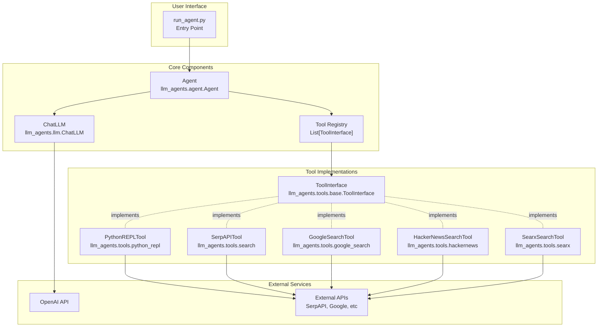
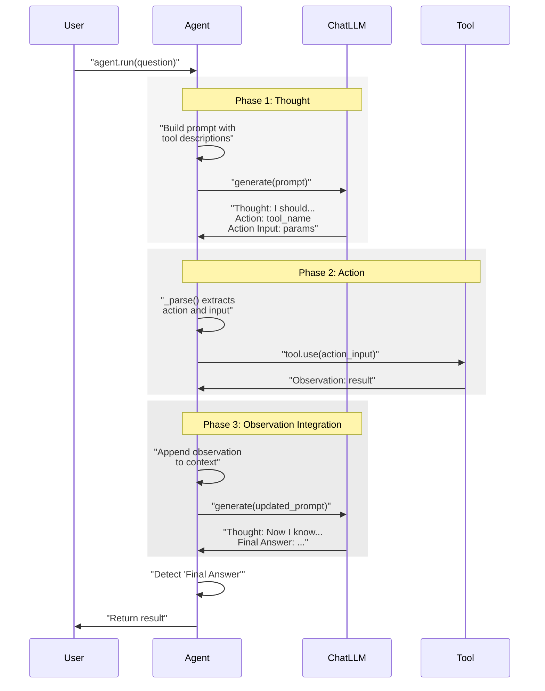
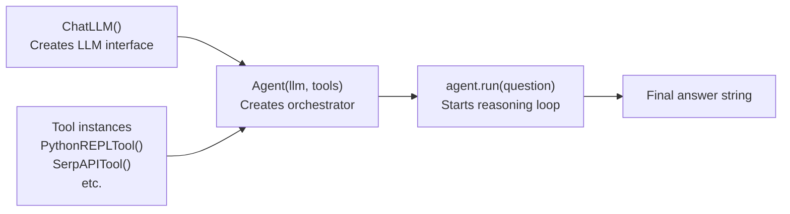

<!-- source: DeepWiki mcp.deepwiki.com · repo mpaepper/llm_agents · page 1 Overview · fetched 2026-10-27 -->

# Overview

<details>
<summary>Relevant source files</summary>

The following files were used as context for generating this wiki page:

- [README.md](README.md)
- [llm_agents/__init__.py](llm_agents/__init__.py)
- [llm_agents/tools/searx.py](llm_agents/tools/searx.py)
- [run_agent.py](run_agent.py)

</details>


## Purpose and Scope

This document provides an introduction to the `llm_agents` repository, a Python library for building autonomous agents powered by Large Language Models (LLMs). The library implements a simplified version of the agent pattern popularized by langchain, focusing on clarity and minimal abstraction layers. This page covers the fundamental concepts, core architecture, and reasoning patterns that make up the system.

For detailed installation instructions and environment setup, see [Installation and Setup](#1.1). For a practical walkthrough of creating your first agent, see [Quick Start Example](#1.2). For in-depth technical details on the architecture, see [Core Architecture](#2).

**Sources:** [README.md:1-10]()

## What are LLM Agents?

LLM agents are autonomous systems that use Large Language Models to break down complex tasks into a series of reasoning steps and tool invocations. Unlike simple LLM calls that generate a single response, agents operate in an iterative loop where they:

1. **Think** - Use the LLM to reason about the problem and decide what action to take
2. **Act** - Execute actions using external tools (search engines, code interpreters, APIs)
3. **Observe** - Receive results from tool execution
4. **Repeat** - Feed observations back to the LLM for further reasoning

This pattern enables LLMs to accomplish tasks that require external information, computation, or multi-step reasoning beyond what a single prompt-response cycle can achieve.

**Sources:** [README.md:11-24]()

## Core Components

The `llm_agents` library consists of three primary components that work together to implement the agent pattern:



**Component Responsibilities:**

| Component | Class | Primary Responsibility |
|-----------|-------|------------------------|
| **Agent** | `Agent` | Orchestrates the reasoning loop, parses LLM responses, invokes tools, and manages conversation history |
| **ChatLLM** | `ChatLLM` | Interfaces with OpenAI API to generate LLM responses based on accumulated context |
| **Tools** | `ToolInterface` implementations | Provide external capabilities (search, computation, data retrieval) that the agent can invoke |

**Sources:** [llm_agents/__init__.py:1-10](), [README.md:13-22]()

## The Thought-Action-Observation Loop

The core of the agent's operation is an iterative reasoning loop. Each iteration consists of three phases that accumulate context over time:



### Loop Mechanics

The agent maintains a `previous_responses` list that accumulates all Thoughts, Actions, and Observations. Each iteration:

1. **Constructs an augmented prompt** containing:
   - System instructions and tool descriptions
   - All previous Thoughts/Actions/Observations
   - The original user question

2. **Generates LLM response** containing:
   - `Thought:` - The LLM's reasoning about what to do next
   - `Action:` - The name of the tool to invoke
   - `Action Input:` - Parameters to pass to the tool
   - OR `Final Answer:` - The final response to return to the user

3. **Executes the action** if present, obtaining an `Observation:`

4. **Appends to context** and repeats until either:
   - The LLM produces a `Final Answer:`
   - Maximum iteration limit is reached

This pattern allows the agent to "learn" from tool outputs and progressively refine its approach to solving the task.

**Sources:** [README.md:14-24]()

## Available Tools

The library provides several built-in tools that extend the agent's capabilities:

| Tool Class | Tool Name | Purpose | Required Configuration |
|------------|-----------|---------|------------------------|
| `PythonREPLTool` | `python_repl` | Execute Python code and return output | None |
| `SerpAPITool` | `Google Search` | Search the web via SerpAPI | `SERPAPI_API_KEY` |
| `GoogleSearchTool` | `Google Search` | Search via Google Custom Search API | `GOOGLE_API_KEY`, `GOOGLE_CSE_ID` |
| `HackerNewsSearchTool` | `hacker news search` | Search Hacker News stories | None |
| `SearxSearchTool` | `Searx Search` | Search via self-hosted Searx instance | `SEARX_INSTANCE_URL` |

All tools implement the `ToolInterface` contract, which requires:
- `name: str` - Identifier used by the agent to select the tool
- `description: str` - Natural language description that helps the LLM understand when to use the tool
- `use(input_text: str) -> str` - Method that executes the tool's functionality

For detailed documentation on each tool, see [Tool System](#3). For creating your own tools, see [Creating Custom Tools](#3.4).

**Sources:** [llm_agents/__init__.py:1-10](), [README.md:15-17]()

## Basic Usage Pattern

The simplest way to create and run an agent is shown in [run_agent.py:1-9]():

```python
from llm_agents import Agent, ChatLLM, PythonREPLTool, HackerNewsSearchTool, SerpAPITool

agent = Agent(llm=ChatLLM(), tools=[PythonREPLTool(), SerpAPITool(), HackerNewsSearchTool()])
result = agent.run("Your question to the agent")

print(f"Final answer is {result}")
```

### Construction Flow



The agent requires:
1. A `ChatLLM` instance for LLM interactions
2. A list of tool instances (can be empty, though this limits capabilities)

The `agent.run()` method:
- Accepts a string question/task
- Executes the Thought-Action-Observation loop
- Returns the final answer as a string

**Sources:** [run_agent.py:1-9](), [README.md:46-58]()

## Configuration Requirements

The library requires certain environment variables depending on which components are used:

| Environment Variable | Required For | How to Obtain |
|---------------------|--------------|---------------|
| `OPENAI_API_KEY` | All agent operations (ChatLLM) | https://platform.openai.com/account/api-keys |
| `SERPAPI_API_KEY` | Using `SerpAPITool` | https://serpapi.com/ |
| `GOOGLE_API_KEY` | Using `GoogleSearchTool` | Google Cloud Console |
| `GOOGLE_CSE_ID` | Using `GoogleSearchTool` | Google Custom Search Engine |
| `SEARX_INSTANCE_URL` | Using `SearxSearchTool` | Self-hosted Searx instance URL |

**Export in bash:**
```bash
export OPENAI_API_KEY='sk-...'
export SERPAPI_API_KEY='...'
```

For complete setup instructions, see [Installation and Setup](#1.1). For detailed information on API keys and external services, see [Dependencies and External Services](#4).

**Sources:** [README.md:37-42](), [llm_agents/tools/searx.py:17]()

## System Design Philosophy

The `llm_agents` library is intentionally minimalist, prioritizing:

1. **Transparency** - The entire agent logic is contained in a small number of files with minimal abstraction
2. **Simplicity** - Core concepts (Agent, ChatLLM, Tools) map directly to code classes
3. **Extensibility** - The `ToolInterface` contract makes it easy to add new capabilities
4. **Educational Value** - The codebase serves as a learning resource for understanding LLM agents

As stated in [README.md:3-7](): "The goal was to get a better grasp of how such an agent works and understand it all in very few lines of code."

This design makes the library suitable for:
- Learning how LLM agents work internally
- Prototyping simple agent applications
- Extending with custom tools for specific use cases
- Understanding the foundations before using more complex frameworks like langchain

For architectural details, see [Core Architecture](#2). For development guidelines, see [Development Guide](#5).

**Sources:** [README.md:1-10]()

## Repository Structure Overview

The codebase is organized as follows:

| Directory/File | Purpose |
|----------------|---------|
| `llm_agents/` | Main package containing core classes |
| `llm_agents/agent.py` | `Agent` class implementation |
| `llm_agents/llm.py` | `ChatLLM` class implementation |
| `llm_agents/tools/` | Tool implementations |
| `llm_agents/tools/base.py` | `ToolInterface` abstract base class |
| `tests/` | Test suite with unit and integration tests |
| `run_agent.py` | Command-line entry point |
| `requirements.txt` | Python dependencies |
| `pyproject.toml` | Poetry project configuration |
| `README.md` | Project documentation |

For a detailed breakdown of the project structure, see [Project Structure](#5.1). For API documentation, see [API Reference](#6).

**Sources:** [llm_agents/__init__.py:1-10](), [run_agent.py:1-9]()

## Next Steps

To start using the library:
1. Follow [Installation and Setup](#1.1) to install dependencies and configure API keys
2. Work through the [Quick Start Example](#1.2) to create your first agent
3. Read [Core Architecture](#2) to understand the system's design in depth
4. Explore [Tool System](#3) to learn about available tools and create custom ones

For developers contributing to the project:
- See [Development Guide](#5) for testing and development workflows
- See [API Reference](#6) for technical specifications
- See [License and Contributing](#8) for contribution guidelines

**Sources:** [README.md:26-58]()

---

