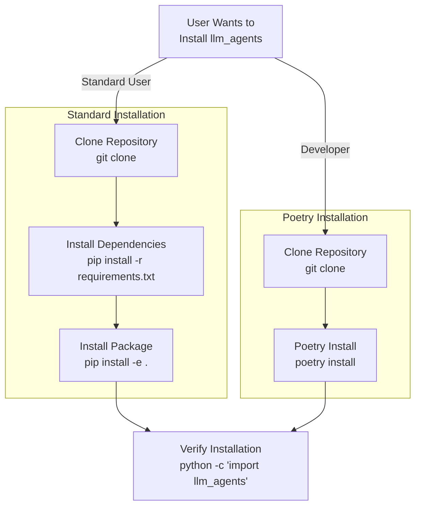
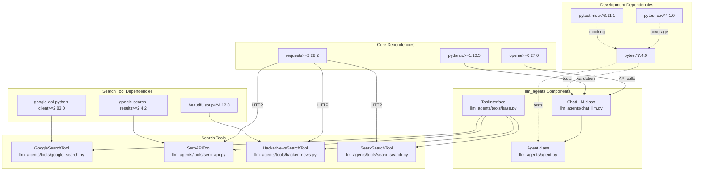
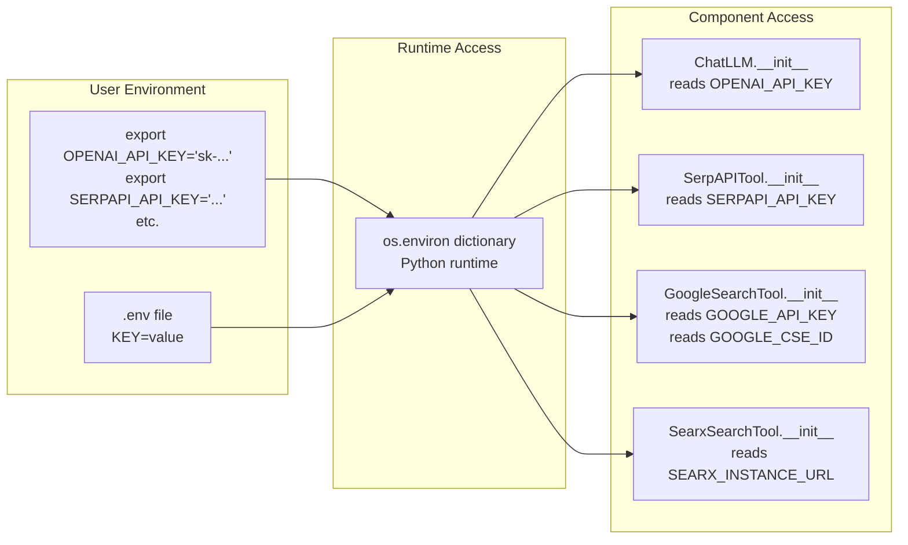

<!-- source: DeepWiki mcp.deepwiki.com · repo mpaepper/llm_agents · page 1.1 Installation and Setup · fetched 2026-10-27 -->

# Installation and Setup

<details>
<summary>Relevant source files</summary>

The following files were used as context for generating this wiki page:

- [README.md](README.md)
- [pyproject.toml](pyproject.toml)
- [requirements.txt](requirements.txt)
- [setup.py](setup.py)

</details>


This page guides you through installing the `llm_agents` library, configuring required API keys, and setting up your environment for development or usage. By the end of this document, you will have a working installation that can execute agents with tools.

For information about running your first agent after installation, see [Quick Start Example](#1.2). For detailed information about obtaining and configuring API keys, see [Required API Keys](#4.1). For development environment setup including testing infrastructure, see [Development Guide](#5).

---

## Prerequisites

The `llm_agents` library requires Python 3.8 or higher. This requirement is specified in [pyproject.toml:17]().

```
python = "^3.8"
```

Before proceeding with installation, ensure you have:
- Python 3.8 or newer installed on your system
- `pip` package manager (typically included with Python)
- `git` for cloning the repository
- Internet access for downloading dependencies and calling external APIs

**Sources:** [pyproject.toml:17]()

---

## Installation Methods

The library supports two primary installation methods: standard `pip` installation and Poetry-based installation for development workflows.

### Installation Method Overview



**Sources:** [README.md:28-35](), [pyproject.toml:1-89]()

### Method 1: Standard pip Installation

This method uses the traditional `pip` workflow with `requirements.txt`. It is suitable for end users who want to use the library.

**Step 1:** Clone the repository from GitHub:

```bash
git clone https://github.com/mpaepper/llm_agents.git
cd llm_agents
```

**Step 2:** Install dependencies from `requirements.txt`:

```bash
pip install -r requirements.txt
```

The [requirements.txt:1-5]() file specifies the following core dependencies:

| Dependency | Version | Purpose |
|------------|---------|---------|
| `openai` | >=0.27.0 | OpenAI API client for LLM interactions |
| `pydantic` | >=1.10.5 | Data validation and settings management |
| `requests` | >=2.28.2 | HTTP client for API calls |
| `google-api-python-client` | >=2.83.0 | Google Custom Search API client |
| `google-search-results` | >=2.4.2 | SerpAPI client for Google search |

**Step 3:** Install the package in editable mode:

```bash
pip install -e .
```

The `-e` flag installs the package in "editable" mode, meaning changes to the source code are immediately reflected without reinstallation.

**Sources:** [README.md:28-35](), [requirements.txt:1-5](), [setup.py:1-21]()

### Method 2: Poetry Installation

Poetry is the recommended method for development, as it provides dependency locking and development dependency management. The project configuration is defined in [pyproject.toml:1-89]().

**Step 1:** Ensure Poetry is installed on your system:

```bash
curl -sSL https://install.python-poetry.org | python3 -
```

**Step 2:** Clone the repository:

```bash
git clone https://github.com/mpaepper/llm_agents.git
cd llm_agents
```

**Step 3:** Install all dependencies (including development dependencies):

```bash
poetry install
```

This command reads [pyproject.toml:16-28]() to install both production and development dependencies, and uses `poetry.lock` to ensure reproducible builds.

**Development dependencies** installed by Poetry include:
- `pytest` (^7.4.0) - Test framework
- `pytest-cov` (^4.1.0) - Coverage reporting
- `pytest-mock` (^3.11.1) - Mocking support

**Sources:** [pyproject.toml:1-89](), [pyproject.toml:25-28]()

---

## Dependency Architecture

The following diagram maps each dependency to its role in the system architecture:



**Sources:** [requirements.txt:1-5](), [pyproject.toml:16-28]()

---

## Environment Configuration

The `llm_agents` library requires environment variables to authenticate with external APIs. These variables must be set before running any agent that uses the corresponding tools.

### Environment Variable Configuration Flow



**Sources:** [README.md:37-42]()

### Required Environment Variables

The following table lists all environment variables used by the library:

| Variable Name | Required By | Purpose | How to Obtain |
|---------------|-------------|---------|---------------|
| `OPENAI_API_KEY` | `ChatLLM` | OpenAI API authentication | https://platform.openai.com/account/api-keys |
| `SERPAPI_API_KEY` | `SerpAPITool` | SerpAPI Google Search | https://serpapi.com/ |
| `GOOGLE_API_KEY` | `GoogleSearchTool` | Google Custom Search API | Google Cloud Console |
| `GOOGLE_CSE_ID` | `GoogleSearchTool` | Google Custom Search Engine ID | Google Programmable Search Engine |
| `SEARX_INSTANCE_URL` | `SearxSearchTool` | Searx instance endpoint | Self-hosted or public Searx instance |

### Setting Environment Variables

**On Linux/macOS (bash/zsh):**

```bash
export OPENAI_API_KEY='sk-...'
export SERPAPI_API_KEY='...'
```

**On Windows (PowerShell):**

```powershell
$env:OPENAI_API_KEY='sk-...'
$env:SERPAPI_API_KEY='...'
```

**On Windows (Command Prompt):**

```cmd
set OPENAI_API_KEY=sk-...
set SERPAPI_API_KEY=...
```

### Required vs Optional Configuration

The **minimum required** environment variable to use the library is:
- `OPENAI_API_KEY` - Required by `ChatLLM` for LLM interactions

All other environment variables are **optional** and only needed if you use the corresponding tool:
- Omit `SERPAPI_API_KEY` if you don't use `SerpAPITool`
- Omit `GOOGLE_API_KEY` and `GOOGLE_CSE_ID` if you don't use `GoogleSearchTool`
- Omit `SEARX_INSTANCE_URL` if you don't use `SearxSearchTool`

As noted in [README.md:57](), you can build agents without certain tools if you don't want to configure their API keys:

```python
# Example: Agent without search tools (no API keys needed except OpenAI)
from llm_agents import Agent, ChatLLM, PythonREPLTool

agent = Agent(llm=ChatLLM(), tools=[PythonREPLTool()])
```

**Sources:** [README.md:37-42](), [README.md:57]()

---

## Verification

After installation, verify that the library is correctly installed and accessible.

### Basic Import Test

Run the following command to verify the package can be imported:

```bash
python -c "import llm_agents; print('Installation successful')"
```

If successful, this command will print `Installation successful` without errors.

### Verify Individual Components

Test that core classes can be imported:

```bash
python -c "from llm_agents import Agent, ChatLLM, PythonREPLTool; print('Core components imported')"
```

### Verify API Key Configuration

Test that the OpenAI API key is properly configured:

```bash
python -c "import os; assert 'OPENAI_API_KEY' in os.environ, 'OPENAI_API_KEY not set'; print('API key configured')"
```

### Complete Installation Check Script

Create a file named `check_installation.py` with the following content:

```python
#!/usr/bin/env python3
"""Verify llm_agents installation and configuration."""

import os
import sys

def check_import():
    """Check if llm_agents can be imported."""
    try:
        import llm_agents
        print("✓ llm_agents package imported successfully")
        return True
    except ImportError as e:
        print(f"✗ Failed to import llm_agents: {e}")
        return False

def check_core_classes():
    """Check if core classes can be imported."""
    try:
        from llm_agents import Agent, ChatLLM, PythonREPLTool
        print("✓ Core classes (Agent, ChatLLM, PythonREPLTool) imported")
        return True
    except ImportError as e:
        print(f"✗ Failed to import core classes: {e}")
        return False

def check_api_keys():
    """Check environment variable configuration."""
    results = []
    
    # Required
    if "OPENAI_API_KEY" in os.environ:
        print("✓ OPENAI_API_KEY is set")
        results.append(True)
    else:
        print("✗ OPENAI_API_KEY is not set (required)")
        results.append(False)
    
    # Optional
    optional_keys = [
        "SERPAPI_API_KEY",
        "GOOGLE_API_KEY",
        "GOOGLE_CSE_ID",
        "SEARX_INSTANCE_URL"
    ]
    
    for key in optional_keys:
        if key in os.environ:
            print(f"✓ {key} is set (optional)")
        else:
            print(f"- {key} is not set (optional)")
    
    return all(results)

if __name__ == "__main__":
    checks = [
        check_import(),
        check_core_classes(),
        check_api_keys()
    ]
    
    if all(checks):
        print("\n✓ Installation verification complete")
        sys.exit(0)
    else:
        print("\n✗ Installation verification failed")
        sys.exit(1)
```

Run this script:

```bash
python check_installation.py
```

**Sources:** [README.md:28-35](), [README.md:37-42]()

---

## Installation Troubleshooting

### Common Issues

| Issue | Symptom | Solution |
|-------|---------|----------|
| **Python version mismatch** | `ImportError` or syntax errors | Ensure Python 3.8+ is installed: `python --version` |
| **Missing dependencies** | `ModuleNotFoundError: No module named 'openai'` | Run `pip install -r requirements.txt` |
| **Permission errors** | `Permission denied` during `pip install` | Use `pip install --user` or a virtual environment |
| **API key not found** | Runtime errors about missing keys | Set environment variables: `export OPENAI_API_KEY='...'` |
| **Editable install issues** | Changes not reflected | Run `pip install -e .` in the repository root |

### Virtual Environment Recommendation

For isolated dependency management, use a virtual environment:

```bash
# Create virtual environment
python -m venv venv

# Activate (Linux/macOS)
source venv/bin/activate

# Activate (Windows)
venv\Scripts\activate

# Install dependencies
pip install -r requirements.txt
pip install -e .
```

**Sources:** [README.md:28-35](), [pyproject.toml:17]()

---

## Next Steps

Once installation is complete, proceed to:
- [Quick Start Example](#1.2) - Run your first agent
- [Required API Keys](#4.1) - Obtain and configure additional API keys
- [Development Guide](#5) - Set up the development environment for contributing

For information about creating custom tools or understanding the architecture, see:
- [Core Architecture](#2) - System overview
- [Tool System](#3) - Understanding and creating tools
- [Testing Infrastructure](#5.2) - Running and writing tests

**Sources:** [README.md:44-57]()

---

