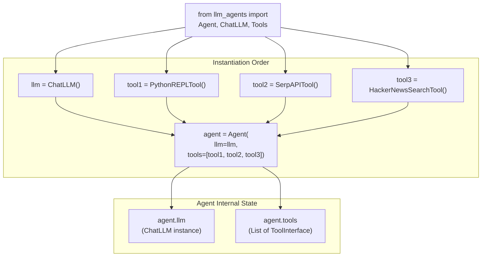
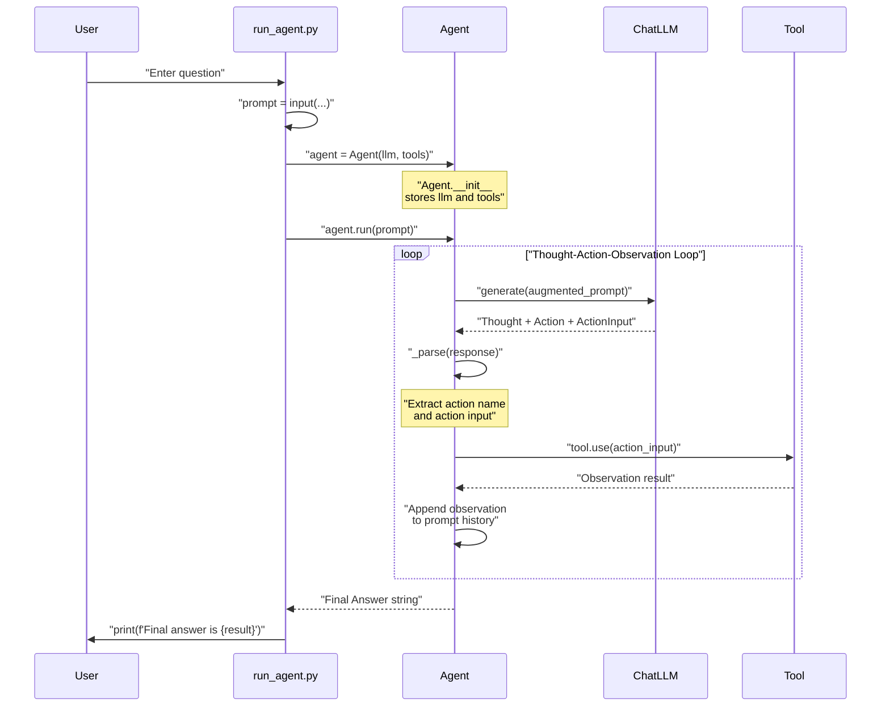
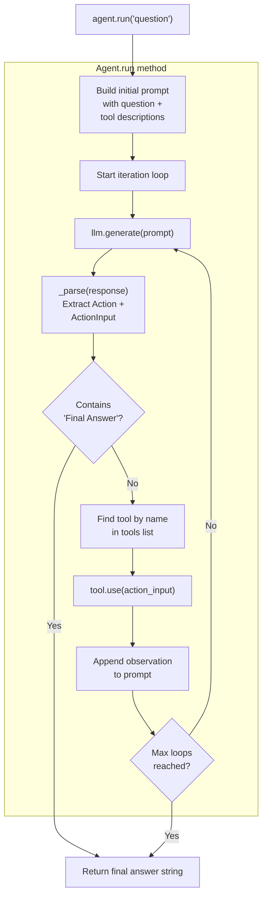

<!-- source: DeepWiki mcp.deepwiki.com · repo mpaepper/llm_agents · page 1.2 Quick Start Example · fetched 2026-10-27 -->

# Quick Start Example

<details>
<summary>Relevant source files</summary>

The following files were used as context for generating this wiki page:

- [README.md](README.md)
- [llm_agents/__init__.py](llm_agents/__init__.py)
- [llm_agents/tools/searx.py](llm_agents/tools/searx.py)
- [run_agent.py](run_agent.py)

</details>


## Purpose and Scope

This page provides a hands-on walkthrough of creating and running your first LLM agent. It demonstrates the minimal code required to instantiate an agent with tools and execute a task. For installation and environment setup instructions, see [Installation and Setup](#1.1). For detailed information about how the agent's reasoning loop works internally, see [Core Architecture](#2) and [Thought-Action-Observation Loop](#2.3).

---

## Overview

Creating an agent in this library follows a simple pattern:

1. Import the necessary components (`Agent`, `ChatLLM`, and tool classes)
2. Instantiate the LLM wrapper
3. Instantiate the tools you want the agent to use
4. Create the `Agent` with the LLM and tools
5. Call `agent.run()` with your question or task

The following sections walk through this pattern with concrete code examples.

---

## Basic Import Pattern

All core components are exported from the top-level `llm_agents` package, making imports straightforward:

```python
from llm_agents import Agent, ChatLLM, PythonREPLTool, HackerNewsSearchTool, SerpAPITool
```

This import statement brings in:
- `Agent`: The orchestrator that manages the reasoning loop
- `ChatLLM`: The OpenAI API wrapper for generating responses
- `PythonREPLTool`: Tool for executing Python code
- `HackerNewsSearchTool`: Tool for searching Hacker News
- `SerpAPITool`: Tool for Google search via SerpAPI

**Sources:** [llm_agents/__init__.py:1-10](), [README.md:49]()

---

## Component Architecture

The following diagram shows how the imported classes relate to each other during agent initialization:



**Sources:** [README.md:49-52](), [llm_agents/__init__.py:1-10](), [run_agent.py:1-6]()

---

## Complete Working Example

The repository includes a runnable example that demonstrates the full pattern. The following code is from [run_agent.py:1-8]():

```python
from llm_agents import Agent, ChatLLM, PythonREPLTool, HackerNewsSearchTool, SerpAPITool

if __name__ == '__main__':
    prompt = input("Enter a question / task for the agent: ")
    agent = Agent(llm=ChatLLM(), tools=[PythonREPLTool(), SerpAPITool(), HackerNewsSearchTool()])
    result = agent.run(prompt)

    print(f"Final answer is {result}")
```

### Step-by-Step Breakdown

| Line | Component | Purpose |
|------|-----------|---------|
| 1 | Imports | Brings in `Agent`, `ChatLLM`, and three tool implementations |
| 4 | User Input | Prompts the user to enter a question or task |
| 5 | Agent Creation | Instantiates an `Agent` with a `ChatLLM` instance and a list of three tools |
| 6 | Execution | Calls `agent.run()` with the user's prompt, which starts the Thought-Action-Observation loop |
| 8 | Output | Prints the final answer returned by the agent |

**Sources:** [run_agent.py:1-8](), [README.md:44-55]()

---

## Agent Execution Flow

When you call `agent.run()`, the following sequence occurs:



**Sources:** [run_agent.py:4-8](), [README.md:18-22]()

---

## Running Your First Agent

To execute the example:

1. **Set environment variables:**
   ```bash
   export OPENAI_API_KEY='sk-...'
   export SERPAPI_API_KEY='...'
   ```
   
   The `OPENAI_API_KEY` is required for the LLM. The `SERPAPI_API_KEY` is only required if you're using `SerpAPITool`. See [Required API Keys](#4.1) for details on obtaining these.

2. **Run the script:**
   ```bash
   python run_agent.py
   ```

3. **Enter your question when prompted:**
   ```
   Enter a question / task for the agent: How many eyes does a typical spider have?
   ```

4. **The agent will:**
   - Generate thoughts about how to answer
   - Select and invoke appropriate tools (e.g., `SerpAPITool` for search)
   - Observe the results
   - Iterate until it has enough information
   - Return a final answer

**Sources:** [README.md:44](), [run_agent.py:4-8]()

---

## Alternative Tool Configurations

You can customize which tools the agent has access to by modifying the tools list. Here are common configurations:

### Minimal Configuration (No External APIs)

```python
agent = Agent(llm=ChatLLM(), tools=[PythonREPLTool()])
```

This configuration only requires an `OPENAI_API_KEY` and gives the agent Python code execution capability without needing search API keys.

**Sources:** [README.md:57]()

### Search-Only Configuration

```python
agent = Agent(llm=ChatLLM(), tools=[SerpAPITool(), HackerNewsSearchTool()])
```

This configuration provides search capabilities but no code execution.

**Sources:** [README.md:49-52]()

### Using Alternative Search Tools

The library provides multiple search tool implementations. You can substitute `SerpAPITool` with alternatives:

```python
# Using Google Custom Search instead of SerpAPI
from llm_agents import GoogleSearchTool
agent = Agent(llm=ChatLLM(), tools=[GoogleSearchTool()])
```

```python
# Using Searx instance
from llm_agents import SearxSearchTool
agent = Agent(llm=ChatLLM(), tools=[SearxSearchTool()])
```

For details on each search tool and their configuration requirements, see [Search Tools](#3.2).

**Sources:** [llm_agents/__init__.py:1-10](), [llm_agents/tools/searx.py:74-81]()

---

## Programmatic Usage Pattern

For embedding agents in your own applications, use the pattern shown in [README.md:48-55]():

```python
from llm_agents import Agent, ChatLLM, PythonREPLTool, HackerNewsSearchTool, SerpAPITool

# Create agent
agent = Agent(
    llm=ChatLLM(), 
    tools=[PythonREPLTool(), SerpAPITool(), HackerNewsSearchTool()]
)

# Execute task
result = agent.run("Your question to the agent")

# Process result
print(f"Final answer is {result}")
```

The `agent.run()` method returns a string containing the final answer. This can be used directly in your application logic.

**Sources:** [README.md:48-55]()

---

## What Happens During Execution

The diagram below shows the data flow when `agent.run()` is invoked:



**Sources:** [README.md:13-22]()

---

## Next Steps

Now that you understand the basic usage pattern:

- **To understand the internal mechanics** of how the agent reasons and selects tools, see [The Agent](#2.1) and [Thought-Action-Observation Loop](#2.3)
- **To learn about individual tools** and their capabilities, see [Tool System](#3)
- **To create custom tools** for your specific use case, see [Creating Custom Tools](#3.4)
- **For API reference** with detailed parameter documentation, see [Agent API](#6.1)
- **For troubleshooting** common issues, see [Troubleshooting](#7)

**Sources:** [README.md:1-58]()

---

