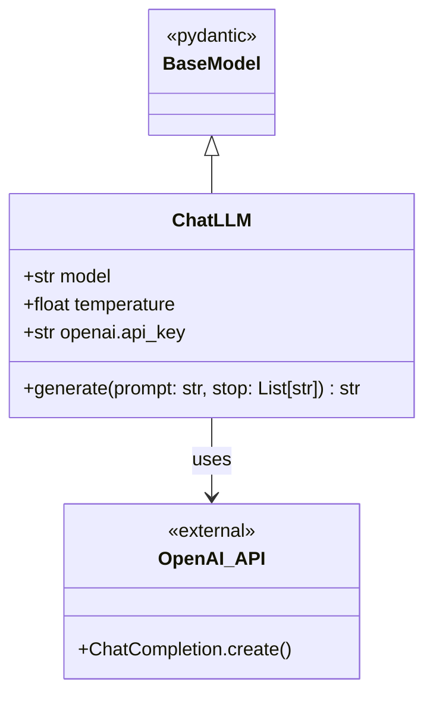
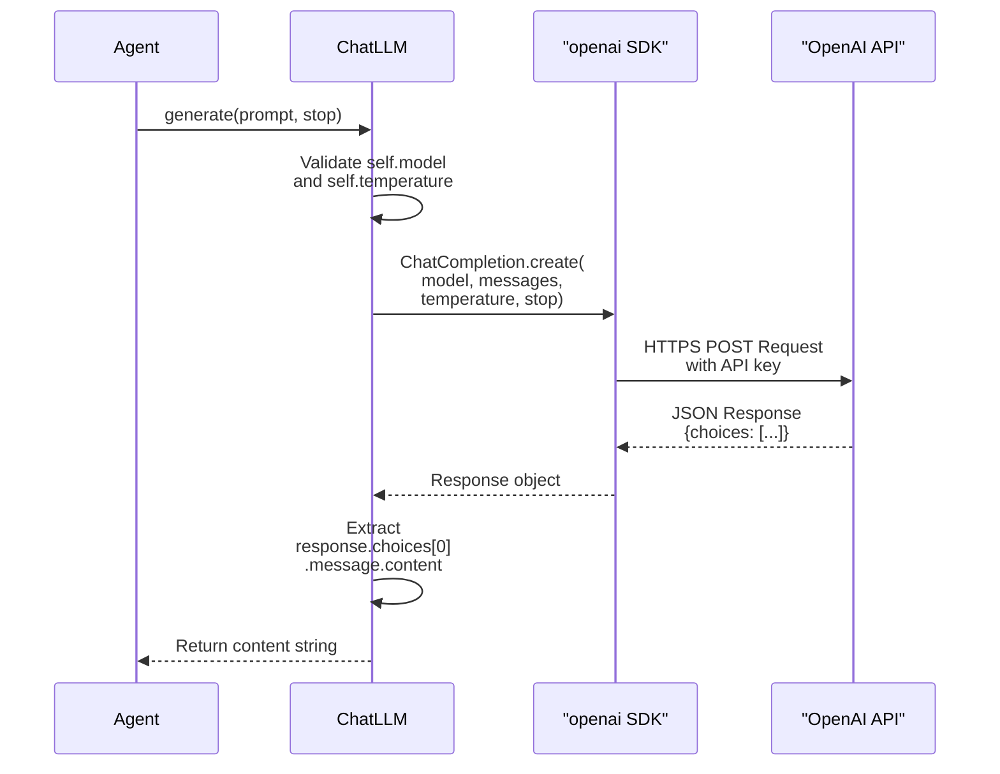
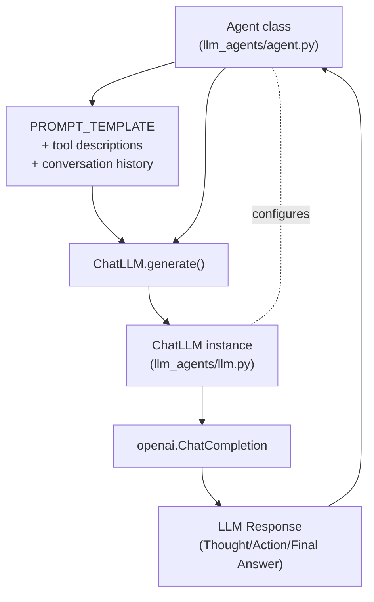
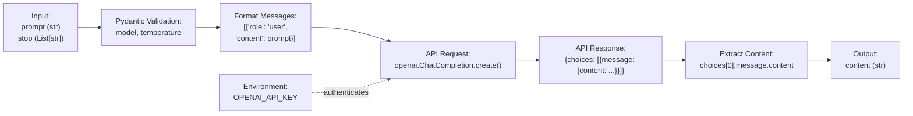

<!-- source: DeepWiki mcp.deepwiki.com · repo mpaepper/llm_agents · page 2.2 ChatLLM Integration · fetched 2026-10-27 -->

# ChatLLM Integration

<details>
<summary>Relevant source files</summary>

The following files were used as context for generating this wiki page:

- [llm_agents/__init__.py](llm_agents/__init__.py)
- [llm_agents/llm.py](llm_agents/llm.py)
- [llm_agents/tools/searx.py](llm_agents/tools/searx.py)
- [requirements.txt](requirements.txt)
- [setup.py](setup.py)

</details>


## Purpose and Scope

This document covers the `ChatLLM` class, which provides the interface between the agent system and OpenAI's language models. The `ChatLLM` component handles all communication with the OpenAI API, manages model configuration, and formats prompts for chat completion.

For information about how the Agent orchestrates calls to ChatLLM, see [The Agent](#2.1). For details on the broader reasoning loop, see [Thought-Action-Observation Loop](#2.3).

## Overview

The `ChatLLM` class is a lightweight wrapper around the OpenAI Python SDK that provides a standardized interface for generating text completions. It is implemented as a Pydantic `BaseModel`, enabling configuration validation and easy instantiation with default values.

**Key Responsibilities:**
- Configure OpenAI API credentials from environment variables
- Manage model selection and temperature settings
- Send chat completion requests to OpenAI
- Extract and return response content
- Support stop sequences for controlled generation

Sources: [llm_agents/llm.py:1-26]()

## Class Structure

The `ChatLLM` class is defined at [llm_agents/llm.py:8-20]() and inherits from `pydantic.BaseModel` for configuration management.



**Diagram: ChatLLM Class Structure**

### Configuration Fields

| Field | Type | Default Value | Description |
|-------|------|---------------|-------------|
| `model` | `str` | `'gpt-3.5-turbo'` | OpenAI model identifier to use for completions |
| `temperature` | `float` | `0.0` | Controls randomness in responses (0.0 = deterministic) |
| `openai.api_key` | `str` | `os.environ["OPENAI_API_KEY"]` | API key loaded from environment variable |

The default temperature of `0.0` is chosen to produce deterministic, focused responses—critical for the agent's reasoning process where consistency is more valuable than creativity.

Sources: [llm_agents/llm.py:8-11]()

## The generate() Method

The `generate()` method is the primary interface for obtaining completions from the language model. It is defined at [llm_agents/llm.py:13-20]().

### Method Signature

```python
def generate(self, prompt: str, stop: List[str] = None) -> str
```

### Parameters

- **`prompt`** (`str`): The complete prompt text to send to the model. In the agent context, this includes the system instructions, tool descriptions, conversation history, and the current question.

- **`stop`** (`List[str]`, optional): List of sequences where the API will stop generating further tokens. The Agent uses this to halt generation at specific markers like `"Observation:"` to prevent the model from hallucinating tool outputs.

### Return Value

Returns the `content` field from the first message choice in the OpenAI response as a string.

Sources: [llm_agents/llm.py:13-20]()

## OpenAI API Integration

The `ChatLLM` class interacts with the OpenAI Chat Completions API using the `openai` Python package (version >=0.27.0).



**Diagram: ChatLLM Request Flow**

### API Call Details

At [llm_agents/llm.py:14-19](), the `generate()` method constructs an API request:

1. **Model Selection**: Uses `self.model` (default: `'gpt-3.5-turbo'`)
2. **Message Format**: Wraps the prompt in a user message: `[{"role": "user", "content": prompt}]`
3. **Temperature**: Uses `self.temperature` (default: `0.0`)
4. **Stop Sequences**: Passes optional `stop` parameter to control generation termination
5. **Response Extraction**: Retrieves `response.choices[0].message.content`

Sources: [llm_agents/llm.py:13-20](), [requirements.txt:1]()

## Usage in the Agent System

The `Agent` class instantiates and uses `ChatLLM` to generate reasoning steps. Here's how the components interact:



**Diagram: ChatLLM in Agent Context**

The Agent typically:
1. Constructs a prompt including instructions, tools, and history
2. Calls `llm.generate(prompt, stop=["Observation:"])` to get a reasoning step
3. Parses the response to extract actions
4. Appends observations to the conversation history
5. Repeats the process until a final answer is produced

Sources: [llm_agents/llm.py:1-26](), [llm_agents/__init__.py:1-10]()

## Configuration and Environment Setup

### API Key Configuration

The `ChatLLM` class expects the OpenAI API key to be available in the environment at import time:

```python
openai.api_key = os.environ["OPENAI_API_KEY"]
```

This line at [llm_agents/llm.py:11]() executes as part of the class definition, meaning the environment variable must be set before importing the module.

**Setup Steps:**

1. Obtain an API key from OpenAI: https://platform.openai.com/api-keys
2. Set the environment variable:
   ```bash
   export OPENAI_API_KEY="sk-..."
   ```
3. Import and instantiate:
   ```python
   from llm_agents import ChatLLM
   llm = ChatLLM()  # Uses defaults
   ```

For detailed API key management, see [Required API Keys](#4.1).

### Custom Configuration

Users can override defaults when instantiating:

```python
llm = ChatLLM(
    model='gpt-4',          # Use GPT-4 instead of gpt-3.5-turbo
    temperature=0.7         # Increase creativity
)
```

Since `ChatLLM` inherits from `pydantic.BaseModel`, field validation is automatic. Invalid values (e.g., temperature outside [0, 2]) will raise validation errors.

Sources: [llm_agents/llm.py:8-11](), [requirements.txt:2]()

## Data Flow

The following diagram illustrates the complete data transformation pipeline through `ChatLLM`:



**Diagram: Data Flow Through ChatLLM**

This flow ensures that:
- Configuration is validated before API calls
- Prompts are properly formatted for the chat API
- Authentication is handled via environment variables
- Only the relevant content is extracted from responses

Sources: [llm_agents/llm.py:13-20]()

## Example Usage

### Standalone Usage

The module includes a simple example at [llm_agents/llm.py:22-25]():

```python
if __name__ == '__main__':
    llm = ChatLLM()
    result = llm.generate(prompt='Who is the president of the USA?')
    print(result)
```

This demonstrates basic usage outside the agent context.

### Agent Integration Example

When used by the Agent (typical usage):

```python
from llm_agents import Agent, ChatLLM

# Agent automatically creates ChatLLM instance
agent = Agent(llm=ChatLLM(), tools=[...])

# Agent calls llm.generate() internally during execution
result = agent.run("What is 2+2?")
```

The Agent manages the prompt construction and history, calling `llm.generate()` iteratively as part of the reasoning loop.

Sources: [llm_agents/llm.py:22-26](), [llm_agents/__init__.py:1-10]()

## Dependencies

The `ChatLLM` component relies on two key Python packages:

| Package | Version | Purpose |
|---------|---------|---------|
| `openai` | `>=0.27.0` | OpenAI API client library |
| `pydantic` | `>=1.10.5` | Data validation and settings management |

These dependencies are specified in both [requirements.txt:1-2]() and [setup.py:13-14]().

For a complete dependency overview, see [Python Dependencies](#4.2).

Sources: [requirements.txt:1-5](), [setup.py:11-16]()

## Error Handling Considerations

While the `ChatLLM` class itself does not implement custom error handling, users should be aware of potential failure modes:

### API Key Errors

If `OPENAI_API_KEY` is not set in the environment, the import will raise a `KeyError`:
```python
# At llm_agents/llm.py:11
openai.api_key = os.environ["OPENAI_API_KEY"]  # KeyError if not set
```

### API Request Failures

The `openai.ChatCompletion.create()` call can raise various exceptions:
- `openai.error.AuthenticationError` - Invalid API key
- `openai.error.RateLimitError` - Rate limit exceeded
- `openai.error.APIError` - OpenAI service errors
- Network errors - Connection timeouts, DNS failures

These exceptions propagate up to the caller (typically the Agent) and are not caught by `ChatLLM`.

### Response Format Issues

The code assumes the API returns at least one choice:
```python
return response.choices[0].message.content
```

If the API returns an empty choices list (rare but possible), this will raise an `IndexError`.

Sources: [llm_agents/llm.py:11](), [llm_agents/llm.py:20]()

## Testing Considerations

The `ChatLLM` class interacts with an external API, requiring special handling in tests:

### Mocking Strategy

Tests typically mock the OpenAI API to avoid:
- Making real API calls during tests
- Dependency on external service availability
- API costs from test execution

The test infrastructure provides fixtures for mocking OpenAI clients. For details, see [Test Fixtures](#5.2.1).

### Environment Isolation

Since `openai.api_key` is set at class definition time, tests must carefully manage environment variables. The `reset_environment` fixture (documented in [Test Fixtures](#5.2.1)) handles this cleanup.

Sources: [llm_agents/llm.py:11]()

## Public API Exports

The `ChatLLM` class is exported in the package's public API at [llm_agents/__init__.py:2]():

```python
from llm_agents.llm import ChatLLM
```

Users can import it directly:
```python
from llm_agents import ChatLLM
```

Or from the submodule:
```python
from llm_agents.llm import ChatLLM
```

Both imports are equivalent and refer to the same class.

Sources: [llm_agents/__init__.py:1-10]()

## Summary

The `ChatLLM` class provides a clean, minimal interface to OpenAI's chat completion API. Its key characteristics are:

- **Simple Configuration**: Two fields (`model`, `temperature`) with sensible defaults
- **Pydantic-Based**: Automatic validation and easy instantiation
- **Stateless**: No conversation history management (handled by Agent)
- **Synchronous**: Blocking API calls (no async support)
- **Environment-Driven**: API key from `OPENAI_API_KEY` environment variable

This design keeps the LLM interface focused and delegates conversation management, tool orchestration, and reasoning logic to the Agent layer.

Sources: [llm_agents/llm.py:1-26]()

---

