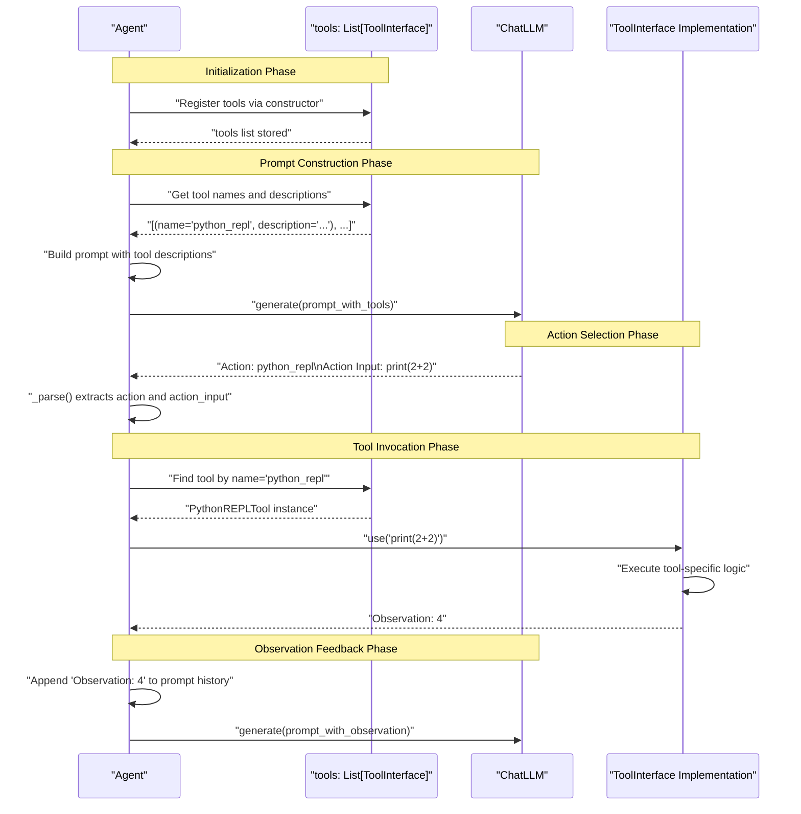
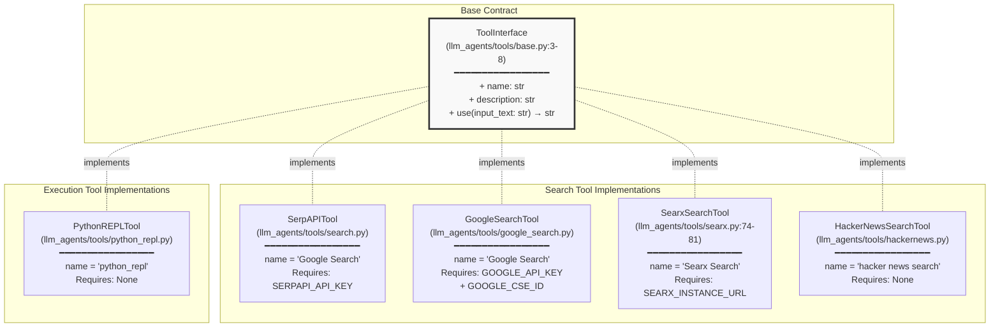

<!-- source: DeepWiki mcp.deepwiki.com · repo mpaepper/llm_agents · page 3 Tool System · fetched 2026-10-27 -->

# Tool System

<details>
<summary>Relevant source files</summary>

The following files were used as context for generating this wiki page:

- [README.md](README.md)
- [llm_agents/__init__.py](llm_agents/__init__.py)
- [llm_agents/tools/base.py](llm_agents/tools/base.py)
- [llm_agents/tools/searx.py](llm_agents/tools/searx.py)

</details>


## Purpose and Scope

This document provides an overview of the tool system in the llm_agents library. Tools are pluggable components that extend the agent's capabilities by providing concrete actions that the LLM can invoke during the Thought-Action-Observation loop. This page covers the tool architecture, the `ToolInterface` contract, tool categories, and how tools integrate with the agent orchestration layer.

For detailed documentation on the Agent's orchestration logic, see [The Agent](#2.1). For information on implementing the Thought-Action-Observation loop, see [Thought-Action-Observation Loop](#2.3). For specific tool implementations, see child pages under this section.

---

## Tool Architecture

The tool system follows a **plugin architecture** where all tools implement a common interface contract defined by the `ToolInterface` base class. This design enables the agent to treat all tools uniformly while supporting diverse capabilities ranging from web search to code execution.

The agent discovers available tools through their `name` and `description` attributes, which are embedded in the prompt sent to the LLM. When the LLM selects a tool and provides input, the agent invokes the tool's `use()` method and returns the observation back to the LLM.

### Tool Interface Contract

All tools in the system inherit from `ToolInterface` [llm_agents/tools/base.py:3-8]() which defines three required members:

| Member | Type | Purpose |
|--------|------|---------|
| `name` | `str` | Unique identifier for the tool that the LLM uses to select it |
| `description` | `str` | Natural language description of the tool's purpose and expected input format |
| `use(input_text: str)` | `str` | Method that executes the tool's action and returns the observation |

The `ToolInterface` extends Pydantic's `BaseModel` [llm_agents/tools/base.py:3](), providing data validation for the tool attributes.

**Sources:** [llm_agents/tools/base.py:1-9]()

---

## Tool Discovery and Invocation Flow

The following diagram illustrates how tools are discovered, selected, and invoked during agent execution:



The key insight is that the agent uses the tool's `name` attribute as the selection key and the `description` attribute to inform the LLM's decision-making process.

**Sources:** [README.md:13-22](), [llm_agents/tools/base.py:3-8]()

---

## Available Tool Categories

The llm_agents library provides two primary categories of tools:

### Search Tools

Search tools enable the agent to retrieve information from external knowledge sources. The library includes four different search implementations:

| Tool Class | Name | External Service | Configuration Required |
|------------|------|------------------|----------------------|
| `SerpAPITool` | `"Google Search"` | SerpAPI | `SERPAPI_API_KEY` |
| `GoogleSearchTool` | `"Google Search"` | Google Custom Search API | `GOOGLE_API_KEY`, `GOOGLE_CSE_ID` |
| `SearxSearchTool` | `"Searx Search"` | Searx instance | `SEARX_INSTANCE_URL` |
| `HackerNewsSearchTool` | `"hacker news search"` | Hacker News Algolia API | None |

Each search tool provides different trade-offs in terms of cost, configuration complexity, and result quality. See [Search Tools](#3.2) for detailed comparisons and usage guidelines.

### Execution Tools

Execution tools allow the agent to perform computational actions:

| Tool Class | Name | Purpose | Security Considerations |
|------------|------|---------|------------------------|
| `PythonREPLTool` | `"python_repl"` | Execute Python code in isolated environment | Code runs with agent process privileges |

See [PythonREPLTool](#3.3) for detailed documentation on code execution capabilities and security considerations.

**Sources:** [llm_agents/__init__.py:1-10](), [README.md:16-17]()

---

## Tool Class Hierarchy and Implementation Map

The following diagram maps the inheritance hierarchy and shows concrete implementations with their code locations:



**Sources:** [llm_agents/tools/base.py:3-8](), [llm_agents/__init__.py:3-7](), [llm_agents/tools/searx.py:74-81]()

---

## Tool Registration and Usage Pattern

Tools are registered with the agent during initialization. The typical usage pattern is:

```python
from llm_agents import Agent, ChatLLM, PythonREPLTool, SerpAPITool

# Instantiate tools
python_tool = PythonREPLTool()
search_tool = SerpAPITool()

# Register tools with agent
agent = Agent(llm=ChatLLM(), tools=[python_tool, search_tool])

# Agent can now use both tools during execution
result = agent.run("What is 15 factorial?")
```

From [README.md:48-54](), this pattern demonstrates how the agent's constructor accepts a list of `ToolInterface` implementations, making the tool registry completely configurable at runtime.

**Sources:** [README.md:46-58]()

---

## Tool Description Format and LLM Integration

The `description` attribute of each tool serves as the primary mechanism for the LLM to understand when and how to use the tool. A well-formatted description typically includes:

1. **Capability statement**: What the tool does
2. **Input format**: Expected format of the action input
3. **Output format**: What kind of observation to expect

For example, the `SearxSearchTool` description [llm_agents/tools/searx.py:78]() states:

```
"Get specific information from a search query. Input should be a question like 'How to add number in Clojure?'. Result will be the answer to the question."
```

This description provides the LLM with:
- **Capability**: Getting specific information from search
- **Input format**: A natural language question
- **Output format**: The answer to the question

The agent embeds these descriptions in the prompt template sent to the LLM, allowing the LLM to reason about which tool to use for a given task.

**Sources:** [llm_agents/tools/searx.py:74-81]()

---

## Tool Execution Architecture

The following diagram shows the data flow from LLM output through tool execution back to observation:

```mermaid
graph LR
    subgraph "LLM Output Parsing"
        LLMResponse["LLM Response Text:<br/>Thought: ...<br/>Action: python_repl<br/>Action Input: print(2+2)"]
        ParseAction["Agent._parse()<br/>Extracts action name<br/>and action_input"]
    end
    
    subgraph "Tool Selection"
        ToolLookup["Loop through tools list:<br/>find tool where<br/>tool.name == action"]
        ToolInstance["Retrieved<br/>ToolInterface instance"]
    end
    
    subgraph "Tool Execution"
        UseMethod["tool.use(action_input)<br/>Executes tool logic"]
        ExternalAPI["External Service<br/>(if applicable)"]
        Observation["Observation string<br/>returned"]
    end
    
    subgraph "Feedback Loop"
        AppendHistory["Append to prompt:<br/>'Observation: {result}'"]
        NextIteration["Next LLM generation<br/>with updated context"]
    end
    
    LLMResponse --> ParseAction
    ParseAction --> ToolLookup
    ToolLookup --> ToolInstance
    ToolInstance --> UseMethod
    UseMethod -.may call.-> ExternalAPI
    UseMethod --> Observation
    Observation --> AppendHistory
    AppendHistory --> NextIteration
    
    style ParseAction fill:#f9f9f9,stroke:#333,stroke-width:2px
    style UseMethod fill:#f9f9f9,stroke:#333,stroke-width:2px
    style Observation fill:#f9f9f9,stroke:#333,stroke-width:2px
```



This architecture ensures that:
1. Tool selection is based on string matching of the tool's `name` attribute
2. Tool execution is completely encapsulated within the `use()` method
3. All tools return string observations that can be fed back to the LLM
4. The agent doesn't need to understand the internal workings of each tool

**Sources:** [README.md:18-21](), [llm_agents/tools/base.py:7-8]()

---

## Extensibility and Custom Tools

The plugin architecture makes it straightforward to add custom tools. To create a new tool:

1. Inherit from `ToolInterface` [llm_agents/tools/base.py:3]()
2. Define `name` and `description` class attributes
3. Implement the `use(input_text: str) -> str` method
4. Register the tool with the agent during initialization

For example, examining `SearxSearchTool` [llm_agents/tools/searx.py:74-81]():

```python
class SearxSearchTool(ToolInterface):
    """Tool for Searx search results."""
    
    name = "Searx Search"
    description = "Get specific information from a search query. Input should be a question like 'How to add number in Clojure?'. Result will be the answer to the question."
    
    def use(self, input_text: str) -> str:
        return search(input_text)
```

The implementation delegates to a helper function `search()` [llm_agents/tools/searx.py:36-71]() that handles the external API interaction, demonstrating the separation between the tool interface contract and the underlying implementation logic.

For detailed guidance on creating custom tools, see [Creating Custom Tools](#3.4).

**Sources:** [llm_agents/tools/searx.py:74-88](), [llm_agents/tools/base.py:3-8](), [README.md:57]()

---

## Configuration and Environment Variables

Most tools require external API keys or service URLs configured via environment variables:

| Tool | Required Environment Variables | Purpose |
|------|-------------------------------|---------|
| `SerpAPITool` | `SERPAPI_API_KEY` | Authenticate with SerpAPI service |
| `GoogleSearchTool` | `GOOGLE_API_KEY`, `GOOGLE_CSE_ID` | Authenticate and identify Custom Search Engine |
| `SearxSearchTool` | `SEARX_INSTANCE_URL` | Specify Searx instance endpoint |
| `HackerNewsSearchTool` | None | Uses public Algolia API |
| `PythonREPLTool` | None | Executes locally |

The tools access these variables using `os.environ` [llm_agents/tools/searx.py:39]() at runtime. Missing required environment variables will cause the tool to fail when invoked.

For detailed setup instructions, see [Required API Keys](#4.1).

**Sources:** [llm_agents/tools/searx.py:39](), [README.md:37-42]()

---

## Error Handling and Fallback Behavior

Tools implement error handling within their `use()` methods. For example, `SearxSearchTool` returns a descriptive message when no results are found [llm_agents/tools/searx.py:47-48]():

```python
if (len(res) == 0 or (len(res['answers']) == 0 and len(res['infoboxes']) == 0 and len(res['results']) == 0)):
    return "No good Searx Search Result was found"
```

This pattern ensures that the agent always receives a string observation, even in error cases, allowing the LLM to reason about the failure and potentially try alternative approaches.

**Sources:** [llm_agents/tools/searx.py:45-48]()

---

## Summary

The tool system provides a clean plugin architecture where:

- **All tools implement `ToolInterface`** with `name`, `description`, and `use()` members
- **The agent discovers tools** through their name and description attributes
- **Tool invocation is uniform** through the `use(input_text: str) -> str` method
- **Multiple tool categories** exist (search, execution) with different capabilities
- **Extension is straightforward** by implementing the interface contract
- **Configuration is environment-based** for external service integration

This design enables the agent to work with any tool without requiring agent-side modifications, supporting both built-in tools and custom implementations.

For implementation details of specific tools, see the child pages: [ToolInterface](#3.1), [Search Tools](#3.2), [PythonREPLTool](#3.3), and [Creating Custom Tools](#3.4).

---

