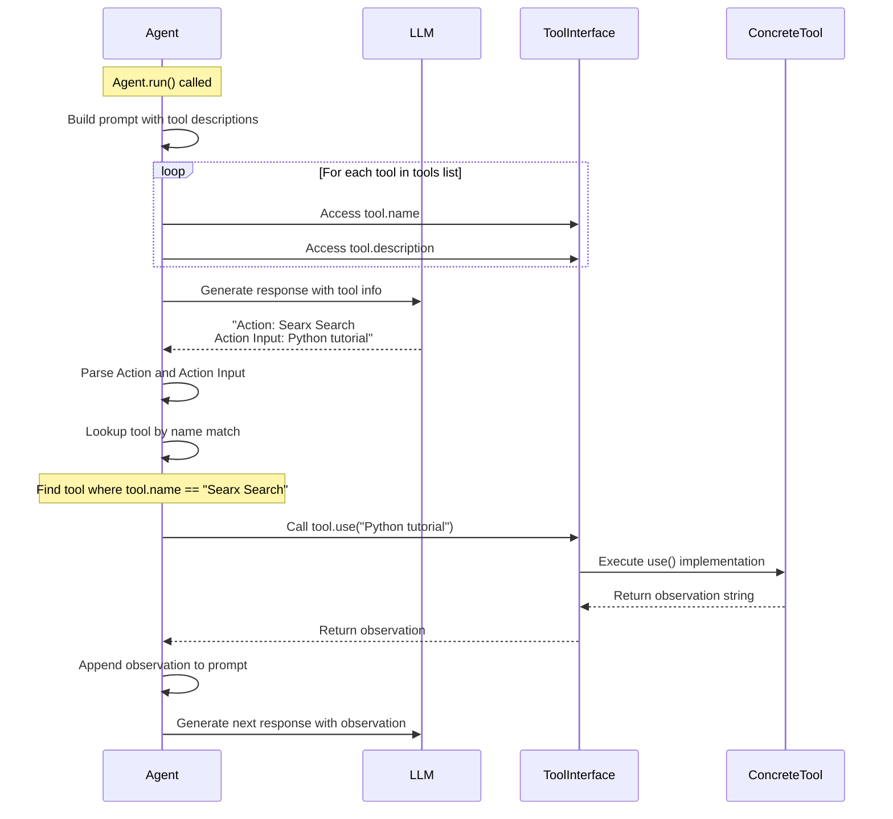

<!-- source: DeepWiki mcp.deepwiki.com · repo mpaepper/llm_agents · page 3.1 ToolInterface · fetched 2026-10-27 -->

# ToolInterface

<details>
<summary>Relevant source files</summary>

The following files were used as context for generating this wiki page:

- [llm_agents/__init__.py](llm_agents/__init__.py)
- [llm_agents/tools/base.py](llm_agents/tools/base.py)
- [llm_agents/tools/searx.py](llm_agents/tools/searx.py)

</details>


## Purpose and Scope

This document describes the `ToolInterface` base class, which defines the contract that all tools in the llm_agents system must implement. The ToolInterface enables the plugin architecture that allows the Agent to uniformly discover, describe, and invoke diverse capabilities such as web search, code execution, and other external actions.

For documentation on specific tool implementations, see [Search Tools](#3.2) and [PythonREPLTool](#3.3). For guidance on implementing your own tools, see [Creating Custom Tools](#3.4). For information on how the Agent orchestrates tool invocation, see [The Agent](#2.1).

---

## Interface Definition

The `ToolInterface` is a Pydantic `BaseModel` that defines the minimal contract all tools must satisfy. It is located in [llm_agents/tools/base.py:1-9]().

```python
class ToolInterface(BaseModel):
    name: str
    description: str
    
    def use(self, input_text: str) -> str:
        raise NotImplementedError("use() method not implemented")
```

The interface consists of three required components:

| Component | Type | Purpose |
|-----------|------|---------|
| `name` | `str` | Unique identifier for the tool that the Agent uses to select it |
| `description` | `str` | Natural language description that helps the LLM understand when and how to use the tool |
| `use()` | Method | Executes the tool's functionality and returns a string observation |

**Sources:** [llm_agents/tools/base.py:1-9]()

---

## Architecture Overview

The following diagram shows how `ToolInterface` fits into the larger agent system:

```mermaid
graph TB
    Agent["Agent Class<br/>(llm_agents/agent.py)"]
    ToolInterface["ToolInterface<br/>(llm_agents/tools/base.py)<br/>---<br/>+ name: str<br/>+ description: str<br/>+ use(input_text: str): str"]
    
    subgraph "Tool Implementations"
        PythonREPL["PythonREPLTool<br/>(llm_agents/tools/python_repl.py)"]
        SerpAPI["SerpAPITool<br/>(llm_agents/tools/search.py)"]
        GoogleSearch["GoogleSearchTool<br/>(llm_agents/tools/google_search.py)"]
        Searx["SearxSearchTool<br/>(llm_agents/tools/searx.py)"]
        HackerNews["HackerNewsSearchTool<br/>(llm_agents/tools/hackernews.py)"]
    end
    
    Agent -->|"discovers via<br/>name + description"| ToolInterface
    Agent -->|"invokes via<br/>use() method"| ToolInterface
    
    ToolInterface <|.."implements"..| PythonREPL
    ToolInterface <|.."implements"..| SerpAPI
    ToolInterface <|.."implements"..| GoogleSearch
    ToolInterface <|.."implements"..| Searx
    ToolInterface <|.."implements"..| HackerNews
```

**Diagram: ToolInterface in the Agent Ecosystem**

The Agent treats all tools uniformly through this interface, enabling extensibility without modifying the Agent's core logic. The Agent uses `name` and `description` to build the LLM prompt, allowing the language model to select appropriate tools. When a tool is selected, the Agent calls `use()` with the action input to execute the tool.

**Sources:** [llm_agents/tools/base.py:1-9](), [llm_agents/__init__.py:1-10]()

---

## Contract Details

### The `name` Attribute

The `name` attribute is a string identifier that serves two purposes:

1. **Tool Selection**: The Agent parses the LLM's output to extract an "Action" field, which must match a tool's `name` exactly
2. **Prompt Construction**: The name is included in the prompt template shown to the LLM

The name should be concise, descriptive, and unique among all tools provided to an Agent instance. Examples from the codebase:

| Tool Class | Name Value |
|------------|------------|
| `PythonREPLTool` | `"python_repl"` |
| `SerpAPITool` | `"Google Search"` |
| `GoogleSearchTool` | `"Google Search"` |
| `SearxSearchTool` | `"Searx Search"` |
| `HackerNewsSearchTool` | `"hacker news search"` |

### The `description` Attribute

The `description` attribute provides natural language guidance to the LLM about when and how to use the tool. It should:

- Explain what the tool does
- Specify the expected input format
- Describe what the output will contain
- Help the LLM distinguish this tool from others

Example from [llm_agents/tools/searx.py:78]():
```
"Get specific information from a search query. Input should be a question like 'How to add number in Clojure?'. Result will be the answer to the question."
```

### The `use()` Method

The `use()` method is the execution interface. It:

- **Input**: Accepts a single `input_text` parameter (string) containing the action input determined by the LLM
- **Output**: Returns a string observation that will be fed back to the LLM in the next reasoning iteration
- **Exceptions**: Should handle errors gracefully and return informative error messages as strings rather than raising exceptions
- **Side Effects**: May perform external API calls, execute code, or modify state as needed

**Sources:** [llm_agents/tools/base.py:3-8](), [llm_agents/tools/searx.py:74-81]()

---

## Implementation Pattern

The following diagram illustrates the typical implementation pattern for a tool:

```mermaid
graph TB
    subgraph "Base Class"
        ToolInterface["ToolInterface<br/>(BaseModel)"]
    end
    
    subgraph "Concrete Implementation"
        ConcreteClass["ExampleTool<br/>(implements ToolInterface)"]
        NameAttr["name = 'tool_identifier'"]
        DescAttr["description = 'Detailed usage instructions...'"]
        UseMethod["use(input_text: str) -> str"]
    end
    
    subgraph "Implementation Steps"
        Parse["1. Parse input_text<br/>Extract parameters"]
        Execute["2. Execute tool logic<br/>Call APIs, run code, etc."]
        Format["3. Format results<br/>Convert to string"]
        Handle["4. Handle errors<br/>Return error messages as strings"]
    end
    
    ToolInterface -.."inherits"..> ConcreteClass
    ConcreteClass --> NameAttr
    ConcreteClass --> DescAttr
    ConcreteClass --> UseMethod
    
    UseMethod --> Parse
    Parse --> Execute
    Execute --> Format
    Format --> Handle
    Handle --> Result["Return observation string"]
```

**Diagram: Tool Implementation Flow**

### Minimal Implementation Example

Here is the complete implementation of `SearxSearchTool` from [llm_agents/tools/searx.py:74-81]():

```python
class SearxSearchTool(ToolInterface):
    """Tool for Searx search results."""

    name = "Searx Search"
    description = "Get specific information from a search query. Input should be a question like 'How to add number in Clojure?'. Result will be the answer to the question."

    def use(self, input_text: str) -> str:
        return search(input_text)
```

This implementation:
1. **Inherits from `ToolInterface`** as required
2. **Sets `name`** to a unique identifier
3. **Sets `description`** with usage guidance
4. **Implements `use()`** by delegating to a helper function that returns a string

**Sources:** [llm_agents/tools/searx.py:74-81]()

---

## Pydantic Integration

`ToolInterface` extends `pydantic.BaseModel` [llm_agents/tools/base.py:1](), which provides:

1. **Type Validation**: Automatic validation that `name` and `description` are strings
2. **Serialization**: Tools can be easily serialized to JSON for logging or storage
3. **IDE Support**: Better autocomplete and type checking in development environments
4. **Validation Errors**: Clear error messages if tools are instantiated incorrectly

This integration ensures that all tools have a consistent structure and fail fast if implemented incorrectly.

**Sources:** [llm_agents/tools/base.py:1-3]()

---

## How the Agent Uses ToolInterface

The following sequence diagram shows the interaction between Agent and tools through the ToolInterface:



**Diagram: Agent-Tool Interaction via ToolInterface**

The Agent depends on three specific behaviors guaranteed by the ToolInterface contract:

1. **Discovery**: The Agent can enumerate all available tools and extract their `name` and `description` attributes to construct the prompt
2. **Selection**: The Agent can match the LLM's output "Action" field against tool names to select the appropriate tool
3. **Execution**: The Agent can call `use()` with a string input and receive a string output, regardless of what the tool actually does internally

**Sources:** [llm_agents/tools/base.py:1-9]()

---

## Error Handling Expectations

Tools should handle errors gracefully within the `use()` method and return error messages as strings rather than raising exceptions. This allows the Agent's reasoning loop to continue and potentially recover from errors.

Example error handling pattern:

```python
def use(self, input_text: str) -> str:
    try:
        # Tool logic here
        result = perform_operation(input_text)
        return result
    except Exception as e:
        return f"Error executing tool: {str(e)}"
```

The Agent will treat error strings as observations and feed them back to the LLM, which may attempt a different approach or provide a final answer based on partial information.

---

## All Tool Implementations

The following table lists all tool implementations in the codebase as exported from [llm_agents/__init__.py:1-10]():

| Tool Class | Module | Name | Primary Function |
|------------|--------|------|------------------|
| `PythonREPLTool` | `llm_agents.tools.python_repl` | `"python_repl"` | Execute Python code |
| `SerpAPITool` | `llm_agents.tools.search` | `"Google Search"` | Web search via SerpAPI |
| `GoogleSearchTool` | `llm_agents.tools.google_search` | `"Google Search"` | Web search via Google Custom Search API |
| `SearxSearchTool` | `llm_agents.tools.searx` | `"Searx Search"` | Web search via Searx instance |
| `HackerNewsSearchTool` | `llm_agents.tools.hackernews` | `"hacker news search"` | Search Hacker News stories |

Each of these classes inherits from `ToolInterface` and implements the required contract.

**Sources:** [llm_agents/__init__.py:3-7]()

---

## Design Rationale

The `ToolInterface` embodies several design principles:

### Plugin Architecture
By defining a minimal interface, new tools can be added without modifying the Agent's core logic. The Agent operates on the interface contract, not concrete implementations.

### Uniform Abstraction
All tools—whether they execute code, query APIs, or parse web pages—present the same interface to the Agent: a string input produces a string output. This simplification allows the LLM to reason about tool usage without understanding implementation details.

### LLM-Friendly Design
The `name` and `description` attributes are designed specifically for inclusion in LLM prompts. The string-based input/output contract aligns with the text-based nature of language models.

### Pydantic Benefits
Extending `BaseModel` provides validation, serialization, and type safety with minimal boilerplate, making tool implementation straightforward.

**Sources:** [llm_agents/tools/base.py:1-9]()

---

## Summary

The `ToolInterface` is the foundational contract that enables the llm_agents system's extensible tool architecture. By requiring only three components—`name`, `description`, and `use()`—it provides a simple yet powerful abstraction that allows the Agent to uniformly interact with diverse external capabilities. All tools in the system implement this interface, and developers can create custom tools by following the same pattern.

For implementing specific types of tools, see:
- [Search Tools](#3.2) for web search implementations
- [PythonREPLTool](#3.3) for code execution
- [Creating Custom Tools](#3.4) for step-by-step implementation guidance

**Sources:** [llm_agents/tools/base.py:1-9](), [llm_agents/__init__.py:1-10](), [llm_agents/tools/searx.py:74-81]()

---

