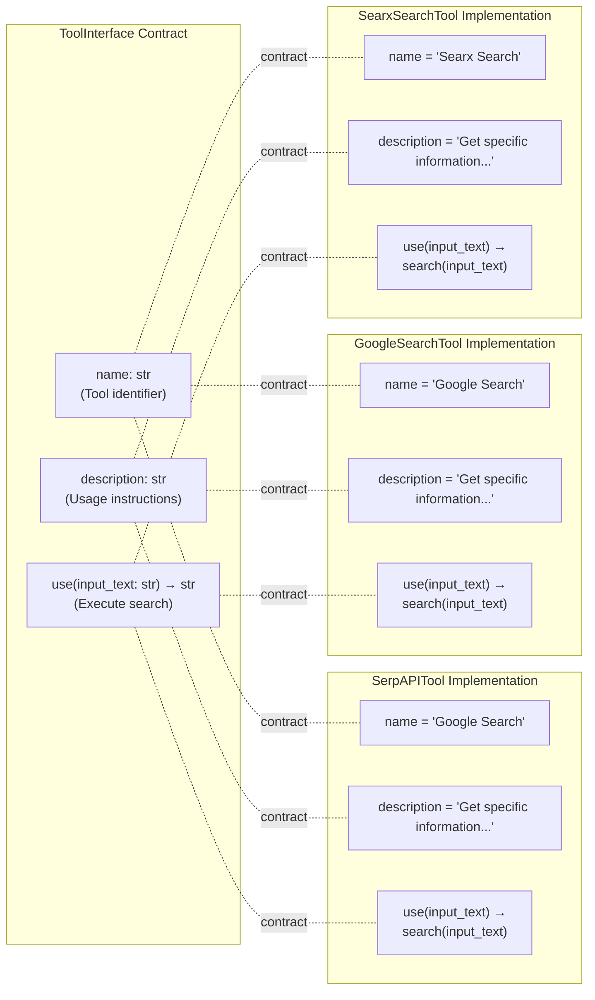
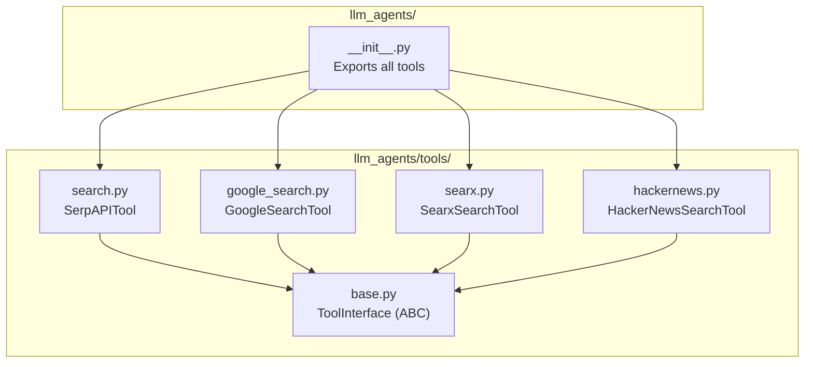

<!-- source: DeepWiki mcp.deepwiki.com · repo mpaepper/llm_agents · page 3.2 Search Tools · fetched 2026-10-27 -->

# Search Tools

<details>
<summary>Relevant source files</summary>

The following files were used as context for generating this wiki page:

- [llm_agents/__init__.py](llm_agents/__init__.py)
- [llm_agents/tools/google_search.py](llm_agents/tools/google_search.py)
- [llm_agents/tools/search.py](llm_agents/tools/search.py)
- [llm_agents/tools/searx.py](llm_agents/tools/searx.py)

</details>


This page provides an overview of the search tool implementations available in the llm_agents codebase. It compares the four search tools, explains their differences, and provides guidance on when to use each one. For detailed documentation on individual tools, see pages [3.2.1](#3.2.1) (SerpAPITool), [3.2.2](#3.2.2) (GoogleSearchTool), [3.2.3](#3.2.3) (SearxSearchTool), and [3.2.4](#3.2.4) (HackerNewsSearchTool). For information about the base tool interface that all search tools implement, see [3.1](#3.1).

## Overview

The llm_agents framework includes four distinct search tool implementations, each providing web search capabilities through different backends. All search tools implement the `ToolInterface` contract defined in [llm_agents/tools/base.py](), allowing agents to use them interchangeably. The search tools enable agents to retrieve factual information from the internet to answer questions that require current or external knowledge.

## Available Search Tools

The framework provides the following search tool implementations:

| Tool Class | Name String | Backend Service | Primary Use Case |
|------------|-------------|-----------------|------------------|
| `SerpAPITool` | "Google Search" | SerpAPI | Commercial Google search with structured results |
| `GoogleSearchTool` | "Google Search" | Google Custom Search API | Direct Google API integration |
| `SearxSearchTool` | "Searx Search" | Self-hosted Searx instance | Privacy-focused, self-hosted search |
| `HackerNewsSearchTool` | "hacker news search" | Hacker News Algolia API | Tech news and discussions from HN |

**Sources:** [llm_agents/__init__.py:1-10](), [llm_agents/tools/search.py:74-78](), [llm_agents/tools/google_search.py:73-77](), [llm_agents/tools/searx.py:74-78]()

## Tool Architecture

```mermaid
graph TB
    subgraph "Agent Layer"
        Agent["Agent<br/>run()"]
    end
    
    subgraph "Tool Interface Contract"
        ToolInterface["ToolInterface (ABC)<br/>name: str<br/>description: str<br/>use(input_text: str)"]
    end
    
    subgraph "Search Tool Implementations"
        SerpAPITool["SerpAPITool<br/>name = 'Google Search'<br/>use(input_text)"]
        GoogleSearchTool["GoogleSearchTool<br/>name = 'Google Search'<br/>use(input_text)"]
        SearxSearchTool["SearxSearchTool<br/>name = 'Searx Search'<br/>use(input_text)"]
        HackerNewsSearchTool["HackerNewsSearchTool<br/>name = 'hacker news search'<br/>use(input_text)"]
    end
    
    subgraph "Internal Functions"
        search_serp["search(query)<br/>llm_agents/tools/search.py"]
        search_google["search(query)<br/>llm_agents/tools/google_search.py"]
        search_searx["search(query)<br/>llm_agents/tools/searx.py"]
        process_response["_process_response(res)<br/>llm_agents/tools/search.py"]
        google_results["_google_search_results(params)<br/>llm_agents/tools/google_search.py"]
        searx_results["_searx_search_results(params)<br/>llm_agents/tools/searx.py"]
    end
    
    subgraph "External APIs"
        SerpAPI["SerpAPI Service<br/>google-search-results"]
        GoogleAPI["Google Custom Search API<br/>google-api-python-client"]
        SearxInstance["Searx Instance<br/>POST /"]
        HNAlgolia["Hacker News Algolia API"]
    end
    
    subgraph "Environment Variables"
        SERPAPI_KEY["SERPAPI_API_KEY"]
        GOOGLE_KEY["GOOGLE_API_KEY"]
        GOOGLE_CSE["GOOGLE_CSE_ID"]
        SEARX_URL["SEARX_INSTANCE_URL"]
    end
    
    Agent -->|"invokes by name"| ToolInterface
    
    ToolInterface <-.implements.- SerpAPITool
    ToolInterface <-.implements.- GoogleSearchTool
    ToolInterface <-.implements.- SearxSearchTool
    ToolInterface <-.implements.- HackerNewsSearchTool
    
    SerpAPITool --> search_serp
    GoogleSearchTool --> search_google
    SearxSearchTool --> search_searx
    
    search_serp --> process_response
    search_google --> google_results
    search_searx --> searx_results
    
    search_serp -->|"GoogleSearch(params)"| SerpAPI
    google_results -->|"build().cse().list()"| GoogleAPI
    searx_results -->|"requests.post()"| SearxInstance
    HackerNewsSearchTool -->|"requests.get()"| HNAlgolia
    
    SERPAPI_KEY -.configures.-> search_serp
    GOOGLE_KEY -.configures.-> google_results
    GOOGLE_CSE -.configures.-> google_results
    SEARX_URL -.configures.-> search_searx
```

**Diagram: Search Tool Architecture and Data Flow**

This diagram shows how search tools fit into the agent architecture. The `Agent` invokes tools through the `ToolInterface` contract, which all search tools implement. Each tool delegates to internal `search()` functions that interact with external APIs using appropriate environment variables.

**Sources:** [llm_agents/tools/search.py:12-27](), [llm_agents/tools/google_search.py:47-70](), [llm_agents/tools/searx.py:21-71]()

## Common Interface Implementation

All search tools implement the same `ToolInterface` contract, providing standardized attributes and methods:



**Diagram: ToolInterface Contract Implementation Across Search Tools**

Each search tool provides:
- **`name`**: A string identifier that the agent uses to invoke the tool (e.g., `"Google Search"`, `"Searx Search"`)
- **`description`**: Instructions for the LLM on how to use the tool and what input format is expected
- **`use(input_text: str)`**: The main execution method that takes a search query string and returns search results as a string

**Sources:** [llm_agents/tools/search.py:74-81](), [llm_agents/tools/google_search.py:73-80](), [llm_agents/tools/searx.py:74-81]()

## Tool Comparison

### Configuration Requirements

| Tool | Required Environment Variables | Additional Setup |
|------|-------------------------------|------------------|
| `SerpAPITool` | `SERPAPI_API_KEY` | Sign up at serpapi.com |
| `GoogleSearchTool` | `GOOGLE_API_KEY`, `GOOGLE_CSE_ID` | Create Google Cloud project, enable Custom Search API, create custom search engine |
| `SearxSearchTool` | `SEARX_INSTANCE_URL` | Self-host Searx instance with JSON output enabled |
| `HackerNewsSearchTool` | None | No configuration needed |

### API Response Processing

Each tool processes API responses differently to extract relevant information:

```mermaid
graph TB
    subgraph "SerpAPITool Response Processing"
        serp_input["SerpAPI JSON Response"]
        serp_check1{"answer_box.answer<br/>exists?"}
        serp_check2{"answer_box.snippet<br/>exists?"}
        serp_check3{"knowledge_graph<br/>exists?"}
        serp_check4{"organic_results[0]<br/>exists?"}
        serp_output["Extracted Text"]
        
        serp_input --> serp_check1
        serp_check1 -->|Yes| serp_output
        serp_check1 -->|No| serp_check2
        serp_check2 -->|Yes| serp_output
        serp_check2 -->|No| serp_check3
        serp_check3 -->|Yes| serp_output
        serp_check3 -->|No| serp_check4
        serp_check4 -->|Yes| serp_output
        serp_check4 -->|No| serp_none["No good search result found"]
    end
    
    subgraph "GoogleSearchTool Response Processing"
        google_input["Google API Items Array"]
        google_extract["Extract 'snippet' from each item"]
        google_join["Join all snippets with spaces"]
        google_output["Combined Text"]
        
        google_input --> google_extract
        google_extract --> google_join
        google_join --> google_output
    end
    
    subgraph "SearxSearchTool Response Processing"
        searx_input["Searx JSON Response"]
        searx_priority1{"answers array<br/>non-empty?"}
        searx_priority2{"infoboxes array<br/>non-empty?"}
        searx_priority3{"results array<br/>non-empty?"}
        searx_extract["Extract 'content' fields"]
        searx_output["Joined Content"]
        
        searx_input --> searx_priority1
        searx_priority1 -->|Yes| searx_extract
        searx_priority1 -->|No| searx_priority2
        searx_priority2 -->|Yes| searx_extract
        searx_priority2 -->|No| searx_priority3
        searx_priority3 -->|Yes| searx_extract
        searx_extract --> searx_output
    end
```



**Diagram: Response Processing Logic by Tool**

- **`SerpAPITool`** ([llm_agents/tools/search.py:29-57]()): Uses `_process_response()` to extract the most relevant information from SerpAPI's structured response, prioritizing answer boxes, knowledge graphs, and organic results
- **`GoogleSearchTool`** ([llm_agents/tools/google_search.py:54-70]()): Extracts the `snippet` field from each search result item and joins them with spaces
- **`SearxSearchTool`** ([llm_agents/tools/searx.py:36-71]()): Prioritizes answers, then infoboxes, then general results, extracting `content` fields from whichever category is populated

**Sources:** [llm_agents/tools/search.py:29-57](), [llm_agents/tools/google_search.py:54-70](), [llm_agents/tools/searx.py:36-71]()

## Tool Selection Guidance

Choose the appropriate search tool based on your requirements:

### Use `SerpAPITool` when:
- You need the most reliable, structured search results
- You have a SerpAPI subscription (paid service)
- You want rich answer boxes and knowledge graph data
- You need consistent result quality

### Use `GoogleSearchTool` when:
- You prefer direct Google API integration
- You already have Google Cloud credentials
- You want to avoid third-party services
- You need Google-specific features

### Use `SearxSearchTool` when:
- Privacy is a primary concern
- You can self-host infrastructure
- You want to avoid rate limits from commercial providers
- You need full control over the search backend

### Use `HackerNewsSearchTool` when:
- Your query is specifically about tech news or discussions
- You need information from the Hacker News community
- You're asking about recent tech events or projects

**Sources:** [llm_agents/tools/search.py:1-2](), [llm_agents/tools/google_search.py:1-44](), [llm_agents/tools/searx.py:7-18]()

## Name Collision

Both `SerpAPITool` and `GoogleSearchTool` use the same `name` value of `"Google Search"`:

```
SerpAPITool.name = "Google Search"      # llm_agents/tools/search.py:77
GoogleSearchTool.name = "Google Search"  # llm_agents/tools/google_search.py:76
```

When registering tools with an agent, only one of these should be included to avoid ambiguity. The agent identifies tools by their `name` attribute, so having two tools with identical names would cause conflicts in tool selection during the Thought-Action-Observation loop.

**Sources:** [llm_agents/tools/search.py:74-78](), [llm_agents/tools/google_search.py:73-77]()

## Error Handling

Each tool implements different error handling strategies:

| Tool | Error Condition | Return Value |
|------|----------------|--------------|
| `SerpAPITool` | API error | Raises `ValueError` with error message |
| `SerpAPITool` | No results found | Returns `"No good search result found"` |
| `GoogleSearchTool` | No results found | Returns `"No good Google Search Result was found"` |
| `SearxSearchTool` | No results found | Returns `"No good Searx Search Result was found"` |

The `SerpAPITool` is the only search tool that raises exceptions on API errors [llm_agents/tools/search.py:31-32](), while the other tools return descriptive error strings that the agent can process as observations.

**Sources:** [llm_agents/tools/search.py:29-57](), [llm_agents/tools/google_search.py:54-70](), [llm_agents/tools/searx.py:36-71]()

## Special Considerations

### SerpAPI Print Suppression

The `SerpAPITool` uses a `HiddenPrints` context manager [llm_agents/tools/search.py:60-71]() to suppress console output from the `serpapi` library. This prevents unwanted print statements from appearing during agent execution:

```python
with HiddenPrints():
    search = GoogleSearch(params)
    res = search.get_dict()
```

**Sources:** [llm_agents/tools/search.py:22-24](), [llm_agents/tools/search.py:60-71]()

### Searx JSON Output Configuration

The `SearxSearchTool` requires the Searx instance to have JSON output enabled. By default, many SearXNG instances disable the JSON format. The instance administrator must manually enable it in the `settings.yml` configuration file. See [3.2.3](#3.2.3) for detailed configuration instructions.

**Sources:** [llm_agents/tools/searx.py:7-18]()

### Google Search Setup Complexity

The `GoogleSearchTool` requires more initial setup than other tools:
1. Create a Google Cloud project
2. Enable the Custom Search API
3. Create an API key
4. Create a custom search engine
5. Configure the search engine to search the entire web
6. Obtain the search engine ID

See [3.2.2](#3.2.2) for step-by-step instructions.

**Sources:** [llm_agents/tools/google_search.py:9-44]()

## Module Organization



**Diagram: Search Tool Module Structure**

All search tools are organized under `llm_agents/tools/` and inherit from `ToolInterface` in `base.py`. The main `__init__.py` exports all tools for convenient imports.

**Sources:** [llm_agents/__init__.py:1-10]()

## Related Documentation

- [3.1](#3.1) - ToolInterface base class documentation
- [3.2.1](#3.2.1) - Detailed SerpAPITool documentation
- [3.2.2](#3.2.2) - Detailed GoogleSearchTool documentation
- [3.2.3](#3.2.3) - Detailed SearxSearchTool documentation
- [3.2.4](#3.2.4) - Detailed HackerNewsSearchTool documentation
- [3.4](#3.4) - Creating custom tools
- [4.1](#4.1) - API keys configuration guide

---

