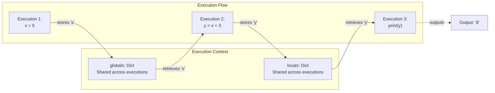
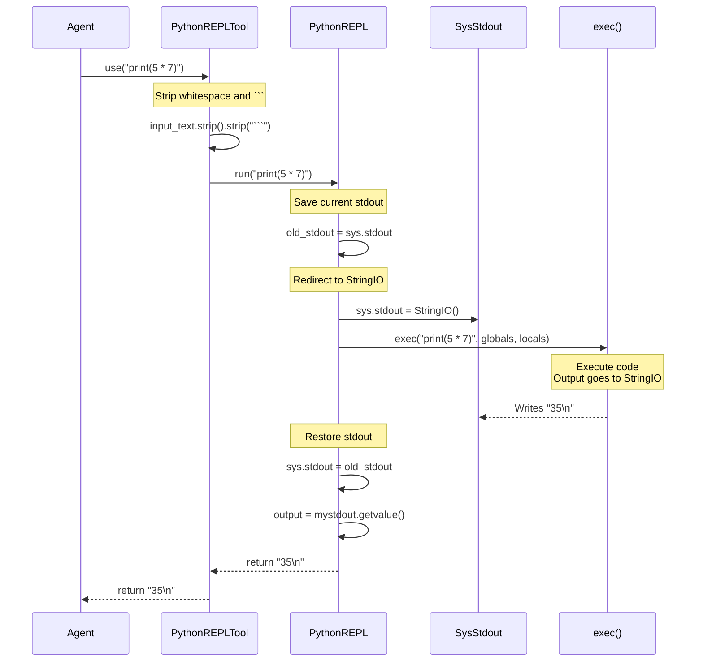
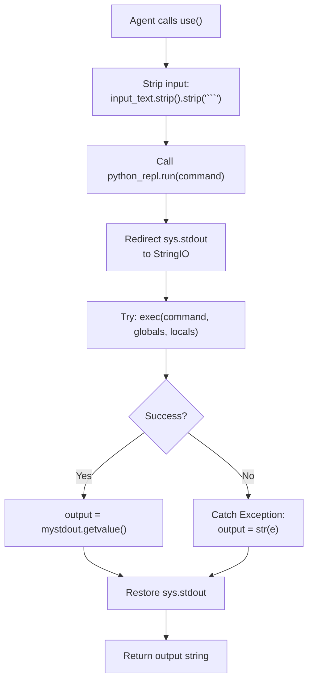
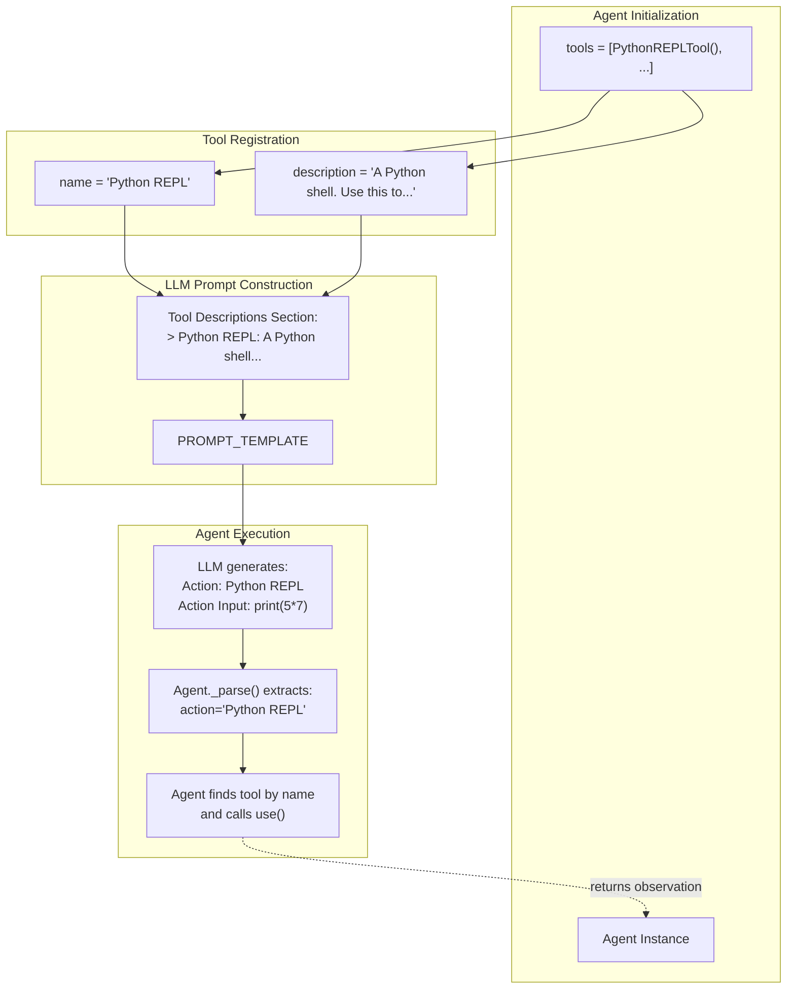

<!-- source: DeepWiki mcp.deepwiki.com · repo mpaepper/llm_agents · page 3.3 PythonREPLTool · fetched 2026-10-27 -->

# PythonREPLTool

<details>
<summary>Relevant source files</summary>

The following files were used as context for generating this wiki page:

- [README.md](README.md)
- [llm_agents/__init__.py](llm_agents/__init__.py)
- [llm_agents/tools/python_repl.py](llm_agents/tools/python_repl.py)
- [llm_agents/tools/searx.py](llm_agents/tools/searx.py)

</details>


This document provides technical documentation for the `PythonREPLTool`, a tool that enables LLM agents to execute Python code dynamically during the reasoning process. The tool allows agents to perform computations, data manipulations, and algorithmic operations that would be difficult or impossible to accomplish through text generation alone.

**Scope**: This page covers the implementation details, execution mechanism, security considerations, and usage patterns of the `PythonREPLTool`. For information about the general tool architecture and how to create custom tools, see [Creating Custom Tools](#3.4). For details about other available tools, see [Tool System](#3).

Sources: [llm_agents/tools/python_repl.py:1-56](), [README.md:17]()

---

## Purpose and Role

The `PythonREPLTool` serves as a code execution environment within the agent's Thought-Action-Observation loop. When an LLM determines that a task requires computational logic—such as calculating Fibonacci numbers, processing data structures, or performing mathematical operations—it generates Python code as the action input. The `PythonREPLTool` executes this code and returns the output as an observation, which the LLM can then use to continue reasoning or provide a final answer.

The tool is particularly valuable for:
- **Mathematical computations**: Complex calculations that exceed LLM reasoning capabilities
- **Algorithmic operations**: Implementing and testing algorithms (sorting, searching, etc.)
- **Data manipulation**: Processing lists, dictionaries, and other data structures
- **Iterative logic**: Loops and conditional logic that are difficult to simulate in natural language

Sources: [llm_agents/tools/python_repl.py:34-43](), [README.md:17]()

---

## Architecture

The `PythonREPLTool` consists of two primary components: the `PythonREPL` execution engine and the `PythonREPLTool` interface wrapper.

### Component Structure

```mermaid
graph TB
    subgraph "Agent Layer"
        Agent["Agent"]
    end
    
    subgraph "Tool Interface Layer"
        ToolInterface["ToolInterface<br/>(ABC)"]
        PythonREPLTool["PythonREPLTool<br/>name: 'Python REPL'<br/>description: '...'"]
    end
    
    subgraph "Execution Engine"
        PythonREPL["PythonREPL<br/>(Pydantic BaseModel)"]
        GlobalsDict["globals: Dict"]
        LocalsDict["locals: Dict"]
    end
    
    subgraph "Python Runtime"
        ExecFunction["exec()<br/>Built-in Function"]
        SysStdout["sys.stdout<br/>Stream Capture"]
    end
    
    Agent -->|"use(code_string)"| PythonREPLTool
    ToolInterface <|-- PythonREPLTool
    PythonREPLTool -->|"run(command)"| PythonREPL
    PythonREPL --> GlobalsDict
    PythonREPL --> LocalsDict
    PythonREPL -->|"exec(command, globals, locals)"| ExecFunction
    PythonREPL -->|"captures output"| SysStdout
    SysStdout -.returns.- PythonREPL
    ExecFunction -.returns.- PythonREPL
    PythonREPL -.returns.- PythonREPLTool
    PythonREPLTool -.returns.- Agent
```

**Diagram: PythonREPLTool Component Architecture**

This diagram shows how the tool integrates with the agent system through the `ToolInterface` contract and how it delegates execution to the internal `PythonREPL` engine.

Sources: [llm_agents/tools/python_repl.py:10-48](), [llm_agents/tools/base.py]()

### Class Hierarchy

| Class | Type | Purpose | Key Attributes |
|-------|------|---------|----------------|
| `ToolInterface` | Abstract Base Class | Defines tool contract | `name`, `description`, `use()` |
| `PythonREPLTool` | Concrete Tool | Tool interface implementation | `name="Python REPL"`, `python_repl` field |
| `PythonREPL` | Pydantic BaseModel | Execution engine | `globals`, `locals`, `run()` method |

Sources: [llm_agents/tools/python_repl.py:10-48]()

---

## Implementation Details

### PythonREPL Execution Engine

The `PythonREPL` class is the core execution engine that maintains execution state and runs Python commands.

**Key Features:**
- **State Persistence**: Maintains `globals` and `locals` dictionaries across multiple executions [llm_agents/tools/python_repl.py:13-14]()
- **Output Capture**: Redirects `sys.stdout` to capture print statements [llm_agents/tools/python_repl.py:18-19]()
- **Exception Handling**: Catches and returns exception messages as strings [llm_agents/tools/python_repl.py:24-26]()
- **Pydantic Validation**: Uses Pydantic's `BaseModel` for structured data [llm_agents/tools/python_repl.py:10]()

**State Management:**


**Diagram: State Persistence Across Executions**

The `PythonREPL` maintains state between executions, allowing variables defined in one execution to be accessed in subsequent executions.

Sources: [llm_agents/tools/python_repl.py:10-27]()

### PythonREPLTool Wrapper

The `PythonREPLTool` class implements the `ToolInterface` contract and provides the agent-facing interface.

**Tool Configuration:**

| Attribute | Value | Purpose |
|-----------|-------|---------|
| `name` | `"Python REPL"` | Identifier used by agent to select this tool |
| `description` | `"A Python shell. Use this to execute python commands..."` | Instructions for the LLM on when and how to use the tool |
| `python_repl` | `PythonREPL` instance | The underlying execution engine |

The description field [llm_agents/tools/python_repl.py:38-43]() is critical as it instructs the LLM to:
1. Use this tool for executing Python commands
2. Provide valid Python code as input
3. Use `print()` statements to see output values

**Input Processing:**
The `use()` method performs preprocessing on the input:
```python
input_text = input_text.strip().strip("```")
```
This removes:
- Leading/trailing whitespace
- Markdown code fence markers (```) that LLMs often include

Sources: [llm_agents/tools/python_repl.py:34-48]()

---

## Execution Flow

### Step-by-Step Execution Process



**Diagram: Code Execution Flow with Output Capture**

This sequence diagram illustrates how the tool captures output by temporarily redirecting `sys.stdout` to a `StringIO` object, executing the code, then restoring the original stdout.

Sources: [llm_agents/tools/python_repl.py:16-27]()

### Error Handling

When an exception occurs during execution, the tool returns the error message as a string:



**Diagram: Error Handling Flow**

The try-except block [llm_agents/tools/python_repl.py:20-26]() ensures that even when code execution fails, the tool returns a meaningful error message to the agent rather than crashing.

Sources: [llm_agents/tools/python_repl.py:16-27]()

---

## Security Considerations

### Critical Security Warnings

⚠️ **WARNING**: The `PythonREPLTool` uses Python's `exec()` function to execute arbitrary code. This presents significant security risks:

1. **Arbitrary Code Execution**: Any code provided to the tool will be executed with the same permissions as the Python process
2. **No Sandboxing**: There are no restrictions on what operations the code can perform
3. **File System Access**: Code can read, write, or delete files
4. **Network Access**: Code can make network requests or open sockets
5. **System Calls**: Code can invoke system commands via `os.system()` or `subprocess`
6. **Resource Exhaustion**: Infinite loops or memory-intensive operations can crash the process

### Risk Mitigation Strategies

While the current implementation does not include security measures, here are recommended mitigations for production use:

| Risk | Mitigation Strategy | Implementation Approach |
|------|---------------------|------------------------|
| File system access | Use restricted execution environment | Run in Docker container with read-only filesystem |
| Network access | Block network calls | Use network namespaces or firewall rules |
| Resource exhaustion | Limit execution time and memory | Use timeout mechanisms and memory limits |
| Malicious imports | Restrict available modules | Use `__builtins__` restrictions or `RestrictedPython` |
| State pollution | Isolate execution contexts | Create new `globals`/`locals` per execution |

### State Persistence Implications

The `PythonREPL` maintains state across executions [llm_agents/tools/python_repl.py:13-14]():
- **Benefits**: Variables can be reused across multiple tool invocations
- **Risks**: 
  - Previous executions can affect subsequent ones
  - Sensitive data may remain in memory
  - Namespace pollution from failed executions

**Default Globals Initialization:**
The factory function `_get_default_python_repl()` [llm_agents/tools/python_repl.py:30-31]() initializes the REPL with the current `globals()`, which includes all imported modules and functions in the scope where the tool is instantiated.

Sources: [llm_agents/tools/python_repl.py:10-31]()

---

## Usage Examples

### Basic Usage in Agent Context

From the README example [README.md:49-52]():

```python
from llm_agents import Agent, ChatLLM, PythonREPLTool

agent = Agent(llm=ChatLLM(), tools=[PythonREPLTool()])
result = agent.run("Calculate the 10th Fibonacci number")
```

The agent will:
1. Receive the question
2. Determine that Python code execution is needed
3. Generate Python code for Fibonacci calculation
4. Use `PythonREPLTool` to execute the code
5. Observe the output
6. Return the final answer

### Direct Tool Usage

The tool can also be used directly [llm_agents/tools/python_repl.py:51-55]():

```python
repl_tool = PythonREPLTool()
result = repl_tool.use('print(5 * 7)')
# result == "35\n"
```

### Multi-Step Execution with State

Due to state persistence, variables defined in one execution are available in subsequent executions:

```python
repl_tool = PythonREPLTool()

# Execution 1: Define a variable
repl_tool.use('x = 10')  # Returns: ""

# Execution 2: Use the variable
result = repl_tool.use('print(x * 2)')  # Returns: "20\n"
```

### Code Fence Handling

The tool automatically strips markdown code fences that LLMs often include [llm_agents/tools/python_repl.py:47]():

```python
# These are equivalent:
repl_tool.use('print("Hello")')
repl_tool.use('```print("Hello")```')
repl_tool.use('```\nprint("Hello")\n```')
```

Sources: [llm_agents/tools/python_repl.py:34-55](), [README.md:49-52]()

---

## Integration with Agent System

### Tool Discovery and Selection

The agent discovers the `PythonREPLTool` through its `name` and `description` attributes:



**Diagram: Tool Registration and Selection Flow**

The agent includes the tool's description in the prompt sent to the LLM, enabling the LLM to understand when and how to use the Python REPL.

Sources: [llm_agents/tools/python_repl.py:37-43](), [llm_agents/agent.py]()

### Observation Integration

When the `PythonREPLTool` executes code, its output becomes an "Observation" in the Thought-Action-Observation loop:

**Example Interaction:**
```
Thought: I need to calculate the factorial of 5
Action: Python REPL
Action Input: 
def factorial(n):
    if n <= 1:
        return 1
    return n * factorial(n-1)
print(factorial(5))

Observation: 120

Thought: I now know the factorial of 5 is 120
Final Answer: The factorial of 5 is 120
```

The observation (the printed output "120") is appended to the agent's conversation history and fed back to the LLM for continued reasoning.

Sources: [README.md:18-22]()

---

## Technical Reference

### PythonREPL Class

**Location**: [llm_agents/tools/python_repl.py:10-27]()

**Inheritance**: `pydantic.BaseModel`

**Fields**:
- `globals: Optional[Dict]` - Global namespace for code execution (default: empty dict)
- `locals: Optional[Dict]` - Local namespace for code execution (default: empty dict)

**Methods**:
- `run(command: str) -> str` - Execute Python code and return output/error as string

**Method Behavior**:
- Redirects `sys.stdout` to `StringIO` to capture print output
- Executes code using `exec(command, self.globals, self.locals)`
- Returns captured output on success
- Returns exception string on error
- Always restores original `sys.stdout`

### PythonREPLTool Class

**Location**: [llm_agents/tools/python_repl.py:34-48]()

**Inheritance**: `ToolInterface`

**Attributes**:
- `name: str = "Python REPL"` - Tool identifier
- `description: str` - Multi-line string describing tool capabilities and usage
- `python_repl: PythonREPL` - Execution engine instance (default factory: `_get_default_python_repl()`)

**Methods**:
- `use(input_text: str) -> str` - Process and execute Python code

**Input Processing**:
1. Strip leading/trailing whitespace
2. Remove markdown code fence markers (```)
3. Pass cleaned code to `python_repl.run()`

### Helper Functions

**`_get_default_python_repl()`**

**Location**: [llm_agents/tools/python_repl.py:30-31]()

**Purpose**: Factory function to create a `PythonREPL` instance initialized with current global namespace

**Returns**: `PythonREPL` with `_globals=globals()` and `_locals=None`

Sources: [llm_agents/tools/python_repl.py:1-56]()

---

## Comparison with Other Tools

| Feature | PythonREPLTool | SerpAPITool | HackerNewsSearchTool |
|---------|----------------|-------------|----------------------|
| Purpose | Code execution | Web search | HN content search |
| External API | No (uses `exec()`) | Yes (SerpAPI) | Yes (HN Algolia) |
| State | Persistent across calls | Stateless | Stateless |
| Security Risk | High (arbitrary code) | Low (API call only) | Low (API call only) |
| Configuration | None required | Requires `SERPAPI_API_KEY` | None required |
| Output Type | Print output or exception | Search results text | Story snippets |

Sources: [llm_agents/tools/python_repl.py:34-48](), [llm_agents/tools/search.py](), [llm_agents/tools/hackernews.py]()

---

## Attribution

The `PythonREPL` implementation is adapted from the langchain library, as noted in the source code comments [llm_agents/tools/python_repl.py:9]():

```python
# Taken from https://github.com/hwchase17/langchain/blob/master/langchain/python.py
```

This acknowledgment reflects the repository's goal of understanding and reimplementing core agent functionality from langchain in a simplified form [README.md:3-7]().

Sources: [llm_agents/tools/python_repl.py:9](), [README.md:3-7]()

---

