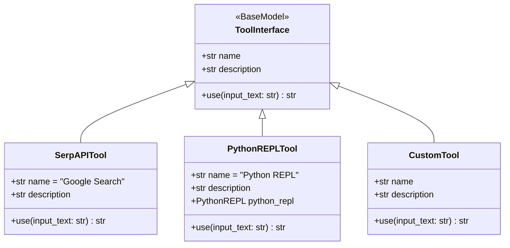
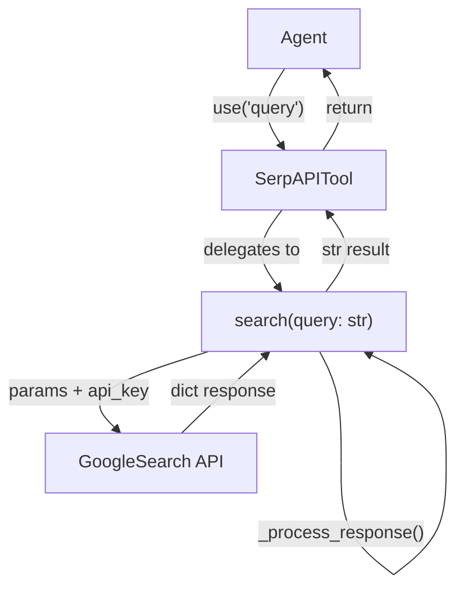
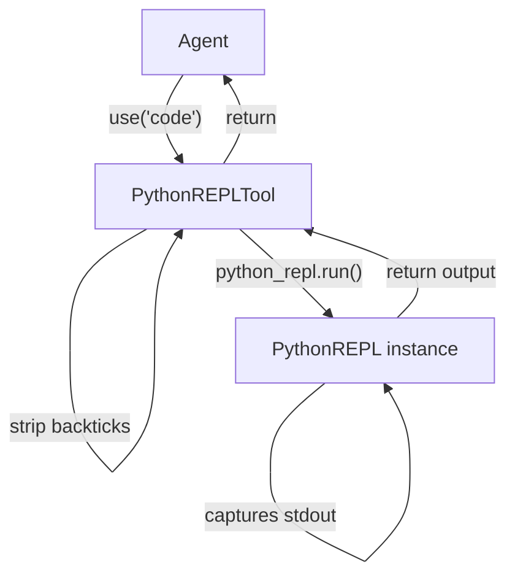
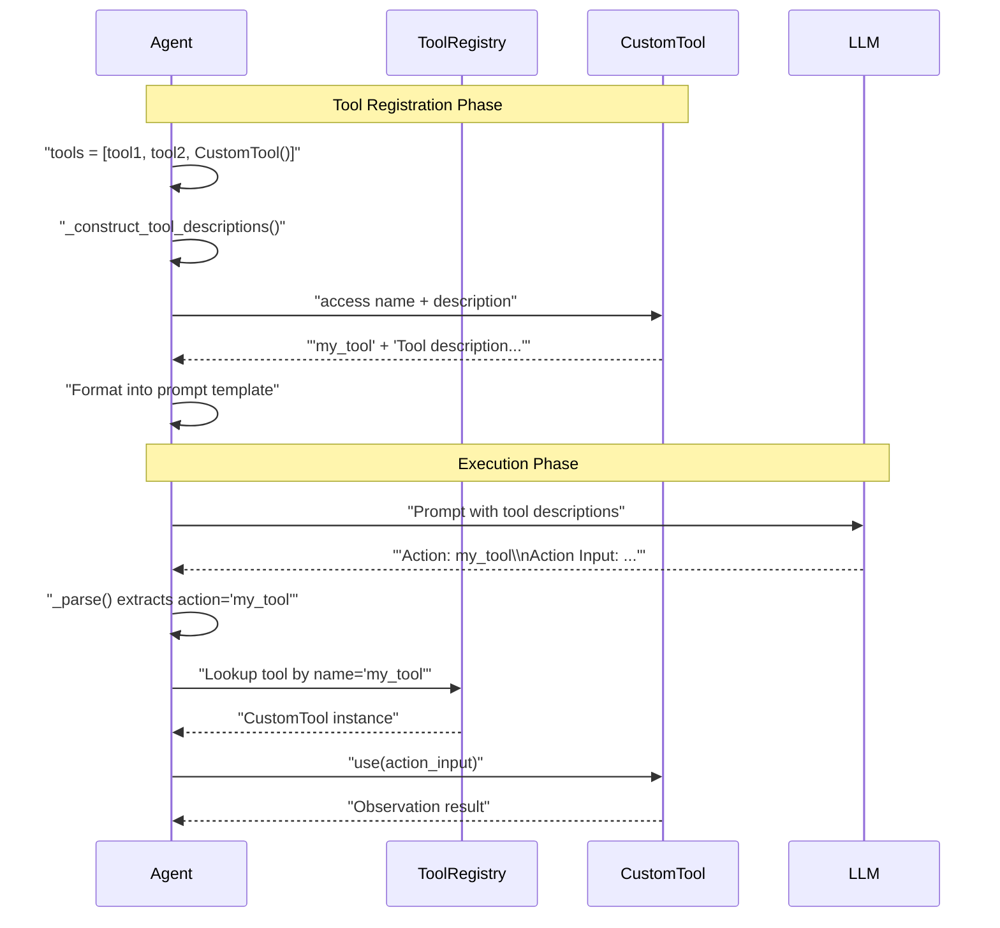
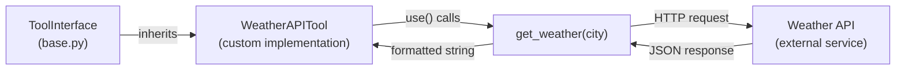

<!-- source: DeepWiki mcp.deepwiki.com · repo mpaepper/llm_agents · page 3.4 Creating Custom Tools · fetched 2026-10-27 -->

# Creating Custom Tools

<details>
<summary>Relevant source files</summary>

The following files were used as context for generating this wiki page:

- [llm_agents/tools/base.py](llm_agents/tools/base.py)
- [llm_agents/tools/python_repl.py](llm_agents/tools/python_repl.py)
- [llm_agents/tools/search.py](llm_agents/tools/search.py)

</details>


This page provides a practical guide for developers to implement custom tools that extend the agent's capabilities. Custom tools enable agents to interact with new APIs, databases, services, or perform specialized computations beyond the built-in tools.

For documentation of the base `ToolInterface` contract, see [ToolInterface](#3.1). For examples of existing tool implementations, see [Search Tools](#3.2) and [PythonREPLTool](#3.3).

## Overview

Custom tools in the llm_agents framework follow a plugin architecture. All tools implement the `ToolInterface` contract, which consists of three required components:

| Component | Type | Purpose |
|-----------|------|---------|
| `name` | `str` | Unique identifier used by the Agent to select the tool |
| `description` | `str` | Natural language description provided to the LLM for tool selection |
| `use()` | method | Executes the tool's functionality and returns a string result |

The Agent discovers tools through their `name` and `description` attributes, which are embedded in the prompt template. When the LLM decides to use a tool, it outputs the tool's `name` and provides input, which the Agent passes to the `use()` method.

Sources: [llm_agents/tools/base.py:1-9]()

## The ToolInterface Contract



**Diagram: ToolInterface inheritance hierarchy showing existing and custom implementations**

The `ToolInterface` class at [llm_agents/tools/base.py:3-9]() inherits from Pydantic's `BaseModel`, providing automatic validation and serialization. All concrete tool implementations must provide values for `name` and `description`, and override the `use()` method.

Sources: [llm_agents/tools/base.py:1-9](), [llm_agents/tools/search.py:74-81](), [llm_agents/tools/python_repl.py:34-48]()

## Implementation Patterns

### Pattern 1: Simple Stateless Tool

The simplest pattern is a stateless tool that wraps a function or API call. The `SerpAPITool` demonstrates this pattern:



**Diagram: SerpAPITool data flow showing stateless delegation pattern**

Key characteristics:
- Class-level attributes for `name` and `description`
- `use()` method delegates to a module-level function
- No instance state beyond the base attributes
- Simple, direct implementation

Implementation at [llm_agents/tools/search.py:74-81]():
- `name = "Google Search"` - class attribute defining tool identifier
- `description` - explains expected input format and output
- `use(input_text)` - calls `search(input_text)` and returns result

Sources: [llm_agents/tools/search.py:74-81](), [llm_agents/tools/search.py:12-26]()

### Pattern 2: Stateful Tool with Dependencies

The `PythonREPLTool` demonstrates a more complex pattern with internal state:



**Diagram: PythonREPLTool showing stateful execution with persistent namespace**

Key characteristics:
- Uses Pydantic `Field` with `default_factory` for complex initialization
- Maintains internal state (`PythonREPL` instance with persistent globals/locals)
- Input preprocessing in `use()` method
- Delegation to a stateful component

Implementation at [llm_agents/tools/python_repl.py:34-48]():
- `python_repl: PythonREPL = Field(default_factory=_get_default_python_repl)` - stateful dependency
- `use()` strips code fence markers before execution
- Each invocation maintains execution context across multiple calls

Sources: [llm_agents/tools/python_repl.py:34-48](), [llm_agents/tools/python_repl.py:10-27](), [llm_agents/tools/python_repl.py:30-31]()

## Step-by-Step Implementation Guide

### Step 1: Define the Tool Class

Create a new class that inherits from `ToolInterface`:

```python
from llm_agents.tools.base import ToolInterface

class MyCustomTool(ToolInterface):
    name: str = "my_custom_tool"
    description: str = "Description of what the tool does and expected input format"
```

### Step 2: Implement the use() Method

The `use()` method receives a string input and must return a string output:

| Input | Type | Purpose |
|-------|------|---------|
| `input_text` | `str` | Action input from LLM, extracted from "Action Input:" in response |

| Output | Type | Purpose |
|--------|------|---------|
| return value | `str` | Observation that will be appended to the conversation history |

Implementation must handle:
- Input validation and parsing
- Error handling (exceptions should be caught and returned as strings)
- Output formatting (convert complex data structures to readable strings)

### Step 3: Choose Initialization Pattern

**For stateless tools:**
```python
class StatelessTool(ToolInterface):
    name = "stateless_tool"
    description = "Tool description"
    
    def use(self, input_text: str) -> str:
        result = some_function(input_text)
        return str(result)
```

**For stateful tools:**
```python
from pydantic import Field

class StatefulTool(ToolInterface):
    name = "stateful_tool"
    description = "Tool description"
    internal_state: SomeType = Field(default_factory=initialize_state)
    
    def use(self, input_text: str) -> str:
        result = self.internal_state.process(input_text)
        return str(result)
```

Sources: [llm_agents/tools/base.py:3-9](), [llm_agents/tools/search.py:74-81](), [llm_agents/tools/python_repl.py:34-48]()

## Tool Discovery and Registration



**Diagram: How Agent discovers and invokes custom tools**

The Agent identifies tools by their `name` attribute. When instantiating an Agent, pass tool instances in the `tools` list parameter:

```python
from llm_agents.agent import Agent
from llm_agents.llm import ChatLLM

# Instantiate custom tool
custom_tool = MyCustomTool()

# Create agent with custom tool
agent = Agent(
    llm=ChatLLM(),
    tools=[custom_tool, other_tool1, other_tool2],
    verbose=True
)

# Agent embeds tool descriptions in prompt
# LLM selects tools by name
result = agent.run("Use my custom tool to...")
```

Sources: [llm_agents/tools/base.py:3-9]()

## Best Practices

### Writing Effective Descriptions

The `description` attribute is critical for tool selection. The LLM uses this text to decide when to use the tool.

| Good Description | Poor Description |
|------------------|------------------|
| "Search for current weather data. Input should be a city name like 'San Francisco'. Returns temperature and conditions." | "Weather tool" |
| "Execute SQL query on customer database. Input should be a valid SELECT statement. Returns result rows as JSON." | "Run SQL" |
| "Calculate mathematical expressions. Input should be a mathematical expression like '(5 + 3) * 2'. Returns the numeric result." | "Math calculator" |

Key elements:
- Specify expected input format with examples
- Describe output format
- Clarify the tool's scope and limitations

Examples from codebase:
- `SerpAPITool.description` at [llm_agents/tools/search.py:78]() includes input example
- `PythonREPLTool.description` at [llm_agents/tools/python_repl.py:38-43]() specifies output requirements

Sources: [llm_agents/tools/search.py:78](), [llm_agents/tools/python_repl.py:38-43]()

### Error Handling

Tools should catch exceptions and return informative error messages as strings:

```python
def use(self, input_text: str) -> str:
    try:
        result = external_api_call(input_text)
        return str(result)
    except APIError as e:
        return f"API Error: {str(e)}"
    except ValidationError as e:
        return f"Invalid input: {str(e)}"
    except Exception as e:
        return f"Unexpected error: {str(e)}"
```

This pattern allows the LLM to understand what went wrong and potentially retry with different input. Example at [llm_agents/tools/python_repl.py:24-26]() where exceptions are caught and returned as strings.

Sources: [llm_agents/tools/python_repl.py:16-27]()

### Environment Variables and Configuration

Tools that require API keys or configuration should follow the pattern used by `SerpAPITool`:

```python
import os

class MyAPITool(ToolInterface):
    name = "my_api_tool"
    description = "..."
    
    def use(self, input_text: str) -> str:
        api_key = os.environ.get("MY_API_KEY")
        if not api_key:
            return "Error: MY_API_KEY environment variable not set"
        
        # Use api_key for external call
        result = call_api(input_text, api_key)
        return result
```

Example at [llm_agents/tools/search.py:19]() shows accessing `SERPAPI_API_KEY` from environment.

Sources: [llm_agents/tools/search.py:12-26]()

### Input Preprocessing

Some tools need to clean or transform LLM output before processing. The `PythonREPLTool` demonstrates this:

```python
def use(self, input_text: str) -> str:
    # Strip markdown code fences that LLMs often include
    input_text = input_text.strip().strip("```")
    return self.python_repl.run(input_text)
```

Implementation at [llm_agents/tools/python_repl.py:47]() strips backticks that LLMs commonly add around code.

Common preprocessing needs:
- Removing markdown formatting
- Parsing JSON or structured input
- URL encoding/decoding
- Trimming whitespace

Sources: [llm_agents/tools/python_repl.py:46-48]()

## Complete Example: Custom Weather Tool



**Diagram: Architecture of a hypothetical custom WeatherAPITool**

Following the patterns from `SerpAPITool` at [llm_agents/tools/search.py:74-81]() and `PythonREPLTool` at [llm_agents/tools/python_repl.py:34-48](), a custom weather tool would:

1. Inherit from `ToolInterface`
2. Define descriptive `name` and `description` attributes
3. Implement `use()` to call weather API
4. Handle errors and return string observations
5. Access API key from environment variables

The tool would be registered with an Agent instance and become available for the LLM to invoke when weather information is needed.

Sources: [llm_agents/tools/base.py:3-9](), [llm_agents/tools/search.py:74-81](), [llm_agents/tools/python_repl.py:34-48]()

## Testing Custom Tools

Custom tools should be tested independently before integration:

```python
if __name__ == '__main__':
    tool = MyCustomTool()
    result = tool.use("test input")
    print(f"Result: {result}")
```

This pattern appears in both [llm_agents/tools/search.py:84-87]() and [llm_agents/tools/python_repl.py:51-55](), allowing tools to be executed and validated as standalone scripts.

For comprehensive testing with mocked dependencies, see [Testing Infrastructure](#5.2) and [Writing Tests](#5.2.3).

Sources: [llm_agents/tools/search.py:84-87](), [llm_agents/tools/python_repl.py:51-55]()

## Common Patterns Summary

| Pattern | Use Case | Example |
|---------|----------|---------|
| Stateless delegation | Simple API wrappers | `SerpAPITool` |
| Stateful with dependencies | Tools requiring context | `PythonREPLTool` |
| Module-level helpers | Complex processing logic | `search()` and `_process_response()` |
| Context managers | Resource management | `HiddenPrints` in search.py |
| Pydantic Fields | Complex initialization | `python_repl` field with `default_factory` |

Sources: [llm_agents/tools/search.py:1-88](), [llm_agents/tools/python_repl.py:1-56](), [llm_agents/tools/base.py:1-9]()

---

