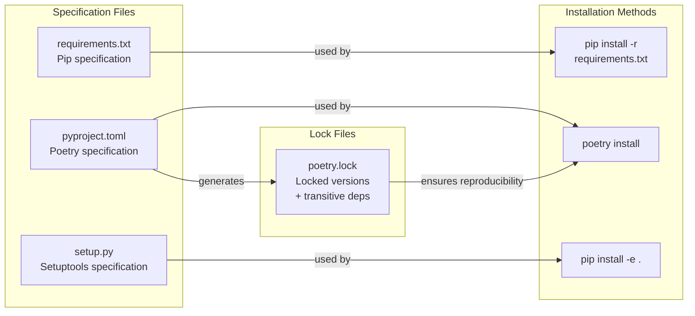
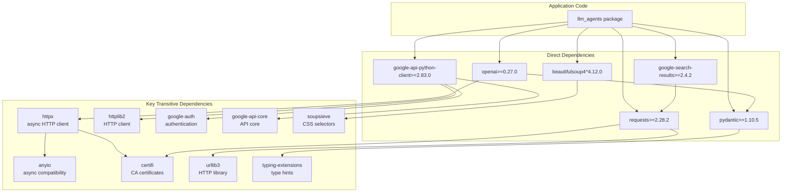
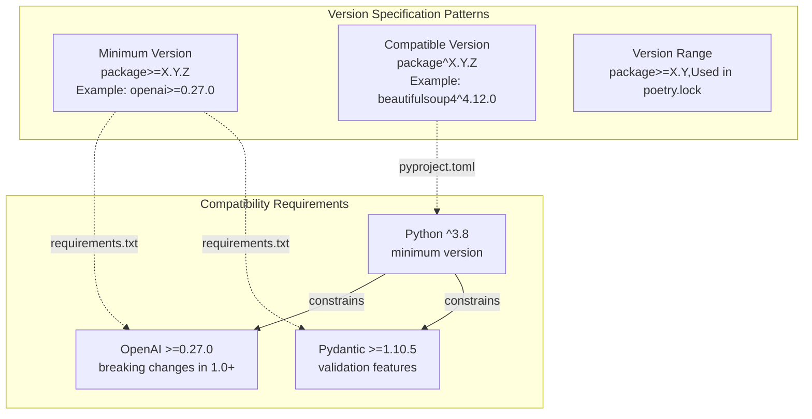
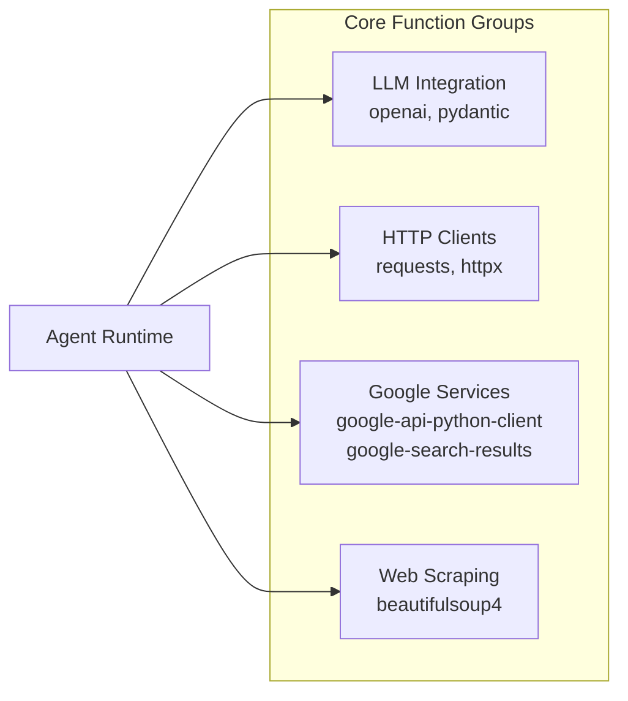
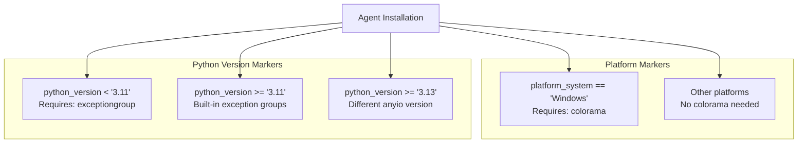

<!-- source: DeepWiki mcp.deepwiki.com · repo mpaepper/llm_agents · page 4.2 Python Dependencies · fetched 2026-10-27 -->

# Python Dependencies

<details>
<summary>Relevant source files</summary>

The following files were used as context for generating this wiki page:

- [poetry.lock](poetry.lock)
- [pyproject.toml](pyproject.toml)
- [requirements.txt](requirements.txt)
- [setup.py](setup.py)

</details>


This document provides a detailed breakdown of all Python package dependencies used in the llm_agents project and their purposes. For information about external API credentials and service integration, see [Required API Keys](#4.1). For build system configuration details, see [Build and Packaging](#5.3).

## Overview

The llm_agents project uses multiple dependency specification files to ensure consistent installation across environments:

- **requirements.txt** - Minimal runtime dependencies for pip-based installation
- **pyproject.toml** - Poetry-based dependency specification with version constraints
- **poetry.lock** - Locked versions of all dependencies and transitive dependencies
- **setup.py** - Setuptools-based installation configuration

Sources: [requirements.txt:1-5](), [pyproject.toml:16-23](), [setup.py:11-16]()

## Dependency Management Files



**Diagram: Dependency specification and installation workflow**

Sources: [pyproject.toml:1-89](), [requirements.txt:1-5](), [setup.py:1-22](), [poetry.lock:1-3]()

## Core Runtime Dependencies

### LLM Integration Dependencies

| Package | Version | Purpose | Used By |
|---------|---------|---------|---------|
| `openai` | >=0.27.0 | OpenAI API client for GPT model integration | ChatLLM class for LLM interactions |
| `pydantic` | >=1.10.5 | Data validation and settings management | Input validation throughout codebase |

**OpenAI Package** ([requirements.txt:1](), [pyproject.toml:18]())
- Provides the official OpenAI API client
- Used by the ChatLLM component to communicate with GPT models
- Transitive dependencies include `httpx`, `anyio`, `distro`, and `jiter` for async HTTP and JSON parsing

**Pydantic Package** ([requirements.txt:2](), [pyproject.toml:19]())
- Provides data validation using Python type annotations
- Used for validating tool inputs and API responses
- Transitive dependencies include `typing-extensions` and `annotated-types`

Sources: [requirements.txt:1-2](), [pyproject.toml:18-19](), [poetry.lock:18-41](), [poetry.lock:651-735]()

### HTTP and Web Scraping Dependencies

| Package | Version | Purpose | Used By |
|---------|---------|---------|---------|
| `requests` | >=2.28.2 | HTTP client library | Tool implementations for API calls |
| `beautifulsoup4` | ^4.12.0 | HTML parsing and web scraping | HackerNewsSearchTool for parsing HTML |

**Requests Package** ([requirements.txt:3](), [pyproject.toml:20]())
- Standard HTTP library for Python
- Used by multiple tool implementations for making HTTP requests
- Transitive dependencies include `urllib3`, `certifi`, `charset-normalizer`, and `idna`

**BeautifulSoup4 Package** ([pyproject.toml:23]())
- HTML/XML parser for web scraping
- Used by HackerNewsSearchTool to parse Hacker News search results
- Transitive dependency on `soupsieve` for CSS selector support

Sources: [requirements.txt:3](), [pyproject.toml:20,23](), [poetry.lock:65-86]()

### Google API Dependencies

| Package | Version | Purpose | Used By |
|---------|---------|---------|---------|
| `google-api-python-client` | >=2.83.0 | Google API client library | GoogleSearchTool for Custom Search API |
| `google-search-results` | >=2.4.2 | SerpAPI client library | SerpAPITool for Google Search via SerpAPI |

**Google API Python Client** ([requirements.txt:4](), [pyproject.toml:21]())
- Official Google API client supporting multiple Google services
- Used by GoogleSearchTool to access Google Custom Search API
- Transitive dependencies include:
  - `google-auth` - Authentication for Google APIs
  - `google-auth-httplib2` - httplib2 transport for Google Auth
  - `google-api-core` - Core functionality for Google API clients
  - `googleapis-common-protos` - Common Protocol Buffer definitions
  - `httplib2` - HTTP client library
  - `uritemplate` - URI template expansion

**Google Search Results** ([requirements.txt:5](), [pyproject.toml:22]())
- SerpAPI client for web search results
- Used by SerpAPITool to perform Google searches via SerpAPI service
- Depends on `requests` for HTTP communication

Sources: [requirements.txt:4-5](), [pyproject.toml:21-22](), [poetry.lock:456-473](), [poetry.lock:518-530]()

## Development and Testing Dependencies

The following dependencies are only required for development and testing, not for runtime execution:

| Package | Version | Purpose |
|---------|---------|---------|
| `pytest` | ^7.4.0 | Test framework |
| `pytest-cov` | ^4.1.0 | Code coverage plugin for pytest |
| `pytest-mock` | ^3.11.1 | Mocking support for pytest |

**Testing Stack Configuration** ([pyproject.toml:25-29]())
- All testing dependencies are specified in the `[tool.poetry.group.dev.dependencies]` section
- These are not installed in production environments
- `pytest` serves as the test runner with extensive configuration in [pyproject.toml:34-54]()
- `pytest-cov` provides code coverage measurement with 80% minimum threshold requirement
- `pytest-mock` simplifies mocking external dependencies in tests

Sources: [pyproject.toml:25-29](), [pyproject.toml:34-54]()

## Dependency Tree



**Diagram: Core dependency relationships showing direct and key transitive dependencies**

Sources: [poetry.lock:1-3000]()

## Important Transitive Dependencies

While not directly specified in requirements.txt, these transitive dependencies provide critical functionality:

### HTTP and Network Layer

| Package | Brought in by | Purpose |
|---------|---------------|---------|
| `httpx` | openai | Modern async HTTP client used by OpenAI SDK |
| `httpcore` | httpx | Low-level HTTP protocol implementation |
| `h11` | httpcore | HTTP/1.1 protocol implementation |
| `anyio` | httpx | Async I/O compatibility layer |
| `urllib3` | requests | HTTP connection pooling and retry logic |
| `certifi` | requests, httpx | Mozilla's CA certificate bundle |
| `idna` | requests, httpx | Internationalized domain name support |

Sources: [poetry.lock:599-622](), [poetry.lock:562-582](), [poetry.lock:550-560](), [poetry.lock:18-63]()

### Google Services Layer

| Package | Brought in by | Purpose |
|---------|---------------|---------|
| `google-auth` | google-api-python-client | Authentication for Google APIs |
| `google-api-core` | google-api-python-client | Core Google API functionality |
| `googleapis-common-protos` | google-api-core | Protocol buffer definitions |
| `protobuf` | googleapis-common-protos | Protocol buffer serialization |
| `cachetools` | google-auth | Caching utilities for auth tokens |
| `rsa` | google-auth | RSA encryption for authentication |
| `pyasn1-modules` | google-auth | ASN.1 parsing for certificates |

Sources: [poetry.lock:475-500](), [poetry.lock:428-454](), [poetry.lock:532-548]()

### Data Validation and Parsing

| Package | Brought in by | Purpose |
|---------|---------------|---------|
| `jiter` | openai | Fast JSON iterator for streaming responses |
| `typing-extensions` | pydantic, openai | Backport of newer typing features |
| `annotated-types` | pydantic | Type annotation utilities |
| `soupsieve` | beautifulsoup4 | CSS selector support for HTML parsing |

Sources: [poetry.lock:651-735](), [poetry.lock:4-17]()

## Version Constraints and Compatibility



**Diagram: Version constraint patterns used across dependency files**

**Version Constraint Patterns:**

1. **Minimum Version (`>=`)** - Used in requirements.txt and setup.py
   - Allows any version greater than or equal to specified version
   - Example: `openai>=0.27.0` allows 0.27.x, 0.28.x, 1.x, etc.

2. **Caret Version (`^`)** - Used in pyproject.toml (Poetry syntax)
   - Allows upgrades that do not modify left-most non-zero version number
   - Example: `^4.12.0` allows 4.12.1, 4.13.0, but not 5.0.0

3. **Exact Version** - Used in poetry.lock
   - Pins exact version for reproducible builds
   - Example: `openai = "1.x.y"` in poetry.lock

**Python Version Support** ([pyproject.toml:17]())
- Minimum Python version: 3.8
- Specified as `python = "^3.8"` in pyproject.toml
- Ensures compatibility with older Python versions while supporting newer ones

Sources: [requirements.txt:1-5](), [pyproject.toml:17-23](), [poetry.lock:1-10]()

## Dependency Groups

### Production Group (Main Dependencies)

All packages required for running the agent in production:



**Diagram: Production dependency groups by functional category**

Sources: [pyproject.toml:16-23](), [requirements.txt:1-5]()

### Development Group (Dev Dependencies)

Only required for development and testing:

| Package | Purpose | Configuration |
|---------|---------|---------------|
| pytest | Test execution | [pyproject.toml:34-54]() |
| pytest-cov | Coverage measurement | 80% minimum threshold required |
| pytest-mock | Test mocking | Simplifies fixture creation |

**Additional Dev Tools:**
- `coverage` (transitive via pytest-cov) - Code coverage measurement engine
- `iniconfig` (transitive via pytest) - INI file parsing for pytest.ini
- `exceptiongroup` (transitive via pytest) - Exception group support for Python <3.11

Sources: [pyproject.toml:25-29](), [poetry.lock:227-314](), [poetry.lock:409-426]()

## Locked Versions (poetry.lock)

The poetry.lock file contains 50+ packages with exact version pins. Key locked versions include:

| Package Category | Example Locked Versions |
|------------------|------------------------|
| Core | openai==specific.version, pydantic==specific.version |
| HTTP | requests==specific.version, httpx==0.28.1 |
| Google | google-api-python-client==2.172.0 |
| Testing | pytest==specific.version, coverage==7.6.1 or 7.9.1 |
| Utilities | beautifulsoup4==4.13.4 |

**Poetry Lock Benefits:**
1. **Reproducible Builds** - Same versions installed across all environments
2. **Transitive Dependency Tracking** - All sub-dependencies explicitly listed
3. **Platform-Specific Builds** - Different versions for different Python versions (e.g., coverage has separate wheels for Python 3.13)
4. **Hash Verification** - File hashes ensure package integrity

Sources: [poetry.lock:1-100](), [poetry.lock:456-473](), [poetry.lock:65-86]()

## Platform-Specific Dependencies

Some dependencies have platform-specific variations specified in poetry.lock:



**Diagram: Conditional dependencies based on platform and Python version**

**Platform Markers Examples:**
- `colorama` - Windows terminal color support ([poetry.lock:214-224]())
- `exceptiongroup` - Python <3.11 exception group backport ([poetry.lock:409-426]())
- `anyio` - Different versions for Python 3.13+ ([poetry.lock:18-63]())

Sources: [poetry.lock:214-224](), [poetry.lock:409-426](), [poetry.lock:18-63]()

## Installation Methods

### Method 1: pip with requirements.txt

```bash
pip install -r requirements.txt
```

Installs only the core runtime dependencies with minimum version constraints. Does not install development dependencies or use locked versions.

Sources: [requirements.txt:1-5]()

### Method 2: Poetry (Recommended)

```bash
poetry install
```

- Installs all dependencies from poetry.lock with exact versions
- Includes development dependencies by default
- Ensures reproducible builds across environments
- Use `poetry install --no-dev` to exclude development dependencies

Sources: [pyproject.toml:1-89](), [poetry.lock:1-3]()

### Method 3: setuptools (Editable Install)

```bash
pip install -e .
```

Uses setup.py to install the package in editable mode with dependencies. Useful for development when you want changes to code immediately reflected without reinstallation.

Sources: [setup.py:1-22]()

## Dependency Update Strategy

**Version Pinning Philosophy:**
- **requirements.txt** - Minimum versions only (`>=`) for maximum compatibility
- **pyproject.toml** - Compatible versions (`^`) for stable upgrades
- **poetry.lock** - Exact versions for reproducible builds

**Updating Dependencies:**
1. Modify version constraints in pyproject.toml
2. Run `poetry update` to regenerate poetry.lock
3. Run test suite to verify compatibility
4. Update requirements.txt if minimum versions change

Sources: [pyproject.toml:16-29](), [requirements.txt:1-5]()

---

