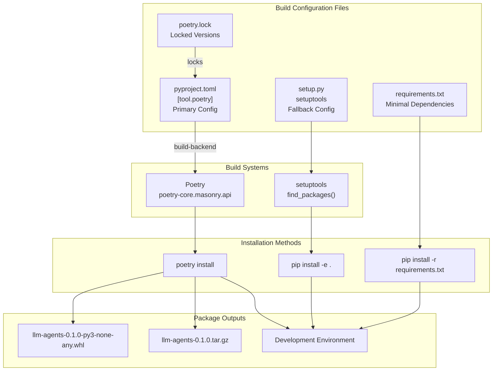
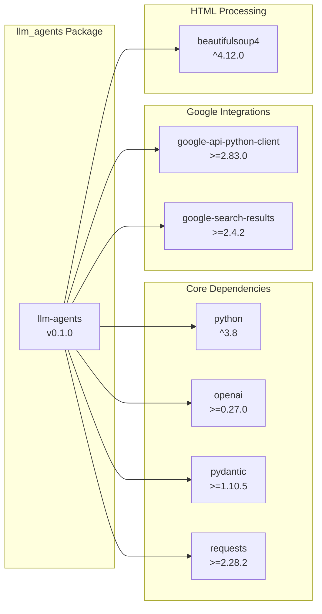
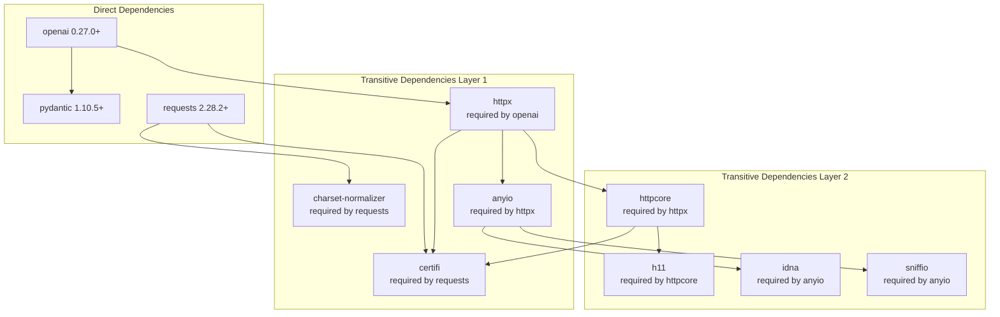
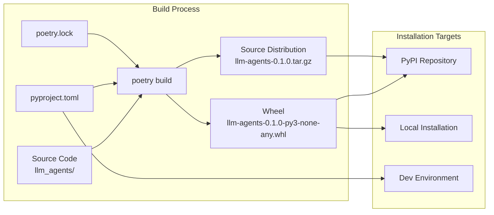

<!-- source: DeepWiki mcp.deepwiki.com · repo mpaepper/llm_agents · page 5.3 Build and Packaging · fetched 2026-10-27 -->

# Build and Packaging

<details>
<summary>Relevant source files</summary>

The following files were used as context for generating this wiki page:

- [poetry.lock](poetry.lock)
- [pyproject.toml](pyproject.toml)
- [requirements.txt](requirements.txt)
- [setup.py](setup.py)

</details>


This page documents the build system, dependency management, and packaging configuration for the llm_agents project. It explains how Poetry and setuptools are used for dependency resolution, version locking, and distribution.

For information about project structure and organization, see [Project Structure](#5.1). For details about running tests with pytest configuration, see [Running Tests](#5.2.2).

---

## Build System Architecture

The llm_agents project uses a **dual build configuration** approach with Poetry as the primary build tool and setuptools as a fallback option. This provides flexibility for different installation methods while maintaining reproducible builds through dependency locking.



**Sources:** [pyproject.toml:1-89](), [setup.py:1-22](), [requirements.txt:1-5](), [poetry.lock:1-100]()

---

## Project Metadata

Project metadata is defined in [pyproject.toml:1-14]() under the `[tool.poetry]` section:

| Metadata Field | Value | Purpose |
|---------------|-------|---------|
| `name` | `"llm-agents"` | Package name for distribution |
| `version` | `"0.1.0"` | Semantic version number |
| `description` | Agent building package description | PyPI description |
| `authors` | `["Marc Päpper <marc@paepper.com>"]` | Package maintainer |
| `license` | `"MIT"` | Open source license |
| `homepage` | GitHub repository URL | Project website |
| `repository` | GitHub repository URL | Source code location |
| `readme` | `"README.md"` | Long description file |

The `packages` field specifies the source package: `[{include = "llm_agents"}]`. This tells Poetry to include only the `llm_agents` directory in the distribution.

The `classifiers` field provides PyPI trove classifiers for categorization:
- `"Programming Language :: Python :: 3"`
- `"License :: OSI Approved :: MIT License"`

**Sources:** [pyproject.toml:1-14](), [setup.py:3-20]()

---

## Dependency Specification

### Runtime Dependencies

Runtime dependencies are specified in [pyproject.toml:16-23]() and [requirements.txt:1-5](). The project requires Python 3.8 or higher and five main dependencies:



**Dependency Details:**

| Package | Version Constraint | Purpose |
|---------|-------------------|---------|
| `openai` | `>=0.27.0` | OpenAI API client for ChatLLM |
| `pydantic` | `>=1.10.5` | Data validation and type hints |
| `requests` | `>=2.28.2` | HTTP client for tool APIs |
| `google-api-python-client` | `>=2.83.0` | Google Custom Search API |
| `google-search-results` | `>=2.4.2` | SerpAPI client wrapper |
| `beautifulsoup4` | `^4.12.0` | HTML parsing for search tools |

**Version Constraint Syntax:**
- `>=X.Y.Z` - Minimum version, allows any newer version
- `^X.Y.Z` - Compatible version, allows updates within major version (Poetry syntax)

**Sources:** [pyproject.toml:16-23](), [requirements.txt:1-5](), [setup.py:11-16]()

### Development Dependencies

Development dependencies are specified in [pyproject.toml:25-28]() under `[tool.poetry.group.dev.dependencies]`:

| Package | Version | Purpose |
|---------|---------|---------|
| `pytest` | `^7.4.0` | Test framework |
| `pytest-cov` | `^4.1.0` | Coverage reporting |
| `pytest-mock` | `^3.11.1` | Mocking utilities |

These dependencies are only installed in development environments and are excluded from production distributions.

**Sources:** [pyproject.toml:25-28]()

---

## Dependency Lock File

The [poetry.lock]() file contains the complete dependency tree with exact versions for reproducible installations. It is automatically generated by Poetry and should be committed to version control.

### Lock File Structure



### Key Locked Packages

The lock file includes detailed metadata for each package:

**Example Lock Entry Structure** (from [poetry.lock:3-17]()):
```toml
[[package]]
name = "annotated-types"
version = "0.7.0"
description = "Reusable constraint types to use with typing.Annotated"
optional = false
python-versions = ">=3.8"
groups = ["main"]
files = [
    {file = "annotated_types-0.7.0-py3-none-any.whl", hash = "sha256:..."},
    {file = "annotated_types-0.7.0.tar.gz", hash = "sha256:..."},
]
```

Each entry includes:
- Exact version number
- Python version compatibility
- Dependency group (`main` or `dev`)
- File hashes for integrity verification
- Platform-specific wheels

**Sources:** [poetry.lock:1-100]()

---

## Build Backend Configuration

### Poetry Build Backend

The build backend is specified in [pyproject.toml:87-89]():

```toml
[build-system]
requires = ["poetry-core"]
build-backend = "poetry.core.masonry.api"
```

This configuration:
- Uses `poetry-core` as the build dependency (PEP 517)
- Specifies `poetry.core.masonry.api` as the build backend
- Enables isolation from the local environment during builds
- Supports creation of wheel and source distributions

### Setuptools Configuration

The alternative [setup.py]() configuration uses traditional setuptools:

**Key Functions:**
- `find_packages()` - Automatically discovers Python packages ([setup.py:10]())
- `setup()` - Defines package metadata and dependencies ([setup.py:3-21]())

**Sources:** [pyproject.toml:87-89](), [setup.py:1-22]()

---

## Test Configuration Scripts

The project defines test execution entry points in [pyproject.toml:30-32]():

```toml
[tool.poetry.scripts]
test = "run_tests:main"
tests = "run_tests:main"
```

These create console scripts that map to the `main` function in the `run_tests` module, allowing execution via `poetry run test` or `poetry run tests`.

**Sources:** [pyproject.toml:30-32]()

---

## Package Building and Distribution

### Building with Poetry



### Build Commands

| Command | Purpose | Output |
|---------|---------|--------|
| `poetry build` | Create wheel and sdist | `dist/*.whl`, `dist/*.tar.gz` |
| `poetry install` | Install with locked dependencies | Development environment |
| `poetry install --no-dev` | Install without dev dependencies | Production environment |
| `poetry export -f requirements.txt` | Export to requirements.txt | Dependency list |

### Installation Methods

**Development Installation:**
```bash
# Using Poetry (recommended)
poetry install

# Using pip with editable install
pip install -e .

# Using requirements.txt
pip install -r requirements.txt
```

**Production Installation:**
```bash
# From source with Poetry
poetry install --no-dev

# From built wheel
pip install dist/llm_agents-0.1.0-py3-none-any.whl

# From PyPI (if published)
pip install llm-agents
```

**Sources:** [pyproject.toml:87-89](), [setup.py:1-22]()

---

## Version Management

The project version is defined in two locations for compatibility:

| File | Location | Value |
|------|----------|-------|
| `pyproject.toml` | [pyproject.toml:3]() | `version = "0.1.0"` |
| `setup.py` | [setup.py:5]() | `version='0.1.0'` |

Both must be updated together when releasing new versions. The project follows semantic versioning:
- **Major version** (0.x.x): Breaking changes
- **Minor version** (x.1.x): New features, backward compatible
- **Patch version** (x.x.0): Bug fixes

**Sources:** [pyproject.toml:3](), [setup.py:5]()

---

## Build System Comparison

The dual configuration provides flexibility:

| Feature | Poetry (`pyproject.toml`) | Setuptools (`setup.py`) |
|---------|--------------------------|-------------------------|
| Dependency locking | ✓ Via `poetry.lock` | ✗ No lock file |
| Version resolution | ✓ Automatic | Manual with pip |
| Dev dependencies | ✓ Separate groups | Manual extras |
| Build isolation | ✓ PEP 517 | ✓ PEP 517 capable |
| Reproducibility | ✓ Locked versions | ✗ Depends on environment |
| Tool integration | ✓ poetry CLI | Standard pip/setuptools |

**Recommendation:** Use Poetry for development and CI/CD. The `setup.py` provides a fallback for environments without Poetry.

**Sources:** [pyproject.toml:1-89](), [setup.py:1-22](), [requirements.txt:1-5]()

---

