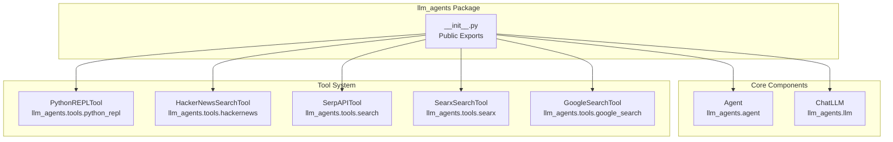
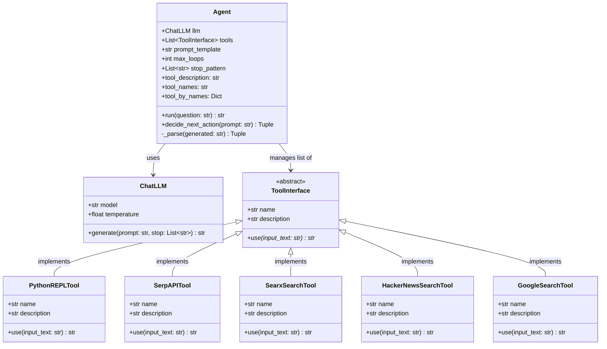
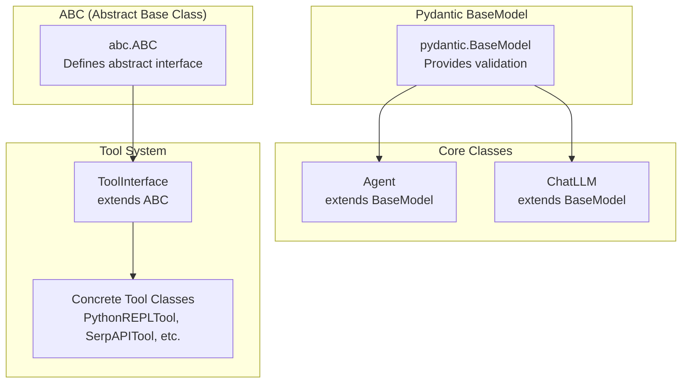
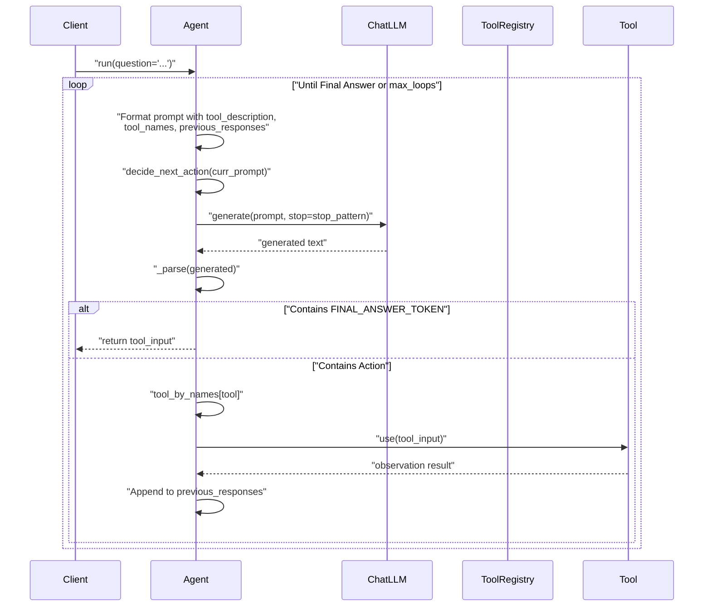

<!-- source: DeepWiki mcp.deepwiki.com · repo mpaepper/llm_agents · page 6 API Reference · fetched 2026-10-27 -->

# API Reference

<details>
<summary>Relevant source files</summary>

The following files were used as context for generating this wiki page:

- [llm_agents/__init__.py](llm_agents/__init__.py)
- [llm_agents/agent.py](llm_agents/agent.py)
- [llm_agents/llm.py](llm_agents/llm.py)
- [llm_agents/tools/searx.py](llm_agents/tools/searx.py)

</details>


This page provides a comprehensive technical reference for all public classes, methods, and interfaces in the `llm_agents` package. It serves as an index to the detailed API documentation for each component.

For architectural concepts and design patterns, see [Core Architecture](#2). For implementation guides and examples, see [Development Guide](#5).

## Scope of Documentation

This API reference covers:

- **Public classes** exported from `llm_agents.__init__.py`
- **Class constructors** with parameter specifications
- **Public methods** with signatures, parameters, and return types
- **Class attributes** and properties
- **Constants and templates** used by the framework

This documentation focuses on the programmatic interface. For usage examples, see [Quick Start Example](#1.2). For creating custom tools, see [Creating Custom Tools](#3.4).

## Public API Surface

The `llm_agents` package exports the following public interface:

```python
from llm_agents import (
    Agent,              # Main orchestrator class
    ChatLLM,            # OpenAI LLM integration
    PythonREPLTool,     # Python code execution tool
    HackerNewsSearchTool,  # Hacker News search tool
    SerpAPITool,        # SerpAPI search tool
    SearxSearchTool,    # Searx search tool
    GoogleSearchTool    # Google Custom Search tool
)
```

Sources: [llm_agents/__init__.py:1-10]()

### API Structure Overview



Sources: [llm_agents/__init__.py:1-10]()

## Core Class Hierarchy

The following diagram shows the relationships between core classes at the code level, including actual class attributes and method signatures:



Sources: [llm_agents/agent.py:36-95](), [llm_agents/llm.py:8-20](), [llm_agents/tools/searx.py:74-81]()

## Class Reference Summary

| Class | Module | Purpose | Detailed Reference |
|-------|--------|---------|-------------------|
| `Agent` | `llm_agents.agent` | Orchestrates the Thought-Action-Observation loop, manages tools, and coordinates LLM calls | [Agent API](#6.1) |
| `ChatLLM` | `llm_agents.llm` | Interfaces with OpenAI API to generate LLM responses | [ChatLLM API](#6.2) |
| `ToolInterface` | `llm_agents.tools.base` | Abstract base class defining the tool contract | [Tool APIs](#6.3) |
| `PythonREPLTool` | `llm_agents.tools.python_repl` | Executes Python code in an isolated environment | [Tool APIs](#6.3) |
| `SerpAPITool` | `llm_agents.tools.search` | Searches the web using SerpAPI service | [Tool APIs](#6.3) |
| `GoogleSearchTool` | `llm_agents.tools.google_search` | Searches using Google Custom Search API | [Tool APIs](#6.3) |
| `SearxSearchTool` | `llm_agents.tools.searx` | Searches using a Searx instance | [Tool APIs](#6.3) |
| `HackerNewsSearchTool` | `llm_agents.tools.hackernews` | Searches Hacker News stories and content | [Tool APIs](#6.3) |

Sources: [llm_agents/__init__.py:1-10]()

## Key Constants and Templates

The framework defines several important constants used throughout the agent execution:

| Constant | Value | Location | Purpose |
|----------|-------|----------|---------|
| `FINAL_ANSWER_TOKEN` | `"Final Answer:"` | [llm_agents/agent.py:11]() | Signals completion of reasoning loop |
| `OBSERVATION_TOKEN` | `"Observation:"` | [llm_agents/agent.py:12]() | Prefixes tool execution results |
| `THOUGHT_TOKEN` | `"Thought:"` | [llm_agents/agent.py:13]() | Prefixes reasoning steps |
| `PROMPT_TEMPLATE` | Multi-line template | [llm_agents/agent.py:14-33]() | Default prompt structure for agent |

Sources: [llm_agents/agent.py:11-33]()

### Prompt Template Structure

The `PROMPT_TEMPLATE` constant defines the prompt structure used by the Agent:

```
Today is {today} and you can use tools to get new information. Answer the question as best as you can using the following tools: 

{tool_description}

Use the following format:

Question: the input question you must answer
Thought: comment on what you want to do next
Action: the action to take, exactly one element of [{tool_names}]
Action Input: the input to the action
Observation: the result of the action
... (this Thought/Action/Action Input/Observation repeats N times)
Thought: I now know the final answer
Final Answer: your final answer to the original input question

Begin!

Question: {question}
Thought: {previous_responses}
```

This template includes placeholders for:
- `{today}` - Current date via `datetime.date.today()`
- `{tool_description}` - Concatenated tool names and descriptions
- `{tool_names}` - Comma-separated list of available tool names
- `{question}` - User's input question
- `{previous_responses}` - Accumulated Thought/Action/Observation history

Sources: [llm_agents/agent.py:14-33](), [llm_agents/agent.py:59-65]()

## Base Types and Inheritance



**Agent and ChatLLM**: Both extend `pydantic.BaseModel`, providing automatic validation, type checking, and serialization capabilities. This allows declarative configuration with type hints.

**ToolInterface**: Extends `abc.ABC` (Abstract Base Class), enforcing that all concrete tool implementations must provide `name`, `description`, and `use()` method.

Sources: [llm_agents/agent.py:4](), [llm_agents/agent.py:36](), [llm_agents/llm.py:4](), [llm_agents/llm.py:8]()

## Method Signature Patterns

### Agent Methods

The `Agent` class follows these signature patterns:

```python
# Main entry point
run(question: str) -> str

# Decision making
decide_next_action(prompt: str) -> Tuple[str, str, str]  # (generated, tool, tool_input)

# Internal parsing
_parse(generated: str) -> Tuple[str, str]  # (tool, tool_input)
```

Sources: [llm_agents/agent.py:56-94]()

### ChatLLM Methods

The `ChatLLM` class has a single public method:

```python
generate(prompt: str, stop: List[str] = None) -> str
```

Sources: [llm_agents/llm.py:13-20]()

### Tool Methods

All tools implement the `ToolInterface` contract:

```python
use(input_text: str) -> str
```

Sources: [llm_agents/tools/searx.py:80-81]()

## Data Flow Through API



This diagram shows the actual method calls and data flow through the public API:

1. Client calls `Agent.run(question)`
2. Agent formats prompt using properties: `tool_description`, `tool_names`
3. Agent calls `decide_next_action(curr_prompt)`
4. Which calls `ChatLLM.generate(prompt, stop)`
5. Agent calls `_parse(generated)` to extract action
6. Agent looks up tool via `tool_by_names` dictionary property
7. Agent calls `Tool.use(tool_input)`
8. Result appended to `previous_responses` list

Sources: [llm_agents/agent.py:56-79](), [llm_agents/agent.py:80-83](), [llm_agents/agent.py:85-94]()

## Configuration and Defaults

### Agent Configuration

```python
Agent(
    llm: ChatLLM,                          # Required
    tools: List[ToolInterface],            # Required
    prompt_template: str = PROMPT_TEMPLATE,  # Optional, default provided
    max_loops: int = 15,                   # Optional, default 15
    stop_pattern: List[str] = ['\nObservation:', '\n\tObservation:']  # Optional
)
```

Sources: [llm_agents/agent.py:36-42]()

### ChatLLM Configuration

```python
ChatLLM(
    model: str = 'gpt-3.5-turbo',  # Optional, defaults to GPT-3.5-Turbo
    temperature: float = 0.0        # Optional, defaults to deterministic
)
```

**Environment Variables Required**:
- `OPENAI_API_KEY` must be set in environment

Sources: [llm_agents/llm.py:8-11]()

### Tool Configuration

Tools are instantiated without parameters but may require environment variables:

| Tool | Required Environment Variables |
|------|-------------------------------|
| `SerpAPITool` | `SERPAPI_API_KEY` |
| `GoogleSearchTool` | `GOOGLE_API_KEY`, `GOOGLE_CSE_ID` |
| `SearxSearchTool` | `SEARX_INSTANCE_URL` |
| `HackerNewsSearchTool` | None |
| `PythonREPLTool` | None |

For details on configuring API keys, see [Required API Keys](#4.1).

Sources: [llm_agents/tools/searx.py:17]()

## Navigation Guide

For detailed API documentation of each component:

- **[Agent API](#6.1)** - Complete reference for `Agent` class including all methods, properties, and the execution loop
- **[ChatLLM API](#6.2)** - Complete reference for `ChatLLM` class including OpenAI integration details
- **[Tool APIs](#6.3)** - Complete reference for `ToolInterface` and all concrete tool implementations

For conceptual understanding of how these APIs work together:

- **[Core Architecture](#2)** - High-level system design
- **[The Agent](#2.1)** - How the Agent orchestrates execution
- **[Tool System](#3)** - Tool architecture and plugin system

For practical usage:

- **[Quick Start Example](#1.2)** - Basic usage examples
- **[Creating Custom Tools](#3.4)** - Extending the framework with new tools

Sources: [llm_agents/__init__.py:1-10](), [llm_agents/agent.py:1-102](), [llm_agents/llm.py:1-26]()

---

