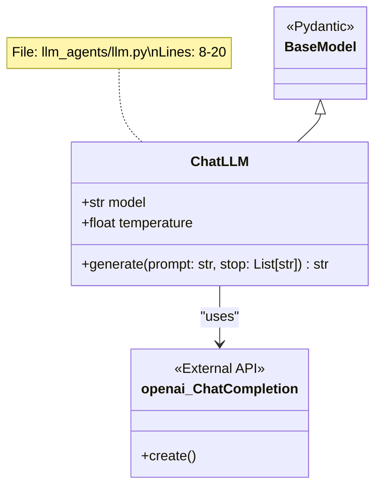
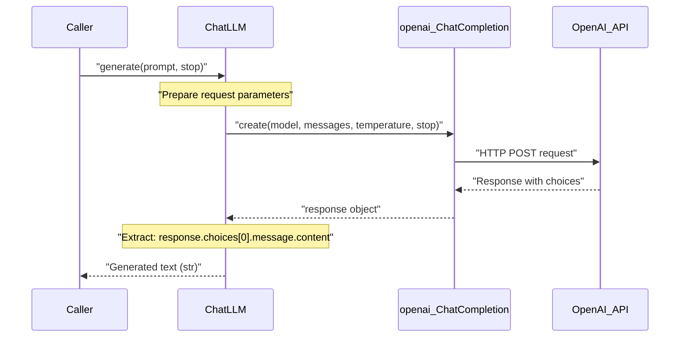
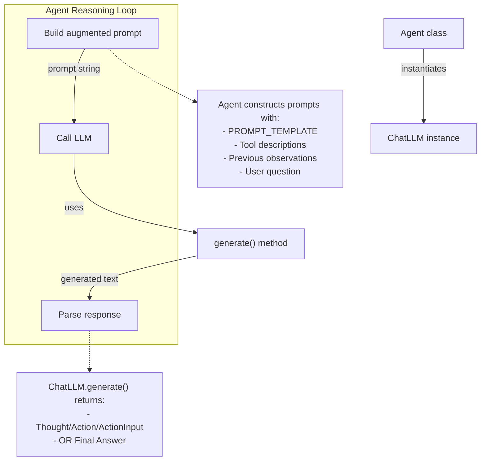

<!-- source: DeepWiki mcp.deepwiki.com · repo mpaepper/llm_agents · page 6.2 ChatLLM API · fetched 2026-10-27 -->

# ChatLLM API

<details>
<summary>Relevant source files</summary>

The following files were used as context for generating this wiki page:

- [llm_agents/__init__.py](llm_agents/__init__.py)
- [llm_agents/llm.py](llm_agents/llm.py)
- [llm_agents/tools/searx.py](llm_agents/tools/searx.py)

</details>


## Purpose and Scope

This document provides a technical reference for the `ChatLLM` class, which encapsulates the OpenAI API integration for language model inference. The `ChatLLM` class is responsible for generating text responses by sending prompts to OpenAI's chat completion models and returning the model's output.

For architectural information about how `ChatLLM` fits into the agent system, see [ChatLLM Integration](#2.2). For information about how the Agent orchestrates calls to `ChatLLM`, see [Agent API](#6.1).

**Sources:** [llm_agents/llm.py:1-26]()

---

## Class Overview

The `ChatLLM` class is implemented as a Pydantic `BaseModel` and serves as a thin wrapper around the OpenAI ChatCompletion API. It provides a simplified interface for generating text responses with configurable model selection and temperature settings.

### Class Structure Diagram



**Sources:** [llm_agents/llm.py:8-20](), [llm_agents/__init__.py:2]()

---

## Constructor and Configuration

### Class Definition

The `ChatLLM` class is defined at [llm_agents/llm.py:8-11]() and inherits from `pydantic.BaseModel`.

### Fields

| Field | Type | Default Value | Description |
|-------|------|---------------|-------------|
| `model` | `str` | `'gpt-3.5-turbo'` | The OpenAI model identifier to use for text generation |
| `temperature` | `float` | `0.0` | Controls randomness in output (0.0 = deterministic, 1.0 = creative) |

### Environment Variables

The class requires the following environment variable to be set:

| Environment Variable | Required | Purpose |
|---------------------|----------|---------|
| `OPENAI_API_KEY` | Yes | Authentication credential for OpenAI API access |

The API key is configured at the class level at [llm_agents/llm.py:11]():
```python
openai.api_key = os.environ["OPENAI_API_KEY"]
```

### Instantiation Example

```python
# Default configuration (gpt-3.5-turbo, temperature=0.0)
llm = ChatLLM()

# Custom model
llm = ChatLLM(model='gpt-4')

# Custom temperature
llm = ChatLLM(temperature=0.7)

# Both custom
llm = ChatLLM(model='gpt-4', temperature=0.5)
```

**Sources:** [llm_agents/llm.py:8-11](), [llm_agents/llm.py:23]()

---

## Methods

### `generate()`

The primary method for generating text responses from the language model.

#### Signature

```python
def generate(self, prompt: str, stop: List[str] = None) -> str
```

#### Parameters

| Parameter | Type | Required | Description |
|-----------|------|----------|-------------|
| `prompt` | `str` | Yes | The input text prompt to send to the language model |
| `stop` | `List[str]` | No | List of stop sequences that will halt generation when encountered |

#### Returns

Returns a `str` containing the generated text response from the model.

#### Implementation Details

The method implementation at [llm_agents/llm.py:13-20]() performs the following operations:

1. Constructs a chat completion request to the OpenAI API
2. Formats the prompt as a user message
3. Applies the configured `model` and `temperature` settings
4. Includes optional `stop` sequences
5. Extracts and returns the message content from the first choice

### Method Call Flow Diagram



**Sources:** [llm_agents/llm.py:13-20]()

---

## OpenAI API Integration

### Message Format

The `generate()` method formats the prompt as a single user message:

```python
messages=[{"role": "user", "content": prompt}]
```

This creates a simple one-turn conversation where the user provides the prompt and the assistant generates a response.

### API Call Structure

The actual OpenAI API call at [llm_agents/llm.py:14-19]():

```python
response = openai.ChatCompletion.create(
    model=self.model,
    messages=[{"role": "user", "content": prompt}],
    temperature=self.temperature,
    stop=stop
)
```

### Response Extraction

The generated text is extracted from the response at [llm_agents/llm.py:20]():

```python
return response.choices[0].message.content
```

This accesses:
- `response.choices[0]` - The first (and typically only) completion choice
- `.message.content` - The actual text content of the assistant's message

**Sources:** [llm_agents/llm.py:14-20]()

---

## Usage Examples

### Basic Usage

Example from [llm_agents/llm.py:22-25]():

```python
llm = ChatLLM()
result = llm.generate(prompt='Who is the president of the USA?')
print(result)
```

### With Stop Sequences

Stop sequences are useful for parsing structured output:

```python
llm = ChatLLM()

# Stop generation when encountering "Observation:"
result = llm.generate(
    prompt="Thought: I need to search for information\nAction:",
    stop=["Observation:"]
)
```

This is commonly used in the agent loop to stop generation after the action specification.

### Custom Configuration

```python
# Use GPT-4 with higher temperature for creative tasks
creative_llm = ChatLLM(model='gpt-4', temperature=0.8)
story = creative_llm.generate("Write a short story about a robot:")

# Use deterministic settings for analytical tasks
analytical_llm = ChatLLM(temperature=0.0)
analysis = analytical_llm.generate("Analyze the following data:")
```

**Sources:** [llm_agents/llm.py:22-25]()

---

## Integration with Agent

### How Agent Uses ChatLLM

The `ChatLLM` class is instantiated by the `Agent` class and used throughout the reasoning loop. Here's how they interact:



### Typical Agent Call Pattern

When the Agent calls `ChatLLM.generate()`:

1. **Input**: Agent provides a multi-line prompt containing instructions, tool descriptions, conversation history, and the current question
2. **Stop Sequence**: Agent typically provides `stop=["Observation:"]` to halt generation after the action specification
3. **Output**: ChatLLM returns text containing "Thought:", "Action:", and "Action Input:" lines, or a "Final Answer:"

**Sources:** [llm_agents/__init__.py:1-2]()

---

## Configuration Reference

### Supported Models

The `model` field accepts any valid OpenAI chat model identifier. Common values include:

| Model ID | Description | Use Case |
|----------|-------------|----------|
| `gpt-3.5-turbo` | Default, fast and cost-effective | General agent tasks |
| `gpt-4` | More capable, higher cost | Complex reasoning tasks |
| `gpt-4-turbo` | GPT-4 with larger context | Long conversation histories |

### Temperature Settings

| Temperature | Behavior | Use Case |
|-------------|----------|----------|
| `0.0` | Deterministic, same output for same input | Agent reasoning (default) |
| `0.3-0.5` | Slightly varied but focused | Analytical tasks |
| `0.7-0.9` | Creative and varied | Content generation |
| `1.0+` | Highly random | Experimental/creative tasks |

The default temperature of `0.0` is appropriate for agent reasoning where consistency is important.

**Sources:** [llm_agents/llm.py:9-10]()

---

## Error Handling Considerations

### Missing API Key

If `OPENAI_API_KEY` is not set in the environment, the class will raise a `KeyError` at import time [llm_agents/llm.py:11]().

**Recommended handling:**
```python
import os

if "OPENAI_API_KEY" not in os.environ:
    raise ValueError("OPENAI_API_KEY environment variable must be set")

from llm_agents import ChatLLM
```

### API Errors

The `generate()` method does not catch OpenAI API exceptions. Callers should handle:
- `openai.error.AuthenticationError` - Invalid API key
- `openai.error.RateLimitError` - Rate limit exceeded
- `openai.error.APIError` - API service errors
- `openai.error.Timeout` - Request timeout

### Validation

As a Pydantic model, `ChatLLM` will validate field types at instantiation:
- `model` must be a string
- `temperature` must be a float

**Sources:** [llm_agents/llm.py:8-20]()

---

## Module Exports

The `ChatLLM` class is exported from the main package at [llm_agents/__init__.py:2]() and can be imported as:

```python
from llm_agents import ChatLLM
```

Or directly from the module:

```python
from llm_agents.llm import ChatLLM
```

**Sources:** [llm_agents/__init__.py:2]()

---

## Code Location Summary

| Component | File | Lines |
|-----------|------|-------|
| Class Definition | `llm_agents/llm.py` | 8-11 |
| `generate()` Method | `llm_agents/llm.py` | 13-20 |
| Usage Example | `llm_agents/llm.py` | 22-25 |
| Package Export | `llm_agents/__init__.py` | 2 |

**Sources:** [llm_agents/llm.py:1-26](), [llm_agents/__init__.py:2]()

---

