# Page: Overview

# Overview

<details>
<summary>Relevant source files</summary>

The following files were used as context for generating this wiki page:

- [README.md](README.md)
- [llm_agents/__init__.py](llm_agents/__init__.py)
- [llm_agents/tools/searx.py](llm_agents/tools/searx.py)
- [run_agent.py](run_agent.py)

</details>


## Purpose and Scope

This document provides an introduction to the `llm_agents` repository, a Python library for building autonomous agents powered by Large Language Models (LLMs). The library implements a simplified version of the agent pattern popularized by langchain, focusing on clarity and minimal abstraction layers. This page covers the fundamental concepts, core architecture, and reasoning patterns that make up the system.

For detailed installation instructions and environment setup, see [Installation and Setup](#1.1). For a practical walkthrough of creating your first agent, see [Quick Start Example](#1.2). For in-depth technical details on the architecture, see [Core Architecture](#2).

**Sources:** [README.md:1-10]()

## What are LLM Agents?

LLM agents are autonomous systems that use Large Language Models to break down complex tasks into a series of reasoning steps and tool invocations. Unlike simple LLM calls that generate a single response, agents operate in an iterative loop where they:

1. **Think** - Use the LLM to reason about the problem and decide what action to take
2. **Act** - Execute actions using external tools (search engines, code interpreters, APIs)
3. **Observe** - Receive results from tool execution
4. **Repeat** - Feed observations back to the LLM for further reasoning

This pattern enables LLMs to accomplish tasks that require external information, computation, or multi-step reasoning beyond what a single prompt-response cycle can achieve.

**Sources:** [README.md:11-24]()

## Core Components

The `llm_agents` library consists of three primary components that work together to implement the agent pattern:

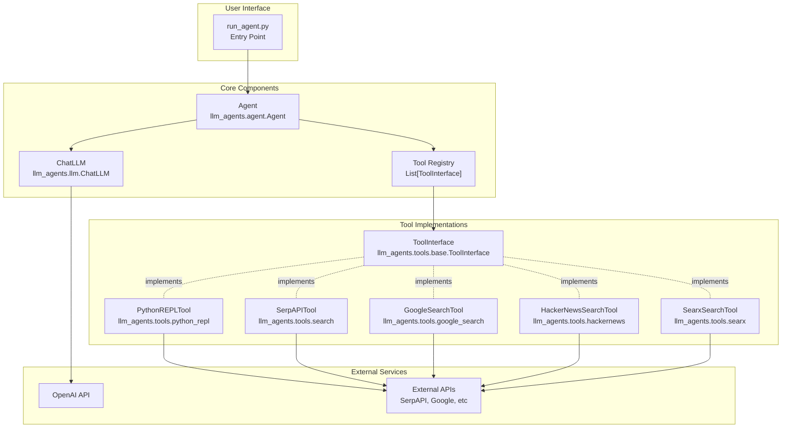

**Component Responsibilities:**

| Component | Class | Primary Responsibility |
|-----------|-------|------------------------|
| **Agent** | `Agent` | Orchestrates the reasoning loop, parses LLM responses, invokes tools, and manages conversation history |
| **ChatLLM** | `ChatLLM` | Interfaces with OpenAI API to generate LLM responses based on accumulated context |
| **Tools** | `ToolInterface` implementations | Provide external capabilities (search, computation, data retrieval) that the agent can invoke |

**Sources:** [llm_agents/__init__.py:1-10](), [README.md:13-22]()

## The Thought-Action-Observation Loop

The core of the agent's operation is an iterative reasoning loop. Each iteration consists of three phases that accumulate context over time:

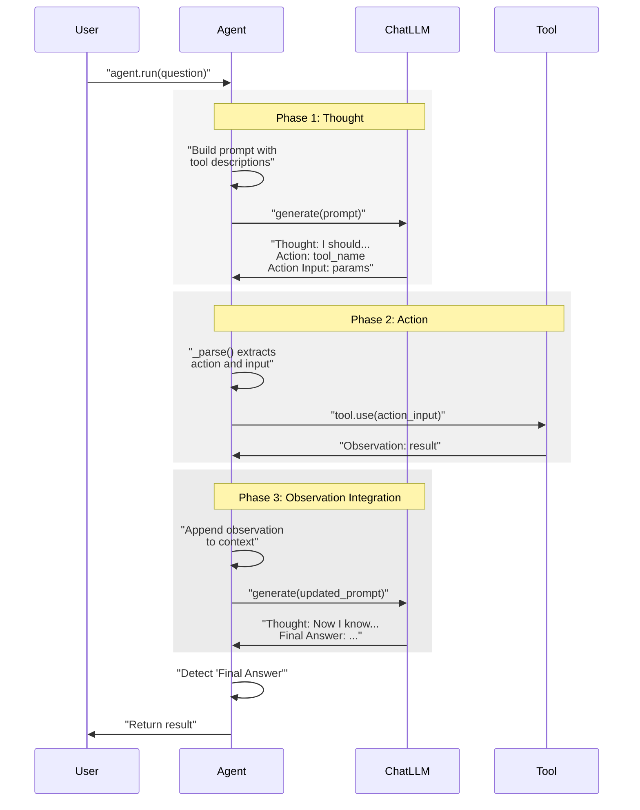

### Loop Mechanics

The agent maintains a `previous_responses` list that accumulates all Thoughts, Actions, and Observations. Each iteration:

1. **Constructs an augmented prompt** containing:
   - System instructions and tool descriptions
   - All previous Thoughts/Actions/Observations
   - The original user question

2. **Generates LLM response** containing:
   - `Thought:` - The LLM's reasoning about what to do next
   - `Action:` - The name of the tool to invoke
   - `Action Input:` - Parameters to pass to the tool
   - OR `Final Answer:` - The final response to return to the user

3. **Executes the action** if present, obtaining an `Observation:`

4. **Appends to context** and repeats until either:
   - The LLM produces a `Final Answer:`
   - Maximum iteration limit is reached

This pattern allows the agent to "learn" from tool outputs and progressively refine its approach to solving the task.

**Sources:** [README.md:14-24]()

## Available Tools

The library provides several built-in tools that extend the agent's capabilities:

| Tool Class | Tool Name | Purpose | Required Configuration |
|------------|-----------|---------|------------------------|
| `PythonREPLTool` | `python_repl` | Execute Python code and return output | None |
| `SerpAPITool` | `Google Search` | Search the web via SerpAPI | `SERPAPI_API_KEY` |
| `GoogleSearchTool` | `Google Search` | Search via Google Custom Search API | `GOOGLE_API_KEY`, `GOOGLE_CSE_ID` |
| `HackerNewsSearchTool` | `hacker news search` | Search Hacker News stories | None |
| `SearxSearchTool` | `Searx Search` | Search via self-hosted Searx instance | `SEARX_INSTANCE_URL` |

All tools implement the `ToolInterface` contract, which requires:
- `name: str` - Identifier used by the agent to select the tool
- `description: str` - Natural language description that helps the LLM understand when to use the tool
- `use(input_text: str) -> str` - Method that executes the tool's functionality

For detailed documentation on each tool, see [Tool System](#3). For creating your own tools, see [Creating Custom Tools](#3.4).

**Sources:** [llm_agents/__init__.py:1-10](), [README.md:15-17]()

## Basic Usage Pattern

The simplest way to create and run an agent is shown in [run_agent.py:1-9]():

```python
from llm_agents import Agent, ChatLLM, PythonREPLTool, HackerNewsSearchTool, SerpAPITool

agent = Agent(llm=ChatLLM(), tools=[PythonREPLTool(), SerpAPITool(), HackerNewsSearchTool()])
result = agent.run("Your question to the agent")

print(f"Final answer is {result}")
```

### Construction Flow

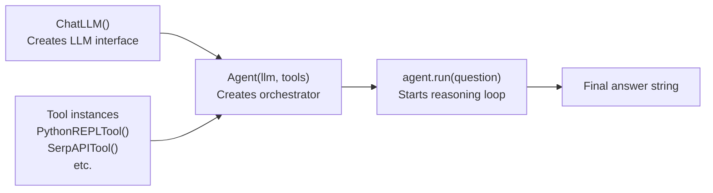

The agent requires:
1. A `ChatLLM` instance for LLM interactions
2. A list of tool instances (can be empty, though this limits capabilities)

The `agent.run()` method:
- Accepts a string question/task
- Executes the Thought-Action-Observation loop
- Returns the final answer as a string

**Sources:** [run_agent.py:1-9](), [README.md:46-58]()

## Configuration Requirements

The library requires certain environment variables depending on which components are used:

| Environment Variable | Required For | How to Obtain |
|---------------------|--------------|---------------|
| `OPENAI_API_KEY` | All agent operations (ChatLLM) | https://platform.openai.com/account/api-keys |
| `SERPAPI_API_KEY` | Using `SerpAPITool` | https://serpapi.com/ |
| `GOOGLE_API_KEY` | Using `GoogleSearchTool` | Google Cloud Console |
| `GOOGLE_CSE_ID` | Using `GoogleSearchTool` | Google Custom Search Engine |
| `SEARX_INSTANCE_URL` | Using `SearxSearchTool` | Self-hosted Searx instance URL |

**Export in bash:**
```bash
export OPENAI_API_KEY='sk-...'
export SERPAPI_API_KEY='...'
```

For complete setup instructions, see [Installation and Setup](#1.1). For detailed information on API keys and external services, see [Dependencies and External Services](#4).

**Sources:** [README.md:37-42](), [llm_agents/tools/searx.py:17]()

## System Design Philosophy

The `llm_agents` library is intentionally minimalist, prioritizing:

1. **Transparency** - The entire agent logic is contained in a small number of files with minimal abstraction
2. **Simplicity** - Core concepts (Agent, ChatLLM, Tools) map directly to code classes
3. **Extensibility** - The `ToolInterface` contract makes it easy to add new capabilities
4. **Educational Value** - The codebase serves as a learning resource for understanding LLM agents

As stated in [README.md:3-7](): "The goal was to get a better grasp of how such an agent works and understand it all in very few lines of code."

This design makes the library suitable for:
- Learning how LLM agents work internally
- Prototyping simple agent applications
- Extending with custom tools for specific use cases
- Understanding the foundations before using more complex frameworks like langchain

For architectural details, see [Core Architecture](#2). For development guidelines, see [Development Guide](#5).

**Sources:** [README.md:1-10]()

## Repository Structure Overview

The codebase is organized as follows:

| Directory/File | Purpose |
|----------------|---------|
| `llm_agents/` | Main package containing core classes |
| `llm_agents/agent.py` | `Agent` class implementation |
| `llm_agents/llm.py` | `ChatLLM` class implementation |
| `llm_agents/tools/` | Tool implementations |
| `llm_agents/tools/base.py` | `ToolInterface` abstract base class |
| `tests/` | Test suite with unit and integration tests |
| `run_agent.py` | Command-line entry point |
| `requirements.txt` | Python dependencies |
| `pyproject.toml` | Poetry project configuration |
| `README.md` | Project documentation |

For a detailed breakdown of the project structure, see [Project Structure](#5.1). For API documentation, see [API Reference](#6).

**Sources:** [llm_agents/__init__.py:1-10](), [run_agent.py:1-9]()

## Next Steps

To start using the library:
1. Follow [Installation and Setup](#1.1) to install dependencies and configure API keys
2. Work through the [Quick Start Example](#1.2) to create your first agent
3. Read [Core Architecture](#2) to understand the system's design in depth
4. Explore [Tool System](#3) to learn about available tools and create custom ones

For developers contributing to the project:
- See [Development Guide](#5) for testing and development workflows
- See [API Reference](#6) for technical specifications
- See [License and Contributing](#8) for contribution guidelines

**Sources:** [README.md:26-58]()

---

# Page: Installation and Setup

# Installation and Setup

<details>
<summary>Relevant source files</summary>

The following files were used as context for generating this wiki page:

- [README.md](README.md)
- [pyproject.toml](pyproject.toml)
- [requirements.txt](requirements.txt)
- [setup.py](setup.py)

</details>


This page guides you through installing the `llm_agents` library, configuring required API keys, and setting up your environment for development or usage. By the end of this document, you will have a working installation that can execute agents with tools.

For information about running your first agent after installation, see [Quick Start Example](#1.2). For detailed information about obtaining and configuring API keys, see [Required API Keys](#4.1). For development environment setup including testing infrastructure, see [Development Guide](#5).

---

## Prerequisites

The `llm_agents` library requires Python 3.8 or higher. This requirement is specified in [pyproject.toml:17]().

```
python = "^3.8"
```

Before proceeding with installation, ensure you have:
- Python 3.8 or newer installed on your system
- `pip` package manager (typically included with Python)
- `git` for cloning the repository
- Internet access for downloading dependencies and calling external APIs

**Sources:** [pyproject.toml:17]()

---

## Installation Methods

The library supports two primary installation methods: standard `pip` installation and Poetry-based installation for development workflows.

### Installation Method Overview

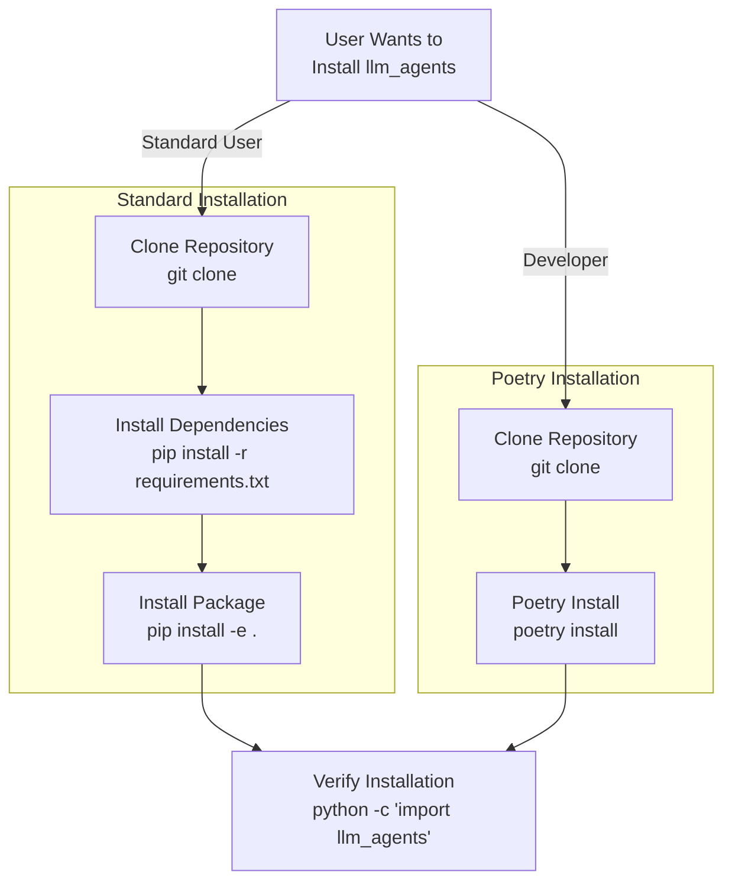

**Sources:** [README.md:28-35](), [pyproject.toml:1-89]()

### Method 1: Standard pip Installation

This method uses the traditional `pip` workflow with `requirements.txt`. It is suitable for end users who want to use the library.

**Step 1:** Clone the repository from GitHub:

```bash
git clone https://github.com/mpaepper/llm_agents.git
cd llm_agents
```

**Step 2:** Install dependencies from `requirements.txt`:

```bash
pip install -r requirements.txt
```

The [requirements.txt:1-5]() file specifies the following core dependencies:

| Dependency | Version | Purpose |
|------------|---------|---------|
| `openai` | >=0.27.0 | OpenAI API client for LLM interactions |
| `pydantic` | >=1.10.5 | Data validation and settings management |
| `requests` | >=2.28.2 | HTTP client for API calls |
| `google-api-python-client` | >=2.83.0 | Google Custom Search API client |
| `google-search-results` | >=2.4.2 | SerpAPI client for Google search |

**Step 3:** Install the package in editable mode:

```bash
pip install -e .
```

The `-e` flag installs the package in "editable" mode, meaning changes to the source code are immediately reflected without reinstallation.

**Sources:** [README.md:28-35](), [requirements.txt:1-5](), [setup.py:1-21]()

### Method 2: Poetry Installation

Poetry is the recommended method for development, as it provides dependency locking and development dependency management. The project configuration is defined in [pyproject.toml:1-89]().

**Step 1:** Ensure Poetry is installed on your system:

```bash
curl -sSL https://install.python-poetry.org | python3 -
```

**Step 2:** Clone the repository:

```bash
git clone https://github.com/mpaepper/llm_agents.git
cd llm_agents
```

**Step 3:** Install all dependencies (including development dependencies):

```bash
poetry install
```

This command reads [pyproject.toml:16-28]() to install both production and development dependencies, and uses `poetry.lock` to ensure reproducible builds.

**Development dependencies** installed by Poetry include:
- `pytest` (^7.4.0) - Test framework
- `pytest-cov` (^4.1.0) - Coverage reporting
- `pytest-mock` (^3.11.1) - Mocking support

**Sources:** [pyproject.toml:1-89](), [pyproject.toml:25-28]()

---

## Dependency Architecture

The following diagram maps each dependency to its role in the system architecture:

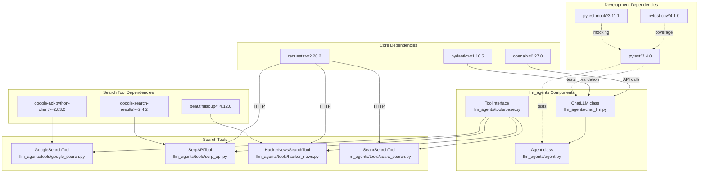

**Sources:** [requirements.txt:1-5](), [pyproject.toml:16-28]()

---

## Environment Configuration

The `llm_agents` library requires environment variables to authenticate with external APIs. These variables must be set before running any agent that uses the corresponding tools.

### Environment Variable Configuration Flow

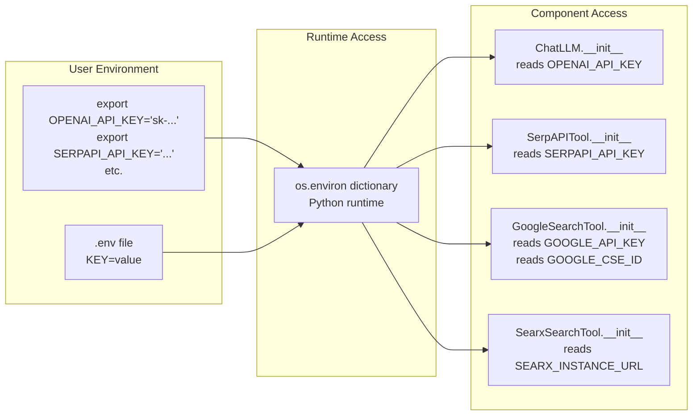

**Sources:** [README.md:37-42]()

### Required Environment Variables

The following table lists all environment variables used by the library:

| Variable Name | Required By | Purpose | How to Obtain |
|---------------|-------------|---------|---------------|
| `OPENAI_API_KEY` | `ChatLLM` | OpenAI API authentication | https://platform.openai.com/account/api-keys |
| `SERPAPI_API_KEY` | `SerpAPITool` | SerpAPI Google Search | https://serpapi.com/ |
| `GOOGLE_API_KEY` | `GoogleSearchTool` | Google Custom Search API | Google Cloud Console |
| `GOOGLE_CSE_ID` | `GoogleSearchTool` | Google Custom Search Engine ID | Google Programmable Search Engine |
| `SEARX_INSTANCE_URL` | `SearxSearchTool` | Searx instance endpoint | Self-hosted or public Searx instance |

### Setting Environment Variables

**On Linux/macOS (bash/zsh):**

```bash
export OPENAI_API_KEY='sk-...'
export SERPAPI_API_KEY='...'
```

**On Windows (PowerShell):**

```powershell
$env:OPENAI_API_KEY='sk-...'
$env:SERPAPI_API_KEY='...'
```

**On Windows (Command Prompt):**

```cmd
set OPENAI_API_KEY=sk-...
set SERPAPI_API_KEY=...
```

### Required vs Optional Configuration

The **minimum required** environment variable to use the library is:
- `OPENAI_API_KEY` - Required by `ChatLLM` for LLM interactions

All other environment variables are **optional** and only needed if you use the corresponding tool:
- Omit `SERPAPI_API_KEY` if you don't use `SerpAPITool`
- Omit `GOOGLE_API_KEY` and `GOOGLE_CSE_ID` if you don't use `GoogleSearchTool`
- Omit `SEARX_INSTANCE_URL` if you don't use `SearxSearchTool`

As noted in [README.md:57](), you can build agents without certain tools if you don't want to configure their API keys:

```python
# Example: Agent without search tools (no API keys needed except OpenAI)
from llm_agents import Agent, ChatLLM, PythonREPLTool

agent = Agent(llm=ChatLLM(), tools=[PythonREPLTool()])
```

**Sources:** [README.md:37-42](), [README.md:57]()

---

## Verification

After installation, verify that the library is correctly installed and accessible.

### Basic Import Test

Run the following command to verify the package can be imported:

```bash
python -c "import llm_agents; print('Installation successful')"
```

If successful, this command will print `Installation successful` without errors.

### Verify Individual Components

Test that core classes can be imported:

```bash
python -c "from llm_agents import Agent, ChatLLM, PythonREPLTool; print('Core components imported')"
```

### Verify API Key Configuration

Test that the OpenAI API key is properly configured:

```bash
python -c "import os; assert 'OPENAI_API_KEY' in os.environ, 'OPENAI_API_KEY not set'; print('API key configured')"
```

### Complete Installation Check Script

Create a file named `check_installation.py` with the following content:

```python
#!/usr/bin/env python3
"""Verify llm_agents installation and configuration."""

import os
import sys

def check_import():
    """Check if llm_agents can be imported."""
    try:
        import llm_agents
        print("✓ llm_agents package imported successfully")
        return True
    except ImportError as e:
        print(f"✗ Failed to import llm_agents: {e}")
        return False

def check_core_classes():
    """Check if core classes can be imported."""
    try:
        from llm_agents import Agent, ChatLLM, PythonREPLTool
        print("✓ Core classes (Agent, ChatLLM, PythonREPLTool) imported")
        return True
    except ImportError as e:
        print(f"✗ Failed to import core classes: {e}")
        return False

def check_api_keys():
    """Check environment variable configuration."""
    results = []
    
    # Required
    if "OPENAI_API_KEY" in os.environ:
        print("✓ OPENAI_API_KEY is set")
        results.append(True)
    else:
        print("✗ OPENAI_API_KEY is not set (required)")
        results.append(False)
    
    # Optional
    optional_keys = [
        "SERPAPI_API_KEY",
        "GOOGLE_API_KEY",
        "GOOGLE_CSE_ID",
        "SEARX_INSTANCE_URL"
    ]
    
    for key in optional_keys:
        if key in os.environ:
            print(f"✓ {key} is set (optional)")
        else:
            print(f"- {key} is not set (optional)")
    
    return all(results)

if __name__ == "__main__":
    checks = [
        check_import(),
        check_core_classes(),
        check_api_keys()
    ]
    
    if all(checks):
        print("\n✓ Installation verification complete")
        sys.exit(0)
    else:
        print("\n✗ Installation verification failed")
        sys.exit(1)
```

Run this script:

```bash
python check_installation.py
```

**Sources:** [README.md:28-35](), [README.md:37-42]()

---

## Installation Troubleshooting

### Common Issues

| Issue | Symptom | Solution |
|-------|---------|----------|
| **Python version mismatch** | `ImportError` or syntax errors | Ensure Python 3.8+ is installed: `python --version` |
| **Missing dependencies** | `ModuleNotFoundError: No module named 'openai'` | Run `pip install -r requirements.txt` |
| **Permission errors** | `Permission denied` during `pip install` | Use `pip install --user` or a virtual environment |
| **API key not found** | Runtime errors about missing keys | Set environment variables: `export OPENAI_API_KEY='...'` |
| **Editable install issues** | Changes not reflected | Run `pip install -e .` in the repository root |

### Virtual Environment Recommendation

For isolated dependency management, use a virtual environment:

```bash
# Create virtual environment
python -m venv venv

# Activate (Linux/macOS)
source venv/bin/activate

# Activate (Windows)
venv\Scripts\activate

# Install dependencies
pip install -r requirements.txt
pip install -e .
```

**Sources:** [README.md:28-35](), [pyproject.toml:17]()

---

## Next Steps

Once installation is complete, proceed to:
- [Quick Start Example](#1.2) - Run your first agent
- [Required API Keys](#4.1) - Obtain and configure additional API keys
- [Development Guide](#5) - Set up the development environment for contributing

For information about creating custom tools or understanding the architecture, see:
- [Core Architecture](#2) - System overview
- [Tool System](#3) - Understanding and creating tools
- [Testing Infrastructure](#5.2) - Running and writing tests

**Sources:** [README.md:44-57]()

---

# Page: Quick Start Example

# Quick Start Example

<details>
<summary>Relevant source files</summary>

The following files were used as context for generating this wiki page:

- [README.md](README.md)
- [llm_agents/__init__.py](llm_agents/__init__.py)
- [llm_agents/tools/searx.py](llm_agents/tools/searx.py)
- [run_agent.py](run_agent.py)

</details>


## Purpose and Scope

This page provides a hands-on walkthrough of creating and running your first LLM agent. It demonstrates the minimal code required to instantiate an agent with tools and execute a task. For installation and environment setup instructions, see [Installation and Setup](#1.1). For detailed information about how the agent's reasoning loop works internally, see [Core Architecture](#2) and [Thought-Action-Observation Loop](#2.3).

---

## Overview

Creating an agent in this library follows a simple pattern:

1. Import the necessary components (`Agent`, `ChatLLM`, and tool classes)
2. Instantiate the LLM wrapper
3. Instantiate the tools you want the agent to use
4. Create the `Agent` with the LLM and tools
5. Call `agent.run()` with your question or task

The following sections walk through this pattern with concrete code examples.

---

## Basic Import Pattern

All core components are exported from the top-level `llm_agents` package, making imports straightforward:

```python
from llm_agents import Agent, ChatLLM, PythonREPLTool, HackerNewsSearchTool, SerpAPITool
```

This import statement brings in:
- `Agent`: The orchestrator that manages the reasoning loop
- `ChatLLM`: The OpenAI API wrapper for generating responses
- `PythonREPLTool`: Tool for executing Python code
- `HackerNewsSearchTool`: Tool for searching Hacker News
- `SerpAPITool`: Tool for Google search via SerpAPI

**Sources:** [llm_agents/__init__.py:1-10](), [README.md:49]()

---

## Component Architecture

The following diagram shows how the imported classes relate to each other during agent initialization:

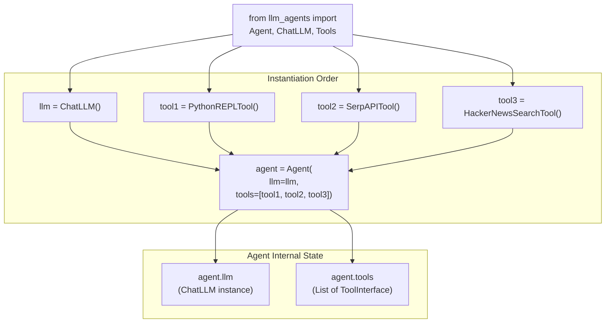

**Sources:** [README.md:49-52](), [llm_agents/__init__.py:1-10](), [run_agent.py:1-6]()

---

## Complete Working Example

The repository includes a runnable example that demonstrates the full pattern. The following code is from [run_agent.py:1-8]():

```python
from llm_agents import Agent, ChatLLM, PythonREPLTool, HackerNewsSearchTool, SerpAPITool

if __name__ == '__main__':
    prompt = input("Enter a question / task for the agent: ")
    agent = Agent(llm=ChatLLM(), tools=[PythonREPLTool(), SerpAPITool(), HackerNewsSearchTool()])
    result = agent.run(prompt)

    print(f"Final answer is {result}")
```

### Step-by-Step Breakdown

| Line | Component | Purpose |
|------|-----------|---------|
| 1 | Imports | Brings in `Agent`, `ChatLLM`, and three tool implementations |
| 4 | User Input | Prompts the user to enter a question or task |
| 5 | Agent Creation | Instantiates an `Agent` with a `ChatLLM` instance and a list of three tools |
| 6 | Execution | Calls `agent.run()` with the user's prompt, which starts the Thought-Action-Observation loop |
| 8 | Output | Prints the final answer returned by the agent |

**Sources:** [run_agent.py:1-8](), [README.md:44-55]()

---

## Agent Execution Flow

When you call `agent.run()`, the following sequence occurs:

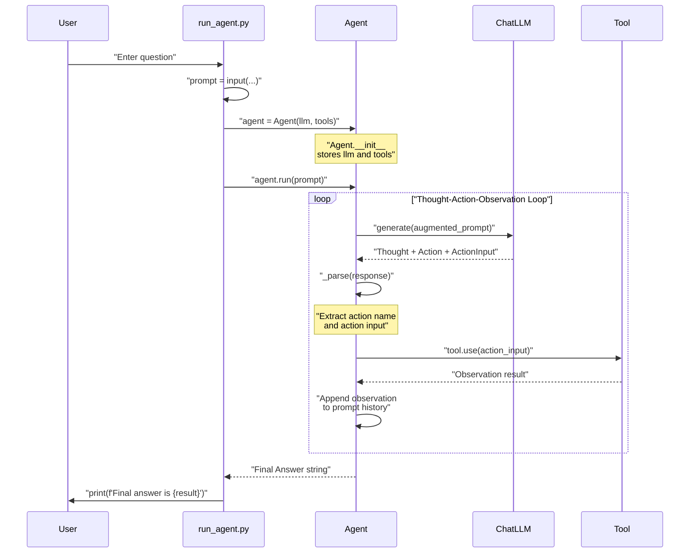

**Sources:** [run_agent.py:4-8](), [README.md:18-22]()

---

## Running Your First Agent

To execute the example:

1. **Set environment variables:**
   ```bash
   export OPENAI_API_KEY='sk-...'
   export SERPAPI_API_KEY='...'
   ```
   
   The `OPENAI_API_KEY` is required for the LLM. The `SERPAPI_API_KEY` is only required if you're using `SerpAPITool`. See [Required API Keys](#4.1) for details on obtaining these.

2. **Run the script:**
   ```bash
   python run_agent.py
   ```

3. **Enter your question when prompted:**
   ```
   Enter a question / task for the agent: How many eyes does a typical spider have?
   ```

4. **The agent will:**
   - Generate thoughts about how to answer
   - Select and invoke appropriate tools (e.g., `SerpAPITool` for search)
   - Observe the results
   - Iterate until it has enough information
   - Return a final answer

**Sources:** [README.md:44](), [run_agent.py:4-8]()

---

## Alternative Tool Configurations

You can customize which tools the agent has access to by modifying the tools list. Here are common configurations:

### Minimal Configuration (No External APIs)

```python
agent = Agent(llm=ChatLLM(), tools=[PythonREPLTool()])
```

This configuration only requires an `OPENAI_API_KEY` and gives the agent Python code execution capability without needing search API keys.

**Sources:** [README.md:57]()

### Search-Only Configuration

```python
agent = Agent(llm=ChatLLM(), tools=[SerpAPITool(), HackerNewsSearchTool()])
```

This configuration provides search capabilities but no code execution.

**Sources:** [README.md:49-52]()

### Using Alternative Search Tools

The library provides multiple search tool implementations. You can substitute `SerpAPITool` with alternatives:

```python
# Using Google Custom Search instead of SerpAPI
from llm_agents import GoogleSearchTool
agent = Agent(llm=ChatLLM(), tools=[GoogleSearchTool()])
```

```python
# Using Searx instance
from llm_agents import SearxSearchTool
agent = Agent(llm=ChatLLM(), tools=[SearxSearchTool()])
```

For details on each search tool and their configuration requirements, see [Search Tools](#3.2).

**Sources:** [llm_agents/__init__.py:1-10](), [llm_agents/tools/searx.py:74-81]()

---

## Programmatic Usage Pattern

For embedding agents in your own applications, use the pattern shown in [README.md:48-55]():

```python
from llm_agents import Agent, ChatLLM, PythonREPLTool, HackerNewsSearchTool, SerpAPITool

# Create agent
agent = Agent(
    llm=ChatLLM(), 
    tools=[PythonREPLTool(), SerpAPITool(), HackerNewsSearchTool()]
)

# Execute task
result = agent.run("Your question to the agent")

# Process result
print(f"Final answer is {result}")
```

The `agent.run()` method returns a string containing the final answer. This can be used directly in your application logic.

**Sources:** [README.md:48-55]()

---

## What Happens During Execution

The diagram below shows the data flow when `agent.run()` is invoked:

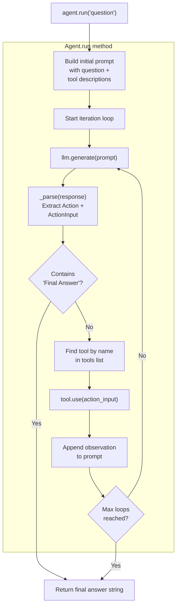

**Sources:** [README.md:13-22]()

---

## Next Steps

Now that you understand the basic usage pattern:

- **To understand the internal mechanics** of how the agent reasons and selects tools, see [The Agent](#2.1) and [Thought-Action-Observation Loop](#2.3)
- **To learn about individual tools** and their capabilities, see [Tool System](#3)
- **To create custom tools** for your specific use case, see [Creating Custom Tools](#3.4)
- **For API reference** with detailed parameter documentation, see [Agent API](#6.1)
- **For troubleshooting** common issues, see [Troubleshooting](#7)

**Sources:** [README.md:1-58]()

---

# Page: Core Architecture

# Core Architecture

<details>
<summary>Relevant source files</summary>

The following files were used as context for generating this wiki page:

- [README.md](README.md)
- [llm_agents/__init__.py](llm_agents/__init__.py)
- [llm_agents/agent.py](llm_agents/agent.py)
- [llm_agents/tools/searx.py](llm_agents/tools/searx.py)

</details>


## Purpose and Scope

This document describes the high-level architecture of the llm_agents system, focusing on how the three core components—`Agent`, `ChatLLM`, and `ToolInterface`—work together to implement the Thought-Action-Observation loop pattern. This page covers the structural organization and interaction patterns that enable LLM-driven agents to reason about problems and execute actions through tools.

For implementation details of specific components, see:
- The `Agent` orchestration logic: [The Agent](#2.1)
- The `ChatLLM` OpenAI integration: [ChatLLM Integration](#2.2)
- The iterative reasoning pattern: [Thought-Action-Observation Loop](#2.3)
- Tool system architecture: [Tool System](#3)

---

## Core Components

The system consists of three primary components that form a clean separation of concerns:

| Component | Class | Responsibility | Key Methods |
|-----------|-------|---------------|-------------|
| **Orchestrator** | `Agent` | Manages the reasoning loop, parses LLM outputs, invokes tools | `run()`, `decide_next_action()`, `_parse()` |
| **Reasoning Engine** | `ChatLLM` | Interfaces with OpenAI API to generate thoughts and actions | `generate()` |
| **Action Executors** | `ToolInterface` implementations | Execute specific capabilities (search, code execution, etc.) | `use()` |

### Component Diagram

```mermaid
graph TB
    Agent["Agent<br/>(llm_agents/agent.py)"]
    ChatLLM["ChatLLM<br/>(llm_agents/llm.py)"]
    ToolInterface["ToolInterface<br/>(llm_agents/tools/base.py)"]
    
    PythonREPL["PythonREPLTool<br/>(tools/python_repl.py)"]
    SerpAPI["SerpAPITool<br/>(tools/search.py)"]
    GoogleSearch["GoogleSearchTool<br/>(tools/google_search.py)"]
    HackerNews["HackerNewsSearchTool<br/>(tools/hackernews.py)"]
    Searx["SearxSearchTool<br/>(tools/searx.py)"]
    
    Agent -->|"uses (property: llm)"| ChatLLM
    Agent -->|"manages (property: tools)"| ToolInterface
    
    ToolInterface <-..|"implements"| PythonREPL
    ToolInterface <-..|"implements"| SerpAPI
    ToolInterface <-..|"implements"| GoogleSearch
    ToolInterface <-..|"implements"| HackerNews
    ToolInterface <-..|"implements"| Searx
    
    Agent -->|"calls generate()"| ChatLLM
    Agent -->|"calls use()"| ToolInterface
```

**Sources:** [llm_agents/__init__.py:1-10](), [llm_agents/agent.py:1-102]()

---

## Agent Class

The `Agent` class ([llm_agents/agent.py:36-95]()) serves as the orchestrator, implementing the core control flow that coordinates between the LLM and tools.

### Agent Properties and Configuration

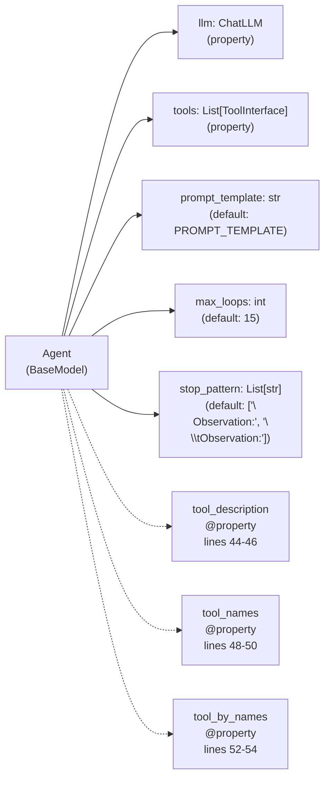

**Key Properties:**
- `llm`: The `ChatLLM` instance used for generating reasoning and actions
- `tools`: List of available `ToolInterface` implementations
- `prompt_template`: Template string defining the agent's instructions ([llm_agents/agent.py:14-33]())
- `max_loops`: Maximum iterations to prevent infinite loops (default: 15)
- `stop_pattern`: Tokens that stop LLM generation to prevent hallucination ([llm_agents/agent.py:42]())

**Computed Properties:**
- `tool_description`: Generates formatted tool descriptions for the prompt ([llm_agents/agent.py:44-46]())
- `tool_names`: Comma-separated list of tool names ([llm_agents/agent.py:48-50]())
- `tool_by_names`: Dictionary mapping tool names to instances ([llm_agents/agent.py:52-54]())

**Sources:** [llm_agents/agent.py:36-54]()

---

## ChatLLM Integration

The `ChatLLM` component abstracts the OpenAI API interaction. While not fully shown in the provided files, the `Agent` interacts with it through the `generate()` method:

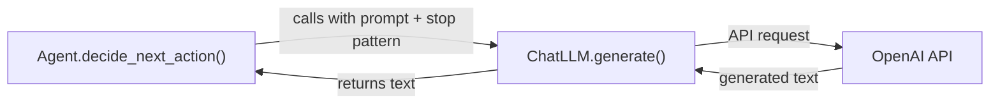

The call occurs at [llm_agents/agent.py:81](), where the agent passes:
- The constructed prompt
- The `stop_pattern` to prevent the LLM from generating past the observation phase

**Sources:** [llm_agents/agent.py:80-83](), [llm_agents/__init__.py:2]()

---

## Tool Architecture

Tools implement a standardized interface (`ToolInterface`) with three required attributes:

| Attribute | Type | Purpose |
|-----------|------|---------|
| `name` | `str` | Identifier used by the agent to select the tool |
| `description` | `str` | Natural language description included in the prompt |
| `use()` | `method` | Executes the tool with input text, returns result string |

### Tool Registration Pattern

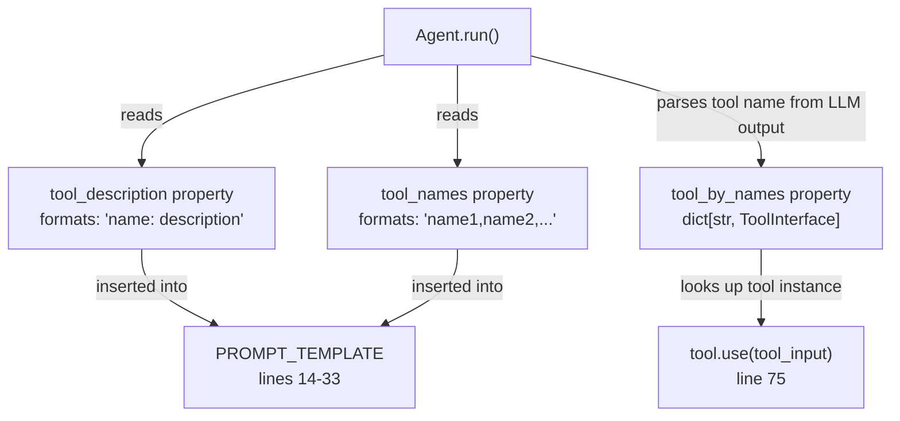

The agent discovers tools dynamically through properties that format tool metadata into the prompt ([llm_agents/agent.py:44-54]()), and looks up tools by name when executing actions ([llm_agents/agent.py:73-75]()).

**Sources:** [llm_agents/agent.py:44-54](), [llm_agents/agent.py:73-75](), [llm_agents/tools/searx.py:74-81]()

---

## The Thought-Action-Observation Loop

The system implements an iterative reasoning pattern where:
1. **Thought**: LLM generates reasoning about what to do next
2. **Action**: LLM specifies a tool and input
3. **Observation**: Tool executes and returns results
4. Loop continues until LLM produces a "Final Answer"

### Loop Implementation

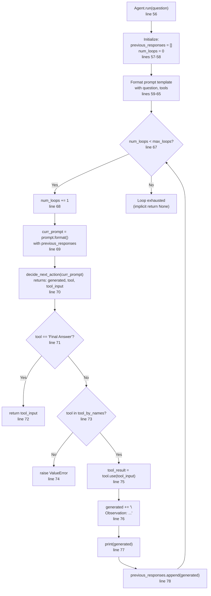

**Sources:** [llm_agents/agent.py:56-78]()

### Prompt Accumulation

The key to the loop's effectiveness is that each iteration appends to `previous_responses`, which gets inserted into the prompt template. This creates a growing context window:

```
Question: {question}
Thought: {previous_responses}
```

Where `previous_responses` contains the full history:
```
Thought: I need to search for X
Action: Google Search
Action Input: X
Observation: Result about X
Thought: Now I need to calculate Y
Action: python_repl
Action Input: code for Y
Observation: Y = 42
Thought: I now know the final answer
```

**Sources:** [llm_agents/agent.py:32](), [llm_agents/agent.py:69](), [llm_agents/agent.py:76-78]()

---

## Response Parsing

The `Agent._parse()` method ([llm_agents/agent.py:85-94]()) extracts structured information from the LLM's free-text response:

### Parsing Logic

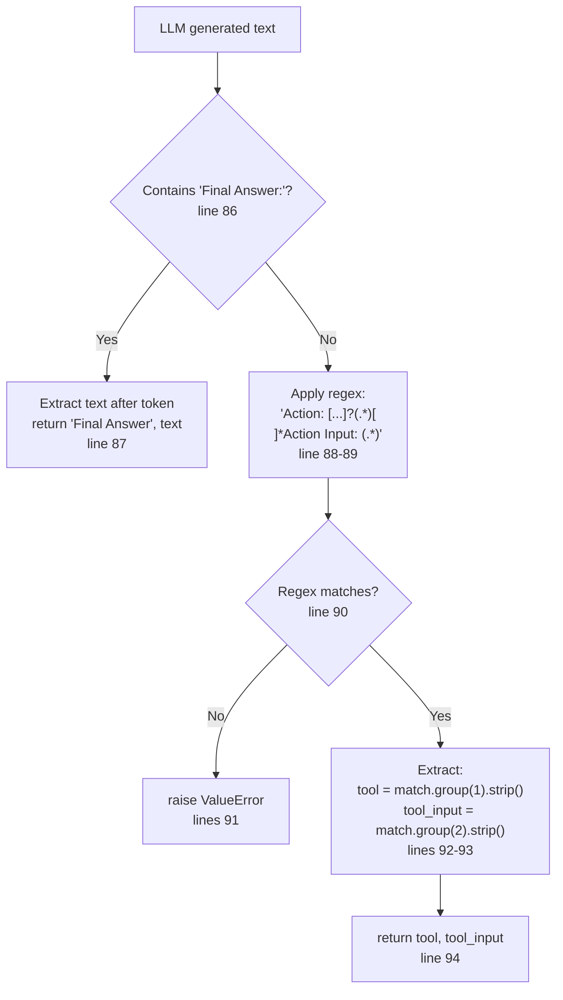

**Pattern Matching:**
- **Final Answer**: Checks for literal string `FINAL_ANSWER_TOKEN` ([llm_agents/agent.py:11]())
- **Action Parsing**: Uses regex to extract action name and input ([llm_agents/agent.py:88]())
- **Error Handling**: Raises `ValueError` if output cannot be parsed ([llm_agents/agent.py:91]())

**Sources:** [llm_agents/agent.py:11](), [llm_agents/agent.py:85-94]()

---

## Prompt Template Structure

The `PROMPT_TEMPLATE` ([llm_agents/agent.py:14-33]()) defines the agent's instructions and expected format:

### Template Sections

| Section | Purpose | Template Variables |
|---------|---------|-------------------|
| **Context** | Provides current date and capabilities | `{today}`, `{tool_description}` |
| **Format Instructions** | Defines the Thought-Action-Observation structure | `{tool_names}` |
| **Task** | Presents the user's question | `{question}` |
| **History** | Contains accumulated conversation | `{previous_responses}` |

**Key Features:**
- **Tool Injection**: Tool descriptions are dynamically inserted at line 16
- **Format Specification**: Lines 18-27 provide explicit formatting instructions
- **Few-Shot Pattern**: The template itself serves as an example of the expected format
- **Stop Tokens**: The pattern ends with `Thought: {previous_responses}` to prime the next generation

**Sources:** [llm_agents/agent.py:14-33]()

---

## Design Principles

### Separation of Concerns

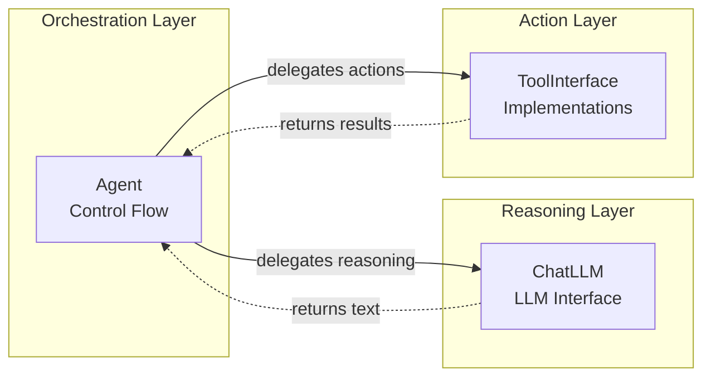

**Key Architectural Decisions:**
1. **Agent as Orchestrator**: Does not implement reasoning or actions itself
2. **Stateful Loop**: Maintains `previous_responses` list for context accumulation
3. **Tool Polymorphism**: All tools implement identical interface, enabling uniform interaction
4. **Stop Patterns**: Prevents LLM hallucination by stopping generation at observation boundaries ([llm_agents/agent.py:42]())
5. **Max Loops**: Safety mechanism to prevent infinite loops ([llm_agents/agent.py:40]())

**Sources:** [llm_agents/agent.py:36-95]()

### Extensibility

The architecture supports extension through:
- **New Tools**: Implement `ToolInterface` and add to `tools` list
- **Custom Prompts**: Override `prompt_template` property
- **Different LLMs**: Swap `ChatLLM` implementation (must provide `generate()` method)

**Sources:** [README.md:46-57](), [llm_agents/__init__.py:1-10]()

---

## Entry Point Integration

The `run_agent.py` script demonstrates the standard initialization pattern:

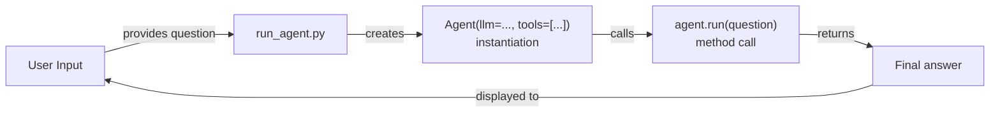

Typical usage pattern from README:
```python
from llm_agents import Agent, ChatLLM, PythonREPLTool, HackerNewsSearchTool, SerpAPITool

agent = Agent(llm=ChatLLM(), tools=[PythonREPLTool(), SerpAPITool(), HackerNewsSearchTool()])
result = agent.run("Your question to the agent")
```

**Sources:** [README.md:46-55]()

---

# Page: The Agent

# The Agent

<details>
<summary>Relevant source files</summary>

The following files were used as context for generating this wiki page:

- [README.md](README.md)
- [llm_agents/__init__.py](llm_agents/__init__.py)
- [llm_agents/agent.py](llm_agents/agent.py)
- [llm_agents/tools/searx.py](llm_agents/tools/searx.py)

</details>


## Purpose and Scope

This document provides a detailed technical reference for the `Agent` class, which serves as the central orchestrator in the llm_agents system. The Agent is responsible for managing the iterative reasoning loop, parsing LLM responses, invoking tools, and maintaining conversation state until a final answer is reached.

This page covers the internal implementation details of the Agent class. For information about how the Agent integrates with the ChatLLM component, see [ChatLLM Integration](#2.2). For a conceptual explanation of the Thought-Action-Observation loop pattern, see [Thought-Action-Observation Loop](#2.3). For information about available tools, see [Tool System](#3).

**Sources:** [llm_agents/agent.py:1-102](), [README.md:11-24]()

---

## Agent Class Overview

The `Agent` class is defined in [llm_agents/agent.py:36-95]() and inherits from Pydantic's `BaseModel` for data validation and configuration management. The Agent acts as the orchestration layer that connects three key components:

1. **ChatLLM** - Generates reasoning steps and action proposals
2. **Tool Registry** - Provides executable capabilities
3. **Prompt Management** - Maintains conversation history and context

The Agent's primary responsibility is to execute the iterative reasoning loop: it sends prompts to the LLM, parses the responses to extract actions and action inputs, executes those actions using registered tools, and feeds observations back into the prompt for the next iteration.

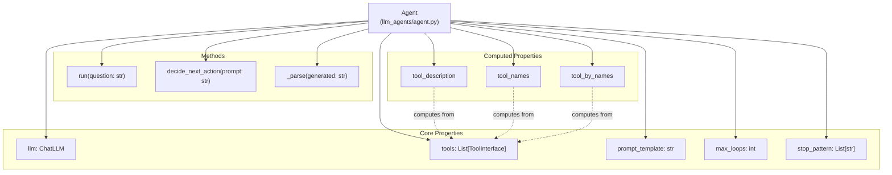

**Agent Class Structure**

| Component | Type | Purpose |
|-----------|------|---------|
| `llm` | `ChatLLM` | Interface to the language model for generating responses |
| `tools` | `List[ToolInterface]` | Registered tools available for the agent to invoke |
| `prompt_template` | `str` | Template for constructing prompts with placeholders |
| `max_loops` | `int` | Maximum iterations before forced termination (default: 15) |
| `stop_pattern` | `List[str]` | Tokens that signal the LLM to stop generation |

**Sources:** [llm_agents/agent.py:36-42]()

---

## The Orchestration Loop

The `run()` method at [llm_agents/agent.py:56-78]() implements the core orchestration logic. This method executes a while loop that continues until either a final answer is generated or the maximum iteration limit is reached.

### Execution Flow

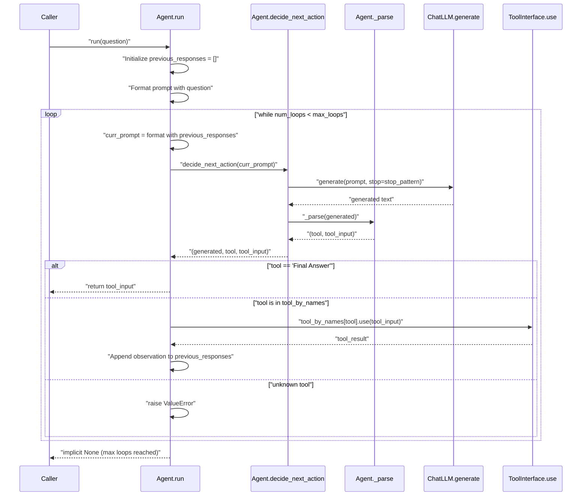

### Key Implementation Details

The orchestration loop maintains several critical pieces of state:

1. **`previous_responses`** - A list of strings accumulating all previous Thought/Action/Observation cycles [llm_agents/agent.py:57]()
2. **`num_loops`** - Counter to prevent infinite loops [llm_agents/agent.py:58]()
3. **`curr_prompt`** - The fully formatted prompt including conversation history [llm_agents/agent.py:69]()

The prompt is constructed using the template at [llm_agents/agent.py:59-65](), which injects:
- Current date via `datetime.date.today()`
- Tool descriptions via `self.tool_description`
- Tool names via `self.tool_names`
- The user's question
- Accumulated conversation history via `previous_responses`

After each tool invocation, the result is formatted with observation markers and appended to `previous_responses` at [llm_agents/agent.py:76-78]():

```
generated += f"\n{OBSERVATION_TOKEN} {tool_result}\n{THOUGHT_TOKEN}"
previous_responses.append(generated)
```

This accumulation pattern ensures that each LLM invocation has access to the complete history of reasoning steps and tool outputs.

**Sources:** [llm_agents/agent.py:56-78]()

---

## Response Parsing

The `_parse()` method at [llm_agents/agent.py:85-94]() is responsible for extracting structured information from the LLM's free-form text responses. This method must handle two distinct response patterns:

### Final Answer Pattern

When the LLM believes it has sufficient information to answer the user's question, it includes the `FINAL_ANSWER_TOKEN` ("Final Answer:") in its response. The parser detects this token and extracts everything after it as the final answer:

```python
if FINAL_ANSWER_TOKEN in generated:
    return "Final Answer", generated.split(FINAL_ANSWER_TOKEN)[-1].strip()
```

This check occurs first at [llm_agents/agent.py:86-87](), taking precedence over action parsing.

### Action Pattern

For intermediate reasoning steps, the LLM must specify an action to take. The parser uses a regular expression at [llm_agents/agent.py:88-89]() to extract:
- **Action**: The tool name to invoke
- **Action Input**: The input parameter for the tool

The regex pattern is:
```python
r"Action: [\[]?(.*?)[\]]?[\n]*Action Input:[\s]*(.*)"
```

This pattern handles optional square brackets around the action name and flexible whitespace between the action and input. The regex uses `re.DOTALL` flag to match across multiple lines, allowing multi-line action inputs.

### Parsing Diagram

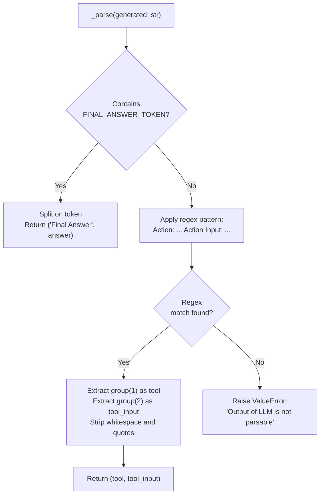

**Error Handling:** If the LLM response doesn't match either pattern, the parser raises a `ValueError` with the unparseable text at [llm_agents/agent.py:91](), providing debugging information about malformed LLM outputs.

**Sources:** [llm_agents/agent.py:85-94]()

---

## Tool Management

The Agent class provides three computed properties for managing the tool registry. These properties dynamically generate tool-related information from the `tools` list.

### Tool Properties

| Property | Return Type | Purpose | Implementation |
|----------|-------------|---------|----------------|
| `tool_description` | `str` | Multi-line string with all tool descriptions for prompt injection | [llm_agents/agent.py:44-46]() |
| `tool_names` | `str` | Comma-separated list of tool names | [llm_agents/agent.py:48-50]() |
| `tool_by_names` | `Dict[str, ToolInterface]` | Dictionary mapping tool names to tool instances | [llm_agents/agent.py:52-54]() |

### Tool Description Format

The `tool_description` property generates a formatted string like:

```
python_repl: A Python shell. Use this to execute python commands...
Google Search: Get specific information from a search query...
```

This string is injected into the prompt template at [llm_agents/agent.py:16]() to inform the LLM about available tools.

### Tool Registry Lookup

When the parser extracts a tool name from the LLM response, the Agent uses `tool_by_names` to retrieve the corresponding tool instance at [llm_agents/agent.py:75]():

```python
tool_result = self.tool_by_names[tool].use(tool_input)
```

If the tool name doesn't exist in the registry, a `ValueError` is raised at [llm_agents/agent.py:73-74]().

```mermaid
graph LR
    ToolsList["tools: List[ToolInterface]"]
    
    subgraph "Computed Properties"
        ToolDesc["tool_description<br/>(lines 44-46)"]
        ToolNames["tool_names<br/>(lines 48-50)"]
        ToolByNames["tool_by_names<br/>(lines 52-54)"]
    end
    
    subgraph "Usage Points"
        PromptInjection["Prompt Template<br/>(line 16)"]
        ToolLookup["Tool Invocation<br/>(line 75)"]
        ToolValidation["Tool Validation<br/>(line 73)"]
    end
    
    ToolsList --> ToolDesc
    ToolsList --> ToolNames
    ToolsList --> ToolByNames
    
    ToolDesc --> PromptInjection
    ToolNames --> PromptInjection
    ToolByNames --> ToolLookup
    ToolByNames --> ToolValidation
```

**Sources:** [llm_agents/agent.py:44-54]()

---

## Prompt Template Structure

The `PROMPT_TEMPLATE` constant at [llm_agents/agent.py:14-33]() defines the instruction format that guides the LLM's behavior. This template uses placeholder variables that are filled in during execution.

### Template Variables

| Placeholder | Source | Injection Point |
|-------------|--------|-----------------|
| `{today}` | `datetime.date.today()` | [llm_agents/agent.py:60]() |
| `{tool_description}` | `self.tool_description` | [llm_agents/agent.py:61]() |
| `{tool_names}` | `self.tool_names` | [llm_agents/agent.py:62]() |
| `{question}` | User-provided question parameter | [llm_agents/agent.py:63]() |
| `{previous_responses}` | Accumulated conversation history | [llm_agents/agent.py:64]() |

### Template Format Specification

The template instructs the LLM to follow a specific output format:

```
Question: the input question you must answer
Thought: comment on what you want to do next
Action: the action to take, exactly one element of [tool_names]
Action Input: the input to the action
Observation: the result of the action
... (this Thought/Action/Action Input/Observation repeats N times)
Thought: I now know the final answer
Final Answer: your final answer to the original input question
```

This format specification is critical because the `_parse()` method expects LLM responses to conform to this structure.

**Sources:** [llm_agents/agent.py:14-33]()

---

## Configuration Parameters

The Agent class exposes several configuration parameters that control its behavior:

### max_loops

**Type:** `int`  
**Default:** `15`  
**Location:** [llm_agents/agent.py:40]()  
**Purpose:** Limits the maximum number of Thought-Action-Observation cycles to prevent infinite loops. After `max_loops` iterations, the `run()` method will exit even if no final answer has been generated.

### stop_pattern

**Type:** `List[str]`  
**Default:** `[f'\n{OBSERVATION_TOKEN}', f'\n\t{OBSERVATION_TOKEN}']`  
**Location:** [llm_agents/agent.py:42]()  
**Purpose:** Specifies token sequences that signal the LLM to stop generating text. This prevents the LLM from hallucinating observation results. The stop pattern includes both newline and tab-prefixed observation tokens to handle different formatting scenarios.

The stop pattern is passed to the LLM during generation at [llm_agents/agent.py:81]():

```python
generated = self.llm.generate(prompt, stop=self.stop_pattern)
```

### prompt_template

**Type:** `str`  
**Default:** `PROMPT_TEMPLATE`  
**Location:** [llm_agents/agent.py:39]()  
**Purpose:** Allows customization of the instruction format. While the default template follows the standard Thought-Action-Observation pattern, users can provide alternative templates for different reasoning strategies.

**Configuration Example:**

```python
from llm_agents import Agent, ChatLLM, PythonREPLTool

agent = Agent(
    llm=ChatLLM(),
    tools=[PythonREPLTool()],
    max_loops=20,  # Allow more iterations
    stop_pattern=['\nObservation:']  # Custom stop token
)
```

**Sources:** [llm_agents/agent.py:39-42]()

---

## Token Constants

The Agent module defines several string constants that serve as structural markers in the conversation flow:

| Constant | Value | Purpose | Usage |
|----------|-------|---------|-------|
| `FINAL_ANSWER_TOKEN` | `"Final Answer:"` | Signals completion | [llm_agents/agent.py:11](), used in parsing at [llm_agents/agent.py:86]() |
| `OBSERVATION_TOKEN` | `"Observation:"` | Marks tool output | [llm_agents/agent.py:12](), used in formatting at [llm_agents/agent.py:76]() and stop pattern |
| `THOUGHT_TOKEN` | `"Thought:"` | Marks reasoning step | [llm_agents/agent.py:13](), used in formatting at [llm_agents/agent.py:76]() |

These constants ensure consistency between the prompt template instructions and the parsing logic. They also make the code more maintainable by centralizing token definitions.

**Sources:** [llm_agents/agent.py:11-13]()

---

## Entry Point Example

The Agent module includes a standalone execution example at [llm_agents/agent.py:97-101]():

```python
if __name__ == '__main__':
    agent = Agent(llm=ChatLLM(), tools=[PythonREPLTool()])
    result = agent.run("What is 7 * 9 - 34 in Python?")
    print(f"Final answer is {result}")
```

This example demonstrates:
1. Agent instantiation with a ChatLLM and a single PythonREPLTool
2. Running the agent with a mathematical question that requires code execution
3. Retrieving and displaying the final answer

The Agent is also exposed as a public API through [llm_agents/__init__.py:1](), making it available via:

```python
from llm_agents import Agent
```

**Sources:** [llm_agents/agent.py:97-101](), [llm_agents/__init__.py:1]()

---

# Page: ChatLLM Integration

# ChatLLM Integration

<details>
<summary>Relevant source files</summary>

The following files were used as context for generating this wiki page:

- [llm_agents/__init__.py](llm_agents/__init__.py)
- [llm_agents/llm.py](llm_agents/llm.py)
- [llm_agents/tools/searx.py](llm_agents/tools/searx.py)
- [requirements.txt](requirements.txt)
- [setup.py](setup.py)

</details>


## Purpose and Scope

This document covers the `ChatLLM` class, which provides the interface between the agent system and OpenAI's language models. The `ChatLLM` component handles all communication with the OpenAI API, manages model configuration, and formats prompts for chat completion.

For information about how the Agent orchestrates calls to ChatLLM, see [The Agent](#2.1). For details on the broader reasoning loop, see [Thought-Action-Observation Loop](#2.3).

## Overview

The `ChatLLM` class is a lightweight wrapper around the OpenAI Python SDK that provides a standardized interface for generating text completions. It is implemented as a Pydantic `BaseModel`, enabling configuration validation and easy instantiation with default values.

**Key Responsibilities:**
- Configure OpenAI API credentials from environment variables
- Manage model selection and temperature settings
- Send chat completion requests to OpenAI
- Extract and return response content
- Support stop sequences for controlled generation

Sources: [llm_agents/llm.py:1-26]()

## Class Structure

The `ChatLLM` class is defined at [llm_agents/llm.py:8-20]() and inherits from `pydantic.BaseModel` for configuration management.

```mermaid
classDiagram
    class BaseModel {
        <<pydantic>>
    }
    
    class ChatLLM {
        +str model
        +float temperature
        +str openai.api_key
        +generate(prompt: str, stop: List[str]) str
    }
    
    class OpenAI_API {
        <<external>>
        +ChatCompletion.create()
    }
    
    BaseModel <|-- ChatLLM
    ChatLLM --> OpenAI_API : uses
```

**Diagram: ChatLLM Class Structure**

### Configuration Fields

| Field | Type | Default Value | Description |
|-------|------|---------------|-------------|
| `model` | `str` | `'gpt-3.5-turbo'` | OpenAI model identifier to use for completions |
| `temperature` | `float` | `0.0` | Controls randomness in responses (0.0 = deterministic) |
| `openai.api_key` | `str` | `os.environ["OPENAI_API_KEY"]` | API key loaded from environment variable |

The default temperature of `0.0` is chosen to produce deterministic, focused responses—critical for the agent's reasoning process where consistency is more valuable than creativity.

Sources: [llm_agents/llm.py:8-11]()

## The generate() Method

The `generate()` method is the primary interface for obtaining completions from the language model. It is defined at [llm_agents/llm.py:13-20]().

### Method Signature

```python
def generate(self, prompt: str, stop: List[str] = None) -> str
```

### Parameters

- **`prompt`** (`str`): The complete prompt text to send to the model. In the agent context, this includes the system instructions, tool descriptions, conversation history, and the current question.

- **`stop`** (`List[str]`, optional): List of sequences where the API will stop generating further tokens. The Agent uses this to halt generation at specific markers like `"Observation:"` to prevent the model from hallucinating tool outputs.

### Return Value

Returns the `content` field from the first message choice in the OpenAI response as a string.

Sources: [llm_agents/llm.py:13-20]()

## OpenAI API Integration

The `ChatLLM` class interacts with the OpenAI Chat Completions API using the `openai` Python package (version >=0.27.0).

```mermaid
sequenceDiagram
    participant Agent
    participant ChatLLM
    participant openai_SDK as "openai SDK"
    participant OpenAI_API as "OpenAI API"
    
    Agent->>ChatLLM: generate(prompt, stop)
    
    ChatLLM->>ChatLLM: Validate self.model<br/>and self.temperature
    
    ChatLLM->>openai_SDK: ChatCompletion.create(<br/>model, messages,<br/>temperature, stop)
    
    openai_SDK->>OpenAI_API: HTTPS POST Request<br/>with API key
    
    OpenAI_API-->>openai_SDK: JSON Response<br/>{choices: [...]}
    
    openai_SDK-->>ChatLLM: Response object
    
    ChatLLM->>ChatLLM: Extract<br/>response.choices[0]<br/>.message.content
    
    ChatLLM-->>Agent: Return content string
```

**Diagram: ChatLLM Request Flow**

### API Call Details

At [llm_agents/llm.py:14-19](), the `generate()` method constructs an API request:

1. **Model Selection**: Uses `self.model` (default: `'gpt-3.5-turbo'`)
2. **Message Format**: Wraps the prompt in a user message: `[{"role": "user", "content": prompt}]`
3. **Temperature**: Uses `self.temperature` (default: `0.0`)
4. **Stop Sequences**: Passes optional `stop` parameter to control generation termination
5. **Response Extraction**: Retrieves `response.choices[0].message.content`

Sources: [llm_agents/llm.py:13-20](), [requirements.txt:1]()

## Usage in the Agent System

The `Agent` class instantiates and uses `ChatLLM` to generate reasoning steps. Here's how the components interact:

```mermaid
graph TB
    Agent["Agent class<br/>(llm_agents/agent.py)"]
    ChatLLM["ChatLLM instance<br/>(llm_agents/llm.py)"]
    PromptTemplate["PROMPT_TEMPLATE<br/>+ tool descriptions<br/>+ conversation history"]
    GenerateMethod["ChatLLM.generate()"]
    OpenAIAPI["openai.ChatCompletion"]
    Response["LLM Response<br/>(Thought/Action/Final Answer)"]
    
    Agent --> PromptTemplate
    PromptTemplate --> GenerateMethod
    Agent --> GenerateMethod
    GenerateMethod --> ChatLLM
    ChatLLM --> OpenAIAPI
    OpenAIAPI --> Response
    Response --> Agent
    
    Agent -.configures.- ChatLLM
```

**Diagram: ChatLLM in Agent Context**

The Agent typically:
1. Constructs a prompt including instructions, tools, and history
2. Calls `llm.generate(prompt, stop=["Observation:"])` to get a reasoning step
3. Parses the response to extract actions
4. Appends observations to the conversation history
5. Repeats the process until a final answer is produced

Sources: [llm_agents/llm.py:1-26](), [llm_agents/__init__.py:1-10]()

## Configuration and Environment Setup

### API Key Configuration

The `ChatLLM` class expects the OpenAI API key to be available in the environment at import time:

```python
openai.api_key = os.environ["OPENAI_API_KEY"]
```

This line at [llm_agents/llm.py:11]() executes as part of the class definition, meaning the environment variable must be set before importing the module.

**Setup Steps:**

1. Obtain an API key from OpenAI: https://platform.openai.com/api-keys
2. Set the environment variable:
   ```bash
   export OPENAI_API_KEY="sk-..."
   ```
3. Import and instantiate:
   ```python
   from llm_agents import ChatLLM
   llm = ChatLLM()  # Uses defaults
   ```

For detailed API key management, see [Required API Keys](#4.1).

### Custom Configuration

Users can override defaults when instantiating:

```python
llm = ChatLLM(
    model='gpt-4',          # Use GPT-4 instead of gpt-3.5-turbo
    temperature=0.7         # Increase creativity
)
```

Since `ChatLLM` inherits from `pydantic.BaseModel`, field validation is automatic. Invalid values (e.g., temperature outside [0, 2]) will raise validation errors.

Sources: [llm_agents/llm.py:8-11](), [requirements.txt:2]()

## Data Flow

The following diagram illustrates the complete data transformation pipeline through `ChatLLM`:

```mermaid
graph LR
    Input["Input:<br/>prompt (str)<br/>stop (List[str])"]
    
    ValidateConfig["Pydantic Validation:<br/>model, temperature"]
    
    FormatMessages["Format Messages:<br/>[{'role': 'user',<br/>'content': prompt}]"]
    
    APIRequest["API Request:<br/>openai.ChatCompletion.create()"]
    
    APIResponse["API Response:<br/>{choices: [{message: {content: ...}}]}"]
    
    Extract["Extract Content:<br/>choices[0].message.content"]
    
    Output["Output:<br/>content (str)"]
    
    Input --> ValidateConfig
    ValidateConfig --> FormatMessages
    FormatMessages --> APIRequest
    APIRequest --> APIResponse
    APIResponse --> Extract
    Extract --> Output
    
    EnvVar["Environment:<br/>OPENAI_API_KEY"]
    EnvVar -.authenticates.-> APIRequest
```

**Diagram: Data Flow Through ChatLLM**

This flow ensures that:
- Configuration is validated before API calls
- Prompts are properly formatted for the chat API
- Authentication is handled via environment variables
- Only the relevant content is extracted from responses

Sources: [llm_agents/llm.py:13-20]()

## Example Usage

### Standalone Usage

The module includes a simple example at [llm_agents/llm.py:22-25]():

```python
if __name__ == '__main__':
    llm = ChatLLM()
    result = llm.generate(prompt='Who is the president of the USA?')
    print(result)
```

This demonstrates basic usage outside the agent context.

### Agent Integration Example

When used by the Agent (typical usage):

```python
from llm_agents import Agent, ChatLLM

# Agent automatically creates ChatLLM instance
agent = Agent(llm=ChatLLM(), tools=[...])

# Agent calls llm.generate() internally during execution
result = agent.run("What is 2+2?")
```

The Agent manages the prompt construction and history, calling `llm.generate()` iteratively as part of the reasoning loop.

Sources: [llm_agents/llm.py:22-26](), [llm_agents/__init__.py:1-10]()

## Dependencies

The `ChatLLM` component relies on two key Python packages:

| Package | Version | Purpose |
|---------|---------|---------|
| `openai` | `>=0.27.0` | OpenAI API client library |
| `pydantic` | `>=1.10.5` | Data validation and settings management |

These dependencies are specified in both [requirements.txt:1-2]() and [setup.py:13-14]().

For a complete dependency overview, see [Python Dependencies](#4.2).

Sources: [requirements.txt:1-5](), [setup.py:11-16]()

## Error Handling Considerations

While the `ChatLLM` class itself does not implement custom error handling, users should be aware of potential failure modes:

### API Key Errors

If `OPENAI_API_KEY` is not set in the environment, the import will raise a `KeyError`:
```python
# At llm_agents/llm.py:11
openai.api_key = os.environ["OPENAI_API_KEY"]  # KeyError if not set
```

### API Request Failures

The `openai.ChatCompletion.create()` call can raise various exceptions:
- `openai.error.AuthenticationError` - Invalid API key
- `openai.error.RateLimitError` - Rate limit exceeded
- `openai.error.APIError` - OpenAI service errors
- Network errors - Connection timeouts, DNS failures

These exceptions propagate up to the caller (typically the Agent) and are not caught by `ChatLLM`.

### Response Format Issues

The code assumes the API returns at least one choice:
```python
return response.choices[0].message.content
```

If the API returns an empty choices list (rare but possible), this will raise an `IndexError`.

Sources: [llm_agents/llm.py:11](), [llm_agents/llm.py:20]()

## Testing Considerations

The `ChatLLM` class interacts with an external API, requiring special handling in tests:

### Mocking Strategy

Tests typically mock the OpenAI API to avoid:
- Making real API calls during tests
- Dependency on external service availability
- API costs from test execution

The test infrastructure provides fixtures for mocking OpenAI clients. For details, see [Test Fixtures](#5.2.1).

### Environment Isolation

Since `openai.api_key` is set at class definition time, tests must carefully manage environment variables. The `reset_environment` fixture (documented in [Test Fixtures](#5.2.1)) handles this cleanup.

Sources: [llm_agents/llm.py:11]()

## Public API Exports

The `ChatLLM` class is exported in the package's public API at [llm_agents/__init__.py:2]():

```python
from llm_agents.llm import ChatLLM
```

Users can import it directly:
```python
from llm_agents import ChatLLM
```

Or from the submodule:
```python
from llm_agents.llm import ChatLLM
```

Both imports are equivalent and refer to the same class.

Sources: [llm_agents/__init__.py:1-10]()

## Summary

The `ChatLLM` class provides a clean, minimal interface to OpenAI's chat completion API. Its key characteristics are:

- **Simple Configuration**: Two fields (`model`, `temperature`) with sensible defaults
- **Pydantic-Based**: Automatic validation and easy instantiation
- **Stateless**: No conversation history management (handled by Agent)
- **Synchronous**: Blocking API calls (no async support)
- **Environment-Driven**: API key from `OPENAI_API_KEY` environment variable

This design keeps the LLM interface focused and delegates conversation management, tool orchestration, and reasoning logic to the Agent layer.

Sources: [llm_agents/llm.py:1-26]()

---

# Page: Thought-Action-Observation Loop

# Thought-Action-Observation Loop

<details>
<summary>Relevant source files</summary>

The following files were used as context for generating this wiki page:

- [README.md](README.md)
- [llm_agents/__init__.py](llm_agents/__init__.py)
- [llm_agents/agent.py](llm_agents/agent.py)
- [llm_agents/tools/searx.py](llm_agents/tools/searx.py)

</details>


## Purpose and Scope

This document explains the Thought-Action-Observation (TAO) loop, the core iterative reasoning pattern that drives agent execution in the llm_agents system. The TAO loop enables the agent to break down complex tasks into steps, execute actions using tools, observe results, and refine its approach until reaching a final answer.

For information about how the Agent class orchestrates this loop, see [The Agent](#2.1). For details on how tools are invoked during the Action phase, see [Tool System](#3). For information about the ChatLLM component that generates thoughts and actions, see [ChatLLM Integration](#2.2).

## Overview

The Thought-Action-Observation loop is an iterative reasoning cycle where an LLM-powered agent:

1. **Thinks**: Generates reasoning about what to do next (produced by LLM)
2. **Acts**: Decides on a tool to use and provides input to it (produced by LLM)
3. **Observes**: Receives the result from tool execution (produced by tool)

This cycle repeats until the agent produces a "Final Answer" or reaches the maximum iteration limit. Each iteration appends its Thought, Action, and Observation to the conversation history, building a growing context that informs subsequent iterations.

**Core Loop Flow**

```mermaid
flowchart TD
    Start["Agent.run(question)"] --> Init["Initialize:<br/>previous_responses = []<br/>num_loops = 0"]
    Init --> BuildPrompt["Build prompt with:<br/>- PROMPT_TEMPLATE<br/>- tool_description<br/>- tool_names<br/>- question"]
    BuildPrompt --> LoopStart{"num_loops < max_loops<br/>(default: 15)"}
    
    LoopStart -->|Yes| IncLoop["num_loops += 1"]
    IncLoop --> FormatPrompt["Format prompt with:<br/>previous_responses"]
    FormatPrompt --> DecideAction["decide_next_action(curr_prompt)"]
    
    DecideAction --> LLMGenerate["llm.generate(prompt, stop)"]
    LLMGenerate --> Parse["_parse(generated)"]
    Parse --> CheckFinal{"tool == 'Final Answer'?"}
    
    CheckFinal -->|Yes| ReturnAnswer["return tool_input"]
    CheckFinal -->|No| ValidateTool{"tool in tool_by_names?"}
    
    ValidateTool -->|No| Error["raise ValueError"]
    ValidateTool -->|Yes| ExecuteTool["tool_by_names[tool].use(tool_input)"]
    
    ExecuteTool --> AppendObs["generated += <br/>OBSERVATION_TOKEN + tool_result<br/>+ THOUGHT_TOKEN"]
    AppendObs --> SaveResponse["previous_responses.append(generated)"]
    SaveResponse --> LoopStart
    
    LoopStart -->|No| MaxReached["Max loops reached"]
    
    ReturnAnswer --> End["Return final answer"]
    MaxReached --> End
```

Sources: [llm_agents/agent.py:56-79]()

## Loop Phases

### Phase 1: Thought Generation

The Thought phase is when the LLM generates reasoning about the current state and what action to take next. The LLM receives the accumulated conversation history and must produce a response in a specific format.

**Thought Format Requirements**

The LLM output must follow this structure:
- **Thought**: Commentary on what to do next
- **Action**: The tool name to use (from available tools)
- **Action Input**: The input parameter to pass to the tool

The prompt template defines this expected format in [llm_agents/agent.py:14-33]():

```
Thought: comment on what you want to do next
Action: the action to take, exactly one element of [tool_names]
Action Input: the input to the action
Observation: the result of the action
... (this Thought/Action/Action Input/Observation repeats N times)
```

**LLM Generation with Stop Patterns**

The agent uses stop patterns to prevent the LLM from hallucinating observations. The `stop_pattern` list [llm_agents/agent.py:42]() contains:
- `'\n{OBSERVATION_TOKEN}'` 
- `'\n\t{OBSERVATION_TOKEN}'`

This ensures the LLM stops generating before it reaches the Observation section, which must be produced by actual tool execution.

Sources: [llm_agents/agent.py:14-33](), [llm_agents/agent.py:42](), [llm_agents/agent.py:80-83]()

### Phase 2: Action Parsing and Execution

Once the LLM generates a response, the agent parses it to extract the action and action input. This parsing logic is critical for translating natural language intent into executable tool invocations.

**Parsing Logic**

```mermaid
flowchart TD
    ParseStart["_parse(generated)"] --> CheckFinal{"FINAL_ANSWER_TOKEN<br/>in generated?"}
    
    CheckFinal -->|Yes| ExtractFinal["Split on FINAL_ANSWER_TOKEN<br/>return 'Final Answer', answer"]
    
    CheckFinal -->|No| RegexMatch["Apply regex:<br/>r'Action: [\[]?(.*?)[\]]?[\n]*Action Input:[\s]*(.*)'"]
    
    RegexMatch --> MatchFound{"match found?"}
    
    MatchFound -->|No| RaiseError["raise ValueError:<br/>'Output of LLM is not parsable'"]
    
    MatchFound -->|Yes| ExtractGroups["Extract:<br/>tool = match.group(1).strip()<br/>tool_input = match.group(2).strip()"]
    
    ExtractGroups --> Return["return tool, tool_input"]
    
    ExtractFinal --> End["End"]
    Return --> End
    RaiseError --> End
```

The `_parse` method [llm_agents/agent.py:85-94]() handles two cases:

1. **Final Answer Detection**: If `FINAL_ANSWER_TOKEN` ("Final Answer:") appears in the generated text, extract everything after it as the final answer
2. **Action Extraction**: Use regex to extract the action name and action input from the structured format

The regex pattern [llm_agents/agent.py:88]() allows for optional brackets around the action name and flexible whitespace:
```
Action: [\[]?(.*?)[\]]?[\n]*Action Input:[\s]*(.*)
```

**Tool Invocation**

After parsing, the agent:
1. Validates the tool name exists in `tool_by_names` [llm_agents/agent.py:73-74]()
2. Retrieves the tool instance from the registry [llm_agents/agent.py:53-54]()
3. Invokes `tool.use(tool_input)` to execute the action [llm_agents/agent.py:75]()

Sources: [llm_agents/agent.py:85-94](), [llm_agents/agent.py:73-75]()

### Phase 3: Observation Integration

The Observation phase captures the tool execution result and integrates it back into the conversation history. This is where external information enters the reasoning loop.

**Observation Formatting**

After tool execution, the observation is formatted and appended to the generated text [llm_agents/agent.py:76]():

```python
generated += f"\n{OBSERVATION_TOKEN} {tool_result}\n{THOUGHT_TOKEN}"
```

This creates a structured entry like:
```
Thought: I need to search for information
Action: Google Search
Action Input: population of Tokyo 2024
Observation: Tokyo has a population of approximately 14 million...
Thought:
```

The trailing `THOUGHT_TOKEN` prepares the prompt for the next iteration, prompting the LLM to generate another thought.

**History Accumulation**

The complete generated text (Thought + Action + Action Input + Observation + Thought token) is appended to `previous_responses` [llm_agents/agent.py:78]():

```python
previous_responses.append(generated)
```

This list accumulates all previous iterations, creating a growing context window that the LLM can reference in subsequent iterations.

Sources: [llm_agents/agent.py:76-78](), [llm_agents/agent.py:11-12]()

## State Accumulation Across Iterations

The TAO loop maintains state through the `previous_responses` list, which accumulates the complete history of all Thought-Action-Observation cycles. This accumulated state is critical for multi-step reasoning.

**State Flow Diagram**

```mermaid
flowchart LR
    subgraph "Iteration 1"
        I1Start["Empty previous_responses"] --> I1Gen["LLM generates:<br/>Thought1 + Action1"]
        I1Gen --> I1Tool["Tool execution:<br/>Observation1"]
        I1Tool --> I1Append["Append to previous_responses:<br/>'Thought1\\nAction1\\nObservation1\\nThought:'"]
    end
    
    subgraph "Iteration 2"
        I2Start["previous_responses has 1 entry"] --> I2Prompt["Prompt includes:<br/>previous iteration"]
        I2Prompt --> I2Gen["LLM generates:<br/>Thought2 + Action2"]
        I2Gen --> I2Tool["Tool execution:<br/>Observation2"]
        I2Tool --> I2Append["Append to previous_responses:<br/>'Thought2\\nAction2\\nObservation2\\nThought:'"]
    end
    
    subgraph "Iteration N"
        INStart["previous_responses has N-1 entries"] --> INPrompt["Prompt includes:<br/>all previous iterations"]
        INPrompt --> INGen["LLM generates:<br/>Final Answer"]
    end
    
    I1Append --> I2Start
    I2Append --> INStart
```

**Prompt Construction**

On each iteration, the current prompt is constructed by formatting the template with the accumulated history [llm_agents/agent.py:69]():

```python
curr_prompt = prompt.format(previous_responses='\n'.join(previous_responses))
```

The `previous_responses` list is joined with newlines and inserted into the `{previous_responses}` placeholder in the prompt template [llm_agents/agent.py:32]().

This means:
- **Iteration 1**: Prompt contains only the original question
- **Iteration 2**: Prompt contains question + first Thought/Action/Observation
- **Iteration 3**: Prompt contains question + first two Thought/Action/Observation cycles
- **Iteration N**: Prompt contains the complete history

This growing context allows the LLM to:
- Reference information from previous tool outputs
- Avoid repeating unsuccessful actions
- Build complex multi-step reasoning chains
- Synthesize information from multiple sources

Sources: [llm_agents/agent.py:57-69]()

## Loop Termination

The TAO loop has two termination conditions, checked in order of priority.

### Condition 1: Final Answer Detection

The primary termination condition is when the LLM generates a response containing `FINAL_ANSWER_TOKEN` ("Final Answer:") [llm_agents/agent.py:11]().

When detected during parsing [llm_agents/agent.py:86-87]():
1. The `_parse` method extracts the text after "Final Answer:"
2. The `decide_next_action` method returns "Final Answer" as the tool name
3. The main loop checks if `tool == 'Final Answer'` [llm_agents/agent.py:71-72]()
4. If true, returns the extracted answer immediately

This allows the agent to terminate as soon as it has sufficient information to answer the question.

### Condition 2: Maximum Iterations

The secondary termination condition is reaching `max_loops` (default: 15) [llm_agents/agent.py:40]().

The loop counter is checked before each iteration [llm_agents/agent.py:67]():
```python
while num_loops < self.max_loops:
    num_loops += 1
    # ... iteration logic
```

If the agent reaches 15 iterations without producing a final answer:
- The loop exits naturally
- No explicit return value (implicitly returns `None`)
- This prevents infinite loops if the LLM fails to converge

This safety mechanism ensures the agent doesn't run indefinitely on unsolvable or poorly-specified tasks.

Sources: [llm_agents/agent.py:40](), [llm_agents/agent.py:67-72](), [llm_agents/agent.py:86-87]()

## Implementation Details

### Complete Loop Implementation

The main loop is implemented in the `Agent.run` method [llm_agents/agent.py:56-79](). Here's a detailed breakdown of the implementation:

**Initialization Phase** [llm_agents/agent.py:57-65]():
```python
previous_responses = []  # Accumulator for conversation history
num_loops = 0           # Iteration counter
prompt = self.prompt_template.format(  # One-time prompt construction
    today=datetime.date.today(),
    tool_description=self.tool_description,
    tool_names=self.tool_names,
    question=question,
    previous_responses='{previous_responses}'  # Placeholder for later
)
```

**Loop Iteration** [llm_agents/agent.py:67-79]():
```python
while num_loops < self.max_loops:
    num_loops += 1
    
    # Format prompt with accumulated history
    curr_prompt = prompt.format(previous_responses='\n'.join(previous_responses))
    
    # Generate and parse LLM response
    generated, tool, tool_input = self.decide_next_action(curr_prompt)
    
    # Check for final answer
    if tool == 'Final Answer':
        return tool_input
    
    # Validate tool exists
    if tool not in self.tool_by_names:
        raise ValueError(f"Unknown tool: {tool}")
    
    # Execute tool and format observation
    tool_result = self.tool_by_names[tool].use(tool_input)
    generated += f"\n{OBSERVATION_TOKEN} {tool_result}\n{THOUGHT_TOKEN}"
    
    # Print and accumulate
    print(generated)
    previous_responses.append(generated)
```

### Token Definitions

The agent uses string tokens to structure the conversation [llm_agents/agent.py:11-13]():

| Token | Value | Purpose |
|-------|-------|---------|
| `FINAL_ANSWER_TOKEN` | `"Final Answer:"` | Marks the final answer in LLM output |
| `OBSERVATION_TOKEN` | `"Observation:"` | Marks tool execution results |
| `THOUGHT_TOKEN` | `"Thought:"` | Marks reasoning sections |

These tokens serve dual purposes:
1. **Prompt structure**: Define the expected format for the LLM
2. **Parsing markers**: Enable regex-based extraction of components

### Tool Registry Access

The agent maintains three properties for tool access [llm_agents/agent.py:44-54]():

**`tool_description`**: Concatenates all tool descriptions for the prompt
```python
@property
def tool_description(self) -> str:
    return "\n".join([f"{tool.name}: {tool.description}" for tool in self.tools])
```

**`tool_names`**: Comma-separated list of tool names
```python
@property
def tool_names(self) -> str:
    return ",".join([tool.name for tool in self.tools])
```

**`tool_by_names`**: Dictionary mapping tool names to instances
```python
@property
def tool_by_names(self) -> Dict[str, ToolInterface]:
    return {tool.name: tool for tool in self.tools}
```

These properties enable:
- Dynamic prompt construction based on available tools
- Fast tool lookup by name during action execution
- Tool description injection into the LLM prompt

Sources: [llm_agents/agent.py:11-13](), [llm_agents/agent.py:44-54](), [llm_agents/agent.py:56-79]()

## Prompt Template Structure

The prompt template is the foundation of the TAO loop, providing instructions and structure for the LLM's outputs.

**Template Components**

```mermaid
flowchart TD
    Template["PROMPT_TEMPLATE"] --> Context["Context Section:<br/>Today is {today}<br/>Available tools: {tool_description}"]
    Template --> Format["Format Instructions:<br/>Question/Thought/Action/Action Input/Observation"]
    Template --> Examples["Examples:<br/>Shows N iterations of the loop"]
    Template --> Input["Input Section:<br/>Question: {question}<br/>Thought: {previous_responses}"]
    
    Context --> tool_desc["tool_description:<br/>Dynamic list of tool names<br/>and descriptions"]
    Format --> tool_names["tool_names:<br/>Comma-separated list<br/>of valid action names"]
    Input --> prev_resp["previous_responses:<br/>Accumulated history<br/>of all iterations"]
```

**Full Template Definition** [llm_agents/agent.py:14-33]():

```
Today is {today} and you can use tools to get new information. Answer the question as best as you can using the following tools: 

{tool_description}

Use the following format:

Question: the input question you must answer
Thought: comment on what you want to do next
Action: the action to take, exactly one element of [{tool_names}]
Action Input: the input to the action
Observation: the result of the action
... (this Thought/Action/Action Input/Observation repeats N times, use it until you are sure of the answer)
Thought: I now know the final answer
Final Answer: your final answer to the original input question

Begin!

Question: {question}
Thought: {previous_responses}
```

**Template Placeholders**:
- `{today}`: Current date via `datetime.date.today()` [llm_agents/agent.py:60]()
- `{tool_description}`: Multi-line list of available tools [llm_agents/agent.py:45-46]()
- `{tool_names}`: Comma-separated valid action names [llm_agents/agent.py:49-50]()
- `{question}`: The user's input question [llm_agents/agent.py:63]()
- `{previous_responses}`: Accumulated TAO iterations [llm_agents/agent.py:64]()

The template uses nested formatting: the outer `format()` call fills in static values once at initialization [llm_agents/agent.py:59-65](), while preserving `{previous_responses}` as a literal `'{previous_responses}'` string for repeated formatting on each iteration [llm_agents/agent.py:69]().

Sources: [llm_agents/agent.py:14-33](), [llm_agents/agent.py:59-65]()

## Example TAO Execution Flow

Consider a question: "What is the capital of France and what is 2 + 2?"

**Iteration 1**:
```
Thought: I need to find the capital of France first
Action: Google Search
Action Input: capital of France
Observation: The capital of France is Paris.
Thought:
```

**Iteration 2** (prompt now includes Iteration 1):
```
Thought: Now I need to calculate 2 + 2
Action: python_repl
Action Input: 2 + 2
Observation: 4
Thought:
```

**Iteration 3** (prompt now includes Iterations 1 and 2):
```
Thought: I now know the final answer
Final Answer: The capital of France is Paris, and 2 + 2 equals 4.
```

Each iteration builds on previous observations, enabling multi-step reasoning that combines information from multiple tools.

Sources: [README.md:13-24](), [llm_agents/agent.py:56-79]()

---

# Page: Tool System

# Tool System

<details>
<summary>Relevant source files</summary>

The following files were used as context for generating this wiki page:

- [README.md](README.md)
- [llm_agents/__init__.py](llm_agents/__init__.py)
- [llm_agents/tools/base.py](llm_agents/tools/base.py)
- [llm_agents/tools/searx.py](llm_agents/tools/searx.py)

</details>


## Purpose and Scope

This document provides an overview of the tool system in the llm_agents library. Tools are pluggable components that extend the agent's capabilities by providing concrete actions that the LLM can invoke during the Thought-Action-Observation loop. This page covers the tool architecture, the `ToolInterface` contract, tool categories, and how tools integrate with the agent orchestration layer.

For detailed documentation on the Agent's orchestration logic, see [The Agent](#2.1). For information on implementing the Thought-Action-Observation loop, see [Thought-Action-Observation Loop](#2.3). For specific tool implementations, see child pages under this section.

---

## Tool Architecture

The tool system follows a **plugin architecture** where all tools implement a common interface contract defined by the `ToolInterface` base class. This design enables the agent to treat all tools uniformly while supporting diverse capabilities ranging from web search to code execution.

The agent discovers available tools through their `name` and `description` attributes, which are embedded in the prompt sent to the LLM. When the LLM selects a tool and provides input, the agent invokes the tool's `use()` method and returns the observation back to the LLM.

### Tool Interface Contract

All tools in the system inherit from `ToolInterface` [llm_agents/tools/base.py:3-8]() which defines three required members:

| Member | Type | Purpose |
|--------|------|---------|
| `name` | `str` | Unique identifier for the tool that the LLM uses to select it |
| `description` | `str` | Natural language description of the tool's purpose and expected input format |
| `use(input_text: str)` | `str` | Method that executes the tool's action and returns the observation |

The `ToolInterface` extends Pydantic's `BaseModel` [llm_agents/tools/base.py:3](), providing data validation for the tool attributes.

**Sources:** [llm_agents/tools/base.py:1-9]()

---

## Tool Discovery and Invocation Flow

The following diagram illustrates how tools are discovered, selected, and invoked during agent execution:

```mermaid
sequenceDiagram
    participant Agent as "Agent"
    participant ToolRegistry as "tools: List[ToolInterface]"
    participant LLM as "ChatLLM"
    participant Tool as "ToolInterface Implementation"
    
    Note over Agent,ToolRegistry: Initialization Phase
    Agent->>ToolRegistry: "Register tools via constructor"
    ToolRegistry-->>Agent: "tools list stored"
    
    Note over Agent,LLM: Prompt Construction Phase
    Agent->>ToolRegistry: "Get tool names and descriptions"
    ToolRegistry-->>Agent: "[(name='python_repl', description='...'), ...]"
    Agent->>Agent: "Build prompt with tool descriptions"
    Agent->>LLM: "generate(prompt_with_tools)"
    
    Note over LLM,Tool: Action Selection Phase
    LLM-->>Agent: "Action: python_repl\nAction Input: print(2+2)"
    Agent->>Agent: "_parse() extracts action and action_input"
    
    Note over Agent,Tool: Tool Invocation Phase
    Agent->>ToolRegistry: "Find tool by name='python_repl'"
    ToolRegistry-->>Agent: "PythonREPLTool instance"
    Agent->>Tool: "use('print(2+2)')"
    Tool->>Tool: "Execute tool-specific logic"
    Tool-->>Agent: "Observation: 4"
    
    Note over Agent,LLM: Observation Feedback Phase
    Agent->>Agent: "Append 'Observation: 4' to prompt history"
    Agent->>LLM: "generate(prompt_with_observation)"
```

The key insight is that the agent uses the tool's `name` attribute as the selection key and the `description` attribute to inform the LLM's decision-making process.

**Sources:** [README.md:13-22](), [llm_agents/tools/base.py:3-8]()

---

## Available Tool Categories

The llm_agents library provides two primary categories of tools:

### Search Tools

Search tools enable the agent to retrieve information from external knowledge sources. The library includes four different search implementations:

| Tool Class | Name | External Service | Configuration Required |
|------------|------|------------------|----------------------|
| `SerpAPITool` | `"Google Search"` | SerpAPI | `SERPAPI_API_KEY` |
| `GoogleSearchTool` | `"Google Search"` | Google Custom Search API | `GOOGLE_API_KEY`, `GOOGLE_CSE_ID` |
| `SearxSearchTool` | `"Searx Search"` | Searx instance | `SEARX_INSTANCE_URL` |
| `HackerNewsSearchTool` | `"hacker news search"` | Hacker News Algolia API | None |

Each search tool provides different trade-offs in terms of cost, configuration complexity, and result quality. See [Search Tools](#3.2) for detailed comparisons and usage guidelines.

### Execution Tools

Execution tools allow the agent to perform computational actions:

| Tool Class | Name | Purpose | Security Considerations |
|------------|------|---------|------------------------|
| `PythonREPLTool` | `"python_repl"` | Execute Python code in isolated environment | Code runs with agent process privileges |

See [PythonREPLTool](#3.3) for detailed documentation on code execution capabilities and security considerations.

**Sources:** [llm_agents/__init__.py:1-10](), [README.md:16-17]()

---

## Tool Class Hierarchy and Implementation Map

The following diagram maps the inheritance hierarchy and shows concrete implementations with their code locations:

```mermaid
graph TB
    subgraph "Base Contract"
        ToolInterface["ToolInterface<br/>(llm_agents/tools/base.py:3-8)<br/>━━━━━━━━━━━━━━━━━<br/>+ name: str<br/>+ description: str<br/>+ use(input_text: str) → str"]
    end
    
    subgraph "Search Tool Implementations"
        SerpAPITool["SerpAPITool<br/>(llm_agents/tools/search.py)<br/>━━━━━━━━━━━━━━━━━<br/>name = 'Google Search'<br/>Requires: SERPAPI_API_KEY"]
        
        GoogleSearchTool["GoogleSearchTool<br/>(llm_agents/tools/google_search.py)<br/>━━━━━━━━━━━━━━━━━<br/>name = 'Google Search'<br/>Requires: GOOGLE_API_KEY<br/>+ GOOGLE_CSE_ID"]
        
        SearxSearchTool["SearxSearchTool<br/>(llm_agents/tools/searx.py:74-81)<br/>━━━━━━━━━━━━━━━━━<br/>name = 'Searx Search'<br/>Requires: SEARX_INSTANCE_URL"]
        
        HackerNewsSearchTool["HackerNewsSearchTool<br/>(llm_agents/tools/hackernews.py)<br/>━━━━━━━━━━━━━━━━━<br/>name = 'hacker news search'<br/>Requires: None"]
    end
    
    subgraph "Execution Tool Implementations"
        PythonREPLTool["PythonREPLTool<br/>(llm_agents/tools/python_repl.py)<br/>━━━━━━━━━━━━━━━━━<br/>name = 'python_repl'<br/>Requires: None"]
    end
    
    ToolInterface -.implements.- SerpAPITool
    ToolInterface -.implements.- GoogleSearchTool
    ToolInterface -.implements.- SearxSearchTool
    ToolInterface -.implements.- HackerNewsSearchTool
    ToolInterface -.implements.- PythonREPLTool
    
    style ToolInterface fill:#f9f9f9,stroke:#333,stroke-width:3px
```

**Sources:** [llm_agents/tools/base.py:3-8](), [llm_agents/__init__.py:3-7](), [llm_agents/tools/searx.py:74-81]()

---

## Tool Registration and Usage Pattern

Tools are registered with the agent during initialization. The typical usage pattern is:

```python
from llm_agents import Agent, ChatLLM, PythonREPLTool, SerpAPITool

# Instantiate tools
python_tool = PythonREPLTool()
search_tool = SerpAPITool()

# Register tools with agent
agent = Agent(llm=ChatLLM(), tools=[python_tool, search_tool])

# Agent can now use both tools during execution
result = agent.run("What is 15 factorial?")
```

From [README.md:48-54](), this pattern demonstrates how the agent's constructor accepts a list of `ToolInterface` implementations, making the tool registry completely configurable at runtime.

**Sources:** [README.md:46-58]()

---

## Tool Description Format and LLM Integration

The `description` attribute of each tool serves as the primary mechanism for the LLM to understand when and how to use the tool. A well-formatted description typically includes:

1. **Capability statement**: What the tool does
2. **Input format**: Expected format of the action input
3. **Output format**: What kind of observation to expect

For example, the `SearxSearchTool` description [llm_agents/tools/searx.py:78]() states:

```
"Get specific information from a search query. Input should be a question like 'How to add number in Clojure?'. Result will be the answer to the question."
```

This description provides the LLM with:
- **Capability**: Getting specific information from search
- **Input format**: A natural language question
- **Output format**: The answer to the question

The agent embeds these descriptions in the prompt template sent to the LLM, allowing the LLM to reason about which tool to use for a given task.

**Sources:** [llm_agents/tools/searx.py:74-81]()

---

## Tool Execution Architecture

The following diagram shows the data flow from LLM output through tool execution back to observation:

```mermaid
graph LR
    subgraph "LLM Output Parsing"
        LLMResponse["LLM Response Text:<br/>Thought: ...<br/>Action: python_repl<br/>Action Input: print(2+2)"]
        ParseAction["Agent._parse()<br/>Extracts action name<br/>and action_input"]
    end
    
    subgraph "Tool Selection"
        ToolLookup["Loop through tools list:<br/>find tool where<br/>tool.name == action"]
        ToolInstance["Retrieved<br/>ToolInterface instance"]
    end
    
    subgraph "Tool Execution"
        UseMethod["tool.use(action_input)<br/>Executes tool logic"]
        ExternalAPI["External Service<br/>(if applicable)"]
        Observation["Observation string<br/>returned"]
    end
    
    subgraph "Feedback Loop"
        AppendHistory["Append to prompt:<br/>'Observation: {result}'"]
        NextIteration["Next LLM generation<br/>with updated context"]
    end
    
    LLMResponse --> ParseAction
    ParseAction --> ToolLookup
    ToolLookup --> ToolInstance
    ToolInstance --> UseMethod
    UseMethod -.may call.-> ExternalAPI
    UseMethod --> Observation
    Observation --> AppendHistory
    AppendHistory --> NextIteration
    
    style ParseAction fill:#f9f9f9,stroke:#333,stroke-width:2px
    style UseMethod fill:#f9f9f9,stroke:#333,stroke-width:2px
    style Observation fill:#f9f9f9,stroke:#333,stroke-width:2px
```

This architecture ensures that:
1. Tool selection is based on string matching of the tool's `name` attribute
2. Tool execution is completely encapsulated within the `use()` method
3. All tools return string observations that can be fed back to the LLM
4. The agent doesn't need to understand the internal workings of each tool

**Sources:** [README.md:18-21](), [llm_agents/tools/base.py:7-8]()

---

## Extensibility and Custom Tools

The plugin architecture makes it straightforward to add custom tools. To create a new tool:

1. Inherit from `ToolInterface` [llm_agents/tools/base.py:3]()
2. Define `name` and `description` class attributes
3. Implement the `use(input_text: str) -> str` method
4. Register the tool with the agent during initialization

For example, examining `SearxSearchTool` [llm_agents/tools/searx.py:74-81]():

```python
class SearxSearchTool(ToolInterface):
    """Tool for Searx search results."""
    
    name = "Searx Search"
    description = "Get specific information from a search query. Input should be a question like 'How to add number in Clojure?'. Result will be the answer to the question."
    
    def use(self, input_text: str) -> str:
        return search(input_text)
```

The implementation delegates to a helper function `search()` [llm_agents/tools/searx.py:36-71]() that handles the external API interaction, demonstrating the separation between the tool interface contract and the underlying implementation logic.

For detailed guidance on creating custom tools, see [Creating Custom Tools](#3.4).

**Sources:** [llm_agents/tools/searx.py:74-88](), [llm_agents/tools/base.py:3-8](), [README.md:57]()

---

## Configuration and Environment Variables

Most tools require external API keys or service URLs configured via environment variables:

| Tool | Required Environment Variables | Purpose |
|------|-------------------------------|---------|
| `SerpAPITool` | `SERPAPI_API_KEY` | Authenticate with SerpAPI service |
| `GoogleSearchTool` | `GOOGLE_API_KEY`, `GOOGLE_CSE_ID` | Authenticate and identify Custom Search Engine |
| `SearxSearchTool` | `SEARX_INSTANCE_URL` | Specify Searx instance endpoint |
| `HackerNewsSearchTool` | None | Uses public Algolia API |
| `PythonREPLTool` | None | Executes locally |

The tools access these variables using `os.environ` [llm_agents/tools/searx.py:39]() at runtime. Missing required environment variables will cause the tool to fail when invoked.

For detailed setup instructions, see [Required API Keys](#4.1).

**Sources:** [llm_agents/tools/searx.py:39](), [README.md:37-42]()

---

## Error Handling and Fallback Behavior

Tools implement error handling within their `use()` methods. For example, `SearxSearchTool` returns a descriptive message when no results are found [llm_agents/tools/searx.py:47-48]():

```python
if (len(res) == 0 or (len(res['answers']) == 0 and len(res['infoboxes']) == 0 and len(res['results']) == 0)):
    return "No good Searx Search Result was found"
```

This pattern ensures that the agent always receives a string observation, even in error cases, allowing the LLM to reason about the failure and potentially try alternative approaches.

**Sources:** [llm_agents/tools/searx.py:45-48]()

---

## Summary

The tool system provides a clean plugin architecture where:

- **All tools implement `ToolInterface`** with `name`, `description`, and `use()` members
- **The agent discovers tools** through their name and description attributes
- **Tool invocation is uniform** through the `use(input_text: str) -> str` method
- **Multiple tool categories** exist (search, execution) with different capabilities
- **Extension is straightforward** by implementing the interface contract
- **Configuration is environment-based** for external service integration

This design enables the agent to work with any tool without requiring agent-side modifications, supporting both built-in tools and custom implementations.

For implementation details of specific tools, see the child pages: [ToolInterface](#3.1), [Search Tools](#3.2), [PythonREPLTool](#3.3), and [Creating Custom Tools](#3.4).

---

# Page: ToolInterface

# ToolInterface

<details>
<summary>Relevant source files</summary>

The following files were used as context for generating this wiki page:

- [llm_agents/__init__.py](llm_agents/__init__.py)
- [llm_agents/tools/base.py](llm_agents/tools/base.py)
- [llm_agents/tools/searx.py](llm_agents/tools/searx.py)

</details>


## Purpose and Scope

This document describes the `ToolInterface` base class, which defines the contract that all tools in the llm_agents system must implement. The ToolInterface enables the plugin architecture that allows the Agent to uniformly discover, describe, and invoke diverse capabilities such as web search, code execution, and other external actions.

For documentation on specific tool implementations, see [Search Tools](#3.2) and [PythonREPLTool](#3.3). For guidance on implementing your own tools, see [Creating Custom Tools](#3.4). For information on how the Agent orchestrates tool invocation, see [The Agent](#2.1).

---

## Interface Definition

The `ToolInterface` is a Pydantic `BaseModel` that defines the minimal contract all tools must satisfy. It is located in [llm_agents/tools/base.py:1-9]().

```python
class ToolInterface(BaseModel):
    name: str
    description: str
    
    def use(self, input_text: str) -> str:
        raise NotImplementedError("use() method not implemented")
```

The interface consists of three required components:

| Component | Type | Purpose |
|-----------|------|---------|
| `name` | `str` | Unique identifier for the tool that the Agent uses to select it |
| `description` | `str` | Natural language description that helps the LLM understand when and how to use the tool |
| `use()` | Method | Executes the tool's functionality and returns a string observation |

**Sources:** [llm_agents/tools/base.py:1-9]()

---

## Architecture Overview

The following diagram shows how `ToolInterface` fits into the larger agent system:

```mermaid
graph TB
    Agent["Agent Class<br/>(llm_agents/agent.py)"]
    ToolInterface["ToolInterface<br/>(llm_agents/tools/base.py)<br/>---<br/>+ name: str<br/>+ description: str<br/>+ use(input_text: str): str"]
    
    subgraph "Tool Implementations"
        PythonREPL["PythonREPLTool<br/>(llm_agents/tools/python_repl.py)"]
        SerpAPI["SerpAPITool<br/>(llm_agents/tools/search.py)"]
        GoogleSearch["GoogleSearchTool<br/>(llm_agents/tools/google_search.py)"]
        Searx["SearxSearchTool<br/>(llm_agents/tools/searx.py)"]
        HackerNews["HackerNewsSearchTool<br/>(llm_agents/tools/hackernews.py)"]
    end
    
    Agent -->|"discovers via<br/>name + description"| ToolInterface
    Agent -->|"invokes via<br/>use() method"| ToolInterface
    
    ToolInterface <|.."implements"..| PythonREPL
    ToolInterface <|.."implements"..| SerpAPI
    ToolInterface <|.."implements"..| GoogleSearch
    ToolInterface <|.."implements"..| Searx
    ToolInterface <|.."implements"..| HackerNews
```

**Diagram: ToolInterface in the Agent Ecosystem**

The Agent treats all tools uniformly through this interface, enabling extensibility without modifying the Agent's core logic. The Agent uses `name` and `description` to build the LLM prompt, allowing the language model to select appropriate tools. When a tool is selected, the Agent calls `use()` with the action input to execute the tool.

**Sources:** [llm_agents/tools/base.py:1-9](), [llm_agents/__init__.py:1-10]()

---

## Contract Details

### The `name` Attribute

The `name` attribute is a string identifier that serves two purposes:

1. **Tool Selection**: The Agent parses the LLM's output to extract an "Action" field, which must match a tool's `name` exactly
2. **Prompt Construction**: The name is included in the prompt template shown to the LLM

The name should be concise, descriptive, and unique among all tools provided to an Agent instance. Examples from the codebase:

| Tool Class | Name Value |
|------------|------------|
| `PythonREPLTool` | `"python_repl"` |
| `SerpAPITool` | `"Google Search"` |
| `GoogleSearchTool` | `"Google Search"` |
| `SearxSearchTool` | `"Searx Search"` |
| `HackerNewsSearchTool` | `"hacker news search"` |

### The `description` Attribute

The `description` attribute provides natural language guidance to the LLM about when and how to use the tool. It should:

- Explain what the tool does
- Specify the expected input format
- Describe what the output will contain
- Help the LLM distinguish this tool from others

Example from [llm_agents/tools/searx.py:78]():
```
"Get specific information from a search query. Input should be a question like 'How to add number in Clojure?'. Result will be the answer to the question."
```

### The `use()` Method

The `use()` method is the execution interface. It:

- **Input**: Accepts a single `input_text` parameter (string) containing the action input determined by the LLM
- **Output**: Returns a string observation that will be fed back to the LLM in the next reasoning iteration
- **Exceptions**: Should handle errors gracefully and return informative error messages as strings rather than raising exceptions
- **Side Effects**: May perform external API calls, execute code, or modify state as needed

**Sources:** [llm_agents/tools/base.py:3-8](), [llm_agents/tools/searx.py:74-81]()

---

## Implementation Pattern

The following diagram illustrates the typical implementation pattern for a tool:

```mermaid
graph TB
    subgraph "Base Class"
        ToolInterface["ToolInterface<br/>(BaseModel)"]
    end
    
    subgraph "Concrete Implementation"
        ConcreteClass["ExampleTool<br/>(implements ToolInterface)"]
        NameAttr["name = 'tool_identifier'"]
        DescAttr["description = 'Detailed usage instructions...'"]
        UseMethod["use(input_text: str) -> str"]
    end
    
    subgraph "Implementation Steps"
        Parse["1. Parse input_text<br/>Extract parameters"]
        Execute["2. Execute tool logic<br/>Call APIs, run code, etc."]
        Format["3. Format results<br/>Convert to string"]
        Handle["4. Handle errors<br/>Return error messages as strings"]
    end
    
    ToolInterface -.."inherits"..> ConcreteClass
    ConcreteClass --> NameAttr
    ConcreteClass --> DescAttr
    ConcreteClass --> UseMethod
    
    UseMethod --> Parse
    Parse --> Execute
    Execute --> Format
    Format --> Handle
    Handle --> Result["Return observation string"]
```

**Diagram: Tool Implementation Flow**

### Minimal Implementation Example

Here is the complete implementation of `SearxSearchTool` from [llm_agents/tools/searx.py:74-81]():

```python
class SearxSearchTool(ToolInterface):
    """Tool for Searx search results."""

    name = "Searx Search"
    description = "Get specific information from a search query. Input should be a question like 'How to add number in Clojure?'. Result will be the answer to the question."

    def use(self, input_text: str) -> str:
        return search(input_text)
```

This implementation:
1. **Inherits from `ToolInterface`** as required
2. **Sets `name`** to a unique identifier
3. **Sets `description`** with usage guidance
4. **Implements `use()`** by delegating to a helper function that returns a string

**Sources:** [llm_agents/tools/searx.py:74-81]()

---

## Pydantic Integration

`ToolInterface` extends `pydantic.BaseModel` [llm_agents/tools/base.py:1](), which provides:

1. **Type Validation**: Automatic validation that `name` and `description` are strings
2. **Serialization**: Tools can be easily serialized to JSON for logging or storage
3. **IDE Support**: Better autocomplete and type checking in development environments
4. **Validation Errors**: Clear error messages if tools are instantiated incorrectly

This integration ensures that all tools have a consistent structure and fail fast if implemented incorrectly.

**Sources:** [llm_agents/tools/base.py:1-3]()

---

## How the Agent Uses ToolInterface

The following sequence diagram shows the interaction between Agent and tools through the ToolInterface:

```mermaid
sequenceDiagram
    participant Agent
    participant LLM
    participant ToolInterface
    participant ConcreteTool
    
    Note over Agent: Agent.run() called
    
    Agent->>Agent: Build prompt with tool descriptions
    loop For each tool in tools list
        Agent->>ToolInterface: Access tool.name
        Agent->>ToolInterface: Access tool.description
    end
    
    Agent->>LLM: Generate response with tool info
    LLM-->>Agent: "Action: Searx Search<br/>Action Input: Python tutorial"
    
    Agent->>Agent: Parse Action and Action Input
    
    Agent->>Agent: Lookup tool by name match
    Note over Agent: Find tool where tool.name == "Searx Search"
    
    Agent->>ToolInterface: Call tool.use("Python tutorial")
    ToolInterface->>ConcreteTool: Execute use() implementation
    ConcreteTool-->>ToolInterface: Return observation string
    ToolInterface-->>Agent: Return observation
    
    Agent->>Agent: Append observation to prompt
    Agent->>LLM: Generate next response with observation
```

**Diagram: Agent-Tool Interaction via ToolInterface**

The Agent depends on three specific behaviors guaranteed by the ToolInterface contract:

1. **Discovery**: The Agent can enumerate all available tools and extract their `name` and `description` attributes to construct the prompt
2. **Selection**: The Agent can match the LLM's output "Action" field against tool names to select the appropriate tool
3. **Execution**: The Agent can call `use()` with a string input and receive a string output, regardless of what the tool actually does internally

**Sources:** [llm_agents/tools/base.py:1-9]()

---

## Error Handling Expectations

Tools should handle errors gracefully within the `use()` method and return error messages as strings rather than raising exceptions. This allows the Agent's reasoning loop to continue and potentially recover from errors.

Example error handling pattern:

```python
def use(self, input_text: str) -> str:
    try:
        # Tool logic here
        result = perform_operation(input_text)
        return result
    except Exception as e:
        return f"Error executing tool: {str(e)}"
```

The Agent will treat error strings as observations and feed them back to the LLM, which may attempt a different approach or provide a final answer based on partial information.

---

## All Tool Implementations

The following table lists all tool implementations in the codebase as exported from [llm_agents/__init__.py:1-10]():

| Tool Class | Module | Name | Primary Function |
|------------|--------|------|------------------|
| `PythonREPLTool` | `llm_agents.tools.python_repl` | `"python_repl"` | Execute Python code |
| `SerpAPITool` | `llm_agents.tools.search` | `"Google Search"` | Web search via SerpAPI |
| `GoogleSearchTool` | `llm_agents.tools.google_search` | `"Google Search"` | Web search via Google Custom Search API |
| `SearxSearchTool` | `llm_agents.tools.searx` | `"Searx Search"` | Web search via Searx instance |
| `HackerNewsSearchTool` | `llm_agents.tools.hackernews` | `"hacker news search"` | Search Hacker News stories |

Each of these classes inherits from `ToolInterface` and implements the required contract.

**Sources:** [llm_agents/__init__.py:3-7]()

---

## Design Rationale

The `ToolInterface` embodies several design principles:

### Plugin Architecture
By defining a minimal interface, new tools can be added without modifying the Agent's core logic. The Agent operates on the interface contract, not concrete implementations.

### Uniform Abstraction
All tools—whether they execute code, query APIs, or parse web pages—present the same interface to the Agent: a string input produces a string output. This simplification allows the LLM to reason about tool usage without understanding implementation details.

### LLM-Friendly Design
The `name` and `description` attributes are designed specifically for inclusion in LLM prompts. The string-based input/output contract aligns with the text-based nature of language models.

### Pydantic Benefits
Extending `BaseModel` provides validation, serialization, and type safety with minimal boilerplate, making tool implementation straightforward.

**Sources:** [llm_agents/tools/base.py:1-9]()

---

## Summary

The `ToolInterface` is the foundational contract that enables the llm_agents system's extensible tool architecture. By requiring only three components—`name`, `description`, and `use()`—it provides a simple yet powerful abstraction that allows the Agent to uniformly interact with diverse external capabilities. All tools in the system implement this interface, and developers can create custom tools by following the same pattern.

For implementing specific types of tools, see:
- [Search Tools](#3.2) for web search implementations
- [PythonREPLTool](#3.3) for code execution
- [Creating Custom Tools](#3.4) for step-by-step implementation guidance

**Sources:** [llm_agents/tools/base.py:1-9](), [llm_agents/__init__.py:1-10](), [llm_agents/tools/searx.py:74-81]()

---

# Page: Search Tools

# Search Tools

<details>
<summary>Relevant source files</summary>

The following files were used as context for generating this wiki page:

- [llm_agents/__init__.py](llm_agents/__init__.py)
- [llm_agents/tools/google_search.py](llm_agents/tools/google_search.py)
- [llm_agents/tools/search.py](llm_agents/tools/search.py)
- [llm_agents/tools/searx.py](llm_agents/tools/searx.py)

</details>


This page provides an overview of the search tool implementations available in the llm_agents codebase. It compares the four search tools, explains their differences, and provides guidance on when to use each one. For detailed documentation on individual tools, see pages [3.2.1](#3.2.1) (SerpAPITool), [3.2.2](#3.2.2) (GoogleSearchTool), [3.2.3](#3.2.3) (SearxSearchTool), and [3.2.4](#3.2.4) (HackerNewsSearchTool). For information about the base tool interface that all search tools implement, see [3.1](#3.1).

## Overview

The llm_agents framework includes four distinct search tool implementations, each providing web search capabilities through different backends. All search tools implement the `ToolInterface` contract defined in [llm_agents/tools/base.py](), allowing agents to use them interchangeably. The search tools enable agents to retrieve factual information from the internet to answer questions that require current or external knowledge.

## Available Search Tools

The framework provides the following search tool implementations:

| Tool Class | Name String | Backend Service | Primary Use Case |
|------------|-------------|-----------------|------------------|
| `SerpAPITool` | "Google Search" | SerpAPI | Commercial Google search with structured results |
| `GoogleSearchTool` | "Google Search" | Google Custom Search API | Direct Google API integration |
| `SearxSearchTool` | "Searx Search" | Self-hosted Searx instance | Privacy-focused, self-hosted search |
| `HackerNewsSearchTool` | "hacker news search" | Hacker News Algolia API | Tech news and discussions from HN |

**Sources:** [llm_agents/__init__.py:1-10](), [llm_agents/tools/search.py:74-78](), [llm_agents/tools/google_search.py:73-77](), [llm_agents/tools/searx.py:74-78]()

## Tool Architecture

```mermaid
graph TB
    subgraph "Agent Layer"
        Agent["Agent<br/>run()"]
    end
    
    subgraph "Tool Interface Contract"
        ToolInterface["ToolInterface (ABC)<br/>name: str<br/>description: str<br/>use(input_text: str)"]
    end
    
    subgraph "Search Tool Implementations"
        SerpAPITool["SerpAPITool<br/>name = 'Google Search'<br/>use(input_text)"]
        GoogleSearchTool["GoogleSearchTool<br/>name = 'Google Search'<br/>use(input_text)"]
        SearxSearchTool["SearxSearchTool<br/>name = 'Searx Search'<br/>use(input_text)"]
        HackerNewsSearchTool["HackerNewsSearchTool<br/>name = 'hacker news search'<br/>use(input_text)"]
    end
    
    subgraph "Internal Functions"
        search_serp["search(query)<br/>llm_agents/tools/search.py"]
        search_google["search(query)<br/>llm_agents/tools/google_search.py"]
        search_searx["search(query)<br/>llm_agents/tools/searx.py"]
        process_response["_process_response(res)<br/>llm_agents/tools/search.py"]
        google_results["_google_search_results(params)<br/>llm_agents/tools/google_search.py"]
        searx_results["_searx_search_results(params)<br/>llm_agents/tools/searx.py"]
    end
    
    subgraph "External APIs"
        SerpAPI["SerpAPI Service<br/>google-search-results"]
        GoogleAPI["Google Custom Search API<br/>google-api-python-client"]
        SearxInstance["Searx Instance<br/>POST /"]
        HNAlgolia["Hacker News Algolia API"]
    end
    
    subgraph "Environment Variables"
        SERPAPI_KEY["SERPAPI_API_KEY"]
        GOOGLE_KEY["GOOGLE_API_KEY"]
        GOOGLE_CSE["GOOGLE_CSE_ID"]
        SEARX_URL["SEARX_INSTANCE_URL"]
    end
    
    Agent -->|"invokes by name"| ToolInterface
    
    ToolInterface <-.implements.- SerpAPITool
    ToolInterface <-.implements.- GoogleSearchTool
    ToolInterface <-.implements.- SearxSearchTool
    ToolInterface <-.implements.- HackerNewsSearchTool
    
    SerpAPITool --> search_serp
    GoogleSearchTool --> search_google
    SearxSearchTool --> search_searx
    
    search_serp --> process_response
    search_google --> google_results
    search_searx --> searx_results
    
    search_serp -->|"GoogleSearch(params)"| SerpAPI
    google_results -->|"build().cse().list()"| GoogleAPI
    searx_results -->|"requests.post()"| SearxInstance
    HackerNewsSearchTool -->|"requests.get()"| HNAlgolia
    
    SERPAPI_KEY -.configures.-> search_serp
    GOOGLE_KEY -.configures.-> google_results
    GOOGLE_CSE -.configures.-> google_results
    SEARX_URL -.configures.-> search_searx
```

**Diagram: Search Tool Architecture and Data Flow**

This diagram shows how search tools fit into the agent architecture. The `Agent` invokes tools through the `ToolInterface` contract, which all search tools implement. Each tool delegates to internal `search()` functions that interact with external APIs using appropriate environment variables.

**Sources:** [llm_agents/tools/search.py:12-27](), [llm_agents/tools/google_search.py:47-70](), [llm_agents/tools/searx.py:21-71]()

## Common Interface Implementation

All search tools implement the same `ToolInterface` contract, providing standardized attributes and methods:

```mermaid
graph LR
    subgraph "ToolInterface Contract"
        name["name: str<br/>(Tool identifier)"]
        description["description: str<br/>(Usage instructions)"]
        use["use(input_text: str) → str<br/>(Execute search)"]
    end
    
    subgraph "SerpAPITool Implementation"
        serp_name["name = 'Google Search'"]
        serp_desc["description = 'Get specific information...'"]
        serp_use["use(input_text) →<br/>search(input_text)"]
    end
    
    subgraph "GoogleSearchTool Implementation"
        google_name["name = 'Google Search'"]
        google_desc["description = 'Get specific information...'"]
        google_use["use(input_text) →<br/>search(input_text)"]
    end
    
    subgraph "SearxSearchTool Implementation"
        searx_name["name = 'Searx Search'"]
        searx_desc["description = 'Get specific information...'"]
        searx_use["use(input_text) →<br/>search(input_text)"]
    end
    
    name -.contract.- serp_name
    name -.contract.- google_name
    name -.contract.- searx_name
    
    description -.contract.- serp_desc
    description -.contract.- google_desc
    description -.contract.- searx_desc
    
    use -.contract.- serp_use
    use -.contract.- google_use
    use -.contract.- searx_use
```

**Diagram: ToolInterface Contract Implementation Across Search Tools**

Each search tool provides:
- **`name`**: A string identifier that the agent uses to invoke the tool (e.g., `"Google Search"`, `"Searx Search"`)
- **`description`**: Instructions for the LLM on how to use the tool and what input format is expected
- **`use(input_text: str)`**: The main execution method that takes a search query string and returns search results as a string

**Sources:** [llm_agents/tools/search.py:74-81](), [llm_agents/tools/google_search.py:73-80](), [llm_agents/tools/searx.py:74-81]()

## Tool Comparison

### Configuration Requirements

| Tool | Required Environment Variables | Additional Setup |
|------|-------------------------------|------------------|
| `SerpAPITool` | `SERPAPI_API_KEY` | Sign up at serpapi.com |
| `GoogleSearchTool` | `GOOGLE_API_KEY`, `GOOGLE_CSE_ID` | Create Google Cloud project, enable Custom Search API, create custom search engine |
| `SearxSearchTool` | `SEARX_INSTANCE_URL` | Self-host Searx instance with JSON output enabled |
| `HackerNewsSearchTool` | None | No configuration needed |

### API Response Processing

Each tool processes API responses differently to extract relevant information:

```mermaid
graph TB
    subgraph "SerpAPITool Response Processing"
        serp_input["SerpAPI JSON Response"]
        serp_check1{"answer_box.answer<br/>exists?"}
        serp_check2{"answer_box.snippet<br/>exists?"}
        serp_check3{"knowledge_graph<br/>exists?"}
        serp_check4{"organic_results[0]<br/>exists?"}
        serp_output["Extracted Text"]
        
        serp_input --> serp_check1
        serp_check1 -->|Yes| serp_output
        serp_check1 -->|No| serp_check2
        serp_check2 -->|Yes| serp_output
        serp_check2 -->|No| serp_check3
        serp_check3 -->|Yes| serp_output
        serp_check3 -->|No| serp_check4
        serp_check4 -->|Yes| serp_output
        serp_check4 -->|No| serp_none["No good search result found"]
    end
    
    subgraph "GoogleSearchTool Response Processing"
        google_input["Google API Items Array"]
        google_extract["Extract 'snippet' from each item"]
        google_join["Join all snippets with spaces"]
        google_output["Combined Text"]
        
        google_input --> google_extract
        google_extract --> google_join
        google_join --> google_output
    end
    
    subgraph "SearxSearchTool Response Processing"
        searx_input["Searx JSON Response"]
        searx_priority1{"answers array<br/>non-empty?"}
        searx_priority2{"infoboxes array<br/>non-empty?"}
        searx_priority3{"results array<br/>non-empty?"}
        searx_extract["Extract 'content' fields"]
        searx_output["Joined Content"]
        
        searx_input --> searx_priority1
        searx_priority1 -->|Yes| searx_extract
        searx_priority1 -->|No| searx_priority2
        searx_priority2 -->|Yes| searx_extract
        searx_priority2 -->|No| searx_priority3
        searx_priority3 -->|Yes| searx_extract
        searx_extract --> searx_output
    end
```

**Diagram: Response Processing Logic by Tool**

- **`SerpAPITool`** ([llm_agents/tools/search.py:29-57]()): Uses `_process_response()` to extract the most relevant information from SerpAPI's structured response, prioritizing answer boxes, knowledge graphs, and organic results
- **`GoogleSearchTool`** ([llm_agents/tools/google_search.py:54-70]()): Extracts the `snippet` field from each search result item and joins them with spaces
- **`SearxSearchTool`** ([llm_agents/tools/searx.py:36-71]()): Prioritizes answers, then infoboxes, then general results, extracting `content` fields from whichever category is populated

**Sources:** [llm_agents/tools/search.py:29-57](), [llm_agents/tools/google_search.py:54-70](), [llm_agents/tools/searx.py:36-71]()

## Tool Selection Guidance

Choose the appropriate search tool based on your requirements:

### Use `SerpAPITool` when:
- You need the most reliable, structured search results
- You have a SerpAPI subscription (paid service)
- You want rich answer boxes and knowledge graph data
- You need consistent result quality

### Use `GoogleSearchTool` when:
- You prefer direct Google API integration
- You already have Google Cloud credentials
- You want to avoid third-party services
- You need Google-specific features

### Use `SearxSearchTool` when:
- Privacy is a primary concern
- You can self-host infrastructure
- You want to avoid rate limits from commercial providers
- You need full control over the search backend

### Use `HackerNewsSearchTool` when:
- Your query is specifically about tech news or discussions
- You need information from the Hacker News community
- You're asking about recent tech events or projects

**Sources:** [llm_agents/tools/search.py:1-2](), [llm_agents/tools/google_search.py:1-44](), [llm_agents/tools/searx.py:7-18]()

## Name Collision

Both `SerpAPITool` and `GoogleSearchTool` use the same `name` value of `"Google Search"`:

```
SerpAPITool.name = "Google Search"      # llm_agents/tools/search.py:77
GoogleSearchTool.name = "Google Search"  # llm_agents/tools/google_search.py:76
```

When registering tools with an agent, only one of these should be included to avoid ambiguity. The agent identifies tools by their `name` attribute, so having two tools with identical names would cause conflicts in tool selection during the Thought-Action-Observation loop.

**Sources:** [llm_agents/tools/search.py:74-78](), [llm_agents/tools/google_search.py:73-77]()

## Error Handling

Each tool implements different error handling strategies:

| Tool | Error Condition | Return Value |
|------|----------------|--------------|
| `SerpAPITool` | API error | Raises `ValueError` with error message |
| `SerpAPITool` | No results found | Returns `"No good search result found"` |
| `GoogleSearchTool` | No results found | Returns `"No good Google Search Result was found"` |
| `SearxSearchTool` | No results found | Returns `"No good Searx Search Result was found"` |

The `SerpAPITool` is the only search tool that raises exceptions on API errors [llm_agents/tools/search.py:31-32](), while the other tools return descriptive error strings that the agent can process as observations.

**Sources:** [llm_agents/tools/search.py:29-57](), [llm_agents/tools/google_search.py:54-70](), [llm_agents/tools/searx.py:36-71]()

## Special Considerations

### SerpAPI Print Suppression

The `SerpAPITool` uses a `HiddenPrints` context manager [llm_agents/tools/search.py:60-71]() to suppress console output from the `serpapi` library. This prevents unwanted print statements from appearing during agent execution:

```python
with HiddenPrints():
    search = GoogleSearch(params)
    res = search.get_dict()
```

**Sources:** [llm_agents/tools/search.py:22-24](), [llm_agents/tools/search.py:60-71]()

### Searx JSON Output Configuration

The `SearxSearchTool` requires the Searx instance to have JSON output enabled. By default, many SearXNG instances disable the JSON format. The instance administrator must manually enable it in the `settings.yml` configuration file. See [3.2.3](#3.2.3) for detailed configuration instructions.

**Sources:** [llm_agents/tools/searx.py:7-18]()

### Google Search Setup Complexity

The `GoogleSearchTool` requires more initial setup than other tools:
1. Create a Google Cloud project
2. Enable the Custom Search API
3. Create an API key
4. Create a custom search engine
5. Configure the search engine to search the entire web
6. Obtain the search engine ID

See [3.2.2](#3.2.2) for step-by-step instructions.

**Sources:** [llm_agents/tools/google_search.py:9-44]()

## Module Organization

```mermaid
graph TB
    subgraph "llm_agents/tools/"
        base["base.py<br/>ToolInterface (ABC)"]
        search["search.py<br/>SerpAPITool"]
        google["google_search.py<br/>GoogleSearchTool"]
        searx["searx.py<br/>SearxSearchTool"]
        hackernews["hackernews.py<br/>HackerNewsSearchTool"]
    end
    
    subgraph "llm_agents/"
        init["__init__.py<br/>Exports all tools"]
    end
    
    search --> base
    google --> base
    searx --> base
    hackernews --> base
    
    init --> search
    init --> google
    init --> searx
    init --> hackernews
```

**Diagram: Search Tool Module Structure**

All search tools are organized under `llm_agents/tools/` and inherit from `ToolInterface` in `base.py`. The main `__init__.py` exports all tools for convenient imports.

**Sources:** [llm_agents/__init__.py:1-10]()

## Related Documentation

- [3.1](#3.1) - ToolInterface base class documentation
- [3.2.1](#3.2.1) - Detailed SerpAPITool documentation
- [3.2.2](#3.2.2) - Detailed GoogleSearchTool documentation
- [3.2.3](#3.2.3) - Detailed SearxSearchTool documentation
- [3.2.4](#3.2.4) - Detailed HackerNewsSearchTool documentation
- [3.4](#3.4) - Creating custom tools
- [4.1](#4.1) - API keys configuration guide

---

# Page: SerpAPITool

# SerpAPITool

<details>
<summary>Relevant source files</summary>

The following files were used as context for generating this wiki page:

- [llm_agents/__init__.py](llm_agents/__init__.py)
- [llm_agents/tools/search.py](llm_agents/tools/search.py)
- [llm_agents/tools/searx.py](llm_agents/tools/searx.py)
- [requirements.txt](requirements.txt)
- [setup.py](setup.py)

</details>


This page documents the `SerpAPITool` class, which provides Google search capabilities to agents using the SerpAPI service. This tool wraps the SerpAPI Google Search API and processes search results into concise, factual answers.

**Scope**: This page covers the SerpAPI-based search implementation. For other search tool options, see [GoogleSearchTool](#3.2.2), [SearxSearchTool](#3.2.3), and [HackerNewsSearchTool](#3.2.4). For the base tool interface contract, see [ToolInterface](#3.1).

---

## Overview

The `SerpAPITool` class is one of four search tool implementations in the `llm_agents` package. It uses the third-party SerpAPI service to perform Google searches and extract relevant information from the results. Unlike direct Google Custom Search API integration, SerpAPI provides a simplified interface with built-in parsing of Google's various result types (answer boxes, knowledge graphs, organic results, etc.).

**Key Characteristics**:
- **Service**: SerpAPI (third-party service that wraps Google Search)
- **API Key Required**: `SERPAPI_API_KEY` environment variable
- **Tool Name**: `"Google Search"`
- **Response Type**: Single-string answer extracted from search results
- **Dependencies**: `google-search-results>=2.4.2` package

Sources: [llm_agents/tools/search.py:1-88](), [requirements.txt:1-5]()

---

## Class Structure and Interface Implementation

The `SerpAPITool` class implements the `ToolInterface` contract, which requires three components: `name`, `description`, and `use()` method.

```mermaid
classDiagram
    class ToolInterface {
        <<abstract>>
        +str name
        +str description
        +use(input_text: str) str
    }
    
    class SerpAPITool {
        +name = "Google Search"
        +description = "Get specific information..."
        +use(input_text: str) str
    }
    
    class search_function {
        <<function>>
        +search(query: str) str
    }
    
    class _process_response_function {
        <<function>>
        +_process_response(res: dict) str
    }
    
    class HiddenPrints {
        +__enter__() None
        +__exit__(*_: Any) None
    }
    
    class GoogleSearch {
        <<external>>
        from serpapi
    }
    
    ToolInterface <|-- SerpAPITool : implements
    SerpAPITool --> search_function : calls
    search_function --> GoogleSearch : uses
    search_function --> HiddenPrints : suppresses output
    search_function --> _process_response_function : processes result
```

**Class Definition**: [llm_agents/tools/search.py:74-81]()

| Attribute | Value | Purpose |
|-----------|-------|---------|
| `name` | `"Google Search"` | Identifier used by Agent to select this tool |
| `description` | `"Get specific information from a search query..."` | Instructions provided to the LLM for when to use this tool |
| `use(input_text)` | Method implementation | Entry point that accepts search query and returns result |

Sources: [llm_agents/tools/search.py:74-81]()

---

## Search Function Implementation

The core search logic is implemented in the `search()` function at the module level, which is then called by the `SerpAPITool.use()` method.

```mermaid
sequenceDiagram
    participant Agent
    participant SerpAPITool
    participant search_function
    participant HiddenPrints
    participant GoogleSearch
    participant SerpAPI_Service
    participant _process_response
    
    Agent->>SerpAPITool: use("Who is the pope in 2023?")
    SerpAPITool->>search_function: search("Who is the pope in 2023?")
    
    search_function->>search_function: Build params dict<br/>(engine, domain, language, etc.)
    
    search_function->>HiddenPrints: __enter__()
    Note over HiddenPrints: Redirects stdout to /dev/null
    
    search_function->>GoogleSearch: GoogleSearch(params)
    GoogleSearch->>SerpAPI_Service: HTTP Request
    SerpAPI_Service-->>GoogleSearch: JSON Response
    GoogleSearch->>search_function: get_dict()
    
    search_function->>HiddenPrints: __exit__()
    Note over HiddenPrints: Restores stdout
    
    search_function->>_process_response: _process_response(res)
    _process_response->>_process_response: Extract answer from:<br/>answer_box, knowledge_graph,<br/>or organic_results
    _process_response-->>search_function: Extracted answer string
    
    search_function-->>SerpAPITool: Result string
    SerpAPITool-->>Agent: Result string
```

### Parameters Configuration

The `search()` function constructs a parameters dictionary for the SerpAPI request:

[llm_agents/tools/search.py:12-20]()

| Parameter | Value | Purpose |
|-----------|-------|---------|
| `engine` | `"google"` | Specifies Google as the search engine |
| `google_domain` | `"google.com"` | Uses the .com domain |
| `gl` | `"us"` | Geographic location set to United States |
| `hl` | `"en"` | Language set to English |
| `q` | User query | The actual search query |
| `api_key` | `os.environ["SERPAPI_API_KEY"]` | Authentication for SerpAPI |

Sources: [llm_agents/tools/search.py:12-20]()

---

## Response Processing Logic

The `_process_response()` function implements a waterfall strategy to extract the most relevant answer from SerpAPI's JSON response. It checks multiple result types in order of priority.

```mermaid
graph TB
    Start["_process_response(res: dict)"]
    
    CheckError{"'error' in<br/>res.keys()?"}
    RaiseError["Raise ValueError"]
    
    CheckAnswerBox{"'answer_box' with<br/>'answer' key?"}
    ReturnAnswer["Return res['answer_box']['answer']"]
    
    CheckSnippet{"'answer_box' with<br/>'snippet' key?"}
    ReturnSnippet["Return res['answer_box']['snippet']"]
    
    CheckHighlighted{"'answer_box' with<br/>'snippet_highlighted_words'?"}
    ReturnHighlighted["Return first highlighted word"]
    
    CheckSports{"'sports_results' with<br/>'game_spotlight'?"}
    ReturnSports["Return game_spotlight"]
    
    CheckKnowledge{"'knowledge_graph' with<br/>'description'?"}
    ReturnKnowledge["Return knowledge_graph description"]
    
    CheckOrganic{"'organic_results'<br/>with 'snippet'?"}
    ReturnOrganic["Return first organic snippet"]
    
    NoResult["Return 'No good search result found'"]
    
    Start --> CheckError
    CheckError -->|Yes| RaiseError
    CheckError -->|No| CheckAnswerBox
    
    CheckAnswerBox -->|Yes| ReturnAnswer
    CheckAnswerBox -->|No| CheckSnippet
    
    CheckSnippet -->|Yes| ReturnSnippet
    CheckSnippet -->|No| CheckHighlighted
    
    CheckHighlighted -->|Yes| ReturnHighlighted
    CheckHighlighted -->|No| CheckSports
    
    CheckSports -->|Yes| ReturnSports
    CheckSports -->|No| CheckKnowledge
    
    CheckKnowledge -->|Yes| ReturnKnowledge
    CheckKnowledge -->|No| CheckOrganic
    
    CheckOrganic -->|Yes| ReturnOrganic
    CheckOrganic -->|No| NoResult
```

### Priority Order

The function checks result types in this order:

1. **Answer Box (direct answer)** - [llm_agents/tools/search.py:33-34]()
2. **Answer Box (snippet)** - [llm_agents/tools/search.py:35-36]()
3. **Answer Box (highlighted words)** - [llm_agents/tools/search.py:37-41]()
4. **Sports Results (game spotlight)** - [llm_agents/tools/search.py:42-46]()
5. **Knowledge Graph (description)** - [llm_agents/tools/search.py:47-51]()
6. **Organic Results (first snippet)** - [llm_agents/tools/search.py:52-53]()
7. **Fallback** - Returns `"No good search result found"` - [llm_agents/tools/search.py:55-56]()

This prioritization ensures that structured, high-quality results (like answer boxes) are preferred over generic search snippets.

Sources: [llm_agents/tools/search.py:29-57]()

---

## HiddenPrints Context Manager

The `HiddenPrints` class suppresses console output from the `serpapi` library during search execution. This prevents the SerpAPI client from polluting the agent's output stream.

```mermaid
graph LR
    Before["stdout → Console"]
    Enter["HiddenPrints.__enter__()"]
    During["stdout → /dev/null"]
    Exit["HiddenPrints.__exit__()"]
    After["stdout → Console"]
    
    Before --> Enter
    Enter --> During
    During --> Exit
    Exit --> After
```

**Implementation**: [llm_agents/tools/search.py:60-71]()

The context manager:
1. Saves the original `sys.stdout` reference
2. Redirects `sys.stdout` to `/dev/null` on entry
3. Restores the original `sys.stdout` on exit

**Usage**: [llm_agents/tools/search.py:22-24]()

Sources: [llm_agents/tools/search.py:60-71](), [llm_agents/tools/search.py:22-24]()

---

## Integration with Agent System

The `SerpAPITool` is registered in the main package exports and can be instantiated by the `Agent` class during the Thought-Action-Observation loop.

```mermaid
graph TB
    Agent["Agent<br/>(Orchestrator)"]
    ToolRegistry["Tool Registry<br/>(List of available tools)"]
    
    SerpAPITool["SerpAPITool<br/>name='Google Search'"]
    
    LLM_Output["LLM Output:<br/>Action: Google Search<br/>Action Input: query"]
    
    Parse["Agent._parse()<br/>Extract action name and input"]
    
    Lookup["Find tool by name<br/>'Google Search'"]
    
    Execute["SerpAPITool.use(query)"]
    
    search_func["search() function"]
    
    SerpAPI_External["SerpAPI Service<br/>(External)"]
    
    Result["Observation:<br/>Search result string"]
    
    Agent --> ToolRegistry
    ToolRegistry --> SerpAPITool
    
    Agent --> LLM_Output
    LLM_Output --> Parse
    Parse --> Lookup
    Lookup --> SerpAPITool
    
    SerpAPITool --> Execute
    Execute --> search_func
    search_func --> SerpAPI_External
    
    SerpAPI_External --> Result
    Result --> Agent
```

**Registration**: [llm_agents/__init__.py:5]()

The tool is imported and exported from the main package, making it available for agent instantiation. The Agent identifies this tool by its `name` attribute (`"Google Search"`) when parsing LLM action selections.

Sources: [llm_agents/__init__.py:5](), [llm_agents/tools/search.py:74-81]()

---

## Configuration Requirements

### Environment Variable

The `SerpAPITool` requires the `SERPAPI_API_KEY` environment variable to be set before use:

[llm_agents/tools/search.py:19]()

```bash
export SERPAPI_API_KEY="your-api-key-here"
```

### Obtaining a SerpAPI API Key

1. Visit https://serpapi.com
2. Create an account
3. Navigate to the API Key section in your dashboard
4. Copy your API key
5. Set the environment variable in your shell or `.env` file

For detailed API key setup instructions, see [Required API Keys](#4.1).

### Dependency Installation

The tool requires the `google-search-results` package, which provides the `serpapi` client library:

[requirements.txt:5]()

```bash
pip install google-search-results>=2.4.2
```

This dependency is automatically installed when installing the `llm_agents` package.

Sources: [llm_agents/tools/search.py:19](), [requirements.txt:5](), [setup.py:12]()

---

## Error Handling

The `SerpAPITool` implements error handling at the response processing level:

### SerpAPI Error Responses

[llm_agents/tools/search.py:31-32]()

If the SerpAPI service returns an error (e.g., invalid API key, rate limit exceeded), the `_process_response()` function raises a `ValueError` with the error message:

```python
if "error" in res.keys():
    raise ValueError(f"Got error from SerpAPI: {res['error']}")
```

Common error scenarios:

| Error Type | Cause | Resolution |
|------------|-------|------------|
| Invalid API key | `SERPAPI_API_KEY` not set or incorrect | Verify API key in environment variable |
| Rate limit exceeded | Too many requests in time period | Wait or upgrade SerpAPI plan |
| Invalid parameters | Malformed query parameters | Check query format |

### No Results Found

[llm_agents/tools/search.py:55-56]()

When no structured results are found in any of the checked response fields, the function returns:

```python
"No good search result found"
```

This string is returned to the Agent as an observation, allowing the LLM to potentially reformulate the query or try a different approach.

Sources: [llm_agents/tools/search.py:31-32](), [llm_agents/tools/search.py:55-56]()

---

## Usage Example

### Standalone Usage

[llm_agents/tools/search.py:84-87]()

The module includes a `__main__` block demonstrating standalone usage:

```python
if __name__ == '__main__':
    s = SerpAPITool()
    res = s.use("Who is the pope in 2023?")
    print(res)
```

### Agent Integration

When integrated with an Agent (see [The Agent](#2.1)), the tool is automatically invoked based on LLM decisions:

```python
from llm_agents import Agent, SerpAPITool

agent = Agent(tools=[SerpAPITool()])
result = agent.run("What is the capital of France?")
```

The Agent's prompt includes the tool's description, allowing the LLM to decide when to use Google Search. When the LLM outputs:

```
Thought: I need to search for information about France's capital
Action: Google Search
Action Input: capital of France
```

The Agent will:
1. Parse the action name (`"Google Search"`)
2. Match it to `SerpAPITool.name`
3. Call `SerpAPITool.use("capital of France")`
4. Receive the observation result
5. Feed the observation back to the LLM for final answer synthesis

Sources: [llm_agents/tools/search.py:84-87]()

---

## Comparison with Other Search Tools

The `llm_agents` package provides four search tool implementations. Here's when to use `SerpAPITool`:

| Aspect | SerpAPITool | GoogleSearchTool | SearxSearchTool | HackerNewsSearchTool |
|--------|-------------|------------------|-----------------|---------------------|
| **Service** | SerpAPI (paid) | Google Custom Search | Self-hosted Searx | Hacker News API |
| **API Key** | `SERPAPI_API_KEY` | `GOOGLE_API_KEY` + `GOOGLE_CSE_ID` | None (instance URL) | None |
| **Cost** | Paid per search | Limited free tier | Free (self-hosted) | Free |
| **Result Quality** | High (Google results) | High (Google results) | Variable | Domain-specific |
| **Setup Complexity** | Low (just API key) | Medium (2 credentials) | High (self-host) | Low |
| **Best For** | Production use, high quality results | Testing, low volume | Privacy-focused, high volume | Tech news queries |

**When to use SerpAPITool**:
- Production deployments requiring reliable search results
- Applications where search quality is critical
- Scenarios where third-party service dependency is acceptable
- Budget allows for per-search costs

**When to use alternatives**:
- See [GoogleSearchTool](#3.2.2) for direct Google API integration
- See [SearxSearchTool](#3.2.3) for self-hosted, privacy-focused search
- See [HackerNewsSearchTool](#3.2.4) for tech community content

Sources: [llm_agents/tools/search.py:1-88](), [llm_agents/__init__.py:5-7]()

---

## Code Attribution

The `SerpAPITool` implementation is based on the LangChain project's SerpAPI wrapper:

[llm_agents/tools/search.py:1]()

```python
# Based on https://github.com/hwchase17/langchain/blob/master/langchain/utilities/serpapi.py
```

The original LangChain implementation provided the foundation for response processing logic and parameter configuration patterns.

Sources: [llm_agents/tools/search.py:1]()

---

# Page: GoogleSearchTool

# GoogleSearchTool

<details>
<summary>Relevant source files</summary>

The following files were used as context for generating this wiki page:

- [llm_agents/__init__.py](llm_agents/__init__.py)
- [llm_agents/tools/google_search.py](llm_agents/tools/google_search.py)
- [llm_agents/tools/searx.py](llm_agents/tools/searx.py)
- [requirements.txt](requirements.txt)
- [setup.py](setup.py)

</details>


## Purpose and Scope

This document describes the `GoogleSearchTool` implementation, which provides web search capabilities via the Google Custom Search API. This tool enables agents to search the entire web and retrieve relevant information snippets to answer queries.

For information about alternative search tool implementations, see:
- [SerpAPITool](#3.2.1) - Uses SerpAPI service for Google searches
- [SearxSearchTool](#3.2.3) - Uses self-hosted Searx instances
- [HackerNewsSearchTool](#3.2.4) - Specialized for Hacker News content

For general tool architecture concepts, see [ToolInterface](#3.1).

---

## Overview

`GoogleSearchTool` is a search tool implementation that directly integrates with Google's Custom Search JSON API. Unlike `SerpAPITool` which uses a third-party service wrapper, `GoogleSearchTool` makes direct API calls to Google using the `google-api-python-client` library.

**Key Characteristics:**

| Aspect | Details |
|--------|---------|
| **Class Name** | `GoogleSearchTool` |
| **Tool Name** | `"Google Search"` |
| **API Provider** | Google Custom Search API |
| **Python Client** | `google-api-python-client` |
| **Required Credentials** | `GOOGLE_API_KEY`, `GOOGLE_CSE_ID` |
| **Search Scope** | Entire web (configurable) |
| **Default Results** | 10 snippets |

**Sources:** [llm_agents/tools/google_search.py:1-87]()

---

## Implementation Details

### Class Structure

The `GoogleSearchTool` class implements the `ToolInterface` contract, providing standardized integration with the agent system.

```mermaid
classDiagram
    class ToolInterface {
        <<abstract>>
        +name: str
        +description: str
        +use(input_text: str) str
    }
    
    class GoogleSearchTool {
        +name: "Google Search"
        +description: str
        +use(input_text: str) str
    }
    
    class google_search_module {
        +search(query: str) str
        +_google_search_results(params) list
    }
    
    ToolInterface <|-- GoogleSearchTool
    GoogleSearchTool --> google_search_module : uses
    google_search_module --> googleapiclient : "build()"
```

**Sources:** [llm_agents/tools/google_search.py:73-80](), [llm_agents/tools/base.py]()

### Core Functions

The implementation consists of three main components:

| Component | Purpose | Location |
|-----------|---------|----------|
| `GoogleSearchTool.use()` | Public interface method called by agent | [llm_agents/tools/google_search.py:79-80]() |
| `search()` | Main search logic and result processing | [llm_agents/tools/google_search.py:54-70]() |
| `_google_search_results()` | Low-level API interaction | [llm_agents/tools/google_search.py:47-51]() |

**Sources:** [llm_agents/tools/google_search.py:47-80]()

---

## Google Custom Search API Integration

### API Call Flow

```mermaid
sequenceDiagram
    participant Agent
    participant GoogleSearchTool
    participant search_function as "search()"
    participant google_results as "_google_search_results()"
    participant googleapiclient as "googleapiclient.discovery"
    participant GoogleAPI as "Google Custom Search API"
    
    Agent->>GoogleSearchTool: use("How to add numbers in Clojure?")
    GoogleSearchTool->>search_function: search(query)
    
    Note over search_function: Build params dict with<br/>GOOGLE_CSE_ID and GOOGLE_API_KEY
    
    search_function->>google_results: _google_search_results(params)
    google_results->>googleapiclient: build("customsearch", "v1", developerKey)
    googleapiclient-->>google_results: service
    google_results->>GoogleAPI: service.cse().list(q, cx, num)
    GoogleAPI-->>google_results: response with items[]
    google_results-->>search_function: list[dict]
    
    Note over search_function: Extract "snippet" fields<br/>from each result item
    
    search_function-->>GoogleSearchTool: joined snippets
    GoogleSearchTool-->>Agent: search result string
```

**Sources:** [llm_agents/tools/google_search.py:47-70]()

### API Request Parameters

The `_google_search_results()` function constructs API requests with the following parameters:

| Parameter | Source | Purpose |
|-----------|--------|---------|
| `q` | Input query string | The search query |
| `cx` | `GOOGLE_CSE_ID` environment variable | Custom Search Engine identifier |
| `developerKey` | `GOOGLE_API_KEY` environment variable | API authentication key |
| `num` | Hardcoded to `10` | Maximum number of results |

**Sources:** [llm_agents/tools/google_search.py:48-51](), [llm_agents/tools/google_search.py:55-60]()

### Response Processing

The `search()` function processes API responses as follows:

1. **Receives items:** Gets list of result dictionaries from `_google_search_results()`
2. **Checks for results:** Returns `"No good Google Search Result was found"` if empty [llm_agents/tools/google_search.py:64-65]()
3. **Extracts snippets:** Iterates through results and collects `"snippet"` fields [llm_agents/tools/google_search.py:66-68]()
4. **Joins output:** Concatenates all snippets with spaces [llm_agents/tools/google_search.py:70]()

**Sources:** [llm_agents/tools/google_search.py:62-70]()

---

## Configuration and Setup

### Required Environment Variables

`GoogleSearchTool` requires two environment variables to be set:

```mermaid
graph LR
    EnvVars["Environment Variables"]
    
    GOOGLE_API_KEY["GOOGLE_API_KEY<br/>API authentication"]
    GOOGLE_CSE_ID["GOOGLE_CSE_ID<br/>Search engine ID"]
    
    GoogleSearchTool["GoogleSearchTool"]
    API["Google Custom<br/>Search API"]
    
    EnvVars --> GOOGLE_API_KEY
    EnvVars --> GOOGLE_CSE_ID
    
    GOOGLE_API_KEY --> GoogleSearchTool
    GOOGLE_CSE_ID --> GoogleSearchTool
    
    GoogleSearchTool --> API
```

**Sources:** [llm_agents/tools/google_search.py:57-58]()

### Setup Process

The tool requires a multi-step setup process to obtain the necessary credentials. The detailed instructions are provided in the module docstring [llm_agents/tools/google_search.py:9-44]().

#### Step 1: Install Dependencies

The `google-api-python-client` library is required:

```
google-api-python-client>=2.83.0
```

**Sources:** [requirements.txt:4](), [llm_agents/tools/google_search.py:15-20]()

#### Step 2: Create API Key

```mermaid
graph TB
    Start["Google Cloud Console"]
    Navigate["Navigate to<br/>APIs & Services → Credentials"]
    Create["Click 'Create credentials'"]
    Select["Select 'API key'"]
    CopyKey["Copy the generated API key"]
    SetEnv["Set GOOGLE_API_KEY<br/>environment variable"]
    
    Start --> Navigate
    Navigate --> Create
    Create --> Select
    Select --> CopyKey
    CopyKey --> SetEnv
```

**Instructions:**
1. Navigate to the APIs & Services → Credentials panel in Google Cloud Console
2. Select "Create credentials"
3. Select "API key" from the drop-down menu
4. Copy the newly created API key

**Sources:** [llm_agents/tools/google_search.py:22-26]()

#### Step 3: Create Custom Search Engine

The Custom Search Engine (CSE) must be configured to search the entire web:

1. Create a custom search engine at [Google Custom Search](https://programmablesearchengine.google.com/)
2. Add any valid URL initially (e.g., `www.stackoverflow.com`)
3. Edit the search engine and enable "Search the entire web"
4. Remove the initial URL from "Sites to search"
5. Copy the "Search engine ID" (this becomes `GOOGLE_CSE_ID`)

**Sources:** [llm_agents/tools/google_search.py:28-36]()

#### Step 4: Enable Custom Search API

The Custom Search API must be enabled in Google Cloud Console:

1. Navigate to APIs & Services → Dashboard
2. Click "Enable APIs and Services"
3. Search for "Custom Search API"
4. Click "Enable"

API URL: `https://console.cloud.google.com/apis/library/customsearch.googleapis.com`

**Sources:** [llm_agents/tools/google_search.py:37-44]()

---

## Integration with Agent System

### Tool Registration

`GoogleSearchTool` is exported from the main package and can be instantiated by agents:

```python
# From llm_agents/__init__.py
from llm_agents.tools.google_search import GoogleSearchTool
```

**Sources:** [llm_agents/__init__.py:7](), [llm_agents/__init__.py:10]()

### Tool Description

The agent receives the following metadata when considering this tool:

| Attribute | Value |
|-----------|-------|
| **name** | `"Google Search"` |
| **description** | `"Get specific information from a search query. Input should be a question like 'How to add number in Clojure?'. Result will be the answer to the question."` |

This description guides the LLM in deciding when and how to use the tool.

**Sources:** [llm_agents/tools/google_search.py:76-77]()

### Usage Pattern

```mermaid
sequenceDiagram
    participant Agent as "Agent"
    participant LLM as "ChatLLM"
    participant Tool as "GoogleSearchTool"
    participant API as "Google API"
    
    Note over Agent,LLM: Agent receives user question
    Agent->>LLM: Generate action for question
    LLM-->>Agent: Action: Google Search<br/>Action Input: "query text"
    
    Agent->>Tool: use("query text")
    Tool->>API: Custom Search request
    API-->>Tool: Search results with snippets
    Tool-->>Agent: "snippet1 snippet2 snippet3..."
    
    Note over Agent,LLM: Observation fed back to LLM
    Agent->>LLM: Generate response with observation
    LLM-->>Agent: Final Answer based on search results
```

**Sources:** [llm_agents/tools/google_search.py:73-80]()

---

## Code Example

The module includes a standalone example demonstrating direct usage:

```python
if __name__ == '__main__':
    s = GoogleSearchTool()
    res = s.use("Who was the pope in 2023?")
    print(res)
```

This example:
1. Instantiates a `GoogleSearchTool` object
2. Calls the `use()` method with a query
3. Prints the concatenated snippet results

**Sources:** [llm_agents/tools/google_search.py:83-86]()

---

## Comparison with Other Search Tools

### GoogleSearchTool vs SerpAPITool

| Feature | GoogleSearchTool | SerpAPITool |
|---------|------------------|-------------|
| **API Provider** | Google directly | SerpAPI (third-party) |
| **Dependencies** | `google-api-python-client` | `google-search-results` |
| **Configuration** | API key + CSE ID | SerpAPI key only |
| **Setup Complexity** | High (4 steps) | Low (1 key) |
| **Tool Name** | `"Google Search"` | `"Google Search"` |
| **Cost Model** | Google API pricing | SerpAPI subscription |

**Note:** Both tools have the same `name` attribute (`"Google Search"`), so only one should be registered with an agent at a time to avoid conflicts.

**Sources:** [llm_agents/tools/google_search.py:76](), [llm_agents/tools/search.py]()

### Architectural Position

```mermaid
graph TB
    subgraph "Agent System"
        Agent["Agent"]
        ToolRegistry["Tool Registry"]
    end
    
    subgraph "ToolInterface Implementations"
        GoogleSearchTool["GoogleSearchTool<br/>(Direct API)"]
        SerpAPITool["SerpAPITool<br/>(SerpAPI wrapper)"]
        SearxSearchTool["SearxSearchTool<br/>(Self-hosted)"]
    end
    
    subgraph "External Services"
        GoogleAPI["Google Custom<br/>Search API"]
        SerpService["SerpAPI Service"]
        SearxInstance["Searx Instance"]
    end
    
    Agent --> ToolRegistry
    ToolRegistry --> GoogleSearchTool
    ToolRegistry --> SerpAPITool
    ToolRegistry --> SearxSearchTool
    
    GoogleSearchTool --> GoogleAPI
    SerpAPITool --> SerpService
    SearxSearchTool --> SearxInstance
    
    SerpService -.proxies to.-> GoogleAPI
```

**Sources:** [llm_agents/tools/google_search.py:1-87](), [llm_agents/tools/searx.py:1-88]()

---

## Error Handling

The implementation includes basic error handling:

### No Results Scenario

When `_google_search_results()` returns an empty list or no items contain snippets:

```python
if len(res) == 0:
    return "No good Google Search Result was found"
```

This message is returned to the agent, which can then decide to:
- Reformulate the query
- Try a different tool
- Report the failure to the user

**Sources:** [llm_agents/tools/google_search.py:64-65]()

### Missing Environment Variables

If required environment variables are not set, the code will raise a `KeyError` when accessing `os.environ["GOOGLE_CSE_ID"]` or `os.environ["GOOGLE_API_KEY"]`. This occurs at runtime when `search()` is first called.

**Sources:** [llm_agents/tools/google_search.py:57-58]()

---

## Attribution and Origin

The `GoogleSearchTool` implementation is adapted from LangChain's Google Search utility:

```python
# Based on https://raw.githubusercontent.com/hwchase17/langchain/master/langchain/utilities/google_search.py
```

The setup instructions are adapted from Stack Overflow documentation on programmatic Google searching.

**Sources:** [llm_agents/tools/google_search.py:1](), [llm_agents/tools/google_search.py:11-13]()

---

# Page: SearxSearchTool

# SearxSearchTool

<details>
<summary>Relevant source files</summary>

The following files were used as context for generating this wiki page:

- [llm_agents/__init__.py](llm_agents/__init__.py)
- [llm_agents/tools/searx.py](llm_agents/tools/searx.py)
- [requirements.txt](requirements.txt)
- [setup.py](setup.py)

</details>


## Purpose and Scope

This document covers the `SearxSearchTool` implementation, which provides web search capabilities through a self-hosted or public Searx/SearXNG instance. This tool enables agents to perform privacy-focused web searches without requiring commercial API keys.

For other search tool implementations, see [SerpAPITool](#3.2.1), [GoogleSearchTool](#3.2.2), and [HackerNewsSearchTool](#3.2.4). For the base interface contract, see [ToolInterface](#3.1).

---

## Overview

The `SearxSearchTool` integrates with Searx/SearXNG meta-search engine instances to provide web search functionality. Unlike commercial search tools that require API keys, this tool works with any Searx instance that has JSON output enabled. The tool prioritizes answers and infoboxes before falling back to regular search results.

**Sources:** [llm_agents/tools/searx.py:1-88]()

---

## Tool Interface Implementation

The `SearxSearchTool` class implements the `ToolInterface` contract defined in the tool system architecture:

```mermaid
graph TB
    ToolInterface["ToolInterface (ABC)<br/>llm_agents/tools/base.py"]
    SearxSearchTool["SearxSearchTool<br/>llm_agents/tools/searx.py"]
    search_func["search(query: str)<br/>Line 36-71"]
    _searx_search_results["_searx_search_results(params)<br/>Line 21-33"]
    SearxInstance["Searx/SearXNG Instance<br/>HTTP POST endpoint"]
    
    ToolInterface -->|"implements"| SearxSearchTool
    SearxSearchTool -->|"use() delegates to"| search_func
    search_func -->|"calls"| _searx_search_results
    _searx_search_results -->|"HTTP POST"| SearxInstance
    SearxInstance -->|"JSON response"| _searx_search_results
    _searx_search_results -->|"returns dict"| search_func
    search_func -->|"extracts & formats"| SearxSearchTool
```

### Class Definition

| Attribute | Value | Line Reference |
|-----------|-------|----------------|
| `name` | `"Searx Search"` | [llm_agents/tools/searx.py:77]() |
| `description` | `"Get specific information from a search query..."` | [llm_agents/tools/searx.py:78]() |
| `use(input_text: str)` | Delegates to `search()` function | [llm_agents/tools/searx.py:80-81]() |

**Sources:** [llm_agents/tools/searx.py:74-81]()

---

## Configuration Requirements

### Environment Variables

The tool requires a single environment variable:

| Variable | Purpose | Required | Example |
|----------|---------|----------|---------|
| `SEARX_INSTANCE_URL` | URL of the Searx/SearXNG instance endpoint | Yes | `https://searx.example.com/search` |

**Sources:** [llm_agents/tools/searx.py:39]()

### Searx Instance Configuration

**Critical:** The Searx/SearXNG instance must have JSON output enabled. By default, SearXNG disables JSON format in the API.

To enable JSON output, modify the `settings.yml` file on your Searx instance:

```yaml
search:
  formats:
    - html
    - json  # Add this line
```

Reference: [SearXNG settings.yml:63](https://github.com/searxng/searxng/blob/934249dd05142cde3461c8c4aae2c6d5804b0409/searx/settings.yml#L63)

**Sources:** [llm_agents/tools/searx.py:10-12]()

---

## Search Implementation

### Request Flow

```mermaid
sequenceDiagram
    participant Agent
    participant SearxSearchTool
    participant search_func
    participant _searx_search_results
    participant SearxAPI
    
    Agent->>SearxSearchTool: use("Who was the pope in 2023?")
    SearxSearchTool->>search_func: search(query)
    
    Note over search_func: Build params dict<br/>Line 37-43
    search_func->>search_func: params = {<br/>  q: query,<br/>  instance_url: SEARX_INSTANCE_URL,<br/>  safesearch: False,<br/>  max_results: 10<br/>}
    
    search_func->>_searx_search_results: _searx_search_results(params)
    
    Note over _searx_search_results: Build search_params<br/>Line 22-26
    _searx_search_results->>_searx_search_results: search_params = {<br/>  q: params['q'],<br/>  safesearch: 0,<br/>  format: "json"<br/>}
    
    _searx_search_results->>SearxAPI: POST with data=search_params
    SearxAPI-->>_searx_search_results: JSON response
    
    Note over _searx_search_results: Parse JSON<br/>Line 32-33
    _searx_search_results-->>search_func: json_results dict
    
    Note over search_func: Process results<br/>Priority order:<br/>1. answers<br/>2. infoboxes<br/>3. results<br/>Line 47-71
    
    search_func-->>SearxSearchTool: Formatted string
    SearxSearchTool-->>Agent: Search results
```

**Sources:** [llm_agents/tools/searx.py:21-71]()

### Search Parameters

The `search()` function constructs parameters for the Searx API request:

```python
params: dict = {
    "q": query,
    "instance_url": os.environ["SEARX_INSTANCE_URL"],
    "method": "POST",
    "safesearch": False,
    "max_results": 10
}
```

These parameters are then transformed into the HTTP request format:

```python
search_params = {
    "q": params['q'],
    "safesearch": 0,  # 0 for disabled, 1 for enabled
    "format": "json",
}
```

**Sources:** [llm_agents/tools/searx.py:37-43](), [llm_agents/tools/searx.py:22-29]()

---

## Result Processing

### Priority-Based Result Extraction

The tool processes Searx API responses with a priority-based approach:

```mermaid
graph TB
    JSONResponse["JSON Response<br/>from Searx API"]
    CheckEmpty{"len(res) == 0 OR<br/>(no answers AND<br/>no infoboxes AND<br/>no results)?"}
    ReturnEmpty["Return:<br/>'No good Searx Search Result was found'"]
    
    CheckAnswers{"len(res['answers']) > 0?"}
    ProcessAnswers["Extract 'content' from<br/>res['answers']<br/>Line 52-55"]
    
    CheckInfoboxes{"len(res['infoboxes']) > 0?"}
    ProcessInfoboxes["Extract 'content' from<br/>res['infoboxes']<br/>Line 58-60"]
    
    CheckResults{"len(res['results']) > 0?"}
    ProcessResults["Extract 'content' from<br/>res['results'][:max_results]<br/>Line 63-65"]
    
    FallbackLoop["Loop through all res items<br/>Extract any 'content'<br/>Line 67-69"]
    
    JoinResults["Join all extracted content<br/>with ' '.join(toret)<br/>Line 71"]
    
    JSONResponse --> CheckEmpty
    CheckEmpty -->|"Yes"| ReturnEmpty
    CheckEmpty -->|"No"| CheckAnswers
    
    CheckAnswers -->|"Yes"| ProcessAnswers
    CheckAnswers -->|"No"| CheckInfoboxes
    ProcessAnswers --> FallbackLoop
    
    CheckInfoboxes -->|"Yes"| ProcessInfoboxes
    CheckInfoboxes -->|"No"| CheckResults
    ProcessInfoboxes --> FallbackLoop
    
    CheckResults -->|"Yes"| ProcessResults
    CheckResults -->|"No"| FallbackLoop
    ProcessResults --> FallbackLoop
    
    FallbackLoop --> JoinResults
```

### Result Types

The Searx API returns results in multiple categories, processed in this order:

| Priority | Category | Description | Line Reference |
|----------|----------|-------------|----------------|
| 1 | `answers` | Direct answers to queries | [llm_agents/tools/searx.py:52-55]() |
| 2 | `infoboxes` | Structured information boxes | [llm_agents/tools/searx.py:58-60]() |
| 3 | `results` | Standard search results (limited by `max_results`) | [llm_agents/tools/searx.py:63-65]() |
| 4 | Fallback | Any remaining items with `content` field | [llm_agents/tools/searx.py:67-69]() |

The tool concatenates all extracted `content` fields with spaces and returns the combined string.

**Sources:** [llm_agents/tools/searx.py:45-71]()

---

## Dependencies

The `SearxSearchTool` relies on the following Python packages:

| Package | Purpose | Usage in Code |
|---------|---------|---------------|
| `requests` | HTTP client for API calls | [llm_agents/tools/searx.py:4](), [llm_agents/tools/searx.py:31]() |
| `json` | JSON parsing | [llm_agents/tools/searx.py:5](), [llm_agents/tools/searx.py:32]() |
| `os` | Environment variable access | [llm_agents/tools/searx.py:1](), [llm_agents/tools/searx.py:39]() |

**Sources:** [llm_agents/tools/searx.py:1-5](), [requirements.txt:3]()

---

## Integration with Agent System

### Module Exports

The `SearxSearchTool` is exported from the main package:

```python
from llm_agents.tools.searx import SearxSearchTool

__all__ = [..., 'SearxSearchTool', ...]
```

**Sources:** [llm_agents/__init__.py:6](), [llm_agents/__init__.py:10]()

### Usage by Agent

When an agent uses this tool, the interaction follows this pattern:

```mermaid
graph LR
    Agent["Agent<br/>llm_agents/agent.py"]
    ToolRegistry["Tool Registry<br/>(list of tools)"]
    SearxSearchTool["SearxSearchTool<br/>name='Searx Search'"]
    
    Agent -->|"1. Discover by name<br/>and description"| ToolRegistry
    ToolRegistry -->|"2. Contains"| SearxSearchTool
    Agent -->|"3. Invoke use(query)"| SearxSearchTool
    SearxSearchTool -->|"4. Return results string"| Agent
```

The agent discovers the tool through its `name` attribute (`"Searx Search"`) and understands its purpose through the `description` field. When the agent's reasoning loop determines a search is needed, it invokes `use()` with a query string.

**Sources:** [llm_agents/tools/searx.py:77-81]()

---

## Example Usage

### Standalone Execution

The module includes a test example that can be run directly:

```python
if __name__ == '__main__':
    s = SearxSearchTool()
    res = s.use("Who was the pope in 2023?")
    print(res)
```

**Prerequisites:**
1. Set `SEARX_INSTANCE_URL` environment variable
2. Ensure the Searx instance has JSON format enabled
3. Run: `python -m llm_agents.tools.searx`

**Sources:** [llm_agents/tools/searx.py:84-87]()

### Within Agent Context

When used by an agent, the tool is invoked through the standard tool interface:

| Step | Action | Code Entity |
|------|--------|-------------|
| 1 | Agent parses LLM output: `Action: Searx Search` | `Agent._parse()` |
| 2 | Agent looks up tool by name `"Searx Search"` | `Agent.run()` |
| 3 | Agent calls `tool.use(action_input)` | `SearxSearchTool.use()` |
| 4 | Tool returns observation string | `search()` → formatted results |

**Sources:** [llm_agents/tools/searx.py:74-81]()

---

## Comparison with Other Search Tools

The llm_agents package provides multiple search tool implementations:

| Tool | API Provider | Authentication | Cost | Privacy | Line Reference |
|------|--------------|----------------|------|---------|----------------|
| `SerpAPITool` | SerpAPI | API key required | Commercial | Third-party | See [3.2.1](#3.2.1) |
| `GoogleSearchTool` | Google Custom Search | API key + CSE ID | Free tier available | Third-party | See [3.2.2](#3.2.2) |
| `SearxSearchTool` | Self-hosted Searx | Instance URL only | Free | Self-hosted | [llm_agents/tools/searx.py:74-81]() |
| `HackerNewsSearchTool` | Algolia HN API | None | Free | Public API | See [3.2.4](#3.2.4) |

**Key Advantages of SearxSearchTool:**
- No API key registration required
- Privacy-focused (no data sent to commercial services)
- Works with any Searx/SearXNG instance
- Free to use

**Key Limitations:**
- Requires access to a Searx instance with JSON enabled
- Performance depends on instance configuration
- May have fewer features than commercial alternatives

**Sources:** [llm_agents/tools/searx.py:1-88](), [llm_agents/__init__.py:1-10]()

---

## Error Handling

### No Results Found

When the Searx API returns no useful results, the tool returns a specific message:

```python
if (len(res) == 0 or 
    (len(res['answers']) == 0 and 
     len(res['infoboxes']) == 0 and 
     len(res['results']) == 0)):
    return "No good Searx Search Result was found"
```

This allows the agent to recognize failed searches and potentially retry with a different query.

**Sources:** [llm_agents/tools/searx.py:47-48]()

### Environment Variable Missing

If `SEARX_INSTANCE_URL` is not set, the code will raise a `KeyError` when attempting to access `os.environ["SEARX_INSTANCE_URL"]` at line 39. This error will propagate to the agent, causing the action to fail.

**Sources:** [llm_agents/tools/searx.py:39]()

### HTTP Request Failures

The `requests.post()` call at line 31 may raise exceptions for:
- Network connectivity issues
- Invalid instance URL
- Timeout errors
- HTTP error status codes

These exceptions are not caught within the tool, so they will propagate to the calling agent.

**Sources:** [llm_agents/tools/searx.py:31]()

---

## Implementation Details

### Internal Functions

#### `_searx_search_results(params)`

Private helper function that performs the actual HTTP request to the Searx API.

**Parameters:**
- `params`: Dictionary containing `q` (query), `instance_url`, `safesearch` (boolean)

**Returns:**
- `list[dict[str, Any]]`: Parsed JSON response from Searx

**Process:**
1. Constructs `search_params` with required Searx API fields
2. Converts boolean `safesearch` to integer (0 or 1)
3. Makes HTTP POST request to instance URL
4. Parses JSON response
5. Returns raw results dictionary

**Sources:** [llm_agents/tools/searx.py:21-33]()

#### `search(query: str)`

Public function that wraps `_searx_search_results()` with parameter construction and result formatting.

**Parameters:**
- `query`: The search query string

**Returns:**
- `str`: Formatted search results or error message

**Process:**
1. Constructs parameter dictionary with environment variables
2. Calls `_searx_search_results()`
3. Checks for empty results
4. Extracts content from prioritized result categories
5. Joins all content into a single string

**Sources:** [llm_agents/tools/searx.py:36-71]()

---

## Security Considerations

### Safe Search

The tool sets `safesearch: False` by default in line 41, which disables safe search filtering. The parameter is configurable in the `search_params` dictionary at line 28-29, where it's converted to an integer (0 for disabled, 1 for enabled).

**Sources:** [llm_agents/tools/searx.py:28-29](), [llm_agents/tools/searx.py:41]()

### Instance Trust

Since the tool makes HTTP requests to a user-specified Searx instance, the security posture depends on:
- Trust in the Searx instance operator
- Network security between the agent and instance
- Whether the instance uses HTTPS

Users should ensure they're using a trusted Searx instance with HTTPS enabled.

**Sources:** [llm_agents/tools/searx.py:39]()

---

# Page: HackerNewsSearchTool

# HackerNewsSearchTool

<details>
<summary>Relevant source files</summary>

The following files were used as context for generating this wiki page:

- [llm_agents/__init__.py](llm_agents/__init__.py)
- [llm_agents/tools/hackernews.py](llm_agents/tools/hackernews.py)
- [llm_agents/tools/searx.py](llm_agents/tools/searx.py)
- [requirements.txt](requirements.txt)
- [setup.py](setup.py)

</details>


## Purpose and Scope

This document covers the `HackerNewsSearchTool`, which retrieves stories and comments from Hacker News using the Algolia HN Search API. This tool enables agents to access community discussions and insights from the Hacker News platform without requiring any API keys or authentication.

For information about the base tool interface that all tools implement, see [ToolInterface](#3.1). For other search tool options (SerpAPI, Google, Searx), see [Search Tools](#3.2).

## Overview

The `HackerNewsSearchTool` provides agents with the ability to search Hacker News content and retrieve relevant stories with associated comments or excerpts. Unlike other search tools in the system, it requires no API keys or configuration, making it immediately available for use.

**Key Characteristics:**
- **No authentication required**: Uses publicly available Algolia HN Search API
- **Filtered results**: Only returns stories with >100 points (high-quality content)
- **Dual content modes**: Can retrieve either URL content excerpts or top comments
- **Limited scope**: Returns top 5 most recent matching stories
- **Rate limiting**: Subject to Algolia API rate limits

Sources: [llm_agents/tools/hackernews.py:1-62]()

## Class Structure and Interface Implementation

The `HackerNewsSearchTool` class implements the `ToolInterface` contract, exposing the standard `name`, `description`, and `use()` method that the Agent uses for tool discovery and invocation.

```mermaid
classDiagram
    class ToolInterface {
        <<abstract>>
        +name: str
        +description: str
        +use(input_text: str) str
    }
    
    class HackerNewsSearchTool {
        +name: "hacker news search"
        +description: str
        +crawl_urls: bool
        +use(input_text: str) str
    }
    
    class search_hn {
        <<function>>
        +search_hn(query: str, crawl_urls: bool) str
    }
    
    class extract_text_from {
        <<function>>
        +extract_text_from(url: str, max_len: int) str
    }
    
    ToolInterface <|.. HackerNewsSearchTool
    HackerNewsSearchTool ..> search_hn : uses
    search_hn ..> extract_text_from : optionally uses
    
    note for HackerNewsSearchTool "Implements ToolInterface\nNo API keys required\nFilters stories >100 points"
```

**Class Attributes:**

| Attribute | Value | Purpose |
|-----------|-------|---------|
| `name` | `"hacker news search"` | Tool identifier used by Agent for selection |
| `description` | Multi-line string | Explains input format and output structure to LLM |
| `crawl_urls` | `False` | Toggles between extracting URL content vs. fetching comments |

Sources: [llm_agents/tools/hackernews.py:47-56](), [llm_agents/tools/base.py]()

## API Integration Architecture

The tool integrates with two Algolia HN Search API endpoints to retrieve story metadata and comments.

```mermaid
graph TB
    Agent["Agent.run()"]
    HNTool["HackerNewsSearchTool.use()"]
    SearchFn["search_hn(query, crawl_urls)"]
    AlgoliaSearch["Algolia API<br/>hn.algolia.com/api/v1/search_by_date"]
    ExtractText["extract_text_from(url, max_len)"]
    StoryURL["Story URL<br/>(if crawl_urls=True)"]
    CommentAPI["Algolia Comment API<br/>tags=comment,story_{objectID}"]
    
    Agent -->|"input_text"| HNTool
    HNTool -->|"query, self.crawl_urls"| SearchFn
    SearchFn -->|"GET params: query, tags=story, points>100"| AlgoliaSearch
    AlgoliaSearch -->|"JSON: hits array"| SearchFn
    
    SearchFn -->|"if crawl_urls=True"| ExtractText
    ExtractText -->|"GET request"| StoryURL
    StoryURL -->|"HTML content"| ExtractText
    ExtractText -->|"text excerpt"| SearchFn
    
    SearchFn -->|"if crawl_urls=False"| CommentAPI
    CommentAPI -->|"JSON: top comment"| SearchFn
    
    SearchFn -->|"formatted result string"| HNTool
    HNTool -->|"observation"| Agent
```

**API Endpoints:**

| Endpoint | Purpose | Parameters |
|----------|---------|------------|
| `https://hn.algolia.com/api/v1/search_by_date` | Story search | `query`, `tags=story`, `numericFilters=points>100` |
| Same endpoint with `tags=comment,story_{objectID}` | Comment retrieval | `tags`, `hitsPerPage=1` |

Sources: [llm_agents/tools/hackernews.py:6-45]()

## Data Flow and Processing

The tool follows a multi-step processing pipeline to transform user queries into formatted search results.

```mermaid
sequenceDiagram
    participant Agent
    participant use_method as "HackerNewsSearchTool.use()"
    participant search_hn as "search_hn()"
    participant AlgoliaAPI as "Algolia HN API"
    participant extract_text as "extract_text_from()"
    participant StoryURL as "Story URL"
    
    Agent->>use_method: input_text="GPT-4"
    use_method->>search_hn: query="GPT-4", crawl_urls=False
    
    rect rgb(240, 240, 240)
        Note over search_hn,AlgoliaAPI: Story Search Phase
        search_hn->>AlgoliaAPI: GET with params
        Note right of search_hn: params={<br/>  query: "GPT-4",<br/>  tags: "story",<br/>  numericFilters: "points>100"<br/>}
        AlgoliaAPI-->>search_hn: JSON response with hits
    end
    
    rect rgb(245, 245, 245)
        Note over search_hn,StoryURL: Content Retrieval (per hit)
        loop For each of top 5 hits
            alt crawl_urls=True
                search_hn->>extract_text: url
                extract_text->>StoryURL: HTTP GET
                StoryURL-->>extract_text: HTML content
                extract_text->>extract_text: BeautifulSoup parsing
                extract_text->>extract_text: Extract text, max 2000 chars
                extract_text-->>search_hn: text excerpt
            else crawl_urls=False
                search_hn->>AlgoliaAPI: GET comments for story_id
                AlgoliaAPI-->>search_hn: Top comment JSON
            end
        end
    end
    
    rect rgb(240, 240, 240)
        Note over search_hn: Result Formatting
        search_hn->>search_hn: Format: "Title: {title}\n\t{content}\n"
    end
    
    search_hn-->>use_method: Formatted result string
    use_method-->>Agent: Observation string
```

**Processing Steps:**

1. **Query Construction** [llm_agents/tools/hackernews.py:19-23]()
   - Builds query parameters with story tag filter
   - Applies numeric filter for points > 100
   
2. **API Request** [llm_agents/tools/hackernews.py:25-27]()
   - Sends GET request to Algolia endpoint
   - Receives JSON response with hits array

3. **Content Extraction** [llm_agents/tools/hackernews.py:30-43]()
   - Iterates over top 5 hits
   - If `crawl_urls=True`: Fetches and parses story URL content
   - If `crawl_urls=False`: Retrieves top comment for each story

4. **Result Formatting** [llm_agents/tools/hackernews.py:29-44]()
   - Formats each hit as "Title: {title}\n\t{content}"
   - Concatenates all results into single string

Sources: [llm_agents/tools/hackernews.py:18-44]()

## Implementation Details

### Story Search Function

The `search_hn()` function handles the core search logic:

```python
# Pseudo-code representation of search_hn logic
def search_hn(query: str, crawl_urls: bool) -> str:
    # 1. Build query parameters
    params = {"query": query, "tags": "story", "numericFilters": "points>100"}
    
    # 2. Execute search
    response = requests.get(ENDPOINT, params=params)
    hits = response.json()["hits"]
    
    # 3. Process top 5 hits
    result = ""
    for hit in hits[:5]:
        title = hit["title"]
        url = hit["url"]
        result += f"Title: {title}\n"
        
        # 4. Get content (URL excerpt or comment)
        if url is not None and crawl_urls:
            result += f"\tExcerpt: {extract_text_from(url)}\n"
        else:
            # Fetch top comment for this story
            comment = fetch_comment_for_story(hit["objectID"])
            result += f"\tComment: {comment}\n"
    
    return result
```

Sources: [llm_agents/tools/hackernews.py:18-44]()

### Text Extraction

The `extract_text_from()` function extracts readable text from story URLs:

| Step | Function | Details |
|------|----------|---------|
| HTTP Request | `requests.get(url)` | Fetches HTML content |
| HTML Parsing | `BeautifulSoup(html, "html.parser")` | Parses HTML structure |
| Text Extraction | `soup.get_text()` | Extracts all text content |
| Line Processing | Strip and filter lines | Removes empty lines and whitespace |
| Truncation | `[:max_len]` | Limits output to 2000 characters (default) |

Sources: [llm_agents/tools/hackernews.py:9-15]()

### Comment Retrieval

When `crawl_urls=False`, the tool fetches the top comment for each story:

```mermaid
graph LR
    StoryID["Story objectID"]
    QueryParams["Query Parameters<br/>tags=comment,story_{objectID}<br/>hitsPerPage=1"]
    AlgoliaAPI["Algolia API"]
    CommentJSON["JSON Response"]
    CommentText["comment_text field"]
    
    StoryID --> QueryParams
    QueryParams --> AlgoliaAPI
    AlgoliaAPI --> CommentJSON
    CommentJSON --> CommentText
```

Sources: [llm_agents/tools/hackernews.py:38-43]()

## Configuration

The `HackerNewsSearchTool` requires **no environment variables or API keys**, distinguishing it from other search tools in the system.

### Comparison with Other Search Tools

| Tool | API Key Required | Configuration |
|------|------------------|---------------|
| `HackerNewsSearchTool` | ❌ No | None |
| `SerpAPITool` | ✅ Yes | `SERPAPI_API_KEY` |
| `GoogleSearchTool` | ✅ Yes | `GOOGLE_API_KEY`, `GOOGLE_CSE_ID` |
| `SearxSearchTool` | ❌ No | `SEARX_INSTANCE_URL` |

### Class-Level Configuration

The `crawl_urls` attribute can be modified at the class level to change behavior:

```python
# Default behavior: fetch comments
tool = HackerNewsSearchTool()  # crawl_urls = False

# Modified behavior: crawl URL content
tool = HackerNewsSearchTool()
tool.crawl_urls = True
```

Sources: [llm_agents/tools/hackernews.py:47-56](), [llm_agents/__init__.py:1-10]()

## Dependencies

The tool relies on the following Python packages:

| Package | Purpose | Used In |
|---------|---------|---------|
| `requests` | HTTP client for API calls | Story search, comment retrieval, URL fetching |
| `beautifulsoup4` | HTML parsing | Text extraction from story URLs |

Sources: [llm_agents/tools/hackernews.py:1-3](), [requirements.txt:1-5]()

## Usage Example

The tool is instantiated and registered with an Agent like other tools:

```python
from llm_agents import Agent, ChatLLM, HackerNewsSearchTool

# Create tool instance
hn_tool = HackerNewsSearchTool()

# Create agent with tool
agent = Agent(
    llm=ChatLLM(),
    tools=[hn_tool]
)

# Agent can now use the tool
result = agent.run("What are people saying about GPT-4 on Hacker News?")
```

The Agent sees the tool's description and can invoke it with search queries. The tool returns formatted results that the Agent can reason about.

**Example Tool Output:**

```
Title: GPT-4 is amazing for code generation
	Comment: I've been using GPT-4 for the past week and the code quality is significantly better than GPT-3.5. It handles edge cases much better.
Title: OpenAI announces GPT-4
	Comment: This is a huge leap forward. The reasoning capabilities are impressive...
```

Sources: [llm_agents/tools/hackernews.py:58-61](), [llm_agents/__init__.py:4-10]()

## Integration with Agent System

The `HackerNewsSearchTool` follows the standard tool integration pattern used throughout the system:

```mermaid
graph TB
    ToolInterface["ToolInterface<br/>(Abstract Base Class)"]
    HNTool["HackerNewsSearchTool"]
    Agent["Agent"]
    ToolRegistry["Tool Registry<br/>(Agent.tools list)"]
    LLM["ChatLLM"]
    
    ToolInterface -."|implements|".-> HNTool
    HNTool -->|"registered in"| ToolRegistry
    Agent -->|"owns"| ToolRegistry
    Agent -->|"queries for decisions"| LLM
    LLM -->|"Action: hacker news search"| Agent
    Agent -->|"lookup by name"| ToolRegistry
    ToolRegistry -->|"returns instance"| HNTool
    Agent -->|"use(input_text)"| HNTool
    HNTool -->|"Observation: ..."| Agent
    
    note1["Tool Discovery:<br/>Agent builds prompt<br/>with tool.name and<br/>tool.description"]
    note2["Tool Invocation:<br/>Agent parses Action<br/>and calls tool.use()"]
    
    Agent -.-> note1
    Agent -.-> note2
```

**Integration Points:**

1. **Tool Discovery** [llm_agents/agent.py](): Agent includes tool name and description in prompt
2. **Tool Selection** [llm_agents/agent.py](): LLM outputs "Action: hacker news search"
3. **Tool Invocation** [llm_agents/agent.py](): Agent calls `tool.use(input_text)`
4. **Observation Loop** [llm_agents/agent.py](): Result fed back to LLM as observation

Sources: [llm_agents/tools/hackernews.py:47-56](), [llm_agents/tools/base.py]()

## Limitations and Considerations

### Query Filtering

The tool applies a hardcoded filter of `points>100`, which:
- **Advantage**: Ensures high-quality, community-vetted content
- **Limitation**: Excludes newer stories that haven't accumulated points yet

### Result Truncation

- Maximum 5 stories returned [llm_agents/tools/hackernews.py:30]()
- URL excerpts limited to 2000 characters [llm_agents/tools/hackernews.py:9]()
- Only top comment retrieved per story [llm_agents/tools/hackernews.py:39]()

### Performance Considerations

| Scenario | Impact |
|----------|--------|
| `crawl_urls=False` | Fast: Only API calls to Algolia |
| `crawl_urls=True` | Slow: Additional HTTP requests to story URLs + HTML parsing |

### Rate Limiting

The tool is subject to Algolia's public API rate limits. No backoff or retry logic is implemented.

Sources: [llm_agents/tools/hackernews.py:9-44]()

## Testing

The tool can be tested directly via the command-line interface:

```bash
python -m llm_agents.tools.hackernews
```

This executes the `if __name__ == '__main__':` block [llm_agents/tools/hackernews.py:58-61](), which searches for "GPT-4" and prints results.

For information about comprehensive testing infrastructure and fixtures, see [Testing Infrastructure](#5.2).

Sources: [llm_agents/tools/hackernews.py:58-61]()

---

# Page: PythonREPLTool

# PythonREPLTool

<details>
<summary>Relevant source files</summary>

The following files were used as context for generating this wiki page:

- [README.md](README.md)
- [llm_agents/__init__.py](llm_agents/__init__.py)
- [llm_agents/tools/python_repl.py](llm_agents/tools/python_repl.py)
- [llm_agents/tools/searx.py](llm_agents/tools/searx.py)

</details>


This document provides technical documentation for the `PythonREPLTool`, a tool that enables LLM agents to execute Python code dynamically during the reasoning process. The tool allows agents to perform computations, data manipulations, and algorithmic operations that would be difficult or impossible to accomplish through text generation alone.

**Scope**: This page covers the implementation details, execution mechanism, security considerations, and usage patterns of the `PythonREPLTool`. For information about the general tool architecture and how to create custom tools, see [Creating Custom Tools](#3.4). For details about other available tools, see [Tool System](#3).

Sources: [llm_agents/tools/python_repl.py:1-56](), [README.md:17]()

---

## Purpose and Role

The `PythonREPLTool` serves as a code execution environment within the agent's Thought-Action-Observation loop. When an LLM determines that a task requires computational logic—such as calculating Fibonacci numbers, processing data structures, or performing mathematical operations—it generates Python code as the action input. The `PythonREPLTool` executes this code and returns the output as an observation, which the LLM can then use to continue reasoning or provide a final answer.

The tool is particularly valuable for:
- **Mathematical computations**: Complex calculations that exceed LLM reasoning capabilities
- **Algorithmic operations**: Implementing and testing algorithms (sorting, searching, etc.)
- **Data manipulation**: Processing lists, dictionaries, and other data structures
- **Iterative logic**: Loops and conditional logic that are difficult to simulate in natural language

Sources: [llm_agents/tools/python_repl.py:34-43](), [README.md:17]()

---

## Architecture

The `PythonREPLTool` consists of two primary components: the `PythonREPL` execution engine and the `PythonREPLTool` interface wrapper.

### Component Structure

```mermaid
graph TB
    subgraph "Agent Layer"
        Agent["Agent"]
    end
    
    subgraph "Tool Interface Layer"
        ToolInterface["ToolInterface<br/>(ABC)"]
        PythonREPLTool["PythonREPLTool<br/>name: 'Python REPL'<br/>description: '...'"]
    end
    
    subgraph "Execution Engine"
        PythonREPL["PythonREPL<br/>(Pydantic BaseModel)"]
        GlobalsDict["globals: Dict"]
        LocalsDict["locals: Dict"]
    end
    
    subgraph "Python Runtime"
        ExecFunction["exec()<br/>Built-in Function"]
        SysStdout["sys.stdout<br/>Stream Capture"]
    end
    
    Agent -->|"use(code_string)"| PythonREPLTool
    ToolInterface <|-- PythonREPLTool
    PythonREPLTool -->|"run(command)"| PythonREPL
    PythonREPL --> GlobalsDict
    PythonREPL --> LocalsDict
    PythonREPL -->|"exec(command, globals, locals)"| ExecFunction
    PythonREPL -->|"captures output"| SysStdout
    SysStdout -.returns.- PythonREPL
    ExecFunction -.returns.- PythonREPL
    PythonREPL -.returns.- PythonREPLTool
    PythonREPLTool -.returns.- Agent
```

**Diagram: PythonREPLTool Component Architecture**

This diagram shows how the tool integrates with the agent system through the `ToolInterface` contract and how it delegates execution to the internal `PythonREPL` engine.

Sources: [llm_agents/tools/python_repl.py:10-48](), [llm_agents/tools/base.py]()

### Class Hierarchy

| Class | Type | Purpose | Key Attributes |
|-------|------|---------|----------------|
| `ToolInterface` | Abstract Base Class | Defines tool contract | `name`, `description`, `use()` |
| `PythonREPLTool` | Concrete Tool | Tool interface implementation | `name="Python REPL"`, `python_repl` field |
| `PythonREPL` | Pydantic BaseModel | Execution engine | `globals`, `locals`, `run()` method |

Sources: [llm_agents/tools/python_repl.py:10-48]()

---

## Implementation Details

### PythonREPL Execution Engine

The `PythonREPL` class is the core execution engine that maintains execution state and runs Python commands.

**Key Features:**
- **State Persistence**: Maintains `globals` and `locals` dictionaries across multiple executions [llm_agents/tools/python_repl.py:13-14]()
- **Output Capture**: Redirects `sys.stdout` to capture print statements [llm_agents/tools/python_repl.py:18-19]()
- **Exception Handling**: Catches and returns exception messages as strings [llm_agents/tools/python_repl.py:24-26]()
- **Pydantic Validation**: Uses Pydantic's `BaseModel` for structured data [llm_agents/tools/python_repl.py:10]()

**State Management:**
```mermaid
graph LR
    subgraph "Execution Context"
        Globals["globals: Dict<br/>Shared across executions"]
        Locals["locals: Dict<br/>Shared across executions"]
    end
    
    subgraph "Execution Flow"
        Command1["Execution 1:<br/>x = 5"]
        Command2["Execution 2:<br/>y = x + 3"]
        Command3["Execution 3:<br/>print(y)"]
    end
    
    Command1 -->|"stores 'x'"| Globals
    Globals -->|"retrieves 'x'"| Command2
    Command2 -->|"stores 'y'"| Locals
    Locals -->|"retrieves 'y'"| Command3
    Command3 -.outputs.-> Result["Output: '8'"]
```

**Diagram: State Persistence Across Executions**

The `PythonREPL` maintains state between executions, allowing variables defined in one execution to be accessed in subsequent executions.

Sources: [llm_agents/tools/python_repl.py:10-27]()

### PythonREPLTool Wrapper

The `PythonREPLTool` class implements the `ToolInterface` contract and provides the agent-facing interface.

**Tool Configuration:**

| Attribute | Value | Purpose |
|-----------|-------|---------|
| `name` | `"Python REPL"` | Identifier used by agent to select this tool |
| `description` | `"A Python shell. Use this to execute python commands..."` | Instructions for the LLM on when and how to use the tool |
| `python_repl` | `PythonREPL` instance | The underlying execution engine |

The description field [llm_agents/tools/python_repl.py:38-43]() is critical as it instructs the LLM to:
1. Use this tool for executing Python commands
2. Provide valid Python code as input
3. Use `print()` statements to see output values

**Input Processing:**
The `use()` method performs preprocessing on the input:
```python
input_text = input_text.strip().strip("```")
```
This removes:
- Leading/trailing whitespace
- Markdown code fence markers (```) that LLMs often include

Sources: [llm_agents/tools/python_repl.py:34-48]()

---

## Execution Flow

### Step-by-Step Execution Process

```mermaid
sequenceDiagram
    participant Agent
    participant PythonREPLTool
    participant PythonREPL
    participant SysStdout
    participant ExecFunc as exec()
    
    Agent->>PythonREPLTool: use("print(5 * 7)")
    
    Note over PythonREPLTool: Strip whitespace and ```
    PythonREPLTool->>PythonREPLTool: input_text.strip().strip("```")
    
    PythonREPLTool->>PythonREPL: run("print(5 * 7)")
    
    Note over PythonREPL: Save current stdout
    PythonREPL->>PythonREPL: old_stdout = sys.stdout
    
    Note over PythonREPL: Redirect to StringIO
    PythonREPL->>SysStdout: sys.stdout = StringIO()
    
    PythonREPL->>ExecFunc: exec("print(5 * 7)", globals, locals)
    
    Note over ExecFunc: Execute code<br/>Output goes to StringIO
    ExecFunc-->>SysStdout: Writes "35\n"
    
    Note over PythonREPL: Restore stdout
    PythonREPL->>PythonREPL: sys.stdout = old_stdout
    
    PythonREPL->>PythonREPL: output = mystdout.getvalue()
    
    PythonREPL-->>PythonREPLTool: return "35\n"
    PythonREPLTool-->>Agent: return "35\n"
```

**Diagram: Code Execution Flow with Output Capture**

This sequence diagram illustrates how the tool captures output by temporarily redirecting `sys.stdout` to a `StringIO` object, executing the code, then restoring the original stdout.

Sources: [llm_agents/tools/python_repl.py:16-27]()

### Error Handling

When an exception occurs during execution, the tool returns the error message as a string:

```mermaid
graph TB
    Start["Agent calls use()"]
    Strip["Strip input:<br/>input_text.strip().strip('```')"]
    CallRun["Call python_repl.run(command)"]
    Redirect["Redirect sys.stdout<br/>to StringIO"]
    TryExec["Try: exec(command, globals, locals)"]
    Success{Success?}
    GetOutput["output = mystdout.getvalue()"]
    CatchError["Catch Exception:<br/>output = str(e)"]
    Restore["Restore sys.stdout"]
    Return["Return output string"]
    
    Start --> Strip
    Strip --> CallRun
    CallRun --> Redirect
    Redirect --> TryExec
    TryExec --> Success
    Success -->|Yes| GetOutput
    Success -->|No| CatchError
    GetOutput --> Restore
    CatchError --> Restore
    Restore --> Return
```

**Diagram: Error Handling Flow**

The try-except block [llm_agents/tools/python_repl.py:20-26]() ensures that even when code execution fails, the tool returns a meaningful error message to the agent rather than crashing.

Sources: [llm_agents/tools/python_repl.py:16-27]()

---

## Security Considerations

### Critical Security Warnings

⚠️ **WARNING**: The `PythonREPLTool` uses Python's `exec()` function to execute arbitrary code. This presents significant security risks:

1. **Arbitrary Code Execution**: Any code provided to the tool will be executed with the same permissions as the Python process
2. **No Sandboxing**: There are no restrictions on what operations the code can perform
3. **File System Access**: Code can read, write, or delete files
4. **Network Access**: Code can make network requests or open sockets
5. **System Calls**: Code can invoke system commands via `os.system()` or `subprocess`
6. **Resource Exhaustion**: Infinite loops or memory-intensive operations can crash the process

### Risk Mitigation Strategies

While the current implementation does not include security measures, here are recommended mitigations for production use:

| Risk | Mitigation Strategy | Implementation Approach |
|------|---------------------|------------------------|
| File system access | Use restricted execution environment | Run in Docker container with read-only filesystem |
| Network access | Block network calls | Use network namespaces or firewall rules |
| Resource exhaustion | Limit execution time and memory | Use timeout mechanisms and memory limits |
| Malicious imports | Restrict available modules | Use `__builtins__` restrictions or `RestrictedPython` |
| State pollution | Isolate execution contexts | Create new `globals`/`locals` per execution |

### State Persistence Implications

The `PythonREPL` maintains state across executions [llm_agents/tools/python_repl.py:13-14]():
- **Benefits**: Variables can be reused across multiple tool invocations
- **Risks**: 
  - Previous executions can affect subsequent ones
  - Sensitive data may remain in memory
  - Namespace pollution from failed executions

**Default Globals Initialization:**
The factory function `_get_default_python_repl()` [llm_agents/tools/python_repl.py:30-31]() initializes the REPL with the current `globals()`, which includes all imported modules and functions in the scope where the tool is instantiated.

Sources: [llm_agents/tools/python_repl.py:10-31]()

---

## Usage Examples

### Basic Usage in Agent Context

From the README example [README.md:49-52]():

```python
from llm_agents import Agent, ChatLLM, PythonREPLTool

agent = Agent(llm=ChatLLM(), tools=[PythonREPLTool()])
result = agent.run("Calculate the 10th Fibonacci number")
```

The agent will:
1. Receive the question
2. Determine that Python code execution is needed
3. Generate Python code for Fibonacci calculation
4. Use `PythonREPLTool` to execute the code
5. Observe the output
6. Return the final answer

### Direct Tool Usage

The tool can also be used directly [llm_agents/tools/python_repl.py:51-55]():

```python
repl_tool = PythonREPLTool()
result = repl_tool.use('print(5 * 7)')
# result == "35\n"
```

### Multi-Step Execution with State

Due to state persistence, variables defined in one execution are available in subsequent executions:

```python
repl_tool = PythonREPLTool()

# Execution 1: Define a variable
repl_tool.use('x = 10')  # Returns: ""

# Execution 2: Use the variable
result = repl_tool.use('print(x * 2)')  # Returns: "20\n"
```

### Code Fence Handling

The tool automatically strips markdown code fences that LLMs often include [llm_agents/tools/python_repl.py:47]():

```python
# These are equivalent:
repl_tool.use('print("Hello")')
repl_tool.use('```print("Hello")```')
repl_tool.use('```\nprint("Hello")\n```')
```

Sources: [llm_agents/tools/python_repl.py:34-55](), [README.md:49-52]()

---

## Integration with Agent System

### Tool Discovery and Selection

The agent discovers the `PythonREPLTool` through its `name` and `description` attributes:

```mermaid
graph TB
    subgraph "Agent Initialization"
        Agent["Agent Instance"]
        ToolsList["tools = [PythonREPLTool(), ...]"]
    end
    
    subgraph "Tool Registration"
        ToolName["name = 'Python REPL'"]
        ToolDesc["description = 'A Python shell. Use this to...'"]
    end
    
    subgraph "LLM Prompt Construction"
        Prompt["PROMPT_TEMPLATE"]
        ToolDescriptions["Tool Descriptions Section:<br/>> Python REPL: A Python shell..."]
    end
    
    subgraph "Agent Execution"
        LLMGeneration["LLM generates:<br/>Action: Python REPL<br/>Action Input: print(5*7)"]
        ToolLookup["Agent._parse() extracts:<br/>action='Python REPL'"]
        ToolExecution["Agent finds tool by name<br/>and calls use()"]
    end
    
    ToolsList --> ToolName
    ToolsList --> ToolDesc
    ToolName --> ToolDescriptions
    ToolDesc --> ToolDescriptions
    ToolDescriptions --> Prompt
    Prompt --> LLMGeneration
    LLMGeneration --> ToolLookup
    ToolLookup --> ToolExecution
    ToolExecution -.returns observation.-> Agent
```

**Diagram: Tool Registration and Selection Flow**

The agent includes the tool's description in the prompt sent to the LLM, enabling the LLM to understand when and how to use the Python REPL.

Sources: [llm_agents/tools/python_repl.py:37-43](), [llm_agents/agent.py]()

### Observation Integration

When the `PythonREPLTool` executes code, its output becomes an "Observation" in the Thought-Action-Observation loop:

**Example Interaction:**
```
Thought: I need to calculate the factorial of 5
Action: Python REPL
Action Input: 
def factorial(n):
    if n <= 1:
        return 1
    return n * factorial(n-1)
print(factorial(5))

Observation: 120

Thought: I now know the factorial of 5 is 120
Final Answer: The factorial of 5 is 120
```

The observation (the printed output "120") is appended to the agent's conversation history and fed back to the LLM for continued reasoning.

Sources: [README.md:18-22]()

---

## Technical Reference

### PythonREPL Class

**Location**: [llm_agents/tools/python_repl.py:10-27]()

**Inheritance**: `pydantic.BaseModel`

**Fields**:
- `globals: Optional[Dict]` - Global namespace for code execution (default: empty dict)
- `locals: Optional[Dict]` - Local namespace for code execution (default: empty dict)

**Methods**:
- `run(command: str) -> str` - Execute Python code and return output/error as string

**Method Behavior**:
- Redirects `sys.stdout` to `StringIO` to capture print output
- Executes code using `exec(command, self.globals, self.locals)`
- Returns captured output on success
- Returns exception string on error
- Always restores original `sys.stdout`

### PythonREPLTool Class

**Location**: [llm_agents/tools/python_repl.py:34-48]()

**Inheritance**: `ToolInterface`

**Attributes**:
- `name: str = "Python REPL"` - Tool identifier
- `description: str` - Multi-line string describing tool capabilities and usage
- `python_repl: PythonREPL` - Execution engine instance (default factory: `_get_default_python_repl()`)

**Methods**:
- `use(input_text: str) -> str` - Process and execute Python code

**Input Processing**:
1. Strip leading/trailing whitespace
2. Remove markdown code fence markers (```)
3. Pass cleaned code to `python_repl.run()`

### Helper Functions

**`_get_default_python_repl()`**

**Location**: [llm_agents/tools/python_repl.py:30-31]()

**Purpose**: Factory function to create a `PythonREPL` instance initialized with current global namespace

**Returns**: `PythonREPL` with `_globals=globals()` and `_locals=None`

Sources: [llm_agents/tools/python_repl.py:1-56]()

---

## Comparison with Other Tools

| Feature | PythonREPLTool | SerpAPITool | HackerNewsSearchTool |
|---------|----------------|-------------|----------------------|
| Purpose | Code execution | Web search | HN content search |
| External API | No (uses `exec()`) | Yes (SerpAPI) | Yes (HN Algolia) |
| State | Persistent across calls | Stateless | Stateless |
| Security Risk | High (arbitrary code) | Low (API call only) | Low (API call only) |
| Configuration | None required | Requires `SERPAPI_API_KEY` | None required |
| Output Type | Print output or exception | Search results text | Story snippets |

Sources: [llm_agents/tools/python_repl.py:34-48](), [llm_agents/tools/search.py](), [llm_agents/tools/hackernews.py]()

---

## Attribution

The `PythonREPL` implementation is adapted from the langchain library, as noted in the source code comments [llm_agents/tools/python_repl.py:9]():

```python
# Taken from https://github.com/hwchase17/langchain/blob/master/langchain/python.py
```

This acknowledgment reflects the repository's goal of understanding and reimplementing core agent functionality from langchain in a simplified form [README.md:3-7]().

Sources: [llm_agents/tools/python_repl.py:9](), [README.md:3-7]()

---

# Page: Creating Custom Tools

# Creating Custom Tools

<details>
<summary>Relevant source files</summary>

The following files were used as context for generating this wiki page:

- [llm_agents/tools/base.py](llm_agents/tools/base.py)
- [llm_agents/tools/python_repl.py](llm_agents/tools/python_repl.py)
- [llm_agents/tools/search.py](llm_agents/tools/search.py)

</details>


This page provides a practical guide for developers to implement custom tools that extend the agent's capabilities. Custom tools enable agents to interact with new APIs, databases, services, or perform specialized computations beyond the built-in tools.

For documentation of the base `ToolInterface` contract, see [ToolInterface](#3.1). For examples of existing tool implementations, see [Search Tools](#3.2) and [PythonREPLTool](#3.3).

## Overview

Custom tools in the llm_agents framework follow a plugin architecture. All tools implement the `ToolInterface` contract, which consists of three required components:

| Component | Type | Purpose |
|-----------|------|---------|
| `name` | `str` | Unique identifier used by the Agent to select the tool |
| `description` | `str` | Natural language description provided to the LLM for tool selection |
| `use()` | method | Executes the tool's functionality and returns a string result |

The Agent discovers tools through their `name` and `description` attributes, which are embedded in the prompt template. When the LLM decides to use a tool, it outputs the tool's `name` and provides input, which the Agent passes to the `use()` method.

Sources: [llm_agents/tools/base.py:1-9]()

## The ToolInterface Contract

```mermaid
classDiagram
    class ToolInterface {
        <<BaseModel>>
        +str name
        +str description
        +use(input_text: str) str
    }
    
    class SerpAPITool {
        +str name = "Google Search"
        +str description
        +use(input_text: str) str
    }
    
    class PythonREPLTool {
        +str name = "Python REPL"
        +str description
        +PythonREPL python_repl
        +use(input_text: str) str
    }
    
    class CustomTool {
        +str name
        +str description
        +use(input_text: str) str
    }
    
    ToolInterface <|-- SerpAPITool
    ToolInterface <|-- PythonREPLTool
    ToolInterface <|-- CustomTool
```

**Diagram: ToolInterface inheritance hierarchy showing existing and custom implementations**

The `ToolInterface` class at [llm_agents/tools/base.py:3-9]() inherits from Pydantic's `BaseModel`, providing automatic validation and serialization. All concrete tool implementations must provide values for `name` and `description`, and override the `use()` method.

Sources: [llm_agents/tools/base.py:1-9](), [llm_agents/tools/search.py:74-81](), [llm_agents/tools/python_repl.py:34-48]()

## Implementation Patterns

### Pattern 1: Simple Stateless Tool

The simplest pattern is a stateless tool that wraps a function or API call. The `SerpAPITool` demonstrates this pattern:

```mermaid
graph TB
    Agent["Agent"]
    SerpAPITool["SerpAPITool"]
    search_function["search(query: str)"]
    GoogleSearch_API["GoogleSearch API"]
    
    Agent -->|"use('query')"| SerpAPITool
    SerpAPITool -->|"delegates to"| search_function
    search_function -->|"params + api_key"| GoogleSearch_API
    GoogleSearch_API -->|"dict response"| search_function
    search_function -->|"_process_response()"| search_function
    search_function -->|"str result"| SerpAPITool
    SerpAPITool -->|"return"| Agent
```

**Diagram: SerpAPITool data flow showing stateless delegation pattern**

Key characteristics:
- Class-level attributes for `name` and `description`
- `use()` method delegates to a module-level function
- No instance state beyond the base attributes
- Simple, direct implementation

Implementation at [llm_agents/tools/search.py:74-81]():
- `name = "Google Search"` - class attribute defining tool identifier
- `description` - explains expected input format and output
- `use(input_text)` - calls `search(input_text)` and returns result

Sources: [llm_agents/tools/search.py:74-81](), [llm_agents/tools/search.py:12-26]()

### Pattern 2: Stateful Tool with Dependencies

The `PythonREPLTool` demonstrates a more complex pattern with internal state:

```mermaid
graph TB
    Agent["Agent"]
    PythonREPLTool["PythonREPLTool"]
    PythonREPL["PythonREPL instance"]
    
    Agent -->|"use('code')"| PythonREPLTool
    PythonREPLTool -->|"strip backticks"| PythonREPLTool
    PythonREPLTool -->|"python_repl.run()"| PythonREPL
    PythonREPL -->|"maintains globals/locals"| PythonREPL
    PythonREPL -->|"exec(command)"| PythonREPL
    PythonREPL -->|"captures stdout"| PythonREPL
    PythonREPL -->|"return output"| PythonREPLTool
    PythonREPLTool -->|"return"| Agent
```

**Diagram: PythonREPLTool showing stateful execution with persistent namespace**

Key characteristics:
- Uses Pydantic `Field` with `default_factory` for complex initialization
- Maintains internal state (`PythonREPL` instance with persistent globals/locals)
- Input preprocessing in `use()` method
- Delegation to a stateful component

Implementation at [llm_agents/tools/python_repl.py:34-48]():
- `python_repl: PythonREPL = Field(default_factory=_get_default_python_repl)` - stateful dependency
- `use()` strips code fence markers before execution
- Each invocation maintains execution context across multiple calls

Sources: [llm_agents/tools/python_repl.py:34-48](), [llm_agents/tools/python_repl.py:10-27](), [llm_agents/tools/python_repl.py:30-31]()

## Step-by-Step Implementation Guide

### Step 1: Define the Tool Class

Create a new class that inherits from `ToolInterface`:

```python
from llm_agents.tools.base import ToolInterface

class MyCustomTool(ToolInterface):
    name: str = "my_custom_tool"
    description: str = "Description of what the tool does and expected input format"
```

### Step 2: Implement the use() Method

The `use()` method receives a string input and must return a string output:

| Input | Type | Purpose |
|-------|------|---------|
| `input_text` | `str` | Action input from LLM, extracted from "Action Input:" in response |

| Output | Type | Purpose |
|--------|------|---------|
| return value | `str` | Observation that will be appended to the conversation history |

Implementation must handle:
- Input validation and parsing
- Error handling (exceptions should be caught and returned as strings)
- Output formatting (convert complex data structures to readable strings)

### Step 3: Choose Initialization Pattern

**For stateless tools:**
```python
class StatelessTool(ToolInterface):
    name = "stateless_tool"
    description = "Tool description"
    
    def use(self, input_text: str) -> str:
        result = some_function(input_text)
        return str(result)
```

**For stateful tools:**
```python
from pydantic import Field

class StatefulTool(ToolInterface):
    name = "stateful_tool"
    description = "Tool description"
    internal_state: SomeType = Field(default_factory=initialize_state)
    
    def use(self, input_text: str) -> str:
        result = self.internal_state.process(input_text)
        return str(result)
```

Sources: [llm_agents/tools/base.py:3-9](), [llm_agents/tools/search.py:74-81](), [llm_agents/tools/python_repl.py:34-48]()

## Tool Discovery and Registration

```mermaid
sequenceDiagram
    participant Agent
    participant ToolRegistry
    participant CustomTool
    participant LLM
    
    Note over Agent,CustomTool: Tool Registration Phase
    Agent->>Agent: "tools = [tool1, tool2, CustomTool()]"
    Agent->>Agent: "_construct_tool_descriptions()"
    Agent->>CustomTool: "access name + description"
    CustomTool-->>Agent: "'my_tool' + 'Tool description...'"
    Agent->>Agent: "Format into prompt template"
    
    Note over Agent,LLM: Execution Phase
    Agent->>LLM: "Prompt with tool descriptions"
    LLM-->>Agent: "'Action: my_tool\\nAction Input: ...'"
    Agent->>Agent: "_parse() extracts action='my_tool'"
    Agent->>ToolRegistry: "Lookup tool by name='my_tool'"
    ToolRegistry-->>Agent: "CustomTool instance"
    Agent->>CustomTool: "use(action_input)"
    CustomTool-->>Agent: "Observation result"
```

**Diagram: How Agent discovers and invokes custom tools**

The Agent identifies tools by their `name` attribute. When instantiating an Agent, pass tool instances in the `tools` list parameter:

```python
from llm_agents.agent import Agent
from llm_agents.llm import ChatLLM

# Instantiate custom tool
custom_tool = MyCustomTool()

# Create agent with custom tool
agent = Agent(
    llm=ChatLLM(),
    tools=[custom_tool, other_tool1, other_tool2],
    verbose=True
)

# Agent embeds tool descriptions in prompt
# LLM selects tools by name
result = agent.run("Use my custom tool to...")
```

Sources: [llm_agents/tools/base.py:3-9]()

## Best Practices

### Writing Effective Descriptions

The `description` attribute is critical for tool selection. The LLM uses this text to decide when to use the tool.

| Good Description | Poor Description |
|------------------|------------------|
| "Search for current weather data. Input should be a city name like 'San Francisco'. Returns temperature and conditions." | "Weather tool" |
| "Execute SQL query on customer database. Input should be a valid SELECT statement. Returns result rows as JSON." | "Run SQL" |
| "Calculate mathematical expressions. Input should be a mathematical expression like '(5 + 3) * 2'. Returns the numeric result." | "Math calculator" |

Key elements:
- Specify expected input format with examples
- Describe output format
- Clarify the tool's scope and limitations

Examples from codebase:
- `SerpAPITool.description` at [llm_agents/tools/search.py:78]() includes input example
- `PythonREPLTool.description` at [llm_agents/tools/python_repl.py:38-43]() specifies output requirements

Sources: [llm_agents/tools/search.py:78](), [llm_agents/tools/python_repl.py:38-43]()

### Error Handling

Tools should catch exceptions and return informative error messages as strings:

```python
def use(self, input_text: str) -> str:
    try:
        result = external_api_call(input_text)
        return str(result)
    except APIError as e:
        return f"API Error: {str(e)}"
    except ValidationError as e:
        return f"Invalid input: {str(e)}"
    except Exception as e:
        return f"Unexpected error: {str(e)}"
```

This pattern allows the LLM to understand what went wrong and potentially retry with different input. Example at [llm_agents/tools/python_repl.py:24-26]() where exceptions are caught and returned as strings.

Sources: [llm_agents/tools/python_repl.py:16-27]()

### Environment Variables and Configuration

Tools that require API keys or configuration should follow the pattern used by `SerpAPITool`:

```python
import os

class MyAPITool(ToolInterface):
    name = "my_api_tool"
    description = "..."
    
    def use(self, input_text: str) -> str:
        api_key = os.environ.get("MY_API_KEY")
        if not api_key:
            return "Error: MY_API_KEY environment variable not set"
        
        # Use api_key for external call
        result = call_api(input_text, api_key)
        return result
```

Example at [llm_agents/tools/search.py:19]() shows accessing `SERPAPI_API_KEY` from environment.

Sources: [llm_agents/tools/search.py:12-26]()

### Input Preprocessing

Some tools need to clean or transform LLM output before processing. The `PythonREPLTool` demonstrates this:

```python
def use(self, input_text: str) -> str:
    # Strip markdown code fences that LLMs often include
    input_text = input_text.strip().strip("```")
    return self.python_repl.run(input_text)
```

Implementation at [llm_agents/tools/python_repl.py:47]() strips backticks that LLMs commonly add around code.

Common preprocessing needs:
- Removing markdown formatting
- Parsing JSON or structured input
- URL encoding/decoding
- Trimming whitespace

Sources: [llm_agents/tools/python_repl.py:46-48]()

## Complete Example: Custom Weather Tool

```mermaid
graph LR
    ToolInterface["ToolInterface<br/>(base.py)"]
    WeatherAPITool["WeatherAPITool<br/>(custom implementation)"]
    weather_api_function["get_weather(city)"]
    ExternalAPI["Weather API<br/>(external service)"]
    
    ToolInterface -->|"inherits"| WeatherAPITool
    WeatherAPITool -->|"use() calls"| weather_api_function
    weather_api_function -->|"HTTP request"| ExternalAPI
    ExternalAPI -->|"JSON response"| weather_api_function
    weather_api_function -->|"formatted string"| WeatherAPITool
```

**Diagram: Architecture of a hypothetical custom WeatherAPITool**

Following the patterns from `SerpAPITool` at [llm_agents/tools/search.py:74-81]() and `PythonREPLTool` at [llm_agents/tools/python_repl.py:34-48](), a custom weather tool would:

1. Inherit from `ToolInterface`
2. Define descriptive `name` and `description` attributes
3. Implement `use()` to call weather API
4. Handle errors and return string observations
5. Access API key from environment variables

The tool would be registered with an Agent instance and become available for the LLM to invoke when weather information is needed.

Sources: [llm_agents/tools/base.py:3-9](), [llm_agents/tools/search.py:74-81](), [llm_agents/tools/python_repl.py:34-48]()

## Testing Custom Tools

Custom tools should be tested independently before integration:

```python
if __name__ == '__main__':
    tool = MyCustomTool()
    result = tool.use("test input")
    print(f"Result: {result}")
```

This pattern appears in both [llm_agents/tools/search.py:84-87]() and [llm_agents/tools/python_repl.py:51-55](), allowing tools to be executed and validated as standalone scripts.

For comprehensive testing with mocked dependencies, see [Testing Infrastructure](#5.2) and [Writing Tests](#5.2.3).

Sources: [llm_agents/tools/search.py:84-87](), [llm_agents/tools/python_repl.py:51-55]()

## Common Patterns Summary

| Pattern | Use Case | Example |
|---------|----------|---------|
| Stateless delegation | Simple API wrappers | `SerpAPITool` |
| Stateful with dependencies | Tools requiring context | `PythonREPLTool` |
| Module-level helpers | Complex processing logic | `search()` and `_process_response()` |
| Context managers | Resource management | `HiddenPrints` in search.py |
| Pydantic Fields | Complex initialization | `python_repl` field with `default_factory` |

Sources: [llm_agents/tools/search.py:1-88](), [llm_agents/tools/python_repl.py:1-56](), [llm_agents/tools/base.py:1-9]()

---

# Page: Dependencies and External Services

# Dependencies and External Services

<details>
<summary>Relevant source files</summary>

The following files were used as context for generating this wiki page:

- [poetry.lock](poetry.lock)
- [pyproject.toml](pyproject.toml)
- [requirements.txt](requirements.txt)
- [setup.py](setup.py)

</details>


This page documents all external dependencies and third-party service integrations required by the llm_agents package. It covers both runtime Python package dependencies and external API services that tools connect to.

For detailed instructions on obtaining and configuring API keys, see [Required API Keys](#4.1). For a comprehensive breakdown of Python package dependencies and their purposes, see [Python Dependencies](#4.2).

## Overview

The llm_agents system has two categories of external dependencies:

1. **External API Services**: Third-party web services that tools integrate with to provide capabilities like web search and code execution
2. **Python Package Dependencies**: Libraries required for LLM integration, HTTP communication, data validation, and web scraping

All external API services require authentication via environment variables. The system uses modern Python dependency management through Poetry, with locked versions for reproducible builds.

Sources: [requirements.txt:1-5](), [pyproject.toml:16-23](), [poetry.lock:1-391]()

## External API Services

The system integrates with five external services, each providing specific capabilities to different tools.

### Service Integration Architecture

```mermaid
graph TB
    subgraph "Environment Configuration"
        OPENAI_KEY["OPENAI_API_KEY"]
        SERPAPI_KEY["SERPAPI_API_KEY"]
        GOOGLE_KEY["GOOGLE_API_KEY"]
        GOOGLE_CSE["GOOGLE_CSE_ID"]
        SEARX_URL["SEARX_INSTANCE_URL"]
    end
    
    subgraph "llm_agents Core"
        ChatLLM["ChatLLM class"]
        SerpAPITool["SerpAPITool class"]
        GoogleSearchTool["GoogleSearchTool class"]
        HNSearchTool["HackerNewsSearchTool class"]
        SearxSearchTool["SearxSearchTool class"]
        PythonREPL["PythonREPLTool class"]
    end
    
    subgraph "External Services"
        OpenAI["OpenAI API<br/>api.openai.com"]
        SerpAPI["SerpAPI Service<br/>serpapi.com"]
        GoogleAPI["Google Custom<br/>Search API"]
        HackerNewsAPI["Hacker News<br/>Algolia API"]
        SearxInstance["Self-hosted<br/>Searx Instance"]
        PythonInterp["Local Python<br/>Interpreter"]
    end
    
    OPENAI_KEY -->|authenticates| ChatLLM
    SERPAPI_KEY -->|authenticates| SerpAPITool
    GOOGLE_KEY -->|authenticates| GoogleSearchTool
    GOOGLE_CSE -->|identifies search engine| GoogleSearchTool
    SEARX_URL -->|specifies endpoint| SearxSearchTool
    
    ChatLLM -->|HTTPS POST| OpenAI
    SerpAPITool -->|HTTPS GET| SerpAPI
    GoogleSearchTool -->|HTTPS| GoogleAPI
    HNSearchTool -->|HTTPS GET| HackerNewsAPI
    SearxSearchTool -->|HTTPS POST| SearxInstance
    PythonREPL -->|exec| PythonInterp
```

**External API Services**

| Service | Purpose | Authentication Required | Used By |
|---------|---------|------------------------|---------|
| OpenAI API | LLM text generation for agent reasoning | `OPENAI_API_KEY` | `ChatLLM` class |
| SerpAPI | Google search results via third-party API | `SERPAPI_API_KEY` | `SerpAPITool` |
| Google Custom Search API | Direct Google search integration | `GOOGLE_API_KEY`, `GOOGLE_CSE_ID` | `GoogleSearchTool` |
| Hacker News Algolia API | Search Hacker News stories | None (public API) | `HackerNewsSearchTool` |
| Searx Instance | Privacy-focused meta-search engine | `SEARX_INSTANCE_URL` | `SearxSearchTool` |
| Python Interpreter | Local code execution | None (system Python) | `PythonREPLTool` |

Sources: [requirements.txt:1-5](), [pyproject.toml:16-23]()

### Service Dependencies by Component

```mermaid
graph LR
    subgraph "Core Components"
        Agent["Agent"]
        ChatLLM["ChatLLM"]
    end
    
    subgraph "Search Tool Group"
        SerpAPI["SerpAPITool"]
        Google["GoogleSearchTool"]
        HN["HackerNewsSearchTool"]
        Searx["SearxSearchTool"]
    end
    
    subgraph "Execution Tool"
        Python["PythonREPLTool"]
    end
    
    subgraph "External Dependencies"
        OpenAILib["openai>=0.27.0"]
        Requests["requests>=2.28.2"]
        GoogleClient["google-api-python-client>=2.83.0"]
        GoogleResults["google-search-results>=2.4.2"]
        BS4["beautifulsoup4"]
    end
    
    ChatLLM -->|imports| OpenAILib
    Agent -->|uses| ChatLLM
    
    SerpAPI -->|imports| GoogleResults
    SerpAPI -->|imports| Requests
    
    Google -->|imports| GoogleClient
    
    HN -->|imports| Requests
    HN -->|imports| BS4
    
    Searx -->|imports| Requests
    
    Python -->|uses| PythonInterp["Python exec"]
```

Sources: [requirements.txt:1-5](), [pyproject.toml:16-23]()

## Python Package Dependencies

The project uses **Poetry** for dependency management with pinned versions in `poetry.lock` for reproducible builds. Dependencies are organized into main (runtime) and dev (testing) groups.

### Core Runtime Dependencies

| Package | Minimum Version | Purpose | Primary Consumer |
|---------|----------------|---------|------------------|
| `openai` | 0.27.0 | OpenAI API client for LLM access | `ChatLLM` class |
| `pydantic` | 1.10.5 | Data validation and settings management | Configuration validation |
| `requests` | 2.28.2 | HTTP client for API calls | All search tools |
| `google-api-python-client` | 2.83.0 | Google APIs client library | `GoogleSearchTool` |
| `google-search-results` | 2.4.2 | SerpAPI Python client | `SerpAPITool` |
| `beautifulsoup4` | 4.12.0+ | HTML parsing for web scraping | `HackerNewsSearchTool` |

Sources: [requirements.txt:1-5](), [pyproject.toml:16-23]()

### Transitive Dependencies

The `poetry.lock` file pins all transitive dependencies. Key transitive dependencies include:

| Package | Purpose | Brought in by |
|---------|---------|---------------|
| `httpx` | Async HTTP client | `openai` library |
| `httpcore` | Low-level HTTP implementation | `httpx` |
| `certifi` | SSL certificate bundle | `requests`, `httpcore` |
| `google-auth` | Google API authentication | `google-api-python-client` |
| `protobuf` | Protocol buffer serialization | Google client libraries |
| `soupsieve` | CSS selector library | `beautifulsoup4` |

Sources: [poetry.lock:1-391]()

### Development Dependencies

| Package | Version | Purpose |
|---------|---------|---------|
| `pytest` | 7.4.0+ | Test framework |
| `pytest-cov` | 4.1.0+ | Code coverage measurement |
| `pytest-mock` | 3.11.1+ | Mocking support for tests |

Sources: [pyproject.toml:25-28]()

## Dependency Management System

### Build System Configuration

```mermaid
graph TB
    subgraph "Dependency Specification Files"
        PyProject["pyproject.toml<br/>Poetry config + metadata"]
        Requirements["requirements.txt<br/>Minimal runtime deps"]
        SetupPy["setup.py<br/>setuptools config"]
    end
    
    subgraph "Lock Files"
        PoetryLock["poetry.lock<br/>Exact pinned versions"]
    end
    
    subgraph "Installation Methods"
        PoetryInstall["poetry install<br/>Development setup"]
        PipInstall["pip install -r requirements.txt<br/>Minimal runtime"]
        SetupInstall["pip install .<br/>Package installation"]
    end
    
    PyProject -->|generates| PoetryLock
    PyProject -->|poetry export| Requirements
    
    PoetryLock -->|poetry install reads| PoetryInstall
    Requirements -->|pip reads| PipInstall
    SetupPy -->|pip reads| SetupInstall
    
    PyProject -.defines same deps as.- SetupPy
    Requirements -.subset of.- PyProject
```

The project maintains three dependency specification files for different use cases:

1. **pyproject.toml**: Primary Poetry configuration with full metadata
2. **requirements.txt**: Minimal runtime dependencies for pip-based installs
3. **setup.py**: Classic setuptools configuration for package distribution

Sources: [pyproject.toml:1-89](), [requirements.txt:1-5](), [setup.py:1-21]()

### Dependency Version Constraints

The project specifies minimum versions (using `>=`) rather than exact versions in the source files, allowing patch and minor version updates. The `poetry.lock` file pins exact versions for all direct and transitive dependencies.

**Version Constraint Philosophy:**
- **Direct dependencies** in [requirements.txt:1-5]() use minimum version constraints (`>=`)
- **Poetry lock file** in [poetry.lock:1-391]() pins exact versions with SHA256 hashes
- **Python version** requires `^3.8` (3.8 or higher, but below 4.0)

Sources: [pyproject.toml:17](), [requirements.txt:1-5](), [poetry.lock:1-391]()

## Dependency Relationship Map

### OpenAI Integration Stack

```mermaid
graph TB
    Agent["Agent.run"]
    ChatLLM["ChatLLM.generate"]
    OpenAIClient["openai.OpenAI"]
    
    subgraph "OpenAI Library Dependencies"
        HTTPX["httpx"]
        HTTPCore["httpcore"]
        H11["h11"]
        AnyIO["anyio"]
        Pydantic["pydantic"]
    end
    
    OpenAIAPI["api.openai.com"]
    
    Agent -->|calls| ChatLLM
    ChatLLM -->|instantiates| OpenAIClient
    OpenAIClient -->|uses| HTTPX
    OpenAIClient -->|validates with| Pydantic
    
    HTTPX -->|built on| HTTPCore
    HTTPCore -->|uses| H11
    HTTPX -->|async support| AnyIO
    
    OpenAIClient -->|HTTPS POST| OpenAIAPI
```

Sources: [poetry.lock:18-63](), [poetry.lock:562-621]()

### Search Tool Dependencies

```mermaid
graph TB
    subgraph "Search Tools"
        SerpAPI["SerpAPITool"]
        Google["GoogleSearchTool"]
        HN["HackerNewsSearchTool"]
        Searx["SearxSearchTool"]
    end
    
    subgraph "HTTP Layer"
        Requests["requests library"]
        GoogleClient["google-api-python-client"]
        SerpAPILib["google-search-results"]
    end
    
    subgraph "Supporting Libraries"
        Certifi["certifi<br/>CA certificates"]
        CharsetNorm["charset-normalizer<br/>Text encoding"]
        IDNA["idna<br/>Domain encoding"]
        GoogleAuth["google-auth<br/>OAuth2"]
        BS4["beautifulsoup4<br/>HTML parser"]
    end
    
    SerpAPI -->|uses| SerpAPILib
    SerpAPILib -->|built on| Requests
    
    Google -->|uses| GoogleClient
    GoogleClient -->|uses| GoogleAuth
    GoogleClient -->|HTTP via| Requests
    
    HN -->|uses| Requests
    HN -->|parses with| BS4
    
    Searx -->|uses| Requests
    
    Requests -->|SSL certs| Certifi
    Requests -->|encoding| CharsetNorm
    Requests -->|domains| IDNA
```

Sources: [poetry.lock:100-211](), [poetry.lock:456-473](), [poetry.lock:518-530](), [poetry.lock:65-85]()

## Environment Variable Configuration

All external service authentication and configuration is managed through environment variables. These must be set before running the agent.

**Required Environment Variables by Feature:**

| Feature | Required Variables | Optional Variables |
|---------|-------------------|-------------------|
| Core agent (ChatLLM) | `OPENAI_API_KEY` | - |
| SerpAPI search | `OPENAI_API_KEY`, `SERPAPI_API_KEY` | - |
| Google Custom Search | `OPENAI_API_KEY`, `GOOGLE_API_KEY`, `GOOGLE_CSE_ID` | - |
| Hacker News search | `OPENAI_API_KEY` | - |
| Searx search | `OPENAI_API_KEY`, `SEARX_INSTANCE_URL` | - |
| Python REPL | `OPENAI_API_KEY` | - |

**Note:** `OPENAI_API_KEY` is required for all operations since the agent's reasoning loop depends on the ChatLLM component.

Sources: Based on tool implementations and architecture diagrams

## Installation Methods

### Poetry Installation (Recommended for Development)

```bash
# Install with locked dependencies
poetry install

# Install without dev dependencies
poetry install --no-dev
```

This installs all dependencies from [poetry.lock:1-391]() with exact versions.

### Pip Installation (Minimal Runtime)

```bash
# Install from requirements.txt
pip install -r requirements.txt

# Or install as package
pip install .
```

This installs minimum required versions from [requirements.txt:1-5]() or [setup.py:11-16]().

Sources: [pyproject.toml:87-89](), [setup.py:1-21](), [requirements.txt:1-5]()

## Dependency Security and Updates

The `poetry.lock` file includes SHA256 hashes for all packages to verify integrity during installation. The project specifies minimum versions to allow security patches while maintaining compatibility.

**Update Strategy:**
- Minimum version constraints allow automatic patch updates
- Poetry lock file ensures reproducible builds
- Manual review required for major/minor version updates

To update dependencies:
```bash
# Update within constraints
poetry update

# Update specific package
poetry update openai
```

Sources: [poetry.lock:1-391](), [pyproject.toml:16-23]()

---

# Page: Required API Keys

# Required API Keys

<details>
<summary>Relevant source files</summary>

The following files were used as context for generating this wiki page:

- [README.md](README.md)
- [llm_agents/llm.py](llm_agents/llm.py)
- [requirements.txt](requirements.txt)
- [setup.py](setup.py)

</details>


This page documents all API keys and external service credentials required to run the llm_agents system. It covers how to obtain each credential, how to configure them, and which components depend on them.

For information about the Python package dependencies, see [Python Dependencies](#4.2). For details on individual tool implementations, see [Search Tools](#3.2) and [PythonREPLTool](#3.3).

## Overview

The llm_agents system requires at minimum one API key (`OPENAI_API_KEY`) to function. Additional API keys enable optional search tools that extend the agent's capabilities. All credentials are configured through environment variables.

**Sources:** [README.md:37-42](), [llm_agents/llm.py:11]()

## API Key Categories

### Required Credentials

| Environment Variable | Purpose | Used By | Documentation |
|---------------------|---------|---------|---------------|
| `OPENAI_API_KEY` | Access OpenAI's language models | `ChatLLM` class | [OpenAI Platform](https://platform.openai.com/account/api-keys) |

### Optional Search Tool Credentials

| Environment Variable | Purpose | Used By | Documentation |
|---------------------|---------|---------|---------------|
| `SERPAPI_API_KEY` | Google Search via SerpAPI | `SerpAPITool` | [SerpAPI](https://serpapi.com/) |
| `GOOGLE_API_KEY` | Google Custom Search API | `GoogleSearchTool` | [Google Cloud Console](https://console.cloud.google.com/) |
| `GOOGLE_CSE_ID` | Custom Search Engine ID | `GoogleSearchTool` | [Google Programmable Search](https://programmablesearchengine.google.com/) |
| `SEARX_INSTANCE_URL` | Searx instance endpoint | `SearxSearchTool` | Self-hosted or public instances |

**Sources:** [README.md:37-42]()

## Credential-to-Component Mapping

```mermaid
graph TB
    subgraph "Environment Variables"
        OPENAI["OPENAI_API_KEY<br/>(Required)"]
        SERPAPI["SERPAPI_API_KEY<br/>(Optional)"]
        GOOGLE_KEY["GOOGLE_API_KEY<br/>(Optional)"]
        GOOGLE_CSE["GOOGLE_CSE_ID<br/>(Optional)"]
        SEARX["SEARX_INSTANCE_URL<br/>(Optional)"]
    end
    
    subgraph "Core Components"
        ChatLLM["ChatLLM"]
        Agent["Agent"]
    end
    
    subgraph "Tool Implementations"
        SerpAPITool["SerpAPITool"]
        GoogleSearchTool["GoogleSearchTool"]
        SearxSearchTool["SearxSearchTool"]
        HackerNewsSearchTool["HackerNewsSearchTool<br/>(No credentials)"]
        PythonREPLTool["PythonREPLTool<br/>(No credentials)"]
    end
    
    OPENAI -->|"os.environ['OPENAI_API_KEY']"| ChatLLM
    ChatLLM -->|"generates responses"| Agent
    
    SERPAPI -->|"os.environ['SERPAPI_API_KEY']"| SerpAPITool
    GOOGLE_KEY -->|"os.environ['GOOGLE_API_KEY']"| GoogleSearchTool
    GOOGLE_CSE -->|"os.environ['GOOGLE_CSE_ID']"| GoogleSearchTool
    SEARX -->|"os.environ['SEARX_INSTANCE_URL']"| SearxSearchTool
    
    Agent -->|"orchestrates"| SerpAPITool
    Agent -->|"orchestrates"| GoogleSearchTool
    Agent -->|"orchestrates"| SearxSearchTool
    Agent -->|"orchestrates"| HackerNewsSearchTool
    Agent -->|"orchestrates"| PythonREPLTool
```

**Sources:** [README.md:37-42](), [llm_agents/llm.py:11]()

## Detailed API Key Configuration

### OPENAI_API_KEY (Required)

**Purpose:** Authenticates requests to OpenAI's API for language model inference. Used by the `ChatLLM` class to generate agent thoughts, actions, and final answers.

**How to Obtain:**
1. Create an account at [https://platform.openai.com](https://platform.openai.com)
2. Navigate to API Keys section: [https://platform.openai.com/account/api-keys](https://platform.openai.com/account/api-keys)
3. Click "Create new secret key"
4. Copy the key immediately (it won't be shown again)

**Configuration:**
```bash
export OPENAI_API_KEY='sk-...'
```

**Code Usage:**
The `ChatLLM` class accesses this credential at initialization:
```python
# Referenced in llm_agents/llm.py:11
openai.api_key = os.environ["OPENAI_API_KEY"]
```

**Cost Considerations:**
- OpenAI charges per token (input + output)
- The agent's iterative loop generates multiple API calls per query
- Monitor usage at [https://platform.openai.com/account/usage](https://platform.openai.com/account/usage)

**Sources:** [README.md:39](), [llm_agents/llm.py:11]()

### SERPAPI_API_KEY (Optional)

**Purpose:** Enables Google Search capabilities through the SerpAPI service. Used by `SerpAPITool` to retrieve search results.

**When to Use:**
- You need web search capabilities
- You prefer a simplified API over direct Google Custom Search integration
- You want to avoid setting up Google Cloud credentials

**How to Obtain:**
1. Register at [https://serpapi.com](https://serpapi.com)
2. Free tier provides 100 searches/month
3. API key is displayed on dashboard after registration

**Configuration:**
```bash
export SERPAPI_API_KEY='your_serpapi_key_here'
```

**Usage Example:**
```python
from llm_agents import Agent, ChatLLM, SerpAPITool

agent = Agent(
    llm=ChatLLM(),
    tools=[SerpAPITool()]  # Requires SERPAPI_API_KEY
)
```

**Alternative:** If you don't want to use SerpAPI, consider `GoogleSearchTool`, `SearxSearchTool`, or `HackerNewsSearchTool` instead. See [Search Tools](#3.2) for comparisons.

**Sources:** [README.md:40](), [README.md:49-51]()

### GOOGLE_API_KEY and GOOGLE_CSE_ID (Optional)

**Purpose:** Enables Google Search through Google's official Custom Search JSON API. Used by `GoogleSearchTool`. Requires both credentials to function.

**When to Use:**
- You prefer official Google APIs over third-party services
- You already have Google Cloud Platform credentials
- You need higher search volume than SerpAPI's free tier

**How to Obtain GOOGLE_API_KEY:**
1. Go to [Google Cloud Console](https://console.cloud.google.com/)
2. Create a new project or select existing project
3. Enable "Custom Search API" for the project
4. Navigate to "Credentials" → "Create Credentials" → "API Key"
5. Copy the generated API key

**How to Obtain GOOGLE_CSE_ID:**
1. Visit [Google Programmable Search Engine](https://programmablesearchengine.google.com/)
2. Click "Add" to create a new search engine
3. Configure search settings (search entire web or specific sites)
4. Copy the "Search engine ID" (CSE ID) from the dashboard

**Configuration:**
```bash
export GOOGLE_API_KEY='AIza...'
export GOOGLE_CSE_ID='your_cse_id_here'
```

**Usage Example:**
```python
from llm_agents import Agent, ChatLLM, GoogleSearchTool

agent = Agent(
    llm=ChatLLM(),
    tools=[GoogleSearchTool()]  # Requires GOOGLE_API_KEY and GOOGLE_CSE_ID
)
```

**Cost Considerations:**
- Google Custom Search API provides 100 free queries/day
- Additional queries cost $5 per 1000 queries (up to 10k queries/day)

**Sources:** [requirements.txt:4](), [setup.py:12]()

### SEARX_INSTANCE_URL (Optional)

**Purpose:** Specifies the URL of a Searx metasearch engine instance. Used by `SearxSearchTool` to perform privacy-focused searches without API keys.

**When to Use:**
- You want search capabilities without commercial API dependencies
- Privacy is a priority (Searx doesn't track users)
- You're willing to self-host or use public instances

**How to Obtain:**

**Option 1: Use Public Instance**
Select from public instances at [https://searx.space](https://searx.space). Example:
```bash
export SEARX_INSTANCE_URL='https://searx.be'
```

**Option 2: Self-Host**
Follow Searx installation guide at [https://searx.github.io/searx/](https://searx.github.io/searx/)

**Configuration:**
```bash
export SEARX_INSTANCE_URL='https://your-searx-instance.com'
```

**Requirements:**
- The instance must support JSON API endpoint (`/search?format=json`)
- Public instances may have rate limits or availability issues
- Self-hosted instances require server infrastructure

**Usage Example:**
```python
from llm_agents import Agent, ChatLLM, SearxSearchTool

agent = Agent(
    llm=ChatLLM(),
    tools=[SearxSearchTool()]  # Requires SEARX_INSTANCE_URL
)
```

**Sources:** Architecture diagrams showing `SearxSearchTool` with `SEARX_INSTANCE_URL`

## Configuration Methods

### Method 1: Export in Shell Session

Temporary configuration for current shell session:
```bash
export OPENAI_API_KEY='sk-...'
export SERPAPI_API_KEY='your_key'
```

**Use Case:** Testing, temporary experimentation

**Sources:** [README.md:42]()

### Method 2: Shell Configuration File

Persistent configuration in `~/.bashrc`, `~/.zshrc`, or `~/.profile`:
```bash
# Add to shell config file
export OPENAI_API_KEY='sk-...'
export SERPAPI_API_KEY='your_key'
export GOOGLE_API_KEY='AIza...'
export GOOGLE_CSE_ID='your_cse_id'
```

Reload configuration:
```bash
source ~/.bashrc  # or ~/.zshrc
```

**Use Case:** Personal development environment

### Method 3: .env File (Not Built-in)

While the codebase doesn't include `.env` file loading by default, you can add it:
```bash
# Create .env file (add to .gitignore!)
OPENAI_API_KEY=sk-...
SERPAPI_API_KEY=your_key
```

Load with python-dotenv:
```python
from dotenv import load_dotenv
load_dotenv()

# Then use normally
from llm_agents import Agent, ChatLLM
```

**Use Case:** Project-specific credentials, team development

### Method 4: Docker/Container Environment

Pass environment variables to containers:
```bash
docker run -e OPENAI_API_KEY='sk-...' -e SERPAPI_API_KEY='your_key' ...
```

Or via docker-compose:
```yaml
environment:
  - OPENAI_API_KEY=${OPENAI_API_KEY}
  - SERPAPI_API_KEY=${SERPAPI_API_KEY}
```

**Use Case:** Containerized deployments

## Environment Variable Access Pattern

```mermaid
sequenceDiagram
    participant Runtime
    participant OSEnv["os.environ"]
    participant ChatLLM
    participant OpenAILib["openai library"]
    participant OpenAIAPI["OpenAI API"]
    
    Note over Runtime,OSEnv: Configuration Phase
    Runtime->>OSEnv: Set OPENAI_API_KEY
    
    Note over ChatLLM,OpenAILib: Initialization Phase
    ChatLLM->>OSEnv: os.environ["OPENAI_API_KEY"]
    OSEnv-->>ChatLLM: "sk-..."
    ChatLLM->>OpenAILib: openai.api_key = "sk-..."
    
    Note over ChatLLM,OpenAIAPI: Inference Phase
    ChatLLM->>OpenAILib: openai.ChatCompletion.create(...)
    OpenAILib->>OpenAIAPI: HTTP POST with API key
    OpenAIAPI-->>OpenAILib: Response
    OpenAILib-->>ChatLLM: Generated text
```

**Key Points:**
- Environment variables are read at module import time
- `ChatLLM` accesses `os.environ["OPENAI_API_KEY"]` directly in class definition ([llm_agents/llm.py:11]())
- Missing required keys raise `KeyError` at initialization
- Tools access their respective keys when invoked

**Sources:** [llm_agents/llm.py:11]()

## Validation and Troubleshooting

### Missing Required Key

**Error:**
```
KeyError: 'OPENAI_API_KEY'
```

**Cause:** `OPENAI_API_KEY` not set in environment

**Solution:**
```bash
export OPENAI_API_KEY='your-key-here'
```

**Location in Code:** [llm_agents/llm.py:11]()

### Invalid API Key

**Error from OpenAI:**
```
openai.error.AuthenticationError: Incorrect API key provided
```

**Solutions:**
- Verify key is copied correctly (no extra spaces)
- Check key hasn't been revoked at [https://platform.openai.com/account/api-keys](https://platform.openai.com/account/api-keys)
- Ensure key starts with `sk-` for OpenAI

### Missing Optional Tool Keys

**Behavior:** Tool instantiation may fail or return errors when invoked

**Example:**
```python
# This will fail if SERPAPI_API_KEY not set
tool = SerpAPITool()  # May raise error during initialization or use
```

**Solution:** Only instantiate tools for which you have configured credentials:
```python
from llm_agents import Agent, ChatLLM, PythonREPLTool

# Only use tools that don't require API keys
agent = Agent(
    llm=ChatLLM(),
    tools=[PythonREPLTool()]  # No API key needed
)
```

### Checking Configured Keys

Verify which keys are set:
```python
import os

required = ['OPENAI_API_KEY']
optional = ['SERPAPI_API_KEY', 'GOOGLE_API_KEY', 'GOOGLE_CSE_ID', 'SEARX_INSTANCE_URL']

print("Required keys:")
for key in required:
    status = "✓ SET" if key in os.environ else "✗ MISSING"
    print(f"  {key}: {status}")

print("\nOptional keys:")
for key in optional:
    status = "✓ SET" if key in os.environ else "✗ MISSING"
    print(f"  {key}: {status}")
```

## Security Best Practices

### Do Not Commit API Keys

**Never commit API keys to version control:**
```bash
# Add to .gitignore
.env
*.env
*_api_keys.txt
```

### Key Rotation

Regularly rotate API keys, especially:
- After team member departure
- If key may have been exposed
- As part of security policy (e.g., quarterly)

### Principle of Least Privilege

- Use separate API keys for development/staging/production
- Enable only necessary API permissions
- Monitor usage for anomalies

### Environment Isolation

Different environments should use different keys:
```bash
# Development
export OPENAI_API_KEY='sk-dev-...'

# Production
export OPENAI_API_KEY='sk-prod-...'
```

## Quick Reference

| API Key | Required? | Used By | Cost | Obtain From |
|---------|-----------|---------|------|-------------|
| `OPENAI_API_KEY` | ✓ Yes | `ChatLLM` | Pay-per-token | [platform.openai.com](https://platform.openai.com/account/api-keys) |
| `SERPAPI_API_KEY` | Optional | `SerpAPITool` | 100 free/month | [serpapi.com](https://serpapi.com/) |
| `GOOGLE_API_KEY` | Optional | `GoogleSearchTool` | 100 free/day | [console.cloud.google.com](https://console.cloud.google.com/) |
| `GOOGLE_CSE_ID` | Optional | `GoogleSearchTool` | Free | [programmablesearchengine.google.com](https://programmablesearchengine.google.com/) |
| `SEARX_INSTANCE_URL` | Optional | `SearxSearchTool` | Free | [searx.space](https://searx.space/) or self-host |

**Sources:** [README.md:37-42](), [requirements.txt:1-5]()

## Minimal Configuration Example

Minimum configuration to run the agent:
```bash
# Only OpenAI key is required
export OPENAI_API_KEY='sk-...'
```

```python
from llm_agents import Agent, ChatLLM, PythonREPLTool

# Agent with only Python execution capability
agent = Agent(
    llm=ChatLLM(),
    tools=[PythonREPLTool()]  # No API key needed
)

result = agent.run("Calculate the sum of numbers 1 to 100")
print(result)
```

**Sources:** [README.md:46-55]()

## Full Configuration Example

Complete configuration with all search tools:
```bash
export OPENAI_API_KEY='sk-...'
export SERPAPI_API_KEY='your_serpapi_key'
export GOOGLE_API_KEY='AIza...'
export GOOGLE_CSE_ID='your_cse_id'
export SEARX_INSTANCE_URL='https://searx.be'
```

```python
from llm_agents import (
    Agent, ChatLLM, PythonREPLTool,
    SerpAPITool, GoogleSearchTool, 
    SearxSearchTool, HackerNewsSearchTool
)

agent = Agent(
    llm=ChatLLM(),
    tools=[
        PythonREPLTool(),
        SerpAPITool(),          # Uses SERPAPI_API_KEY
        GoogleSearchTool(),      # Uses GOOGLE_API_KEY + GOOGLE_CSE_ID
        SearxSearchTool(),       # Uses SEARX_INSTANCE_URL
        HackerNewsSearchTool()   # No API key needed
    ]
)

result = agent.run("What are the latest AI developments?")
print(result)
```

**Sources:** [README.md:46-55]()

---

# Page: Python Dependencies

# Python Dependencies

<details>
<summary>Relevant source files</summary>

The following files were used as context for generating this wiki page:

- [poetry.lock](poetry.lock)
- [pyproject.toml](pyproject.toml)
- [requirements.txt](requirements.txt)
- [setup.py](setup.py)

</details>


This document provides a detailed breakdown of all Python package dependencies used in the llm_agents project and their purposes. For information about external API credentials and service integration, see [Required API Keys](#4.1). For build system configuration details, see [Build and Packaging](#5.3).

## Overview

The llm_agents project uses multiple dependency specification files to ensure consistent installation across environments:

- **requirements.txt** - Minimal runtime dependencies for pip-based installation
- **pyproject.toml** - Poetry-based dependency specification with version constraints
- **poetry.lock** - Locked versions of all dependencies and transitive dependencies
- **setup.py** - Setuptools-based installation configuration

Sources: [requirements.txt:1-5](), [pyproject.toml:16-23](), [setup.py:11-16]()

## Dependency Management Files

```mermaid
graph LR
    subgraph "Specification Files"
        PyProject["pyproject.toml<br/>Poetry specification"]
        Requirements["requirements.txt<br/>Pip specification"]
        SetupPy["setup.py<br/>Setuptools specification"]
    end
    
    subgraph "Lock Files"
        PoetryLock["poetry.lock<br/>Locked versions<br/>+ transitive deps"]
    end
    
    subgraph "Installation Methods"
        PipInstall["pip install -r<br/>requirements.txt"]
        PoetryInstall["poetry install"]
        SetuptoolsInstall["pip install -e ."]
    end
    
    PyProject -->|"generates"| PoetryLock
    PyProject -->|"used by"| PoetryInstall
    Requirements -->|"used by"| PipInstall
    SetupPy -->|"used by"| SetuptoolsInstall
    
    PoetryLock -->|"ensures reproducibility"| PoetryInstall
```

**Diagram: Dependency specification and installation workflow**

Sources: [pyproject.toml:1-89](), [requirements.txt:1-5](), [setup.py:1-22](), [poetry.lock:1-3]()

## Core Runtime Dependencies

### LLM Integration Dependencies

| Package | Version | Purpose | Used By |
|---------|---------|---------|---------|
| `openai` | >=0.27.0 | OpenAI API client for GPT model integration | ChatLLM class for LLM interactions |
| `pydantic` | >=1.10.5 | Data validation and settings management | Input validation throughout codebase |

**OpenAI Package** ([requirements.txt:1](), [pyproject.toml:18]())
- Provides the official OpenAI API client
- Used by the ChatLLM component to communicate with GPT models
- Transitive dependencies include `httpx`, `anyio`, `distro`, and `jiter` for async HTTP and JSON parsing

**Pydantic Package** ([requirements.txt:2](), [pyproject.toml:19]())
- Provides data validation using Python type annotations
- Used for validating tool inputs and API responses
- Transitive dependencies include `typing-extensions` and `annotated-types`

Sources: [requirements.txt:1-2](), [pyproject.toml:18-19](), [poetry.lock:18-41](), [poetry.lock:651-735]()

### HTTP and Web Scraping Dependencies

| Package | Version | Purpose | Used By |
|---------|---------|---------|---------|
| `requests` | >=2.28.2 | HTTP client library | Tool implementations for API calls |
| `beautifulsoup4` | ^4.12.0 | HTML parsing and web scraping | HackerNewsSearchTool for parsing HTML |

**Requests Package** ([requirements.txt:3](), [pyproject.toml:20]())
- Standard HTTP library for Python
- Used by multiple tool implementations for making HTTP requests
- Transitive dependencies include `urllib3`, `certifi`, `charset-normalizer`, and `idna`

**BeautifulSoup4 Package** ([pyproject.toml:23]())
- HTML/XML parser for web scraping
- Used by HackerNewsSearchTool to parse Hacker News search results
- Transitive dependency on `soupsieve` for CSS selector support

Sources: [requirements.txt:3](), [pyproject.toml:20,23](), [poetry.lock:65-86]()

### Google API Dependencies

| Package | Version | Purpose | Used By |
|---------|---------|---------|---------|
| `google-api-python-client` | >=2.83.0 | Google API client library | GoogleSearchTool for Custom Search API |
| `google-search-results` | >=2.4.2 | SerpAPI client library | SerpAPITool for Google Search via SerpAPI |

**Google API Python Client** ([requirements.txt:4](), [pyproject.toml:21]())
- Official Google API client supporting multiple Google services
- Used by GoogleSearchTool to access Google Custom Search API
- Transitive dependencies include:
  - `google-auth` - Authentication for Google APIs
  - `google-auth-httplib2` - httplib2 transport for Google Auth
  - `google-api-core` - Core functionality for Google API clients
  - `googleapis-common-protos` - Common Protocol Buffer definitions
  - `httplib2` - HTTP client library
  - `uritemplate` - URI template expansion

**Google Search Results** ([requirements.txt:5](), [pyproject.toml:22]())
- SerpAPI client for web search results
- Used by SerpAPITool to perform Google searches via SerpAPI service
- Depends on `requests` for HTTP communication

Sources: [requirements.txt:4-5](), [pyproject.toml:21-22](), [poetry.lock:456-473](), [poetry.lock:518-530]()

## Development and Testing Dependencies

The following dependencies are only required for development and testing, not for runtime execution:

| Package | Version | Purpose |
|---------|---------|---------|
| `pytest` | ^7.4.0 | Test framework |
| `pytest-cov` | ^4.1.0 | Code coverage plugin for pytest |
| `pytest-mock` | ^3.11.1 | Mocking support for pytest |

**Testing Stack Configuration** ([pyproject.toml:25-29]())
- All testing dependencies are specified in the `[tool.poetry.group.dev.dependencies]` section
- These are not installed in production environments
- `pytest` serves as the test runner with extensive configuration in [pyproject.toml:34-54]()
- `pytest-cov` provides code coverage measurement with 80% minimum threshold requirement
- `pytest-mock` simplifies mocking external dependencies in tests

Sources: [pyproject.toml:25-29](), [pyproject.toml:34-54]()

## Dependency Tree

```mermaid
graph TB
    subgraph "Application Code"
        LLMAgents["llm_agents package"]
    end
    
    subgraph "Direct Dependencies"
        OpenAI["openai>=0.27.0"]
        Pydantic["pydantic>=1.10.5"]
        Requests["requests>=2.28.2"]
        GoogleAPI["google-api-python-client>=2.83.0"]
        GoogleSearch["google-search-results>=2.4.2"]
        BS4["beautifulsoup4^4.12.0"]
    end
    
    subgraph "Key Transitive Dependencies"
        HTTPX["httpx<br/>async HTTP client"]
        AnyIO["anyio<br/>async compatibility"]
        HTTPLib2["httplib2<br/>HTTP client"]
        GoogleAuth["google-auth<br/>authentication"]
        GoogleAPICore["google-api-core<br/>API core"]
        Certifi["certifi<br/>CA certificates"]
        URLLib3["urllib3<br/>HTTP library"]
        TypingExt["typing-extensions<br/>type hints"]
        Soupsieve["soupsieve<br/>CSS selectors"]
    end
    
    LLMAgents --> OpenAI
    LLMAgents --> Pydantic
    LLMAgents --> Requests
    LLMAgents --> GoogleAPI
    LLMAgents --> GoogleSearch
    LLMAgents --> BS4
    
    OpenAI --> HTTPX
    OpenAI --> Pydantic
    HTTPX --> AnyIO
    HTTPX --> Certifi
    
    Requests --> URLLib3
    Requests --> Certifi
    
    GoogleAPI --> GoogleAuth
    GoogleAPI --> GoogleAPICore
    GoogleAPI --> HTTPLib2
    GoogleSearch --> Requests
    
    BS4 --> Soupsieve
    
    Pydantic --> TypingExt
```

**Diagram: Core dependency relationships showing direct and key transitive dependencies**

Sources: [poetry.lock:1-3000]()

## Important Transitive Dependencies

While not directly specified in requirements.txt, these transitive dependencies provide critical functionality:

### HTTP and Network Layer

| Package | Brought in by | Purpose |
|---------|---------------|---------|
| `httpx` | openai | Modern async HTTP client used by OpenAI SDK |
| `httpcore` | httpx | Low-level HTTP protocol implementation |
| `h11` | httpcore | HTTP/1.1 protocol implementation |
| `anyio` | httpx | Async I/O compatibility layer |
| `urllib3` | requests | HTTP connection pooling and retry logic |
| `certifi` | requests, httpx | Mozilla's CA certificate bundle |
| `idna` | requests, httpx | Internationalized domain name support |

Sources: [poetry.lock:599-622](), [poetry.lock:562-582](), [poetry.lock:550-560](), [poetry.lock:18-63]()

### Google Services Layer

| Package | Brought in by | Purpose |
|---------|---------------|---------|
| `google-auth` | google-api-python-client | Authentication for Google APIs |
| `google-api-core` | google-api-python-client | Core Google API functionality |
| `googleapis-common-protos` | google-api-core | Protocol buffer definitions |
| `protobuf` | googleapis-common-protos | Protocol buffer serialization |
| `cachetools` | google-auth | Caching utilities for auth tokens |
| `rsa` | google-auth | RSA encryption for authentication |
| `pyasn1-modules` | google-auth | ASN.1 parsing for certificates |

Sources: [poetry.lock:475-500](), [poetry.lock:428-454](), [poetry.lock:532-548]()

### Data Validation and Parsing

| Package | Brought in by | Purpose |
|---------|---------------|---------|
| `jiter` | openai | Fast JSON iterator for streaming responses |
| `typing-extensions` | pydantic, openai | Backport of newer typing features |
| `annotated-types` | pydantic | Type annotation utilities |
| `soupsieve` | beautifulsoup4 | CSS selector support for HTML parsing |

Sources: [poetry.lock:651-735](), [poetry.lock:4-17]()

## Version Constraints and Compatibility

```mermaid
graph TB
    subgraph "Version Specification Patterns"
        MinVer["Minimum Version<br/>package>=X.Y.Z<br/>Example: openai>=0.27.0"]
        CaretVer["Compatible Version<br/>package^X.Y.Z<br/>Example: beautifulsoup4^4.12.0"]
        RangeVer["Version Range<br/>package>=X.Y,<Z.A<br/>Used in poetry.lock"]
    end
    
    subgraph "Compatibility Requirements"
        Python38["Python ^3.8<br/>minimum version"]
        OpenAI027["OpenAI >=0.27.0<br/>breaking changes in 1.0+"]
        Pydantic110["Pydantic >=1.10.5<br/>validation features"]
    end
    
    MinVer -.->|"requirements.txt"| OpenAI027
    MinVer -.->|"requirements.txt"| Pydantic110
    CaretVer -.->|"pyproject.toml"| Python38
    
    Python38 -->|"constrains"| OpenAI027
    Python38 -->|"constrains"| Pydantic110
```

**Diagram: Version constraint patterns used across dependency files**

**Version Constraint Patterns:**

1. **Minimum Version (`>=`)** - Used in requirements.txt and setup.py
   - Allows any version greater than or equal to specified version
   - Example: `openai>=0.27.0` allows 0.27.x, 0.28.x, 1.x, etc.

2. **Caret Version (`^`)** - Used in pyproject.toml (Poetry syntax)
   - Allows upgrades that do not modify left-most non-zero version number
   - Example: `^4.12.0` allows 4.12.1, 4.13.0, but not 5.0.0

3. **Exact Version** - Used in poetry.lock
   - Pins exact version for reproducible builds
   - Example: `openai = "1.x.y"` in poetry.lock

**Python Version Support** ([pyproject.toml:17]())
- Minimum Python version: 3.8
- Specified as `python = "^3.8"` in pyproject.toml
- Ensures compatibility with older Python versions while supporting newer ones

Sources: [requirements.txt:1-5](), [pyproject.toml:17-23](), [poetry.lock:1-10]()

## Dependency Groups

### Production Group (Main Dependencies)

All packages required for running the agent in production:

```mermaid
graph LR
    subgraph "Core Function Groups"
        LLMGroup["LLM Integration<br/>openai, pydantic"]
        HTTPGroup["HTTP Clients<br/>requests, httpx"]
        GoogleGroup["Google Services<br/>google-api-python-client<br/>google-search-results"]
        ScrapingGroup["Web Scraping<br/>beautifulsoup4"]
    end
    
    Agent["Agent Runtime"] --> LLMGroup
    Agent --> HTTPGroup
    Agent --> GoogleGroup
    Agent --> ScrapingGroup
```

**Diagram: Production dependency groups by functional category**

Sources: [pyproject.toml:16-23](), [requirements.txt:1-5]()

### Development Group (Dev Dependencies)

Only required for development and testing:

| Package | Purpose | Configuration |
|---------|---------|---------------|
| pytest | Test execution | [pyproject.toml:34-54]() |
| pytest-cov | Coverage measurement | 80% minimum threshold required |
| pytest-mock | Test mocking | Simplifies fixture creation |

**Additional Dev Tools:**
- `coverage` (transitive via pytest-cov) - Code coverage measurement engine
- `iniconfig` (transitive via pytest) - INI file parsing for pytest.ini
- `exceptiongroup` (transitive via pytest) - Exception group support for Python <3.11

Sources: [pyproject.toml:25-29](), [poetry.lock:227-314](), [poetry.lock:409-426]()

## Locked Versions (poetry.lock)

The poetry.lock file contains 50+ packages with exact version pins. Key locked versions include:

| Package Category | Example Locked Versions |
|------------------|------------------------|
| Core | openai==specific.version, pydantic==specific.version |
| HTTP | requests==specific.version, httpx==0.28.1 |
| Google | google-api-python-client==2.172.0 |
| Testing | pytest==specific.version, coverage==7.6.1 or 7.9.1 |
| Utilities | beautifulsoup4==4.13.4 |

**Poetry Lock Benefits:**
1. **Reproducible Builds** - Same versions installed across all environments
2. **Transitive Dependency Tracking** - All sub-dependencies explicitly listed
3. **Platform-Specific Builds** - Different versions for different Python versions (e.g., coverage has separate wheels for Python 3.13)
4. **Hash Verification** - File hashes ensure package integrity

Sources: [poetry.lock:1-100](), [poetry.lock:456-473](), [poetry.lock:65-86]()

## Platform-Specific Dependencies

Some dependencies have platform-specific variations specified in poetry.lock:

```mermaid
graph TB
    subgraph "Platform Markers"
        Windows["platform_system == 'Windows'<br/>Requires: colorama"]
        Unix["Other platforms<br/>No colorama needed"]
    end
    
    subgraph "Python Version Markers"
        Py311["python_version < '3.11'<br/>Requires: exceptiongroup"]
        Py311Plus["python_version >= '3.11'<br/>Built-in exception groups"]
        Py313["python_version >= '3.13'<br/>Different anyio version"]
    end
    
    Agent["Agent Installation"] --> Windows
    Agent --> Unix
    Agent --> Py311
    Agent --> Py311Plus
    Agent --> Py313
```

**Diagram: Conditional dependencies based on platform and Python version**

**Platform Markers Examples:**
- `colorama` - Windows terminal color support ([poetry.lock:214-224]())
- `exceptiongroup` - Python <3.11 exception group backport ([poetry.lock:409-426]())
- `anyio` - Different versions for Python 3.13+ ([poetry.lock:18-63]())

Sources: [poetry.lock:214-224](), [poetry.lock:409-426](), [poetry.lock:18-63]()

## Installation Methods

### Method 1: pip with requirements.txt

```bash
pip install -r requirements.txt
```

Installs only the core runtime dependencies with minimum version constraints. Does not install development dependencies or use locked versions.

Sources: [requirements.txt:1-5]()

### Method 2: Poetry (Recommended)

```bash
poetry install
```

- Installs all dependencies from poetry.lock with exact versions
- Includes development dependencies by default
- Ensures reproducible builds across environments
- Use `poetry install --no-dev` to exclude development dependencies

Sources: [pyproject.toml:1-89](), [poetry.lock:1-3]()

### Method 3: setuptools (Editable Install)

```bash
pip install -e .
```

Uses setup.py to install the package in editable mode with dependencies. Useful for development when you want changes to code immediately reflected without reinstallation.

Sources: [setup.py:1-22]()

## Dependency Update Strategy

**Version Pinning Philosophy:**
- **requirements.txt** - Minimum versions only (`>=`) for maximum compatibility
- **pyproject.toml** - Compatible versions (`^`) for stable upgrades
- **poetry.lock** - Exact versions for reproducible builds

**Updating Dependencies:**
1. Modify version constraints in pyproject.toml
2. Run `poetry update` to regenerate poetry.lock
3. Run test suite to verify compatibility
4. Update requirements.txt if minimum versions change

Sources: [pyproject.toml:16-29](), [requirements.txt:1-5]()

---

# Page: Development Guide

# Development Guide

<details>
<summary>Relevant source files</summary>

The following files were used as context for generating this wiki page:

- [.gitignore](.gitignore)
- [pyproject.toml](pyproject.toml)
- [requirements.txt](requirements.txt)
- [setup.py](setup.py)

</details>


## Purpose and Scope

This document provides guidance for developers who want to contribute to the llm_agents repository. It covers setting up a development environment, understanding the development workflow, and maintaining code quality standards. For detailed information about specific aspects of development, see:
- [Project Structure](#5.1) - Repository organization and module layout
- [Testing Infrastructure](#5.2) - Comprehensive testing guide
- [Build and Packaging](#5.3) - Distribution and version management

## Prerequisites

The llm_agents project requires:

| Requirement | Version | Purpose |
|------------|---------|---------|
| Python | ^3.8 | Core runtime |
| Poetry | Latest | Dependency management (recommended) |
| pip | Latest | Alternative dependency installation |
| Git | Any | Version control |

**Sources:** [pyproject.toml:17](), [setup.py:1-21]()

## Environment Setup

### Installation Methods

The project supports two installation methods: Poetry (recommended for development) and pip.

```mermaid
graph TB
    Clone["Clone Repository<br/>git clone"]
    ChooseMethod{"Choose<br/>Installation<br/>Method"}
    Poetry["Poetry Install"]
    Pip["pip Install"]
    PoetryInstall["poetry install"]
    PipInstall["pip install -r requirements.txt"]
    DevDeps["Install dev dependencies<br/>pytest, pytest-cov, pytest-mock"]
    EnvSetup["Configure environment<br/>API keys in .env"]
    Ready["Development Environment Ready"]
    
    Clone --> ChooseMethod
    ChooseMethod -->|"Recommended"| Poetry
    ChooseMethod -->|"Alternative"| Pip
    Poetry --> PoetryInstall
    Pip --> PipInstall
    PoetryInstall --> DevDeps
    PipInstall --> DevDeps
    DevDeps --> EnvSetup
    EnvSetup --> Ready
```

**Sources:** [pyproject.toml:16-28](), [requirements.txt:1-5]()

### Step-by-Step Setup

#### 1. Clone the Repository

```bash
git clone https://github.com/mpaepper/llm_agents.git
cd llm_agents
```

#### 2. Install Dependencies

**Using Poetry (Recommended):**
```bash
poetry install
```

This installs all production dependencies from [pyproject.toml:16-23]() and development dependencies from [pyproject.toml:25-28](), including:
- `pytest` - Test framework
- `pytest-cov` - Coverage reporting
- `pytest-mock` - Mocking utilities

**Using pip:**
```bash
pip install -r requirements.txt
pip install pytest pytest-cov pytest-mock
```

#### 3. Configure API Keys

Create a `.env` file in the repository root (ignored by [.gitignore:34]()):

```bash
OPENAI_API_KEY=your_openai_api_key
SERPAPI_API_KEY=your_serpapi_key  # Optional
GOOGLE_API_KEY=your_google_key    # Optional
GOOGLE_CSE_ID=your_cse_id         # Optional
SEARX_INSTANCE_URL=your_url       # Optional
```

For testing purposes, you can use mock values or omit optional keys. See [Required API Keys](#4.1) for obtaining production keys.

**Sources:** [.gitignore:34]()

## Development Workflow

The standard development workflow follows this pattern:

```mermaid
graph LR
    subgraph "Code Development"
        Edit["Edit Source Code<br/>llm_agents/*.py"]
        Implement["Implement Feature<br/>or Fix Bug"]
    end
    
    subgraph "Testing"
        WriteTests["Write/Update Tests<br/>tests/unit/ or tests/integration/"]
        RunTests["Run Tests<br/>pytest or poetry run pytest"]
        CheckCoverage["Verify Coverage<br/>≥80% required"]
    end
    
    subgraph "Quality Checks"
        Review["Code Review"]
        Commit["Commit Changes"]
        PR["Submit Pull Request"]
    end
    
    Edit --> Implement
    Implement --> WriteTests
    WriteTests --> RunTests
    RunTests --> CheckCoverage
    CheckCoverage -->|"Pass"| Review
    CheckCoverage -->|"Fail"| WriteTests
    Review --> Commit
    Commit --> PR
```

**Sources:** [pyproject.toml:34-54]()

### Common Development Commands

| Task | Poetry Command | Direct Command |
|------|----------------|----------------|
| Run all tests | `poetry run pytest` | `pytest` |
| Run unit tests only | `poetry run pytest -m unit` | `pytest -m unit` |
| Run with coverage | `poetry run pytest --cov` | `pytest --cov=llm_agents` |
| Generate HTML coverage | `poetry run pytest --cov-report=html` | `pytest --cov-report=html` |
| Run specific test file | `poetry run pytest tests/unit/test_agent.py` | `pytest tests/unit/test_agent.py` |
| Skip slow tests | `poetry run pytest -m "not slow"` | `pytest -m "not slow"` |

**Sources:** [pyproject.toml:30-32](), [pyproject.toml:40-49]()

## Code Quality Standards

### Coverage Requirements

The project enforces strict code quality standards through automated coverage checks:

```mermaid
graph TB
    subgraph "Coverage Configuration"
        PyProject["pyproject.toml<br/>[tool.pytest.ini_options]"]
        CovConfig["[tool.coverage.run]<br/>[tool.coverage.report]"]
    end
    
    subgraph "Coverage Enforcement"
        MinCoverage["Minimum Coverage: 80%<br/>--cov-fail-under=80"]
        BranchCoverage["Branch Coverage: Enabled<br/>branch = true"]
        Exclusions["Excluded Lines<br/>pragma: no cover<br/>TYPE_CHECKING blocks"]
    end
    
    subgraph "Coverage Outputs"
        Terminal["Terminal Report<br/>--cov-report=term-missing"]
        HTML["HTML Report<br/>htmlcov/index.html"]
        XML["XML Report<br/>coverage.xml"]
    end
    
    PyProject --> MinCoverage
    CovConfig --> BranchCoverage
    CovConfig --> Exclusions
    
    MinCoverage --> Terminal
    MinCoverage --> HTML
    MinCoverage --> XML
```

**Sources:** [pyproject.toml:43-48](), [pyproject.toml:56-85]()

### Coverage Configuration Details

From [pyproject.toml:56-79]():

| Setting | Value | Purpose |
|---------|-------|---------|
| `source` | `["llm_agents"]` | Only measure coverage in main package |
| `branch` | `true` | Enable branch coverage analysis |
| `fail_under` | `80` | Minimum required coverage percentage |
| `precision` | `2` | Decimal places in coverage reports |
| `show_missing` | `true` | Display lines not covered by tests |

### Excluded from Coverage

The following code patterns are excluded from coverage requirements [pyproject.toml:70-79]():

- `pragma: no cover` - Explicit coverage exclusions
- `def __repr__` - String representation methods
- `def __str__` - String conversion methods
- `raise AssertionError` - Assertion failures
- `raise NotImplementedError` - Abstract method stubs
- `if __name__ == .__main__.:` - Script entry points
- `if TYPE_CHECKING:` - Type checking imports

### Test Organization

Tests are organized using pytest markers defined in [pyproject.toml:50-54]():

| Marker | Purpose | Usage |
|--------|---------|-------|
| `unit` | Unit tests for individual components | `@pytest.mark.unit` |
| `integration` | Tests involving multiple components | `@pytest.mark.integration` |
| `slow` | Long-running tests | `@pytest.mark.slow` |

Run specific test categories:
```bash
pytest -m unit              # Unit tests only
pytest -m integration       # Integration tests only
pytest -m "not slow"        # Skip slow tests
```

**Sources:** [pyproject.toml:50-54]()

## Project Configuration Files

The repository uses multiple configuration files for different purposes:

```mermaid
graph TB
    subgraph "Package Definition"
        PyProject["pyproject.toml<br/>Poetry configuration"]
        SetupPy["setup.py<br/>setuptools fallback"]
    end
    
    subgraph "Dependencies"
        ProdDeps["Production Dependencies<br/>openai, pydantic, requests<br/>google-api-python-client<br/>google-search-results<br/>beautifulsoup4"]
        DevDeps["Development Dependencies<br/>pytest, pytest-cov<br/>pytest-mock"]
        ReqTxt["requirements.txt<br/>Minimal dependency list"]
    end
    
    subgraph "Configuration Sections"
        TestConfig["[tool.pytest.ini_options]<br/>Test discovery and execution"]
        CovConfig["[tool.coverage.*]<br/>Coverage measurement"]
        BuildConfig["[build-system]<br/>poetry-core backend"]
    end
    
    PyProject --> ProdDeps
    PyProject --> DevDeps
    PyProject --> TestConfig
    PyProject --> CovConfig
    PyProject --> BuildConfig
    SetupPy --> ProdDeps
    ReqTxt --> ProdDeps
```

**Sources:** [pyproject.toml:1-89](), [setup.py:1-21](), [requirements.txt:1-5]()

### Configuration File Purposes

| File | Purpose | Primary Use Case |
|------|---------|------------------|
| `pyproject.toml` | Comprehensive Poetry configuration | Development and distribution |
| `setup.py` | setuptools compatibility | Legacy pip installations |
| `requirements.txt` | Minimal dependency specification | Lightweight installations |
| `.gitignore` | Version control exclusions | Repository cleanliness |

**Sources:** [pyproject.toml:1](), [setup.py:1](), [requirements.txt:1](), [.gitignore:1]()

## Ignored Files and Directories

The `.gitignore` file excludes development artifacts from version control:

| Category | Patterns | Reason |
|----------|----------|--------|
| Python bytecode | `__pycache__/`, `*.py[cod]` | Generated at runtime |
| Distribution | `dist/`, `build/`, `*.egg-info/` | Build artifacts |
| Virtual environments | `.venv`, `venv/`, `ENV/` | Local installations |
| Testing | `.pytest_cache/`, `.coverage`, `htmlcov/` | Test outputs |
| IDE | `.vscode/`, `.idea/`, `.DS_Store` | Editor configurations |
| Environment variables | `.env` | Sensitive credentials |

**Sources:** [.gitignore:1-61]()

## Quick Start for Contributors

### First-Time Setup
```bash
# Clone and setup
git clone https://github.com/mpaepper/llm_agents.git
cd llm_agents
poetry install

# Configure environment
cp .env.example .env  # If available, otherwise create manually
# Edit .env with your API keys

# Verify installation
poetry run pytest -m unit
```

### Before Submitting Changes
```bash
# Run full test suite
poetry run pytest

# Check coverage (must be ≥80%)
poetry run pytest --cov-report=term-missing

# Generate HTML coverage report
poetry run pytest --cov-report=html
# Open htmlcov/index.html to review coverage

# Ensure no files are accidentally included
git status
```

### Typical Development Cycle
```bash
# Create feature branch
git checkout -b feature/your-feature-name

# Make changes to code
# Edit llm_agents/your_module.py

# Write/update tests
# Edit tests/unit/test_your_module.py

# Run affected tests
poetry run pytest tests/unit/test_your_module.py

# Run full suite before committing
poetry run pytest

# Commit and push
git add .
git commit -m "Add your feature description"
git push origin feature/your-feature-name
```

## Integration with CI/CD

While CI/CD configuration is not visible in the provided files, the project's test configuration [pyproject.toml:40-49]() is designed to work with continuous integration systems. The strict coverage requirements (`--cov-fail-under=80`) and standardized test markers enable automated quality checks.

**Sources:** [pyproject.toml:40-49]()

## Next Steps

For detailed information about specific development topics:
- **Understanding the codebase structure**: See [Project Structure](#5.1)
- **Writing and running tests**: See [Testing Infrastructure](#5.2)
- **Building and distributing packages**: See [Build and Packaging](#5.3)
- **Creating new tools**: See [Creating Custom Tools](#3.4)
- **API integration details**: See [Dependencies and External Services](#4)

**Sources:** [pyproject.toml:1-89](), [setup.py:1-21](), [requirements.txt:1-5](), [.gitignore:1-61]()

---

# Page: Project Structure

# Project Structure

<details>
<summary>Relevant source files</summary>

The following files were used as context for generating this wiki page:

- [.gitignore](.gitignore)
- [llm_agents/__init__.py](llm_agents/__init__.py)
- [llm_agents/tools/searx.py](llm_agents/tools/searx.py)
- [pyproject.toml](pyproject.toml)

</details>


This document explains the repository's directory structure and organization of modules in the `llm_agents` codebase. It provides a technical overview of where different components are located, how files are organized, and the purpose of each major directory and configuration file.

For details on the testing infrastructure within the project structure, see [Testing Infrastructure](#5.2). For build and packaging details, see [Build and Packaging](#5.3).

---

## Repository Layout

The repository follows a standard Python package structure with the main application code in `llm_agents/`, tests in `tests/`, and configuration files at the root level.

### Directory Tree

```mermaid
graph TB
    root["Repository Root"]
    
    llm_agents["llm_agents/<br/>(Main Package)"]
    tools["llm_agents/tools/<br/>(Tool Implementations)"]
    tests["tests/<br/>(Test Suite)"]
    tests_unit["tests/unit/"]
    tests_integration["tests/integration/"]
    
    root --> llm_agents
    root --> tests
    root --> pyproject["pyproject.toml"]
    root --> setup["setup.py"]
    root --> poetry["poetry.lock"]
    root --> readme["README.md"]
    root --> license["LICENSE"]
    root --> gitignore[".gitignore"]
    root --> run_agent["run_agent.py"]
    root --> run_tests["run_tests.py"]
    
    llm_agents --> init["__init__.py"]
    llm_agents --> agent["agent.py"]
    llm_agents --> llm["llm.py"]
    llm_agents --> tools
    
    tools --> tools_init["__init__.py"]
    tools --> base["base.py"]
    tools --> python_repl["python_repl.py"]
    tools --> search["search.py"]
    tools --> google_search["google_search.py"]
    tools --> searx["searx.py"]
    tools --> hackernews["hackernews.py"]
    
    tests --> conftest["conftest.py"]
    tests --> setup_validation["test_setup_validation.py"]
    tests --> tests_unit
    tests --> tests_integration
    
    tests_unit --> test_agent["test_agent.py"]
    tests_unit --> test_llm["test_llm.py"]
    tests_unit --> test_tools["test_tools.py"]
    
    tests_integration --> test_agent_integration["test_agent_integration.py"]
```

**Sources:** [llm_agents/__init__.py:1-10](), [pyproject.toml:1-89](), [.gitignore:1-61]()

---

## Core Package Structure

### The `llm_agents/` Package

The main application code is organized in the `llm_agents/` package, which contains the core agent logic, LLM integration, and tool implementations.

```mermaid
graph LR
    subgraph "llm_agents Package"
        init["__init__.py<br/>Public API Exports"]
        agent["agent.py<br/>Agent Class"]
        llm["llm.py<br/>ChatLLM Class"]
        tools_dir["tools/<br/>Tool Subpackage"]
    end
    
    subgraph "Public API"
        Agent["Agent"]
        ChatLLM["ChatLLM"]
        PythonREPLTool["PythonREPLTool"]
        HackerNewsSearchTool["HackerNewsSearchTool"]
        SerpAPITool["SerpAPITool"]
        SearxSearchTool["SearxSearchTool"]
        GoogleSearchTool["GoogleSearchTool"]
    end
    
    init --> Agent
    init --> ChatLLM
    init --> PythonREPLTool
    init --> HackerNewsSearchTool
    init --> SerpAPITool
    init --> SearxSearchTool
    init --> GoogleSearchTool
    
    agent --> Agent
    llm --> ChatLLM
    tools_dir --> PythonREPLTool
    tools_dir --> HackerNewsSearchTool
    tools_dir --> SerpAPITool
    tools_dir --> SearxSearchTool
    tools_dir --> GoogleSearchTool
```

**Sources:** [llm_agents/__init__.py:1-10]()

#### Package Exports

The [llm_agents/__init__.py:1-10]() file defines the public API by explicitly exporting seven classes:

| Export | Source Module | Purpose |
|--------|--------------|---------|
| `Agent` | `llm_agents.agent` | Main agent orchestrator |
| `ChatLLM` | `llm_agents.llm` | OpenAI LLM integration |
| `PythonREPLTool` | `llm_agents.tools.python_repl` | Python code execution |
| `HackerNewsSearchTool` | `llm_agents.tools.hackernews` | Hacker News search |
| `SerpAPITool` | `llm_agents.tools.search` | SerpAPI-based search |
| `SearxSearchTool` | `llm_agents.tools.searx` | Searx search engine |
| `GoogleSearchTool` | `llm_agents.tools.google_search` | Google Custom Search |

**Sources:** [llm_agents/__init__.py:1-10]()

---

### The `llm_agents/tools/` Subpackage

Tool implementations are organized in their own subpackage with a clear interface-based architecture:

```mermaid
graph TB
    base["llm_agents/tools/base.py<br/>ToolInterface (ABC)"]
    
    subgraph "Search Tools"
        search["search.py<br/>SerpAPITool"]
        google["google_search.py<br/>GoogleSearchTool"]
        searx["searx.py<br/>SearxSearchTool"]
        hn["hackernews.py<br/>HackerNewsSearchTool"]
    end
    
    subgraph "Execution Tools"
        repl["python_repl.py<br/>PythonREPLTool"]
    end
    
    base -.implements.-> search
    base -.implements.-> google
    base -.implements.-> searx
    base -.implements.-> hn
    base -.implements.-> repl
```

Each tool file contains:
- A concrete implementation class inheriting from `ToolInterface`
- Helper functions for the tool's specific functionality
- Configuration and API key management
- Optional `__main__` block for standalone testing

**Sources:** [llm_agents/__init__.py:3-7](), [llm_agents/tools/searx.py:1-88]()

---

## Configuration and Build Files

### Root-Level Configuration

The repository root contains several configuration files that define the project structure, dependencies, and build process:

| File | Purpose | Key Contents |
|------|---------|--------------|
| `pyproject.toml` | Poetry configuration and project metadata | Package metadata, dependencies, dev dependencies, pytest config, coverage settings |
| `setup.py` | Alternative setuptools configuration | Package installation configuration |
| `poetry.lock` | Locked dependency versions | Pinned versions for reproducible builds |
| `.gitignore` | Version control exclusions | Build artifacts, virtual environments, IDE files, test cache |
| `README.md` | Project documentation | Usage instructions, API key setup, examples |
| `LICENSE` | MIT License | Legal terms |

**Sources:** [pyproject.toml:1-89](), [.gitignore:1-61]()

### pyproject.toml Structure

The [pyproject.toml:1-89]() file serves multiple purposes:

```mermaid
graph TB
    pyproject["pyproject.toml"]
    
    subgraph "Poetry Configuration"
        metadata["[tool.poetry]<br/>Package metadata<br/>name, version, authors"]
        deps["[tool.poetry.dependencies]<br/>Runtime dependencies<br/>openai, pydantic, requests"]
        devdeps["[tool.poetry.group.dev.dependencies]<br/>Development dependencies<br/>pytest, pytest-cov, pytest-mock"]
        scripts["[tool.poetry.scripts]<br/>Command-line entry points"]
    end
    
    subgraph "Test Configuration"
        pytest_config["[tool.pytest.ini_options]<br/>pytest settings<br/>markers, coverage, test paths"]
        coverage_run["[tool.coverage.run]<br/>Coverage collection settings"]
        coverage_report["[tool.coverage.report]<br/>Coverage reporting settings"]
    end
    
    subgraph "Build System"
        build["[build-system]<br/>Poetry core backend"]
    end
    
    pyproject --> metadata
    pyproject --> deps
    pyproject --> devdeps
    pyproject --> scripts
    pyproject --> pytest_config
    pyproject --> coverage_run
    pyproject --> coverage_report
    pyproject --> build
```

**Sources:** [pyproject.toml:1-89]()

#### Package Metadata

[pyproject.toml:1-14]() defines:
- Package name: `llm-agents`
- Version: `0.1.0`
- Package inclusion: `{include = "llm_agents"}`
- License: MIT
- Repository: https://github.com/mpaepper/llm_agents

#### Dependency Groups

**Runtime Dependencies** [pyproject.toml:16-23]():
- `python = "^3.8"`
- `openai >= 0.27.0` (LLM integration)
- `pydantic >= 1.10.5` (data validation)
- `requests >= 2.28.2` (HTTP client)
- `google-api-python-client >= 2.83.0` (Google APIs)
- `google-search-results >= 2.4.2` (SerpAPI)
- `beautifulsoup4 ^4.12.0` (HTML parsing)

**Development Dependencies** [pyproject.toml:25-28]():
- `pytest ^7.4.0`
- `pytest-cov ^4.1.0`
- `pytest-mock ^3.11.1`

#### Test Configuration

[pyproject.toml:34-54]() configures pytest with:
- Test paths: `["tests"]`
- Coverage target: 80% minimum
- Markers: `unit`, `integration`, `slow`
- Coverage reports: terminal, HTML, XML

**Sources:** [pyproject.toml:1-89]()

---

## Entry Points and Runners

### Application Entry Point

`run_agent.py` serves as the primary entry point for running the agent interactively. It demonstrates how to instantiate an `Agent` with tools and execute queries.

### Test Runner

`run_tests.py` provides a programmatic interface for running the test suite, allowing execution of tests via `poetry run test` or `poetry run tests` as defined in [pyproject.toml:30-32]().

**Sources:** [pyproject.toml:30-32]()

---

## Test Organization

The `tests/` directory is organized into unit and integration tests with shared fixtures:

```mermaid
graph TB
    tests["tests/"]
    
    conftest["conftest.py<br/>Shared pytest fixtures"]
    setup_validation["test_setup_validation.py<br/>Test infrastructure validation"]
    
    unit["unit/<br/>Isolated component tests"]
    integration["integration/<br/>End-to-end tests"]
    
    unit_agent["unit/test_agent.py<br/>Agent class tests"]
    unit_llm["unit/test_llm.py<br/>ChatLLM tests"]
    unit_tools["unit/test_tools.py<br/>Tool implementation tests"]
    
    integration_agent["integration/test_agent_integration.py<br/>Full agent workflow tests"]
    
    tests --> conftest
    tests --> setup_validation
    tests --> unit
    tests --> integration
    
    unit --> unit_agent
    unit --> unit_llm
    unit --> unit_tools
    
    integration --> integration_agent
    
    conftest -.provides fixtures to.-> unit_agent
    conftest -.provides fixtures to.-> unit_llm
    conftest -.provides fixtures to.-> unit_tools
    conftest -.provides fixtures to.-> integration_agent
```

For detailed information on test fixtures and organization, see [Testing Infrastructure](#5.2).

**Sources:** [pyproject.toml:34-54]()

---

## Git Exclusions

The [.gitignore:1-61]() file excludes several categories of files from version control:

| Category | Files Excluded | Lines |
|----------|----------------|-------|
| Python artifacts | `__pycache__/`, `*.pyc`, `*.egg-info/` | [.gitignore:1-24]() |
| Virtual environments | `.venv`, `env/`, `venv/`, `ENV/` | [.gitignore:33-40]() |
| Test artifacts | `.pytest_cache/`, `.coverage`, `htmlcov/` | [.gitignore:42-50]() |
| IDE files | `.vscode/`, `.idea/`, `*.swp` | [.gitignore:55-60]() |
| Build artifacts | `build/`, `dist/`, `*.egg` | [.gitignore:6-24]() |

**Sources:** [.gitignore:1-61]()

---

## Module Dependencies

### Internal Dependency Flow

```mermaid
graph LR
    subgraph "Entry Layer"
        run_agent["run_agent.py"]
    end
    
    subgraph "Core Layer"
        agent["agent.py<br/>Agent"]
        llm["llm.py<br/>ChatLLM"]
    end
    
    subgraph "Tool Layer"
        base["tools/base.py<br/>ToolInterface"]
        python_repl["tools/python_repl.py"]
        search["tools/search.py"]
        google_search["tools/google_search.py"]
        searx["tools/searx.py"]
        hackernews["tools/hackernews.py"]
    end
    
    subgraph "External Dependencies"
        openai["openai"]
        requests["requests"]
        google_api["google-api-python-client"]
        serpapi["google-search-results"]
        bs4["beautifulsoup4"]
    end
    
    run_agent --> agent
    agent --> llm
    agent --> base
    
    python_repl -.implements.-> base
    search -.implements.-> base
    google_search -.implements.-> base
    searx -.implements.-> base
    hackernews -.implements.-> base
    
    llm --> openai
    search --> serpapi
    google_search --> google_api
    searx --> requests
    hackernews --> requests
    hackernews --> bs4
```

**Sources:** [llm_agents/__init__.py:1-10](), [pyproject.toml:16-23]()

---

## File Location Reference

This table provides quick reference for locating specific functionality:

| Functionality | File Path | Key Classes/Functions |
|--------------|-----------|----------------------|
| Agent orchestration | `llm_agents/agent.py` | `Agent` |
| LLM integration | `llm_agents/llm.py` | `ChatLLM` |
| Tool interface | `llm_agents/tools/base.py` | `ToolInterface` |
| Python execution | `llm_agents/tools/python_repl.py` | `PythonREPLTool` |
| SerpAPI search | `llm_agents/tools/search.py` | `SerpAPITool` |
| Google search | `llm_agents/tools/google_search.py` | `GoogleSearchTool` |
| Searx search | `llm_agents/tools/searx.py` | `SearxSearchTool`, `search()` |
| Hacker News | `llm_agents/tools/hackernews.py` | `HackerNewsSearchTool` |
| Test fixtures | `tests/conftest.py` | Various pytest fixtures |
| Project config | `pyproject.toml` | Poetry, pytest, coverage settings |

**Sources:** [llm_agents/__init__.py:1-10](), [llm_agents/tools/searx.py:74-81]()

---

## Navigating the Codebase

### Adding a New Tool

To add a new tool implementation:
1. Create a new file in `llm_agents/tools/`
2. Import `ToolInterface` from `llm_agents.tools.base`
3. Implement the `name`, `description`, and `use()` interface
4. Export the tool in `llm_agents/__init__.py`
5. Add tests in `tests/unit/test_tools.py`

### Modifying Core Logic

- Agent orchestration logic: `llm_agents/agent.py`
- LLM prompt construction: `llm_agents/agent.py`
- OpenAI API integration: `llm_agents/llm.py`

### Configuration Changes

- Add dependencies: [pyproject.toml:16-28]()
- Modify test settings: [pyproject.toml:34-54]()
- Update coverage thresholds: [pyproject.toml:56-85]()

**Sources:** [llm_agents/__init__.py:1-10](), [pyproject.toml:1-89]()

---

# Page: Testing Infrastructure

# Testing Infrastructure

<details>
<summary>Relevant source files</summary>

The following files were used as context for generating this wiki page:

- [pyproject.toml](pyproject.toml)
- [run_tests.py](run_tests.py)
- [tests/conftest.py](tests/conftest.py)

</details>


## Purpose and Scope

This document describes the testing infrastructure for the llm_agents codebase, including the pytest configuration, test organization, shared fixtures, and coverage requirements. The testing system provides comprehensive validation of all components through unit and integration tests with strict quality gates.

For detailed information about individual test fixtures, see [Test Fixtures](#5.2.1). For instructions on running tests, see [Running Tests](#5.2.2). For guidelines on writing new tests, see [Writing Tests](#5.2.3).

## Test Framework Configuration

The testing infrastructure is built on pytest with comprehensive configuration defined in [pyproject.toml:34-54]().

### Pytest Core Settings

The pytest configuration establishes the following test discovery and execution parameters:

| Setting | Value | Purpose |
|---------|-------|---------|
| `minversion` | 7.0 | Requires pytest 7.0 or newer |
| `testpaths` | `["tests"]` | Root directory for test discovery |
| `python_files` | `["test_*.py", "*_test.py", "tests.py"]` | File patterns to recognize as tests |
| `python_classes` | `["Test*", "*Tests"]` | Class patterns for test classes |
| `python_functions` | `["test_*"]` | Function patterns for test functions |

The configuration uses strict markers mode (`--strict-markers`) to prevent typos in test markers and ensure all markers are explicitly declared.

**Sources:** [pyproject.toml:34-39]()

### Test Markers

Three test markers categorize tests by type and execution time:

```python
markers = [
    "unit: Unit tests",
    "integration: Integration tests", 
    "slow: Tests that take a long time to run",
]
```

These markers enable selective test execution, such as running only fast unit tests during development or including integration tests in CI pipelines.

**Sources:** [pyproject.toml:50-54]()

## Coverage Configuration

The testing infrastructure enforces strict coverage requirements to maintain code quality.

### Coverage Targets

```mermaid
graph TB
    subgraph "Coverage Configuration"
        CovRun["coverage.run<br/>[pyproject.toml:56-63]"]
        CovReport["coverage.report<br/>[pyproject.toml:65-79]"]
    end
    
    subgraph "Source Tracking"
        SourceDir["source = ['llm_agents']"]
        BranchCov["branch = true"]
        OmitPaths["omit = tests, __init__.py, setup.py"]
    end
    
    subgraph "Reporting"
        Threshold["fail_under = 80%"]
        TermReport["--cov-report=term-missing"]
        HTMLReport["--cov-report=html<br/>directory = htmlcov"]
        XMLReport["--cov-report=xml<br/>output = coverage.xml"]
    end
    
    subgraph "Quality Gate"
        TestExec["pytest execution"]
        CovCheck["Coverage check"]
        FailCond["Fail if < 80%"]
    end
    
    CovRun --> SourceDir
    CovRun --> BranchCov
    CovRun --> OmitPaths
    
    CovReport --> Threshold
    CovReport --> TermReport
    CovReport --> HTMLReport
    CovReport --> XMLReport
    
    TestExec --> CovCheck
    CovCheck --> FailCond
    Threshold --> FailCond
```

### Coverage Requirements

| Requirement | Value | Location |
|-------------|-------|----------|
| Minimum coverage | 80% | [pyproject.toml:48](), [pyproject.toml:69]() |
| Branch coverage | Enabled | [pyproject.toml:44](), [pyproject.toml:58]() |
| Source directory | `llm_agents` | [pyproject.toml:43](), [pyproject.toml:57]() |

The dual enforcement of 80% coverage (in both pytest options and coverage config) ensures tests cannot pass without meeting the quality threshold. Branch coverage is enabled to validate that both true and false conditions in conditional statements are tested.

### Coverage Exclusions

Certain code patterns are excluded from coverage calculations [pyproject.toml:70-79]():

- Debug representation methods (`__repr__`, `__str__`)
- Error conditions that should never occur (`raise AssertionError`, `raise NotImplementedError`)
- Main execution blocks (`if __name__ == .__main__.:`)
- Type checking blocks (`if TYPE_CHECKING:`)
- Pragmas explicitly marked with `pragma: no cover`

Files excluded from coverage tracking [pyproject.toml:59-63]():
- Test files themselves (`*/tests/*`)
- Package initialization files (`*/__init__.py`)
- Setup scripts (`*/setup.py`)

**Sources:** [pyproject.toml:40-49](), [pyproject.toml:56-85]()

## Test Organization

### Directory Structure

Tests are organized in a dedicated `tests/` directory with subdirectories for different test types:

```mermaid
graph TB
    TestRoot["tests/"]
    ConfTest["conftest.py<br/>Shared fixtures"]
    UnitDir["unit/<br/>Unit tests"]
    IntegrationDir["integration/<br/>Integration tests"]
    
    TestRoot --> ConfTest
    TestRoot --> UnitDir
    TestRoot --> IntegrationDir
    
    ConfTest -.provides.-> UnitDir
    ConfTest -.provides.-> IntegrationDir
```

The `conftest.py` file at the root of the tests directory provides shared fixtures available to all test files.

**Sources:** [pyproject.toml:36](), [tests/conftest.py:1-122]()

### Test Execution Wrapper

The `run_tests.py` script provides a convenient wrapper for pytest execution:

```python
def main():
    """Run pytest with all provided arguments."""
    return subprocess.call(["pytest"] + sys.argv[1:])
```

This script is registered as both `test` and `tests` commands in the Poetry scripts configuration [pyproject.toml:30-32](), allowing tests to be run using:

```bash
poetry run test
poetry run tests
```

Both commands forward all arguments to pytest, enabling usage like `poetry run test -k test_agent` or `poetry run test --markers`.

**Sources:** [run_tests.py:1-11](), [pyproject.toml:30-32]()

## Fixtures and Mocking

The `conftest.py` file provides a comprehensive set of fixtures for test isolation and mocking external dependencies.

### Fixture Architecture

```mermaid
graph TB
    subgraph "Environment Fixtures"
        ResetEnv["reset_environment<br/>autouse=True<br/>[conftest.py:89-104]"]
        IsolatedFS["isolated_filesystem<br/>[conftest.py:114-122]"]
        TempDir["temp_dir<br/>[conftest.py:13-17]"]
    end
    
    subgraph "Mock Fixtures"
        MockOpenAI["mock_openai_client<br/>[conftest.py:33-50]"]
        MockTool["mock_tool<br/>[conftest.py:53-60]"]
        MockRequests["mock_requests<br/>[conftest.py:74-86]"]
        MockConfig["mock_config<br/>[conftest.py:20-30]"]
    end
    
    subgraph "Utility Fixtures"
        SampleMessages["sample_messages<br/>[conftest.py:63-70]"]
        CaptureLogs["capture_logs<br/>[conftest.py:107-111]"]
    end
    
    subgraph "Test Functions"
        UnitTests["Unit Tests"]
        IntegrationTests["Integration Tests"]
    end
    
    ResetEnv -.auto-applies.-> UnitTests
    ResetEnv -.auto-applies.-> IntegrationTests
    
    MockOpenAI -.mocks.-> UnitTests
    MockTool -.mocks.-> UnitTests
    MockRequests -.mocks.-> IntegrationTests
    
    IsolatedFS -.provides.-> IntegrationTests
    TempDir -.provides.-> UnitTests
```

### Core Fixtures

#### Environment Isolation: `reset_environment`

The `reset_environment` fixture is automatically applied to every test (`autouse=True`) to ensure consistent environment configuration:

```python
@pytest.fixture(autouse=True)
def reset_environment(monkeypatch):
    """Reset environment variables for each test."""
    test_env = {
        "OPENAI_API_KEY": "test-key",
        "GOOGLE_API_KEY": "test-google-key",
        "GOOGLE_CSE_ID": "test-cse-id"
    }
    
    for key, value in test_env.items():
        monkeypatch.setenv(key, value)
```

This fixture sets standardized test values for all API keys, preventing tests from accidentally using real credentials and ensuring reproducible test behavior.

**Sources:** [tests/conftest.py:89-104]()

#### OpenAI Client Mock: `mock_openai_client`

The `mock_openai_client` fixture provides a fully mocked OpenAI client that simulates API responses without making real API calls:

```python
@pytest.fixture
def mock_openai_client():
    """Mock OpenAI client for testing."""
    client = MagicMock()
    
    mock_response = MagicMock()
    mock_response.choices = [
        MagicMock(
            message=MagicMock(
                content="Test response",
                tool_calls=None
            )
        )
    ]
    
    client.chat.completions.create.return_value = mock_response
    
    return client
```

The mock client returns a structured response matching the OpenAI API format with `choices`, `message`, and `content` attributes.

**Sources:** [tests/conftest.py:33-50]()

#### HTTP Request Mocking: `mock_requests`

The `mock_requests` fixture patches the `requests` module to prevent actual HTTP calls during testing:

```python
@pytest.fixture
def mock_requests(monkeypatch):
    """Mock requests module for testing HTTP calls."""
    mock_get = Mock()
    mock_response = Mock()
    mock_response.status_code = 200
    mock_response.json.return_value = {"result": "success"}
    mock_response.text = '{"result": "success"}'
    mock_get.return_value = mock_response
    
    monkeypatch.setattr("requests.get", mock_get)
    monkeypatch.setattr("requests.post", mock_get)
    
    return mock_get
```

This fixture mocks both GET and POST requests, returning a standardized success response useful for testing tool integrations that make HTTP calls.

**Sources:** [tests/conftest.py:74-86]()

### Filesystem Fixtures

Two fixtures provide temporary filesystem access for tests involving file operations:

| Fixture | Type | Purpose | Location |
|---------|------|---------|----------|
| `temp_dir` | Generator | Creates temporary directory, auto-cleanup | [conftest.py:13-17]() |
| `isolated_filesystem` | Context manager | Changes to temp directory, restores CWD | [conftest.py:114-122]() |

The `isolated_filesystem` fixture changes the current working directory to a temporary location and restores the original directory after the test completes, ensuring file operations don't pollute the repository.

**Sources:** [tests/conftest.py:13-17](), [tests/conftest.py:114-122]()

### Configuration and Sample Data

Additional fixtures provide test data:

- **`mock_config`** [conftest.py:20-30](): Returns a dictionary with sample configuration values including API key, model name, temperature, and tool list
- **`sample_messages`** [conftest.py:63-70](): Provides a list of sample chat messages in the format expected by ChatLLM
- **`capture_logs`** [conftest.py:107-111](): Wraps pytest's `caplog` fixture with DEBUG level logging enabled

**Sources:** [tests/conftest.py:20-30](), [tests/conftest.py:63-70](), [tests/conftest.py:107-111]()

## Test Execution Flow

### Pytest Invocation and Configuration Loading

```mermaid
sequenceDiagram
    participant Dev as "Developer"
    participant Script as "run_tests.py"
    participant Pytest as "pytest"
    participant Config as "pyproject.toml"
    participant ConfTest as "tests/conftest.py"
    participant Tests as "Test Files"
    
    Dev->>Script: "poetry run test --markers"
    Script->>Pytest: "subprocess.call(['pytest', '--markers'])"
    
    Pytest->>Config: "Load [tool.pytest.ini_options]"
    Config-->>Pytest: "testpaths, markers, addopts"
    
    Pytest->>Config: "Load [tool.coverage.*]"
    Config-->>Pytest: "source, branch, fail_under=80"
    
    Pytest->>ConfTest: "Import fixtures"
    ConfTest-->>Pytest: "Register fixtures"
    
    Note over Pytest: "Auto-apply reset_environment to all tests"
    
    Pytest->>Tests: "Discover tests in tests/"
    Tests-->>Pytest: "Collected test functions"
    
    Pytest->>Pytest: "Execute tests with coverage"
    
    Pytest->>Pytest: "Check coverage >= 80%"
    
    alt Coverage >= 80%
        Pytest-->>Dev: "Exit code 0 (success)"
    else Coverage < 80%
        Pytest-->>Dev: "Exit code 1 (failure)"
    end
```

### Configuration Resolution Order

When pytest is invoked, configuration is loaded and applied in this order:

1. **Command-line arguments** - Override all other settings
2. **`pyproject.toml` [tool.pytest.ini_options]** [pyproject.toml:34-54]() - Project-level pytest configuration
3. **`pyproject.toml` [tool.coverage.*]** [pyproject.toml:56-85]() - Coverage measurement configuration
4. **`conftest.py` fixtures** [tests/conftest.py:1-122]() - Loaded before test execution
5. **Default pytest behavior** - Fallback for unconfigured options

The `reset_environment` fixture with `autouse=True` is automatically applied to every test function without requiring explicit declaration in test signatures.

**Sources:** [pyproject.toml:34-85](), [tests/conftest.py:89-104](), [run_tests.py:1-11]()

## Quality Gates

The testing infrastructure enforces two hard quality gates that must pass for tests to succeed:

### Coverage Gate

```mermaid
graph LR
    TestRun["Test Execution"]
    CovMeasure["Coverage Measurement<br/>pytest-cov"]
    BranchCheck["Branch Coverage<br/>Analysis"]
    ThresholdCheck{"Coverage >= 80%"}
    FailBuild["pytest exit code 1"]
    PassBuild["pytest exit code 0"]
    
    TestRun --> CovMeasure
    CovMeasure --> BranchCheck
    BranchCheck --> ThresholdCheck
    ThresholdCheck -->|No| FailBuild
    ThresholdCheck -->|Yes| PassBuild
```

The coverage gate is enforced by:
- **pytest option**: `--cov-fail-under=80` [pyproject.toml:48]()
- **coverage config**: `fail_under = 80` [pyproject.toml:69]()

Both settings must be satisfied for tests to pass.

### Test Success Gate

All test functions must pass. Pytest's default behavior fails the test run if any test raises an exception or assertion error. The strict markers setting (`--strict-markers`) additionally fails the build if undefined markers are used, preventing typos like `@pytest.mark.uint` instead of `@pytest.mark.unit`.

**Sources:** [pyproject.toml:40-49](), [pyproject.toml:65-79]()

## Coverage Reporting Formats

The testing infrastructure generates coverage reports in three formats:

| Format | Output Location | Purpose |
|--------|----------------|---------|
| Terminal | stdout | Immediate feedback with missing lines |
| HTML | `htmlcov/` directory | Detailed browsable report |
| XML | `coverage.xml` | CI/CD integration (e.g., Codecov) |

All three reports are generated automatically on every test run via the `addopts` configuration [pyproject.toml:45-47]():

```toml
"--cov-report=term-missing",
"--cov-report=html",
"--cov-report=xml",
```

The HTML report directory and XML output file are configured in [pyproject.toml:81-85]().

**Sources:** [pyproject.toml:40-47](), [pyproject.toml:81-85]()

## Development Dependencies

Testing-related dependencies are isolated in the `[tool.poetry.group.dev.dependencies]` section [pyproject.toml:25-28]():

| Package | Version | Purpose |
|---------|---------|---------|
| `pytest` | ^7.4.0 | Test framework |
| `pytest-cov` | ^4.1.0 | Coverage plugin for pytest |
| `pytest-mock` | ^3.11.1 | Mocking utilities for pytest |

These dependencies are only installed in development environments and are not included when the package is installed as a library dependency.

**Sources:** [pyproject.toml:25-28]()

---

# Page: Test Fixtures

# Test Fixtures

<details>
<summary>Relevant source files</summary>

The following files were used as context for generating this wiki page:

- [tests/conftest.py](tests/conftest.py)
- [tests/test_setup_validation.py](tests/test_setup_validation.py)
- [tests/unit/__init__.py](tests/unit/__init__.py)

</details>


## Purpose and Scope

This document catalogs all shared test fixtures provided by the testing infrastructure. Test fixtures are reusable components defined in [tests/conftest.py]() that provide mocked dependencies, test data, and isolated environments to tests. For information on running tests with these fixtures, see [Running Tests](#5.2.2). For guidance on writing tests that use these fixtures, see [Writing Tests](#5.2.3).

---

## Overview of Test Fixtures

The test suite provides nine shared fixtures through pytest's [tests/conftest.py:1-122]() module. These fixtures automatically handle setup and teardown, mock external dependencies, provide test data, and ensure test isolation. All fixtures are function-scoped unless otherwise noted.

**Sources:** [tests/conftest.py:1-122]()

---

## Fixture Catalog

The following table summarizes all available fixtures:

| Fixture Name | Purpose | Type | Auto-use |
|-------------|---------|------|----------|
| `temp_dir` | Temporary directory for file operations | Generator[Path] | No |
| `mock_config` | Mock configuration dictionary | Dict[str, Any] | No |
| `mock_openai_client` | Mocked OpenAI API client | MagicMock | No |
| `mock_tool` | Generic mock tool instance | Mock | No |
| `sample_messages` | Sample chat messages | List[Dict] | No |
| `mock_requests` | Mocked HTTP requests library | Mock | No |
| `reset_environment` | Environment variable isolation | None | Yes |
| `capture_logs` | Log message capture | LogCaptureFixture | No |
| `isolated_filesystem` | Isolated working directory | Path | No |

**Sources:** [tests/conftest.py:13-122]()

---

## Fixture Architecture

### Fixture Dependency Graph

```mermaid
graph TB
    subgraph "External Mock Fixtures"
        mock_openai_client["mock_openai_client<br/>[conftest.py:34-50]"]
        mock_requests["mock_requests<br/>[conftest.py:74-86]"]
        mock_tool["mock_tool<br/>[conftest.py:54-60]"]
    end
    
    subgraph "Environment Fixtures"
        reset_environment["reset_environment<br/>[conftest.py:90-104]<br/>(autouse=True)"]
        temp_dir["temp_dir<br/>[conftest.py:14-17]"]
        isolated_filesystem["isolated_filesystem<br/>[conftest.py:115-122]"]
    end
    
    subgraph "Data Provider Fixtures"
        mock_config["mock_config<br/>[conftest.py:21-30]"]
        sample_messages["sample_messages<br/>[conftest.py:64-70]"]
    end
    
    subgraph "Utility Fixtures"
        capture_logs["capture_logs<br/>[conftest.py:108-111]"]
    end
    
    subgraph "pytest Built-ins"
        monkeypatch["monkeypatch<br/>(pytest built-in)"]
        caplog["caplog<br/>(pytest built-in)"]
        tmp_path["tmp_path<br/>(pytest built-in)"]
    end
    
    monkeypatch -->|"provides"| mock_requests
    monkeypatch -->|"provides"| reset_environment
    caplog -->|"provides"| capture_logs
    tmp_path -->|"provides"| isolated_filesystem
    
    reset_environment -.->|"auto-applied to all tests"| AllTests["All Test Functions"]
    
    style reset_environment fill:#f9f,stroke:#333,stroke-width:3px
```

**Diagram:** Fixture dependency relationships showing which fixtures depend on pytest built-ins and which are automatically applied.

**Sources:** [tests/conftest.py:1-122]()

---

## Mock External Dependencies

These fixtures mock external services and APIs to enable testing without actual network calls or API keys.

### mock_openai_client

Creates a fully mocked OpenAI client instance that returns predictable responses.

**Definition:** [tests/conftest.py:34-50]()

**Structure:**
```python
client = MagicMock()
client.chat.completions.create.return_value = mock_response
mock_response.choices[0].message.content = "Test response"
```

**Usage Pattern:**
```python
def test_chat_generation(mock_openai_client):
    # mock_openai_client is already configured
    response = mock_openai_client.chat.completions.create(...)
    assert response.choices[0].message.content == "Test response"
```

**Key Attributes:**
- `chat.completions.create`: Returns mock response with `choices` list
- `choices[0].message.content`: Contains "Test response"
- `choices[0].message.tool_calls`: Set to `None` by default

**Sources:** [tests/conftest.py:34-50](), [tests/test_setup_validation.py:29-38]()

---

### mock_requests

Patches the `requests` library to prevent actual HTTP calls and return controlled responses.

**Definition:** [tests/conftest.py:74-86]()

**Mocked Methods:**
- `requests.get`: Returns mock response with status 200
- `requests.post`: Returns same mock response

**Mock Response Structure:**
```python
mock_response.status_code = 200
mock_response.json.return_value = {"result": "success"}
mock_response.text = '{"result": "success"}'
```

**Usage Pattern:**
```python
def test_http_call(mock_requests):
    import requests
    response = requests.get("http://example.com")
    assert response.status_code == 200
    assert response.json() == {"result": "success"}
```

**Sources:** [tests/conftest.py:74-86](), [tests/test_setup_validation.py:73-78]()

---

### mock_tool

Provides a generic mock tool that implements the ToolInterface contract.

**Definition:** [tests/conftest.py:54-60]()

**Mock Attributes:**
- `name`: "mock_tool"
- `description`: "A mock tool for testing"
- `run()`: Returns "Mock tool result"

**Usage Pattern:**
```python
def test_tool_execution(mock_tool):
    assert mock_tool.name == "mock_tool"
    result = mock_tool.run("input")
    assert result == "Mock tool result"
```

**Sources:** [tests/conftest.py:54-60](), [tests/test_setup_validation.py:29-38]()

---

## Environment Setup Fixtures

These fixtures manage test isolation by controlling the filesystem and environment variables.

### reset_environment (Auto-use)

Automatically applies to every test function, ensuring isolated environment variables.

**Definition:** [tests/conftest.py:89-104]()

**Auto-use:** `@pytest.fixture(autouse=True)` - runs before and after every test

**Environment Variables Set:**
```python
{
    "OPENAI_API_KEY": "test-key",
    "GOOGLE_API_KEY": "test-google-key",
    "GOOGLE_CSE_ID": "test-cse-id"
}
```

**Lifecycle:**
1. **Setup:** Sets test environment variables before each test
2. **Test Execution:** Test runs with isolated environment
3. **Teardown:** Deletes test variables after test completes

```mermaid
sequenceDiagram
    participant pytest
    participant reset_environment
    participant test_function
    participant os_environ
    
    pytest->>reset_environment: Setup phase (autouse)
    reset_environment->>os_environ: setenv("OPENAI_API_KEY", "test-key")
    reset_environment->>os_environ: setenv("GOOGLE_API_KEY", "test-google-key")
    reset_environment->>os_environ: setenv("GOOGLE_CSE_ID", "test-cse-id")
    
    reset_environment->>test_function: yield (test executes)
    
    test_function-->>reset_environment: Test completes
    
    reset_environment->>os_environ: delenv("OPENAI_API_KEY", raising=False)
    reset_environment->>os_environ: delenv("GOOGLE_API_KEY", raising=False)
    reset_environment->>os_environ: delenv("GOOGLE_CSE_ID", raising=False)
    reset_environment-->>pytest: Teardown complete
```

**Diagram:** Lifecycle of the auto-use `reset_environment` fixture showing automatic setup and teardown around each test.

**Sources:** [tests/conftest.py:89-104](), [tests/test_setup_validation.py:68-71]()

---

### temp_dir

Creates a temporary directory that is automatically cleaned up after the test.

**Definition:** [tests/conftest.py:14-17]()

**Returns:** `Generator[Path, None, None]`

**Implementation:**
```python
with tempfile.TemporaryDirectory() as tmpdir:
    yield Path(tmpdir)
```

**Usage Pattern:**
```python
def test_file_operations(temp_dir):
    test_file = temp_dir / "test.txt"
    test_file.write_text("content")
    assert test_file.exists()
    # temp_dir automatically deleted after test
```

**Sources:** [tests/conftest.py:14-17](), [tests/test_setup_validation.py:29-38]()

---

### isolated_filesystem

Creates an isolated working directory and changes `os.cwd()` to that directory for the test duration.

**Definition:** [tests/conftest.py:115-122]()

**Returns:** `Path` (tmp_path directory)

**Implementation:**
```python
original_cwd = os.getcwd()
os.chdir(tmp_path)
yield tmp_path
os.chdir(original_cwd)
```

**Usage Pattern:**
```python
def test_with_cwd_isolation(isolated_filesystem):
    # os.getcwd() == isolated_filesystem
    Path("test.txt").write_text("content")
    assert Path("test.txt").exists()
    # Original cwd restored after test
```

**Difference from `temp_dir`:** This fixture changes the current working directory, while `temp_dir` only provides a path.

**Sources:** [tests/conftest.py:115-122](), [tests/test_setup_validation.py:80-85]()

---

## Data Provider Fixtures

These fixtures supply test data in standardized formats.

### mock_config

Provides a complete configuration dictionary for testing components that require configuration.

**Definition:** [tests/conftest.py:21-30]()

**Returns:** `Dict[str, Any]`

**Configuration Structure:**
```python
{
    "api_key": "test-api-key",
    "model": "test-model",
    "temperature": 0.7,
    "max_tokens": 1000,
    "tools": ["search", "python_repl"],
    "debug": True
}
```

**Usage Pattern:**
```python
def test_configuration(mock_config):
    assert mock_config["api_key"] == "test-api-key"
    assert mock_config["model"] == "test-model"
    assert "search" in mock_config["tools"]
```

**Sources:** [tests/conftest.py:21-30](), [tests/test_setup_validation.py:29-38]()

---

### sample_messages

Provides sample chat messages in the format expected by chat-based LLM APIs.

**Definition:** [tests/conftest.py:64-70]()

**Returns:** `List[Dict[str, str]]`

**Message Structure:**
```python
[
    {"role": "system", "content": "You are a helpful assistant."},
    {"role": "user", "content": "Hello, how are you?"},
    {"role": "assistant", "content": "I'm doing well, thank you!"}
]
```

**Usage Pattern:**
```python
def test_message_processing(sample_messages):
    assert len(sample_messages) == 3
    assert sample_messages[0]["role"] == "system"
    assert sample_messages[1]["role"] == "user"
```

**Sources:** [tests/conftest.py:64-70]()

---

## Test Utility Fixtures

### capture_logs

Enables capturing and asserting on log messages produced during test execution.

**Definition:** [tests/conftest.py:108-111]()

**Returns:** `LogCaptureFixture` (pytest's caplog)

**Configuration:** Sets log level to `DEBUG` for comprehensive capture

**Usage Pattern:**
```python
def test_logging(capture_logs):
    import logging
    logger = logging.getLogger(__name__)
    logger.info("Test message")
    
    assert "Test message" in capture_logs.text
    assert len(capture_logs.records) == 1
```

**Captured Attributes:**
- `capture_logs.text`: Full log output as string
- `capture_logs.records`: List of LogRecord objects
- Individual record attributes: `levelname`, `message`, etc.

**Sources:** [tests/conftest.py:108-111](), [tests/test_setup_validation.py:87-93]()

---

## Fixture-to-Component Mapping

The following diagram shows which fixtures are used to test which components of the codebase:

```mermaid
graph LR
    subgraph "Test Components"
        AgentTests["Agent Tests<br/>(llm_agents/agent.py)"]
        ChatLLMTests["ChatLLM Tests<br/>(llm_agents/chat_llm.py)"]
        ToolTests["Tool Tests<br/>(llm_agents/tools/*.py)"]
    end
    
    subgraph "Mock Fixtures"
        mock_openai_client["mock_openai_client"]
        mock_tool["mock_tool"]
        mock_requests["mock_requests"]
    end
    
    subgraph "Environment Fixtures"
        reset_environment["reset_environment<br/>(auto-use)"]
    end
    
    subgraph "Data Fixtures"
        mock_config["mock_config"]
        sample_messages["sample_messages"]
    end
    
    mock_openai_client -->|"mocks API calls"| ChatLLMTests
    mock_openai_client -->|"mocks reasoning"| AgentTests
    
    mock_tool -->|"mocks tool execution"| AgentTests
    mock_tool -->|"tests interface"| ToolTests
    
    mock_requests -->|"mocks HTTP"| ToolTests
    
    reset_environment -.->|"isolates environment"| AgentTests
    reset_environment -.->|"isolates environment"| ChatLLMTests
    reset_environment -.->|"isolates environment"| ToolTests
    
    mock_config -->|"provides config"| AgentTests
    mock_config -->|"provides config"| ChatLLMTests
    
    sample_messages -->|"provides messages"| ChatLLMTests
```

**Diagram:** Mapping between test fixtures and the components they support testing. Dashed lines indicate auto-use fixtures that apply to all tests.

**Sources:** [tests/conftest.py:1-122](), [tests/test_setup_validation.py:1-93]()

---

## Fixture Validation

The test suite includes meta-tests that validate the fixtures themselves are working correctly.

### Setup Validation Tests

[tests/test_setup_validation.py]() contains tests that verify:

| Validation Test | Purpose | Line Reference |
|----------------|---------|----------------|
| `test_fixtures_available` | Confirms all fixtures can be imported and used | [29-38]() |
| `test_environment_isolation` | Verifies `reset_environment` sets correct values | [68-71]() |
| `test_mock_requests_fixture` | Validates HTTP mocking works | [73-78]() |
| `test_isolated_filesystem` | Confirms filesystem isolation | [80-85]() |
| `test_log_capture` | Verifies log capturing functionality | [87-93]() |

**Sources:** [tests/test_setup_validation.py:1-93]()

---

## Implementation Details

### Path Setup

The conftest module adds the parent directory to `sys.path` to enable imports:

```python
sys.path.insert(0, os.path.abspath(os.path.join(os.path.dirname(__file__), '..')))
```

**Location:** [tests/conftest.py:10]()

This allows test files to import from the `llm_agents` package without installation.

---

### Fixture Scope

All fixtures use the default function scope, meaning they are created and destroyed for each test function. This ensures test isolation at the cost of some performance overhead.

**Scope Table:**

| Scope | Fixtures Using It | Rationale |
|-------|------------------|-----------|
| Function (default) | All 9 fixtures | Maximum test isolation |
| Session | None | No shared state needed across tests |
| Class | None | Not using class-based tests |
| Module | None | Each test needs fresh state |

**Sources:** [tests/conftest.py:13-122]()

---

## Common Fixture Usage Patterns

### Testing LLM Interactions

```python
def test_llm_call(mock_openai_client, sample_messages):
    """Test pattern for LLM-based components."""
    response = mock_openai_client.chat.completions.create(
        messages=sample_messages,
        model="gpt-3.5-turbo"
    )
    assert response.choices[0].message.content == "Test response"
```

### Testing Tool Execution

```python
def test_tool_with_http(mock_tool, mock_requests):
    """Test pattern for tools that make HTTP calls."""
    result = mock_tool.run("query")
    assert result == "Mock tool result"
    mock_requests.assert_called()
```

### Testing File Operations

```python
def test_file_handling(temp_dir):
    """Test pattern for file I/O operations."""
    file_path = temp_dir / "output.txt"
    file_path.write_text("data")
    assert file_path.read_text() == "data"
```

### Testing with Environment Variables

```python
def test_env_dependent_code(reset_environment):
    """Test pattern leveraging auto-use environment fixture."""
    import os
    # reset_environment automatically provides test keys
    assert os.environ["OPENAI_API_KEY"] == "test-key"
```

**Sources:** [tests/conftest.py:1-122](), [tests/test_setup_validation.py:1-93]()

---

# Page: Running Tests

# Running Tests

<details>
<summary>Relevant source files</summary>

The following files were used as context for generating this wiki page:

- [pyproject.toml](pyproject.toml)
- [run_tests.py](run_tests.py)
- [tests/test_setup_validation.py](tests/test_setup_validation.py)

</details>


## Purpose and Scope

This document explains how to execute tests in the llm_agents codebase. It covers running pytest directly or through the provided wrapper script, selecting specific test subsets using markers, and interpreting coverage reports. For information about the overall testing infrastructure and fixtures, see [Testing Infrastructure](#5.2). For guidance on writing new tests, see [Writing Tests](#5.2.3). For details about available test fixtures, see [Test Fixtures](#5.2.1).

## Basic Test Execution

The codebase provides multiple methods to run tests. All tests are executed using pytest as the underlying test framework.

### Using the Wrapper Script

The simplest method is to use the provided wrapper script [run_tests.py:1-11]():

```bash
python run_tests.py
```

This script is a thin wrapper that passes all arguments directly to pytest. You can also use the Poetry script shortcuts defined in [pyproject.toml:30-32]():

```bash
poetry run test
# or
poetry run tests
```

### Direct Pytest Execution

You can also run pytest directly:

```bash
pytest
# or with specific options
pytest tests/
```

### Test Discovery Configuration

The pytest configuration in [pyproject.toml:34-54]() defines how tests are discovered:

| Configuration | Value | Purpose |
|--------------|-------|---------|
| `testpaths` | `["tests"]` | Root directory for test discovery |
| `python_files` | `["test_*.py", "*_test.py", "tests.py"]` | File patterns to identify test files |
| `python_classes` | `["Test*", "*Tests"]` | Class patterns to identify test classes |
| `python_functions` | `["test_*"]` | Function patterns to identify test functions |

```mermaid
graph TB
    subgraph "Test Execution Entry Points"
        RunTestsScript["run_tests.py<br/>Simple wrapper"]
        PoetryScripts["Poetry scripts<br/>'test' or 'tests'"]
        DirectPytest["pytest command"]
    end
    
    subgraph "Pytest Framework"
        PytestEngine["pytest engine"]
        DiscoveryConfig["Discovery Config<br/>pyproject.toml:34-39"]
        AddOpts["Default Options<br/>pyproject.toml:40-49"]
        Markers["Test Markers<br/>pyproject.toml:50-54"]
    end
    
    subgraph "Test Discovery"
        TestPath["tests/ directory"]
        TestFiles["test_*.py files"]
        TestClasses["Test* classes"]
        TestFunctions["test_* functions"]
    end
    
    subgraph "Test Execution"
        UnitTests["Unit Tests<br/>@pytest.mark.unit"]
        IntegrationTests["Integration Tests<br/>@pytest.mark.integration"]
        SlowTests["Slow Tests<br/>@pytest.mark.slow"]
    end
    
    RunTestsScript --> PytestEngine
    PoetryScripts --> PytestEngine
    DirectPytest --> PytestEngine
    
    PytestEngine --> DiscoveryConfig
    PytestEngine --> AddOpts
    PytestEngine --> Markers
    
    DiscoveryConfig --> TestPath
    TestPath --> TestFiles
    TestFiles --> TestClasses
    TestFiles --> TestFunctions
    
    TestFunctions --> UnitTests
    TestFunctions --> IntegrationTests
    TestFunctions --> SlowTests
```

**Sources:** [pyproject.toml:34-54](), [run_tests.py:1-11]()

## Test Selection with Markers

Tests in the codebase are categorized using pytest markers defined in [pyproject.toml:50-54](). This allows selective test execution based on test type or execution time.

### Available Markers

| Marker | Purpose | Example Usage |
|--------|---------|---------------|
| `unit` | Fast, isolated unit tests | `@pytest.mark.unit` |
| `integration` | Tests requiring external services or components | `@pytest.mark.integration` |
| `slow` | Tests with long execution time | `@pytest.mark.slow` |

### Running Specific Test Subsets

To run only tests with a specific marker:

```bash
# Run only unit tests
pytest -m unit

# Run only integration tests
pytest -m integration

# Run only slow tests
pytest -m slow
```

To exclude tests with a specific marker:

```bash
# Run all tests except slow ones
pytest -m "not slow"

# Run unit tests but exclude slow ones
pytest -m "unit and not slow"
```

### Marker Examples in Code

The [tests/test_setup_validation.py:40-53]() file demonstrates marker usage:

```python
@pytest.mark.unit
def test_unit_marker(self):
    """Test that unit test marker is configured."""
    assert True

@pytest.mark.integration
def test_integration_marker(self):
    """Test that integration test marker is configured."""
    assert True

@pytest.mark.slow
def test_slow_marker(self):
    """Test that slow test marker is configured."""
    assert True
```

```mermaid
graph LR
    subgraph "Test Execution Commands"
        AllTests["pytest<br/>Runs all tests"]
        UnitOnly["pytest -m unit<br/>Unit tests only"]
        IntegrationOnly["pytest -m integration<br/>Integration only"]
        NoSlow["pytest -m 'not slow'<br/>Exclude slow tests"]
        Combined["pytest -m 'unit and not slow'<br/>Combined filters"]
    end
    
    subgraph "Test Collection"
        TestDirectory["tests/ directory"]
        UnitDir["tests/unit/"]
        IntegrationDir["tests/integration/"]
    end
    
    subgraph "Marker Application"
        UnitMarker["@pytest.mark.unit<br/>test_setup_validation.py:40"]
        IntegrationMarker["@pytest.mark.integration<br/>test_setup_validation.py:45"]
        SlowMarker["@pytest.mark.slow<br/>test_setup_validation.py:50"]
    end
    
    AllTests --> TestDirectory
    UnitOnly --> UnitMarker
    IntegrationOnly --> IntegrationMarker
    NoSlow -.excludes.-> SlowMarker
    Combined --> UnitMarker
    Combined -.excludes.-> SlowMarker
    
    TestDirectory --> UnitDir
    TestDirectory --> IntegrationDir
    
    UnitDir --> UnitMarker
    IntegrationDir --> IntegrationMarker
```

**Sources:** [pyproject.toml:50-54](), [tests/test_setup_validation.py:40-53]()

## Coverage Reports

The test suite is configured with comprehensive coverage reporting in [pyproject.toml:40-49]() and [pyproject.toml:56-85]().

### Coverage Configuration

| Setting | Value | Location |
|---------|-------|----------|
| Minimum Coverage | 80% | [pyproject.toml:48,69]() |
| Branch Coverage | Enabled | [pyproject.toml:44,58]() |
| Source Directory | `llm_agents` | [pyproject.toml:43,57]() |
| Report Formats | terminal, HTML, XML | [pyproject.toml:45-47]() |

### Default Coverage Options

The following coverage options are automatically applied on every test run via [pyproject.toml:40-49]():

```
--cov=llm_agents          # Measure coverage for llm_agents package
--cov-branch              # Enable branch coverage analysis
--cov-report=term-missing # Show missing lines in terminal
--cov-report=html         # Generate HTML report in htmlcov/
--cov-report=xml          # Generate XML report as coverage.xml
--cov-fail-under=80       # Fail if coverage below 80%
```

### Viewing Coverage Reports

After running tests, coverage reports are generated in multiple formats:

**Terminal Output**: Displayed automatically after test run, shows per-file coverage with missing line numbers.

**HTML Report**: Located at `htmlcov/index.html` (configured in [pyproject.toml:81-82]()):
```bash
# Open in browser
open htmlcov/index.html
```

**XML Report**: Located at `coverage.xml` (configured in [pyproject.toml:84-85]()), useful for CI/CD integration.

### Coverage Exclusions

The following code patterns are excluded from coverage requirements [pyproject.toml:70-79]():

- Lines marked with `pragma: no cover`
- `__repr__` and `__str__` methods
- Debug assertions (`raise AssertionError`)
- Abstract methods (`raise NotImplementedError`)
- Main entry points (`if __name__ == "__main__":`)
- Type checking blocks (`if TYPE_CHECKING:`)

```mermaid
graph TB
    subgraph "Test Execution"
        PytestRun["pytest execution"]
        CoveragePlugin["pytest-cov plugin"]
    end
    
    subgraph "Coverage Measurement"
        SourceCode["llm_agents/ source<br/>pyproject.toml:57"]
        BranchAnalysis["Branch coverage<br/>pyproject.toml:44,58"]
        OmitPatterns["Omit patterns<br/>tests/*, __init__.py<br/>pyproject.toml:59-63"]
    end
    
    subgraph "Coverage Analysis"
        ThresholdCheck["80% threshold check<br/>pyproject.toml:48,69"]
        ExcludeLines["Exclude patterns<br/>pyproject.toml:70-79"]
        Precision["2 decimal precision<br/>pyproject.toml:66"]
    end
    
    subgraph "Report Generation"
        TerminalReport["Terminal output<br/>term-missing format<br/>pyproject.toml:45"]
        HTMLReport["htmlcov/index.html<br/>pyproject.toml:46,81-82"]
        XMLReport["coverage.xml<br/>pyproject.toml:47,84-85"]
    end
    
    subgraph "Build Status"
        PassCriteria["Coverage >= 80%"]
        FailCriteria["Coverage < 80%"]
    end
    
    PytestRun --> CoveragePlugin
    CoveragePlugin --> SourceCode
    CoveragePlugin --> BranchAnalysis
    SourceCode --> OmitPatterns
    
    BranchAnalysis --> ThresholdCheck
    ThresholdCheck --> ExcludeLines
    ExcludeLines --> Precision
    
    Precision --> TerminalReport
    Precision --> HTMLReport
    Precision --> XMLReport
    
    ThresholdCheck --> PassCriteria
    ThresholdCheck --> FailCriteria
```

**Sources:** [pyproject.toml:40-49](), [pyproject.toml:56-85]()

## Common Test Execution Patterns

### Running All Tests with Verbose Output

```bash
pytest -v
```

### Running Specific Test Files

```bash
# Run a specific test file
pytest tests/test_setup_validation.py

# Run all tests in a directory
pytest tests/unit/

# Run tests matching a pattern
pytest tests/unit/test_agent*.py
```

### Running Specific Test Functions

```bash
# Run a specific test function
pytest tests/test_setup_validation.py::TestSetupValidation::test_pytest_installed

# Run all tests in a class
pytest tests/test_setup_validation.py::TestSetupValidation
```

### Disabling Coverage

To run tests without coverage measurement (faster execution):

```bash
pytest --no-cov
```

### Verbose Output with Coverage

```bash
pytest -v --cov-report=term-missing:skip-covered
```

This shows only files with missing coverage, making output more concise.

### Stopping on First Failure

```bash
pytest -x
```

### Running Last Failed Tests

```bash
# Run only tests that failed in the last run
pytest --lf

# Run failed tests first, then remaining
pytest --ff
```

### Test Execution Flow Summary

```mermaid
graph TB
    subgraph "Command Variations"
        BasicRun["pytest"]
        VerboseRun["pytest -v"]
        SpecificFile["pytest tests/file.py"]
        SpecificTest["pytest tests/file.py::TestClass::test_func"]
        MarkerSelect["pytest -m marker"]
        NoCov["pytest --no-cov"]
        StopFirst["pytest -x"]
        LastFailed["pytest --lf"]
    end
    
    subgraph "Pytest Configuration"
        AddOpts["addopts from<br/>pyproject.toml:40-49"]
        Markers["markers from<br/>pyproject.toml:50-54"]
        TestPaths["testpaths from<br/>pyproject.toml:36"]
    end
    
    subgraph "Test Selection"
        DiscoverAll["Discover all tests<br/>in tests/"]
        FilterByMarker["Filter by marker"]
        FilterByPath["Filter by path"]
        FilterByName["Filter by name"]
    end
    
    subgraph "Execution"
        RunTests["Execute selected tests"]
        MeasureCoverage["Measure coverage<br/>if --no-cov not used"]
        GenerateReports["Generate reports"]
    end
    
    subgraph "Results"
        PassOrFail["Pass/Fail status"]
        CoverageCheck["Coverage >= 80%<br/>pyproject.toml:48"]
        ExitCode["Exit code<br/>0=success, 1=failure"]
    end
    
    BasicRun --> AddOpts
    VerboseRun --> AddOpts
    MarkerSelect --> Markers
    SpecificFile --> TestPaths
    
    AddOpts --> DiscoverAll
    Markers --> FilterByMarker
    SpecificFile --> FilterByPath
    SpecificTest --> FilterByName
    
    DiscoverAll --> RunTests
    FilterByMarker --> RunTests
    FilterByPath --> RunTests
    FilterByName --> RunTests
    
    RunTests --> MeasureCoverage
    NoCov -.skips.-> MeasureCoverage
    MeasureCoverage --> GenerateReports
    
    GenerateReports --> PassOrFail
    PassOrFail --> CoverageCheck
    CoverageCheck --> ExitCode
    
    StopFirst -.modifies.-> RunTests
    LastFailed -.filters.-> DiscoverAll
```

**Sources:** [pyproject.toml:34-54]()

## Understanding Test Results

### Test Output Format

Pytest displays test results with the following indicators:

| Symbol | Meaning |
|--------|---------|
| `.` | Test passed |
| `F` | Test failed |
| `E` | Test error (exception during setup/teardown) |
| `s` | Test skipped |
| `x` | Expected failure (xfail) |
| `X` | Unexpected pass (xfail that passed) |

### Coverage Report Interpretation

The terminal coverage report shows:

```
Name                          Stmts   Miss Branch BrPart  Cover   Missing
-------------------------------------------------------------------------
llm_agents/agent.py             150     10     40      2    92.50%   45-48, 102
llm_agents/chat_llm.py           85      5     20      1    93.75%   67-69
```

| Column | Description |
|--------|-------------|
| `Stmts` | Total executable statements |
| `Miss` | Statements not executed |
| `Branch` | Total branch points (if/else, etc.) |
| `BrPart` | Branches partially covered |
| `Cover` | Coverage percentage |
| `Missing` | Line numbers not covered |

### Exit Codes

| Exit Code | Meaning |
|-----------|---------|
| `0` | All tests passed, coverage >= 80% |
| `1` | Test failures or coverage < 80% |
| `2` | Test execution interrupted |
| `3` | Internal pytest error |
| `4` | Usage error (invalid command) |
| `5` | No tests collected |

### Example: Interpreting a Test Run

```bash
$ pytest
======================== test session starts =========================
platform darwin -- Python 3.9.0, pytest-7.4.0, pluggy-1.2.0
rootdir: /path/to/llm_agents
configfile: pyproject.toml
plugins: cov-4.1.0, mock-3.11.1
collected 45 items

tests/test_setup_validation.py ............              [ 26%]
tests/unit/test_agent.py ..................              [ 66%]
tests/unit/test_chat_llm.py ........                     [ 84%]
tests/integration/test_tools.py .......                  [100%]

----------- coverage: platform darwin, python 3.9.0 -----------
Name                          Stmts   Miss  Cover   Missing
-----------------------------------------------------------
llm_agents/agent.py             150     10    93%    45-48, 102
llm_agents/chat_llm.py           85      5    94%    67-69
llm_agents/tools/base.py         30      0   100%
-----------------------------------------------------------
TOTAL                           265     15    94%

Required coverage of 80% reached. Total coverage: 94.34%
==================== 45 passed in 2.45s =======================
```

**Sources:** [pyproject.toml:40-49](), [pyproject.toml:56-69]()

## Validation Tests

The codebase includes infrastructure validation tests in [tests/test_setup_validation.py:1-93]() that verify the testing setup itself:

| Test | Purpose |
|------|---------|
| `test_pytest_installed` | Verifies pytest is available |
| `test_pytest_cov_installed` | Verifies pytest-cov is installed |
| `test_pytest_mock_installed` | Verifies pytest-mock is installed |
| `test_fixtures_available` | Validates shared fixtures work |
| `test_unit_marker` | Confirms unit marker is configured |
| `test_integration_marker` | Confirms integration marker is configured |
| `test_slow_marker` | Confirms slow marker is configured |
| `test_coverage_configured` | Validates coverage configuration |
| `test_test_directories_exist` | Checks directory structure |
| `test_environment_isolation` | Validates environment fixture |
| `test_mock_requests_fixture` | Validates HTTP mocking fixture |

These tests serve as meta-tests that ensure the testing infrastructure itself is functioning correctly.

**Sources:** [tests/test_setup_validation.py:7-93]()

---

# Page: Writing Tests

# Writing Tests

<details>
<summary>Relevant source files</summary>

The following files were used as context for generating this wiki page:

- [tests/conftest.py](tests/conftest.py)
- [tests/integration/__init__.py](tests/integration/__init__.py)
- [tests/unit/__init__.py](tests/unit/__init__.py)

</details>


## Purpose and Scope

This document provides practical guidelines for writing unit and integration tests for the llm_agents codebase. It covers test organization, fixture usage, mocking strategies, and best practices for ensuring code quality.

For information about running tests and interpreting results, see [Running Tests](#5.2.2). For a comprehensive list of available test fixtures, see [Test Fixtures](#5.2.1).

## Test Organization

The test suite is organized into two categories: unit tests and integration tests. This separation allows developers to run fast, isolated tests during development and comprehensive integration tests before merging.

```mermaid
graph TB
    TestRoot["tests/"]
    UnitDir["tests/unit/"]
    IntegrationDir["tests/integration/"]
    ConftestFile["tests/conftest.py"]
    
    TestRoot --> UnitDir
    TestRoot --> IntegrationDir
    TestRoot --> ConftestFile
    
    UnitDir --> UnitTests["Unit Tests<br/>- Fast execution<br/>- Mock all external dependencies<br/>- Test single components"]
    IntegrationDir --> IntegrationTests["Integration Tests<br/>- Slower execution<br/>- May use real APIs (optional)<br/>- Test component interactions"]
    
    ConftestFile --> SharedFixtures["Shared Fixtures<br/>Available to all tests"]
    
    SharedFixtures --> UnitTests
    SharedFixtures --> IntegrationTests
```

**Sources:** [tests/unit/__init__.py:1](), [tests/integration/__init__.py:1](), [tests/conftest.py:1-10]()

### Directory Structure

| Directory | Purpose | Characteristics |
|-----------|---------|-----------------|
| `tests/unit/` | Unit tests for individual components | Fast, isolated, all dependencies mocked |
| `tests/integration/` | Integration tests for component interactions | Slower, may involve multiple components |
| `tests/conftest.py` | Shared pytest fixtures | Available to all tests automatically |

## Writing Unit Tests

Unit tests verify individual components in isolation. All external dependencies (OpenAI API, HTTP requests, file system) must be mocked to ensure fast, deterministic execution.

### Basic Unit Test Structure

A typical unit test follows this structure:

```python
import pytest
from llm_agents.agent import Agent

def test_agent_initialization(mock_config):
    """Test that Agent initializes with correct configuration."""
    agent = Agent(config=mock_config)
    
    assert agent.model == "test-model"
    assert agent.temperature == 0.7
```

### Using Fixtures in Unit Tests

The `conftest.py` file provides several fixtures specifically designed for unit testing. Here's how to use them effectively:

```mermaid
graph LR
    TestFunction["Test Function"]
    
    MockOpenAI["mock_openai_client<br/>(mocks OpenAI API)"]
    MockTool["mock_tool<br/>(mocks tool execution)"]
    MockRequests["mock_requests<br/>(mocks HTTP calls)"]
    MockConfig["mock_config<br/>(provides test config)"]
    ResetEnv["reset_environment<br/>(isolates env vars)"]
    
    TestFunction -->|"inject as parameter"| MockOpenAI
    TestFunction -->|"inject as parameter"| MockTool
    TestFunction -->|"inject as parameter"| MockRequests
    TestFunction -->|"inject as parameter"| MockConfig
    
    ResetEnv -->|"auto-applied to all tests"| TestFunction
```

**Sources:** [tests/conftest.py:13-61](), [tests/conftest.py:89-104]()

### Example: Testing ChatLLM with Mocked OpenAI

```python
def test_chatllm_generate_response(mock_openai_client):
    """Test ChatLLM generates response using OpenAI client."""
    from llm_agents.chat_llm import ChatLLM
    
    llm = ChatLLM(client=mock_openai_client, model="gpt-4")
    response = llm.generate("Hello, world!")
    
    # Verify OpenAI client was called
    mock_openai_client.chat.completions.create.assert_called_once()
    
    # Verify response content
    assert response == "Test response"
```

This test uses the `mock_openai_client` fixture from [tests/conftest.py:33-50](), which provides a pre-configured mock that returns "Test response".

### Example: Testing Tools with Mocked HTTP

```python
def test_serpapi_tool_execution(mock_requests):
    """Test SerpAPITool makes correct HTTP request."""
    from llm_agents.tools.serpapi import SerpAPITool
    
    tool = SerpAPITool(api_key="test-key")
    result = tool.use("Python programming")
    
    # Verify HTTP request was made
    mock_requests.assert_called()
    
    # Verify result parsing
    assert "result" in result
```

This test uses the `mock_requests` fixture from [tests/conftest.py:74-86]() to intercept HTTP calls.

**Sources:** [tests/conftest.py:33-50](), [tests/conftest.py:74-86]()

## Writing Integration Tests

Integration tests verify that multiple components work together correctly. They may involve real or mocked external services depending on the test scenario.

### Integration Test Patterns

```mermaid
graph TB
    IntegrationTest["Integration Test"]
    
    subgraph "Components Under Test"
        Agent["Agent"]
        ChatLLM["ChatLLM"]
        Tool["Tool"]
    end
    
    subgraph "External Dependencies"
        MockAPI["Mocked API<br/>(for deterministic tests)"]
        RealAPI["Real API<br/>(optional, marked as slow)"]
    end
    
    IntegrationTest --> Agent
    Agent --> ChatLLM
    Agent --> Tool
    
    ChatLLM -.-> MockAPI
    ChatLLM -.-> RealAPI
    Tool -.-> MockAPI
    Tool -.-> RealAPI
    
    Note1["Use @pytest.mark.integration<br/>to mark integration tests"]
    Note2["Use @pytest.mark.slow<br/>for tests using real APIs"]
```

### Example: Testing Agent Execution Loop

```python
import pytest

@pytest.mark.integration
def test_agent_executes_tool_and_returns_answer(mock_openai_client, mock_tool):
    """Test full agent execution: thought -> action -> observation -> answer."""
    from llm_agents.agent import Agent
    
    # Configure mock to return action then final answer
    mock_responses = [
        "Thought: I need to use a tool\nAction: mock_tool\nAction Input: test input",
        "Final Answer: The answer is 42"
    ]
    mock_openai_client.chat.completions.create.side_effect = [
        create_mock_response(resp) for resp in mock_responses
    ]
    
    agent = Agent(
        llm_client=mock_openai_client,
        tools=[mock_tool],
        max_loops=3
    )
    
    result = agent.run("What is the answer?")
    
    # Verify tool was called
    mock_tool.run.assert_called_once_with("test input")
    
    # Verify final answer
    assert result == "The answer is 42"
```

This integration test verifies the complete thought-action-observation loop by orchestrating multiple mocked components.

**Sources:** [tests/conftest.py:33-50](), [tests/conftest.py:53-60]()

## Using Test Fixtures

Test fixtures provide reusable test data and mocked dependencies. Fixtures are injected by adding them as function parameters.

### Fixture Injection Patterns

```mermaid
graph TB
    ConfTest["tests/conftest.py"]
    
    subgraph "Configuration Fixtures"
        MockConfig["mock_config<br/>Dict[str, Any]"]
        SampleMessages["sample_messages<br/>List[Dict]"]
    end
    
    subgraph "Mock Fixtures"
        MockOpenAI["mock_openai_client<br/>MagicMock"]
        MockTool["mock_tool<br/>Mock"]
        MockRequests["mock_requests<br/>Mock"]
    end
    
    subgraph "Environment Fixtures"
        TempDir["temp_dir<br/>Path"]
        IsolatedFS["isolated_filesystem<br/>Path"]
        ResetEnv["reset_environment<br/>(autouse)"]
        CaptureLogs["capture_logs<br/>LogCaptureFixture"]
    end
    
    ConfTest --> MockConfig
    ConfTest --> SampleMessages
    ConfTest --> MockOpenAI
    ConfTest --> MockTool
    ConfTest --> MockRequests
    ConfTest --> TempDir
    ConfTest --> IsolatedFS
    ConfTest --> ResetEnv
    ConfTest --> CaptureLogs
```

**Sources:** [tests/conftest.py:13-122]()

### Fixture Usage Reference

| Fixture Name | Type | Purpose | Auto-applied |
|--------------|------|---------|--------------|
| `mock_config` | `Dict[str, Any]` | Test configuration dictionary with API keys and settings | No |
| `mock_openai_client` | `MagicMock` | Mocked OpenAI client returning "Test response" | No |
| `mock_tool` | `Mock` | Generic tool mock with name, description, and run method | No |
| `sample_messages` | `List[Dict]` | Example conversation messages for testing | No |
| `mock_requests` | `Mock` | Mocked `requests.get` and `requests.post` returning success | No |
| `reset_environment` | `None` | Sets test environment variables (OPENAI_API_KEY, etc.) | Yes (autouse) |
| `capture_logs` | `LogCaptureFixture` | Captures log messages at DEBUG level | No |
| `temp_dir` | `Path` | Temporary directory that auto-cleans | No |
| `isolated_filesystem` | `Path` | Temporary directory as working directory | No |

### Example: Using Multiple Fixtures

```python
def test_agent_with_config_and_tool(mock_config, mock_tool, mock_openai_client):
    """Test agent initialization with configuration and tools."""
    from llm_agents.agent import Agent
    
    agent = Agent(
        config=mock_config,
        llm_client=mock_openai_client,
        tools=[mock_tool]
    )
    
    assert agent.temperature == 0.7
    assert len(agent.tools) == 1
    assert agent.tools[0].name == "mock_tool"
```

**Sources:** [tests/conftest.py:20-30](), [tests/conftest.py:33-50](), [tests/conftest.py:53-60]()

## Mocking External Dependencies

Proper mocking ensures tests run quickly and deterministically without relying on external services.

### Mocking Strategy Map

```mermaid
graph TB
    ExternalDep["External Dependency"]
    
    OpenAI["OpenAI API"]
    HTTPService["HTTP Services<br/>(SerpAPI, Google, etc.)"]
    FileSystem["File System"]
    Environment["Environment Variables"]
    
    ExternalDep --> OpenAI
    ExternalDep --> HTTPService
    ExternalDep --> FileSystem
    ExternalDep --> Environment
    
    OpenAI --> MockOpenAI["Use: mock_openai_client<br/>Location: conftest.py:34-50"]
    HTTPService --> MockRequests["Use: mock_requests<br/>Location: conftest.py:74-86"]
    FileSystem --> TempDir["Use: temp_dir or isolated_filesystem<br/>Location: conftest.py:14-17, 115-122"]
    Environment --> ResetEnv["Use: reset_environment (autouse)<br/>Location: conftest.py:89-104"]
```

**Sources:** [tests/conftest.py:33-50](), [tests/conftest.py:74-86](), [tests/conftest.py:89-104](), [tests/conftest.py:114-122]()

### OpenAI API Mocking

The `mock_openai_client` fixture provides a pre-configured mock:

```python
def test_llm_with_custom_response(mock_openai_client):
    """Test LLM with custom mock response."""
    # Override default response
    custom_response = MagicMock()
    custom_response.choices = [
        MagicMock(message=MagicMock(content="Custom answer"))
    ]
    mock_openai_client.chat.completions.create.return_value = custom_response
    
    from llm_agents.chat_llm import ChatLLM
    llm = ChatLLM(client=mock_openai_client)
    result = llm.generate("Question")
    
    assert result == "Custom answer"
```

The fixture is defined at [tests/conftest.py:34-50]() and creates a mock with this structure:
- `client.chat.completions.create()` returns a mock response
- Response has `choices[0].message.content = "Test response"`

### HTTP Request Mocking

The `mock_requests` fixture uses `monkeypatch` to replace the `requests` module:

```python
def test_tool_http_call(mock_requests):
    """Test tool making HTTP request."""
    # Configure mock response
    mock_requests.return_value.json.return_value = {"data": "result"}
    
    from llm_agents.tools.serpapi import SerpAPITool
    tool = SerpAPITool(api_key="test")
    result = tool.use("query")
    
    # Verify request was made
    assert mock_requests.called
```

The fixture at [tests/conftest.py:74-86]() mocks both `requests.get` and `requests.post` with a 200 status code response.

### Environment Variable Isolation

The `reset_environment` fixture automatically sets test environment variables for every test:

```python
def test_reads_environment_variable():
    """Test that reads OPENAI_API_KEY from environment."""
    import os
    
    # Environment is already set by reset_environment fixture
    api_key = os.getenv("OPENAI_API_KEY")
    assert api_key == "test-key"
```

This autouse fixture at [tests/conftest.py:89-104]() ensures:
- Test environment variables are set before each test
- Variables are cleaned up after each test
- Tests don't interfere with each other

### File System Isolation

For tests that create files, use `temp_dir` or `isolated_filesystem`:

```python
def test_writes_to_file(isolated_filesystem):
    """Test file writing in isolated environment."""
    import os
    
    # Write to file (in temporary directory)
    with open("test.txt", "w") as f:
        f.write("test content")
    
    # Verify file exists
    assert os.path.exists("test.txt")
    
    # Cleanup is automatic when fixture exits
```

The `isolated_filesystem` fixture at [tests/conftest.py:115-122]() changes the working directory to a temporary location and restores it after the test.

**Sources:** [tests/conftest.py:14-17](), [tests/conftest.py:115-122]()

## Test Structure and Patterns

### Standard Test Function Pattern

```python
def test_<component>_<behavior>_<expected_result>(fixtures):
    """Docstring describing what is being tested."""
    
    # 1. Arrange: Set up test data and mocks
    mock_data = create_test_data()
    configure_mocks(fixtures)
    
    # 2. Act: Execute the code under test
    result = component.method(mock_data)
    
    # 3. Assert: Verify expected behavior
    assert result == expected_value
    mock.assert_called_once_with(expected_args)
```

### Test Naming Convention

Test names should clearly describe what is being tested:

| Pattern | Example | Purpose |
|---------|---------|---------|
| `test_<class>_<method>` | `test_agent_run` | Basic method test |
| `test_<class>_<method>_<scenario>` | `test_agent_run_with_tool` | Specific scenario |
| `test_<class>_<method>_<error>` | `test_agent_run_raises_error` | Error condition |

### Assertion Patterns

Common assertion patterns for the llm_agents codebase:

```python
# Value assertions
assert result == expected_value
assert result is not None
assert len(results) == 3

# Mock call assertions
mock.assert_called_once()
mock.assert_called_with(expected_arg)
mock.assert_called_once_with(arg1, arg2)
mock.assert_not_called()

# Exception assertions
with pytest.raises(ValueError):
    agent.run(invalid_input)

# String content assertions
assert "Final Answer" in response
assert response.startswith("Thought:")

# Type assertions
assert isinstance(tool, ToolInterface)
```

## Log Capture and Debugging

Use the `capture_logs` fixture to verify logging behavior:

```python
def test_agent_logs_actions(capture_logs):
    """Test that agent logs its actions."""
    from llm_agents.agent import Agent
    
    agent = Agent()
    agent.run("Test question")
    
    # Verify log messages
    assert "Starting agent execution" in capture_logs.text
    assert "Executing action" in capture_logs.text
```

The `capture_logs` fixture at [tests/conftest.py:108-111]() captures logs at DEBUG level, allowing tests to verify logging behavior.

**Sources:** [tests/conftest.py:107-111]()

## Best Practices Summary

```mermaid
graph TB
    BestPractices["Test Writing Best Practices"]
    
    Isolation["Test Isolation<br/>- Mock all external dependencies<br/>- Use reset_environment for clean state<br/>- No side effects between tests"]
    
    Clarity["Test Clarity<br/>- Descriptive test names<br/>- Clear docstrings<br/>- Arrange-Act-Assert structure"]
    
    Coverage["Coverage Goals<br/>- 80% minimum code coverage<br/>- Branch coverage enabled<br/>- Test edge cases and errors"]
    
    Organization["Test Organization<br/>- Unit tests in tests/unit/<br/>- Integration tests in tests/integration/<br/>- Use pytest markers appropriately"]
    
    Fixtures["Fixture Usage<br/>- Reuse conftest.py fixtures<br/>- Keep fixtures simple and focused<br/>- Document custom fixtures"]
    
    BestPractices --> Isolation
    BestPractices --> Clarity
    BestPractices --> Coverage
    BestPractices --> Organization
    BestPractices --> Fixtures
```

### Key Guidelines

1. **Always mock external dependencies** in unit tests using the provided fixtures
2. **Use descriptive test names** that explain what is being tested
3. **Follow the Arrange-Act-Assert pattern** for clear test structure
4. **Leverage autouse fixtures** like `reset_environment` for automatic isolation
5. **Write integration tests** for multi-component scenarios using `@pytest.mark.integration`
6. **Test error conditions** as well as success paths
7. **Keep tests independent** - no test should depend on another test's execution
8. **Use appropriate pytest markers** for test categorization

**Sources:** [tests/conftest.py:1-122](), [tests/unit/__init__.py:1](), [tests/integration/__init__.py:1]()

---

# Page: Build and Packaging

# Build and Packaging

<details>
<summary>Relevant source files</summary>

The following files were used as context for generating this wiki page:

- [poetry.lock](poetry.lock)
- [pyproject.toml](pyproject.toml)
- [requirements.txt](requirements.txt)
- [setup.py](setup.py)

</details>


This page documents the build system, dependency management, and packaging configuration for the llm_agents project. It explains how Poetry and setuptools are used for dependency resolution, version locking, and distribution.

For information about project structure and organization, see [Project Structure](#5.1). For details about running tests with pytest configuration, see [Running Tests](#5.2.2).

---

## Build System Architecture

The llm_agents project uses a **dual build configuration** approach with Poetry as the primary build tool and setuptools as a fallback option. This provides flexibility for different installation methods while maintaining reproducible builds through dependency locking.

```mermaid
graph TB
    subgraph "Build Configuration Files"
        PyProject["pyproject.toml<br/>[tool.poetry]<br/>Primary Config"]
        SetupPy["setup.py<br/>setuptools<br/>Fallback Config"]
        ReqTxt["requirements.txt<br/>Minimal Dependencies"]
        PoetryLock["poetry.lock<br/>Locked Versions"]
    end
    
    subgraph "Build Systems"
        Poetry["Poetry<br/>poetry-core.masonry.api"]
        Setuptools["setuptools<br/>find_packages()"]
    end
    
    subgraph "Installation Methods"
        PoetryInstall["poetry install"]
        PipInstall["pip install -e ."]
        PipReq["pip install -r requirements.txt"]
    end
    
    subgraph "Package Outputs"
        Wheel["llm-agents-0.1.0-py3-none-any.whl"]
        Tarball["llm-agents-0.1.0.tar.gz"]
        DevEnv["Development Environment"]
    end
    
    PyProject -->|"build-backend"| Poetry
    SetupPy --> Setuptools
    PoetryLock -->|"locks"| PyProject
    
    Poetry --> PoetryInstall
    Setuptools --> PipInstall
    ReqTxt --> PipReq
    
    PoetryInstall --> DevEnv
    PoetryInstall --> Wheel
    PoetryInstall --> Tarball
    PipInstall --> DevEnv
    PipReq --> DevEnv
```

**Sources:** [pyproject.toml:1-89](), [setup.py:1-22](), [requirements.txt:1-5](), [poetry.lock:1-100]()

---

## Project Metadata

Project metadata is defined in [pyproject.toml:1-14]() under the `[tool.poetry]` section:

| Metadata Field | Value | Purpose |
|---------------|-------|---------|
| `name` | `"llm-agents"` | Package name for distribution |
| `version` | `"0.1.0"` | Semantic version number |
| `description` | Agent building package description | PyPI description |
| `authors` | `["Marc Päpper <marc@paepper.com>"]` | Package maintainer |
| `license` | `"MIT"` | Open source license |
| `homepage` | GitHub repository URL | Project website |
| `repository` | GitHub repository URL | Source code location |
| `readme` | `"README.md"` | Long description file |

The `packages` field specifies the source package: `[{include = "llm_agents"}]`. This tells Poetry to include only the `llm_agents` directory in the distribution.

The `classifiers` field provides PyPI trove classifiers for categorization:
- `"Programming Language :: Python :: 3"`
- `"License :: OSI Approved :: MIT License"`

**Sources:** [pyproject.toml:1-14](), [setup.py:3-20]()

---

## Dependency Specification

### Runtime Dependencies

Runtime dependencies are specified in [pyproject.toml:16-23]() and [requirements.txt:1-5](). The project requires Python 3.8 or higher and five main dependencies:

```mermaid
graph LR
    subgraph "llm_agents Package"
        Package["llm-agents<br/>v0.1.0"]
    end
    
    subgraph "Core Dependencies"
        Python["python<br/>^3.8"]
        OpenAI["openai<br/>>=0.27.0"]
        Pydantic["pydantic<br/>>=1.10.5"]
        Requests["requests<br/>>=2.28.2"]
    end
    
    subgraph "Google Integrations"
        GoogleAPI["google-api-python-client<br/>>=2.83.0"]
        GoogleSearch["google-search-results<br/>>=2.4.2"]
    end
    
    subgraph "HTML Processing"
        BS4["beautifulsoup4<br/>^4.12.0"]
    end
    
    Package --> Python
    Package --> OpenAI
    Package --> Pydantic
    Package --> Requests
    Package --> GoogleAPI
    Package --> GoogleSearch
    Package --> BS4
```

**Dependency Details:**

| Package | Version Constraint | Purpose |
|---------|-------------------|---------|
| `openai` | `>=0.27.0` | OpenAI API client for ChatLLM |
| `pydantic` | `>=1.10.5` | Data validation and type hints |
| `requests` | `>=2.28.2` | HTTP client for tool APIs |
| `google-api-python-client` | `>=2.83.0` | Google Custom Search API |
| `google-search-results` | `>=2.4.2` | SerpAPI client wrapper |
| `beautifulsoup4` | `^4.12.0` | HTML parsing for search tools |

**Version Constraint Syntax:**
- `>=X.Y.Z` - Minimum version, allows any newer version
- `^X.Y.Z` - Compatible version, allows updates within major version (Poetry syntax)

**Sources:** [pyproject.toml:16-23](), [requirements.txt:1-5](), [setup.py:11-16]()

### Development Dependencies

Development dependencies are specified in [pyproject.toml:25-28]() under `[tool.poetry.group.dev.dependencies]`:

| Package | Version | Purpose |
|---------|---------|---------|
| `pytest` | `^7.4.0` | Test framework |
| `pytest-cov` | `^4.1.0` | Coverage reporting |
| `pytest-mock` | `^3.11.1` | Mocking utilities |

These dependencies are only installed in development environments and are excluded from production distributions.

**Sources:** [pyproject.toml:25-28]()

---

## Dependency Lock File

The [poetry.lock]() file contains the complete dependency tree with exact versions for reproducible installations. It is automatically generated by Poetry and should be committed to version control.

### Lock File Structure

```mermaid
graph TB
    subgraph "Direct Dependencies"
        OpenAI["openai 0.27.0+"]
        Pydantic["pydantic 1.10.5+"]
        Requests["requests 2.28.2+"]
    end
    
    subgraph "Transitive Dependencies Layer 1"
        HTTPX["httpx<br/>required by openai"]
        Certifi["certifi<br/>required by requests"]
        Charset["charset-normalizer<br/>required by requests"]
        AnyIO["anyio<br/>required by httpx"]
    end
    
    subgraph "Transitive Dependencies Layer 2"
        HTTPCore["httpcore<br/>required by httpx"]
        H11["h11<br/>required by httpcore"]
        IDNA["idna<br/>required by anyio"]
        Sniffio["sniffio<br/>required by anyio"]
    end
    
    OpenAI --> HTTPX
    OpenAI --> Pydantic
    Requests --> Certifi
    Requests --> Charset
    HTTPX --> AnyIO
    HTTPX --> Certifi
    HTTPX --> HTTPCore
    AnyIO --> IDNA
    AnyIO --> Sniffio
    HTTPCore --> Certifi
    HTTPCore --> H11
```

### Key Locked Packages

The lock file includes detailed metadata for each package:

**Example Lock Entry Structure** (from [poetry.lock:3-17]()):
```toml
[[package]]
name = "annotated-types"
version = "0.7.0"
description = "Reusable constraint types to use with typing.Annotated"
optional = false
python-versions = ">=3.8"
groups = ["main"]
files = [
    {file = "annotated_types-0.7.0-py3-none-any.whl", hash = "sha256:..."},
    {file = "annotated_types-0.7.0.tar.gz", hash = "sha256:..."},
]
```

Each entry includes:
- Exact version number
- Python version compatibility
- Dependency group (`main` or `dev`)
- File hashes for integrity verification
- Platform-specific wheels

**Sources:** [poetry.lock:1-100]()

---

## Build Backend Configuration

### Poetry Build Backend

The build backend is specified in [pyproject.toml:87-89]():

```toml
[build-system]
requires = ["poetry-core"]
build-backend = "poetry.core.masonry.api"
```

This configuration:
- Uses `poetry-core` as the build dependency (PEP 517)
- Specifies `poetry.core.masonry.api` as the build backend
- Enables isolation from the local environment during builds
- Supports creation of wheel and source distributions

### Setuptools Configuration

The alternative [setup.py]() configuration uses traditional setuptools:

**Key Functions:**
- `find_packages()` - Automatically discovers Python packages ([setup.py:10]())
- `setup()` - Defines package metadata and dependencies ([setup.py:3-21]())

**Sources:** [pyproject.toml:87-89](), [setup.py:1-22]()

---

## Test Configuration Scripts

The project defines test execution entry points in [pyproject.toml:30-32]():

```toml
[tool.poetry.scripts]
test = "run_tests:main"
tests = "run_tests:main"
```

These create console scripts that map to the `main` function in the `run_tests` module, allowing execution via `poetry run test` or `poetry run tests`.

**Sources:** [pyproject.toml:30-32]()

---

## Package Building and Distribution

### Building with Poetry

```mermaid
graph LR
    subgraph "Build Process"
        Source["Source Code<br/>llm_agents/"]
        PyProject["pyproject.toml"]
        Lock["poetry.lock"]
        
        Build["poetry build"]
        
        Wheel["Wheel<br/>llm-agents-0.1.0-py3-none-any.whl"]
        SrcDist["Source Distribution<br/>llm-agents-0.1.0.tar.gz"]
    end
    
    subgraph "Installation Targets"
        PyPI["PyPI Repository"]
        Local["Local Installation"]
        DevEnv["Dev Environment"]
    end
    
    Source --> Build
    PyProject --> Build
    Lock --> Build
    
    Build --> Wheel
    Build --> SrcDist
    
    Wheel --> PyPI
    Wheel --> Local
    SrcDist --> PyPI
    PyProject --> DevEnv
```

### Build Commands

| Command | Purpose | Output |
|---------|---------|--------|
| `poetry build` | Create wheel and sdist | `dist/*.whl`, `dist/*.tar.gz` |
| `poetry install` | Install with locked dependencies | Development environment |
| `poetry install --no-dev` | Install without dev dependencies | Production environment |
| `poetry export -f requirements.txt` | Export to requirements.txt | Dependency list |

### Installation Methods

**Development Installation:**
```bash
# Using Poetry (recommended)
poetry install

# Using pip with editable install
pip install -e .

# Using requirements.txt
pip install -r requirements.txt
```

**Production Installation:**
```bash
# From source with Poetry
poetry install --no-dev

# From built wheel
pip install dist/llm_agents-0.1.0-py3-none-any.whl

# From PyPI (if published)
pip install llm-agents
```

**Sources:** [pyproject.toml:87-89](), [setup.py:1-22]()

---

## Version Management

The project version is defined in two locations for compatibility:

| File | Location | Value |
|------|----------|-------|
| `pyproject.toml` | [pyproject.toml:3]() | `version = "0.1.0"` |
| `setup.py` | [setup.py:5]() | `version='0.1.0'` |

Both must be updated together when releasing new versions. The project follows semantic versioning:
- **Major version** (0.x.x): Breaking changes
- **Minor version** (x.1.x): New features, backward compatible
- **Patch version** (x.x.0): Bug fixes

**Sources:** [pyproject.toml:3](), [setup.py:5]()

---

## Build System Comparison

The dual configuration provides flexibility:

| Feature | Poetry (`pyproject.toml`) | Setuptools (`setup.py`) |
|---------|--------------------------|-------------------------|
| Dependency locking | ✓ Via `poetry.lock` | ✗ No lock file |
| Version resolution | ✓ Automatic | Manual with pip |
| Dev dependencies | ✓ Separate groups | Manual extras |
| Build isolation | ✓ PEP 517 | ✓ PEP 517 capable |
| Reproducibility | ✓ Locked versions | ✗ Depends on environment |
| Tool integration | ✓ poetry CLI | Standard pip/setuptools |

**Recommendation:** Use Poetry for development and CI/CD. The `setup.py` provides a fallback for environments without Poetry.

**Sources:** [pyproject.toml:1-89](), [setup.py:1-22](), [requirements.txt:1-5]()

---

# Page: API Reference

# API Reference

<details>
<summary>Relevant source files</summary>

The following files were used as context for generating this wiki page:

- [llm_agents/__init__.py](llm_agents/__init__.py)
- [llm_agents/agent.py](llm_agents/agent.py)
- [llm_agents/llm.py](llm_agents/llm.py)
- [llm_agents/tools/searx.py](llm_agents/tools/searx.py)

</details>


This page provides a comprehensive technical reference for all public classes, methods, and interfaces in the `llm_agents` package. It serves as an index to the detailed API documentation for each component.

For architectural concepts and design patterns, see [Core Architecture](#2). For implementation guides and examples, see [Development Guide](#5).

## Scope of Documentation

This API reference covers:

- **Public classes** exported from `llm_agents.__init__.py`
- **Class constructors** with parameter specifications
- **Public methods** with signatures, parameters, and return types
- **Class attributes** and properties
- **Constants and templates** used by the framework

This documentation focuses on the programmatic interface. For usage examples, see [Quick Start Example](#1.2). For creating custom tools, see [Creating Custom Tools](#3.4).

## Public API Surface

The `llm_agents` package exports the following public interface:

```python
from llm_agents import (
    Agent,              # Main orchestrator class
    ChatLLM,            # OpenAI LLM integration
    PythonREPLTool,     # Python code execution tool
    HackerNewsSearchTool,  # Hacker News search tool
    SerpAPITool,        # SerpAPI search tool
    SearxSearchTool,    # Searx search tool
    GoogleSearchTool    # Google Custom Search tool
)
```

Sources: [llm_agents/__init__.py:1-10]()

### API Structure Overview

```mermaid
graph TB
    subgraph "llm_agents Package"
        Init["__init__.py<br/>Public Exports"]
    end
    
    subgraph "Core Components"
        Agent["Agent<br/>llm_agents.agent"]
        ChatLLM["ChatLLM<br/>llm_agents.llm"]
    end
    
    subgraph "Tool System"
        PythonREPL["PythonREPLTool<br/>llm_agents.tools.python_repl"]
        HackerNews["HackerNewsSearchTool<br/>llm_agents.tools.hackernews"]
        SerpAPI["SerpAPITool<br/>llm_agents.tools.search"]
        Searx["SearxSearchTool<br/>llm_agents.tools.searx"]
        GoogleSearch["GoogleSearchTool<br/>llm_agents.tools.google_search"]
    end
    
    Init --> Agent
    Init --> ChatLLM
    Init --> PythonREPL
    Init --> HackerNews
    Init --> SerpAPI
    Init --> Searx
    Init --> GoogleSearch
```

Sources: [llm_agents/__init__.py:1-10]()

## Core Class Hierarchy

The following diagram shows the relationships between core classes at the code level, including actual class attributes and method signatures:

```mermaid
classDiagram
    class Agent {
        +ChatLLM llm
        +List~ToolInterface~ tools
        +str prompt_template
        +int max_loops
        +List~str~ stop_pattern
        +run(question: str) str
        +decide_next_action(prompt: str) Tuple
        -_parse(generated: str) Tuple
        +tool_description: str
        +tool_names: str
        +tool_by_names: Dict
    }
    
    class ChatLLM {
        +str model
        +float temperature
        +generate(prompt: str, stop: List~str~) str
    }
    
    class ToolInterface {
        <<abstract>>
        +str name
        +str description
        +use(input_text: str)* str
    }
    
    class PythonREPLTool {
        +str name
        +str description
        +use(input_text: str) str
    }
    
    class SerpAPITool {
        +str name
        +str description
        +use(input_text: str) str
    }
    
    class SearxSearchTool {
        +str name
        +str description
        +use(input_text: str) str
    }
    
    class HackerNewsSearchTool {
        +str name
        +str description
        +use(input_text: str) str
    }
    
    class GoogleSearchTool {
        +str name
        +str description
        +use(input_text: str) str
    }
    
    Agent --> ChatLLM : uses
    Agent --> ToolInterface : manages list of
    ToolInterface <|-- PythonREPLTool : implements
    ToolInterface <|-- SerpAPITool : implements
    ToolInterface <|-- SearxSearchTool : implements
    ToolInterface <|-- HackerNewsSearchTool : implements
    ToolInterface <|-- GoogleSearchTool : implements
```

Sources: [llm_agents/agent.py:36-95](), [llm_agents/llm.py:8-20](), [llm_agents/tools/searx.py:74-81]()

## Class Reference Summary

| Class | Module | Purpose | Detailed Reference |
|-------|--------|---------|-------------------|
| `Agent` | `llm_agents.agent` | Orchestrates the Thought-Action-Observation loop, manages tools, and coordinates LLM calls | [Agent API](#6.1) |
| `ChatLLM` | `llm_agents.llm` | Interfaces with OpenAI API to generate LLM responses | [ChatLLM API](#6.2) |
| `ToolInterface` | `llm_agents.tools.base` | Abstract base class defining the tool contract | [Tool APIs](#6.3) |
| `PythonREPLTool` | `llm_agents.tools.python_repl` | Executes Python code in an isolated environment | [Tool APIs](#6.3) |
| `SerpAPITool` | `llm_agents.tools.search` | Searches the web using SerpAPI service | [Tool APIs](#6.3) |
| `GoogleSearchTool` | `llm_agents.tools.google_search` | Searches using Google Custom Search API | [Tool APIs](#6.3) |
| `SearxSearchTool` | `llm_agents.tools.searx` | Searches using a Searx instance | [Tool APIs](#6.3) |
| `HackerNewsSearchTool` | `llm_agents.tools.hackernews` | Searches Hacker News stories and content | [Tool APIs](#6.3) |

Sources: [llm_agents/__init__.py:1-10]()

## Key Constants and Templates

The framework defines several important constants used throughout the agent execution:

| Constant | Value | Location | Purpose |
|----------|-------|----------|---------|
| `FINAL_ANSWER_TOKEN` | `"Final Answer:"` | [llm_agents/agent.py:11]() | Signals completion of reasoning loop |
| `OBSERVATION_TOKEN` | `"Observation:"` | [llm_agents/agent.py:12]() | Prefixes tool execution results |
| `THOUGHT_TOKEN` | `"Thought:"` | [llm_agents/agent.py:13]() | Prefixes reasoning steps |
| `PROMPT_TEMPLATE` | Multi-line template | [llm_agents/agent.py:14-33]() | Default prompt structure for agent |

Sources: [llm_agents/agent.py:11-33]()

### Prompt Template Structure

The `PROMPT_TEMPLATE` constant defines the prompt structure used by the Agent:

```
Today is {today} and you can use tools to get new information. Answer the question as best as you can using the following tools: 

{tool_description}

Use the following format:

Question: the input question you must answer
Thought: comment on what you want to do next
Action: the action to take, exactly one element of [{tool_names}]
Action Input: the input to the action
Observation: the result of the action
... (this Thought/Action/Action Input/Observation repeats N times)
Thought: I now know the final answer
Final Answer: your final answer to the original input question

Begin!

Question: {question}
Thought: {previous_responses}
```

This template includes placeholders for:
- `{today}` - Current date via `datetime.date.today()`
- `{tool_description}` - Concatenated tool names and descriptions
- `{tool_names}` - Comma-separated list of available tool names
- `{question}` - User's input question
- `{previous_responses}` - Accumulated Thought/Action/Observation history

Sources: [llm_agents/agent.py:14-33](), [llm_agents/agent.py:59-65]()

## Base Types and Inheritance

```mermaid
graph TB
    subgraph "Pydantic BaseModel"
        BaseModel["pydantic.BaseModel<br/>Provides validation"]
    end
    
    subgraph "ABC (Abstract Base Class)"
        ABC["abc.ABC<br/>Defines abstract interface"]
    end
    
    subgraph "Core Classes"
        Agent["Agent<br/>extends BaseModel"]
        ChatLLM["ChatLLM<br/>extends BaseModel"]
    end
    
    subgraph "Tool System"
        ToolInterface["ToolInterface<br/>extends ABC"]
        ConcreteTools["Concrete Tool Classes<br/>PythonREPLTool, SerpAPITool, etc."]
    end
    
    BaseModel --> Agent
    BaseModel --> ChatLLM
    ABC --> ToolInterface
    ToolInterface --> ConcreteTools
```

**Agent and ChatLLM**: Both extend `pydantic.BaseModel`, providing automatic validation, type checking, and serialization capabilities. This allows declarative configuration with type hints.

**ToolInterface**: Extends `abc.ABC` (Abstract Base Class), enforcing that all concrete tool implementations must provide `name`, `description`, and `use()` method.

Sources: [llm_agents/agent.py:4](), [llm_agents/agent.py:36](), [llm_agents/llm.py:4](), [llm_agents/llm.py:8]()

## Method Signature Patterns

### Agent Methods

The `Agent` class follows these signature patterns:

```python
# Main entry point
run(question: str) -> str

# Decision making
decide_next_action(prompt: str) -> Tuple[str, str, str]  # (generated, tool, tool_input)

# Internal parsing
_parse(generated: str) -> Tuple[str, str]  # (tool, tool_input)
```

Sources: [llm_agents/agent.py:56-94]()

### ChatLLM Methods

The `ChatLLM` class has a single public method:

```python
generate(prompt: str, stop: List[str] = None) -> str
```

Sources: [llm_agents/llm.py:13-20]()

### Tool Methods

All tools implement the `ToolInterface` contract:

```python
use(input_text: str) -> str
```

Sources: [llm_agents/tools/searx.py:80-81]()

## Data Flow Through API

```mermaid
sequenceDiagram
    participant Client
    participant Agent
    participant ChatLLM
    participant ToolRegistry
    participant Tool
    
    Client->>Agent: "run(question='...')"
    
    loop "Until Final Answer or max_loops"
        Agent->>Agent: "Format prompt with tool_description,<br/>tool_names, previous_responses"
        Agent->>Agent: "decide_next_action(curr_prompt)"
        Agent->>ChatLLM: "generate(prompt, stop=stop_pattern)"
        ChatLLM-->>Agent: "generated text"
        Agent->>Agent: "_parse(generated)"
        
        alt "Contains FINAL_ANSWER_TOKEN"
            Agent-->>Client: "return tool_input"
        else "Contains Action"
            Agent->>Agent: "tool_by_names[tool]"
            Agent->>Tool: "use(tool_input)"
            Tool-->>Agent: "observation result"
            Agent->>Agent: "Append to previous_responses"
        end
    end
```

This diagram shows the actual method calls and data flow through the public API:

1. Client calls `Agent.run(question)`
2. Agent formats prompt using properties: `tool_description`, `tool_names`
3. Agent calls `decide_next_action(curr_prompt)`
4. Which calls `ChatLLM.generate(prompt, stop)`
5. Agent calls `_parse(generated)` to extract action
6. Agent looks up tool via `tool_by_names` dictionary property
7. Agent calls `Tool.use(tool_input)`
8. Result appended to `previous_responses` list

Sources: [llm_agents/agent.py:56-79](), [llm_agents/agent.py:80-83](), [llm_agents/agent.py:85-94]()

## Configuration and Defaults

### Agent Configuration

```python
Agent(
    llm: ChatLLM,                          # Required
    tools: List[ToolInterface],            # Required
    prompt_template: str = PROMPT_TEMPLATE,  # Optional, default provided
    max_loops: int = 15,                   # Optional, default 15
    stop_pattern: List[str] = ['\nObservation:', '\n\tObservation:']  # Optional
)
```

Sources: [llm_agents/agent.py:36-42]()

### ChatLLM Configuration

```python
ChatLLM(
    model: str = 'gpt-3.5-turbo',  # Optional, defaults to GPT-3.5-Turbo
    temperature: float = 0.0        # Optional, defaults to deterministic
)
```

**Environment Variables Required**:
- `OPENAI_API_KEY` must be set in environment

Sources: [llm_agents/llm.py:8-11]()

### Tool Configuration

Tools are instantiated without parameters but may require environment variables:

| Tool | Required Environment Variables |
|------|-------------------------------|
| `SerpAPITool` | `SERPAPI_API_KEY` |
| `GoogleSearchTool` | `GOOGLE_API_KEY`, `GOOGLE_CSE_ID` |
| `SearxSearchTool` | `SEARX_INSTANCE_URL` |
| `HackerNewsSearchTool` | None |
| `PythonREPLTool` | None |

For details on configuring API keys, see [Required API Keys](#4.1).

Sources: [llm_agents/tools/searx.py:17]()

## Navigation Guide

For detailed API documentation of each component:

- **[Agent API](#6.1)** - Complete reference for `Agent` class including all methods, properties, and the execution loop
- **[ChatLLM API](#6.2)** - Complete reference for `ChatLLM` class including OpenAI integration details
- **[Tool APIs](#6.3)** - Complete reference for `ToolInterface` and all concrete tool implementations

For conceptual understanding of how these APIs work together:

- **[Core Architecture](#2)** - High-level system design
- **[The Agent](#2.1)** - How the Agent orchestrates execution
- **[Tool System](#3)** - Tool architecture and plugin system

For practical usage:

- **[Quick Start Example](#1.2)** - Basic usage examples
- **[Creating Custom Tools](#3.4)** - Extending the framework with new tools

Sources: [llm_agents/__init__.py:1-10](), [llm_agents/agent.py:1-102](), [llm_agents/llm.py:1-26]()

---

# Page: Agent API

# Agent API

<details>
<summary>Relevant source files</summary>

The following files were used as context for generating this wiki page:

- [llm_agents/__init__.py](llm_agents/__init__.py)
- [llm_agents/agent.py](llm_agents/agent.py)
- [llm_agents/tools/searx.py](llm_agents/tools/searx.py)

</details>


## Purpose and Scope

This page provides a comprehensive technical reference for the `Agent` class, the core orchestrator of the LLM agent system. The `Agent` class implements the Thought-Action-Observation loop, coordinates between the language model and tools, and manages the iterative reasoning process.

For information about the ChatLLM component that the Agent uses, see [ChatLLM API](#6.2). For details about tool implementations, see [Tool APIs](#6.3). For architectural context and design patterns, see [The Agent](#2.1).

**Sources:** [llm_agents/agent.py:1-102]()

---

## Class Overview

The `Agent` class is defined in [llm_agents/agent.py:36-95]() and extends Pydantic's `BaseModel` for data validation and configuration management.

```mermaid
classDiagram
    class Agent {
        +ChatLLM llm
        +List~ToolInterface~ tools
        +str prompt_template
        +int max_loops
        +List~str~ stop_pattern
        +tool_description() str
        +tool_names() str
        +tool_by_names() Dict
        +run(question: str) str
        +decide_next_action(prompt: str) Tuple
        -_parse(generated: str) Tuple
    }
    
    class BaseModel {
        <<Pydantic>>
    }
    
    class ChatLLM {
        +generate(prompt, stop)
    }
    
    class ToolInterface {
        <<abstract>>
        +name str
        +description str
        +use(input_text: str) str
    }
    
    BaseModel <|-- Agent
    Agent --> ChatLLM : uses
    Agent --> ToolInterface : manages list
```

**Sources:** [llm_agents/agent.py:36-43]()

---

## Constructor and Class Attributes

The `Agent` class is instantiated with the following attributes. Since it extends `BaseModel`, these can be provided as constructor arguments:

| Attribute | Type | Required | Default | Description |
|-----------|------|----------|---------|-------------|
| `llm` | `ChatLLM` | Yes | - | The language model interface used for generating thoughts and actions |
| `tools` | `List[ToolInterface]` | Yes | - | List of available tools the agent can invoke |
| `prompt_template` | `str` | No | `PROMPT_TEMPLATE` | Template string for formatting prompts (see [Prompt Template](#prompt-template)) |
| `max_loops` | `int` | No | `15` | Maximum number of reasoning iterations before terminating |
| `stop_pattern` | `List[str]` | No | `['\nObservation:', '\n\tObservation:']` | Stop sequences to prevent LLM from hallucinating observations |

### Example Instantiation

```python
from llm_agents import Agent, ChatLLM, PythonREPLTool

agent = Agent(
    llm=ChatLLM(),
    tools=[PythonREPLTool()],
    max_loops=10  # Optional: override default
)
```

**Sources:** [llm_agents/agent.py:36-42](), [llm_agents/agent.py:97-99]()

---

## Properties

The `Agent` class provides three computed properties that derive information from the configured tools:

### `tool_description`

Returns a formatted string containing the name and description of each tool, one per line. This is used in prompt construction to inform the LLM about available tools.

```python
@property
def tool_description(self) -> str:
    return "\n".join([f"{tool.name}: {tool.description}" for tool in self.tools])
```

**Returns:** String with format `"<tool_name>: <tool_description>\n..."` for each tool.

**Sources:** [llm_agents/agent.py:44-46]()

---

### `tool_names`

Returns a comma-separated string of all tool names. This is used in the prompt template to show the LLM which actions are valid.

```python
@property
def tool_names(self) -> str:
    return ",".join([tool.name for tool in self.tools])
```

**Returns:** String with format `"tool1,tool2,tool3"`.

**Sources:** [llm_agents/agent.py:48-50]()

---

### `tool_by_names`

Returns a dictionary mapping tool names to their corresponding `ToolInterface` instances. This enables efficient tool lookup during action execution.

```python
@property
def tool_by_names(self) -> Dict[str, ToolInterface]:
    return {tool.name: tool for tool in self.tools}
```

**Returns:** Dictionary with structure `{"tool_name": ToolInterface}`.

**Sources:** [llm_agents/agent.py:52-54]()

---

## Public Methods

### `run(question: str)`

The primary entry point for agent execution. Implements the Thought-Action-Observation loop, iteratively calling the LLM and executing tools until a final answer is produced or `max_loops` is reached.

```mermaid
flowchart TD
    Start["run(question)"] --> Init["Initialize:<br/>previous_responses = []<br/>num_loops = 0"]
    Init --> FormatPrompt["Format prompt template with:<br/>- today's date<br/>- tool descriptions<br/>- tool names<br/>- question"]
    FormatPrompt --> PrintPrompt["Print initial prompt"]
    PrintPrompt --> LoopCheck{"num_loops <<br/>max_loops?"}
    
    LoopCheck -->|Yes| Increment["Increment num_loops"]
    Increment --> BuildPrompt["Build current prompt with<br/>previous_responses history"]
    BuildPrompt --> Decide["Call decide_next_action(curr_prompt)"]
    Decide --> CheckFinal{"tool ==<br/>'Final Answer'?"}
    
    CheckFinal -->|Yes| Return["Return tool_input"]
    CheckFinal -->|No| ValidateTool{"tool in<br/>tool_by_names?"}
    
    ValidateTool -->|No| Error["Raise ValueError:<br/>'Unknown tool'"]
    ValidateTool -->|Yes| ExecuteTool["Execute:<br/>tool_result = tool.use(tool_input)"]
    
    ExecuteTool --> AppendObs["Append observation and<br/>thought token to generated"]
    AppendObs --> Print["Print generated"]
    Print --> SaveHistory["Append generated to<br/>previous_responses"]
    SaveHistory --> LoopCheck
    
    LoopCheck -->|No| EndLoop["End: Return None<br/>(max loops reached)"]
```

#### Parameters
- `question` (str): The user's question or task to be answered/completed

#### Returns
- `str` | `None`: The final answer if found, or `None` if `max_loops` is reached without a final answer

#### Behavior
1. Formats the prompt template with the question and tool information
2. Enters a loop (up to `max_loops` iterations):
   - Constructs the current prompt with conversation history
   - Calls `decide_next_action()` to get the LLM's next thought/action
   - If the action is "Final Answer", returns the answer
   - Otherwise, validates the tool exists and executes it
   - Appends the observation to the conversation history
3. Prints intermediate steps for debugging/transparency

#### Example

```python
agent = Agent(llm=ChatLLM(), tools=[PythonREPLTool()])
result = agent.run("What is 7 * 9 - 34 in Python?")
print(f"Final answer is {result}")
```

**Sources:** [llm_agents/agent.py:56-78](), [llm_agents/agent.py:97-101]()

---

### `decide_next_action(prompt: str)`

Generates the next action by calling the LLM and parsing its response. This method encapsulates one reasoning step in the agent loop.

#### Parameters
- `prompt` (str): The complete prompt including conversation history

#### Returns
- `Tuple[str, str, str]`: A tuple containing:
  - `generated` (str): The raw LLM output
  - `tool` (str): The parsed tool/action name (or "Final Answer")
  - `tool_input` (str): The parsed input for the tool/action

#### Behavior
1. Calls `self.llm.generate()` with the prompt and stop patterns
2. Parses the generated text using `_parse()` to extract action and input
3. Returns all three components

**Sources:** [llm_agents/agent.py:80-83]()

---

## Private Methods

### `_parse(generated: str)`

Internal method that parses the LLM's generated text to extract the action and action input. Handles both final answer detection and action extraction.

```mermaid
flowchart TD
    Start["_parse(generated)"] --> CheckFinal{"Contains<br/>FINAL_ANSWER_TOKEN?"}
    
    CheckFinal -->|Yes| ExtractFinal["Split on 'Final Answer:'<br/>Take last part<br/>Strip whitespace"]
    ExtractFinal --> ReturnFinal["Return ('Final Answer', extracted_text)"]
    
    CheckFinal -->|No| RegexMatch["Apply regex:<br/>Action: [name]<br/>Action Input: [input]"]
    RegexMatch --> MatchFound{"Match<br/>successful?"}
    
    MatchFound -->|No| RaiseError["Raise ValueError:<br/>'Output not parsable'"]
    MatchFound -->|Yes| ExtractGroups["Extract match groups:<br/>group(1) = tool<br/>group(2) = tool_input"]
    
    ExtractGroups --> StripTool["Strip tool name<br/>Remove spaces, brackets"]
    StripTool --> StripInput["Strip tool_input<br/>Remove spaces, quotes"]
    StripInput --> ReturnParsed["Return (tool, tool_input)"]
```

#### Parameters
- `generated` (str): Raw text output from the LLM

#### Returns
- `Tuple[str, str]`: A tuple containing:
  - Tool name (or "Final Answer")
  - Tool input (or the final answer text)

#### Behavior
1. **Final Answer Detection**: If `FINAL_ANSWER_TOKEN` ("Final Answer:") is in the text:
   - Splits on the token and returns the text after it
   - Returns tuple `("Final Answer", answer_text)`

2. **Action Parsing**: Otherwise, uses regex pattern:
   ```
   Action: [\[]?(.*?)[\]]?[\n]*Action Input:[\s]*(.*)
   ```
   - Extracts action name (with optional brackets)
   - Extracts action input (everything after "Action Input:")
   - Strips whitespace and quotes from both

3. **Error Handling**: If the regex doesn't match, raises `ValueError` with the unparsable text

**Sources:** [llm_agents/agent.py:85-94]()

---

## Constants and Templates

The following module-level constants are used by the `Agent` class:

### Tokens

| Constant | Value | Purpose |
|----------|-------|---------|
| `FINAL_ANSWER_TOKEN` | `"Final Answer:"` | Marker for the agent's final answer |
| `OBSERVATION_TOKEN` | `"Observation:"` | Marker for tool execution results |
| `THOUGHT_TOKEN` | `"Thought:"` | Marker for agent's reasoning steps |

**Sources:** [llm_agents/agent.py:11-13]()

---

### Prompt Template

The default `PROMPT_TEMPLATE` is a multi-line string that structures the agent's reasoning:

```python
PROMPT_TEMPLATE = """Today is {today} and you can use tools to get new information. Answer the question as best as you can using the following tools: 

{tool_description}

Use the following format:

Question: the input question you must answer
Thought: comment on what you want to do next
Action: the action to take, exactly one element of [{tool_names}]
Action Input: the input to the action
Observation: the result of the action
... (this Thought/Action/Action Input/Observation repeats N times, use it until you are sure of the answer)
Thought: I now know the final answer
Final Answer: your final answer to the original input question

Begin!

Question: {question}
Thought: {previous_responses}
"""
```

The template uses the following placeholders:
- `{today}`: Current date (populated by `datetime.date.today()`)
- `{tool_description}`: Multi-line tool descriptions (from `agent.tool_description`)
- `{tool_names}`: Comma-separated tool names (from `agent.tool_names`)
- `{question}`: The user's input question
- `{previous_responses}`: Accumulated history of thoughts, actions, and observations

**Sources:** [llm_agents/agent.py:14-33]()

---

## Agent-Tool-LLM Interaction

The following diagram shows how `Agent` coordinates between `ChatLLM` and tools during execution:

```mermaid
sequenceDiagram
    participant User
    participant Agent
    participant ChatLLM
    participant tool_by_names
    participant Tool
    
    User->>Agent: run("question")
    activate Agent
    
    Agent->>Agent: Format prompt with<br/>tool_description, tool_names
    
    loop Until Final Answer or max_loops
        Agent->>Agent: Build prompt with<br/>previous_responses
        Agent->>Agent: decide_next_action(prompt)
        
        Agent->>ChatLLM: generate(prompt, stop=stop_pattern)
        activate ChatLLM
        ChatLLM-->>Agent: generated text
        deactivate ChatLLM
        
        Agent->>Agent: _parse(generated)
        Agent->>Agent: Extract (tool, tool_input)
        
        alt tool == "Final Answer"
            Agent-->>User: Return tool_input
        else tool is valid
            Agent->>tool_by_names: Get tool by name
            tool_by_names-->>Agent: Tool instance
            
            Agent->>Tool: use(tool_input)
            activate Tool
            Tool-->>Agent: tool_result
            deactivate Tool
            
            Agent->>Agent: Append observation to<br/>previous_responses
            Agent->>Agent: Print generated + observation
        else tool not found
            Agent->>Agent: Raise ValueError
        end
    end
    
    deactivate Agent
```

**Sources:** [llm_agents/agent.py:56-94]()

---

## Error Conditions

The `Agent` class can raise the following errors:

### `ValueError: "Unknown tool: {tool}"`

**Raised by:** `run()` method at [llm_agents/agent.py:73-74]()

**Condition:** The LLM specifies a tool name that is not in the `tools` list

**Prevention:** Ensure the LLM is properly constrained by the prompt template and that all necessary tools are provided during agent instantiation

---

### `ValueError: "Output of LLM is not parsable for next tool use: `{generated}`"`

**Raised by:** `_parse()` method at [llm_agents/agent.py:90-91]()

**Condition:** The LLM's output doesn't match the expected format:
- Doesn't contain "Final Answer:"
- Doesn't match the regex pattern for "Action:" and "Action Input:"

**Common causes:**
- LLM hallucinating beyond the stop pattern
- Malformed LLM output
- Incomplete stop pattern configuration

**Prevention:** 
- Ensure `stop_pattern` includes observation tokens to prevent LLM continuation
- Use a well-configured prompt template
- Consider adjusting LLM temperature or other generation parameters

**Sources:** [llm_agents/agent.py:85-94]()

---

## Import Path

The `Agent` class is exported at the package level:

```python
from llm_agents import Agent
```

**Sources:** [llm_agents/__init__.py:1](), [llm_agents/__init__.py:9]()

---

# Page: ChatLLM API

# ChatLLM API

<details>
<summary>Relevant source files</summary>

The following files were used as context for generating this wiki page:

- [llm_agents/__init__.py](llm_agents/__init__.py)
- [llm_agents/llm.py](llm_agents/llm.py)
- [llm_agents/tools/searx.py](llm_agents/tools/searx.py)

</details>


## Purpose and Scope

This document provides a technical reference for the `ChatLLM` class, which encapsulates the OpenAI API integration for language model inference. The `ChatLLM` class is responsible for generating text responses by sending prompts to OpenAI's chat completion models and returning the model's output.

For architectural information about how `ChatLLM` fits into the agent system, see [ChatLLM Integration](#2.2). For information about how the Agent orchestrates calls to `ChatLLM`, see [Agent API](#6.1).

**Sources:** [llm_agents/llm.py:1-26]()

---

## Class Overview

The `ChatLLM` class is implemented as a Pydantic `BaseModel` and serves as a thin wrapper around the OpenAI ChatCompletion API. It provides a simplified interface for generating text responses with configurable model selection and temperature settings.

### Class Structure Diagram

```mermaid
classDiagram
    class ChatLLM {
        +str model
        +float temperature
        +generate(prompt: str, stop: List[str]) str
    }
    
    class BaseModel {
        <<Pydantic>>
    }
    
    class openai_ChatCompletion {
        <<External API>>
        +create()
    }
    
    BaseModel <|-- ChatLLM
    ChatLLM --> openai_ChatCompletion : "uses"
    
    note for ChatLLM "File: llm_agents/llm.py\nLines: 8-20"
```

**Sources:** [llm_agents/llm.py:8-20](), [llm_agents/__init__.py:2]()

---

## Constructor and Configuration

### Class Definition

The `ChatLLM` class is defined at [llm_agents/llm.py:8-11]() and inherits from `pydantic.BaseModel`.

### Fields

| Field | Type | Default Value | Description |
|-------|------|---------------|-------------|
| `model` | `str` | `'gpt-3.5-turbo'` | The OpenAI model identifier to use for text generation |
| `temperature` | `float` | `0.0` | Controls randomness in output (0.0 = deterministic, 1.0 = creative) |

### Environment Variables

The class requires the following environment variable to be set:

| Environment Variable | Required | Purpose |
|---------------------|----------|---------|
| `OPENAI_API_KEY` | Yes | Authentication credential for OpenAI API access |

The API key is configured at the class level at [llm_agents/llm.py:11]():
```python
openai.api_key = os.environ["OPENAI_API_KEY"]
```

### Instantiation Example

```python
# Default configuration (gpt-3.5-turbo, temperature=0.0)
llm = ChatLLM()

# Custom model
llm = ChatLLM(model='gpt-4')

# Custom temperature
llm = ChatLLM(temperature=0.7)

# Both custom
llm = ChatLLM(model='gpt-4', temperature=0.5)
```

**Sources:** [llm_agents/llm.py:8-11](), [llm_agents/llm.py:23]()

---

## Methods

### `generate()`

The primary method for generating text responses from the language model.

#### Signature

```python
def generate(self, prompt: str, stop: List[str] = None) -> str
```

#### Parameters

| Parameter | Type | Required | Description |
|-----------|------|----------|-------------|
| `prompt` | `str` | Yes | The input text prompt to send to the language model |
| `stop` | `List[str]` | No | List of stop sequences that will halt generation when encountered |

#### Returns

Returns a `str` containing the generated text response from the model.

#### Implementation Details

The method implementation at [llm_agents/llm.py:13-20]() performs the following operations:

1. Constructs a chat completion request to the OpenAI API
2. Formats the prompt as a user message
3. Applies the configured `model` and `temperature` settings
4. Includes optional `stop` sequences
5. Extracts and returns the message content from the first choice

### Method Call Flow Diagram

```mermaid
sequenceDiagram
    participant Caller
    participant ChatLLM
    participant openai_ChatCompletion
    participant OpenAI_API
    
    Caller->>ChatLLM: "generate(prompt, stop)"
    Note over ChatLLM: "Prepare request parameters"
    ChatLLM->>openai_ChatCompletion: "create(model, messages, temperature, stop)"
    openai_ChatCompletion->>OpenAI_API: "HTTP POST request"
    OpenAI_API-->>openai_ChatCompletion: "Response with choices"
    openai_ChatCompletion-->>ChatLLM: "response object"
    Note over ChatLLM: "Extract: response.choices[0].message.content"
    ChatLLM-->>Caller: "Generated text (str)"
```

**Sources:** [llm_agents/llm.py:13-20]()

---

## OpenAI API Integration

### Message Format

The `generate()` method formats the prompt as a single user message:

```python
messages=[{"role": "user", "content": prompt}]
```

This creates a simple one-turn conversation where the user provides the prompt and the assistant generates a response.

### API Call Structure

The actual OpenAI API call at [llm_agents/llm.py:14-19]():

```python
response = openai.ChatCompletion.create(
    model=self.model,
    messages=[{"role": "user", "content": prompt}],
    temperature=self.temperature,
    stop=stop
)
```

### Response Extraction

The generated text is extracted from the response at [llm_agents/llm.py:20]():

```python
return response.choices[0].message.content
```

This accesses:
- `response.choices[0]` - The first (and typically only) completion choice
- `.message.content` - The actual text content of the assistant's message

**Sources:** [llm_agents/llm.py:14-20]()

---

## Usage Examples

### Basic Usage

Example from [llm_agents/llm.py:22-25]():

```python
llm = ChatLLM()
result = llm.generate(prompt='Who is the president of the USA?')
print(result)
```

### With Stop Sequences

Stop sequences are useful for parsing structured output:

```python
llm = ChatLLM()

# Stop generation when encountering "Observation:"
result = llm.generate(
    prompt="Thought: I need to search for information\nAction:",
    stop=["Observation:"]
)
```

This is commonly used in the agent loop to stop generation after the action specification.

### Custom Configuration

```python
# Use GPT-4 with higher temperature for creative tasks
creative_llm = ChatLLM(model='gpt-4', temperature=0.8)
story = creative_llm.generate("Write a short story about a robot:")

# Use deterministic settings for analytical tasks
analytical_llm = ChatLLM(temperature=0.0)
analysis = analytical_llm.generate("Analyze the following data:")
```

**Sources:** [llm_agents/llm.py:22-25]()

---

## Integration with Agent

### How Agent Uses ChatLLM

The `ChatLLM` class is instantiated by the `Agent` class and used throughout the reasoning loop. Here's how they interact:

```mermaid
graph TB
    Agent["Agent class"]
    ChatLLM_instance["ChatLLM instance"]
    generate_method["generate() method"]
    
    subgraph "Agent Reasoning Loop"
        build_prompt["Build augmented prompt"]
        call_llm["Call LLM"]
        parse_response["Parse response"]
    end
    
    Agent -->|"instantiates"| ChatLLM_instance
    build_prompt -->|"prompt string"| call_llm
    call_llm -->|"uses"| generate_method
    generate_method -->|"generated text"| parse_response
    
    note1["Agent constructs prompts with:\n- PROMPT_TEMPLATE\n- Tool descriptions\n- Previous observations\n- User question"]
    note2["ChatLLM.generate() returns:\n- Thought/Action/ActionInput\n- OR Final Answer"]
    
    build_prompt -.-> note1
    parse_response -.-> note2
```

### Typical Agent Call Pattern

When the Agent calls `ChatLLM.generate()`:

1. **Input**: Agent provides a multi-line prompt containing instructions, tool descriptions, conversation history, and the current question
2. **Stop Sequence**: Agent typically provides `stop=["Observation:"]` to halt generation after the action specification
3. **Output**: ChatLLM returns text containing "Thought:", "Action:", and "Action Input:" lines, or a "Final Answer:"

**Sources:** [llm_agents/__init__.py:1-2]()

---

## Configuration Reference

### Supported Models

The `model` field accepts any valid OpenAI chat model identifier. Common values include:

| Model ID | Description | Use Case |
|----------|-------------|----------|
| `gpt-3.5-turbo` | Default, fast and cost-effective | General agent tasks |
| `gpt-4` | More capable, higher cost | Complex reasoning tasks |
| `gpt-4-turbo` | GPT-4 with larger context | Long conversation histories |

### Temperature Settings

| Temperature | Behavior | Use Case |
|-------------|----------|----------|
| `0.0` | Deterministic, same output for same input | Agent reasoning (default) |
| `0.3-0.5` | Slightly varied but focused | Analytical tasks |
| `0.7-0.9` | Creative and varied | Content generation |
| `1.0+` | Highly random | Experimental/creative tasks |

The default temperature of `0.0` is appropriate for agent reasoning where consistency is important.

**Sources:** [llm_agents/llm.py:9-10]()

---

## Error Handling Considerations

### Missing API Key

If `OPENAI_API_KEY` is not set in the environment, the class will raise a `KeyError` at import time [llm_agents/llm.py:11]().

**Recommended handling:**
```python
import os

if "OPENAI_API_KEY" not in os.environ:
    raise ValueError("OPENAI_API_KEY environment variable must be set")

from llm_agents import ChatLLM
```

### API Errors

The `generate()` method does not catch OpenAI API exceptions. Callers should handle:
- `openai.error.AuthenticationError` - Invalid API key
- `openai.error.RateLimitError` - Rate limit exceeded
- `openai.error.APIError` - API service errors
- `openai.error.Timeout` - Request timeout

### Validation

As a Pydantic model, `ChatLLM` will validate field types at instantiation:
- `model` must be a string
- `temperature` must be a float

**Sources:** [llm_agents/llm.py:8-20]()

---

## Module Exports

The `ChatLLM` class is exported from the main package at [llm_agents/__init__.py:2]() and can be imported as:

```python
from llm_agents import ChatLLM
```

Or directly from the module:

```python
from llm_agents.llm import ChatLLM
```

**Sources:** [llm_agents/__init__.py:2]()

---

## Code Location Summary

| Component | File | Lines |
|-----------|------|-------|
| Class Definition | `llm_agents/llm.py` | 8-11 |
| `generate()` Method | `llm_agents/llm.py` | 13-20 |
| Usage Example | `llm_agents/llm.py` | 22-25 |
| Package Export | `llm_agents/__init__.py` | 2 |

**Sources:** [llm_agents/llm.py:1-26](), [llm_agents/__init__.py:2]()

---

# Page: Tool APIs

# Tool APIs

<details>
<summary>Relevant source files</summary>

The following files were used as context for generating this wiki page:

- [llm_agents/__init__.py](llm_agents/__init__.py)
- [llm_agents/tools/base.py](llm_agents/tools/base.py)
- [llm_agents/tools/python_repl.py](llm_agents/tools/python_repl.py)
- [llm_agents/tools/searx.py](llm_agents/tools/searx.py)

</details>


This page provides comprehensive technical reference documentation for all tool implementations in the llm_agents system. It documents the `ToolInterface` base class contract and the API signatures for each concrete tool implementation.

For conceptual explanations of the tool system architecture, see [Tool System](#3). For guides on creating custom tools, see [Creating Custom Tools](#3.4). For individual tool usage guides, see [Search Tools](#3.2) and [PythonREPLTool](#3.3).

---

## Overview

All tools in the llm_agents system implement the `ToolInterface` contract defined in [llm_agents/tools/base.py:3-8](). This interface ensures uniform tool discovery and invocation by the `Agent` class.

### Tool Interface Contract

The `ToolInterface` is a Pydantic `BaseModel` that defines three required elements:

| Attribute | Type | Purpose |
|-----------|------|---------|
| `name` | `str` | Unique identifier for the tool, used by the LLM to reference it in Action fields |
| `description` | `str` | Natural language description explaining the tool's purpose and expected input format |
| `use()` | Method | Executes the tool's functionality and returns results as a string |

```mermaid
classDiagram
    class ToolInterface {
        <<abstract>>
        +str name
        +str description
        +use(input_text: str) str
    }
    
    class PythonREPLTool {
        +name: "Python REPL"
        +python_repl: PythonREPL
        +use(input_text: str) str
    }
    
    class SearxSearchTool {
        +name: "Searx Search"
        +use(input_text: str) str
    }
    
    class SerpAPITool {
        +name: "Google Search"
        +use(input_text: str) str
    }
    
    class GoogleSearchTool {
        +name: "Google Search"
        +use(input_text: str) str
    }
    
    class HackerNewsSearchTool {
        +name: "hacker news search"
        +use(input_text: str) str
    }
    
    ToolInterface <|-- PythonREPLTool
    ToolInterface <|-- SearxSearchTool
    ToolInterface <|-- SerpAPITool
    ToolInterface <|-- GoogleSearchTool
    ToolInterface <|-- HackerNewsSearchTool
```

**Sources:** [llm_agents/tools/base.py:1-9](), [llm_agents/__init__.py:1-10]()

---

## ToolInterface Base Class

### Class Definition

```python
class ToolInterface(BaseModel)
```

Defined in [llm_agents/tools/base.py:3]()

### Attributes

| Attribute | Type | Required | Description |
|-----------|------|----------|-------------|
| `name` | `str` | Yes | Tool identifier used in LLM-generated Action fields |
| `description` | `str` | Yes | Instructions for the LLM on when and how to use the tool |

### Methods

#### `use(input_text: str) -> str`

**Location:** [llm_agents/tools/base.py:7-8]()

**Signature:**
```python
def use(self, input_text: str) -> str
```

**Parameters:**
| Parameter | Type | Description |
|-----------|------|-------------|
| `input_text` | `str` | The raw input string extracted from the LLM's "Action Input" field |

**Returns:** `str` - The observation result to be fed back to the LLM

**Raises:** `NotImplementedError` - If called on the base class without override

**Implementation Requirements:**
- Must parse and validate `input_text` appropriately for the tool's domain
- Must return a string representation of results, even for structured data
- Should handle errors gracefully and return informative error messages as strings
- Should not raise exceptions unless absolutely necessary (errors should be observation strings)

**Sources:** [llm_agents/tools/base.py:3-8]()

---

## PythonREPLTool

### Class Definition

```python
class PythonREPLTool(ToolInterface)
```

Defined in [llm_agents/tools/python_repl.py:34]()

### Purpose

Executes arbitrary Python code in an isolated REPL environment and captures printed output. Used by the agent for computational tasks, data manipulation, and algorithmic problem-solving.

### Attributes

| Attribute | Type | Default | Description |
|-----------|------|---------|-------------|
| `name` | `str` | `"Python REPL"` | Tool identifier |
| `description` | `str` | See below | Instructions for LLM usage |
| `python_repl` | `PythonREPL` | Factory | Internal REPL instance with isolated globals/locals |

**Description Text:**
```
"A Python shell. Use this to execute python commands. Input should be a valid python command. If you want to see the output of a value, you should print it out with `print(...)`."
```

### Methods

#### `use(input_text: str) -> str`

**Location:** [llm_agents/tools/python_repl.py:46-48]()

**Behavior:**
1. Strips leading/trailing whitespace and markdown code fences (```)
2. Executes code via `PythonREPL.run()`
3. Captures stdout or exception messages
4. Returns captured output as string

**Parameters:**
| Parameter | Type | Description |
|-----------|------|-------------|
| `input_text` | `str` | Python code to execute (may include markdown code fences) |

**Returns:** `str` - Captured stdout or exception message

### Internal Components

#### PythonREPL Class

**Location:** [llm_agents/tools/python_repl.py:10-27]()

A Pydantic `BaseModel` that simulates an isolated Python REPL session.

**Attributes:**
| Attribute | Type | Default | Description |
|-----------|------|---------|-------------|
| `globals` | `Optional[Dict]` | `{}` | Global namespace for code execution |
| `locals` | `Optional[Dict]` | `{}` | Local namespace for code execution |

**Method: `run(command: str) -> str`**

**Location:** [llm_agents/tools/python_repl.py:16-27]()

Executes Python code by:
1. Redirecting `sys.stdout` to `StringIO` buffer
2. Using `exec(command, self.globals, self.locals)`
3. Capturing stdout output or exception messages
4. Restoring original stdout
5. Returning captured content

```mermaid
sequenceDiagram
    participant Agent
    participant PythonREPLTool
    participant PythonREPL
    participant PythonInterpreter
    
    Agent->>PythonREPLTool: use("print(5 * 7)")
    PythonREPLTool->>PythonREPLTool: Strip whitespace/fences
    PythonREPLTool->>PythonREPL: run("print(5 * 7)")
    PythonREPL->>PythonREPL: Redirect sys.stdout to StringIO
    PythonREPL->>PythonInterpreter: exec("print(5 * 7)", globals, locals)
    PythonInterpreter-->>PythonREPL: Prints "35\n" to stdout
    PythonREPL->>PythonREPL: Restore sys.stdout
    PythonREPL->>PythonREPL: Get StringIO contents
    PythonREPL-->>PythonREPLTool: "35\n"
    PythonREPLTool-->>Agent: "35\n"
```

**Sources:** [llm_agents/tools/python_repl.py:1-56]()

---

## SearxSearchTool

### Class Definition

```python
class SearxSearchTool(ToolInterface)
```

Defined in [llm_agents/tools/searx.py:74]()

### Purpose

Performs web searches using a self-hosted Searx/SearXNG instance. Requires manual configuration of the Searx instance to enable JSON output.

### Attributes

| Attribute | Type | Default | Description |
|-----------|------|---------|-------------|
| `name` | `str` | `"Searx Search"` | Tool identifier |
| `description` | `str` | See below | Instructions for LLM usage |

**Description Text:**
```
"Get specific information from a search query. Input should be a question like 'How to add number in Clojure?'. Result will be the answer to the question."
```

### Configuration Requirements

**Environment Variable:** `SEARX_INSTANCE_URL`

**Searx Instance Requirements:**
- Must have JSON output enabled in `settings.yml`
- See [searx/settings.yml#L63](https://github.com/searxng/searxng/blob/934249dd05142cde3461c8c4aae2c6d5804b0409/searx/settings.yml#L63)
- API documentation: https://searx.github.io/searx/dev/search_api.html

### Methods

#### `use(input_text: str) -> str`

**Location:** [llm_agents/tools/searx.py:80-81]()

Delegates to the module-level `search()` function.

### Module-Level Functions

#### `search(query: str) -> str`

**Location:** [llm_agents/tools/searx.py:36-71]()

**Parameters:**
| Parameter | Type | Description |
|-----------|------|-------------|
| `query` | `str` | Natural language search query |

**Returns:** `str` - Concatenated search result contents or error message

**Default Search Parameters:**
| Parameter | Value | Description |
|-----------|-------|-------------|
| `instance_url` | `$SEARX_INSTANCE_URL` | Base URL of Searx instance |
| `method` | `POST` | HTTP method |
| `safesearch` | `False` | Content filtering |
| `max_results` | `10` | Maximum results to process |

**Result Processing Priority:**
1. **Answers** - Direct answer content if available
2. **Infoboxes** - Knowledge panel content if available
3. **Results** - Standard search results (up to `max_results`)
4. **Fallback** - Any remaining results with "content" field

**Error Handling:**
- Returns `"No good Searx Search Result was found"` if response is empty or contains no results

#### `_searx_search_results(params) -> list[dict[str, Any]]`

**Location:** [llm_agents/tools/searx.py:21-33]()

Internal function that performs the HTTP POST request to the Searx instance.

**Request Format:**
```python
{
    "q": query_string,
    "safesearch": 0 or 1,
    "format": "json"
}
```

**Returns:** Parsed JSON response from Searx API

```mermaid
flowchart TD
    use["SearxSearchTool.use(input_text)"]
    search["search(query)"]
    params["Build params dict<br/>SEARX_INSTANCE_URL from env"]
    fetch["_searx_search_results(params)"]
    post["requests.post(url, data=params)"]
    parse["json.loads(response.content)"]
    check{"Any results?"}
    priority["Check result types:<br/>1. answers<br/>2. infoboxes<br/>3. results<br/>4. fallback"]
    concat["Join content with spaces"]
    error["Return 'No good Searx<br/>Search Result was found'"]
    
    use --> search
    search --> params
    params --> fetch
    fetch --> post
    post --> parse
    parse --> check
    check -->|Yes| priority
    check -->|No| error
    priority --> concat
    concat --> return["Return concatenated string"]
```

**Sources:** [llm_agents/tools/searx.py:1-88]()

---

## Search Tool APIs (Additional Implementations)

The following search tools are also available in the system. For detailed implementation documentation, see their individual conceptual pages.

### SerpAPITool

**Defined in:** [llm_agents/tools/search.py]()

**Export:** [llm_agents/__init__.py:5]()

**Description:** Uses SerpAPI service for Google search results

**Environment Variable:** `SERPAPI_API_KEY`

**Documentation:** See [SerpAPITool](#3.2.1)

### GoogleSearchTool

**Defined in:** [llm_agents/tools/google_search.py]()

**Export:** [llm_agents/__init__.py:7]()

**Description:** Uses Google Custom Search API directly

**Environment Variables:** 
- `GOOGLE_API_KEY`
- `GOOGLE_CSE_ID`

**Documentation:** See [GoogleSearchTool](#3.2.2)

### HackerNewsSearchTool

**Defined in:** [llm_agents/tools/hackernews.py]()

**Export:** [llm_agents/__init__.py:4]()

**Description:** Searches Hacker News stories using Algolia API

**Documentation:** See [HackerNewsSearchTool](#3.2.4)

**Sources:** [llm_agents/__init__.py:1-10]()

---

## Tool Registration and Discovery

### Exported Tools

All concrete tool implementations are exported from the package root for easy import:

```python
from llm_agents import (
    PythonREPLTool,
    SerpAPITool,
    GoogleSearchTool,
    SearxSearchTool,
    HackerNewsSearchTool
)
```

**Location:** [llm_agents/__init__.py:1-10]()

### Agent Integration

Tools are registered with the `Agent` by passing instances to the constructor. The Agent extracts the `name` and `description` attributes to build the tool selection prompt for the LLM.

```mermaid
graph LR
    Tool1["PythonREPLTool<br/>name='Python REPL'"]
    Tool2["SearxSearchTool<br/>name='Searx Search'"]
    ToolN["...other tools..."]
    
    Agent["Agent Constructor<br/>tools: list[ToolInterface]"]
    
    Prompt["PROMPT_TEMPLATE<br/>Includes tool descriptions"]
    
    LLM["ChatLLM.generate()"]
    
    Response["LLM Response<br/>Action: tool_name<br/>Action Input: params"]
    
    Parse["Agent._parse()<br/>Extract action & input"]
    
    Lookup["Tool lookup by name"]
    
    Execute["tool.use(action_input)"]
    
    Tool1 --> Agent
    Tool2 --> Agent
    ToolN --> Agent
    
    Agent --> Prompt
    Prompt --> LLM
    LLM --> Response
    Response --> Parse
    Parse --> Lookup
    Lookup --> Execute
```

### Tool Discovery Mechanism

The Agent builds tool descriptions for the prompt by iterating over the provided tool list:

1. Extract `tool.name` - Used as the Action identifier
2. Extract `tool.description` - Embedded in the prompt template
3. Store tools in a dictionary keyed by name for O(1) lookup during execution

When the LLM generates an Action, the Agent:
1. Parses the action name from the response
2. Looks up the tool instance by name
3. Calls `tool.use(action_input)` with the parsed input
4. Returns the observation string to be appended to the prompt

**Sources:** [llm_agents/__init__.py:1-10](), [llm_agents/tools/base.py:1-9]()

---

## Type Information

All tool classes use Pydantic for runtime validation and type safety:

- `ToolInterface` inherits from `pydantic.BaseModel` ([llm_agents/tools/base.py:3]())
- `PythonREPLTool` uses `pydantic.Field` for factory defaults ([llm_agents/tools/python_repl.py:44]())
- `PythonREPL` internal class uses Pydantic field aliases ([llm_agents/tools/python_repl.py:13-14]())

This provides:
- Automatic validation of `name` and `description` attributes
- Type checking via Pydantic's validation system
- Integration with static type checkers when type hints are present

**Sources:** [llm_agents/tools/base.py:1-9](), [llm_agents/tools/python_repl.py:10-14]()

---

# Page: Troubleshooting

# Troubleshooting

<details>
<summary>Relevant source files</summary>

The following files were used as context for generating this wiki page:

- [README.md](README.md)
- [llm_agents/llm.py](llm_agents/llm.py)
- [requirements.txt](requirements.txt)
- [setup.py](setup.py)

</details>


This page provides solutions to common issues encountered when working with the llm_agents library. It covers configuration problems, API errors, tool failures, and agent execution issues. For information about setting up the environment initially, see [Installation and Setup](#1.1). For details about the testing infrastructure, see [Testing Infrastructure](#5.2).

## Scope

This guide addresses runtime errors, configuration issues, and common failure modes. It does not cover architectural design decisions (see [Core Architecture](#2)) or API reference details (see [API Reference](#6)).

---

## Environment and Configuration Issues

### Missing or Invalid API Keys

The most common issue is missing environment variables for API keys. The system requires specific environment variables depending on which tools you use.

#### Required Environment Variables

| Tool Used | Environment Variable | How to Obtain | Required? |
|-----------|---------------------|---------------|-----------|
| `ChatLLM` | `OPENAI_API_KEY` | https://platform.openai.com/account/api-keys | Yes (always) |
| `SerpAPITool` | `SERPAPI_API_KEY` | https://serpapi.com/ | Only if using SerpAPI |
| `GoogleSearchTool` | `GOOGLE_API_KEY`, `GOOGLE_CSE_ID` | Google Cloud Console | Only if using Google Search |
| `SearxSearchTool` | `SEARX_INSTANCE_URL` | Self-hosted or public Searx instance | Only if using Searx |

**Error Symptoms:**
- `KeyError: 'OPENAI_API_KEY'` when instantiating `ChatLLM`
- `KeyError` when instantiating search tools
- API authentication failures

**Solution:**
```bash
# Set environment variables in bash
export OPENAI_API_KEY='sk-your-key-here'
export SERPAPI_API_KEY='your-serpapi-key'

# Or in Python before importing
import os
os.environ['OPENAI_API_KEY'] = 'sk-your-key-here'
```

**Diagnostic Diagram: Configuration Resolution Flow**

```mermaid
flowchart TD
    Start["Agent Instantiation"] --> LoadChatLLM["Load ChatLLM"]
    LoadChatLLM --> CheckOpenAI{"os.environ['OPENAI_API_KEY']<br/>exists?"}
    
    CheckOpenAI -->|No| Error1["KeyError: 'OPENAI_API_KEY'<br/>at llm.py:11"]
    CheckOpenAI -->|Yes| LoadTools["Load Tools"]
    
    LoadTools --> CheckToolType{"Tool Type"}
    
    CheckToolType -->|SerpAPITool| CheckSerpAPI{"SERPAPI_API_KEY<br/>exists?"}
    CheckToolType -->|GoogleSearchTool| CheckGoogle{"GOOGLE_API_KEY<br/>+ GOOGLE_CSE_ID<br/>exist?"}
    CheckToolType -->|SearxSearchTool| CheckSearx{"SEARX_INSTANCE_URL<br/>exists?"}
    CheckToolType -->|PythonREPLTool| Success["Configuration Valid"]
    CheckToolType -->|HackerNewsSearchTool| Success
    
    CheckSerpAPI -->|No| Error2["KeyError:<br/>'SERPAPI_API_KEY'"]
    CheckSerpAPI -->|Yes| Success
    
    CheckGoogle -->|No| Error3["KeyError:<br/>'GOOGLE_API_KEY' or<br/>'GOOGLE_CSE_ID'"]
    CheckGoogle -->|Yes| Success
    
    CheckSearx -->|No| Error4["KeyError:<br/>'SEARX_INSTANCE_URL'"]
    CheckSearx -->|Yes| Success
    
    Success --> Ready["Agent Ready"]
```

Sources: [llm_agents/llm.py:11](), [README.md:37-42]()

---

## API and Authentication Errors

### OpenAI API Errors

**Common Error Patterns:**

| Error Message | Root Cause | Solution |
|--------------|------------|----------|
| `openai.error.AuthenticationError` | Invalid API key | Verify key at https://platform.openai.com/account/api-keys |
| `openai.error.RateLimitError` | Too many requests | Implement retry logic or reduce request frequency |
| `openai.error.InvalidRequestError` | Malformed prompt or parameters | Check prompt length, model compatibility |
| `openai.error.APIError` | OpenAI service issue | Retry request, check OpenAI status page |
| `openai.error.Timeout` | Network timeout | Increase timeout or check network connectivity |

**Error Propagation in System:**

```mermaid
sequenceDiagram
    participant Agent as "Agent.run()"
    participant ChatLLM as "ChatLLM.generate()"
    participant OpenAI as "openai.ChatCompletion.create()"
    participant User as "User Code"
    
    Agent->>ChatLLM: "generate(prompt)"
    ChatLLM->>OpenAI: "API request"
    
    alt Authentication Error
        OpenAI-->>ChatLLM: "AuthenticationError"
        ChatLLM-->>Agent: "Propagate exception"
        Agent-->>User: "Uncaught AuthenticationError"
        Note over User: "Check OPENAI_API_KEY"
    end
    
    alt Rate Limit Error
        OpenAI-->>ChatLLM: "RateLimitError"
        ChatLLM-->>Agent: "Propagate exception"
        Agent-->>User: "Uncaught RateLimitError"
        Note over User: "Wait or implement backoff"
    end
    
    alt Success
        OpenAI-->>ChatLLM: "Response text"
        ChatLLM-->>Agent: "Generated text"
        Agent->>Agent: "Parse response"
        Agent-->>User: "Final answer or continue loop"
    end
```

**Diagnostic Steps:**
1. Test OpenAI connection independently:
   ```python
   from llm_agents import ChatLLM
   llm = ChatLLM()
   # If this fails, the issue is with OpenAI authentication
   result = llm.generate("Test prompt")
   ```
2. Check API key validity at OpenAI dashboard
3. Verify network connectivity to `api.openai.com`
4. Check rate limits and usage quotas

Sources: [llm_agents/llm.py:8-20](), [README.md:39]()

---

### Search Tool API Errors

#### SerpAPI Issues

**Common Problems:**
- Invalid `SERPAPI_API_KEY`
- Monthly search quota exceeded
- Network connectivity to SerpAPI

**Diagnostic Code:**
```python
from llm_agents import SerpAPITool

tool = SerpAPITool()
try:
    result = tool.use("test query")
    print("SerpAPI working:", result[:100])
except Exception as e:
    print(f"SerpAPI error: {type(e).__name__}: {e}")
```

#### Google Custom Search Issues

**Common Problems:**
- Missing `GOOGLE_CSE_ID` (Custom Search Engine ID)
- Invalid API key credentials
- Daily search quota exceeded (100 queries/day for free tier)

**Setup Validation:**
```python
import os
print("GOOGLE_API_KEY:", os.environ.get('GOOGLE_API_KEY', 'NOT SET'))
print("GOOGLE_CSE_ID:", os.environ.get('GOOGLE_CSE_ID', 'NOT SET'))
```

#### Searx Instance Issues

**Common Problems:**
- Searx instance URL unreachable
- Instance not configured for JSON output
- Network firewall blocking requests

**Test Connectivity:**
```python
import requests
searx_url = os.environ.get('SEARX_INSTANCE_URL')
response = requests.post(f"{searx_url}/search", 
                        data={"q": "test", "format": "json"})
print(f"Searx status: {response.status_code}")
```

Sources: [README.md:40](), High-level system diagrams showing tool integrations

---

## Tool-Specific Issues

### PythonREPLTool Execution Errors

**Error Pattern Mapping:**

```mermaid
flowchart TD
    Execute["PythonREPLTool.use(code)"] --> Exec["exec(code)"]
    
    Exec --> CheckError{"Exception<br/>Raised?"}
    
    CheckError -->|SyntaxError| Syntax["Invalid Python syntax<br/>Check generated code"]
    CheckError -->|NameError| NameErr["Undefined variable/function<br/>Code context lost"]
    CheckError -->|ImportError| Import["Module not installed<br/>or import failed"]
    CheckError -->|Exception| Generic["Runtime error in code<br/>Check error message"]
    CheckError -->|No error| Success["Return output"]
    
    Syntax --> Return["Return error message<br/>as observation"]
    NameErr --> Return
    Import --> Return
    Generic --> Return
    Success --> Return
    
    Return --> Agent["Agent receives observation"]
    Agent --> NextThought["Agent generates next Thought"]
```

**Common Issues:**

| Issue | Symptom | Solution |
|-------|---------|----------|
| Lost state between calls | `NameError: name 'x' is not defined` | Each `PythonREPLTool.use()` call is independent; combine code in single call |
| Import errors | `ImportError: No module named 'xyz'` | Only standard library available; avoid external imports |
| Infinite loops | Agent never returns | Code execution has no timeout; avoid loops without clear exit |
| Security concerns | Concerned about arbitrary code | PythonREPL runs in same process; only use with trusted prompts |

**Example Problem:**
```python
# Agent Action 1
tool.use("x = 5")

# Agent Action 2 (in next iteration)
tool.use("print(x)")  # NameError - x is not defined!
```

**Solution Pattern:**
Agent should generate all related code in single action:
```python
tool.use("x = 5\nprint(x)")  # Works correctly
```

Sources: High-level system diagrams showing tool architecture

---

## Agent Execution Issues

### Agent Loop Problems

**Infinite Loop Conditions:**

```mermaid
stateDiagram-v2
    [*] --> GenerateThought: "Agent.run() called"
    GenerateThought --> ParseResponse: "LLM generates response"
    
    ParseResponse --> CheckFinalAnswer: "Parse Thought/Action"
    
    CheckFinalAnswer --> ReturnAnswer: "Contains 'Final Answer'"
    CheckFinalAnswer --> ExecuteTool: "No 'Final Answer'"
    
    ExecuteTool --> AppendObservation: "Tool returns result"
    AppendObservation --> CheckLoopCount: "Add to history"
    
    CheckLoopCount --> GenerateThought: "Loop count < MAX_LOOPS"
    CheckLoopCount --> ForceExit: "Loop count >= MAX_LOOPS"
    
    ReturnAnswer --> [*]
    ForceExit --> [*]: "Return last response"
    
    note right of CheckLoopCount
        Common failure: Agent never
        generates "Final Answer"
        and loops until MAX_LOOPS
    end note
```

**Common Failure Modes:**

| Problem | Symptoms | Root Cause | Solution |
|---------|----------|------------|----------|
| No Final Answer | Agent loops to MAX_LOOPS limit | LLM doesn't understand when to stop | Improve prompt, check tool outputs are useful |
| Tool execution fails repeatedly | Same tool error every loop | Tool configuration issue | Fix tool setup, validate tool independently |
| Parse errors | Agent can't extract Action/Action Input | LLM output doesn't match expected format | Check LLM temperature (should be low), validate prompt template |
| Tool not found | `KeyError` during tool lookup | LLM generates invalid tool name | Ensure tool names in prompt match registered tools exactly |

**Diagnostic Technique - Trace Agent Execution:**
```python
from llm_agents import Agent, ChatLLM, PythonREPLTool

agent = Agent(llm=ChatLLM(temperature=0.0), tools=[PythonREPLTool()])

# Add print statements to trace execution
# Note: You may need to modify agent.py to add logging
result = agent.run("Calculate 2 + 2")
```

**Expected Loop Pattern:**
```
Loop 1: Thought -> Action (python_repl) -> Observation (4)
Loop 2: Thought -> Final Answer: "2 + 2 = 4"
```

**Problematic Pattern:**
```
Loop 1: Thought -> Action (python_repl) -> Observation (error)
Loop 2: Thought -> Action (python_repl) -> Observation (error)
Loop 3: Thought -> Action (python_repl) -> Observation (error)
...continues until MAX_LOOPS
```

Sources: [README.md:13-22](), High-level system diagrams showing Thought-Action-Observation loop

---

### Response Parsing Failures

The Agent expects LLM responses in a specific format:
```
Thought: <reasoning>
Action: <tool_name>
Action Input: <input_to_tool>
```

or:
```
Thought: <reasoning>
Final Answer: <answer>
```

**Common Parsing Issues:**

| Issue | Cause | Solution |
|-------|-------|----------|
| Missing "Action:" prefix | LLM doesn't follow format | Lower temperature to 0.0, improve prompt |
| Invalid tool name | LLM invents non-existent tool | List all tools clearly in prompt |
| Malformed Action Input | LLM provides wrong input format | Improve tool descriptions |
| Missing "Final Answer:" | LLM never concludes | Improve prompt instructions about when to finish |

**Error Location:**
The `Agent._parse()` method handles response parsing. If parsing fails, the agent may:
1. Raise an exception
2. Skip the action and continue looping
3. Return incomplete results

Sources: High-level system diagrams showing Agent parsing logic

---

## Dependency and Installation Issues

### Import Errors

**Common Import Problems:**

```mermaid
flowchart TD
    Import["import llm_agents"] --> CheckInstalled{"Package installed?"}
    
    CheckInstalled -->|No| NotInstalled["ModuleNotFoundError:<br/>No module named 'llm_agents'"]
    CheckInstalled -->|Yes| CheckDeps{"Dependencies<br/>installed?"}
    
    NotInstalled --> SolutionInstall["Run: pip install -e ."]
    
    CheckDeps -->|Missing openai| Error1["ModuleNotFoundError:<br/>No module named 'openai'"]
    CheckDeps -->|Missing pydantic| Error2["ModuleNotFoundError:<br/>No module named 'pydantic'"]
    CheckDeps -->|Missing requests| Error3["ModuleNotFoundError:<br/>No module named 'requests'"]
    CheckDeps -->|All present| Success["Import successful"]
    
    Error1 --> SolutionDeps["Run: pip install -r requirements.txt"]
    Error2 --> SolutionDeps
    Error3 --> SolutionDeps
```

**Installation Checklist:**
1. Clone repository: `git clone https://github.com/mpaepper/llm_agents`
2. Install dependencies: `pip install -r requirements.txt`
3. Install package: `pip install -e .`
4. Verify installation:
   ```python
   import llm_agents
   print(llm_agents.__file__)  # Should print package location
   ```

### Version Compatibility Issues

**Required Versions:**

| Package | Minimum Version | Specified In |
|---------|----------------|--------------|
| `openai` | 0.27.0 | [requirements.txt:1]() |
| `pydantic` | 1.10.5 | [requirements.txt:2]() |
| `requests` | 2.28.2 | [requirements.txt:3]() |
| `google-api-python-client` | 2.83.0 | [requirements.txt:4]() |
| `google-search-results` | 2.4.2 | [requirements.txt:5]() |

**Check Installed Versions:**
```bash
pip list | grep -E "openai|pydantic|requests|google"
```

**Upgrade if Needed:**
```bash
pip install --upgrade openai pydantic requests
```

Sources: [requirements.txt:1-5](), [setup.py:11-16]()

---

## Diagnostic Tools and Techniques

### Step 1: Validate Basic Setup

Run this diagnostic script to validate your configuration:

```python
import os
import sys

print("=== Environment Check ===")
print(f"Python version: {sys.version}")
print(f"OPENAI_API_KEY set: {bool(os.environ.get('OPENAI_API_KEY'))}")
print(f"SERPAPI_API_KEY set: {bool(os.environ.get('SERPAPI_API_KEY'))}")

print("\n=== Import Check ===")
try:
    from llm_agents import Agent, ChatLLM, PythonREPLTool
    print("✓ llm_agents imports successfully")
except ImportError as e:
    print(f"✗ Import failed: {e}")
    sys.exit(1)

print("\n=== ChatLLM Test ===")
try:
    llm = ChatLLM()
    response = llm.generate("Say 'test'")
    print(f"✓ ChatLLM working: {response[:50]}")
except Exception as e:
    print(f"✗ ChatLLM failed: {e}")

print("\n=== Tool Test ===")
try:
    tool = PythonREPLTool()
    result = tool.use("print('hello')")
    print(f"✓ PythonREPLTool working: {result}")
except Exception as e:
    print(f"✗ Tool failed: {e}")

print("\n=== Agent Test ===")
try:
    agent = Agent(llm=ChatLLM(), tools=[PythonREPLTool()])
    result = agent.run("What is 2+2?")
    print(f"✓ Agent working: {result[:100]}")
except Exception as e:
    print(f"✗ Agent failed: {e}")
```

### Step 2: Enable Verbose Logging

To see what the agent is doing, you can modify the code or add print statements:

```python
from llm_agents import Agent, ChatLLM, PythonREPLTool

# Trace LLM calls
class VerboseChatLLM(ChatLLM):
    def generate(self, prompt, stop=None):
        print(f"\n=== LLM PROMPT ===\n{prompt[:200]}...\n")
        response = super().generate(prompt, stop)
        print(f"\n=== LLM RESPONSE ===\n{response}\n")
        return response

agent = Agent(llm=VerboseChatLLM(), tools=[PythonREPLTool()])
```

### Step 3: Isolate the Problem

Test components individually:

```mermaid
flowchart TD
    Problem["Experiencing Error"] --> TestLLM["Test ChatLLM alone"]
    TestLLM --> LLMWorks{"Works?"}
    
    LLMWorks -->|No| FixLLM["Fix: Check API key,<br/>network, OpenAI status"]
    LLMWorks -->|Yes| TestTool["Test individual tools"]
    
    TestTool --> ToolWorks{"Work?"}
    ToolWorks -->|No| FixTool["Fix: Check tool config,<br/>API keys, network"]
    ToolWorks -->|Yes| TestAgent["Test agent with<br/>simple question"]
    
    TestAgent --> AgentWorks{"Works?"}
    AgentWorks -->|No| DebugLoop["Debug: Check prompt,<br/>parsing, loop logic"]
    AgentWorks -->|Yes| ComplexTest["Try original complex<br/>question"]
    
    FixLLM --> TestLLM
    FixTool --> TestTool
    DebugLoop --> Resolved
    ComplexTest --> Resolved["Issue Resolved"]
```

Sources: [llm_agents/llm.py:8-25](), [README.md:46-55]()

---

## Common Error Messages Reference

### Quick Error Lookup Table

| Error Message Fragment | Likely Cause | Quick Fix |
|------------------------|--------------|-----------|
| `KeyError: 'OPENAI_API_KEY'` | Environment variable not set | `export OPENAI_API_KEY='sk-...'` |
| `openai.error.AuthenticationError` | Invalid OpenAI API key | Verify key at OpenAI dashboard |
| `openai.error.RateLimitError` | Too many API requests | Wait or upgrade OpenAI plan |
| `ModuleNotFoundError: No module named 'llm_agents'` | Package not installed | `pip install -e .` |
| `ModuleNotFoundError: No module named 'openai'` | Dependencies not installed | `pip install -r requirements.txt` |
| `KeyError: '<tool_name>'` | Tool not registered or LLM generated wrong name | Check tools list matches prompt |
| `NameError` in PythonREPL | Code context lost between calls | Combine related code in single action |
| `SyntaxError` in PythonREPL | LLM generated invalid Python | Check LLM output, lower temperature |
| Agent loops without finishing | No "Final Answer" generated | Improve prompt or check tool outputs |
| `ConnectionError` or `Timeout` | Network connectivity issue | Check internet connection, firewall |

---

## Getting Help

If you've tried the solutions above and still have issues:

1. **Check Existing Issues**: Visit https://github.com/mpaepper/llm_agents/issues
2. **Review the Blog Post**: Additional context at https://www.paepper.com/blog/posts/intelligent-agents-guided-by-llms/
3. **Check Hacker News Discussion**: https://news.ycombinator.com/item?id=35446171
4. **Create New Issue**: Provide:
   - Error message (full traceback)
   - Python version
   - Installed package versions (`pip list`)
   - Environment variable configuration (without revealing actual keys)
   - Minimal code to reproduce the issue

For installation issues specifically, see [Installation and Setup](#1.1). For architectural questions, see [Core Architecture](#2).

Sources: [README.md:1-58]()

---

# Page: License and Contributing

# License and Contributing

<details>
<summary>Relevant source files</summary>

The following files were used as context for generating this wiki page:

- [.gitignore](.gitignore)
- [LICENSE](LICENSE)
- [pyproject.toml](pyproject.toml)

</details>


This page documents the open-source license under which the llm_agents project is distributed and provides guidelines for contributing to the codebase. For information about setting up a development environment, see [Development Guide](#5). For details on the testing infrastructure and how to run tests, see [Testing Infrastructure](#5.2).

## License

The llm_agents project is distributed under the MIT License, one of the most permissive open-source licenses. The project is copyright © 2023 Marc Päpper.

### MIT License Summary

The MIT License grants users the following rights:

| Permission | Description |
|------------|-------------|
| **Use** | Freedom to use the software for any purpose, including commercial applications |
| **Modify** | Freedom to modify the source code to suit specific needs |
| **Distribute** | Freedom to distribute copies of the original or modified software |
| **Sublicense** | Freedom to grant these same permissions to others |
| **Private Use** | Freedom to use privately without disclosure |

The license requires that the copyright notice and license text be included in all copies or substantial portions of the software, as specified in [LICENSE:1-22]().

### License Declaration in Project Metadata

The MIT License is formally declared in the project configuration at [pyproject.toml:9](), with the classifier `License :: OSI Approved :: MIT License` at [pyproject.toml:13]() for proper package index categorization.

**Sources:** [LICENSE:1-22](), [pyproject.toml:9-13]()

## Project Metadata

The project metadata defines key information for contributors:

| Property | Value |
|----------|-------|
| **Project Name** | llm-agents |
| **Version** | 0.1.0 |
| **Author** | Marc Päpper <marc@paepper.com> |
| **Repository** | https://github.com/mpaepper/llm_agents |
| **Homepage** | https://github.com/mpaepper/llm_agents |
| **License** | MIT |

This information is defined in [pyproject.toml:1-14]().

**Sources:** [pyproject.toml:1-14]()

## Contributing Guidelines

Contributions to the llm_agents project are welcome. The project follows standard open-source contribution practices.

### Getting Started

Before contributing, ensure you have completed the following steps:

```mermaid
graph TD
    Start["Start Contributing"]
    Fork["Fork repository<br/>github.com/mpaepper/llm_agents"]
    Clone["Clone forked repository"]
    Setup["Set up development environment<br/>see Development Guide #5"]
    Branch["Create feature branch"]
    
    Start --> Fork
    Fork --> Clone
    Clone --> Setup
    Setup --> Branch
    
    Branch --> MakeChanges["Make changes to codebase"]
    MakeChanges --> RunTests["Run test suite<br/>pytest"]
    RunTests --> CheckCoverage["Verify coverage ≥ 80%<br/>pyproject.toml:48"]
    CheckCoverage --> Commit["Commit with clear message"]
    Commit --> Push["Push to forked repository"]
    Push --> PR["Submit pull request"]
```

**Sources:** [pyproject.toml:48]()

### Development Prerequisites

Contributors must have the following configured:

1. **Python Environment**: Python 3.8 or higher as specified in [pyproject.toml:17]()
2. **API Keys**: Required keys for testing, documented in [Required API Keys](#4.1)
3. **Development Dependencies**: pytest, pytest-cov, pytest-mock as listed in [pyproject.toml:25-28]()

For detailed setup instructions, see [Installation and Setup](#1.1) and [Development Guide](#5).

**Sources:** [pyproject.toml:17](), [pyproject.toml:25-28]()

## Code Quality Standards

All contributions must meet the project's quality standards before being merged.

### Testing Requirements

The project enforces strict testing requirements configured in [pyproject.toml:34-54]():

| Requirement | Standard | Configuration |
|-------------|----------|---------------|
| **Minimum Coverage** | 80% | `--cov-fail-under=80` in [pyproject.toml:48]() |
| **Branch Coverage** | Required | `--cov-branch` in [pyproject.toml:44]() |
| **Test Discovery** | Automatic | `testpaths = ["tests"]` in [pyproject.toml:36]() |
| **Test Markers** | `unit`, `integration`, `slow` | [pyproject.toml:50-54]() |

Contributors must ensure all tests pass and coverage requirements are met before submitting pull requests. See [Running Tests](#5.2.2) for detailed instructions.

### Test Execution

```mermaid
graph LR
    subgraph "Pre-Commit Checks"
        ModifyCode["Modify code in<br/>llm_agents/"]
        WriteTests["Write tests in<br/>tests/"]
    end
    
    subgraph "Test Execution"
        RunPytest["Execute: pytest<br/>pyproject.toml:31"]
        CheckMarkers["Run unit/integration tests<br/>pyproject.toml:50-54"]
        GenerateCoverage["Generate coverage report<br/>pyproject.toml:45-47"]
    end
    
    subgraph "Quality Gates"
        Verify80["Verify ≥ 80% coverage<br/>pyproject.toml:48,69"]
        VerifyBranch["Verify branch coverage<br/>pyproject.toml:44,58"]
        AllPass{"All tests<br/>passing?"}
    end
    
    ModifyCode --> WriteTests
    WriteTests --> RunPytest
    RunPytest --> CheckMarkers
    CheckMarkers --> GenerateCoverage
    GenerateCoverage --> Verify80
    Verify80 --> VerifyBranch
    VerifyBranch --> AllPass
    
    AllPass -->|Yes| ReadyForPR["Ready for PR"]
    AllPass -->|No| ModifyCode
```

**Sources:** [pyproject.toml:31](), [pyproject.toml:34-54](), [pyproject.toml:56-85]()

### Coverage Configuration

The coverage tool is configured to exclude certain patterns from coverage requirements at [pyproject.toml:70-79]():

- Test files: `*/tests/*`
- Initialization files: `*/__init__.py`
- Setup files: `*/setup.py`
- Type checking blocks: `if TYPE_CHECKING:`
- Debugging code: `if __name__ == .__main__.:`
- Abstract methods: `raise NotImplementedError`

These exclusions ensure coverage metrics focus on actual application logic.

**Sources:** [pyproject.toml:59-79]()

## Version Control Practices

The project uses Git for version control with specific exclusion patterns defined in [.gitignore:1-61]().

### Excluded Files and Directories

The following are excluded from version control and should not be committed:

```mermaid
graph TB
    subgraph "Python Artifacts"
        PyCache["__pycache__/<br/>.gitignore:2"]
        PyCompiled["*.py[cod], *$py.class<br/>.gitignore:3-4"]
        EggInfo["*.egg-info/<br/>.gitignore:21"]
    end
    
    subgraph "Build Artifacts"
        Build["build/, dist/<br/>.gitignore:8,10"]
        Wheels["wheels/<br/>.gitignore:19"]
    end
    
    subgraph "Environment Files"
        EnvFiles[".env, .venv<br/>.gitignore:34-35"]
        VenvDirs["env/, venv/<br/>.gitignore:36-37"]
    end
    
    subgraph "Testing Artifacts"
        PytestCache[".pytest_cache/<br/>.gitignore:43"]
        CoverageFiles[".coverage, htmlcov/<br/>.gitignore:44-45"]
        CoverageXML["coverage.xml<br/>.gitignore:46"]
    end
    
    subgraph "IDE and Editor"
        VSCode[".vscode/<br/>.gitignore:56"]
        Idea[".idea/<br/>.gitignore:57"]
        SwapFiles["*.swp, *.swo<br/>.gitignore:58-59"]
    end
    
    GitIgnore[".gitignore"] --> PyCache
    GitIgnore --> PyCompiled
    GitIgnore --> EggInfo
    GitIgnore --> Build
    GitIgnore --> Wheels
    GitIgnore --> EnvFiles
    GitIgnore --> VenvDirs
    GitIgnore --> PytestCache
    GitIgnore --> CoverageFiles
    GitIgnore --> CoverageXML
    GitIgnore --> VSCode
    GitIgnore --> Idea
    GitIgnore --> SwapFiles
```

Contributors should ensure they do not commit any files matching these patterns. Note that `.env` files containing API keys are explicitly excluded at [.gitignore:34]() to prevent accidental exposure of credentials.

**Sources:** [.gitignore:1-61]()

## Key Files for Contributors

Understanding the project's key files helps contributors navigate the codebase efficiently:

```mermaid
graph TB
    subgraph "Configuration Files"
        PyProject["pyproject.toml<br/>Project metadata, dependencies<br/>test configuration"]
        License["LICENSE<br/>MIT License text"]
        GitIgnore[".gitignore<br/>Version control exclusions"]
    end
    
    subgraph "Source Code"
        LLMAgents["llm_agents/<br/>Main package directory"]
        Agent["llm_agents/agent.py<br/>Agent class implementation"]
        ChatLLM["llm_agents/chat_llm.py<br/>LLM integration"]
        Tools["llm_agents/tools/<br/>Tool implementations"]
    end
    
    subgraph "Testing"
        TestsDir["tests/<br/>Test suite directory"]
        ConfTest["tests/conftest.py<br/>Shared test fixtures"]
        UnitTests["tests/unit/<br/>Unit test files"]
        IntegrationTests["tests/integration/<br/>Integration test files"]
    end
    
    subgraph "Documentation"
        Readme["README.md<br/>Project overview"]
    end
    
    PyProject -.defines.-> LLMAgents
    PyProject -.defines.-> TestsDir
    License -.applies to.-> LLMAgents
    GitIgnore -.excludes.-> TestsDir
    
    LLMAgents --> Agent
    LLMAgents --> ChatLLM
    LLMAgents --> Tools
    
    TestsDir --> ConfTest
    TestsDir --> UnitTests
    TestsDir --> IntegrationTests
```

**Sources:** [pyproject.toml:1-89](), [LICENSE:1-22](), [.gitignore:1-61]()

## Contribution Workflow

The standard workflow for contributing to the project follows these steps:

### 1. Repository Setup

Fork the repository at https://github.com/mpaepper/llm_agents (as specified in [pyproject.toml:8]()) and clone your fork locally.

### 2. Development Environment

Set up your development environment following [Installation and Setup](#1.1). Install development dependencies:

```
poetry install --with dev
```

The development dependencies are defined at [pyproject.toml:25-28]().

### 3. Code Changes

Make your changes in the appropriate directory:
- Core agent logic: `llm_agents/` directory
- Tool implementations: `llm_agents/tools/` directory  
- Tests: `tests/unit/` or `tests/integration/` directories

Ensure your changes align with the existing code structure documented in [Project Structure](#5.1).

### 4. Testing

Write tests for your changes following the guidelines in [Writing Tests](#5.2.3). Run the test suite:

```
pytest
```

or use the configured script at [pyproject.toml:31]():

```
poetry run test
```

Ensure:
- All tests pass
- Code coverage remains at or above 80% ([pyproject.toml:48]())
- Branch coverage is maintained ([pyproject.toml:44]())

### 5. Submit Pull Request

Push your changes to your fork and submit a pull request to the main repository. Provide:
- Clear description of changes
- Rationale for the changes
- Test coverage information
- Any relevant issue references

**Sources:** [pyproject.toml:8](), [pyproject.toml:25-28](), [pyproject.toml:31](), [pyproject.toml:44](), [pyproject.toml:48]()

## Code Style and Best Practices

While not explicitly documented in configuration files, contributors should follow these practices evident in the existing codebase:

| Practice | Guideline |
|----------|-----------|
| **Type Hints** | Use Pydantic models and type annotations as demonstrated in the ChatLLM and Tool classes |
| **Testing** | Write both unit tests (mocked dependencies) and integration tests (real API calls marked with `@pytest.mark.integration`) |
| **Tool Interface** | New tools must implement the ToolInterface contract as documented in [ToolInterface](#3.1) |
| **Documentation** | Include docstrings for public methods and classes |
| **Error Handling** | Handle exceptions appropriately, especially for external API calls |

For detailed API references, see [API Reference](#6).

## Package Distribution

The project uses Poetry for package management and distribution. The package is configured at [pyproject.toml:1-14]() with:

- Package name: `llm-agents`
- Version: `0.1.0`
- Build system: Poetry Core ([pyproject.toml:87-89]())
- Package includes: `llm_agents` directory ([pyproject.toml:10]())

Contributors do not typically need to modify distribution settings unless changing package structure or metadata.

**Sources:** [pyproject.toml:1-14](), [pyproject.toml:87-89]()

## Summary

Contributing to llm_agents requires:

1. **Understanding the License**: The MIT License permits free use, modification, and distribution
2. **Meeting Quality Standards**: 80% test coverage with branch coverage enabled
3. **Following the Workflow**: Fork, develop, test, submit pull request
4. **Respecting Project Structure**: Place code in appropriate directories
5. **Writing Tests**: Include comprehensive tests for all changes

For technical details on specific components, refer to:
- [Development Guide](#5) for development environment setup
- [Testing Infrastructure](#5.2) for testing practices
- [API Reference](#6) for code interfaces
- [Creating Custom Tools](#3.4) for adding new tools

**Sources:** [LICENSE:1-22](), [pyproject.toml:1-89](), [.gitignore:1-61]()