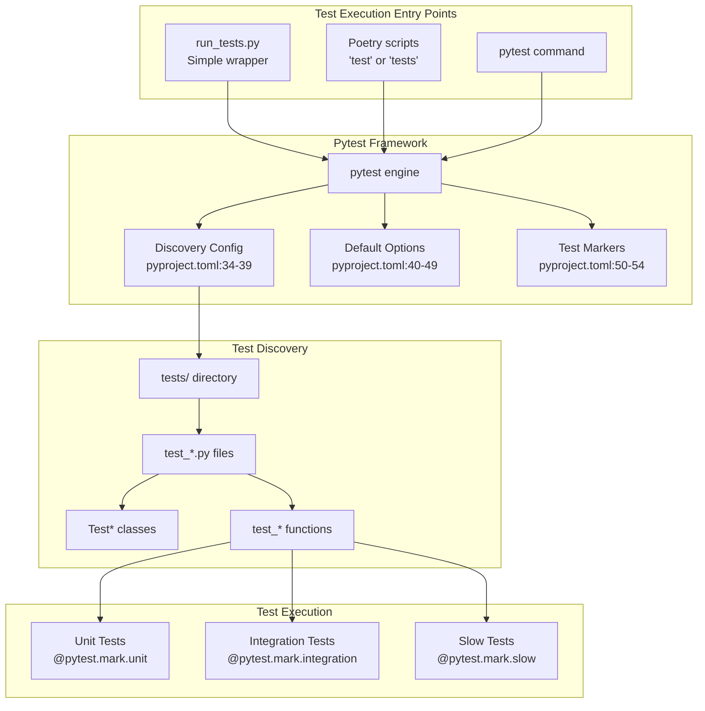
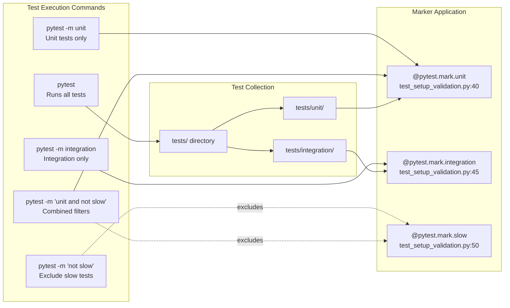
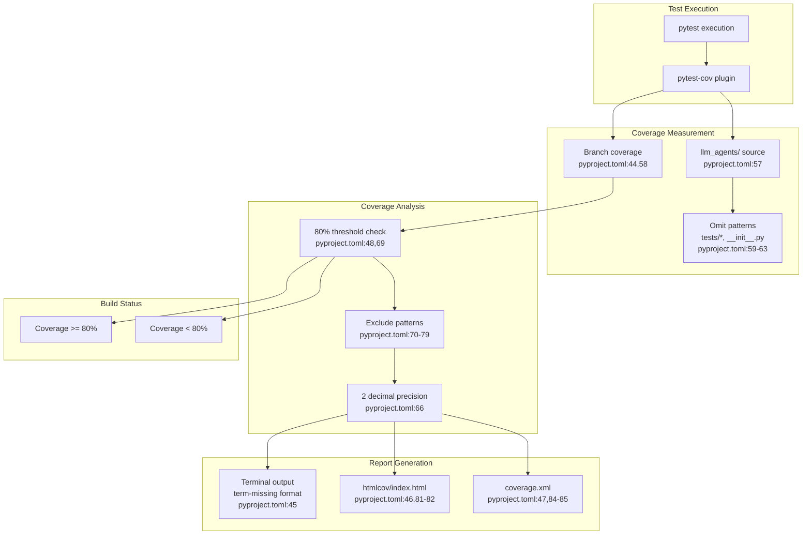
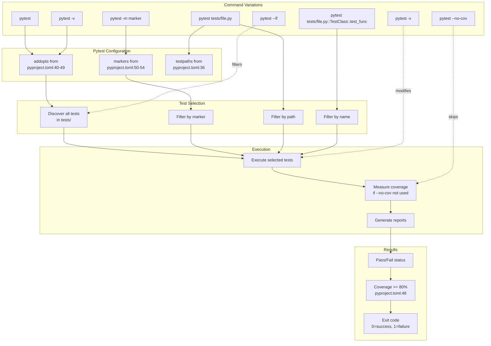

<!-- source: DeepWiki mcp.deepwiki.com · repo mpaepper/llm_agents · extra page Running Tests · fetched 2026-10-27 -->

# Running Tests

<details>
<summary>Relevant source files</summary>

The following files were used as context for generating this wiki page:

- [pyproject.toml](pyproject.toml)
- [run_tests.py](run_tests.py)
- [tests/test_setup_validation.py](tests/test_setup_validation.py)

</details>


## Purpose and Scope

This document explains how to execute tests in the llm_agents codebase. It covers running pytest directly or through the provided wrapper script, selecting specific test subsets using markers, and interpreting coverage reports. For information about the overall testing infrastructure and fixtures, see [Testing Infrastructure](#5.2). For guidance on writing new tests, see [Writing Tests](#5.2.3). For details about available test fixtures, see [Test Fixtures](#5.2.1).

## Basic Test Execution

The codebase provides multiple methods to run tests. All tests are executed using pytest as the underlying test framework.

### Using the Wrapper Script

The simplest method is to use the provided wrapper script [run_tests.py:1-11]():

```bash
python run_tests.py
```

This script is a thin wrapper that passes all arguments directly to pytest. You can also use the Poetry script shortcuts defined in [pyproject.toml:30-32]():

```bash
poetry run test
# or
poetry run tests
```

### Direct Pytest Execution

You can also run pytest directly:

```bash
pytest
# or with specific options
pytest tests/
```

### Test Discovery Configuration

The pytest configuration in [pyproject.toml:34-54]() defines how tests are discovered:

| Configuration | Value | Purpose |
|--------------|-------|---------|
| `testpaths` | `["tests"]` | Root directory for test discovery |
| `python_files` | `["test_*.py", "*_test.py", "tests.py"]` | File patterns to identify test files |
| `python_classes` | `["Test*", "*Tests"]` | Class patterns to identify test classes |
| `python_functions` | `["test_*"]` | Function patterns to identify test functions |



**Sources:** [pyproject.toml:34-54](), [run_tests.py:1-11]()

## Test Selection with Markers

Tests in the codebase are categorized using pytest markers defined in [pyproject.toml:50-54](). This allows selective test execution based on test type or execution time.

### Available Markers

| Marker | Purpose | Example Usage |
|--------|---------|---------------|
| `unit` | Fast, isolated unit tests | `@pytest.mark.unit` |
| `integration` | Tests requiring external services or components | `@pytest.mark.integration` |
| `slow` | Tests with long execution time | `@pytest.mark.slow` |

### Running Specific Test Subsets

To run only tests with a specific marker:

```bash
# Run only unit tests
pytest -m unit

# Run only integration tests
pytest -m integration

# Run only slow tests
pytest -m slow
```

To exclude tests with a specific marker:

```bash
# Run all tests except slow ones
pytest -m "not slow"

# Run unit tests but exclude slow ones
pytest -m "unit and not slow"
```

### Marker Examples in Code

The [tests/test_setup_validation.py:40-53]() file demonstrates marker usage:

```python
@pytest.mark.unit
def test_unit_marker(self):
    """Test that unit test marker is configured."""
    assert True

@pytest.mark.integration
def test_integration_marker(self):
    """Test that integration test marker is configured."""
    assert True

@pytest.mark.slow
def test_slow_marker(self):
    """Test that slow test marker is configured."""
    assert True
```



**Sources:** [pyproject.toml:50-54](), [tests/test_setup_validation.py:40-53]()

## Coverage Reports

The test suite is configured with comprehensive coverage reporting in [pyproject.toml:40-49]() and [pyproject.toml:56-85]().

### Coverage Configuration

| Setting | Value | Location |
|---------|-------|----------|
| Minimum Coverage | 80% | [pyproject.toml:48,69]() |
| Branch Coverage | Enabled | [pyproject.toml:44,58]() |
| Source Directory | `llm_agents` | [pyproject.toml:43,57]() |
| Report Formats | terminal, HTML, XML | [pyproject.toml:45-47]() |

### Default Coverage Options

The following coverage options are automatically applied on every test run via [pyproject.toml:40-49]():

```
--cov=llm_agents          # Measure coverage for llm_agents package
--cov-branch              # Enable branch coverage analysis
--cov-report=term-missing # Show missing lines in terminal
--cov-report=html         # Generate HTML report in htmlcov/
--cov-report=xml          # Generate XML report as coverage.xml
--cov-fail-under=80       # Fail if coverage below 80%
```

### Viewing Coverage Reports

After running tests, coverage reports are generated in multiple formats:

**Terminal Output**: Displayed automatically after test run, shows per-file coverage with missing line numbers.

**HTML Report**: Located at `htmlcov/index.html` (configured in [pyproject.toml:81-82]()):
```bash
# Open in browser
open htmlcov/index.html
```

**XML Report**: Located at `coverage.xml` (configured in [pyproject.toml:84-85]()), useful for CI/CD integration.

### Coverage Exclusions

The following code patterns are excluded from coverage requirements [pyproject.toml:70-79]():

- Lines marked with `pragma: no cover`
- `__repr__` and `__str__` methods
- Debug assertions (`raise AssertionError`)
- Abstract methods (`raise NotImplementedError`)
- Main entry points (`if __name__ == "__main__":`)
- Type checking blocks (`if TYPE_CHECKING:`)



**Sources:** [pyproject.toml:40-49](), [pyproject.toml:56-85]()

## Common Test Execution Patterns

### Running All Tests with Verbose Output

```bash
pytest -v
```

### Running Specific Test Files

```bash
# Run a specific test file
pytest tests/test_setup_validation.py

# Run all tests in a directory
pytest tests/unit/

# Run tests matching a pattern
pytest tests/unit/test_agent*.py
```

### Running Specific Test Functions

```bash
# Run a specific test function
pytest tests/test_setup_validation.py::TestSetupValidation::test_pytest_installed

# Run all tests in a class
pytest tests/test_setup_validation.py::TestSetupValidation
```

### Disabling Coverage

To run tests without coverage measurement (faster execution):

```bash
pytest --no-cov
```

### Verbose Output with Coverage

```bash
pytest -v --cov-report=term-missing:skip-covered
```

This shows only files with missing coverage, making output more concise.

### Stopping on First Failure

```bash
pytest -x
```

### Running Last Failed Tests

```bash
# Run only tests that failed in the last run
pytest --lf

# Run failed tests first, then remaining
pytest --ff
```

### Test Execution Flow Summary



**Sources:** [pyproject.toml:34-54]()

## Understanding Test Results

### Test Output Format

Pytest displays test results with the following indicators:

| Symbol | Meaning |
|--------|---------|
| `.` | Test passed |
| `F` | Test failed |
| `E` | Test error (exception during setup/teardown) |
| `s` | Test skipped |
| `x` | Expected failure (xfail) |
| `X` | Unexpected pass (xfail that passed) |

### Coverage Report Interpretation

The terminal coverage report shows:

```
Name                          Stmts   Miss Branch BrPart  Cover   Missing
-------------------------------------------------------------------------
llm_agents/agent.py             150     10     40      2    92.50%   45-48, 102
llm_agents/chat_llm.py           85      5     20      1    93.75%   67-69
```

| Column | Description |
|--------|-------------|
| `Stmts` | Total executable statements |
| `Miss` | Statements not executed |
| `Branch` | Total branch points (if/else, etc.) |
| `BrPart` | Branches partially covered |
| `Cover` | Coverage percentage |
| `Missing` | Line numbers not covered |

### Exit Codes

| Exit Code | Meaning |
|-----------|---------|
| `0` | All tests passed, coverage >= 80% |
| `1` | Test failures or coverage < 80% |
| `2` | Test execution interrupted |
| `3` | Internal pytest error |
| `4` | Usage error (invalid command) |
| `5` | No tests collected |

### Example: Interpreting a Test Run

```bash
$ pytest
======================== test session starts =========================
platform darwin -- Python 3.9.0, pytest-7.4.0, pluggy-1.2.0
rootdir: /path/to/llm_agents
configfile: pyproject.toml
plugins: cov-4.1.0, mock-3.11.1
collected 45 items

tests/test_setup_validation.py ............              [ 26%]
tests/unit/test_agent.py ..................              [ 66%]
tests/unit/test_chat_llm.py ........                     [ 84%]
tests/integration/test_tools.py .......                  [100%]

----------- coverage: platform darwin, python 3.9.0 -----------
Name                          Stmts   Miss  Cover   Missing
-----------------------------------------------------------
llm_agents/agent.py             150     10    93%    45-48, 102
llm_agents/chat_llm.py           85      5    94%    67-69
llm_agents/tools/base.py         30      0   100%
-----------------------------------------------------------
TOTAL                           265     15    94%

Required coverage of 80% reached. Total coverage: 94.34%
==================== 45 passed in 2.45s =======================
```

**Sources:** [pyproject.toml:40-49](), [pyproject.toml:56-69]()

## Validation Tests

The codebase includes infrastructure validation tests in [tests/test_setup_validation.py:1-93]() that verify the testing setup itself:

| Test | Purpose |
|------|---------|
| `test_pytest_installed` | Verifies pytest is available |
| `test_pytest_cov_installed` | Verifies pytest-cov is installed |
| `test_pytest_mock_installed` | Verifies pytest-mock is installed |
| `test_fixtures_available` | Validates shared fixtures work |
| `test_unit_marker` | Confirms unit marker is configured |
| `test_integration_marker` | Confirms integration marker is configured |
| `test_slow_marker` | Confirms slow marker is configured |
| `test_coverage_configured` | Validates coverage configuration |
| `test_test_directories_exist` | Checks directory structure |
| `test_environment_isolation` | Validates environment fixture |
| `test_mock_requests_fixture` | Validates HTTP mocking fixture |

These tests serve as meta-tests that ensure the testing infrastructure itself is functioning correctly.

**Sources:** [tests/test_setup_validation.py:7-93]()

---

