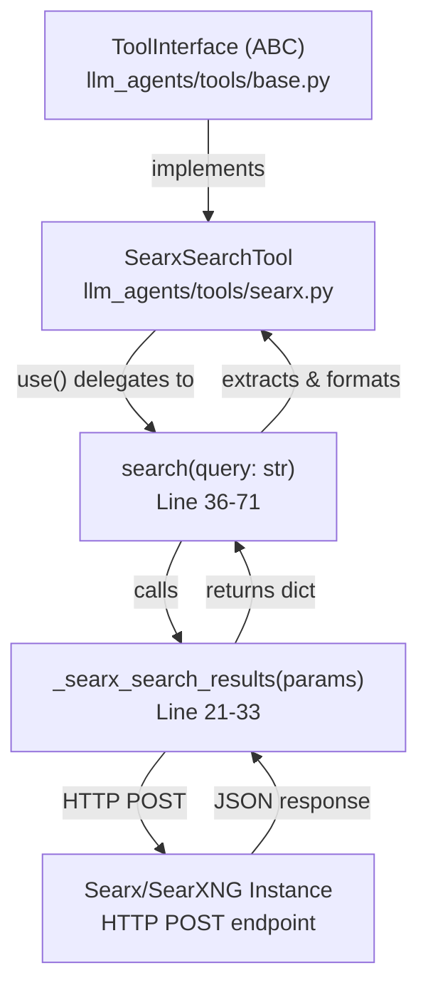
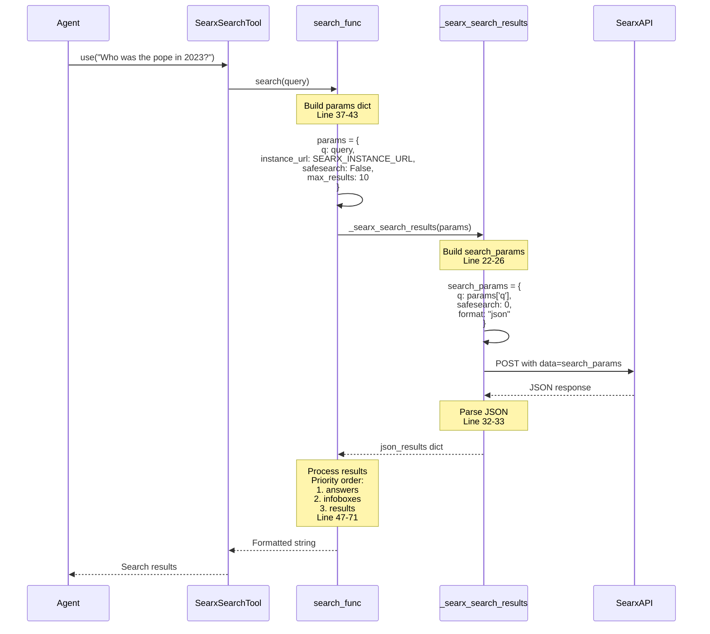
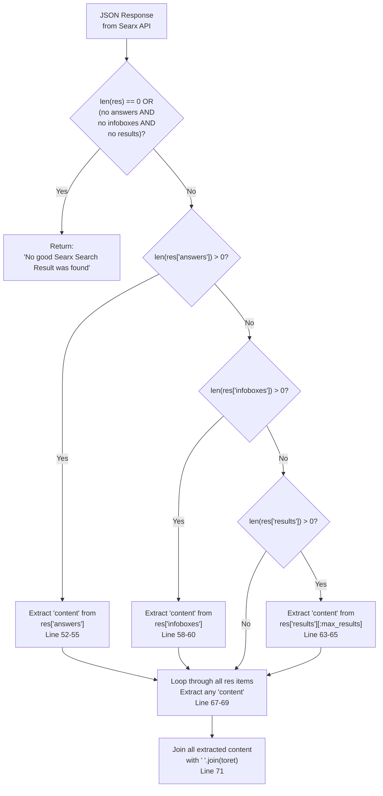
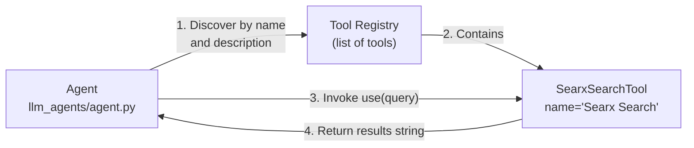

<!-- source: DeepWiki mcp.deepwiki.com · repo mpaepper/llm_agents · extra page SearxSearchTool · fetched 2026-10-27 -->

# SearxSearchTool

<details>
<summary>Relevant source files</summary>

The following files were used as context for generating this wiki page:

- [llm_agents/__init__.py](llm_agents/__init__.py)
- [llm_agents/tools/searx.py](llm_agents/tools/searx.py)
- [requirements.txt](requirements.txt)
- [setup.py](setup.py)

</details>


## Purpose and Scope

This document covers the `SearxSearchTool` implementation, which provides web search capabilities through a self-hosted or public Searx/SearXNG instance. This tool enables agents to perform privacy-focused web searches without requiring commercial API keys.

For other search tool implementations, see [SerpAPITool](#3.2.1), [GoogleSearchTool](#3.2.2), and [HackerNewsSearchTool](#3.2.4). For the base interface contract, see [ToolInterface](#3.1).

---

## Overview

The `SearxSearchTool` integrates with Searx/SearXNG meta-search engine instances to provide web search functionality. Unlike commercial search tools that require API keys, this tool works with any Searx instance that has JSON output enabled. The tool prioritizes answers and infoboxes before falling back to regular search results.

**Sources:** [llm_agents/tools/searx.py:1-88]()

---

## Tool Interface Implementation

The `SearxSearchTool` class implements the `ToolInterface` contract defined in the tool system architecture:



### Class Definition

| Attribute | Value | Line Reference |
|-----------|-------|----------------|
| `name` | `"Searx Search"` | [llm_agents/tools/searx.py:77]() |
| `description` | `"Get specific information from a search query..."` | [llm_agents/tools/searx.py:78]() |
| `use(input_text: str)` | Delegates to `search()` function | [llm_agents/tools/searx.py:80-81]() |

**Sources:** [llm_agents/tools/searx.py:74-81]()

---

## Configuration Requirements

### Environment Variables

The tool requires a single environment variable:

| Variable | Purpose | Required | Example |
|----------|---------|----------|---------|
| `SEARX_INSTANCE_URL` | URL of the Searx/SearXNG instance endpoint | Yes | `https://searx.example.com/search` |

**Sources:** [llm_agents/tools/searx.py:39]()

### Searx Instance Configuration

**Critical:** The Searx/SearXNG instance must have JSON output enabled. By default, SearXNG disables JSON format in the API.

To enable JSON output, modify the `settings.yml` file on your Searx instance:

```yaml
search:
  formats:
    - html
    - json  # Add this line
```

Reference: [SearXNG settings.yml:63](https://github.com/searxng/searxng/blob/934249dd05142cde3461c8c4aae2c6d5804b0409/searx/settings.yml#L63)

**Sources:** [llm_agents/tools/searx.py:10-12]()

---

## Search Implementation

### Request Flow



**Sources:** [llm_agents/tools/searx.py:21-71]()

### Search Parameters

The `search()` function constructs parameters for the Searx API request:

```python
params: dict = {
    "q": query,
    "instance_url": os.environ["SEARX_INSTANCE_URL"],
    "method": "POST",
    "safesearch": False,
    "max_results": 10
}
```

These parameters are then transformed into the HTTP request format:

```python
search_params = {
    "q": params['q'],
    "safesearch": 0,  # 0 for disabled, 1 for enabled
    "format": "json",
}
```

**Sources:** [llm_agents/tools/searx.py:37-43](), [llm_agents/tools/searx.py:22-29]()

---

## Result Processing

### Priority-Based Result Extraction

The tool processes Searx API responses with a priority-based approach:



### Result Types

The Searx API returns results in multiple categories, processed in this order:

| Priority | Category | Description | Line Reference |
|----------|----------|-------------|----------------|
| 1 | `answers` | Direct answers to queries | [llm_agents/tools/searx.py:52-55]() |
| 2 | `infoboxes` | Structured information boxes | [llm_agents/tools/searx.py:58-60]() |
| 3 | `results` | Standard search results (limited by `max_results`) | [llm_agents/tools/searx.py:63-65]() |
| 4 | Fallback | Any remaining items with `content` field | [llm_agents/tools/searx.py:67-69]() |

The tool concatenates all extracted `content` fields with spaces and returns the combined string.

**Sources:** [llm_agents/tools/searx.py:45-71]()

---

## Dependencies

The `SearxSearchTool` relies on the following Python packages:

| Package | Purpose | Usage in Code |
|---------|---------|---------------|
| `requests` | HTTP client for API calls | [llm_agents/tools/searx.py:4](), [llm_agents/tools/searx.py:31]() |
| `json` | JSON parsing | [llm_agents/tools/searx.py:5](), [llm_agents/tools/searx.py:32]() |
| `os` | Environment variable access | [llm_agents/tools/searx.py:1](), [llm_agents/tools/searx.py:39]() |

**Sources:** [llm_agents/tools/searx.py:1-5](), [requirements.txt:3]()

---

## Integration with Agent System

### Module Exports

The `SearxSearchTool` is exported from the main package:

```python
from llm_agents.tools.searx import SearxSearchTool

__all__ = [..., 'SearxSearchTool', ...]
```

**Sources:** [llm_agents/__init__.py:6](), [llm_agents/__init__.py:10]()

### Usage by Agent

When an agent uses this tool, the interaction follows this pattern:



The agent discovers the tool through its `name` attribute (`"Searx Search"`) and understands its purpose through the `description` field. When the agent's reasoning loop determines a search is needed, it invokes `use()` with a query string.

**Sources:** [llm_agents/tools/searx.py:77-81]()

---

## Example Usage

### Standalone Execution

The module includes a test example that can be run directly:

```python
if __name__ == '__main__':
    s = SearxSearchTool()
    res = s.use("Who was the pope in 2023?")
    print(res)
```

**Prerequisites:**
1. Set `SEARX_INSTANCE_URL` environment variable
2. Ensure the Searx instance has JSON format enabled
3. Run: `python -m llm_agents.tools.searx`

**Sources:** [llm_agents/tools/searx.py:84-87]()

### Within Agent Context

When used by an agent, the tool is invoked through the standard tool interface:

| Step | Action | Code Entity |
|------|--------|-------------|
| 1 | Agent parses LLM output: `Action: Searx Search` | `Agent._parse()` |
| 2 | Agent looks up tool by name `"Searx Search"` | `Agent.run()` |
| 3 | Agent calls `tool.use(action_input)` | `SearxSearchTool.use()` |
| 4 | Tool returns observation string | `search()` → formatted results |

**Sources:** [llm_agents/tools/searx.py:74-81]()

---

## Comparison with Other Search Tools

The llm_agents package provides multiple search tool implementations:

| Tool | API Provider | Authentication | Cost | Privacy | Line Reference |
|------|--------------|----------------|------|---------|----------------|
| `SerpAPITool` | SerpAPI | API key required | Commercial | Third-party | See [3.2.1](#3.2.1) |
| `GoogleSearchTool` | Google Custom Search | API key + CSE ID | Free tier available | Third-party | See [3.2.2](#3.2.2) |
| `SearxSearchTool` | Self-hosted Searx | Instance URL only | Free | Self-hosted | [llm_agents/tools/searx.py:74-81]() |
| `HackerNewsSearchTool` | Algolia HN API | None | Free | Public API | See [3.2.4](#3.2.4) |

**Key Advantages of SearxSearchTool:**
- No API key registration required
- Privacy-focused (no data sent to commercial services)
- Works with any Searx/SearXNG instance
- Free to use

**Key Limitations:**
- Requires access to a Searx instance with JSON enabled
- Performance depends on instance configuration
- May have fewer features than commercial alternatives

**Sources:** [llm_agents/tools/searx.py:1-88](), [llm_agents/__init__.py:1-10]()

---

## Error Handling

### No Results Found

When the Searx API returns no useful results, the tool returns a specific message:

```python
if (len(res) == 0 or 
    (len(res['answers']) == 0 and 
     len(res['infoboxes']) == 0 and 
     len(res['results']) == 0)):
    return "No good Searx Search Result was found"
```

This allows the agent to recognize failed searches and potentially retry with a different query.

**Sources:** [llm_agents/tools/searx.py:47-48]()

### Environment Variable Missing

If `SEARX_INSTANCE_URL` is not set, the code will raise a `KeyError` when attempting to access `os.environ["SEARX_INSTANCE_URL"]` at line 39. This error will propagate to the agent, causing the action to fail.

**Sources:** [llm_agents/tools/searx.py:39]()

### HTTP Request Failures

The `requests.post()` call at line 31 may raise exceptions for:
- Network connectivity issues
- Invalid instance URL
- Timeout errors
- HTTP error status codes

These exceptions are not caught within the tool, so they will propagate to the calling agent.

**Sources:** [llm_agents/tools/searx.py:31]()

---

## Implementation Details

### Internal Functions

#### `_searx_search_results(params)`

Private helper function that performs the actual HTTP request to the Searx API.

**Parameters:**
- `params`: Dictionary containing `q` (query), `instance_url`, `safesearch` (boolean)

**Returns:**
- `list[dict[str, Any]]`: Parsed JSON response from Searx

**Process:**
1. Constructs `search_params` with required Searx API fields
2. Converts boolean `safesearch` to integer (0 or 1)
3. Makes HTTP POST request to instance URL
4. Parses JSON response
5. Returns raw results dictionary

**Sources:** [llm_agents/tools/searx.py:21-33]()

#### `search(query: str)`

Public function that wraps `_searx_search_results()` with parameter construction and result formatting.

**Parameters:**
- `query`: The search query string

**Returns:**
- `str`: Formatted search results or error message

**Process:**
1. Constructs parameter dictionary with environment variables
2. Calls `_searx_search_results()`
3. Checks for empty results
4. Extracts content from prioritized result categories
5. Joins all content into a single string

**Sources:** [llm_agents/tools/searx.py:36-71]()

---

## Security Considerations

### Safe Search

The tool sets `safesearch: False` by default in line 41, which disables safe search filtering. The parameter is configurable in the `search_params` dictionary at line 28-29, where it's converted to an integer (0 for disabled, 1 for enabled).

**Sources:** [llm_agents/tools/searx.py:28-29](), [llm_agents/tools/searx.py:41]()

### Instance Trust

Since the tool makes HTTP requests to a user-specified Searx instance, the security posture depends on:
- Trust in the Searx instance operator
- Network security between the agent and instance
- Whether the instance uses HTTPS

Users should ensure they're using a trusted Searx instance with HTTPS enabled.

**Sources:** [llm_agents/tools/searx.py:39]()

---

