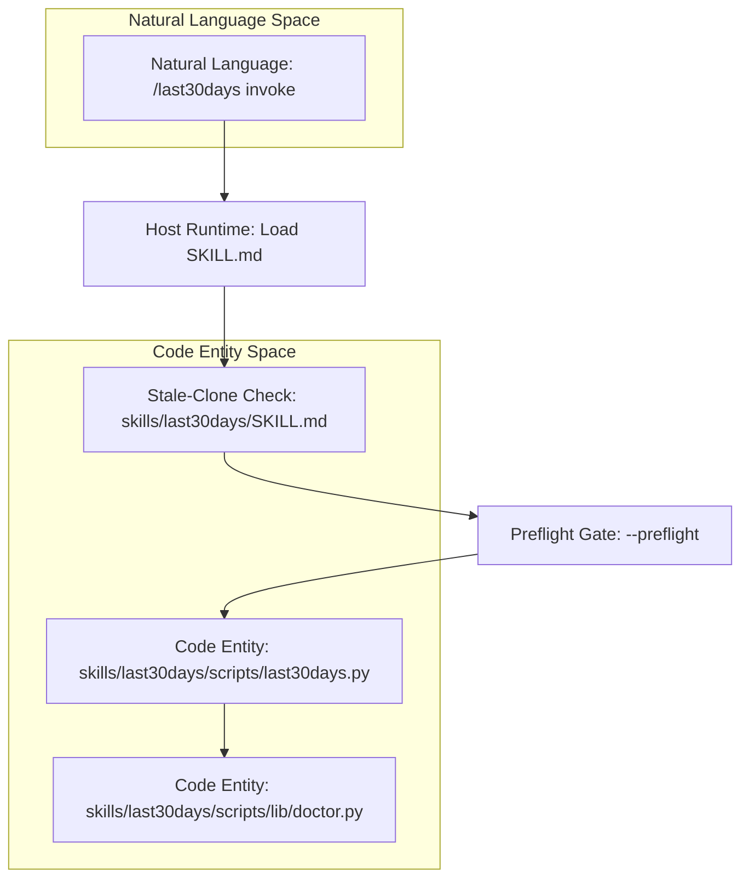
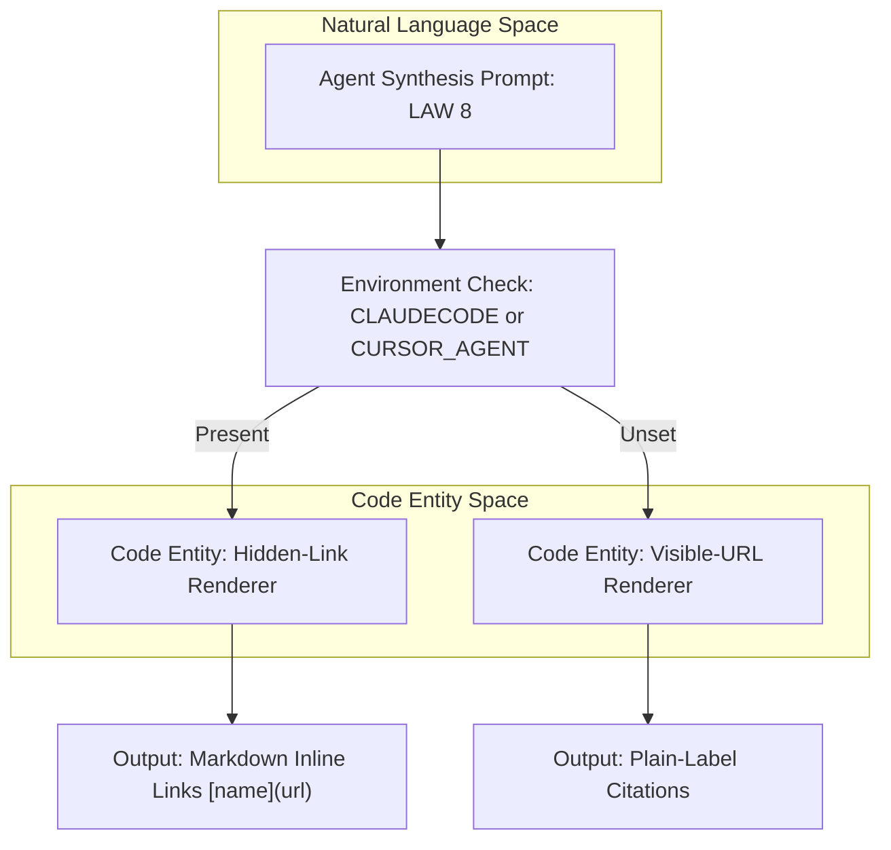

<!-- source: DeepWiki mcp.deepwiki.com · repo mvanhorn/last30days-skill · page 1.1 SKILL.md Contract and Output LAWs · fetched 2026-10-27 -->

# SKILL.md Contract and Output LAWs

<details>
<summary>Relevant source files</summary>

The following files were used as context for generating this wiki page:

- [.claude-plugin/marketplace.json](.claude-plugin/marketplace.json)
- [.claude-plugin/plugin.json](.claude-plugin/plugin.json)
- [CHANGELOG.md](CHANGELOG.md)
- [gemini-extension.json](gemini-extension.json)
- [skills/last30days/SKILL.md](skills/last30days/SKILL.md)
- [tests/test_codex_host_contract.py](tests/test_codex_host_contract.py)
- [tests/test_doc_security_contract.py](tests/test_doc_security_contract.py)

</details>


## Purpose and Scope
This page documents the operational contract defined in `skills/last30days/SKILL.md`. The `/last30days` skill is an agent-led multi-source social research engine rather than a generic search prompt. The instruction contract prevents the host model from improvising against the skill name, enforcing strict adherence to output formatting rules, preflight checks, stale-clone self-checks, and citation rendering regimes across diverse agent runtimes (Claude Code, Codex, Grok, Gemini CLI, and MCP).

Sources: `skills/last30days/SKILL.md:99-111`

---

## Step 0: Stale-Clone Self-Check and Runtime Preflight
Before executing any retrieval or synthesis steps, the engine evaluates environment integrity to protect against stale checkouts and missing dependencies.

### Stale-Clone Self-Check
Certain agent runtimes (such as Claude Code's marketplace auto-restore mechanism) clone repositories to `origin/main` directories under `~/.claude/plugins/marketplaces/`, which can lag behind versioned plugin caches. To prevent execution of outdated instructions, the engine executes a bash-based self-check [skills/last30days/SKILL.md:70-90]():

```bash
CLAUDE_CACHE_LATEST=$(find "$HOME/.claude/plugins/cache/last30days-skill/last30days" -mindepth 1 -maxdepth 1 -type d 2>/dev/null | sort -V | tail -1)
```

If the loaded `SKILL.md` resolves from the marketplaces directory and a newer cached version exists, the agent halts and re-reads the fresh `SKILL.md` path [skills/last30days/SKILL.md:91-93](). Other installation paths (`~/.codex/skills/`, `~/.agents/skills/`, or local checkouts) bypass this check [skills/last30days/SKILL.md:95]().

### Runtime Preflight (`--preflight`)
The `--preflight` command-line flag verifies system readiness without reading browser-cookie values, writing setup/config files, or executing active research [tests/test_doc_security_contract.py:37-47](). It acts as a lightweight configuration validation gate for non-modal agent runtimes.


*Figure 1: Natural Language to Code Entity Space mapping for runtime preflight and invocation.*

Sources: `skills/last30days/SKILL.md:70-96`, `tests/test_doc_security_contract.py:37-47`

---

## The Eleven Output LAWs
The core contract mandates adherence to eleven strict output LAWs. These rules eliminate hallucinated section headers, custom titles, or unverified citation blocks.

1. **LAW 1 (Mandatory First-Line Badge):** Every response must begin with the exact badge emitted by the engine [skills/last30days/SKILL.md:114-123]().
2. **LAW 2 (No Invented Titles):** Do not fabricate custom titles or headers for general queries.
3. **LAW 3 (Strict Source Adherence):** Only cite sources and items explicitly returned by the engine data envelope.
4. **LAW 4 (Structured Section Integrity):** Adhere strictly to the requested query type template layout without injecting unapproved commentary blocks.
5. **LAW 5 (Freshness Verification):** Report absolute dates and verify items fall within the 30-day sliding window.
6. **LAW 6 (Confidence Floor Enforcement):** Drop or isolate items failing relevance or confidence thresholds.
7. **LAW 7 (First-Party Credit):** Preserve original creator attributions and handle identifiers.
8. **LAW 8 (Renderer-Aware Citations):** Format links according to host runtime capabilities (hidden-link vs. visible-URL formatting).
9. **LAW 9 (Evidence Envelope Compliance):** Base all synthesis exclusively on provided JSON/text evidence envelopes.
10. **LAW 10 (Strict Exit and Error Propagation):** Propagate engine exit codes and degraded status flags accurately.
11. **LAW 11 (No Bare Shell Execution):** Always execute via defined wrappers and flags rather than raw improvised scripts.

Sources: `skills/last30days/SKILL.md:114-123`, `CHANGELOG.md:12-22`

---

## Badge, Footer, and Pass-Through Rules
The Python engine outputs a standardized header badge as the first line of execution:
```
🌐 last30days v{VERSION} · synced {YYYY-MM-DD}
```
Host models are expected to pass this output through verbatim [skills/last30days/SKILL.md:114-123]().

### Host-Conditional Citation Formatting (LAW 8)
Citation rendering adapts dynamically based on the host runtime environment detected via environment variables (`CLAUDECODE`, `CURSOR_AGENT`):
* **Hidden-Link Hosts (Claude Code, Grok Bot / Cursor agent chat):** Use markdown inline links `[name](url)` because the UI hides raw URLs [tests/test_codex_host_contract.py:94-116]().
* **Visible-URL Hosts (Codex, Gemini CLI, raw CLI):** Use explicit plain-label citation formats to prevent broken markdown rendering or "URL soup" [tests/test_codex_host_contract.py:94-116]().


*Figure 2: Natural Language Space mapping to citation rendering code paths under LAW 8.*

Sources: `CHANGELOG.md:39`, `tests/test_codex_host_contract.py:85-161`

---

## Query Type Templates and Runtime Integration
The engine supports multiple query archetypes (general, comparison, discovery, drill mode, deep research, and competitors mode). When a query is initiated:
1. **Auto-Resolve / Pre-Research:** The orchestrator determines whether host web search tools are active (`LAST30DAYS_NATIVE_SEARCH=1`) or falls back to engine-internal search planners [tests/test_codex_host_contract.py:68-83]().
2. **Execution Plan:** Subqueries are dispatched across parallel worker pools with specified filters and flags.
3. **Synthesis:** The host model processes the returned JSON candidate structures and formats findings adhering strictly to the Output LAWs.

Sources: `skills/last30days/SKILL.md:1-68`, `tests/test_codex_host_contract.py:57-84`

---

