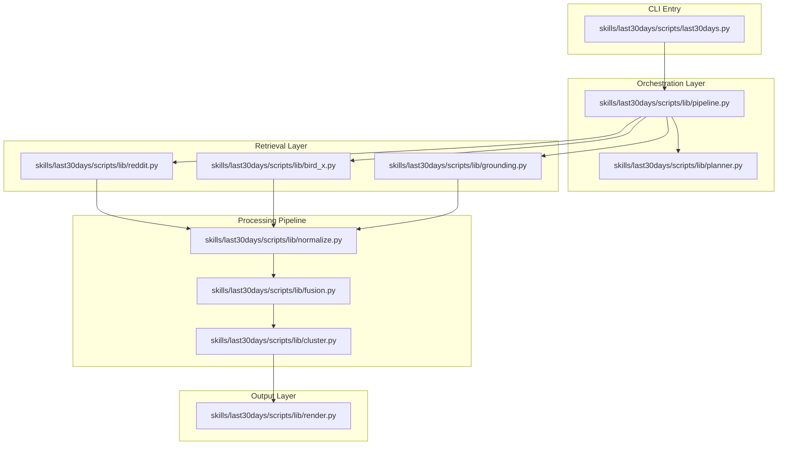
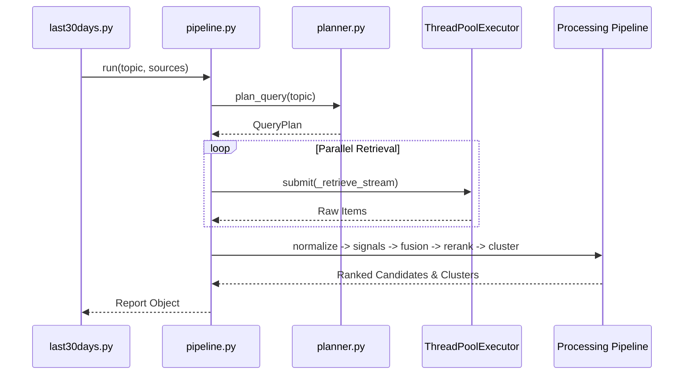

<!-- source: DeepWiki mcp.deepwiki.com · repo mvanhorn/last30days-skill · page 2 Core Architecture · fetched 2026-10-27 -->

# Core Architecture

Relevant source files

The following files were used as context for generating this wiki page:

- [skills/last30days/scripts/last30days.py](skills/last30days/scripts/last30days.py)
- [skills/last30days/scripts/lib/pipeline.py](skills/last30days/scripts/lib/pipeline.py)
- [skills/last30days/scripts/lib/planner.py](skills/last30days/scripts/lib/planner.py)
- [tests/test_cli_v3.py](tests/test_cli_v3.py)
- [tests/test_external_plan_source_contract.py](tests/test_external_plan_source_contract.py)
- [tests/test_internals_v3.py](tests/test_internals_v3.py)
- [tests/test_pipeline_v3.py](tests/test_pipeline_v3.py)
- [tests/test_planner_v3.py](tests/test_planner_v3.py)

This page provides a high-level overview of the engine architecture for the `last30days` skill, covering planning, parallel retrieval, fusion, ranking, and rendering. The codebase is organized into modular components under `skills/last30days/scripts/lib` [skills/last30days/scripts/last30days.py:51-55]().

For detailed mechanics on each subsystem, refer to the child pages:
- [Two-Phase Search Strategy](#2.1) — Intent classification, query expansion, source priority tables, and auto-resolve pre-research.
- [Orchestration Pipeline](#2.2) — CLI integration, thread pool fan-out, fetch caps, rate-limit tracking, and Report assembly.
- [Configuration and Authentication](#2.3) — Configuration priority resolution, provider descriptors, chain failover, and cookie/credential extraction.
- [Discovery Protocol](#2.4) — Host-judged discovery workflow, river listing sweeps, and confidence floor gating.

---

## System Overview and Module Layout

The engine operates as a parallel multi-source research pipeline supporting over 20 source adapters (Reddit, X, YouTube, TikTok, Hacker News, Polymarket, GitHub, web search, etc.) [skills/last30days/scripts/lib/pipeline.py:199-225](). The implementation is partitioned into dedicated functional libraries under `skills/last30days/scripts/lib/` [skills/last30days/scripts/last30days.py:51-55]():

- **Orchestration & Control**: `pipeline.py`, `planner.py`, `query.py`, `resolve.py`, `fanout.py`
- **Data Acquisition & Sources**: `reddit.py`, `bird_x.py`, `youtube_yt.py`, `grounding.py`, `polymarket.py`, etc.
- **Processing & Fusion**: `normalize.py`, `signals.py`, `fusion.py`, `rerank.py`, `cluster.py`, `dedupe.py`
- **Output & Presentation**: `render.py`, `ui.py`, `html_render.py`
- **Persistence & Management**: `store.py`, `watchlist.py`, `briefing.py`, `health.py`, `doctor.py`

Title: Component Architecture Diagram

Sources: [skills/last30days/scripts/last30days.py:51-55](), [skills/last30days/scripts/lib/pipeline.py:1-85]()

---

## Execution Flow

The engine executes research across four distinct phases: intent planning and query expansion, parallel retrieval via thread pools, multi-signal fusion and ranking, and final report rendering [skills/last30days/scripts/last30days.py:114-175](), [skills/last30days/scripts/lib/pipeline.py:1-102]().

Title: Engine Execution Flow

Sources: [skills/last30days/scripts/last30days.py:114-175](), [skills/last30days/scripts/lib/pipeline.py:1-102]()

---

## Summary of Subsystems and Child Pages

- **Two-Phase Search Strategy**: Details intent classification, query expansion, source priority tables, and auto-resolve pre-research. For details, see [Two-Phase Search Strategy](#2.1).
- **Orchestration Pipeline**: Covers `last30days.py` CLI integration, `pipeline.py` execution (`ThreadPoolExecutor` fan-out, fetch caps, rate-limit tracking, thin-source retries, and Report assembly). For details, see [Orchestration Pipeline](#2.2).
- **Configuration and Authentication**: Documents configuration resolution, provider/backend descriptors, chain failover, cookie extraction, and credential stores. For details, see [Configuration and Authentication](#2.3).
- **Discovery Protocol**: Details the host-judged discovery workflow, river listing sweeps, clustering, and confidence floor gating. For details, see [Discovery Protocol](#2.4).

Sources: [skills/last30days/scripts/last30days.py:1-115](), [skills/last30days/scripts/lib/pipeline.py:1-102](), [skills/last30days/scripts/lib/planner.py:19-90]()

---

