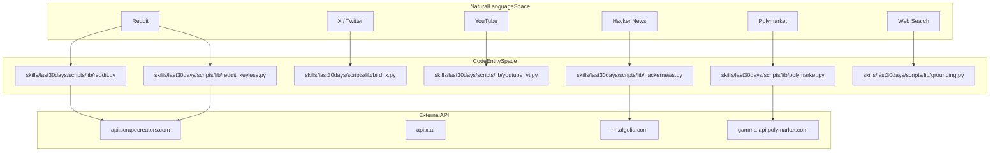
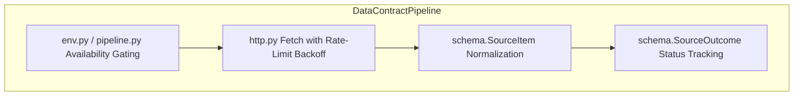

<!-- source: DeepWiki mcp.deepwiki.com · repo mvanhorn/last30days-skill · page 3 Data Sources · fetched 2026-10-27 -->

# Data Sources

Relevant source files

The following files were used as context for generating this wiki page:

- [changelog.d/+base-url-api-root.fixed.md](changelog.d/+base-url-api-root.fixed.md)
- [changelog.d/+reddit-negative-engagement.fixed.md](changelog.d/+reddit-negative-engagement.fixed.md)
- [docs/reference/json-export.md](docs/reference/json-export.md)
- [skills/last30days/scripts/lib/http.py](skills/last30days/scripts/lib/http.py)
- [skills/last30days/scripts/lib/providers.py](skills/last30days/scripts/lib/providers.py)
- [skills/last30days/scripts/lib/reddit.py](skills/last30days/scripts/lib/reddit.py)
- [skills/last30days/scripts/lib/reddit_keyless.py](skills/last30days/scripts/lib/reddit_keyless.py)
- [skills/last30days/scripts/lib/schema.py](skills/last30days/scripts/lib/schema.py)
- [tests/test_env_cookies.py](tests/test_env_cookies.py)
- [tests/test_http_v3.py](tests/test_http_v3.py)
- [tests/test_providers_v3.py](tests/test_providers_v3.py)
- [tests/test_reddit.py](tests/test_reddit.py)
- [tests/test_reddit_relevance_ranking.py](tests/test_reddit_relevance_ranking.py)

## Purpose and Scope

This document provides a high-level overview of the source connectors located in `skills/last30days/scripts/lib/`. The engine integrates over 15 heterogeneous connectors that pull data under a common fetch-and-normalize contract [skills/last30days/scripts/lib/schema.py:76-100](). Retrieved raw items are mapped into standard `SourceItem` dataclasses, tracked via explicit `SourceOutcome` states, and governed by environment availability checks before the `pipeline.py` execution phase [skills/last30days/scripts/lib/schema.py:182-222]().

As a parent page, this document outlines the common contracts and system architecture. For deep technical details on individual source families, refer to the child pages:
- Reddit: [Reddit Integration](#3.1)
- X / Twitter: [X/Twitter Integration](#3.2)
- Social Media (YouTube, TikTok, Instagram, Bluesky, etc.): [Social Media Sources](#3.3)
- Forums & Prediction Markets (Hacker News, Polymarket, Digg, arXiv): [Forums and Prediction Markets](#3.4)
- Web Search & Grounding: [Web Search](#3.5)
- Developer, Commerce & Hiring: [Developer, Commerce and Hiring Sources](#3.6)

---

## Source Architecture and Entity Mapping

All connectors implement an asynchronous or multi-threaded retrieval interface that converts raw vendor payloads into normalized structures defined in `schema.py` [skills/last30days/scripts/lib/schema.py:76-100](). 

Sources: [skills/last30days/scripts/lib/reddit.py:1-29](), [skills/last30days/scripts/lib/reddit_keyless.py:1-17](), [skills/last30days/scripts/lib/schema.py:76-100]()

---

## Common Contract: Normalization and Outcomes

Connectors in `scripts/lib/` adhere to a uniform lifecycle contract:
1. **Availability Gating**: Preflight checks verify required keys, binaries, or cookies before scheduling execution [skills/last30days/scripts/lib/schema.py:182-222]().
2. **Fetch and Retry**: Network requests use bounded backoff and honor rate limit headers (`Retry-After`, `x-ratelimit-reset`) [skills/last30days/scripts/lib/http.py:47-83]().
3. **Normalization**: Raw items are mapped to `SourceItem` instances capturing identifiers, author, timestamps, raw engagement metrics, and relevance hints [skills/last30days/scripts/lib/schema.py:76-100]().
4. **Outcome Recording**: Every run logs a `SourceOutcome` stating whether retrieval resulted in `ok`, `no-results`, `rate-limited`, `auth-failed`, `unreachable`, or `timeout` [skills/last30days/scripts/lib/schema.py:146-158]().

Sources: [skills/last30days/scripts/lib/http.py:47-83](), [skills/last30days/scripts/lib/schema.py:76-100](), [skills/last30days/scripts/lib/schema.py:182-222]()

---

## Source Families

### 3.1 Reddit Integration
Managed primarily via `reddit.py` (using ScrapeCreators) and `reddit_keyless.py` (using `reddit_rss`, `reddit_shreddit`, `reddit_arctic`, and `reddit_listing`) [skills/last30days/scripts/lib/reddit.py:1-29](), [skills/last30days/scripts/lib/reddit_keyless.py:1-28](). Features multi-phase discovery, subreddit relevance scoring with utility penalties [skills/last30days/scripts/lib/reddit.py:141-188](), engagement-bounded relevance ranking (`_relevance_rank_key`) [skills/last30days/scripts/lib/reddit.py:38-61](), [skills/last30days/scripts/lib/reddit_keyless.py:45-55](), comment enrichment, and robust backoff handling. For details, see [Reddit Integration](#3.1).

Sources: [skills/last30days/scripts/lib/reddit.py:1-191](), [skills/last30days/scripts/lib/reddit_keyless.py:1-118]()

### 3.2 X/Twitter Integration
Handles resolution and failover chains through `bird_x.py`, `xai_x.py`, `xurl_x.py`, `xquik.py`, `grok_x.py`, and `xapi.py`. Supports cookie-authenticated local browser scraping, official xAI API requests, `x_judge` retry policies, and host-conditional `x_policy` routing. For details, see [X/Twitter Integration](#3.2).

Sources: [skills/last30days/scripts/lib/providers.py:160-190]()

### 3.3 Social Media Sources
Covers YouTube (`yt-dlp` search, comments, transcripts, and transcript backfill), TikTok, Instagram, Threads, Pinterest, Bluesky, Truth Social, Telegram, LinkedIn, and Xiaohongshu connectors. Includes auxiliary transcription services for audio/video media. For details, see [Social Media Sources](#3.3).

Sources: [skills/last30days/scripts/lib/schema.py:76-100]()

### 3.4 Forums and Prediction Markets
Integrates Hacker News (Algolia API with points/comment score floors), Polymarket (Gamma API odds extraction and market disambiguation), Digg, arXiv preprints, and Techmeme Printing Press CLI feeds. For details, see [Forums and Prediction Markets](#3.4).

Sources: [skills/last30days/scripts/lib/schema.py:76-100]()

### 3.5 Web Search
Encapsulates grounding modules (`grounding.py`) and external search backends (Brave, Exa, Serper, Parallel MCP, Perplexity/OpenRouter). Implements keyless web search/fetch fallbacks and provider routing. For details, see [Web Search](#3.5).

Sources: [skills/last30days/scripts/lib/providers.py:192-220]()

### 3.6 Developer, Commerce and Hiring Sources
Provides GitHub repository and issue search (with qualifier handling and spam filtering), jobs/hiring signal scraping, Amazon and Trustpilot review feeds via Bright Data, and local corpus file ingestion. For details, see [Developer, Commerce and Hiring Sources](#3.6).

Sources: [skills/last30days/scripts/lib/schema.py:76-100]()

---

