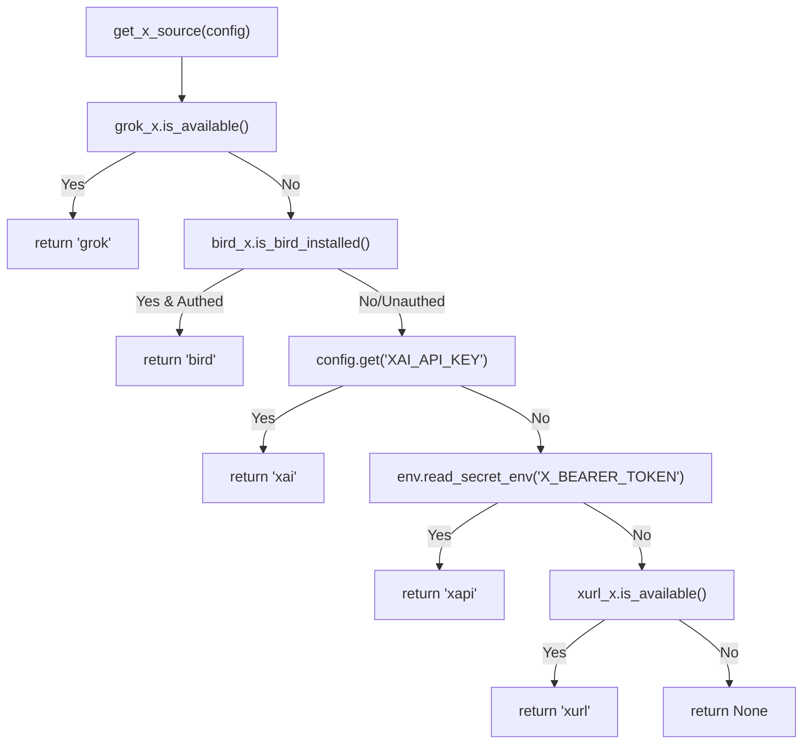
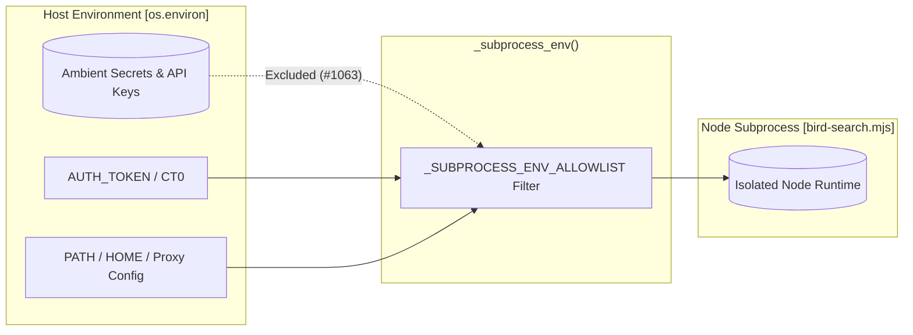
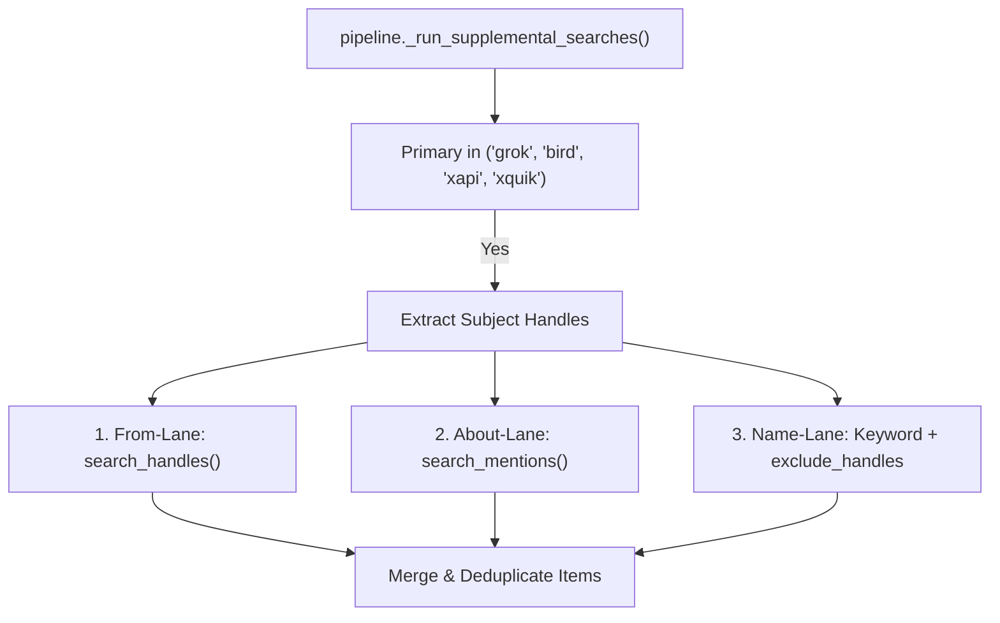

<!-- source: DeepWiki mcp.deepwiki.com · repo mvanhorn/last30days-skill · page 3.2 X/Twitter Integration · fetched 2026-10-27 -->

# X/Twitter Integration

Relevant source files

The following files were used as context for generating this wiki page:

- [changelog.d/+grok-x-windows-utf8-decode.fixed.md](changelog.d/+grok-x-windows-utf8-decode.fixed.md)
- [changelog.d/1051.fixed.md](changelog.d/1051.fixed.md)
- [changelog.d/978.fixed.md](changelog.d/978.fixed.md)
- [docs/plans/2026-08-14-feat-x-retrieve-judge-retry-plan.md](docs/plans/2026-08-14-feat-x-retrieve-judge-retry-plan.md)
- [docs/residual-review-findings/fix-xurl-x978.md](docs/residual-review-findings/fix-xurl-x978.md)
- [skills/last30days/scripts/lib/bird_x.py](skills/last30days/scripts/lib/bird_x.py)
- [skills/last30days/scripts/lib/grok_x.py](skills/last30days/scripts/lib/grok_x.py)
- [skills/last30days/scripts/lib/log.py](skills/last30days/scripts/lib/log.py)
- [skills/last30days/scripts/lib/x_judge.py](skills/last30days/scripts/lib/x_judge.py)
- [skills/last30days/scripts/lib/xai_x.py](skills/last30days/scripts/lib/xai_x.py)
- [skills/last30days/scripts/lib/xurl_x.py](skills/last30days/scripts/lib/xurl_x.py)
- [tests/test_bird_x.py](tests/test_bird_x.py)
- [tests/test_config_x_backends.py](tests/test_config_x_backends.py)
- [tests/test_diagnose_compat.py](tests/test_diagnose_compat.py)
- [tests/test_grok_lanes_pipeline.py](tests/test_grok_lanes_pipeline.py)
- [tests/test_grok_x.py](tests/test_grok_x.py)
- [tests/test_x_judge.py](tests/test_x_judge.py)
- [tests/test_xurl_x.py](tests/test_xurl_x.py)

## Purpose and Scope

This document specifies the X (formerly Twitter) retrieval engine architecture within `/last30days`. It details the multi-backend chain (`bird_x`, `xai_x`, `xurl_x`, `xquik`, `grok_x`, `xapi`), cookie authentication management, handle-based discovery lanes, validation via `x_judge`, chain failover mechanics, and host-conditional `x_policy` routing.

---

## Backend Chain and Failover Architecture

The engine coordinates multiple X retrieval backends through an ordered failover chain. Depending on the environment configuration, installed CLIs, and API credentials, the system evaluates availability and routes searches through the appropriate transport.

### Backend Priority and Chain Order

**Sources:** [skills/last30days/scripts/lib/bird_x.py:109-133](), [skills/last30days/scripts/lib/xurl_x.py:34-52](), [skills/last30days/scripts/lib/grok_x.py:1-150]()

| Backend Module | Transport Mechanism | Cost / Auth Requirement | Coverage / Notes |
|----------------|---------------------|------------------------|------------------|
| `grok_x` | Grok CLI subprocess | Sign-in via `grok login` (no API key needed) | Model-driven retrieval; snowflakes validated against window [skills/last30days/scripts/lib/grok_x.py:1-31]() |
| `bird_x` | Vendored `@steipete/bird` Node.js script | Free; browser cookies or `AUTH_TOKEN`/`CT0` | Twitter GraphQL API via subprocess [skills/last30days/scripts/lib/bird_x.py:1-6]() |
| `xai_x` | xAI API REST endpoint (`/v1/responses`) | Paid; requires `XAI_API_KEY` | Native `x_search` agent tool [skills/last30days/scripts/lib/xai_x.py:27-36]() |
| `xapi` | X API v2 (Bearer Token) | Free/Paid developer app; `X_BEARER_TOKEN` | Recent posts (~last week) unless full-archive access [tests/test_config_x_backends.py:15-18]() |
| `xurl_x` | xfficial `xurl` CLI | Free developer app credentials in `~/.xurl` | Official X API v2 client wrapper [skills/last30days/scripts/lib/xurl_x.py:1-12]() |
| `xquik` | Lightweight fallback scraper | Varies | Supplementary or fallback query execution |

**Sources:** [skills/last30days/scripts/lib/bird_x.py:1-6](), [skills/last30days/scripts/lib/xai_x.py:27-36](), [skills/last30days/scripts/lib/xurl_x.py:1-12](), [skills/last30days/scripts/lib/grok_x.py:1-31]()

---

## Cookie Authentication and Credential Management

For unauthenticated or cookie-dependent backends like `bird_x`, the engine manages session cookies (`AUTH_TOKEN` and `CT0`) securely.

### Subprocess Environment Isolation (`_subprocess_env`)
To prevent credential leakage to vendored or third-party Node subprocesses, `bird_x` restricts the environment passed to `node` through an explicit allowlist (`_SUBPROCESS_ENV_ALLOWLIST`) [skills/last30days/scripts/lib/bird_x.py:64-78]().

**Sources:** [skills/last30days/scripts/lib/bird_x.py:57-120](), [tests/test_bird_x.py:16-52]()

- **Hardened Cookie Disable Flag:** `BIRD_DISABLE_BROWSER_COOKIES` is hard-set to `1` during automated pipeline executions to prevent interactive Keychain prompts in Safari or Chrome [skills/last30days/scripts/lib/bird_x.py:117-120]().
- **Credential Stores:** Local token stores (such as `~/.xurl/auth.yml` and legacy flat files) are probed via stat-based helpers that correctly propagate permission errors (`EACCES`) rather than misreporting unreadable stores as missing [skills/last30days/scripts/lib/xurl_x.py:113-171]().

**Sources:** [skills/last30days/scripts/lib/bird_x.py:57-120](), [skills/last30days/scripts/lib/xurl_x.py:113-171](), [tests/test_bird_x.py:16-52]()

---

## Handle Resolution and Two-Phase Search Lanes

Entity-focused research on X requires capturing both direct statements from subjects and wider ecosystem discussions. The pipeline executes a multi-lane supplemental retrieval strategy.

### Three-Lane Supplemental Retrieval

**Sources:** [skills/last30days/scripts/lib/pipeline.py](), [tests/test_grok_lanes_pipeline.py:20-71]()

1. **From-Lane (`_from_lane`):** Retrieves posts authored directly by the target handle (e.g., `from:steipete`) without forcing an AND-topic conjunction by default [tests/test_grok_lanes_pipeline.py:43-47, 90-106]().
2. **About-Lane (`_about_lane`):** Retrieves replies and conversations directed at the target handle (e.g., `@steipete`) [tests/test_grok_lanes_pipeline.py:43-47]().
3. **Name-Lane (`_name_lane`):** Searches for the subject's name or keywords across the platform while explicitly excluding the subject's own handles (`exclude_handles=hs`) to avoid duplication [tests/test_grok_lanes_pipeline.py:43-71]().

**Sources:** [skills/last30days/scripts/lib/pipeline.py](), [tests/test_grok_lanes_pipeline.py:20-71]()

---

## Validation, `x_judge` Retry, and Anti-Bot Handling

Because certain backends (such as `grok_x`) rely on language model inference or face edge anti-bot protections, outputs undergo rigorous structural and temporal validation.

### Snowflake Timestamp Verification
Model-recalled posts or scraped JSON responses are validated against the requested time window using snowflake ID decoding (`_decode_snowflake`) [skills/last30days/scripts/lib/grok_x.py:25-31, 51-57](). Out-of-window posts or uniformly generated artificial ID sequences are dropped to prevent hallucinated citations [tests/test_grok_x.py:40-71]().

### Anti-Bot Interstitial Recovery
When `bird_x` encounters HTML anti-bot interstitials or non-JSON payloads from Twitter's edge, `MAX_JSON_DECODE_RETRIES` triggers exponential backoff and retries before classifying the failure as schema drift or authentication failure [skills/last30days/scripts/lib/bird_x.py:21-25, 127-138]().

**Sources:** [skills/last30days/scripts/lib/bird_x.py:21-25, 127-138](), [skills/last30days/scripts/lib/grok_x.py:25-57](), [tests/test_grok_x.py:40-71]()

---

## Host-Conditional `x_policy` Routing

The engine respects host-environment constraints when selecting X policies:
- **Grok Bot Host Restrictions:** On Grok Bot host environments, standard fallback chains are restricted unless explicitly overridden by `LAST30DAYS_X_BACKEND` [tests/test_config_x_backends.py:73-80]().
- **Lane Signal Isolation:** The `LAST30DAYS_X_HOST_LANE` configuration variable is read strictly from the process environment rather than `.env` files to maintain secure container isolation [tests/test_config_x_backends.py:67-71]().

**Sources:** [tests/test_config_x_backends.py:1-84]()

---

