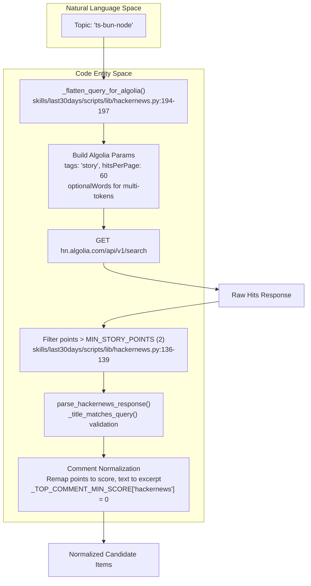
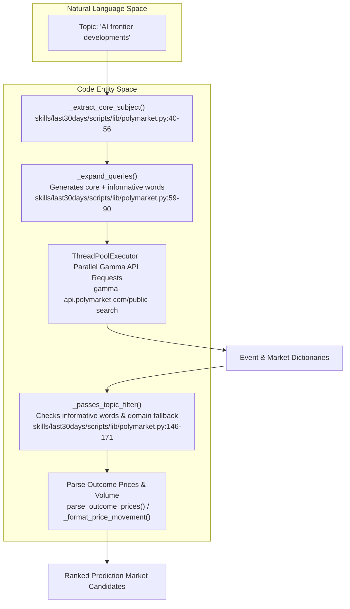
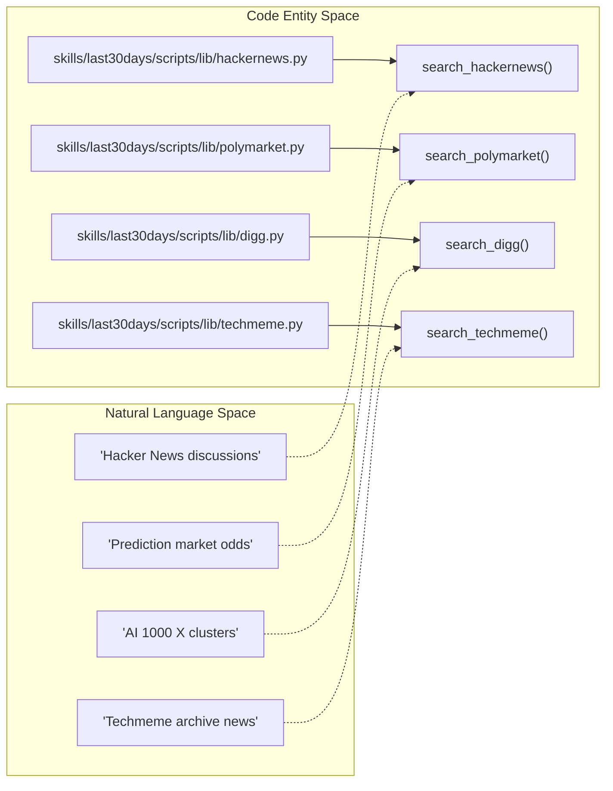

<!-- source: DeepWiki mcp.deepwiki.com · repo mvanhorn/last30days-skill · page 3.4 Forums and Prediction Markets · fetched 2026-10-27 -->

# Forums and Prediction Markets

Relevant source files

The following files were used as context for generating this wiki page:

- [skills/last30days/scripts/briefing.py](skills/last30days/scripts/briefing.py)
- [skills/last30days/scripts/lib/digg.py](skills/last30days/scripts/lib/digg.py)
- [skills/last30days/scripts/lib/hackernews.py](skills/last30days/scripts/lib/hackernews.py)
- [skills/last30days/scripts/lib/polymarket.py](skills/last30days/scripts/lib/polymarket.py)
- [skills/last30days/scripts/lib/techmeme.py](skills/last30days/scripts/lib/techmeme.py)
- [tests/test_digg.py](tests/test_digg.py)
- [tests/test_hackernews.py](tests/test_hackernews.py)
- [tests/test_hackernews_comment_floor.py](tests/test_hackernews_comment_floor.py)
- [tests/test_polymarket.py](tests/test_polymarket.py)
- [tests/test_techmeme_source.py](tests/test_techmeme_source.py)

## Purpose and Scope

This document covers the integration of specialized data sources that provide community-driven technical discussions, financial prediction probabilities, and curated editorial feeds: **Hacker News** (Algolia search with comment floor normalisation), **Polymarket** (Gamma API odds and query disambiguation), **Digg** (AI 1000 X-curated clusters), and **Techmeme** (Printing Press CLI archive search feeds). These sources provide high-signal engagement data across technical, economic, and industry trends.

For Reddit and X/Twitter social platforms, see [3.1]() and [3.2](). For video and multimedia sources, see [3.3]().

---

## Hacker News Integration

Hacker News (HN) provides access to technology stories and discussions through the Algolia Search API (`hn.algolia.com`). The integration identifies high-signal threads where technical communities discuss specific themes and enriches them with top comment threads.

### API and Search Architecture

**Sources:** [skills/last30days/scripts/lib/hackernews.py:24-147](), [skills/last30days/scripts/lib/hackernews.py:194-197]()

### Key Functions and Normalization Logic

*   **`search_hackernews`**: Executes the search against Algolia. It processes the raw topic via `extract_core_subject()` [skills/last30days/scripts/lib/hackernews.py:96-96]() and flattens hyphens/commas via `_flatten_query_for_algolia()` [skills/last30days/scripts/lib/hackernews.py:97-99](). Multi-word theme queries mark all tokens after the first as `optionalWords` so Algolia ranks by overlap rather than strict conjunction [skills/last30days/scripts/lib/hackernews.py:116-122]().
*   **`_title_matches_query`**: Post-filters results by stripping HN prefixes (`Ask HN:`, `Show HN:`, `Launch HN:`) via `_HN_PREFIXES` [skills/last30days/scripts/lib/hackernews.py:22-22]() and verifying that at least one query token appears as a whole word on word boundaries [skills/last30days/scripts/lib/hackernews.py:158-188]().
*   **Comment Floor Normalization**: Algolia comment child items arrive with `{author, text, points}` where `points` is frequently `null`. During normalization in `_normalize_hackernews`, these fields are remapped to the shared schema (`score` and `excerpt`) [skills/last30days/scripts/lib/normalize.py](). The per-source top-comment minimum score floor is set explicitly to `0` for Hacker News (`_TOP_COMMENT_MIN_SCORE["hackernews"] = 0`) to prevent a strict positive score floor from zeroing out the entire source [tests/test_hackernews_comment_floor.py:90-96]().

**Sources:** [skills/last30days/scripts/lib/hackernews.py:73-147](), [tests/test_hackernews_comment_floor.py:64-96]()

---

## Polymarket Integration

Polymarket represents prediction markets where financial stakes reflect future event probabilities. The integration utilizes the public read-only Gamma API (`gamma-api.polymarket.com`) without requiring authentication [skills/last30days/scripts/lib/polymarket.py:1-5]().

### Two-Phase Disarmed Search and Filtering

Because direct keyword queries on prediction markets often miss matching events where the search term appears only as an outcome option, the integration uses multi-query expansion and domain-aware topic filtering.

**Sources:** [skills/last30days/scripts/lib/polymarket.py:40-171](), [skills/last30days/scripts/lib/polymarket.py:231-306]()

### Key Filtering and Disambiguation Mechanisms

*   **`_passes_topic_filter`**: Validates whether an event title matches the research topic. It separates noise words and domain terms (`_DOMAIN_WORDS`) from informative words [skills/last30days/scripts/lib/polymarket.py:98-171](). For soft AI sweep topics (e.g., `AI frontier developments`), a domain fallback triggers when soft residue matches, ensuring relevant AI models markets are retained [skills/last30days/scripts/lib/polymarket.py:137-164]().
*   **Relevance Scoring**: Merges text similarity overlap with financial weight metrics, applying log scaling to volume (`log1p(volume) / 16`) to balance heavy political markets with niche technology predictions [skills/last30days/scripts/lib/polymarket.py:483-508]().

**Sources:** [skills/last30days/scripts/lib/polymarket.py:96-171](), [skills/last30days/scripts/lib/polymarket.py:483-508]()

---

## Digg AI 1000 Integration

The `digg` module integrates the "Digg AI 1000" source, surfacing clustered stories curated from high-signal AI accounts on X via the `digg-pp-cli` binary [skills/last30days/scripts/lib/digg.py:1-17]().

### Implementation and Execution Flow

*   **Activation Gate**: The source is available only when `digg-pp-cli` is present on `PATH`, verified via `shutil.which(CLI_BIN)` [skills/last30days/scripts/lib/digg.py:60-62]().
*   **Search and Enrichment**: Invokes `digg-pp-cli search <topic> --since 30d --agent --limit N` [skills/last30days/scripts/lib/digg.py:110-120](). For default and deep research depths, top-ranked clusters undergo post-enrichment via `digg-pp-cli posts <clusterUrlId> --agent --by rank --limit M` to attach high-scoring X post quotes [skills/last30days/scripts/lib/digg.py:13-17]().
*   **Date Windowing**: Uses `_parse_first_post_age()` to parse relative age strings (e.g., `'5d'`, `'1w'`, `'1m'`) into ISO dates, discarding clusters older than 30 days [skills/last30days/scripts/lib/digg.py:69-108]().

**Sources:** [skills/last30days/scripts/lib/digg.py:1-226]()

---

## Techmeme Printing Press CLI Feeds

The `techmeme` module integrates Techmeme's live archive search via the `techmeme-pp-cli` binary without requiring authentication [skills/last30days/scripts/lib/techmeme.py:1-10]().

### Surface Choice and Date Windowing

*   **Surface Choice**: Issues `search <topic> --json` rather than `--agent` [skills/last30days/scripts/lib/techmeme.py:11-15](). Using `--json` avoids `--agent`'s `--compact` behavior which blanked headline records on pre-PR-1383 binaries [skills/last30days/scripts/lib/techmeme.py:11-15]().
*   **Date Windowing**: Windows parsed records against the research date range (`from_date <= date <= to_date`) using ISO date comparisons [skills/last30days/scripts/lib/techmeme.py:17-24](). Records with unparseable or missing dates (emitted by older CLI builds) are retained with low date confidence rather than discarded [skills/last30days/scripts/lib/techmeme.py:21-28]().
*   **Header Filtering**: Filters out bare publication-name section headers by enforcing a minimum headline word count (`MIN_HEADLINE_WORDS = 4`) [skills/last30days/scripts/lib/techmeme.py:53-56]().

**Sources:** [skills/last30days/scripts/lib/techmeme.py:1-161]()

---

## Code Entity Mapping

The following diagram maps natural language research requests to the specific Python modules and search functions responsible for forums and prediction markets.

**Sources:** [skills/last30days/scripts/lib/hackernews.py:73](), [skills/last30days/scripts/lib/polymarket.py:179](), [skills/last30days/scripts/lib/digg.py:179](), [skills/last30days/scripts/lib/techmeme.py:146]()

### Summary of Depth Configurations

| Source | Quick Depth | Default Depth | Deep Depth |
| :--- | :--- | :--- | :--- |
| **Hacker News** | 15 hits [skills/last30days/scripts/lib/hackernews.py:29]() | 30 hits [skills/last30days/scripts/lib/hackernews.py:30]() | 60 hits [skills/last30days/scripts/lib/hackernews.py:31]() |
| **Polymarket** | 1 page [skills/last30days/scripts/lib/polymarket.py:22]() | 3 pages [skills/last30days/scripts/lib/polymarket.py:24]() | 4 pages [skills/last30days/scripts/lib/polymarket.py:25]() |
| **Digg AI 1000** | 8 clusters [skills/last30days/scripts/lib/digg.py:35]() | 20 clusters [skills/last30days/scripts/lib/digg.py:36]() | 40 clusters [skills/last30days/scripts/lib/digg.py:37]() |
| **Techmeme** | 8 records [skills/last30days/scripts/lib/techmeme.py:48]() | 16 records [skills/last30days/scripts/lib/techmeme.py:49]() | 30 records [skills/last30days/scripts/lib/techmeme.py:50]() |

**Sources:** [skills/last30days/scripts/lib/hackernews.py:28-32](), [skills/last30days/scripts/lib/polymarket.py:21-26](), [skills/last30days/scripts/lib/digg.py:33-38](), [skills/last30days/scripts/lib/techmeme.py:47-51]()

---

