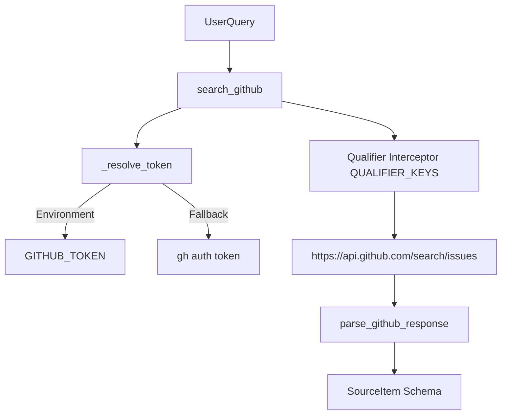
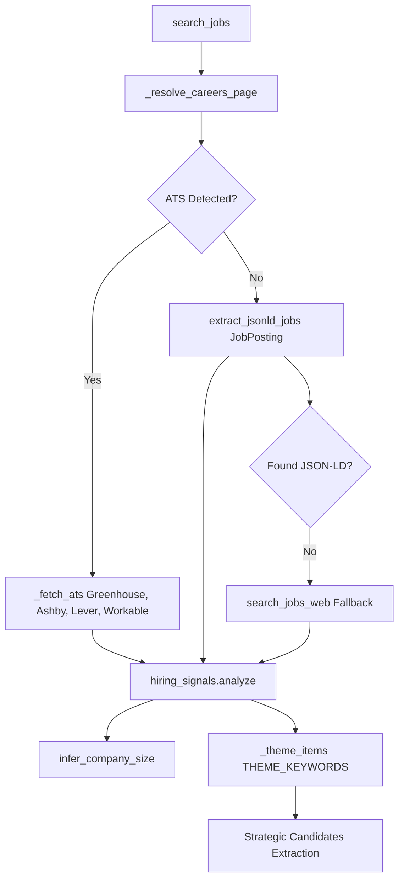
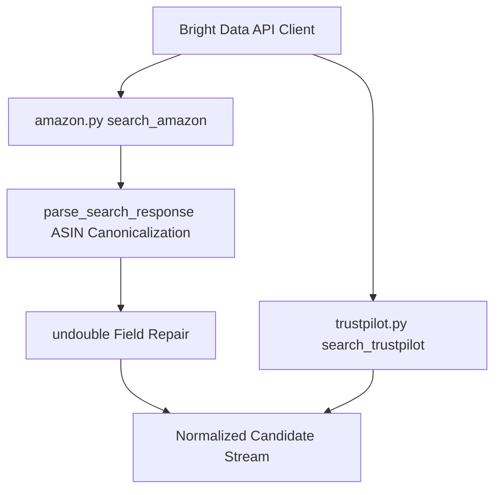
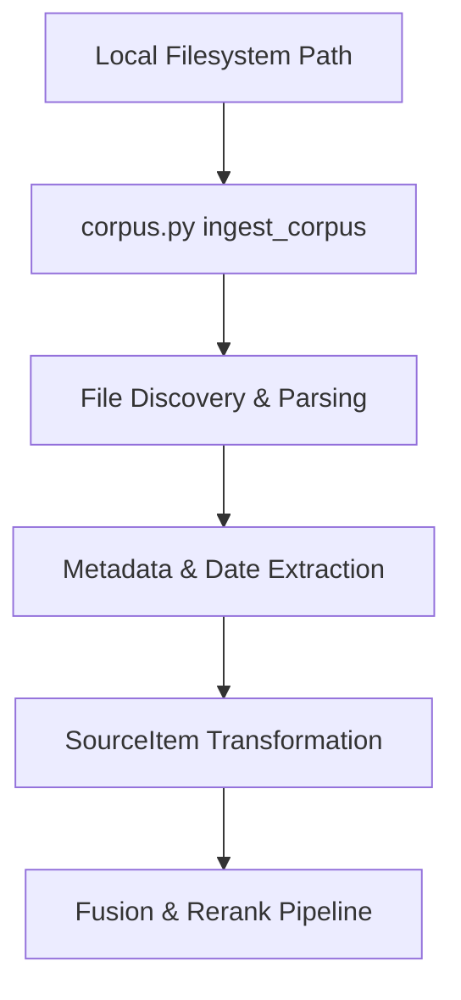

<!-- source: DeepWiki mcp.deepwiki.com · repo mvanhorn/last30days-skill · page 3.6 Developer, Commerce and Hiring Sources · fetched 2026-10-27 -->

# Developer, Commerce and Hiring Sources

Relevant source files

The following files were used as context for generating this wiki page:

- [.gitattributes](.gitattributes)
- [.gitignore](.gitignore)
- [docs/plans/2026-08-14-fix-amazon-review-budget-plan.md](docs/plans/2026-08-14-fix-amazon-review-budget-plan.md)
- [skills/last30days/scripts/lib/amazon.py](skills/last30days/scripts/lib/amazon.py)
- [skills/last30days/scripts/lib/brightdata.py](skills/last30days/scripts/lib/brightdata.py)
- [skills/last30days/scripts/lib/corpus.py](skills/last30days/scripts/lib/corpus.py)
- [skills/last30days/scripts/lib/github.py](skills/last30days/scripts/lib/github.py)
- [skills/last30days/scripts/lib/hiring_signals.py](skills/last30days/scripts/lib/hiring_signals.py)
- [skills/last30days/scripts/lib/html_render.py](skills/last30days/scripts/lib/html_render.py)
- [skills/last30days/scripts/lib/jobs.py](skills/last30days/scripts/lib/jobs.py)
- [skills/last30days/scripts/lib/library.py](skills/last30days/scripts/lib/library.py)
- [skills/last30days/scripts/lib/library_index.py](skills/last30days/scripts/lib/library_index.py)
- [skills/last30days/scripts/lib/trustpilot.py](skills/last30days/scripts/lib/trustpilot.py)
- [tests/test_amazon.py](tests/test_amazon.py)
- [tests/test_github.py](tests/test_github.py)
- [tests/test_github_qualifier_spam.py](tests/test_github_qualifier_spam.py)
- [tests/test_hiring_signals.py](tests/test_hiring_signals.py)
- [tests/test_html_render.py](tests/test_html_render.py)
- [tests/test_jobs_source.py](tests/test_jobs_source.py)
- [tests/test_render_hiring_signals.py](tests/test_render_hiring_signals.py)
- [tests/test_trustpilot_source.py](tests/test_trustpilot_source.py)

## Purpose and Scope

This page documents the specialized developer, commerce, and hiring source connectors within the `last30days` engine. These sources extend general web and social retrieval into structured domains: developer ecosystems via the GitHub search API, career movements via tiered job board discovery and hiring signal heuristics, merchant and product feedback via Bright Data-backed Amazon and Trustpilot scrapers, and local document stores via corpus ingestion. 

---

## 3.6.1 GitHub Search Integration (`github.py`)

The GitHub connector (`skills/last30days/scripts/lib/github.py`) queries the public GitHub Search API (`https://api.github.com/search/issues`) to retrieve issues and pull requests relevant to technical queries [skills/last30days/scripts/lib/github.py:1-24]().

### Authentication and Rate Limiting
Authentication is resolved via the `GITHUB_TOKEN` environment variable, or through a fallback subprocess invocation of `gh auth token` [skills/last30days/scripts/lib/github.py:49-66](). To avoid repeated subprocess overhead, the pipeline invokes `resolve_token()` once before search and enrichment [skills/last30days/scripts/lib/github.py:69-78](). 

Unauthenticated requests are capped at the anonymous rate tier using `UNAUTH_COUNT_CAP = 10` [skills/last30days/scripts/lib/github.py:38-40](). When an unauthenticated rate limit (HTTP 403) or error occurs, the engine returns a structured error envelope containing diagnostic context rather than failing silently [tests/test_github.py:74-90]().

### Qualifier Handling and Spam Filters
LLM planners frequently inject raw search qualifiers into topic strings (e.g., `stars:>1000 created:>2025-03-20`). The `github.py` module maintains a strict list of `QUALIFIER_KEYS` to intercept and clean these inputs [skills/last30days/scripts/lib/github.py:169-192](). 

If a query contains conflicting `created:` qualifiers, GitHub honors the first and ignores subsequent ones, causing API mismatches and zero-result leakage [skills/last30days/scripts/lib/github.py:169-175](). The engine strips or normalizes wrapped qualifiers (`(created:>2025-03-20)`) and guards against unbounded raw topic growth in error logs and diagnostics [tests/test_github_qualifier_spam.py:1-76]().

*Sources: [skills/last30days/scripts/lib/github.py:1-192](), [tests/test_github.py:11-32](), [tests/test_github_qualifier_spam.py:1-76]()*

---

## 3.6.2 Jobs and Hiring Signals (`jobs.py`, `hiring_signals.py`)

The jobs subsystem (`skills/last30days/scripts/lib/jobs.py`) retrieves public job listings via a tiered discovery strategy designed to prevent hallucinations and slug-probing spam [skills/last30days/scripts/lib/jobs.py:1-16]().

### Tiered Retrieval Strategy
1. **Tier 1 (Direct ATS API)**: Careers-page-first discovery. The engine fetches the target company's careers page, scans for supported ATS embed patterns (Greenhouse, Ashby, Lever, Workable, SmartRecruiters), extracts the exact published slug, and queries the ATS API directly [skills/last30days/scripts/lib/jobs.py:7-11, 35-48]().
2. **Tier 2 (Schema.org JSON-LD)**: If no direct ATS API is detected, the engine parses `JobPosting` JSON-LD blocks emitted by careers pages for SEO [skills/last30days/scripts/lib/jobs.py:12-14, 96-103]().
3. **Tier 3 (Generic Web Search)**: Last resort web grounding search for company job postings [skills/last30days/scripts/lib/jobs.py:15, 105-117]().

### Hiring Signals Analysis (`hiring_signals.py`)
Once jobs are normalized into `SourceItem` structures, `skills/last30days/scripts/lib/hiring_signals.py` categorizes them into strategic themes (such as *enterprise readiness*, *go-to-market*, *ai and machine learning*, and *infrastructure and reliability*) [skills/last30days/scripts/lib/hiring_signals.py:1-37]() and infers the company size tier (*startup*, *growth*, *mid-market*, *large-enterprise*, *mega-cap*) [skills/last30days/scripts/lib/hiring_signals.py:97-131]().

*Sources: [skills/last30days/scripts/lib/jobs.py:54-117](), [skills/last30days/scripts/lib/hiring_signals.py:52-94]() [tests/test_hiring_signals.py:1-104]()*

---

## 3.6.3 Commerce Reviews via Bright Data (`amazon.py`, `trustpilot.py`, `brightdata.py`)

Commerce sources ingest customer feedback and product metrics using structured web scrapers powered by Bright Data proxy infra.

### Amazon Integration (`amazon.py`)
The Amazon connector queries product listings, ASINs, review counts, ratings, and individual reviews. Because live payloads frequently duplicate review text, headers, and date strings, `amazon.py` implements field repair functions like `undouble()` and `parse_review_date()` [tests/test_amazon.py:74-110](). Search responses filter out-of-keyword products and canonicalize raw URLs to clean `/dp/ASIN` endpoints [tests/test_amazon.py:115-165]().

### Trustpilot Integration (`trustpilot.py`)
The Trustpilot connector extracts company trust scores, review distributions, and verified customer testimonials, normalizing them into standard `SourceItem` entities for cross-source fusion.

*Sources: [skills/last30days/scripts/lib/amazon.py](), [skills/last30days/scripts/lib/trustpilot.py](), [tests/test_amazon.py:1-170]()*

---

## 3.6.4 Local Corpus Ingestion (`corpus.py`)

Local corpus ingestion (`skills/last30days/scripts/lib/corpus.py`) allows researchers to query local directories, markdown files, and codebase documents alongside live web and social sources. The corpus parser reads local files, chunks text, assigns metadata, and wraps entries into canonical `SourceItem` objects for local retrieval and narrative clustering.

*Sources: [skills/last30days/scripts/lib/corpus.py]()*, [skills/last30days/scripts/lib/schema.py]()

---

