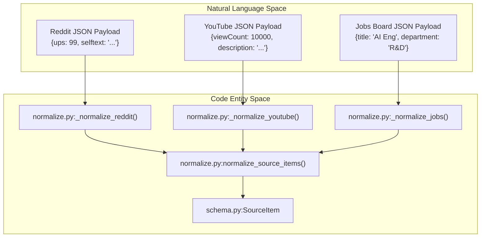
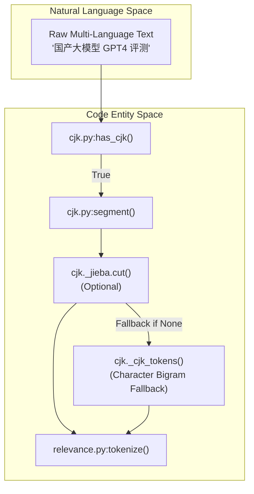

<!-- source: DeepWiki mcp.deepwiki.com · repo mvanhorn/last30days-skill · page 4.1 Data Normalization · fetched 2026-10-27 -->

# Data Normalization

Relevant source files

The following files were used as context for generating this wiki page:

- [changelog.d/1017.fixed.md](changelog.d/1017.fixed.md)
- [changelog.d/946.fixed.md](changelog.d/946.fixed.md)
- [docs/reference/json-export.md](docs/reference/json-export.md)
- [skills/last30days/scripts/lib/cjk.py](skills/last30days/scripts/lib/cjk.py)
- [skills/last30days/scripts/lib/dates.py](skills/last30days/scripts/lib/dates.py)
- [skills/last30days/scripts/lib/dedupe.py](skills/last30days/scripts/lib/dedupe.py)
- [skills/last30days/scripts/lib/http.py](skills/last30days/scripts/lib/http.py)
- [skills/last30days/scripts/lib/normalize.py](skills/last30days/scripts/lib/normalize.py)
- [skills/last30days/scripts/lib/relevance.py](skills/last30days/scripts/lib/relevance.py)
- [skills/last30days/scripts/lib/schema.py](skills/last30days/scripts/lib/schema.py)
- [tests/test_as_of_date.py](tests/test_as_of_date.py)
- [tests/test_cjk.py](tests/test_cjk.py)
- [tests/test_http_v3.py](tests/test_http_v3.py)
- [tests/test_instagram.py](tests/test_instagram.py)
- [tests/test_normalize_v3.py](tests/test_normalize_v3.py)
- [tests/test_signals_v3.py](tests/test_signals_v3.py)

## Purpose and Scope

Data Normalization transforms raw, heterogeneous API payloads returned from over 10 independent source connectors into the unified canonical dataclass model (`SourceItem`). This layer decouples upstream retrieval mechanics (such as platform-specific JSON schemas, rate limit errors, and unique pagination keys) from downstream scoring, deduplication, fusion, and rendering pipelines.

This page covers the canonical data types defined in `schema.py`, source-specific normalizers and comment-remapping utilities in `normalize.py`, CJK multi-language segmentation in `cjk.py`, date range filtering, and freshness modes.

## Canonical Schema Architecture

The normalization pipeline relies on structured dataclasses defined in `skills/last30days/scripts/lib/schema.py` to represent evidence items at different stages of refinement.

### Core Entities

- **`SourceItem`**: The fundamental normalized evidence unit representing a post, video, paper, or record. It unifies disparate identifiers, text payloads, publication dates, and raw platform engagement maps [skills/last30days/scripts/lib/schema.py:76-99]().
- **`Candidate`**: The global entity produced after fusion and reranking, grouping one or more `SourceItem` objects with computed RRF, rerank, and cluster scores [skills/last30days/scripts/lib/schema.py:102-127]().
- **`Report`**: The top-level container encapsulating query metadata, source outcome statuses, confidence metrics, and final ranked candidate lists [docs/reference/json-export.md:40-54]().

### SourceItem Field Contract

| Field | Type | Description |
| :--- | :--- | :--- |
| `item_id` | `str` | Source-specific unique identifier. |
| `source` | `str` | Platform identifier (e.g., `"reddit"`, `"youtube"`, `"arxiv"`). |
| `title` | `str` | Primary headline or truncated body text. |
| `body` | `str` | Full body text or transcript excerpt. |
| `url` | `str` | Canonical web URL pointing to the item. |
| `author` | `str \| None` | Author username or handle, when available. |
| `published_at` | `str \| None` | ISO-8601 publication timestamp string. |
| `date_confidence` | `Literal["high", "med", "low"]` | Precision tier of the publication date. |
| `engagement` | `dict[str, float \| int]` | Source-specific raw engagement counts. |
| `metadata` | `dict[str, Any]` | Supplemental payload (e.g., top comments, media codes). |

Sources: [skills/last30days/scripts/lib/schema.py:76-99]()

---

## Natural Language Space to Code Entity Space: Normalization Dispatch

The diagram below maps raw external API JSON payloads (Natural Language Space) to their corresponding parsing functions and typed instances in Code Entity Space (`normalize.py` and `schema.py`).

Title: Normalization Dispatch Flow

Sources: [skills/last30days/scripts/lib/normalize.py:30-78](), [skills/last30days/scripts/lib/schema.py:76-99]()

---

## Source-Specific Normalizers and Comment Remapping

The central dispatcher `normalize_source_items()` maps source identifiers to dedicated parsing functions and executes date filtering [skills/last30days/scripts/lib/normalize.py:30-85]().

### Platform Normalization Handlers
- **Reddit & X**: Maps upvotes, comments, reposts, and author handles into standard engagement keys [skills/last30days/scripts/lib/normalize.py:40-41]().
- **YouTube**: Parses video metadata, transcript snippets, and supports the `evergreen_ok` fallback mode [skills/last30days/scripts/lib/normalize.py:42](), [skills/last30days/scripts/lib/normalize.py:108-121]().
- **Short-form Video (TikTok, Instagram, etc.)**: Standardizes view, like, and comment metrics across platform-specific keys via `_normalize_shortform_video` [skills/last30days/scripts/lib/normalize.py:43-48]().
- **Specialized Sources (arXiv, Jobs)**: Bypasses strict date windowing where recency operates differently (e.g., arXiv's 365-day recency contract or career boards containing active, open roles) [skills/last30days/scripts/lib/normalize.py:86-96]().

### Comment Standardization (`_remap_comments`)
Downstream ranking and signal modules expect comments to share a uniform shape containing `score` and `excerpt`. The helper `_remap_comments` translates source-specific attributes (such as YouTube's `likes`/`text` or TikTok's `digg_count`/`text`) into the canonical comment schema while preserving metadata like author and publication date [skills/last30days/scripts/lib/normalize.py:124-167]().

Sources: [skills/last30days/scripts/lib/normalize.py:30-167]()

---

## Date and Freshness Handling

Date extraction and freshness enforcement are managed through `dates.py` and date windowing utilities in `normalize.py`.

### Date Range Filtering
The function `filter_by_date_range()` evaluates `SourceItem.published_at` against the requested `from_date` and `to_date` bounds [skills/last30days/scripts/lib/normalize.py:11-27](). Items lacking timestamps are included only when `require_date` is set to `False` (such as in broad web grounding searches).

### Freshness Modes
- **`balanced_recent`**: Default filtering policy enforcing strict compliance with the computed report window.
- **`evergreen_ok`**: Specifically applied to sources like YouTube; if the recent search pool is empty, older items with strong relevance are preserved [skills/last30days/scripts/lib/normalize.py:117-120]().

Sources: [skills/last30days/scripts/lib/normalize.py:11-27](), [skills/last30days/scripts/lib/normalize.py:108-121]()

---

## CJK Handling and Multi-Language Segmentation

Because the engine maintains zero hard external dependencies, Chinese, Japanese, and Korean (CJK) text parsing is handled natively via `cjk.py` to support token overlap scoring and near-duplicate detection without failing when optional packages are absent [skills/last30days/scripts/lib/cjk.py:1-20]().

---

## Natural Language Space to Code Entity Space: CJK Segmentation

The diagram below illustrates how raw mixed-language strings in Natural Language Space are processed by tokenization and segmentation code entities.

Title: CJK Segmentation Pipeline

Sources: [skills/last30days/scripts/lib/cjk.py:61-107](), [skills/last30days/scripts/lib/relevance.py:90-105]()

### Implementation Details
- **Optional `jieba` Integration**: At import time, `cjk.py` attempts to load `jieba`. Any failure or absence safely falls back to a dictionary-free character bigram segmentation strategy, ensuring zero installation friction [skills/last30days/scripts/lib/cjk.py:55-84]().
- **Stopword Filtering**: Language-specific stopword dictionaries (`CHINESE_STOPWORDS` and English `STOPWORDS`) eliminate high-frequency noise terms prior to Jaccard similarity and token overlap scoring [skills/last30days/scripts/lib/cjk.py:37-47](), [skills/last30days/scripts/lib/dedupe.py:9-34]().

Sources: [skills/last30days/scripts/lib/cjk.py:1-107](), [skills/last30days/scripts/lib/dedupe.py:9-34]()

---

