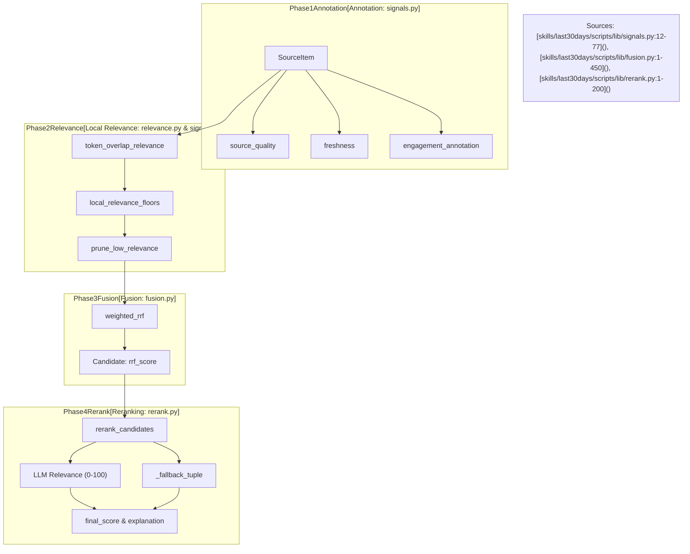
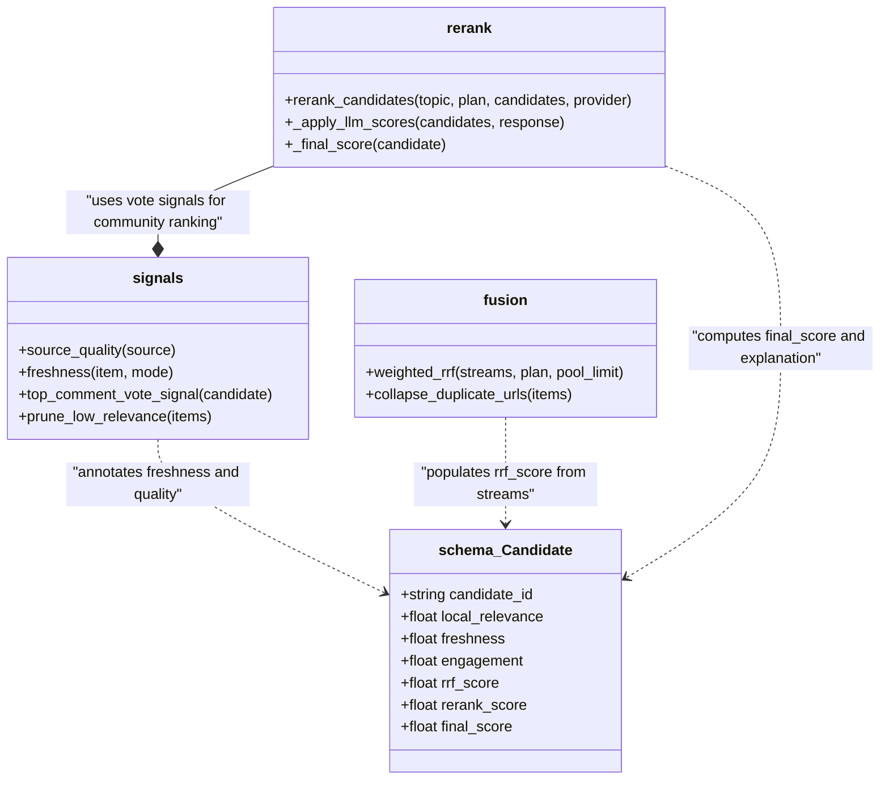

<!-- source: DeepWiki mcp.deepwiki.com · repo mvanhorn/last30days-skill · page 4.2 Scoring and Ranking · fetched 2026-10-27 -->

# Scoring and Ranking

Relevant source files

The following files were used as context for generating this wiki page:

- [skills/last30days/scripts/lib/cluster.py](skills/last30days/scripts/lib/cluster.py)
- [skills/last30days/scripts/lib/fusion.py](skills/last30days/scripts/lib/fusion.py)
- [skills/last30days/scripts/lib/render.py](skills/last30days/scripts/lib/render.py)
- [skills/last30days/scripts/lib/rerank.py](skills/last30days/scripts/lib/rerank.py)
- [skills/last30days/scripts/lib/signals.py](skills/last30days/scripts/lib/signals.py)
- [tests/test_cluster_v3.py](tests/test_cluster_v3.py)
- [tests/test_creator_first_party.py](tests/test_creator_first_party.py)
- [tests/test_discover_nominate_topics.py](tests/test_discover_nominate_topics.py)
- [tests/test_fusion_v3.py](tests/test_fusion_v3.py)
- [tests/test_render_footer.py](tests/test_render_footer.py)
- [tests/test_render_v3.py](tests/test_render_v3.py)
- [tests/test_rerank_v3.py](tests/test_rerank_v3.py)
- [tests/test_top_comments_relevance.py](tests/test_top_comments_relevance.py)

## Purpose and Scope

The `/last30days` skill employs a multi-stage scoring and ranking architecture to transform heterogeneous search results into a prioritized list of high-quality evidence. The system balances **textual relevance** (how well content matches the query), **engagement** (social proof and virality), **recency** (freshness within the 30-day window), and **source quality**.

The pipeline progresses from source-specific normalization and local relevance pruning to a weighted Reciprocal Rank Fusion (RRF), followed by an LLM-based reranking stage that applies intent-specific scoring logic, entity grounding, first-party author credit, and engagement-rescue mechanisms.

---

## Architecture: The Scoring Pipeline

The scoring flow moves through four distinct phases before items are clustered for synthesis.

Sources: [skills/last30days/scripts/lib/signals.py:12-77](), [skills/last30days/scripts/lib/fusion.py:1-450](), [skills/last30days/scripts/lib/rerank.py:1-200]()

---

## Phase 1: Annotation and Local Relevance Scoring

The `signals.py` and `relevance.py` modules annotate `SourceItem` objects with quality metrics and compute initial keyword relevance [skills/last30days/scripts/lib/signals.py:1-77]().

### Source Quality and Freshness
*   **Source Quality Multipliers**: Static platform weights reflect editorial signal-to-noise ratios, with Grounding (Google Search) as the 1.0 baseline, down to social platforms discounted for noise [skills/last30days/scripts/lib/signals.py:12-32]().
*   **Freshness Calculation**: Recency scores are computed relative to the query window. `strict_recent` mode returns raw recency scores, whereas `evergreen_ok` introduces a floor to permit enduring references [skills/last30days/scripts/lib/signals.py:80-97]().

### Local Relevance Floors and Pruning
The `local_relevance()` function calculates token overlap against the query [skills/last30days/scripts/lib/signals.py:39-77](). Specialized floors prevent correct retrievals from being pruned when standard keyword matching fails:
*   **YouTube View Floor**: Official videos with over 100,000 views receive a relevance floor of `0.3` even if title token overlap is low [skills/last30days/scripts/lib/signals.py:55-56]().
*   **GitHub Project Mode**: Repositories requested via `--github-repo` receive a `0.8` floor to survive low token diversity [skills/last30days/scripts/lib/signals.py:59-64]().
*   **Grounding-Exempt Floor**: Amazon product reviews and catalog metadata receive an `0.8` floor since descriptive buyer text often omits overarching brand search terms [skills/last30days/scripts/lib/signals.py:74-75]().

The `prune_low_relevance()` function filters out items falling below the threshold unless protected by first-party author status or creator exceptions [tests/test_creator_first_party.py:59-70]().

Sources: [skills/last30days/scripts/lib/signals.py:12-97](), [tests/test_creator_first_party.py:59-70]()

---

## Phase 2: Engagement Log Scales

To prevent platforms with massive engagement figures (like TikTok or YouTube) from overpowering text-based platforms (like Reddit or Hacker News), metrics are normalized using platform-specific logarithmic references [skills/last30days/scripts/lib/signals.py:118-133]().

*   **Logarithmic Scaling**: `log1p_safe()` computes safe log transformations for metrics like likes, reposts, and comments [skills/last30days/scripts/lib/signals.py:99-109]().
*   **Top Comment Signals**: Reddit, YouTube, and TikTok factor in top-voted comments using normalized vote log-references (`_VOTE_LOG_REFERENCE`), mapping vote counts into a `[0, 1]` comparative score [skills/last30days/scripts/lib/signals.py:125-170]().

Sources: [skills/last30days/scripts/lib/signals.py:99-170]()

---

## Phase 3: Weighted Reciprocal Rank Fusion

The `fusion.py` module combines retrieval streams across multiple subqueries and sources into a unified candidate list using Weighted Reciprocal Rank Fusion (RRF) [skills/last30days/scripts/lib/fusion.py:1-450]().

*   **URL Normalization and Deduplication**: `collapse_duplicate_urls()` and `_normalize_url()` strip tracking parameters (`utm_*`) and standard host prefixes (`www.`, `m.`) to merge identical items retrieved across distinct subquery paths [skills/last30days/scripts/lib/fusion.py:30-41](), [skills/last30days/scripts/lib/fusion.py:91-108]().
*   **Enrichment Merging**: `merge_source_items()` merges metadata such as `top_comments` and transcript highlights from duplicate thread entries [skills/last30days/scripts/lib/fusion.py:62-88]().
*   **Diversity Reservations**: Active sources meeting relevance thresholds receive guaranteed pool slots to prevent high-weight social streams from starving niche sources [tests/test_fusion_v3.py:51-115]().

Sources: [skills/last30days/scripts/lib/fusion.py:30-108](), [tests/test_fusion_v3.py:51-115]()

---

## Phase 4: LLM Reranking, Entity Grounding, and First-Party Credit

The `rerank.py` module evaluates shortlisted candidates using an LLM provider model to assign semantic relevance scores between `0` and `100` [skills/last30days/scripts/lib/rerank.py:1-200]().

*   **Entity Grounding**: An `ENTITY_MISS_PENALTY` of `25.0` points is deducted if a candidate fails to mention the primary entity in its title or snippet, countering viral off-topic collisions [skills/last30days/scripts/lib/rerank.py:13-20]().
*   **First-Party Credit**: A small additive `FIRST_PARTY_AUTHOR_CREDIT` of `5.0` points lifts posts authored by resolved handles (e.g., official creator accounts) off the neutral floor so they are not buried by keyword pruning [skills/last30days/scripts/lib/rerank.py:34-40]().
*   **Security Fencing**: Scraped candidate text is wrapped inside `<untrusted_content>` XML fences during prompt assembly to neutralize prompt-injection attacks contained within web snippets [tests/test_rerank_v3.py:92-101]().

Sources: [skills/last30days/scripts/lib/rerank.py:13-40](), [tests/test_rerank_v3.py:92-101]()

---

## Fallback, Engagement Rescue, and Best-Takes Scoring

If the LLM reranker encounters errors or timeouts, the engine falls back to local scoring heuristics and engagement rescue rules [skills/last30days/scripts/lib/rerank.py:1-200]().

*   **Engagement Rescue**: High-engagement posts that are entity-grounded are rescued from low LLM relevance scores up to designated score floors.
*   **Fun and Best-Takes Scoring**: Specialized judges evaluate community comments and humorous takes, leveraging normalized comment vote signals (`top_comment_vote_signal`) to surface vibrant community reactions [skills/last30days/scripts/lib/signals.py:151-170]().

Sources: [skills/last30days/scripts/lib/signals.py:151-170](), [skills/last30days/scripts/lib/rerank.py:1-200]()

---

## Data Flow: Code Entity Space

Sources: [skills/last30days/scripts/lib/signals.py:1-411](), [skills/last30days/scripts/lib/fusion.py:1-450](), [skills/last30days/scripts/lib/rerank.py:1-990](), [skills/last30days/scripts/lib/schema.py:1-200]()

---

