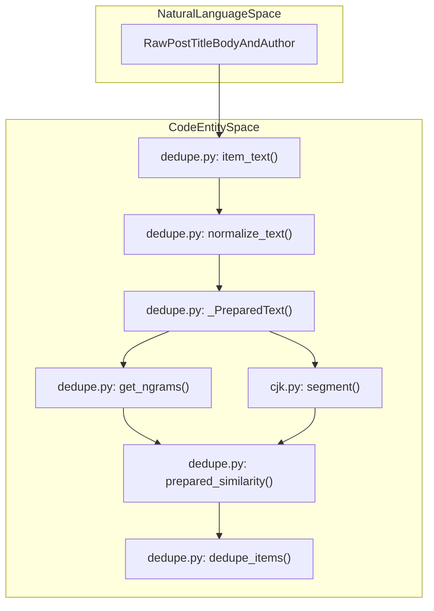
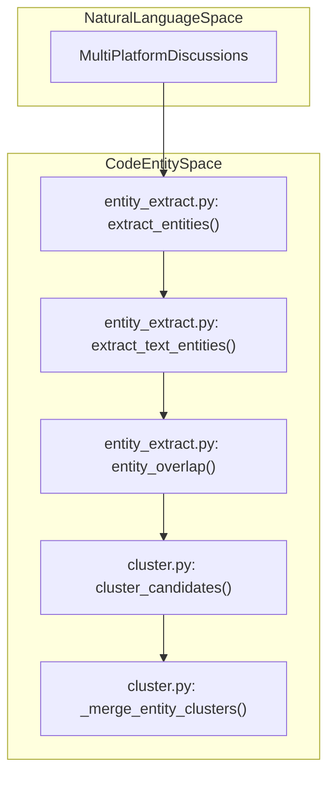

<!-- source: DeepWiki mcp.deepwiki.com · repo mvanhorn/last30days-skill · page 4.3 Deduplication and Cross-Source Linking · fetched 2026-10-27 -->

# Deduplication and Cross-Source Linking

Relevant source files

The following files were used as context for generating this wiki page:

- [skills/last30days/scripts/lib/cjk.py](skills/last30days/scripts/lib/cjk.py)
- [skills/last30days/scripts/lib/cluster.py](skills/last30days/scripts/lib/cluster.py)
- [skills/last30days/scripts/lib/dedupe.py](skills/last30days/scripts/lib/dedupe.py)
- [skills/last30days/scripts/lib/entity_extract.py](skills/last30days/scripts/lib/entity_extract.py)
- [skills/last30days/scripts/lib/fusion.py](skills/last30days/scripts/lib/fusion.py)
- [skills/last30days/scripts/lib/reddit_public.py](skills/last30days/scripts/lib/reddit_public.py)
- [skills/last30days/scripts/lib/relevance.py](skills/last30days/scripts/lib/relevance.py)
- [tests/test_cjk.py](tests/test_cjk.py)
- [tests/test_cluster_v3.py](tests/test_cluster_v3.py)
- [tests/test_discover_nominate_topics.py](tests/test_discover_nominate_topics.py)
- [tests/test_fusion_v3.py](tests/test_fusion_v3.py)
- [tests/test_reddit_public.py](tests/test_reddit_public.py)
- [tests/test_render_footer.py](tests/test_render_footer.py)

## Purpose and Scope

This document details how the `/last30days` engine identifies when the same story, discussion, or content item appears across multiple sources (Reddit, X, YouTube, Hacker News, Polymarket, etc.) and links them together. The deduplication subsystem prevents redundant items from cluttering research reports, while the cross-source narrative clustering engine groups related candidates to highlight multi-platform consensus.

The pipeline executes a multi-stage workflow:
1. **Intra-Source Deduplication**: Eliminating text near-duplicates and exact URL collisions within individual source result streams via `dedupe.py` [skills/last30days/scripts/lib/dedupe.py:1-145]().
2. **Narrative Clustering**: Grouping diverse candidates into thematic stories using greedy textual similarity and Maximal Marginal Relevance (`_mmr_representatives`) via `cluster.py` [skills/last30days/scripts/lib/cluster.py:1-124]().
3. **Cross-Source Entity Merging**: Merging small clusters that discuss the same underlying story across different platforms through proper noun and entity overlap detection via `_merge_entity_clusters` [skills/last30days/scripts/lib/cluster.py:135-172]() and `entity_extract.py` [skills/last30days/scripts/lib/entity_extract.py:1-45]().

Sources: [skills/last30days/scripts/lib/dedupe.py:1-145](), [skills/last30days/scripts/lib/cluster.py:1-172](), [skills/last30days/scripts/lib/entity_extract.py:1-45]()

---

## System Overview and Data Flow

The deduplication and cross-source linking engine operates after individual sources are normalized and scored, right before cluster-first report rendering. 

Title: "Deduplication Similarity Pipeline: Natural Language to Code Entities"

Sources: [skills/last30days/scripts/lib/dedupe.py:37-145](), [skills/last30days/scripts/lib/cjk.py:86-107]()

---

## Hybrid Jaccard Similarity and CJK-Aware Tokenization

The `dedupe.py` module implements a hybrid similarity computation combining character-level n-grams with token-level Jaccard overlap [skills/last30days/scripts/lib/dedupe.py:75-79]().

### Core Similarity Functions
* **Text Preparation**: `item_text(item)` concatenates `item.title`, `item.body`, `item.author`, and `item.container` into a single raw string [skills/last30days/scripts/lib/dedupe.py:107-110]().
* **Normalization**: `normalize_text(text)` lowercases text, strips punctuation via regex `[^\w\s]`, and collapses whitespace [skills/last30days/scripts/lib/dedupe.py:37-39]().
* **Trigram N-grams**: `get_ngrams(text, n=3)` generates sliding character trigrams from normalized text for sub-word matching [skills/last30days/scripts/lib/dedupe.py:42-49]().
* **Token Jaccard**: `token_jaccard(text_a, text_b)` segments text via `cjk.segment`, filters out terms of length $\le 1$ and common `STOPWORDS` (including CJK stopwords), and computes Jaccard similarity [skills/last30days/scripts/lib/dedupe.py:61-72]().
* **Hybrid Combination**: `hybrid_similarity(text_a, text_b)` returns the maximum of trigram Jaccard and token Jaccard [skills/last30days/scripts/lib/dedupe.py:75-79]().
* **Prepared Caches**: `_PreparedText` precomputes n-grams and token sets for performance during repeated evaluations, evaluated via `prepared_similarity` [skills/last30days/scripts/lib/dedupe.py:89-104]().

### CJK Support
Because Chinese, Japanese, and Korean scripts lack whitespace boundaries, `cjk.py` provides `segment(text)` [skills/last30days/scripts/lib/cjk.py:1-20](). It utilizes `jieba` when installed (silencing logs via `_jieba.setLogLevel(60)`) and falls back to character bigrams without external dependencies [skills/last30days/scripts/lib/cjk.py:61-84](). This ensures token-overlap and near-duplicate detection function correctly for sources like Xiaohongshu and Bilibili [skills/last30days/scripts/lib/cjk.py:1-20]().

### Job Postings Special Case
In `dedupe_items`, job postings (`item.source == "jobs"`) are deduplicated strictly by exact URL rather than fuzzy text similarity [skills/last30days/scripts/lib/dedupe.py:123-131](). Job boards share heavy boilerplate templates (company introductions, benefits, location policies) that would otherwise trigger fuzzy text similarity and collapse distinct roles into a single entry [skills/last30days/scripts/lib/dedupe.py:115-119]().

Sources: [skills/last30days/scripts/lib/dedupe.py:37-145](), [skills/last30days/scripts/lib/cjk.py:1-107]()

---

## Entity Extraction and Cross-Source Linking

Title: "Cross-Source Linking and Entity Clustering Pipeline"

Sources: [skills/last30days/scripts/lib/entity_extract.py:1-164](), [skills/last30days/scripts/lib/cluster.py:61-172]()

The `entity_extract.py` module extracts proper nouns, handles, hashtags, and subreddits from raw items to support cross-source linking and secondary query planning [skills/last30days/scripts/lib/entity_extract.py:1-85]().

### Extraction Mechanisms
* **Text Entities**: `extract_text_entities(text)` cleans text, filters out `ENTITY_STOPWORDS` and short words, and retains words possessing anchor signals (leading capitals, all-caps, or digits representing product versions or people) [skills/last30days/scripts/lib/entity_extract.py:28-45]().
* **X Handles**: `_extract_x_handles` parses author handles and `@mentions` from text, filtering out generic platform accounts listed in `GENERIC_HANDLES` (e.g., `openai`, `google`, `elonmusk`) [skills/last30days/scripts/lib/entity_extract.py:87-113]().
* **Hashtags and Subreddits**: `_extract_x_hashtags` and `_extract_subreddits` rank hashtags and subreddit cross-references (including those found in comment excerpts) by frequency [skills/last30days/scripts/lib/entity_extract.py:116-164]().
* **Entity Overlap**: `entity_overlap(entities_a, entities_b)` computes the overlap coefficient between two entity sets, used during cluster merging [skills/last30days/scripts/lib/entity_extract.py:47-52]().

Sources: [skills/last30days/scripts/lib/entity_extract.py:1-164]()

---

## Narrative Clustering and Cross-Source Overlap

The `cluster.py` module organizes ranked candidates into narrative clusters for structured report rendering [skills/last30days/scripts/lib/cluster.py:1-124]().

### Greedy Clustering Algorithm
1. **Intent Gating**: If the query intent is not in `CLUSTERABLE_INTENTS` (`breaking_news`, `opinion`, `comparison`, `prediction`) or `cluster_mode == "none"`, each candidate forms an independent singleton cluster [skills/last30days/scripts/lib/cluster.py:19-82]().
2. **Text Caching**: `_PreparedText` representations are built for all candidate titles and snippets [skills/last30days/scripts/lib/cluster.py:84-87]().
3. **Greedy Grouping**: Candidates are iterated and assigned to existing clusters if their prepared similarity to the group leader exceeds a threshold (0.42 for `breaking_news`, 0.48 for other intents). Otherwise, a new cluster is initiated [skills/last30days/scripts/lib/cluster.py:89-105]().
4. **MMR Representative Selection**: `_mmr_representatives` selects up to 3 representative candidate IDs per cluster balancing `final_score` and textual diversity via a diversity lambda parameter (default 0.75) [skills/last30days/scripts/lib/cluster.py:24-58]().
5. **Freshness Partitioning**: `_cluster_sort_key` ensures stale items (out-of-window candidates) are strictly partitioned below fresh items, preventing outdated items from leading cluster titles [skills/last30days/scripts/lib/cluster.py:8-17]().

### Entity-Based Cluster Merging
A second pass (`_merge_entity_clusters`) merges small clusters ($\le 3$ items) that discuss the same story across different sources where text phrasing differs [skills/last30days/scripts/lib/cluster.py:125-172](). By extracting text entities for each cluster and checking cross-source overlap, the engine successfully links equivalent discussions (e.g., a Reddit thread and an X post about the same event) into a single cohesive narrative cluster tagged with multi-source metadata [skills/last30days/scripts/lib/cluster.py:135-172]().

Sources: [skills/last30days/scripts/lib/cluster.py:1-248]()

---

## Relevance Scoring and Synonym Expansion

To ensure items matched across sources are genuinely topically aligned, `relevance.py` provides query-centric token overlap scoring [skills/last30days/scripts/lib/relevance.py:1-157]().

* **Synonym Expansion**: `SYNONYMS` maps alternative spellings and abbreviations bidirectionally (e.g., `js` $\leftrightarrow$ `javascript`, `ai` $\leftrightarrow$ `artificial intelligence`, `hip` $\leftrightarrow$ `rap`) so cross-platform posts using different terminology still achieve high relevance overlap [skills/last30days/scripts/lib/relevance.py:39-58]().
* **PreparedQuery Optimization**: `PreparedQuery` precomputes token sets and filters out `LOW_SIGNAL_QUERY_TOKENS` (such as generic query scaffolding words like `review`, `latest`, `update`, `evidence`) so that scoring concentrates on informative entity tokens [skills/last30days/scripts/lib/relevance.py:113-128]().

Sources: [skills/last30days/scripts/lib/relevance.py:1-217]()

---

