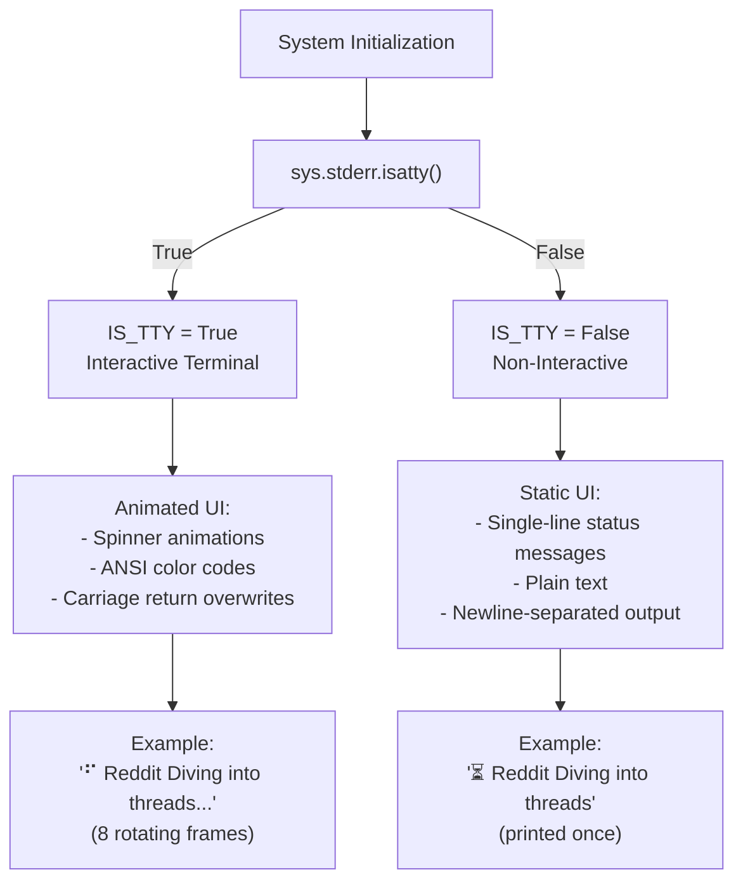
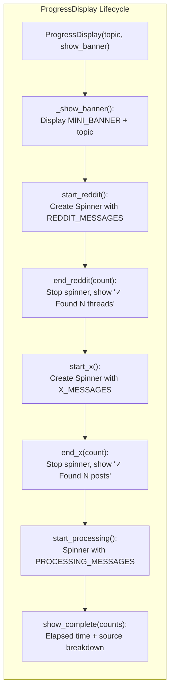
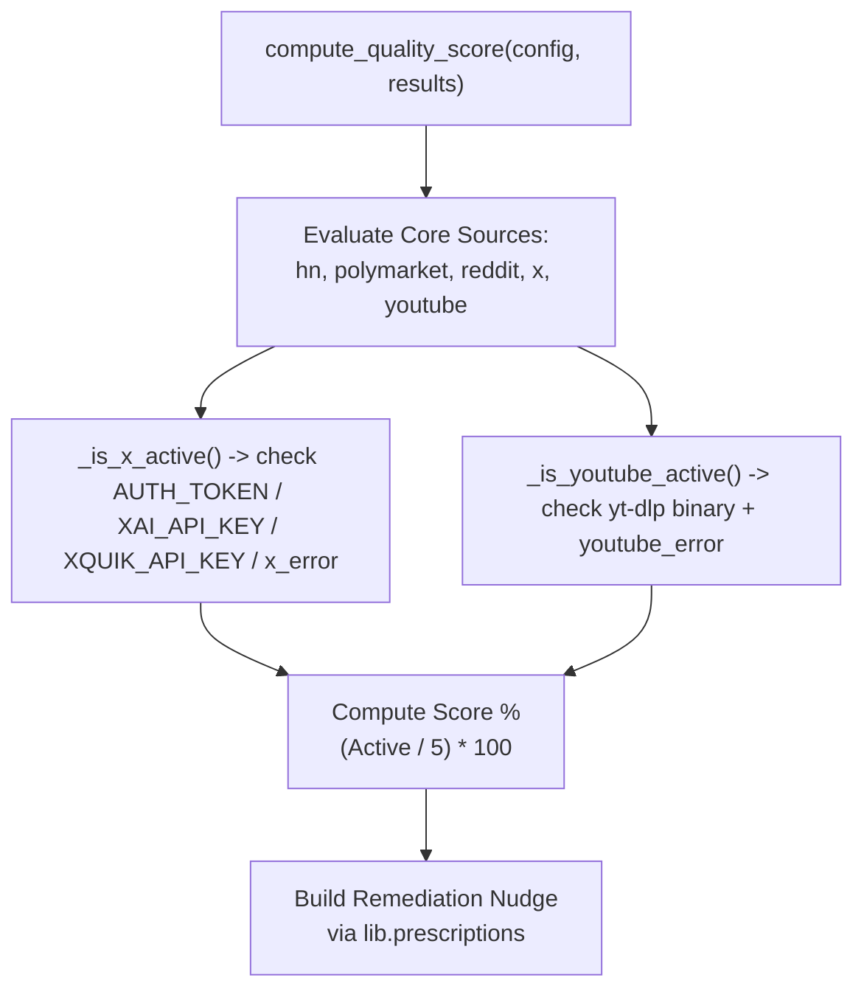

<!-- source: DeepWiki mcp.deepwiki.com · repo mvanhorn/last30days-skill · page 5.2 Terminal UI and Nudges · fetched 2026-10-27 -->

# Terminal UI and Nudges

Relevant source files

The following files were used as context for generating this wiki page:

- [skills/last30days/scripts/lib/dripstack.py](skills/last30days/scripts/lib/dripstack.py)
- [skills/last30days/scripts/lib/prescriptions.py](skills/last30days/scripts/lib/prescriptions.py)
- [skills/last30days/scripts/lib/quality_nudge.py](skills/last30days/scripts/lib/quality_nudge.py)
- [skills/last30days/scripts/lib/ui.py](skills/last30days/scripts/lib/ui.py)
- [tests/test_dripstack.py](tests/test_dripstack.py)
- [tests/test_grok_surfacing.py](tests/test_grok_surfacing.py)
- [tests/test_prescriptions.py](tests/test_prescriptions.py)
- [tests/test_quality_nudge.py](tests/test_quality_nudge.py)
- [tests/test_xiaohongshu_api.py](tests/test_xiaohongshu_api.py)

This document describes the terminal user interface (UI) system and post-run quality nudge mechanism that provide visual feedback and configuration remediation during research execution. The Terminal UI renders progress indicators, spinners, status banners, and completion messages in both interactive TTY environments and non-interactive execution contexts (e.g., Claude Code, agent mode).

For information about output formats and file generation, see [Output Formats and Files](#5.3). For the main orchestration flow that drives these UI updates, see [Orchestration Pipeline](#2.2).

## Purpose and Scope

The Terminal UI and nudge systems serve four primary functions:

1. **Progress visualization**: Display real-time status for each research phase (Reddit, X, YouTube, etc.) using animated spinners and progress counters (`skills/last30days/scripts/lib/ui.py:223-362]`).
2. **Diagnostic reporting**: Show source availability, authentication status, and configuration hints before research begins (`skills/last30days/scripts/lib/ui.py:420-519]`).
3. **Adaptive rendering**: Automatically detect terminal capabilities and render appropriately for both TTY (animated) and non-TTY (static) environments (`skills/last30days/scripts/lib/ui.py:11-12]`).
4. **Quality Assessment and Prescriptions**: Provide a post-research quality score based on core sources, trigger upgrade prompts, and resolve remediation steps via the shared prescription registry (`skills/last30days/scripts/lib/quality_nudge.py:1-190]`, `skills/last30days/scripts/lib/prescriptions.py:1-75]`).

---

## TTY Detection and Rendering Strategy

The UI system uses a dual-rendering strategy based on terminal type detection. This ensures readable output in both interactive terminals and non-interactive execution channels.

**Sources**: `skills/last30days/scripts/lib/ui.py:11-12]`, `skills/last30days/scripts/lib/ui.py:171-202]()

Detection occurs at module load time via `IS_TTY = sys.stderr.isatty()` (`skills/last30days/scripts/lib/ui.py:12`). This flag controls rendering behavior throughout the UI module:

| Context | `IS_TTY` | Rendering Behavior |
| :--- | :--- | :--- |
| macOS Terminal.app | `True` | Animated spinners, ANSI colors, overwrite lines with `\r` |
| iTerm2, Alacritty | `True` | Full ANSI support, 256-color palette available |
| Claude Code | `False` | Static messages, no animations, plain UTF-8 emoji |
| SSH session (pseudo-TTY) | `True` | Animated (pseudo-TTY supports ANSI sequences) |
| Piped output (`> file.txt`) | `False` | Static output suitable for log files |

**Sources**: `skills/last30days/scripts/lib/ui.py:11-12]`, `skills/last30days/scripts/lib/ui.py:171-221]()

---

## Core UI Components

### ProgressDisplay Class

The `ProgressDisplay` class orchestrates UI updates across the research lifecycle, managing banner displays, phase-specific spinners, and completion summaries (`skills/last30days/scripts/lib/ui.py:223-362]`).

**Sources**: `skills/last30days/scripts/lib/ui.py:223-362]()

#### Spinner Implementation

The `Spinner` class uses a daemon threading model to execute asynchronous loading animations without blocking execution (`skills/last30days/scripts/lib/ui.py:171-221]`).

* **Thread Lifecycle**: Created in `start()`, joined with a short timeout in `stop()` (`skills/last30days/scripts/lib/ui.py:195-196]`, `skills/last30days/scripts/lib/ui.py:212-214]`).
* **Frame Rate**: Iterates over `SPINNER_FRAMES` at ~80ms intervals (`skills/last30days/scripts/lib/ui.py:167-169]`, `skills/last30days/scripts/lib/ui.py:189]`).
* **Carriage Return**: Rewrites status messages in-place via `\r` (`skills/last30days/scripts/lib/ui.py:186]`).

**Sources**: `skills/last30days/scripts/lib/ui.py:167-220]()

---

## Quality Nudges and Prescriptions

Post-research analysis evaluates core source coverage and builds actionable upgrade prompts when sources are missing or degraded (`skills/last30days/scripts/lib/quality_nudge.py:1-134]`).

### Quality Score Calculation

`compute_quality_score()` evaluates runs against five core sources: Hacker News, Polymarket, X, YouTube, and Reddit (`skills/last30days/scripts/lib/quality_nudge.py:16-19]`).

**Sources**: `skills/last30days/scripts/lib/quality_nudge.py:11-134]`, `skills/last30days/scripts/lib/prescriptions.py:1-75]()

### Unified Prescriptions Vocabulary

Remediation text is centralized in `lib.prescriptions` (`skills/last30days/scripts/lib/prescriptions.py:1-27`). Both `quality_nudge.py` and the engine's diagnostic `doctor` command reference this single vocabulary. This ensures that the nudge displayed after a degraded run and the diagnostic fix printed by the doctor command never drift apart (`skills/last30days/scripts/lib/prescriptions.py:1-14`).

Each entry maps a `(source, failure_mode)` pair to a structured `Prescription` dataclass containing:
* `cause`: Technical explanation of the failure (`skills/last30days/scripts/lib/prescriptions.py:64`).
* `fix_nl`: Natural language remediation instructions (`skills/last30days/scripts/lib/prescriptions.py:65`).
* `fix_cli`: Executable CLI command for repair (`skills/last30days/scripts/lib/prescriptions.py:66`).
* `anchor`: `CONFIGURATION.md` section anchor (`skills/last30days/scripts/lib/prescriptions.py:68`).

**Sources**: `skills/last30days/scripts/lib/quality_nudge.py:6-9]`, `skills/last30days/scripts/lib/prescriptions.py:51-70]()

---

