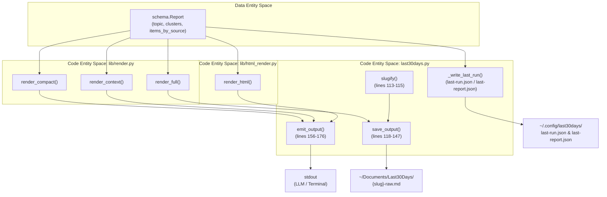
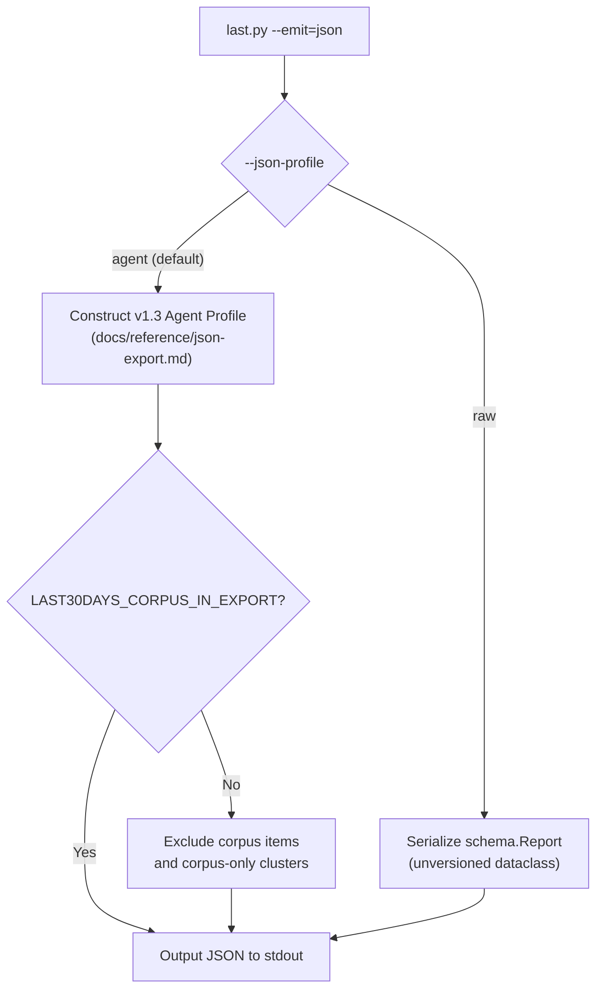

<!-- source: DeepWiki mcp.deepwiki.com · repo mvanhorn/last30days-skill · page 5.3 Output Formats and Files · fetched 2026-10-27 -->

# Output Formats and Files

Relevant source files

The following files were used as context for generating this wiki page:

- [CONTRIBUTORS.md](CONTRIBUTORS.md)
- [docs/reference/json-export.md](docs/reference/json-export.md)
- [hooks/scripts/check-config.sh](hooks/scripts/check-config.sh)
- [skills/last30days/scripts/last30days.py](skills/last30days/scripts/last30days.py)
- [skills/last30days/scripts/lib/http.py](skills/last30days/scripts/lib/http.py)
- [skills/last30days/scripts/lib/pipeline.py](skills/last30days/scripts/lib/pipeline.py)
- [skills/last30days/scripts/lib/schema.py](skills/last30days/scripts/lib/schema.py)
- [tests/fixtures/agent_export_v1.json](tests/fixtures/agent_export_v1.json)
- [tests/test_agent_export.py](tests/test_agent_export.py)
- [tests/test_check_config_env_safety.py](tests/test_check_config_env_safety.py)
- [tests/test_check_config_memory_dir.py](tests/test_check_config_memory_dir.py)
- [tests/test_cli_v3.py](tests/test_cli_v3.py)
- [tests/test_http_v3.py](tests/test_http_v3.py)
- [tests/test_last_run_state.py](tests/test_last_run_state.py)
- [tests/test_pipeline_v3.py](tests/test_pipeline_v3.py)

## Purpose and Scope

This page documents the output layer's format options, emission modes, and file persistence mechanisms for the `last30days` v3.0.0 engine. The system is designed to provide high-density research data in formats optimized for AI synthesis (LLM context), human readability (Markdown and HTML reports), and stable machine-readable contracts (JSON export schema and local execution caches).

For information about the rendering logic and cluster assembly, see [Report Generation](5.1). For terminal-specific display features like progress indicators, see [Terminal UI](5.2).

Sources: [skills/last30days/scripts/last30days.py:1-176](), [docs/reference/json-export.md:1-53]()

---

## Overview: Emit Modes and Output Files

The output system is controlled by the `--emit` flag in `last30days.py` [skills/last30days/scripts/last30days.py:156-176](), which determines the content format written to `stdout`. Regardless of the chosen emit mode, the system can generate persistent artifacts on disk.

### Emit Mode Summary

| Flag | Purpose | Primary Consumer | Implementation |
|------|---------|------------------|----------------|
| `compact` | Ranked clusters with representative items (default) | AI assistant reading results | `render.render_compact()` [skills/last30days/scripts/last30days.py:169-170]() |
| `md` | Full-length report with all items by source | Human readers, archival | `render.render_compact()` [skills/last30days/scripts/last30days.py:169-170]() |
| `json` | Full structured data dump of the `Report` object | Scripts, automation, databases | `schema.to_dict()` [skills/last30days/scripts/last30days.py:163-164]() |
| `html` | Shareable, styled report with synthesis | Human sharing (Slack/Notion) | `html_render.render_html()` [skills/last30days/scripts/last30days.py:165-168]() |
| `context` | High-level summary for cross-skill injection | Skill context windows | `render.render_context()` [skills/last30days/scripts/last30days.py:171-172]() |
| `brief` | Short-form summary | Quick updates | `render.render_brief()` [skills/last30days/scripts/last30days.py:173-174]() |

Sources: [skills/last30days/scripts/last30days.py:156-176]()

---

## Atomic Save and Memory Directory

Research artifacts and raw debugging dumps are saved to the local filesystem under a designated memory directory, ensuring that writes are atomic and handle collisions safely.

- **Primary Archive Directory:** Specified by the `LAST30DAYS_MEMORY_DIR` environment variable, defaulting to `~/Documents/Last30Days/` [hooks/scripts/check-config.sh:20-23]().
- **Atomic Writes:** File saving is handled via atomic replacement patterns, writing to a temporary file in the target directory before renaming it into place to prevent partial reads.
- **Slugification:** The topic string is normalized via regex (`re.sub(r"[^a-z0-9]+", "-", value.lower())`) to construct consistent filenames [skills/last30days/scripts/last30days.py:113-115]().
- **Collision Guard:** If a file with the primary slug already exists, the engine appends an ISO date suffix (`{slug}-{raw_label}-{date}.{ext}`) to avoid data loss [skills/last30days/scripts/last30days.py:135-136]().

Sources: [hooks/scripts/check-config.sh:20-23](), [skills/last30days/scripts/last30days.py:113-147]()

---

## Diagram: Output Generation and Save Pipeline

This diagram illustrates how the `schema.Report` object is transformed into various formats through rendering modules, saved via atomic disk operations, and cached in configuration state files.

Sources: [skills/last30days/scripts/last30days.py:113-176](), [skills/last30days/scripts/lib/html_render.py:1-10](), [skills/last30days/scripts/lib/render.py:1-10](), [tests/test_last_run_state.py:109-122]()

---

## Execution Caches: last-run.json and last-report.json

To support rapid iteration, HTML brief generation, and session re-entry without re-running expensive network sweeps, the engine maintains state caches in the configuration directory (defaulting to `~/.config/last30days/`).

- **`last-run.json`**: Records metadata about the most recent command execution, including the query topic, total items retrieved, timestamp, and the absolute file path to the report cache (`report_cache`) [tests/test_last_run_state.py:103-108]().
- **`last-report.json`**: Serializes the full structured `schema.Report` (or multi-report comparison fixtures) for the last run [tests/test_last_run_state.py:112-122]().
- **TTL and Expiration**: Cached reports include timestamp validation [tests/test_last_run_state.py:130-131]() and respect TTL bounds (e.g., expiring after 3600 seconds or when explicitly bypassed) [tests/test_last_run_state.py:132-134](). Partial comparison cache corruptions are strictly rejected rather than silently degraded [tests/test_last_run_state.py:145-158]().

Sources: [tests/test_last_run_state.py:80-168]()

---

## JSON Export Schema and Agent Export Fixtures

When `--emit=json` is requested, the output defaults to the stable machine-readable agent export profile (`--json-profile=agent`), versioned at `1.3` [docs/reference/json-export.md:12-16](). 

### Top-Level Agent Export Fields (`schema_version: "1.3"`)

| Field | Type | Meaning |
| --- | --- | --- |
| `schema_version` | string | Agent export contract version (`1.3`) [docs/reference/json-export.md:44-44](). |
| `query` | string | The research topic supplied to the engine [docs/reference/json-export.md:45-45](). |
| `generated_at` | string | UTC generation timestamp in RFC 3339 format [docs/reference/json-export.md:46-46](). |
| `window_days` | integer | Number of days between report start and end dates [docs/reference/json-export.md:47-47](). |
| `source_status` | object | Map of source names to observed v3 run outcomes (`ok`, `no-results`, `rate-limited`, `auth-failed`, `payment-required`, etc.) [docs/reference/json-export.md:48-48](). |
| `freshness_verdicts` | array | Per-claim act-time verification results produced by `--verify-freshness` [docs/reference/json-export.md:49-49](). |
| `clusters` | array | Ranked groups of related results [docs/reference/json-export.md:50-50](). |
| `results` | array | Ranked, flat evidence results for downstream processing [docs/reference/json-export.md:51-51](). |

### Local Corpus Privacy and Raw Profile
Evidence from local corpus directories (`--corpus` / `LAST30DAYS_CORPUS_DIRS`) is excluded from the versioned agent export by default unless `LAST30DAYS_CORPUS_IN_EXPORT=1` is set [docs/reference/json-export.md:26-26](). Alternatively, passing `--json-profile=raw` dumps the unversioned internal `Report` dataclass directly for debugging, which may contain local file paths and raw structures [docs/reference/json-export.md:19-22]().

Sources: [docs/reference/json-export.md:1-78]()

---

## Diagram: JSON Export Resolution Flow

This diagram traces the flow from CLI emission parameters to the selection of agent export profiles or unversioned raw payloads.

Sources: [docs/reference/json-export.md:16-26](), [skills/last30days/scripts/last30days.py:156-176]()

---

