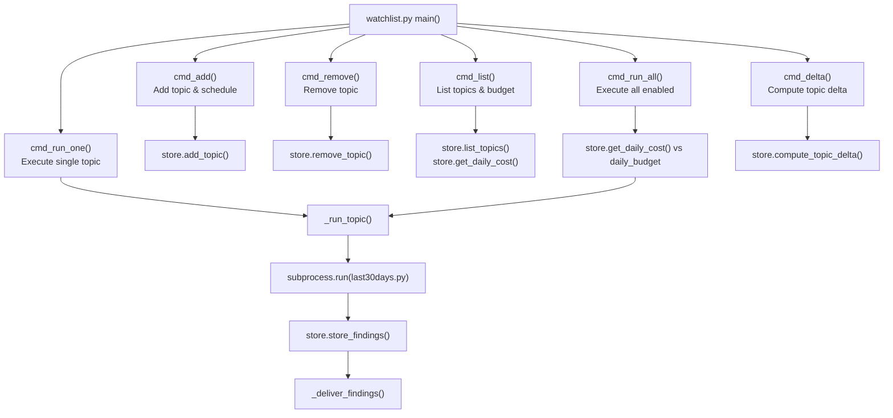
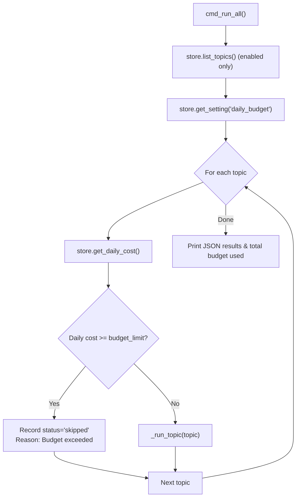
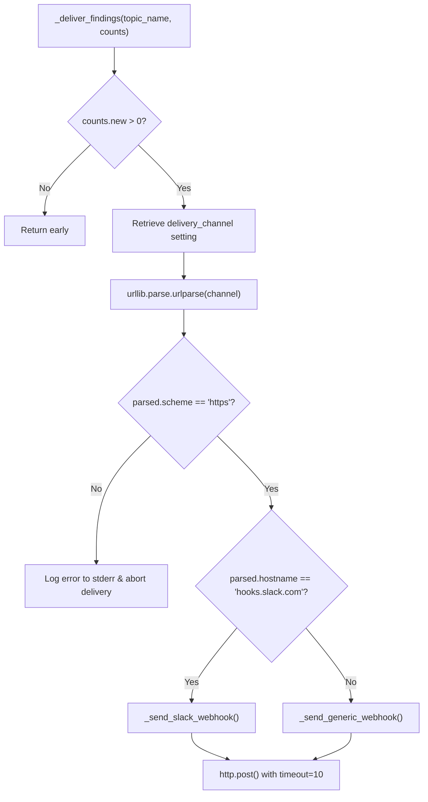

<!-- source: DeepWiki mcp.deepwiki.com · repo mvanhorn/last30days-skill · page 6.1 Watchlist Management · fetched 2026-10-27 -->

# Watchlist Management

Relevant source files

The following files were used as context for generating this wiki page:

- [skills/last30days/scripts/store.py](skills/last30days/scripts/store.py)
- [skills/last30days/scripts/watchlist.py](skills/last30days/scripts/watchlist.py)
- [tests/test_project_config_trust.py](tests/test_project_config_trust.py)
- [tests/test_security_boundaries.py](tests/test_security_boundaries.py)
- [tests/test_store.py](tests/test_store.py)
- [tests/test_tiktok.py](tests/test_tiktok.py)
- [tests/test_watchlist_commands.py](tests/test_watchlist_commands.py)
- [tests/test_watchlist_delivery.py](tests/test_watchlist_delivery.py)

## Purpose and Scope

This document covers the watchlist management system for adding, removing, and executing scheduled research topics in `/last30days`. It focuses on the command interface in `watchlist.py`, scheduling syntax, budget control mechanisms, webhook notification delivery, and the execution pipeline that transforms topic definitions into stored findings within the SQLite persistence layer. For information about the underlying database schema and table structure, see [6.2 Storage and Persistence](). For querying accumulated findings and generating briefings, see [6.3 History and Briefings]().

**Important context:** The watchlist system stores schedules as metadata only (`topics` table). An external scheduler (cron, launchd, or an always-on bot) must call `watchlist.py run-all` on a timer to trigger actual research runs. The system does not include an internal background scheduling daemon.

Sources: [skills/last30days/scripts/watchlist.py:1-20](), [skills/last30days/scripts/store.py:89-97]()

---

## Command Interface

The watchlist management CLI is provided by `skills/last30days/scripts/watchlist.py`, which exposes commands for topic lifecycle management, execution, deltas, and notification delivery.

### Command Routing Architecture

**Diagram: Watchlist Command Routing and Execution Flow**

Sources: [skills/last30days/scripts/watchlist.py:88-168]()

---

## Topic Lifecycle Management

Topics are managed via CLI commands that interact directly with the SQLite database via `store.py`.

### Adding Topics (`cmd_add`)
Topics can be added with custom cron schedules or predefined flags (`--weekly`) and custom search queries (`--queries`) [skills/last30days/scripts/watchlist.py:88-98]().

| CLI Syntax | Schedule Interpretation | Cron Expression |
|------------|-------------------------|-----------------|
| `watchlist.py add "topic"` | Daily at 8:00 AM (default) | `0 8 * * *` [skills/last30days/scripts/watchlist.py:89]() |
| `watchlist.py add "topic" --weekly` | Weekly on Mondays at 8:00 AM | `0 8 * * 1` [skills/last30days/scripts/watchlist.py:89]() |
| `watchlist.py add "topic" --schedule "0 12 * * *"` | Custom user-specified schedule | User-provided cron string [skills/last30days/scripts/watchlist.py:89]() |
| `watchlist.py add "topic" --queries "q1,q2"` | Custom query expansion override | Stored as JSON array [skills/last30days/scripts/watchlist.py:90]() |

Sources: [skills/last30days/scripts/watchlist.py:88-99](), [tests/test_watchlist_commands.py:41-104]()

### Removing Topics (`cmd_remove`)
Topics are removed by name using `store.remove_topic()` [skills/last30days/scripts/watchlist.py:101-113](). If the topic is not found, an action status of `"not_found"` is returned [skills/last30days/scripts/watchlist.py:104]().

Sources: [skills/last30days/scripts/watchlist.py:101-113]()

---

## Budget Control System

To prevent runaway API costs during unattended periodic runs, `run-all` evaluates daily spending limits before initiating research on each enabled topic [skills/last30days/scripts/watchlist.py:143-168]().

### Budget Enforcement Pipeline

**Diagram: Budget Guard Mechanism in run-all Execution**

Sources: [skills/last30days/scripts/watchlist.py:143-168](), [skills/last30days/scripts/store.py:170]()

---

## Research Execution Pipeline

When a topic is executed via `_run_topic()`, the engine runs an isolated subprocess executing `last30days.py` with unattended security flags [skills/last30days/scripts/watchlist.py:170-200]().

### Execution Steps
1. **Record Run Initiation**: A database run entry is created with `status="running"` using `store.record_run()` [skills/last30days/scripts/watchlist.py:173]().
2. **Subprocess Invocation**: `last30days.py` is executed with `--emit=json`, `--json-profile=raw`, `--quick`, `--lookback-days 90`, and crucially `--no-browser-cookies` [skills/last30days/scripts/watchlist.py:178-193]().
   * *Security Note*: Watchlist cron runs are unattended. Passing `--no-browser-cookies` prevents silent Chromium disk reads or macOS Keychain permission dialog prompts if a user configured interactive browser cookie scraping [skills/last30days/scripts/watchlist.py:188-192]().
3. **Data Ingestion**: Parsed findings from the JSON output are stored into the database [skills/last30days/scripts/store.py]() and topic deltas are computed.
4. **Webhook Delivery**: If new findings are discovered, `_deliver_findings()` is triggered [skills/last30days/scripts/watchlist.py:23-27]().

Sources: [skills/last30days/scripts/watchlist.py:170-220]()

---

## Webhook Notifications and Delivery

The watchlist supports automated delivery of new research findings via webhook integrations (Slack and generic JSON webhooks) [skills/last30days/scripts/watchlist.py:23-84]().

### Delivery Security and Routing

**Diagram: Webhook Notification Routing and Scheme Validation**

* **HTTPS Enforcement**: Channels must explicitly use the `https://` scheme. Cleartext `http://` URLs are rejected to prevent credential or finding leakage [skills/last30days/scripts/watchlist.py:36-42]().
* **Slack Exact Hostname Matching**: Slack webhooks are identified by exact hostname matching (`hooks.slack.com`) rather than substring searches, preventing malformed URL exploitation [skills/last30days/scripts/watchlist.py:35-46]().
* **Delivery Modes**: Supported modes include `announce` (formatted with emoji and counts), `silent` (concise summary without emoji), and default [skills/last30days/scripts/watchlist.py:29-65]().

Sources: [skills/last30days/scripts/watchlist.py:23-84](), [tests/test_watchlist_delivery.py:1-212]()

---

