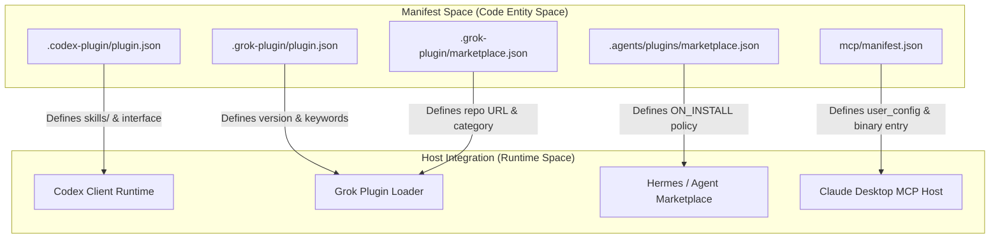
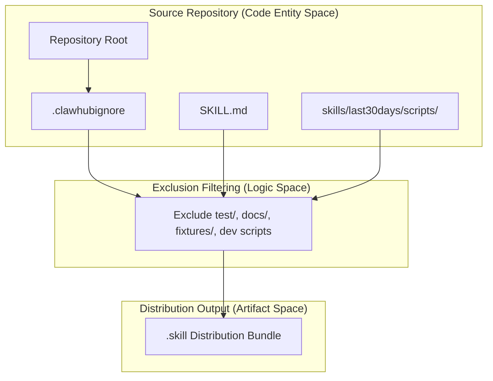
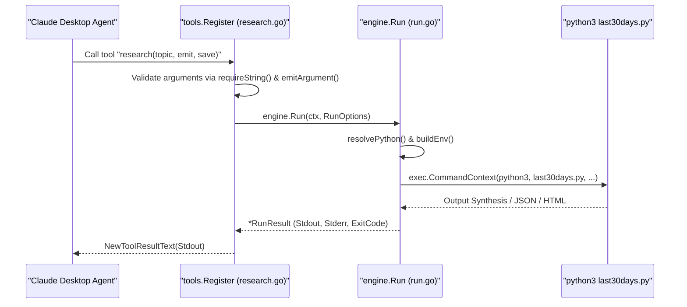

<!-- source: DeepWiki mcp.deepwiki.com · repo mvanhorn/last30days-skill · page 7.2 Packaging: Plugin Manifests and MCP Server · fetched 2026-10-27 -->

# Packaging: Plugin Manifests and MCP Server

Relevant source files

The following files were used as context for generating this wiki page:

- [.agents/plugins/marketplace.json](.agents/plugins/marketplace.json)
- [.clawhubignore](.clawhubignore)
- [.codex-plugin/plugin.json](.codex-plugin/plugin.json)
- [.grok-plugin/marketplace.json](.grok-plugin/marketplace.json)
- [.grok-plugin/plugin.json](.grok-plugin/plugin.json)
- [.skillignore](.skillignore)
- [mcp/.gitignore](mcp/.gitignore)
- [mcp/README.md](mcp/README.md)
- [mcp/cmd/last30days-pp-mcp/main.go](mcp/cmd/last30days-pp-mcp/main.go)
- [mcp/go.mod](mcp/go.mod)
- [mcp/go.sum](mcp/go.sum)
- [mcp/internal/engine/embed.go](mcp/internal/engine/embed.go)
- [mcp/internal/engine/extract.go](mcp/internal/engine/extract.go)
- [mcp/internal/engine/extract_test.go](mcp/internal/engine/extract_test.go)
- [mcp/internal/engine/run.go](mcp/internal/engine/run.go)
- [mcp/internal/engine/run_test.go](mcp/internal/engine/run_test.go)
- [mcp/internal/engine/vendored/.gitkeep](mcp/internal/engine/vendored/.gitkeep)
- [mcp/internal/manifest/manifest_test.go](mcp/internal/manifest/manifest_test.go)
- [mcp/internal/tools/preflight.go](mcp/internal/tools/preflight.go)
- [mcp/internal/tools/preflight_test.go](mcp/internal/tools/preflight_test.go)
- [mcp/internal/tools/research.go](mcp/internal/tools/research.go)
- [mcp/internal/tools/research_test.go](mcp/internal/tools/research_test.go)
- [mcp/manifest.json](mcp/manifest.json)
- [mcp/scripts/sync-engine.sh](mcp/scripts/sync-engine.sh)
- [skills/last30days/.skillignore](skills/last30days/.skillignore)
- [skills/last30days/scripts/lib/xquik.py](skills/last30days/scripts/lib/xquik.py)
- [tests/hermes/baseline_findings.md](tests/hermes/baseline_findings.md)
- [tests/test_chromium_browsers.py](tests/test_chromium_browsers.py)
- [tests/test_hermes_skillignore.py](tests/test_hermes_skillignore.py)
- [tests/test_xquik.py](tests/test_xquik.py)

## Purpose and Scope

This document details the packaging, plugin manifests, distribution artifacts, exclusion rules, and Model Context Protocol (MCP) server integration for the `/last30days` codebase. It covers how metadata is declared across multiple AI agent platforms (Claude Code, Codex, Grok, Gemini CLI, and agent marketplaces), how build scripts and ignore rules curate distribution bundles (`.skill` and `.clawhubignore`), and how the Go-based MCP server (`mcp/`) bundles and executes the Python research engine.

For installation instructions, see [7.1 Installation and Setup](). For environment configuration and API key management, see [2.3 Configuration and Authentication]().

---

## Plugin and Marketplace Manifests

The repository maintains specialized metadata manifests across multiple AI agent ecosystems to enable seamless discovery, installation, and tool invocation.

### Manifest Ecosystem Overview

| Ecosystem / Host | Manifest Path | Role & Metadata Content |
|------------------|---------------|-------------------------|
| **Codex** | `.codex-plugin/plugin.json` | Declares Codex skill metadata, supported version (`3.24.0`), interface properties, capabilities (`Interactive`, `Read`, `Write`), and default prompt templates [.codex-plugin/plugin.json:1-50](). |
| **Grok** | `.grok-plugin/plugin.json` | Specifies Grok plugin author, repository, keywords, and skill directory bindings [.grok-plugin/plugin.json:1-18](). |
| **Grok Marketplace** | `.grok-plugin/marketplace.json` | Registers the plugin for marketplace distribution with URL source links [.grok-plugin/marketplace.json:1-25](). |
| **Agents / Hermes** | `.agents/plugins/marketplace.json` | Defines installation policy (`AVAILABLE`) and authentication requirements (`ON_INSTALL`) [.agents/plugins/marketplace.json:1-20](). |
| **Claude Desktop (MCP)** | `mcp/manifest.json` | Defines the MCP binary entry point, compatibility rules, and user configuration prompts mapping API keys to environment variables [mcp/manifest.json:1-159](). |

### Manifest Structure and Data Mapping

**Sources:** [.codex-plugin/plugin.json:1-50](), [.grok-plugin/plugin.json:1-18](), [.grok-plugin/marketplace.json:1-25](), [.agents/plugins/marketplace.json:1-20](), [mcp/manifest.json:1-159]()

---

## Skill Artifacts and Packaging Rules

Distribution archives (`.skill` artifacts) bundle the core instruction sets and Python engines for deployment across remote agent registries. 

### Build and Exclusions Architecture

Packaging relies on exclusion filters to strip non-runtime development artifacts, local caches, logs, and evaluation suites from public bundles. The `.clawhubignore` file mirrors `.skillignore` rules to protect sensitive or bulky repository items [.clawhubignore:1-71]().

**Sources:** [.clawhubignore:1-71](), [skills/last30days/.skillignore]()

---

## Go MCP Server and `.mcpb` Bundle

The `mcp/` directory houses a Go-based Model Context Protocol server built on `github.com/mark3labs/mcp-go` [mcp/go.mod:1-14](). It acts as a lightweight binary wrapper that provisions, configures, and invokes the Python research engine.

### Engine Execution Pipeline

The MCP server delegates research requests to the embedded Python engine via `engine.Run` [mcp/internal/engine/run.go:68-114](). 

**Sources:** [mcp/internal/tools/research.go:25-87](), [mcp/internal/engine/run.go:68-114]()

### Key Implementation Components

- **Tool Registration & Validation**: `tools.Register` registers the `research` tool with input schema validation (`topic`, `emit`, `save`) [mcp/internal/tools/research.go:25-44](). Validation errors are surfaced cleanly as MCP tool errors rather than transport faults [mcp/internal/tools/research_test.go:130-160]().
- **Environment Isolation**: `buildEnv` constructs the child process environment, dropping any stale parent `PYTHONPATH` entries and injecting the dedicated user cache path so that `from lib import ...` imports resolve correctly [mcp/internal/engine/run.go:157-170]().
- **Timeout & Error Handling**: Subprocess execution is bound by `DefaultTimeout` (5 minutes) or overridden via `LAST30DAYS_MCP_TIMEOUT` [mcp/internal/engine/run.go:35-48](). Exit codes and `stderr` streams are captured to assist diagnostics [mcp/internal/engine/run.go:50-58]().

**Sources:** [mcp/internal/tools/research.go:1-158](), [mcp/internal/tools/research_test.go:1-175](), [mcp/internal/engine/run.go:1-170]()

---

