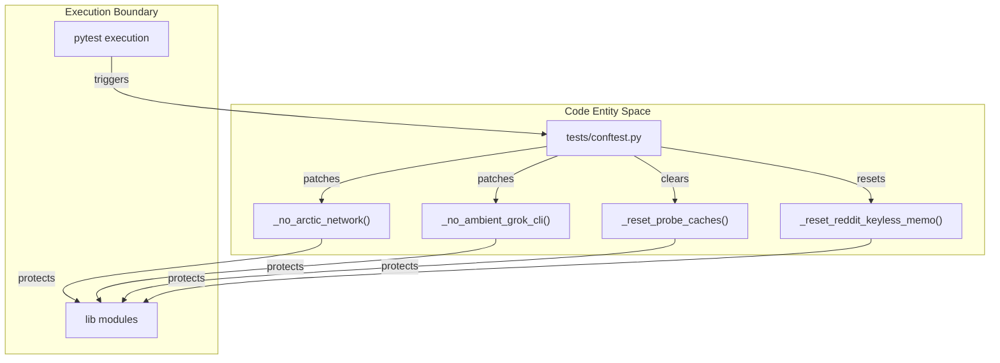
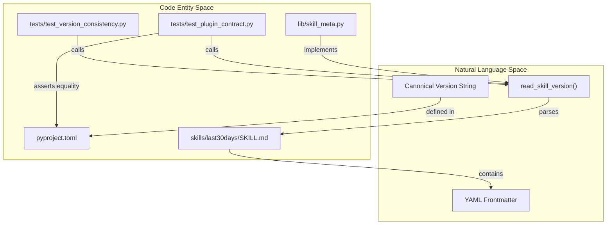
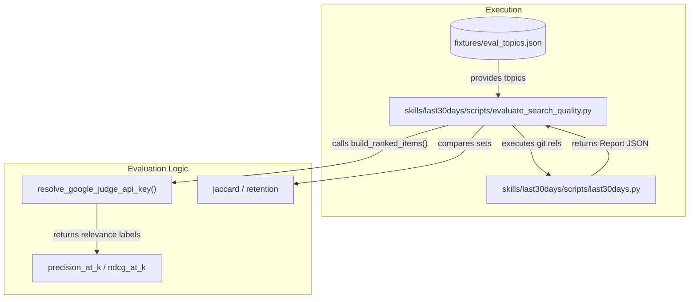

<!-- source: DeepWiki mcp.deepwiki.com · repo mvanhorn/last30days-skill · page 7.3 Testing and Quality Evaluation · fetched 2026-10-27 -->

# Testing and Quality Evaluation

Relevant source files

The following files were used as context for generating this wiki page:

- [changelog.d/+verify-v3-test-runner.fixed.md](changelog.d/+verify-v3-test-runner.fixed.md)
- [docs/search-quality-eval.md](docs/search-quality-eval.md)
- [pyproject.toml](pyproject.toml)
- [skills/last30days/scripts/evaluate_search_quality.py](skills/last30days/scripts/evaluate_search_quality.py)
- [skills/last30days/scripts/test-v1-vs-v2.sh](skills/last30days/scripts/test-v1-vs-v2.sh)
- [skills/last30days/scripts/verify_v3.py](skills/last30days/scripts/verify_v3.py)
- [tests/conftest.py](tests/conftest.py)
- [tests/test_briefing_v3.py](tests/test_briefing_v3.py)
- [tests/test_evaluator_v3.py](tests/test_evaluator_v3.py)
- [tests/test_instagram_sc.py](tests/test_instagram_sc.py)
- [tests/test_reddit_enrich.py](tests/test_reddit_enrich.py)
- [tests/test_reddit_sc.py](tests/test_reddit_sc.py)
- [tests/test_schema_v3.py](tests/test_schema_v3.py)
- [tests/test_skill_version.py](tests/test_skill_version.py)
- [tests/test_verify_v3.py](tests/test_verify_v3.py)
- [tests/test_youtube_relevance.py](tests/test_youtube_relevance.py)
- [uv.lock](uv.lock)

The `/last30days` skill utilizes a rigorous multi-layered testing, coverage, and quality evaluation architecture. This framework combines standard `pytest` execution with specialized conftest isolation fixtures, a coverage enforcement gate, metadata contract tests, an LLM-judged search quality evaluation harness (`evaluate_search_quality.py`), and an end-to-end verification bundle (`verify_v3.py`).

## Test Suite Layout and Conftest Fixtures

The test suite is structured under the `tests/` directory and executed via `pytest` according to the settings defined in `pyproject.toml` [pyproject.toml:56-62](). To ensure tests run entirely offline and avoid cross-test state pollution or ambient environment leakage, `tests/conftest.py` defines several critical `autouse` fixtures [tests/conftest.py:1-57]():

*   `_no_arctic_network`: Intercepts `lib.reddit_arctic.fetch_scores` to prevent real network requests, returning empty dicts unless explicitly overridden [tests/conftest.py:10-16]() (e.g., in `test_reddit_arctic`).
*   `_no_ambient_grok_cli`: Stubs `lib.grok_x.binary_path` to return `None`, preventing local developer CLI installations from altering X-chain resolution across tests [tests/conftest.py:19-32]().
*   `_reset_probe_caches`: Clears module-level memoization dicts in `lib.health`, `lib.xurl_x`, and `lib.grok_x` before and after each test [tests/conftest.py:35-49]().
*   `_reset_reddit_keyless_memo`: Resets the keyless Reddit fetch cache via `_http.reset_reddit_keyless_memo()` [tests/conftest.py:50-57]().

**Fixture Isolation Flow**

**Sources:** [tests/conftest.py:1-57](), [pyproject.toml:56-62]()

## Coverage Gate

Code coverage is measured using `pytest-cov` over the script and test directories (`skills/last30days/scripts` and `tests`), while omitting vendor code and distribution bundles [pyproject.toml:64-70](). 

The project enforces a strict coverage floor via `fail_under = 84` in `pyproject.toml` [pyproject.toml:79-79](). This gate is pinned to the baseline measured on `main` and is designed to rise over time rather than act as a ceiling [pyproject.toml:75-78]().

**Sources:** [pyproject.toml:64-83]()

## Contract and Consistency Tests

The suite includes specific validation tests that verify consistency across plugin metadata, security files, and version specifications.

| Component | Test File | Description |
| :--- | :--- | :--- |
| **Plugin Contract** | `tests/test_plugin_contract.py` | Validates version alignment across configuration and skill descriptors [tests/test_plugin_contract.py:30-42](). |
| **Version Consistency** | `tests/test_version_consistency.py` | Asserts that `SKILL.md` uses double-quoted version strings and checks for hardcoded paths [tests/test_version_consistency.py:18-75](). |
| **Evaluator Logic** | `tests/test_evaluator_v3.py` | Validates evaluation metric helpers (NDCG, Jaccard) and multi-source provenance aggregation [tests/test_evaluator_v3.py:11-96](). |
| **Security Workflow** | `tests/test_security_workflow.py` | Verifies dependency audit configurations and secret scanning definitions [tests/test_security_workflow.py:19-36](). |

**Metadata and Version Consistency**

**Sources:** [tests/test_plugin_contract.py:6-42](), [tests/test_version_consistency.py:11-75](), [lib/skill_meta.py:1-20]()

## Search Quality Evaluation Harness

The `skills/last30days/scripts/evaluate_search_quality.py` script serves as a local evaluation harness for retrieval quality [skills/last30days/scripts/evaluate_search_quality.py:1-4](). It compares a baseline git revision (defaulting to `origin/main`) against a candidate checkout using topics defined in `fixtures/eval_topics.json` or fallback lists [skills/last30days/scripts/evaluate_search_quality.py:28-43](), [docs/search-quality-eval.md:7-8]().

### Metrics and Data Flow
The harness calculates two categories of metrics:
1.  **Stability Metrics (Regression Guards):**
    *   `jaccard`: Measures set overlap between baseline and candidate ranked outputs [skills/last30days/scripts/evaluate_search_quality.py:136-142]().
    *   `retention`: Calculates baseline item retention in the candidate results [skills/last30days/scripts/evaluate_search_quality.py:145-148]().
2.  **Judged Quality Metrics (via Gemini API):**
    *   `precision_at_k`: Evaluates the proportion of relevant items (grade >= 2) in the top $k$ results [skills/last30days/scripts/evaluate_search_quality.py:151-155]().
    *   `ndcg_at_k`: Computes Normalized Discounted Cumulative Gain over the top results [skills/last30days/scripts/evaluate_search_quality.py:158-175]().
    *   `source_coverage_recall`: Assesses source coverage against the judged union pool [skills/last30days/scripts/evaluate_search_quality.py:177-192]().

**Evaluation Pipeline**

**Sources:** [skills/last30days/scripts/evaluate_search_quality.py:28-192](), [docs/search-quality-eval.md:7-16]()

## Verification Bundle (`verify_v3.py`)

The `skills/last30days/scripts/verify_v3.py` script executes the complete v3 verification bundle [skills/last30days/scripts/verify_v3.py:1-2](). It orchestrates multiple validation stages:
*   `verify_unit()`: Runs `pytest tests` and bytecode compilation across all non-vendor python files [skills/last30days/scripts/verify_v3.py:54-80]().
*   `verify_diagnose()`: Executes `last30days.py --diagnose` and validates health state [skills/last30days/scripts/verify_v3.py:83-86]().
*   `verify_smoke()`: Tests reasoning provider backends (`gemini`, `openai`, `xai`, `auto`) using raw JSON profile emissions [skills/last30days/scripts/verify_v3.py:88-111]().
*   `verify_latency()`: Samples command execution latency across search profiles [skills/last30days/scripts/verify_v3.py:114-130]().
*   `verify_eval()`: Shells out to `evaluate_search_quality.py` to check retrieval regression metrics [skills/last30days/scripts/verify_v3.py:133-158]().

**Sources:** [skills/last30days/scripts/verify_v3.py:1-195](), [tests/test_verify_v3.py:1-53]()

---

