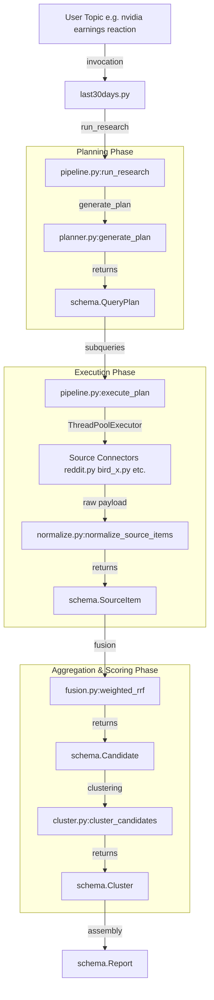
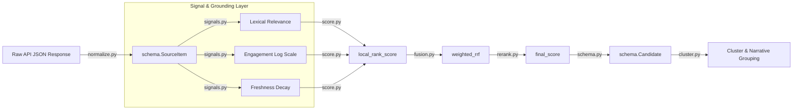

<!-- source: DeepWiki mcp.deepwiki.com · repo mvanhorn/last30days-skill · page 8 Glossary · fetched 2026-10-27 -->

# Glossary

Relevant source files

The following files were used as context for generating this wiki page:

- [.claude-plugin/marketplace.json](.claude-plugin/marketplace.json)
- [.claude-plugin/plugin.json](.claude-plugin/plugin.json)
- [CHANGELOG.md](CHANGELOG.md)
- [CONCEPTS.md](CONCEPTS.md)
- [CONFIGURATION.md](CONFIGURATION.md)
- [README.md](README.md)
- [changelog.d/+doctor-transient-probe.fixed.md](changelog.d/+doctor-transient-probe.fixed.md)
- [changelog.d/1081.fixed.md](changelog.d/1081.fixed.md)
- [docs/solutions/architecture-patterns/discovery-checkpoint-protocol-design-conventions.md](docs/solutions/architecture-patterns/discovery-checkpoint-protocol-design-conventions.md)
- [docs/solutions/architecture-patterns/discovery-topic-queue-design-conventions.md](docs/solutions/architecture-patterns/discovery-topic-queue-design-conventions.md)
- [docs/solutions/conventions/argparse-optional-value-flag-dispatch-truthiness.md](docs/solutions/conventions/argparse-optional-value-flag-dispatch-truthiness.md)
- [docs/solutions/design-patterns/ranked-output-confidence-floor-honest-empty-state.md](docs/solutions/design-patterns/ranked-output-confidence-floor-honest-empty-state.md)
- [docs/solutions/logic-errors/fusion-source-item-dedupe-by-stream-local-id-drops-enrichment.md](docs/solutions/logic-errors/fusion-source-item-dedupe-by-stream-local-id-drops-enrichment.md)
- [docs/solutions/logic-errors/non-daemon-executor-threads-defeat-wall-clock-budget.md](docs/solutions/logic-errors/non-daemon-executor-threads-defeat-wall-clock-budget.md)
- [gemini-extension.json](gemini-extension.json)
- [skills/last30days/SKILL.md](skills/last30days/SKILL.md)
- [skills/last30days/scripts/lib/doctor.py](skills/last30days/scripts/lib/doctor.py)
- [skills/last30days/scripts/lib/env.py](skills/last30days/scripts/lib/env.py)
- [skills/last30days/scripts/lib/permission_preflight.py](skills/last30days/scripts/lib/permission_preflight.py)
- [tests/test_doctor.py](tests/test_doctor.py)
- [tests/test_env_unsubstituted_template.py](tests/test_env_unsubstituted_template.py)
- [tests/test_permission_preflight.py](tests/test_permission_preflight.py)
- [tests/test_source_outcomes.py](tests/test_source_outcomes.py)

This glossary provides definitions for codebase-specific terms, architectural patterns, jargon, abbreviations, and domain concepts used within the `/last30days` skill. It serves as a technical reference for contributors and agent harnesses to understand how natural language intents are mapped to code entities, data structures, and pipeline execution flows.

## Core System & Pipeline Concepts

### The Research Pipeline
The end-to-end execution flow that transforms a natural language topic into a structured, scored research report. It encompasses intent planning, parallel source retrieval, normalization, local scoring, Reciprocal Rank Fusion (RRF), semantic reranking, and narrative clustering.
* **Code Pointers**: Orchestrated by `pipeline.py` [skills/last30days/scripts/lib/pipeline.py:1-53]() and initiated via `last30days.py` [skills/last30days/scripts/last30days.py:1-40]().

### Query Plan
A structured execution object generated by an LLM planner (Gemini, OpenAI, or xAI) that decomposes a user topic into target subqueries across different platforms, specifying source weights and freshness modes.
* **Data Structure**: `schema.QueryPlan` and `schema.SubQuery` [skills/last30days/scripts/lib/schema.py:42-69]().

### Evidence Cluster
A group of related `Candidate` items identified as discussing the same event, product, or narrative thread. Clustering prevents reports from being dominated by repetitive posts from a single platform.
* **Data Structure**: `schema.Cluster` [skills/last30days/scripts/lib/schema.py:126-140]().

---

## Data Model & Schema Hierarchy

The engine utilizes a strict hierarchy of data structures to normalize heterogeneous data sources (e.g., Reddit upvotes, X likes, Polymarket prediction odds, GitHub PR velocity) into unified records.

| Term | Definition | Code Pointer |
| :--- | :--- | :--- |
| **SourceItem** | The rawest normalized representation of an item from an individual API or scraper, containing universal fields like `engagement` and `date_confidence`. | `schema.SourceItem` [skills/last30days/scripts/lib/schema.py:72-95]() |
| **Candidate** | A cross-source entity after items are merged and scored by normalized URL. It aggregates ranking metrics and copies from multiple source streams. | `schema.Candidate` [skills/last30days/scripts/lib/schema.py:98-123]() |
| **RetrievalBundle** | A container used during the concurrent fan-out phase to aggregate retrieved items, execution status, and source outcome errors. | `schema.RetrievalBundle` [skills/last30days/scripts/lib/schema.py:161-175]() |
| **Report** | The final serialized output object containing query plans, clusters, ranked candidates, source coverage stats, and runtime metadata. | `schema.Report` [skills/last30days/scripts/lib/schema.py:143-158]() |

### Natural Language to Code Entity Mapping

The following diagram illustrates how user input transitions from natural language intent into internal code data structures during orchestration.

**Mapping: Natural Language to Code Entities**

*Sources: [skills/last30days/scripts/lib/pipeline.py:1-53](), [skills/last30days/scripts/lib/schema.py:42-158](), [skills/last30days/scripts/lib/planner.py:1-50]()*

---

## Architecture & Transport Jargon

### x_backend_chain
The sequential fallback chain utilized by X (Twitter) search when encountering rate limits, missing authentication, or interstitial blocks. The standard order evaluates `bird_x`, `xai_x`, `xurl_x`, `xquik`, and the official `xapi` connector [CHANGELOG.md:16-20].
* **Implementation**: Managed in `lib/backends.py` and platform modules.

### MCPB (Model Context Protocol Bundle)
A packaging format produced by the Go MCP server located in `mcp/` that bundles the Python research engine into a deployable agent artifact for AI harnesses.
* **Code Pointers**: Packaging and manifest logic under `mcp/` and root plugin manifests.

### Printing Press CLI
A family of lightweight command-line feed and paper scrapers (`arxiv-pp-cli`, `techmeme-pp-cli`, `digg-pp-cli`) that supply structured pre-filtered RSS/JSON feeds directly to the engine without requiring browser sessions or heavy API keys.
* **Usage**: Automatically integrated when binaries are present on the system `PATH` [README.md:79-81].

### Registers
User-selectable output formatting lenses (`exec`, `dev`, `creator`, `eli5`) that shape a standard Markdown or HTML research brief for specific target audiences. 
* **Details**: `exec` prioritizes decisions and financial figures; `dev` emphasizes GitHub activity and technical depth; `creator` highlights virality metrics and community hooks; `eli5` formats explanations for general audiences.
* **Configuration**: Passed via `--register` [CONFIGURATION.md:51-51].

---

## Quality, Synthesis, and Gating Concepts

### LAWs (The Output LAWs)
The mandatory set of behavioral and formatting constraints defined in `SKILL.md` that dictate how the hosting AI agent must synthesize engine output. They prevent hallucinated titles, enforce strict source attribution, and dictate the mandatory presence of the version badge.
* **Code Pointer**: `skills/last30days/SKILL.md` [skills/last30days/SKILL.md:1-123]().

### Pass-Through Footer
The convention where the synthesizing AI agent is required to emit the emoji-tree stats and coverage summary directly as output from the Python engine without modification or truncation.
* **Implementation**: Formatted in `lib/render.py` and enforced via `SKILL.md` synthesis rules.

### Confidence Floor
A gating mechanism in discovery and research pipelines that ensures topics or findings must clear a minimum threshold of cross-source confirmation or strong single-source engagement spikes. If nothing clears the floor, the engine reports an honest empty state ("Nothing solid this window") rather than generating noise [CONFIGURATION.md:52-52].

### Drill Mode (`--drill`)
A focused exploration mode that takes an existing entity or sub-topic from prior research and executes a deep, multi-source dive into its specific sub-discussions or controversies. Mutually exclusive with discovery modes [CONFIGURATION.md:52-52].

### Source Outcomes
Standardized status classifications assigned to each data connector after a retrieval attempt: `ok`, `no-results`, `rate-limited`, `auth-failed`, `payment-required`, `unreachable`, `schema-drift`, `timeout`, and `skipped-unconfigured`.
* **Data Pointers**: Tested and defined across `schema.py` and `tests/test_source_outcomes.py` [tests/test_source_outcomes.py:56-67]().

### Evidence Envelope
Structured intermediate data containers (such as `last30days-x-posts/1`) passed between host agents and the engine via files or CLI arguments (e.g., `--x-posts <path>`) to supply pre-fetched posts or judgments [CHANGELOG.md:16-20].

---

## Data Processing & Scoring Data Flow

The following diagram illustrates how raw normalized items flow through relevance pruning, signal annotation, Reciprocal Rank Fusion, and narrative clustering to produce ranked candidates.

**Data Flow: Raw Items to Ranked Candidates**

*Sources: [skills/last30days/scripts/lib/normalize.py:1-30](), [skills/last30days/scripts/lib/schema.py:89-94](), [skills/last30days/scripts/lib/fusion.py:1-52](), [skills/last30days/scripts/lib/cluster.py:1-40]()*

---
*Sources: [README.md:1-100](), [skills/last30days/SKILL.md:1-123](), [skills/last30days/scripts/lib/pipeline.py:1-163](), [skills/last30days/scripts/lib/schema.py:1-175](), [skills/last30days/scripts/lib/env.py:1-163](), [CONFIGURATION.md:1-85](), [CHANGELOG.md:1-57](), [tests/test_source_outcomes.py:1-70]()*