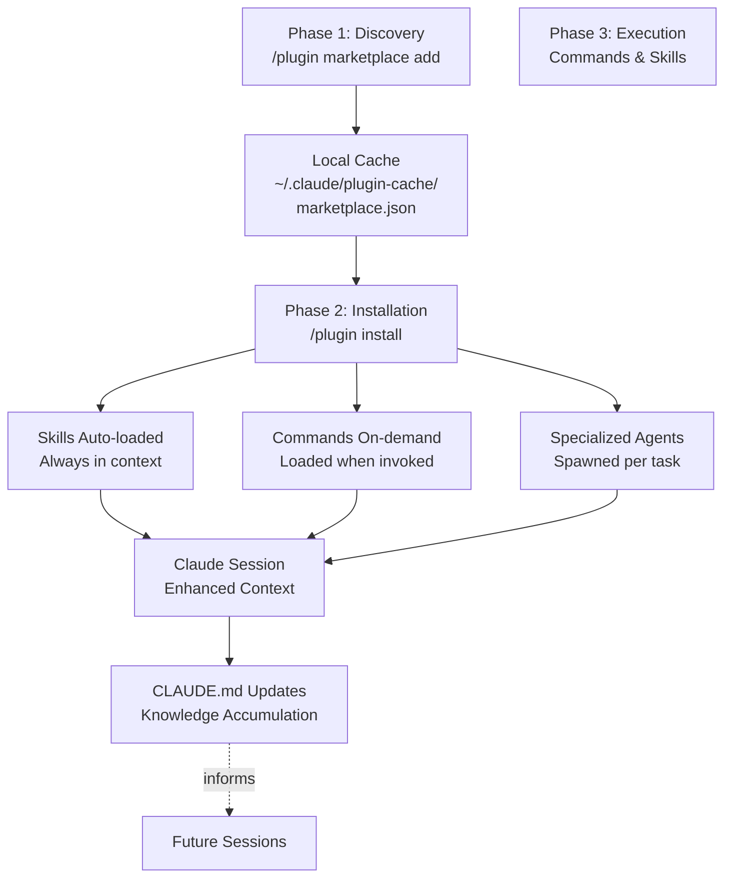
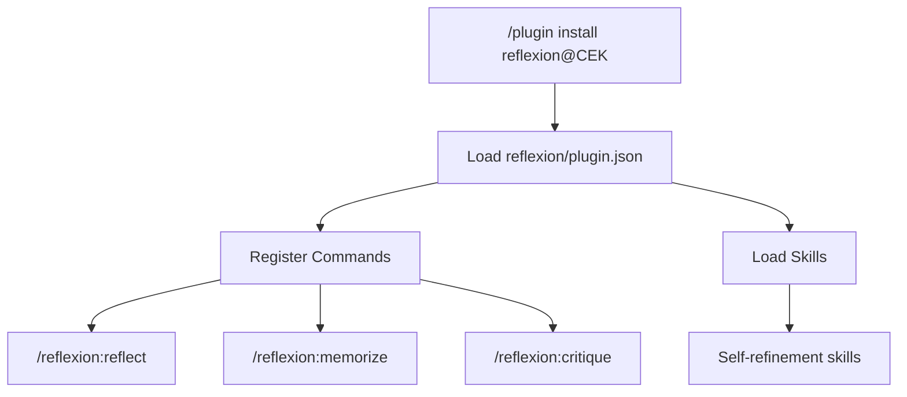
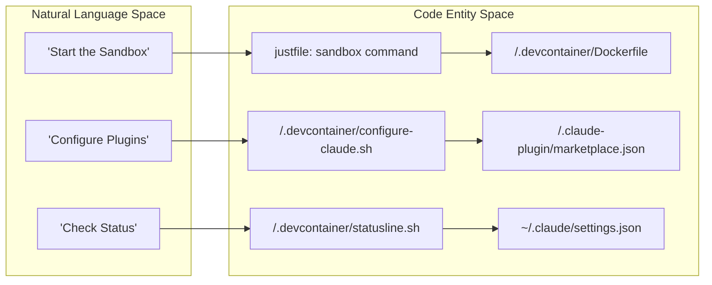

<!-- source: DeepWiki mcp.deepwiki.com · repo neolabhq/context-engineering-kit · page 1.1 Getting Started · fetched 2026-10-27 -->

# Getting Started

<details>
<summary>Relevant source files</summary>

The following files were used as context for generating this wiki page:

- [.bin/install-commands.sh](.bin/install-commands.sh)
- [.devcontainer/Dockerfile](.devcontainer/Dockerfile)
- [.devcontainer/configure-claude.sh](.devcontainer/configure-claude.sh)
- [.devcontainer/devcontainer.json](.devcontainer/devcontainer.json)
- [.devcontainer/install-mcps.sh](.devcontainer/install-mcps.sh)
- [.devcontainer/statusline.sh](.devcontainer/statusline.sh)
- [CLAUDE.md](CLAUDE.md)
- [README.md](README.md)
- [docs/plugins/fpf/architecture.md](docs/plugins/fpf/architecture.md)
- [docs/plugins/fpf/evidence-freshness.md](docs/plugins/fpf/evidence-freshness.md)
- [justfile](justfile)

</details>


This page guides you through installing and configuring the Context Engineering Kit for Claude Code. You will learn how to add the marketplace, install your first plugin, and use the provided devcontainer sandbox environment for a pre-configured experience.

The Context Engineering Kit is a hand-crafted collection of advanced context engineering techniques focused on improving agent result quality and predictability with a minimal token footprint [README.md:17-21]().

## Prerequisites

Before beginning, you must have:

- **Claude Code CLI** - The official command-line interface from Anthropic [README.md:44-46]().
- **Git repository** - A project where you want to use context engineering techniques [README.md:49]().
- **Optional: Docker & Dev Containers extension** - If you wish to use the automated sandbox environment [justfile:82-87]().

Sources: [README.md:44-50](), [justfile:82-87]()

## Installation Workflow

The Context Engineering Kit follows a three-phase installation model that minimizes context pollution while maximizing flexibility.

### Installation Phases



Sources: [README.md:42-61](), [CLAUDE.md:46-51]()

## Step 1: Add the Marketplace

Launch Claude Code and add the Context Engineering Kit marketplace:

```bash
/plugin marketplace add NeoLabHQ/context-engineering-kit
```

**What happens internally:**
This registers the marketplace metadata but does **not** load any agents or skills into your context yet [README.md:52]().

| Action | Location | Result |
|--------|----------|--------|
| Downloads metadata | `~/.claude/plugin-cache/` | Caches `marketplace.json` [CLAUDE.md:12-12]() |
| Registers plugins | Claude Code internal registry | Makes plugins like `sdd`, `reflexion`, and `git` discoverable [CLAUDE.md:31-31]() |
| Context impact | None | Zero tokens added to context |

Sources: [README.md:48-52](), [CLAUDE.md:11-12]()

## Step 2: Install Your First Plugin

We recommend starting with the `reflexion` plugin to enable self-refinement capabilities.

```bash
/plugin install reflexion@NeoLabHQ/context-engineering-kit
```

**What gets installed:**



**Internal Structure:**
Each plugin is isolated in the `plugins/` directory, containing its own `plugin.json` manifest, `commands/` (invoked via `/`), and `skills/` (automatically loaded) [CLAUDE.md:13-19]().

Sources: [README.md:54-60](), [CLAUDE.md:13-19]()

## Step 3: Use the Plugin

Once installed, you can use commands to refine Claude's output.

1. Ask Claude to perform a task: `implement user authentication` [README.md:86-86]().
2. Invoke reflection: `/reflexion:reflect` [README.md:89-89]().
3. Save insights to project memory: `/reflexion:memorize` [README.md:97-97]().

### Natural Language Hooks
If you have `bun` installed, you can use the `reflect` keyword in your initial prompt to trigger the command automatically:
`claude "implement user authentication, then reflect"` [README.md:102-103]().

Sources: [README.md:83-106]()

## Using the Devcontainer Sandbox

For a fully pre-configured environment, the repository includes a `devcontainer` setup. This environment automatically installs Claude Code, essential tools like `jq` and `gh`, and pre-loads core plugins [/.devcontainer/Dockerfile:4-89]().

### Sandbox Setup

1. **Start the sandbox**: Run `just sandbox` from your terminal [justfile:82-96](). This builds the image and attaches an interactive shell.
2. **Automated Configuration**: The `.devcontainer/configure-claude.sh` script runs automatically to:
   - Set `bypassPermissions` in `~/.claude/settings.json` [/.devcontainer/configure-claude.sh:18-18]().
   - Install the `typescript-lsp` official plugin [/.devcontainer/configure-claude.sh:78-78]().
   - Install `sdd`, `sadd`, and `git` plugins from the Context Engineering Kit [/.devcontainer/configure-claude.sh:83-85]().
   - Configure a custom status line using `statusline.sh` [/.devcontainer/configure-claude.sh:32-35]().

### Sandbox Management Commands

| Command | Action |
|---------|--------|
| `just sandbox` | Starts and attaches to the devcontainer [justfile:82-96]() |
| `just attach-sandbox` | Attaches to an already running container [justfile:99-118]() |
| `just stop-sandbox` | Stops and removes the container [justfile:121-131]() |

Sources: [justfile:82-131](), [/.devcontainer/configure-claude.sh:1-89]()

## Code Entity Mapping

The following diagram maps the logical setup steps to the specific script entities and configuration files involved in the "Getting Started" process.



Sources: [justfile:82-96](), [/.devcontainer/configure-claude.sh:1-44](), [/.devcontainer/statusline.sh:1-35]()

## Understanding Configuration Levels

The kit utilizes a three-tier configuration system via `CLAUDE.md` to manage project context effectively [CLAUDE.md:50-50]().

| Level | File | Purpose |
|-------|------|---------|
| **Project-Shared** | `CLAUDE.md` | Team-wide standards, tech stack rules, and project structure [CLAUDE.md:1-27](). |
| **Project-Personal** | `CLAUDE.local.md` | User-specific overrides or private notes. |
| **User-Global** | `~/.claude/settings.json` | Global CLI behavior, hooks, and permissions [/.devcontainer/configure-claude.sh:15-42](). |

Sources: [CLAUDE.md:1-50](), [/.devcontainer/configure-claude.sh:15-42]()

---

