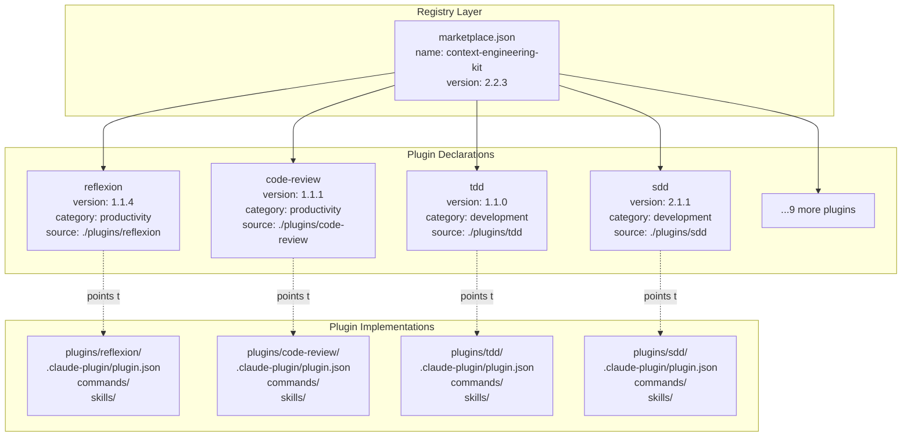
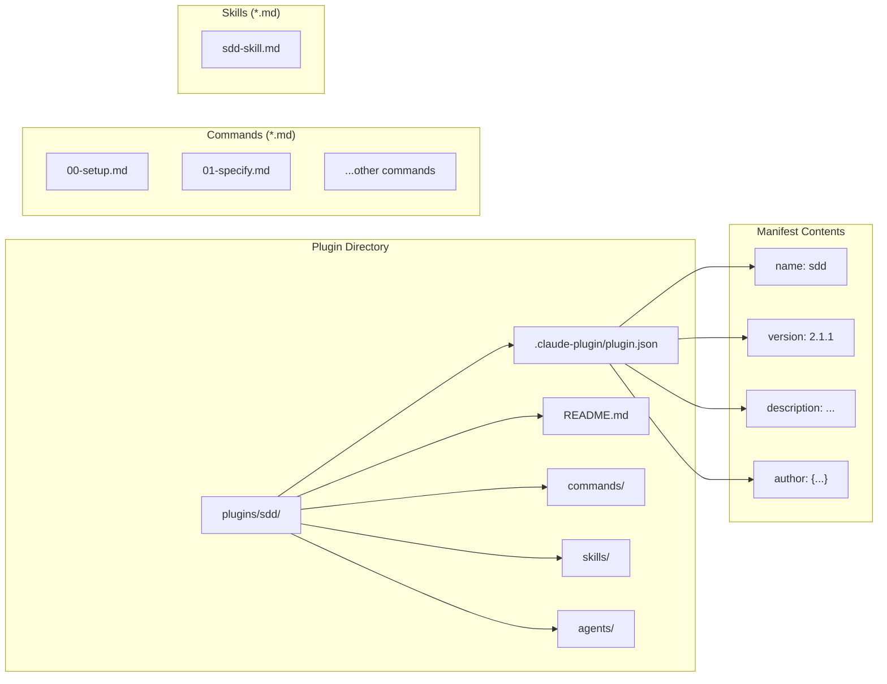
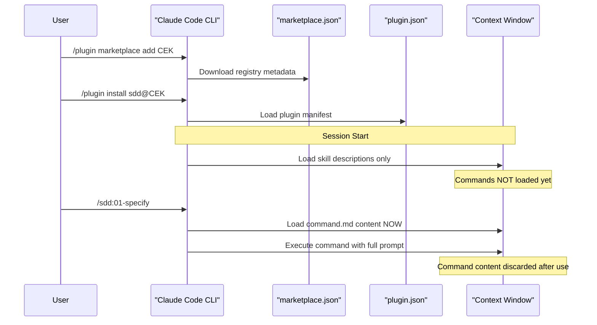
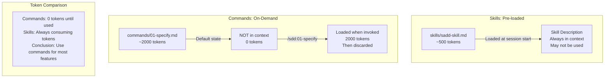
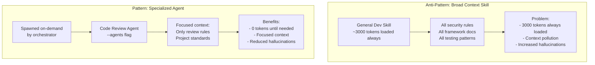
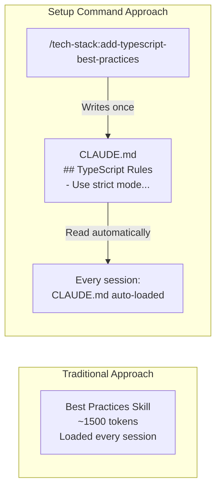
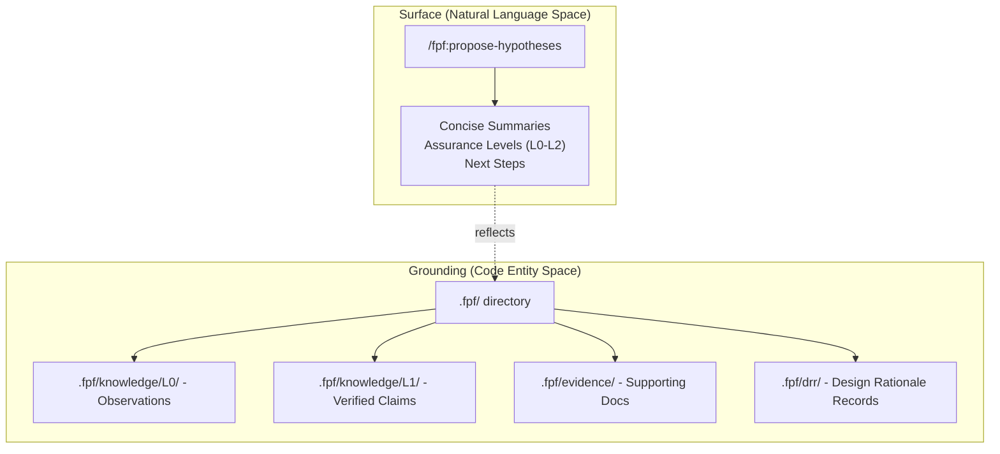

<!-- source: DeepWiki mcp.deepwiki.com · repo neolabhq/context-engineering-kit · page 1.2 Architecture & Design Principles · fetched 2026-10-27 -->

# Architecture & Design Principles

Relevant source files

The following files were used as context for generating this wiki page:

- [.claude-plugin/marketplace.json](.claude-plugin/marketplace.json)
- [.claude/commands/bump-plugin.md](.claude/commands/bump-plugin.md)
- [CLAUDE.md](CLAUDE.md)
- [docs/plugins/fpf/architecture.md](docs/plugins/fpf/architecture.md)
- [docs/plugins/fpf/evidence-freshness.md](docs/plugins/fpf/evidence-freshness.md)
- [justfile](justfile)
- [plugins/customaize-agent/.claude-plugin/plugin.json](plugins/customaize-agent/.claude-plugin/plugin.json)
- [plugins/sadd/.claude-plugin/plugin.json](plugins/sadd/.claude-plugin/plugin.json)
- [plugins/sdd/.claude-plugin/plugin.json](plugins/sdd/.claude-plugin/plugin.json)

This document explains the architectural design of the Context Engineering Kit and the core principles that guide plugin development. It covers the plugin system structure, token efficiency strategies, and the context management hierarchy.

## Core Architecture

### Plugin Registry System

The Context Engineering Kit uses a marketplace-based architecture where all plugins are registered in a central manifest file at [.claude-plugin/marketplace.json:1-155](). This file serves as the single source of truth for plugin discovery and metadata.

**Marketplace Structure**

The marketplace manifest defines:
- **Registry metadata**: Name, version, description, owner ([.claude-plugin/marketplace.json:2-9]())
- **Plugin entries**: Each plugin declaration includes name, description, version, author, source path, and category ([.claude-plugin/marketplace.json:11-153]())
- **Two categories**: `productivity` (reflexion, code-review, git, kaizen, docs) and `development` (tdd, sadd, ddd, sdd, customaize-agent, tech-stack, mcp, fpf) ([.claude-plugin/marketplace.json:20,31,42,53,64,75,86,97,108,119,130,141,152]())

**Sources**: [.claude-plugin/marketplace.json:1-155]()

### Plugin Structure

Each plugin follows a standardized directory structure that separates metadata, commands, and skills as defined in the project structure ([CLAUDE.md:10-27]()):

**Required Files**:
- `.claude-plugin/plugin.json`: Plugin manifest with metadata ([plugins/sdd/.claude-plugin/plugin.json:1-9]())
- `README.md`: Usage documentation and examples ([CLAUDE.md:17]())

**Optional Directories**:
- `commands/`: Markdown files defining slash commands that load on-demand ([CLAUDE.md:18]())
- `skills/`: Markdown files defining skills whose descriptions load automatically ([CLAUDE.md:19]())
- `agents/`: Markdown files defining specialized agent personas ([CLAUDE.md:89]())

**Sources**: [CLAUDE.md:10-27](), [plugins/sdd/.claude-plugin/plugin.json:1-9](), [CLAUDE.md:89]()

### Loading Mechanism

The system uses a selective loading strategy to minimize token usage, distinguishing between immediate skill availability and on-demand command execution ([CLAUDE.md:48]()).

**Loading Strategy**:
1. **Plugin Installation**: Downloads plugin metadata from marketplace ([.claude-plugin/marketplace.json:1-155]())
2. **Session Start**: Loads only skill descriptions into context to save tokens ([CLAUDE.md:48]())
3. **Command Invocation**: Loads full command content on-demand ([CLAUDE.md:48]())
4. **Command Completion**: Command content is not persisted in the long-term context window.

**Sources**: [CLAUDE.md:48](), [.claude-plugin/marketplace.json:1-155]()

## Token Efficiency Principles

The architecture prioritizes a minimal token footprint through four core design patterns ([CLAUDE.md:46-51]()).

### Commands Over Skills

Commands load on-demand while skill descriptions load automatically, making commands the preferred choice for most functionality to preserve the context window ([CLAUDE.md:48]()).

**Decision Matrix**:

| Use Case | Pattern | Rationale |
|----------|---------|-----------|
| User-invoked actions | Commands | Zero tokens until needed ([CLAUDE.md:48]()) |
| Agent-initiated workflows | Skills | Agent needs to know capability exists ([CLAUDE.md:48]()) |
| Configuration setup | Setup-commands | Persistent context in CLAUDE.md ([CLAUDE.md:50]()) |
| Complex reasoning | Specialized agents | Isolated context reduces hallucinations ([CLAUDE.md:49]()) |

**Sources**: [CLAUDE.md:46-51]()

### Specialized Agents Pattern

Instead of loading broad context as skills, the system uses specialized agents with focused context to reduce hallucinations ([CLAUDE.md:49]()).

**Agent Architecture**:
- **Location**: Agents are defined in `.claude/agents/` or `plugins/<plugin>/agents/` ([CLAUDE.md:89]()).
- **Isolation**: Agents use focused context to ensure high-quality output without polluting the main session ([CLAUDE.md:49]()).
- **FPF Personas**: In the First Principles Framework (FPF), agents act as specific **Personas** (e.g., Abductor, Auditor) that run within the visible chat thread to maintain transparency ([docs/plugins/fpf/architecture.md:38-43]()).

**Sources**: [CLAUDE.md:49,89](), [docs/plugins/fpf/architecture.md:38-43]()

### Setup Commands for Persistent Context

Setup commands update the `CLAUDE.md` file to provide persistent project context without consuming skill slots ([CLAUDE.md:50]()).

**Sources**: [CLAUDE.md:50](), [.claude-plugin/marketplace.json:122-131]()

## The Role of CLAUDE.md Files

`CLAUDE.md` serves as the primary mechanism for persistent context and project-specific configuration.

### Configuration Hierarchy
The system relies on a tiered configuration approach:
1. **Project Shared (`CLAUDE.md`)**: Team standards, architecture rules, and MCP setup ([CLAUDE.md:1-8]()).
2. **Project Personal (`CLAUDE.local.md`)**: Local overrides or personal preferences (not tracked in git).
3. **User Global (`~/.claude/CLAUDE.md`)**: Cross-project defaults.

### Knowledge Accumulation
Plugins like **Reflexion** and **Kaizen** use `CLAUDE.md` to store long-term learnings.
- **Reflexion**: Uses `/reflexion:memorize` to save insights from refinement loops ([.claude-plugin/marketplace.json:12-21]()).
- **DDD**: Updates `CLAUDE.md` with Clean Architecture and SOLID principles ([.claude-plugin/marketplace.json:67-76]()) to ensure future agents follow these patterns.

### MCP Configuration
The `mcp` plugin uses setup commands to explicitly define which MCP servers are required for a project within `CLAUDE.md` ([.claude-plugin/marketplace.json:133-142]()). For example, it might configure:
- **Context7**: For real-time documentation fetching ([CLAUDE.md:93-111]()).
- **Paper Search**: For academic research via Docker MCP ([CLAUDE.md:113-138]()).

**Sources**: [CLAUDE.md:1-8,93-138](), [.claude-plugin/marketplace.json:12-21,67-76,133-142]()

## FPF Architecture: Surface vs. Grounding

The **First Principles Framework (FPF)** plugin introduces a strict separation between the user experience and the data layer ([docs/plugins/fpf/architecture.md:3-6]()).

**Key FPF Principles**:
- **Knowledge Assurance Levels**: Claims move from L0 (Observation) to L2 (Verified) through validation steps ([docs/plugins/fpf/architecture.md:53-60]()).
- **WLNK (Weakest Link)**: The reliability of a claim is capped by its most fragile piece of evidence ([docs/plugins/fpf/architecture.md:62-67]()).
- **Evidence Freshness**: Evidence has a `valid_until` date; stale evidence triggers a decay warning ([docs/plugins/fpf/evidence-freshness.md:1-14]()).
- **Transformer Mandate**: AI generates options, but the Human decides on the final architectural path ([docs/plugins/fpf/architecture.md:44-51]()).

**Sources**: [docs/plugins/fpf/architecture.md:1-90](), [docs/plugins/fpf/evidence-freshness.md:1-20]()

---

