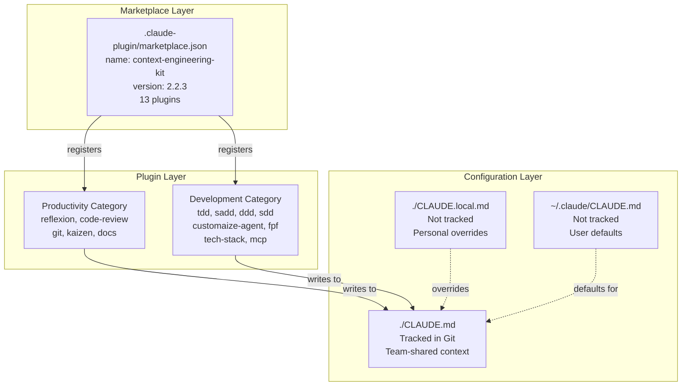
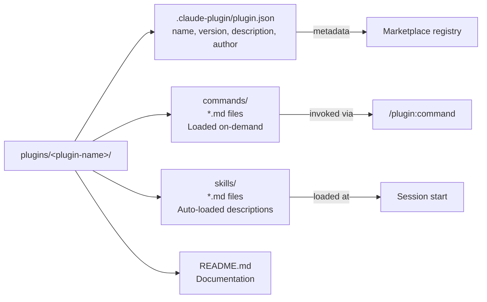
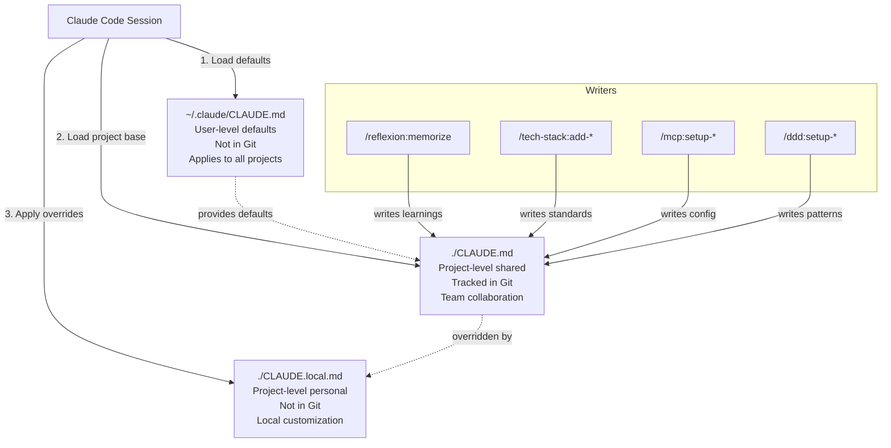
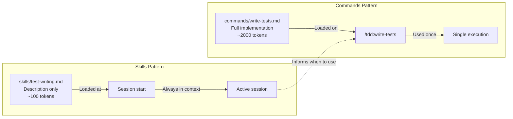
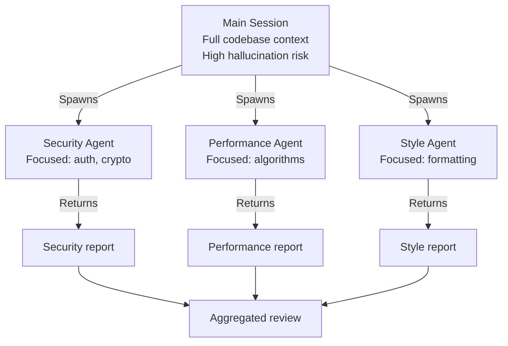
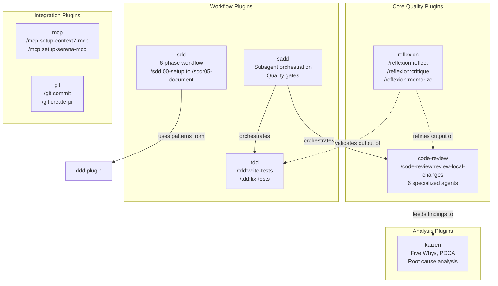
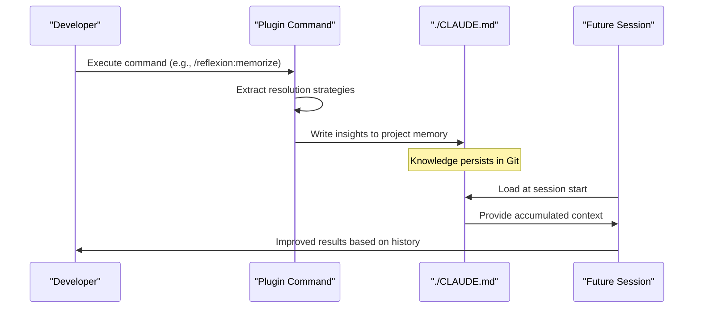

<!-- source: DeepWiki mcp.deepwiki.com · repo neolabhq/context-engineering-kit · page 2 Core Concepts · fetched 2026-10-27 -->

# Core Concepts

Relevant source files

The following files were used as context for generating this wiki page:

- [.bin/install-commands.sh](.bin/install-commands.sh)
- [.claude-plugin/marketplace.json](.claude-plugin/marketplace.json)
- [.claude/commands/bump-plugin.md](.claude/commands/bump-plugin.md)
- [README.md](README.md)
- [plugins/customaize-agent/.claude-plugin/plugin.json](plugins/customaize-agent/.claude-plugin/plugin.json)
- [plugins/sadd/.claude-plugin/plugin.json](plugins/sadd/.claude-plugin/plugin.json)
- [plugins/sdd/.claude-plugin/plugin.json](plugins/sdd/.claude-plugin/plugin.json)

This page covers the fundamental architectural concepts underlying the Context Engineering Kit: the plugin system, configuration hierarchy, token efficiency patterns, and knowledge accumulation mechanisms. For specific plugin implementations, see [Plugin Reference](#3). For practical usage workflows, see [Development Guides](#5).

---

## The Three-Tier Architecture

The Context Engineering Kit is built on three architectural layers: a centralized marketplace registry, a plugin ecosystem, and a multi-level configuration system. These layers interact to provide token-efficient, context-aware development tools.

### Marketplace Registry Structure

The marketplace manifest at [.claude-plugin/marketplace.json:1-155]() defines the complete plugin registry. Each plugin entry specifies `name`, `description`, `version`, `author`, `source` path, and `category` (either `"productivity"` or `"development"`).

**Sources:** [.claude-plugin/marketplace.json:1-155]()

---

## Plugin Manifest and Directory Structure

Each plugin follows a standardized directory layout that separates on-demand commands from pre-loaded skills:

The plugin manifest at paths like [plugins/sdd/.claude-plugin/plugin.json:1-9]() contains metadata mirroring the marketplace entry. The `commands/` directory holds markdown files that define slash commands with full implementation details. The `skills/` directory holds markdown files with skill descriptions that are pre-loaded into the session context.

| Component | Load Timing | Token Impact | Use Case |
|-----------|-------------|--------------|----------|
| `plugin.json` | Installation | Minimal | Metadata only |
| `commands/*.md` | On invocation | Per-use | Complex operations |
| `skills/*.md` | Session start | Persistent | Knowledge/guidance |
| `README.md` | Never auto-loaded | None | Human documentation |

**Sources:** [plugins/sdd/.claude-plugin/plugin.json:1-9](), [plugins/sadd/.claude-plugin/plugin.json:1-9](), [plugins/customaize-agent/.claude-plugin/plugin.json:1-9]()

---

## Multi-Tier Configuration System

The Context Engineering Kit uses a three-tier configuration hierarchy where each level serves a distinct purpose in context management. For details, see [Configuration & Context Management](#2.2).

### Configuration Hierarchy Diagram

**Configuration Precedence:** `CLAUDE.local.md` > `./CLAUDE.md` > `~/.claude/CLAUDE.md`

### CLAUDE.md Content Categories

The configuration files contain structured sections that serve different purposes:

| Section Type | Example Content | Written By | Purpose |
|--------------|-----------------|------------|---------|
| Setup Commands | Hard rules, architecture decisions | `ddd`, `tech-stack` plugins | Persistent constraints |
| MCP Configuration | Server URLs, library IDs, usage guidelines | `mcp` plugin | External tool integration |
| Best Practices | Tech stack rules, DDD patterns, testing strategies | `tech-stack`, `ddd`, `tdd` plugins | Code quality standards |
| Accumulated Learnings | Reflexion insights, Kaizen root causes, pattern discoveries | `reflexion`, `kaizen` plugins | Knowledge accumulation |

**Sources:** [.claude-plugin/marketplace.json:67-142](), [README.md:37-38]()

---

## Commands, Skills, and Agents

The Kit distinguishes between on-demand commands, pre-loaded skills, and specialized agents to balance token efficiency and performance. For details, see [Commands, Skills, and Agents](#2.3).

### Token-Efficient Design Patterns

#### Pattern 1: Commands vs Skills

**Design Rule:** Skills provide lightweight descriptions that inform Claude when to use commands. Commands contain heavy implementation details loaded only when invoked. This is a core "Token-Efficient" feature [README.md:26]().

#### Pattern 2: Specialized Agents

The `code-review` and `sdd` plugins demonstrate this pattern by dispatching specialized agents [README.md:28, 79](). This minimizes populating context with unnecessary information [README.md:26]().

**Sources:** [README.md:25-29](), [.claude-plugin/marketplace.json:23-32, 78-87]()

---

## Plugin System & Orchestration

Plugins are structured to be granular and independent, yet they can be combined into complex workflows. For details, see [Plugin System](#2.1).

### Plugin Interaction Network

**Key Interaction Patterns:**

1. **Reflexion as Quality Multiplier:** The `reflexion` plugin refines outputs through feedback loops [README.md:89-98]().
2. **SADD as Orchestrator:** The `sadd` plugin dispatches fresh subagents for each task with quality gates [.claude-plugin/marketplace.json:56-65]().
3. **SDD Integration:** The `sdd` plugin incorporates high-level code quality guidelines from the `ddd` plugin [README.md:37]().

**Sources:** [README.md:36-39, 83-98](), [.claude-plugin/marketplace.json:10-154]()

---

## Knowledge Accumulation Model

The Kit implements a continuous learning system where insights from each session enhance future sessions via the `CLAUDE.md` hierarchy.

### Knowledge Accumulation Flow

### Accumulation Mechanisms

| Mechanism | Command | Content Type |
|-----------|---------|--------------|
| Reflexion Memorization | `/reflexion:memorize` | Insights and resolution strategies [README.md:97-98]() |
| Kaizen Analysis | `/kaizen:why` | Root cause tracing and problem analysis [.claude-plugin/marketplace.json:89-98]() |
| Tech Stack Setup | `/tech-stack:add-*` | Language/framework best practices [.claude-plugin/marketplace.json:122-131]() |
| DDD Setup | `/ddd:setup-*` | Clean Architecture and SOLID patterns [README.md:38]() |

**Sources:** [README.md:38, 97-98](), [.claude-plugin/marketplace.json:89-98, 122-131]()

---

## Summary of Core Principles

1. **Token Efficiency:** Prefer command-oriented skills over general information skills [README.md:26]().
2. **Granularity:** Install only what you need; plugins load specific agents without overlap [README.md:28]().
3. **Persistence:** Use `CLAUDE.md` to store persistent context and architectural rules [README.md:38]().
4. **Specialization:** Use subagents for complex tasks to maintain accuracy as context grows [README.md:118-144]().
5. **Standardization:** Follow open standards like [agentskills.io](https://agentskills.io) and Arc42 [README.md:30]().

**Sources:** [README.md:25-31, 118-144]()

---

