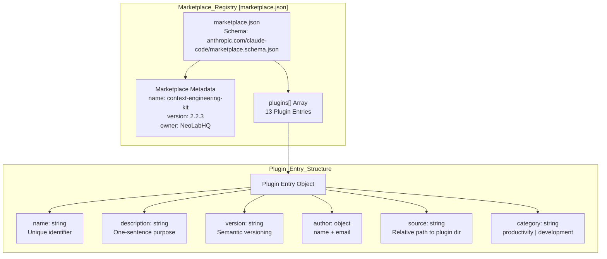
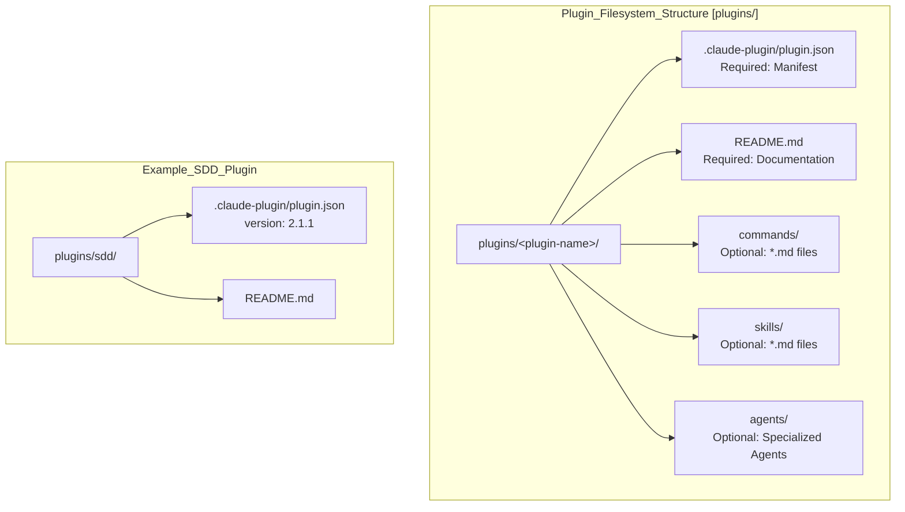
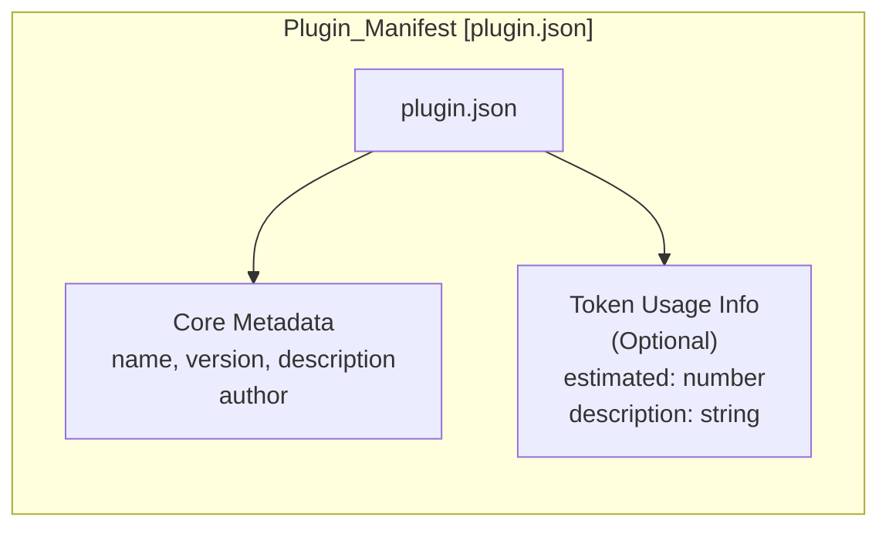

<!-- source: DeepWiki mcp.deepwiki.com · repo neolabhq/context-engineering-kit · page 2.1 Plugin System · fetched 2026-10-27 -->

# Plugin System

<details>
<summary>Relevant source files</summary>

The following files were used as context for generating this wiki page:

- [.claude-plugin/marketplace.json](.claude-plugin/marketplace.json)
- [.claude/commands/bump-plugin.md](.claude/commands/bump-plugin.md)
- [CLAUDE.md](CLAUDE.md)
- [docs/plugins/fpf/architecture.md](docs/plugins/fpf/architecture.md)
- [docs/plugins/fpf/evidence-freshness.md](docs/plugins/fpf/evidence-freshness.md)
- [justfile](justfile)
- [plugins/README.md](plugins/README.md)
- [plugins/customaize-agent/.claude-plugin/plugin.json](plugins/customaize-agent/.claude-plugin/plugin.json)
- [plugins/sadd/.claude-plugin/plugin.json](plugins/sadd/.claude-plugin/plugin.json)
- [plugins/sdd/.claude-plugin/plugin.json](plugins/sdd/.claude-plugin/plugin.json)

</details>


The plugin system is the core architecture of the Context Engineering Kit, providing a structured way to extend Claude Code's capabilities through a curated marketplace. This document explains the marketplace registry, plugin manifest format, directory structure, component types (commands, skills, agents), and the plugin lifecycle from discovery through execution.

## Marketplace Registry

The Context Engineering Kit uses a centralized registry file at [.claude-plugin/marketplace.json:1-155]() that serves as the single source of truth for all available plugins. This registry follows the Claude Code marketplace schema and contains metadata for 13 official plugins.

### Marketplace Structure



**Sources:** [.claude-plugin/marketplace.json:1-155]()

### Plugin Categories

Plugins are organized into two categories that determine their primary use case:

| Category | Purpose | Plugin Count | Examples |
|----------|---------|--------------|----------|
| `productivity` | Code quality, review, analysis, and improvement | 5 | reflexion, code-review, git, kaizen, docs |
| `development` | Development workflows, methodologies, and configuration | 8 | tdd, sdd, sadd, ddd, mcp, tech-stack, customaize-agent, fpf |

**Sources:** [.claude-plugin/marketplace.json:10-154]()

### Marketplace Metadata Format

```json
{
  "$schema": "https://anthropic.com/claude-code/marketplace.schema.json",
  "name": "context-engineering-kit",
  "version": "2.2.3",
  "description": "Hand-crafted collection of advanced context engineering techniques...",
  "owner": {
    "name": "NeoLabHQ",
    "email": "vlad.goncharov@neolab.finance"
  },
  "plugins": [...]
}
```

**Sources:** [.claude-plugin/marketplace.json:1-10]()

## Plugin Directory Structure

Each plugin follows a standardized directory layout that separates metadata, commands, and skills into distinct locations.



**Sources:** [CLAUDE.md:7-27](), [plugins/README.md:5-15](), [plugins/sdd/.claude-plugin/plugin.json:1-9]()

### Required Files

| File | Purpose | Format |
|------|---------|--------|
| `.claude-plugin/plugin.json` | Plugin manifest with metadata and component registry | JSON |
| `README.md` | User-facing documentation with installation and usage examples | Markdown |

### Optional Directories

| Directory | Contents | Loading Behavior |
|-----------|----------|------------------|
| `commands/` | `.md` files with command prompts | Loaded on-demand when invoked via `/plugin:command` |
| `skills/` | `.md` files with skill descriptions | Descriptions loaded at session start (auto-loaded) |
| `agents/` | `.md` files defining specialized agents | Spawned with isolated context via `--agents` |

**Sources:** [CLAUDE.md:13-19](), [plugins/README.md:10-15]()

## Plugin Manifest Format

The `plugin.json` file within each plugin directory defines the plugin's metadata.

### Manifest Schema



**Sources:** [plugins/README.md:17-32](), [plugins/sdd/.claude-plugin/plugin.json:1-9]()

### Example Manifest

The `sdd` plugin manifest demonstrates the standard format:

```json
{
  "name": "sdd",
  "version": "2.1.1",
  "description": "Specification Driven Development workflow commands and agents...",
  "author": {
    "name": "Vlad Goncharov",
    "email": "vlad.goncharov@neolab.finance"
  }
}
```

**Sources:** [plugins/sdd/.claude-plugin/plugin.json:1-9]()

## Plugin Components

Plugins consist of component types that Claude Code loads and executes differently.

### Commands

Commands are prompt files that load only when explicitly invoked by the user via slash command syntax (`/plugin-name:command-name`). This on-demand loading minimizes token usage.

**Directory:** `commands/` within plugin root  
**File Format:** Markdown (`.md`)  
**Invocation:** `/plugin-name:command-name [args]`  
**Token Cost:** Zero until invoked; full prompt loaded on execution.

**Sources:** [CLAUDE.md:48](), [plugins/README.md:13]()

### Skills

Skills are descriptions that Claude Code loads at every session start. They inform the orchestrator agent about available capabilities but do not contain full implementation logic.

**Directory:** `skills/` within plugin root  
**File Format:** Markdown (`.md`)  
**Loading:** Automatic at session start  
**Token Cost:** Always present in context.

**Sources:** [CLAUDE.md:48](), [plugins/README.md:14]()

### Specialized Agents

Plugins can spawn fresh subagents. These agents receive isolated context, reducing hallucination risk for the orchestrator agent.

**Definition Location:** `.claude/agents/<agent-name>.md` or `plugins/<plugin>/agents/<agent-name>.md`  
**Spawning:** Via plugin commands using subagent dispatch.  
**Context:** Fresh, isolated from main orchestrator context.

**Sources:** [CLAUDE.md:49-91]()

## Plugin Lifecycle and Management

The toolkit provides automated commands via `justfile` to manage the plugin lifecycle, specifically for versioning and documentation syncing.

### Version Management

Plugin versions are synchronized between their local manifests and the global marketplace registry using `just` commands.

```mermaid
sequenceDiagram
    participant Dev as "Developer"
    participant Just as "just set-version"
    participant PManifest as "plugins/&lt;name&gt;/.claude-plugin/plugin.json"
    participant MRegistry as ".claude-plugin/marketplace.json"
    
    Dev->>Just: just set-version reflexion 1.1.4
    Just->>PManifest: jq update .version
    Just->>MRegistry: jq update plugin entry .version
    Note over Just: Version consistency ensured
```

**Sources:** [justfile:37-53](), [CLAUDE.md:55-56]()

### Documentation Synchronization

Documentation is maintained in both the `docs/` directory for the GitBook and within the `plugins/` directory for local CLI access.

| Command | Direction | Source File | Destination File |
|---------|-----------|-------------|------------------|
| `just sync-docs-to-plugins` | Docs → Plugins | `docs/plugins/<plugin>/README.md` | `plugins/<plugin>/README.md` |
| `just sync-plugins-to-docs` | Plugins → Docs | `plugins/<plugin>/README.md` | `docs/plugins/<plugin>/README.md` |

**Sources:** [justfile:11-35](), [CLAUDE.md:38-39]()

## Design Principles

The plugin system embodies specific architectural principles that optimize for token efficiency and output quality.

1.  **Commands over skills**: Commands load on-demand; skill descriptions load into context by default. Prefer commands to keep the initial context window small. [CLAUDE.md:48]()
2.  **Specialized agents**: Use agents with focused context (e.g., in `sdd` or `code-review`) to reduce hallucinations. [CLAUDE.md:49]()
3.  **Setup-commands**: Use setup commands (like in `mcp` or `tech-stack`) to update `CLAUDE.md` for persistent project context rather than relying on large skill descriptions. [CLAUDE.md:50]()
4.  **Minimal tokens**: Prompts are kept concise because every token counts toward the context limit. [CLAUDE.md:51]()

**Sources:** [CLAUDE.md:46-52]()

---

