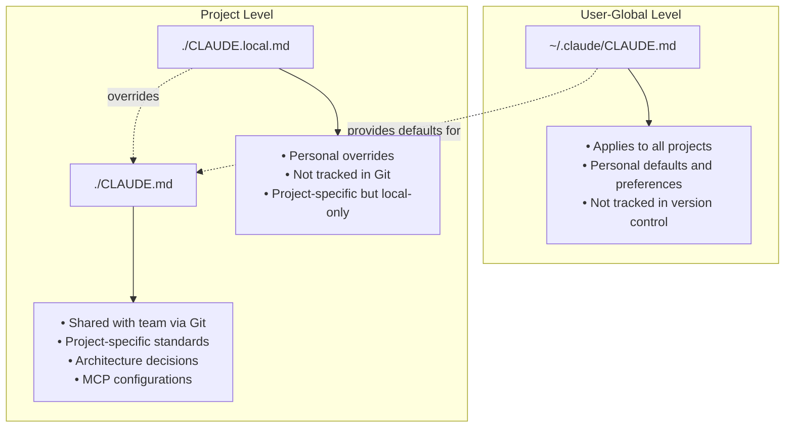
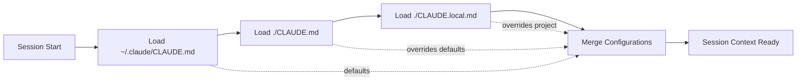
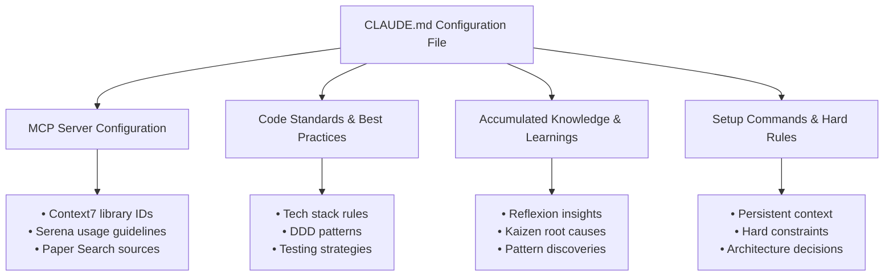
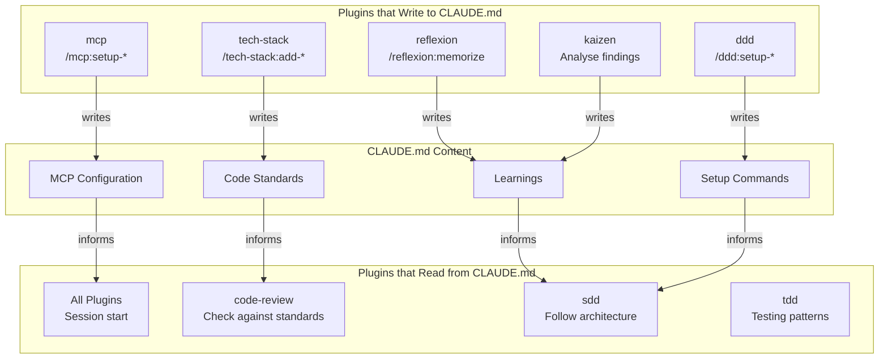
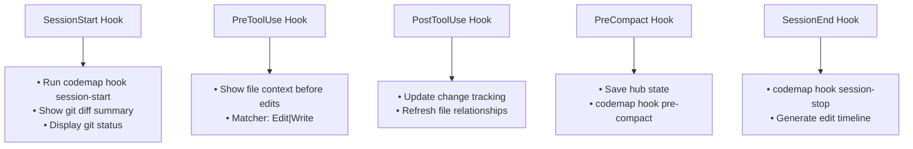

<!-- source: DeepWiki mcp.deepwiki.com · repo neolabhq/context-engineering-kit · page 2.2 Configuration & Context Management · fetched 2026-10-27 -->

# Configuration & Context Management

<details>
<summary>Relevant source files</summary>

The following files were used as context for generating this wiki page:

- [.bin/install-commands.sh](.bin/install-commands.sh)
- [CLAUDE.md](CLAUDE.md)
- [README.md](README.md)
- [docs/guides/file-structure-context.md](docs/guides/file-structure-context.md)
- [docs/plugins/fpf/architecture.md](docs/plugins/fpf/architecture.md)
- [docs/plugins/fpf/evidence-freshness.md](docs/plugins/fpf/evidence-freshness.md)
- [justfile](justfile)

</details>


This document details the three-tier configuration system used by the Context Engineering Kit to manage persistent context across Claude Code sessions. It covers the `CLAUDE.md` file hierarchy (project-shared, project-personal, user-global), content types stored in these files, how plugins interact with configuration, and session automation through `.claude/settings.json`.

For information about plugin installation and the marketplace registry, see [Plugin System (2.1)](). For details on how commands, skills, and agents use this configuration, see [Commands, Skills, and Agents (2.3)]().

## Three-Tier Configuration Hierarchy

The Context Engineering Kit uses a three-level configuration system to manage context that persists across sessions:

Title: Configuration Hierarchy


**Sources:** [CLAUDE.md:1-84](), [README.md:40-108]()

### Project-Shared Configuration (CLAUDE.md)

The project-shared `CLAUDE.md` file is located at the repository root and is tracked in version control. It contains team-wide context that all developers share.

| Property | Value |
|----------|-------|
| **File Path** | `./CLAUDE.md` |
| **Git Tracking** | ✓ Tracked (committed to repository) |
| **Scope** | All team members, all sessions |
| **Purpose** | Shared project context, standards, architecture decisions |
| **Loaded When** | Every Claude Code session in this project |

**Typical Contents:**
- Project structure and available plugins [CLAUDE.md:7-32]()
- Tech stack configurations and best practices [CLAUDE.md:44-51]()
- MCP server configurations (Context7 library IDs) [CLAUDE.md:93-111]()
- Accumulated learnings from Reflexion plugin [README.md:97-98]()
- Development rules and hard constraints [CLAUDE.md:44-59]()

**Sources:** [CLAUDE.md:1-163](), [README.md:40-108]()

### Project-Personal Configuration (CLAUDE.local.md)

The project-personal `CLAUDE.local.md` file is located at the repository root but excluded from version control. It allows individual developers to override project defaults without affecting the team.

| Property | Value |
|----------|-------|
| **File Path** | `./CLAUDE.local.md` |
| **Git Tracking** | ✗ Not tracked (in `.gitignore`) |
| **Scope** | Current developer, current project only |
| **Purpose** | Personal overrides and local-only configurations |
| **Loaded When** | Every Claude Code session in this project |
| **Precedence** | Overrides `./CLAUDE.md` |

**Sources:** [README.md:40-108](), [docs/guides/file-structure-context.md:78-80]()

### User-Global Configuration (~/.claude/CLAUDE.md)

The user-global `CLAUDE.md` file is located in the user's home directory at `~/.claude/CLAUDE.md`. It provides default configurations that apply to all projects.

| Property | Value |
|----------|-------|
| **File Path** | `~/.claude/CLAUDE.md` |
| **Git Tracking** | ✗ Not tracked (outside repositories) |
| **Scope** | Current developer, all projects |
| **Purpose** | Personal defaults across all projects |
| **Loaded When** | Every Claude Code session (unless overridden) |
| **Precedence** | Lowest (overridden by project files) |

**Sources:** [.bin/install-commands.sh:62-65]()

## Configuration File Locations and Loading Order

Claude Code loads configuration files in a specific order, with later files overriding earlier ones:

Title: Configuration Loading Order


**Sources:** [README.md:40-108](), [.bin/install-commands.sh:47-65]()

## Content Types in CLAUDE.md

Configuration files contain four primary content types, each serving a specific purpose:

Title: Content Types and Code Entities


**Sources:** [CLAUDE.md:44-111](), [README.md:118-161]()

### MCP Server Configuration

MCP (Model Context Protocol) server configurations specify which external tools and data sources are available to Claude.

**Example from CLAUDE.md:**

```markdown
## Use Context7 MCP for Loading Documentation

Context7 MCP is available to fetch up-to-date documentation with code examples.

**Recommended library IDs**:

- `/anthropics/claude-code` - Claude Code CLI tool documentation
- `/websites/platform_claude` - Claude Developer Platform comprehensive docs
```

**Written By:** `/mcp:setup-context7-mcp`, `/mcp:setup-serena-mcp`, `/mcp:setup-codemap-cli`, `/mcp:setup-arxiv-mcp` [CLAUDE.md:93-111](), [.bin/install-commands.sh:209]()

### Code Standards & Best Practices

Tech stack configurations and development standards that guide code generation and review.

**Example from CLAUDE.md:**

```markdown
## Key Development Rules

### Plugin Design Philosophy

1. **Commands over skills** - Commands load on-demand; skill descriptions load into context by default
2. **Specialized agents** - Use agents with focused context to reduce hallucinations
3. **Setup-commands** - Use setup commands to update CLAUDE.md for persistent project context
```

**Written By:** `/tech-stack:add-*`, `/ddd:setup-code-formating` [CLAUDE.md:44-51](), [.bin/install-commands.sh:204]()

### Accumulated Knowledge & Learnings

Insights and patterns discovered during development that should persist across sessions.

**Written By:** `/reflexion:memorize`, `/kaizen:analyse-problem` [README.md:97-98](), [.bin/install-commands.sh:208-210]()

## How Plugins Interact with Configuration

Plugins both write to and read from configuration files to create a continuously improving context system.

Title: Plugin Configuration Flow


**Sources:** [CLAUDE.md:44-59](), [README.md:89-108]()

### Plugins that Write to CLAUDE.md

The following table shows which plugins can modify configuration files:

| Plugin | Commands | Content Type |
|--------|----------|--------------|
| **reflexion** | `/reflexion:memorize` | Accumulated Learnings [README.md:97-98]() |
| **tech-stack** | `/tech-stack:add-*` | Code Standards [CLAUDE.md:31]() |
| **mcp** | `/mcp:setup-*` | MCP Configuration [CLAUDE.md:93-111]() |
| **ddd** | `/ddd:setup-code-formating` | Setup Commands [CLAUDE.md:50]() |
| **kaizen** | `/kaizen:analyse` | Accumulated Learnings [.bin/install-commands.sh:208]() |

**Sources:** [CLAUDE.md:29-59](), [.bin/install-commands.sh:201-215]()

## Session Hooks and Automation

Beyond `CLAUDE.md` files, the `.claude/settings.json` file provides session-level automation through hooks.

Title: Session Hook Execution Flow


**Sources:** [docs/guides/file-structure-context.md:104-121](), [docs/guides/file-structure-context.md:172-180]()

### Hook Configuration File (.claude/settings.json)

| Property | Value |
|----------|-------|
| **File Path** | `./.claude/settings.json` |
| **Purpose** | Automate context injection via shell commands |

**Example Configuration:**

```json
{
  "hooks": {
    "SessionStart": [
      {
        "hooks": [
          {
            "type": "command",
            "command": "codemap hook session-start && echo 'git diff:' && git diff --stat && echo 'git status:' && git status"
          }
        ]
      }
    ]
  }
}
```

**Sources:** [docs/guides/file-structure-context.md:104-121]()

### Available Hook Types

| Hook | Trigger | Typical Command |
|------|---------|-----------------|
| `SessionStart` | Beginning of session | `codemap hook session-start` [docs/guides/file-structure-context.md:174]() |
| `PreToolUse` | Before Tool execution | `codemap hook pre-edit` [docs/guides/file-structure-context.md:175]() |
| `PostToolUse` | After Tool execution | `codemap hook post-edit` [docs/guides/file-structure-context.md:176]() |
| `UserPromptSubmit`| User submits message | `codemap hook prompt-submit` [docs/guides/file-structure-context.md:177]() |
| `PreCompact` | Before context compaction| `codemap hook pre-compact` [docs/guides/file-structure-context.md:178]() |
| `SessionEnd` | End of session | `codemap hook session-stop` [docs/guides/file-structure-context.md:179]() |

**Sources:** [docs/guides/file-structure-context.md:172-180]()

## Configuration Management Best Practices

### Token Efficiency Considerations

Configuration files are loaded into context at session start, consuming tokens.

| Guideline | Rationale |
|-----------|-----------|
| **Commands over skills** | Commands load on-demand; skills load by default [CLAUDE.md:48]() |
| **Specialized agents** | Focused context reduces hallucinations [CLAUDE.md:49]() |
| **Minimal tokens** | Every token counts; keep prompts concise [CLAUDE.md:51]() |

**Sources:** [CLAUDE.md:46-51]()

### Version Control Guidelines

**DO commit to Git:**
- `CLAUDE.md` (project-shared configuration)
- `.claude/settings.json` (team hooks)

**DO NOT commit to Git:**
- `CLAUDE.local.md` (personal overrides)
- `.codemap/` (local cache) [docs/guides/file-structure-context.md:79]()

**Sources:** [docs/guides/file-structure-context.md:78-80]()

---

