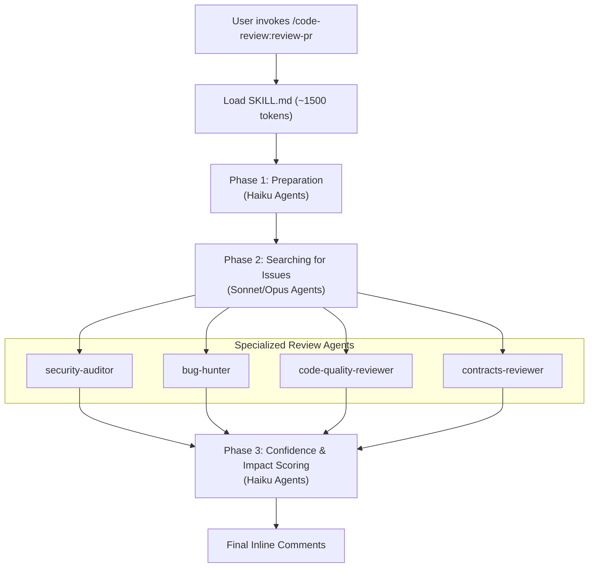
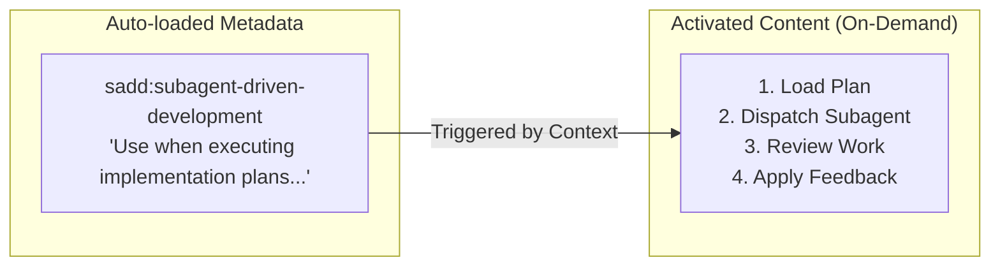
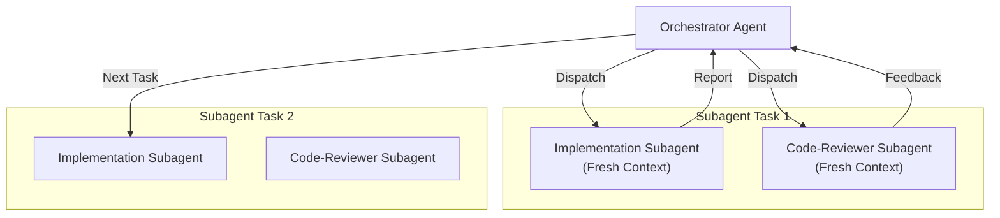

<!-- source: DeepWiki mcp.deepwiki.com · repo neolabhq/context-engineering-kit · page 2.3 Commands, Skills, and Agents · fetched 2026-10-27 -->

# Commands, Skills, and Agents

Relevant source files

The following files were used as context for generating this wiki page:

- [.claude-plugin/marketplace.json](.claude-plugin/marketplace.json)
- [.claude/commands/bump-plugin.md](.claude/commands/bump-plugin.md)
- [plugins/code-review/skills/review-local-changes/SKILL.md](plugins/code-review/skills/review-local-changes/SKILL.md)
- [plugins/code-review/skills/review-pr/SKILL.md](plugins/code-review/skills/review-pr/SKILL.md)
- [plugins/customaize-agent/.claude-plugin/plugin.json](plugins/customaize-agent/.claude-plugin/plugin.json)
- [plugins/customaize-agent/skills/agent-evaluation/SKILL.md](plugins/customaize-agent/skills/agent-evaluation/SKILL.md)
- [plugins/customaize-agent/skills/apply-anthropic-skill-best-practices/SKILL.md](plugins/customaize-agent/skills/apply-anthropic-skill-best-practices/SKILL.md)
- [plugins/customaize-agent/skills/context-engineering/SKILL.md](plugins/customaize-agent/skills/context-engineering/SKILL.md)
- [plugins/customaize-agent/skills/create-agent/SKILL.md](plugins/customaize-agent/skills/create-agent/SKILL.md)
- [plugins/customaize-agent/skills/create-command/SKILL.md](plugins/customaize-agent/skills/create-command/SKILL.md)
- [plugins/customaize-agent/skills/create-skill/SKILL.md](plugins/customaize-agent/skills/create-skill/SKILL.md)
- [plugins/customaize-agent/skills/create-workflow-command/SKILL.md](plugins/customaize-agent/skills/create-workflow-command/SKILL.md)
- [plugins/customaize-agent/skills/test-prompt/SKILL.md](plugins/customaize-agent/skills/test-prompt/SKILL.md)
- [plugins/customaize-agent/skills/test-skill/SKILL.md](plugins/customaize-agent/skills/test-skill/SKILL.md)
- [plugins/ddd/skills/setup-code-formating/SKILL.md](plugins/ddd/skills/setup-code-formating/SKILL.md)
- [plugins/sadd/.claude-plugin/plugin.json](plugins/sadd/.claude-plugin/plugin.json)
- [plugins/sadd/skills/multi-agent-patterns/SKILL.md](plugins/sadd/skills/multi-agent-patterns/SKILL.md)
- [plugins/sadd/skills/subagent-driven-development/SKILL.md](plugins/sadd/skills/subagent-driven-development/SKILL.md)
- [plugins/sdd/.claude-plugin/plugin.json](plugins/sdd/.claude-plugin/plugin.json)
- [plugins/tdd/skills/test-driven-development/SKILL.md](plugins/tdd/skills/test-driven-development/SKILL.md)

## Purpose and Scope

This page explains the three mechanisms for loading context into Claude Code: **commands**, **skills**, and **specialized agents**. Each mechanism has distinct token efficiency characteristics and use cases. Understanding when to use each type is critical for building plugins that enhance agent capabilities without causing context pollution or degrading performance.

The Context Engineering Kit focuses on minimal token footprints while maximizing result quality [ .claude-plugin/marketplace.json:1-5]().

---

## Overview: Three Context Loading Mechanisms

The Context Engineering Kit provides three ways to make functionality available to Claude Code, each with different token footprints and loading behaviors:

| Mechanism | Token Cost | When Loaded | Best For |
|-----------|-----------|-------------|----------|
| **Commands** | ~500-2000 tokens | On-demand when invoked | Complex operations, multi-step workflows |
| **Skills** | ~200-800 tokens | Every conversation start | Continuous guidance, persistent principles |
| **Agents** | Variable (fresh context) | Spawned for specific tasks | Specialized analysis, parallel work |

**Key Principle**: Commands over skills, specialized agents over commands. Use the most token-efficient approach that solves the problem.

Sources: [.claude-plugin/marketplace.json:1-155](), [plugins/customaize-agent/skills/context-engineering/SKILL.md:55-75]()

---

## Commands: On-Demand Context Loading

Commands load their full instructions only when explicitly invoked with the `/plugin:command-name` syntax. This makes them token-efficient for operations that are used occasionally rather than continuously.

### Command Structure

Commands are defined in the plugin manifest and stored as markdown files. When a user types a command, Claude Code loads the full contents of the associated `.md` file into context for that invocation only.

### Command Use Cases

Commands are ideal for:

1. **Multi-step workflows**: The SDD plugin uses commands for phases from setup to documentation [ .claude-plugin/marketplace.json:78-87]().
2. **Complex analysis**: The Kaizen plugin provides commands for "5 Whys" and "Cause and Effect Analysis" [ .claude-plugin/marketplace.json:89-98]().
3. **File operations**: The Git plugin introduces commands for commit and PR creation [ .claude-plugin/marketplace.json:34-43]().
4. **Configuration setup**: The Tech-Stack plugin uses commands to update `CLAUDE.md` with language-specific best practices [ .claude-plugin/marketplace.json:122-131]().

### Example: Code Review Command

The `code-review` plugin demonstrates command-based complexity. It uses a command to trigger a multi-agent review process [ plugins/code-review/skills/review-pr/SKILL.md:1-5]().

**Token Economics**: The command itself consumes tokens only when invoked. By spawning specialized agents for the actual review, the orchestrator avoids context pollution from the massive amount of code being analyzed [ plugins/code-review/skills/review-pr/SKILL.md:98-128]().

Sources: [plugins/code-review/skills/review-pr/SKILL.md:64-150](), [.claude-plugin/marketplace.json:23-32]()

---

## Skills: Persistent Context

Skills are modular, self-contained packages that extend Claude's capabilities. In the Context Engineering Kit, skill metadata (name and description) is typically loaded to allow Claude to know when to "onboard" itself to a specific technique [ plugins/customaize-agent/skills/create-skill/SKILL.md:25-35]().

### Skill Principles

**Writing skills is Test-Driven Development (TDD) applied to process documentation** [ plugins/customaize-agent/skills/create-skill/SKILL.md:13-14]().
- **Test Case**: A pressure scenario with a subagent.
- **Production Code**: The `SKILL.md` document.
- **Red Phase**: The agent violates a rule without the skill.
- **Green Phase**: The agent complies with the skill present.

### Skill Use Cases

Skills are ideal for:

1. **Specialized Workflows**: Multi-step procedures for specific domains [ plugins/customaize-agent/skills/create-skill/SKILL.md:42]().
2. **Tool Integrations**: Instructions for working with specific file formats or APIs [ plugins/customaize-agent/skills/create-skill/SKILL.md:43]().
3. **Domain Expertise**: Company-specific knowledge or business logic [ plugins/customaize-agent/skills/create-skill/SKILL.md:44]().
4. **Continuous Principles**: The TDD plugin provides skills for testing using subagents [ .claude-plugin/marketplace.json:45-54]().

### Example: SADD Skill Orchestration

The `sadd` (Subagent-Driven Development) plugin uses a skill to define how to dispatch fresh subagents for tasks [ plugins/sadd/skills/subagent-driven-development/SKILL.md:1-10]().

Sources: [plugins/sadd/skills/subagent-driven-development/SKILL.md:1-10](), [plugins/customaize-agent/skills/create-skill/SKILL.md:47-62]()

---

## Specialized Agents: Fresh Context for Complex Tasks

Specialized agents address the **Context Bottleneck** by partitioning work across multiple context windows [ plugins/sadd/skills/multi-agent-patterns/SKILL.md:18-23]().

### Why Specialized Agents?

1. **Context Isolation**: Each agent operates in a clean context focused on its subtask, preventing "lost-in-middle" effects and attention scarcity [ plugins/sadd/skills/multi-agent-patterns/SKILL.md:12-23]().
2. **Parallelization**: Tasks like searching multiple sources or reviewing different files can happen simultaneously [ plugins/sadd/skills/multi-agent-patterns/SKILL.md:24-29]().
3. **Specialization**: Different agents can have different system prompts and tool sets optimized for their domain (e.g., a security auditor vs. a test coverage reviewer) [ plugins/sadd/skills/multi-agent-patterns/SKILL.md:30-35]().

### Architectural Patterns

The Kit utilizes three dominant patterns [ plugins/sadd/skills/multi-agent-patterns/SKILL.md:38-103]():

| Pattern | Description | Use Case |
|---------|-------------|----------|
| **Supervisor/Orchestrator** | Central agent delegates to specialists and synthesizes results. | Complex tasks with clear decomposition (e.g., Code Review). |
| **Peer-to-Peer/Swarm** | Agents communicate directly and hand off control based on protocols. | Flexible exploration with emergent requirements. |
| **Hierarchical** | Layers of abstraction: Strategy -> Planning -> Execution. | Large-scale projects with organizational structures. |

### Example: SADD Sequential Execution

The `sadd` plugin implements a supervisor pattern where the main agent dispatches "implementation" and "code-reviewer" subagents sequentially [ plugins/sadd/skills/subagent-driven-development/SKILL.md:43-91]().

Sources: [plugins/sadd/skills/multi-agent-patterns/SKILL.md:38-66](), [plugins/sadd/skills/subagent-driven-development/SKILL.md:43-91]()

---

## Token Efficiency Trade-offs

Research on agent performance shows that **Token Usage** explains 80% of performance variance [ plugins/customaize-agent/skills/agent-evaluation/SKILL.md:16-23](). However, simply increasing context size is not always the answer.

### The "95% Finding" for Performance

| Factor | Variance Explained | Strategy |
|--------|-------------------|----------|
| **Token usage** | 80% | More tokens usually equals better performance, but must be high-signal. |
| **Number of tool calls** | ~10% | Exploration helps; specialized agents can explore in parallel. |
| **Model choice** | ~5% | Better models (Sonnet/Opus) multiply efficiency. |

### Context Quality vs. Quantity

Context engineering is the discipline of curating the **smallest high-signal token set** [ plugins/customaize-agent/skills/context-engineering/SKILL.md:12-14]().
- **Progressive Disclosure**: Loading information (like full skill content) only when needed keeps the agent fast and responsive [ plugins/customaize-agent/skills/context-engineering/SKILL.md:55-59]().
- **Attention Budget**: Models have finite attention; every irrelevant token introduced depletes the budget for reasoning [ plugins/customaize-agent/skills/context-engineering/SKILL.md:47-51]().

Sources: [plugins/customaize-agent/skills/agent-evaluation/SKILL.md:16-30](), [plugins/customaize-agent/skills/context-engineering/SKILL.md:45-75]()

---

