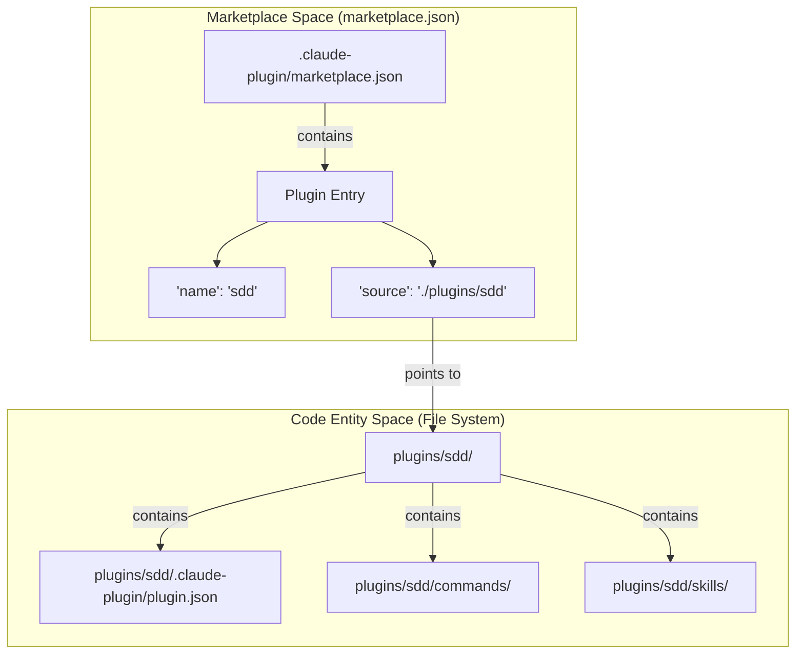
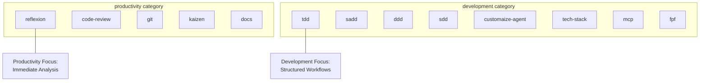

<!-- source: DeepWiki mcp.deepwiki.com · repo neolabhq/context-engineering-kit · page 3 Plugin Reference · fetched 2026-10-27 -->

# Plugin Reference

Relevant source files

The following files were used as context for generating this wiki page:

- [.claude-plugin/marketplace.json](.claude-plugin/marketplace.json)
- [.claude/commands/bump-plugin.md](.claude/commands/bump-plugin.md)
- [docs/SUMMARY.md](docs/SUMMARY.md)
- [docs/plugins/README.md](docs/plugins/README.md)
- [docs/plugins/ddd/README.md](docs/plugins/ddd/README.md)
- [docs/plugins/ddd/rules.md](docs/plugins/ddd/rules.md)
- [docs/reference/skills.md](docs/reference/skills.md)
- [plugins/README.md](plugins/README.md)
- [plugins/customaize-agent/.claude-plugin/plugin.json](plugins/customaize-agent/.claude-plugin/plugin.json)
- [plugins/ddd/.claude-plugin/plugin.json](plugins/ddd/.claude-plugin/plugin.json)
- [plugins/ddd/README.md](plugins/ddd/README.md)
- [plugins/sadd/.claude-plugin/plugin.json](plugins/sadd/.claude-plugin/plugin.json)
- [plugins/sdd/.claude-plugin/plugin.json](plugins/sdd/.claude-plugin/plugin.json)

This page provides a comprehensive reference for all official plugins available in the Context Engineering Kit marketplace. It covers the plugin registry structure, categorization system, and provides a high-level overview of each plugin's purpose and capabilities.

For detailed documentation of specific plugins, see the category-specific pages:
- **Code Quality Plugins**: Focus on review and self-refinement. For details, see [Code Quality Plugins](#3.1).
- **Development Workflow Plugins**: Implement structured methodologies like TDD and SDD. For details, see [Development Workflow Plugins](#3.2).
- **Integration Plugins**: Connect with Git and Model Context Protocol (MCP). For details, see [Integration Plugins](#3.3).
- **Continuous Improvement Plugins**: Root cause analysis and documentation. For details, see [Continuous Improvement Plugins](#3.4).
- **Configuration Plugins**: Project standards and custom agent authoring. For details, see [Configuration Plugins](#3.5).

## Plugin Registry Architecture

The Context Engineering Kit maintains a centralized plugin registry in [.claude-plugin/marketplace.json:1-155](). This registry follows the official Claude Code marketplace schema and contains metadata for all available plugins.

### Registry to Code Entity Mapping
The following diagram bridges the high-level marketplace definitions to the actual file system entities within the repository.

Title: Marketplace Entity Mapping

**Registry Location and Plugin Directory Mapping**
The marketplace registry at [.claude-plugin/marketplace.json:10-154]() defines all available plugins. Each plugin's `source` field points to its implementation directory following the pattern `./plugins/{plugin-name}/`. Each plugin directory contains a `.claude-plugin/plugin.json` manifest file that mirrors the registry metadata, such as [plugins/sdd/.claude-plugin/plugin.json:1-9]().

Sources: [.claude-plugin/marketplace.json:1-155](), [plugins/sdd/.claude-plugin/plugin.json:1-9]()

## Plugin Categories

The Context Engineering Kit organizes plugins into two primary categories that determine their focus and typical usage patterns:

| Category | Focus | Token Philosophy | Primary Use Cases |
|----------|-------|------------------|-------------------|
| **productivity** | Immediate value delivery, analysis, and quality improvement | Skills and commands for on-demand analysis | Code review, documentation, continuous improvement, version control |
| **development** | Structured workflows and methodologies | Commands for guided processes, skills for persistent patterns | TDD, DDD, SADD, SDD, custom tooling, tech stack configuration |

Title: Plugin Category Distribution

**Category Distribution and Component Usage**
The registry at [.claude-plugin/marketplace.json:10-154]() defines 13 plugins. The `category` field, such as in [.claude-plugin/marketplace.json:20]() (productivity) or [.claude-plugin/marketplace.json:53]() (development), determines how the plugin is classified within the marketplace.

Sources: [.claude-plugin/marketplace.json:10-154](), [docs/plugins/README.md:39-138]()

## Plugin Component Types

Each plugin can provide three types of components, each with different token efficiency characteristics and usage patterns:

- **Commands**: On-demand execution. Loaded only when invoked (e.g., `/tdd:write-tests`).
- **Skills**: Pre-loaded context. These load automatically and inform all agent decisions (e.g., `prompt-engineering` in [docs/reference/skills.md:43]()).
- **Agents**: Specialized expertise. Spawns focused sub-agents for specific tasks (e.g., `bug-hunter` in Code Review).

Sources: [docs/reference/skills.md:1-46](), [docs/plugins/README.md:7-23]()

## Summary of Official Plugins

### Code Quality Plugins
These plugins focus on verifying and refining existing code.
- **Reflexion**: Implements feedback loops for self-refinement [.claude-plugin/marketplace.json:12-21]().
- **Code Review**: Uses specialized agents for thorough codebase and PR analysis [.claude-plugin/marketplace.json:23-32]().
- For details, see [Code Quality Plugins](#3.1).

### Development Workflow Plugins
Structured methodologies to guide feature creation from start to finish.
- **TDD**: Test-Driven Development with Red-Green-Refactor cycles [.claude-plugin/marketplace.json:45-54]().
- **SDD**: Specification-Driven Development based on GitHub Spec Kit [.claude-plugin/marketplace.json:78-87]().
- **SADD**: Subagent-Driven Development for parallel task execution [.claude-plugin/marketplace.json:56-65]().
- **DDD**: Domain-Driven Development focusing on Clean Architecture and SOLID [.claude-plugin/marketplace.json:67-76]().
- **FPF**: First Principles Framework for structured reasoning via ADI cycles [.claude-plugin/marketplace.json:144-153]().
- For details, see [Development Workflow Plugins](#3.2).

### Integration Plugins
Connecting Claude Code to the broader engineering ecosystem.
- **Git**: Conventional commits and PR management [.claude-plugin/marketplace.json:34-43]().
- **MCP**: Model Context Protocol integration for external tools like Context7 and Serena [.claude-plugin/marketplace.json:133-142]().
- For details, see [Integration Plugins](#3.3).

### Continuous Improvement Plugins
Analysis tools for process and documentation.
- **Kaizen**: Lean-inspired root cause analysis (5 Whys, PDCA) [.claude-plugin/marketplace.json:89-98]().
- **Docs**: Automated documentation generation and refinement [.claude-plugin/marketplace.json:111-120]().
- For details, see [Continuous Improvement Plugins](#3.4).

### Configuration Plugins
Standardizing the development environment.
- **Tech Stack**: Language-specific best practices (e.g., TypeScript) [.claude-plugin/marketplace.json:122-131]().
- **Customaize Agent**: Tools for authoring your own commands and skills [.claude-plugin/marketplace.json:100-109]().
- For details, see [Configuration Plugins](#3.5).

Sources: [.claude-plugin/marketplace.json:1-155](), [docs/plugins/README.md:9-23]()

---

