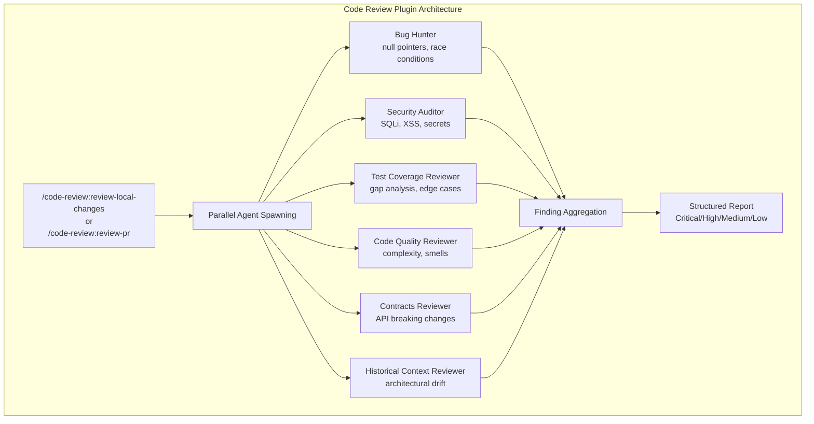
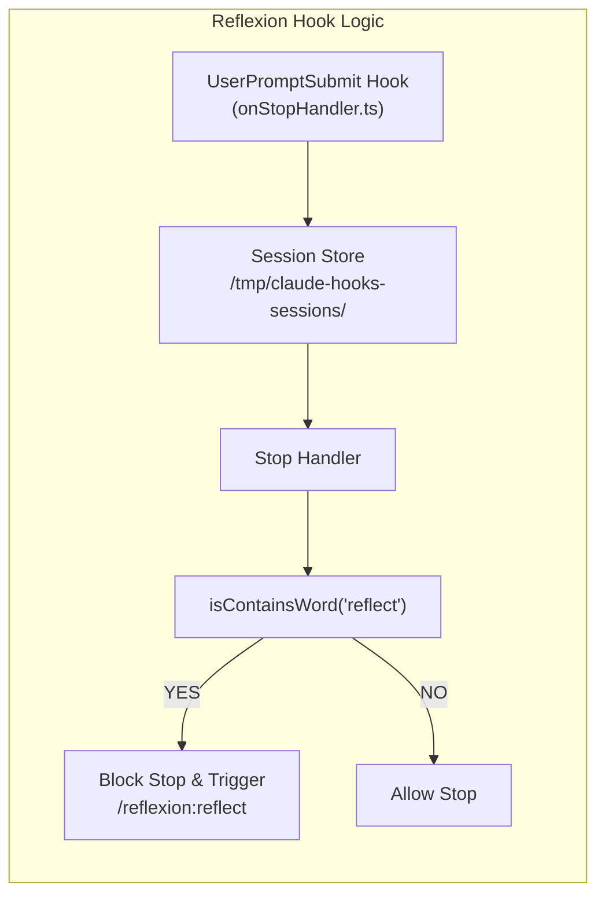

<!-- source: DeepWiki mcp.deepwiki.com · repo neolabhq/context-engineering-kit · page 3.1 Code Quality Plugins · fetched 2026-10-27 -->

# Code Quality Plugins

Relevant source files

The following files were used as context for generating this wiki page:

- [docs/plugins/code-review/README.md](docs/plugins/code-review/README.md)
- [docs/plugins/code-review/review-local-changes.md](docs/plugins/code-review/review-local-changes.md)
- [docs/plugins/code-review/review-pr.md](docs/plugins/code-review/review-pr.md)
- [docs/plugins/code-review/usage-examples.md](docs/plugins/code-review/usage-examples.md)
- [docs/plugins/customaize-agent/agent-evaluation.md](docs/plugins/customaize-agent/agent-evaluation.md)
- [docs/plugins/customaize-agent/apply-anthropic-skill-best-practices.md](docs/plugins/customaize-agent/apply-anthropic-skill-best-practices.md)
- [docs/plugins/customaize-agent/context-engineering.md](docs/plugins/customaize-agent/context-engineering.md)
- [plugins/code-review/.claude-plugin/plugin.json](plugins/code-review/.claude-plugin/plugin.json)
- [plugins/reflexion/.claude-plugin/plugin.json](plugins/reflexion/.claude-plugin/plugin.json)
- [plugins/reflexion/hooks/README.md](plugins/reflexion/hooks/README.md)
- [plugins/reflexion/hooks/src/onStopHandler.test.ts](plugins/reflexion/hooks/src/onStopHandler.test.ts)
- [plugins/reflexion/hooks/src/onStopHandler.ts](plugins/reflexion/hooks/src/onStopHandler.ts)

## Purpose and Scope

Code Quality Plugins provide automated, multi-perspective code analysis through specialized AI agents that catch bugs, security vulnerabilities, and quality issues before code reaches production. This page covers the two core quality plugins: **Code Review** and **Reflexion**.

The **Code Review** plugin implements a six-agent parallel review system that examines code from different specialized perspectives (bugs, security, tests, quality, contracts, and historical context) [docs/plugins/code-review/README.md:12-14](). The **Reflexion** plugin enables self-refinement through iterative improvement, critique, and memory updates based on techniques like Self-Refine and Reflexion [plugins/reflexion/.claude-plugin/plugin.json:4-4]().

For detailed documentation, see [Code Review Plugin](#3.1.1) and [Reflexion Plugin](#3.1.2).

Sources: [docs/plugins/code-review/README.md:1-14](), [plugins/reflexion/.claude-plugin/plugin.json:1-9]()

---

## Plugin Comparison

The two plugins serve complementary roles in ensuring code quality:

| Aspect | Code Review Plugin | Reflexion Plugin |
|--------|-------------------|------------------|
| **Primary Purpose** | Multi-perspective bug/security detection [docs/plugins/code-review/README.md:7-10]() | Self-refinement and iterative improvement [plugins/reflexion/.claude-plugin/plugin.json:4-4]() |
| **Analysis Approach** | 6 Parallel specialized agents [docs/plugins/code-review/README.md:46-60]() | Feedback and refinement loops [plugins/reflexion/.claude-plugin/plugin.json:4-4]() |
| **Timing** | Before commits and PRs [docs/plugins/code-review/README.md:14-14]() | After completing work / on "reflect" trigger [plugins/reflexion/hooks/README.md:3-3]() |
| **Focus** | Finding specific issues (Bugs, Security, Coverage) [docs/plugins/code-review/README.md:68-135]() | Reflecting on previous response/output [plugins/reflexion/.claude-plugin/plugin.json:4-4]() |
| **Output** | Severity-categorized findings [docs/plugins/code-review/review-local-changes.md:55-55]() | Refined implementation + learned patterns [plugins/reflexion/hooks/README.md:3-3]() |
| **Memory Integration** | No direct persistence | Updates CLAUDE.md via `/reflexion:memorize` |

**Workflow Synergy**: Use Code Review to identify issues, Reflexion to improve solutions, and `/reflexion:memorize` to capture patterns for future prevention.

Sources: [docs/plugins/code-review/README.md:3-14](), [plugins/reflexion/.claude-plugin/plugin.json:1-9](), [plugins/reflexion/hooks/README.md:1-4]()

---

## Multi-Agent Architecture

The Code Review plugin utilizes a fan-out architecture to maximize specialized coverage.

### Code Review Agent Fan-out

Sources: [docs/plugins/code-review/README.md:46-60](), [docs/plugins/code-review/review-local-changes.md:37-55]()

### Reflexion Hook Architecture
The Reflexion plugin includes a session-aware hook system that intercepts Claude's stop signal to trigger refinement.

Sources: [plugins/reflexion/hooks/src/onStopHandler.ts:11-37](), [plugins/reflexion/hooks/README.md:9-27]()

---

## Command Reference

### Code Review Commands
| Command | Purpose |
|---------|---------|
| `/code-review:review-local-changes` | Reviews uncommitted changes (staged and unstaged) [docs/plugins/code-review/review-local-changes.md:32-35](). |
| `/code-review:review-pr` | Reviews a specific Pull Request, posting inline comments [docs/plugins/code-review/review-pr.md:1-6](). |

**Filtering**: Both commands support `--min-impact` (critical, high, medium, medium-low, low) to reduce noise [docs/plugins/code-review/review-local-changes.md:17-17]().

### Reflexion Commands
| Command | Purpose |
|---------|---------|
| `/reflexion:reflect` | Self-refinement of the previous output based on self-critique. |
| `/reflexion:critique` | Multi-judge comprehensive review of a solution. |
| `/reflexion:memorize` | Saves insights and patterns to `CLAUDE.md` to improve future performance. |

Sources: [docs/plugins/code-review/README.md:63-67](), [plugins/reflexion/.claude-plugin/plugin.json:4-4]()

---

## Review Agent Specialization

### Code Review Agents
Each agent focuses on a specific domain to ensure deep analysis:

*   **Bug Hunter**: Identifies logic errors, null pointers, and race conditions [docs/plugins/code-review/README.md:70-81]().
*   **Security Auditor**: Scans for OWASP vulnerabilities and exposed credentials [docs/plugins/code-review/README.md:82-93]().
*   **Test Coverage Reviewer**: Evaluates test quality and identifies missing edge cases [docs/plugins/code-review/README.md:94-103]().
*   **Code Quality Reviewer**: Assesses maintainability, complexity, and naming [docs/plugins/code-review/README.md:104-114]().
*   **Contracts Reviewer**: Checks for breaking API changes and type safety [docs/plugins/code-review/README.md:115-125]().
*   **Historical Context Reviewer**: Ensures consistency with existing codebase patterns [docs/plugins/code-review/README.md:126-135]().

Sources: [docs/plugins/code-review/README.md:68-135]()

---

## Integration Workflow

### Pre-Commit Quality Gate
1.  **Implement**: Use Claude to write code.
2.  **Reflect**: Include "reflect" in your prompt to trigger automatic refinement via `onStopHandler.ts` [plugins/reflexion/hooks/src/onStopHandler.ts:3-10]().
3.  **Review**: Run `/code-review:review-local-changes` to catch bugs [docs/plugins/code-review/review-local-changes.md:91-91]().
4.  **Fix**: Address findings categorized as `Critical` or `High` [docs/plugins/code-review/review-local-changes.md:92-92]().
5.  **Memorize**: Run `/reflexion:memorize` to save patterns to `CLAUDE.md`.
6.  **Commit**: Use `/git:commit` once the quality gate passes.

### CI/CD Integration
The Code Review plugin can be integrated into GitHub Actions using the `anthropics/claude-code-action`. This allows automated PR reviews where agents post inline comments directly on the diff [docs/plugins/code-review/README.md:143-198]().

Sources: [docs/plugins/code-review/README.md:143-198](), [docs/plugins/code-review/review-local-changes.md:89-95](), [plugins/reflexion/hooks/README.md:82-92]()

---

