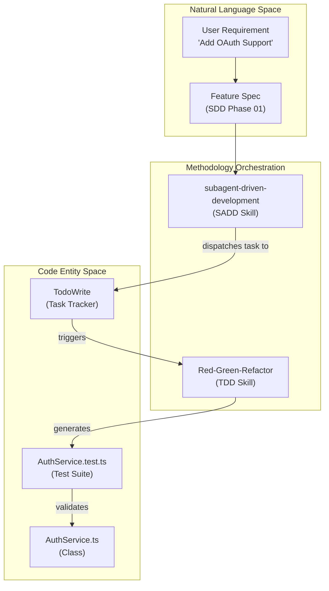
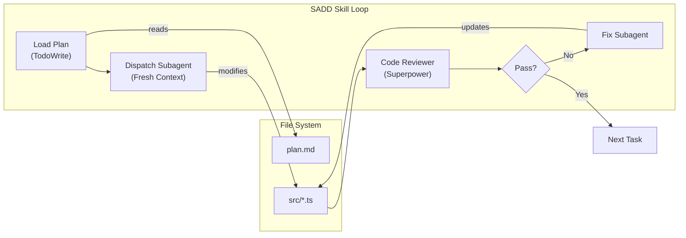

<!-- source: DeepWiki mcp.deepwiki.com · repo neolabhq/context-engineering-kit · page 3.2 Development Workflow Plugins · fetched 2026-10-27 -->

# Development Workflow Plugins

Relevant source files

The following files were used as context for generating this wiki page:

- [plugins/sadd/skills/subagent-driven-development/SKILL.md](plugins/sadd/skills/subagent-driven-development/SKILL.md)
- [plugins/tdd/skills/test-driven-development/SKILL.md](plugins/tdd/skills/test-driven-development/SKILL.md)

Development Workflow Plugins implement structured software development methodologies that guide the complete lifecycle from requirements to implementation. These plugins provide systematic approaches to building features with quality gates, testing discipline, and architectural consistency.

This page provides an overview of the four core development workflow plugins: **Test-Driven Development (TDD)**, **Spec-Driven Development (SDD)**, **Subagent-Driven Development (SADD)**, and **Domain-Driven Development (DDD)**. For detailed documentation of individual plugins, see [TDD Plugin](#3.2.1), [SDD Plugin](#3.2.2), [SADD Plugin](#3.2.3), and [DDD Plugin](#3.2.4). For complete feature development workflows combining these plugins, see [Feature Development Workflow](#5.1) and [Spec-Driven Development Workflow](#5.2).

---

## Plugin Capabilities Overview

Each development workflow plugin serves a distinct role in the software development process:

| Plugin | Type | Primary Purpose | Key Mechanism |
|--------|------|-----------------|---------------|
| **TDD** | Commands + Skills | Test coverage and verification | `/tdd:write-tests`, `/tdd:fix-tests` with Red-Green-Refactor |
| **SDD** | Commands + Agents | Specification-driven feature development | 6-phase workflow from `/sdd:00-setup` to `/sdd:05-document` |
| **SADD** | Skills only | Quality gates through fresh subagents | Skill enables task dispatch with code review between tasks |
| **DDD** | Commands + Skills | Architecture and design standards | `/ddd:setup-code-formating` + `software-architecture` skill |

**Sources:** [plugins/tdd/plugin.json:2-14](), [plugins/sdd/plugin.json:2-19](), [plugins/sadd/plugin.json:2-9](), [plugins/ddd/plugin.json:2-9]()

---

## Methodology Characteristics

### Test-Driven Development (TDD)

TDD enforces **test-first discipline** where production code is only written after a failing test exists. The plugin implements the Red-Green-Refactor cycle with strict anti-pattern detection.

**Core Philosophy:** "No production code without a failing test first" [plugins/tdd/skills/test-driven-development/SKILL.md:36-37](). Tests prove correctness through the failing → passing transition.

**Key Components:**
- **Iron Law:** If you didn't watch the test fail, you don't know if it tests the right thing [plugins/tdd/skills/test-driven-development/SKILL.md:12-12]().
- **Red-Green-Refactor:** A 3-stage cycle (Write failing test → Minimal code to pass → Clean up) [plugins/tdd/skills/test-driven-development/SKILL.md:52-71]().

**When to Use:**
- New features, bug fixes, and refactoring [plugins/tdd/skills/test-driven-development/SKILL.md:18-23]().
- When behavior changes are required with high confidence.

**Sources:** [plugins/tdd/skills/test-driven-development/SKILL.md:1-205]()

---

### Spec-Driven Development (SDD)

SDD implements a **6-phase specification-driven workflow** based on GitHub Spec Kit. It uses specialized agents for effective context management.

**Core Philosophy:** Transform natural language into rigorous feature specifications, plans, and tasks before implementation.

**Phases:**
- `00-setup`: Project constitution (principles, constraints).
- `01-specify`: Natural language to feature specification.
- `02-plan`: Implementation planning.
- `03-tasks`: Detailed task breakdown.
- `04-implement`: Execution with TDD.
- `05-document`: Final documentation.

**Specialized Agents:**
- `code-architect`: System architecture design.
- `code-explorer`: Codebase navigation.
- `code-reviewer`: Quality review against specs.

**Sources:** [plugins/sdd/plugin.json:2-19]()

---

### Subagent-Driven Development (SADD)

SADD provides a **skill for orchestrating fresh subagents** with code review quality gates between tasks. This prevents "context pollution" by using a clean agent for every task [plugins/sadd/skills/subagent-driven-development/SKILL.md:15-15]().

**Core Principle:** Fresh subagent per task + review between tasks = high quality, fast iteration [plugins/sadd/skills/subagent-driven-development/SKILL.md:10-10]().

**Execution Types:**
- **Sequential:** For tightly coupled tasks that must be executed in order [plugins/sadd/skills/subagent-driven-development/SKILL.md:21-31]().
- **Parallel:** For independent tasks across different subsystems [plugins/sadd/skills/subagent-driven-development/SKILL.md:32-42]().

**Review Mechanism:**
After a subagent reports back, a `code-reviewer` subagent is dispatched to assess strengths and issues [plugins/sadd/skills/subagent-driven-development/SKILL.md:75-91]().

**Sources:** [plugins/sadd/skills/subagent-driven-development/SKILL.md:1-128]()

---

### Domain-Driven Development (DDD)

DDD focuses on **architecture and design pattern setup**. It configures `CLAUDE.md` with Clean Architecture and SOLID principles to ensure long-term maintainability.

**Core Philosophy:** Establish architectural boundaries and tactical patterns (Entities, Value Objects, Repositories) upfront.

**Key Skill:**
- `software-architecture`: Enforces Clean Architecture and SOLID principles during the implementation phase.

**Sources:** [plugins/ddd/plugin.json:2-9]()

---

## Plugin Interconnections

The following diagram illustrates how these methodologies bridge high-level requirements to specific code entities.

### From Spec to Code: Methodology Bridge
Title: "Natural Language to Code Entity Mapping"

**Sources:** [plugins/sadd/skills/subagent-driven-development/SKILL.md:45-50](), [plugins/tdd/skills/test-driven-development/SKILL.md:52-71]()

---

## Workflow Decision Matrix

Choose the appropriate plugin(s) based on your development scenario:

| Scenario | Recommended Plugins | Workflow |
|----------|-------------------|----------|
| **Simple feature, tests needed** | TDD | Use `test-driven-development` skill to watch tests fail first. |
| **Complex feature, unclear requirements** | SDD → TDD | Phase 01 (Specify) through Phase 04 (Implement with TDD). |
| **Large feature, multiple subtasks** | SADD + TDD | Dispatch subagents for each task defined in SDD Phase 03. |
| **New project setup** | DDD | Run `/ddd:setup-code-formating` to establish standards. |

**Sources:** [plugins/sadd/skills/subagent-driven-development/SKILL.md:27-42](), [plugins/tdd/skills/test-driven-development/SKILL.md:16-24]()

---

## Subagent Orchestration Detail

The SADD plugin implements a rigorous loop to ensure code quality through isolated execution environments.

### SADD Task Loop
Title: "Subagent Execution and Review Gate"

**Sources:** [plugins/sadd/skills/subagent-driven-development/SKILL.md:43-111]()

---

## Command and Skill Inventory

### Skills by Plugin

| Plugin | Skill Name | Purpose |
|--------|-----------|---------|
| **TDD** | `tdd:test-driven-development` | Enforces "No production code without a failing test" [plugins/tdd/skills/test-driven-development/SKILL.md:36-37](). |
| **SADD** | `sadd:subagent-driven-development` | Manages sequential or parallel task execution with review gates [plugins/sadd/skills/subagent-driven-development/SKILL.md:1-10](). |
| **DDD** | `ddd:software-architecture` | Guides implementation towards Clean Architecture and SOLID. |

**Sources:** [plugins/tdd/plugin.json:11-13](), [plugins/sadd/plugin.json:6-8](), [plugins/ddd/plugin.json:6-8]()

---

## Summary

Development workflow plugins provide systematic methodologies for software development:

- **TDD** enforces test-first discipline with the Red-Green-Refactor cycle.
- **SDD** provides a 6-phase specification-driven workflow with specialized agents.
- **SADD** orchestrates subagents with quality gates between tasks to prevent context pollution.
- **DDD** establishes architectural patterns and design standards in `CLAUDE.md`.

For details on specific plugins, navigate to their respective child pages:
- [TDD Plugin](#3.2.1)
- [SDD Plugin](#3.2.2)
- [SADD Plugin](#3.2.3)
- [DDD Plugin](#3.2.4)

**Sources:** [plugins/tdd/skills/test-driven-development/SKILL.md:1-50](), [plugins/sadd/skills/subagent-driven-development/SKILL.md:1-20]()

---

