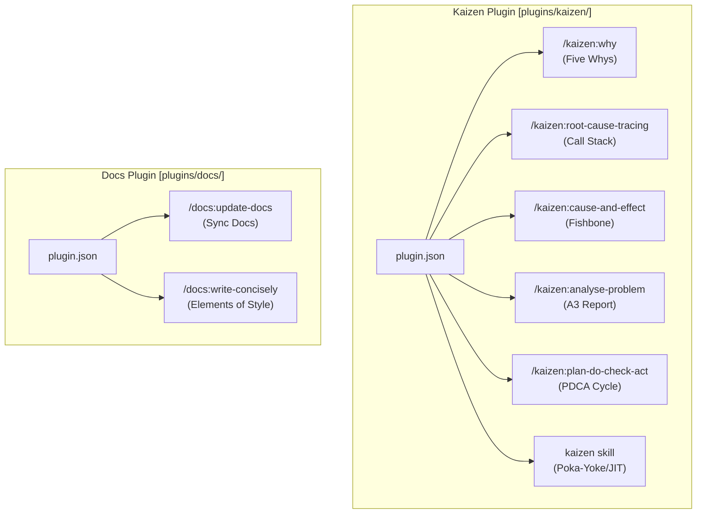
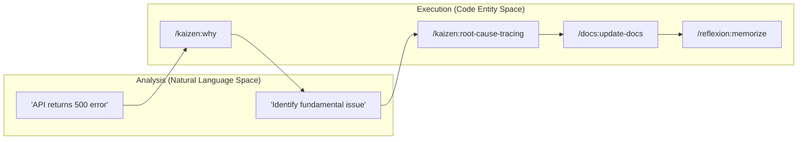

<!-- source: DeepWiki mcp.deepwiki.com · repo neolabhq/context-engineering-kit · page 3.4 Continuous Improvement Plugins · fetched 2026-10-27 -->

# Continuous Improvement Plugins

Relevant source files

The following files were used as context for generating this wiki page:

- [docs/plugins/docs/README.md](docs/plugins/docs/README.md)
- [docs/plugins/git/README.md](docs/plugins/git/README.md)
- [docs/plugins/kaizen/README.md](docs/plugins/kaizen/README.md)
- [docs/plugins/tdd/README.md](docs/plugins/tdd/README.md)
- [docs/plugins/tech-stack/README.md](docs/plugins/tech-stack/README.md)
- [plugins/docs/.claude-plugin/plugin.json](plugins/docs/.claude-plugin/plugin.json)
- [plugins/docs/README.md](plugins/docs/README.md)
- [plugins/git/.claude-plugin/plugin.json](plugins/git/.claude-plugin/plugin.json)
- [plugins/git/README.md](plugins/git/README.md)
- [plugins/kaizen/.claude-plugin/plugin.json](plugins/kaizen/.claude-plugin/plugin.json)
- [plugins/kaizen/README.md](plugins/kaizen/README.md)
- [plugins/tdd/.claude-plugin/plugin.json](plugins/tdd/.claude-plugin/plugin.json)
- [plugins/tdd/README.md](plugins/tdd/README.md)
- [plugins/tech-stack/README.md](plugins/tech-stack/README.md)

The Continuous Improvement Plugins category encompasses two complementary plugins that enable systematic analysis, learning, and documentation throughout the development lifecycle: **Kaizen** and **Docs**. Together, they implement a feedback loop where problems are analyzed, root causes are identified, improvements are documented, and learnings are preserved for future sessions.

This page provides an overview of both plugins, their relationship, and how they work together to create a continuously improving development environment. For detailed command references and usage:
- See [Kaizen Plugin](#3.4.1) for root cause analysis and problem-solving techniques.
- See [Docs Plugin](#3.4.2) for documentation management and living documentation practices.

## Plugin Overview

### Kaizen: Problem Analysis and Root Cause Investigation

The Kaizen plugin implements proven manufacturing problem-solving methodologies from the **Toyota Production System (TPS)** and **Lean manufacturing** adapted for software development [plugins/kaizen/README.md:12-16](). It focuses on finding root causes rather than treating symptoms to prevent entire classes of problems [plugins/kaizen/README.md:17-19]().

**Core Capabilities:**
- **Root Cause Analysis**: Using Five Whys (`/kaizen:why`) and Fishbone diagrams (`/kaizen:cause-and-effect`) [plugins/kaizen/README.md:40-42]().
- **Bug Tracing**: Systematically tracing bugs through the call stack (`/kaizen:root-cause-tracing`) [plugins/kaizen/README.md:41]().
- **Process Optimization**: Smart analysis of Gemba Walk, Value Stream Mapping, or Muda (Waste) analysis (`/kaizen:analyse`) [plugins/kaizen/README.md:44]().
- **Structured Documentation**: Comprehensive A3 problem documentation (`/kaizen:analyse-problem`) [plugins/kaizen/README.md:43]().
- **Iterative Improvement**: Applying the PDCA (Plan-Do-Check-Act) cycle [plugins/kaizen/README.md:45]().

**Skills:**
- `kaizen`: An automatically applied skill guiding a continuous improvement mindset, including Poka-Yoke (error proofing) and Just-In-Time (JIT) principles [plugins/kaizen/README.md:49-60]().

Sources: [plugins/kaizen/README.md:1-88](), [plugins/kaizen/.claude-plugin/plugin.json:1-10]()

### Docs: Living Documentation Management

The Docs plugin maintains accurate, useful documentation throughout the development lifecycle, ensuring docs stay synchronized with implementation changes [plugins/docs/README.md:1-10](). It is grounded in classic writing principles from *The Elements of Style* by William Strunk Jr. [plugins/docs/README.md:63-70]().

**Core Capabilities:**
- **Living Documentation**: Documentation that evolves alongside the codebase [plugins/docs/README.md:14]().
- **Smart Prioritization**: Focuses on high-impact documentation that helps users accomplish real tasks [plugins/docs/README.md:15]().
- **Concise Writing**: Applies principles like active voice, omitting needless words, and using positive form (`/docs:write-concisely`) [plugins/docs/README.md:58-81]().
- **Documentation Audit**: Assesses existing docs for freshness and accuracy [plugins/docs/README.md:25]().

**Key Commands:**
- `/docs:update-docs`: Analyzes the project and identifies documentation needs to create or update content [plugins/docs/README.md:51-55]().
- `/docs:write-concisely`: Refines documentation for clarity and strength [plugins/docs/README.md:58-61]().

Sources: [plugins/docs/README.md:1-83](), [plugins/docs/.claude-plugin/plugin.json:1-10]()

## Architecture and Integration

### Plugin Structure

The following diagram maps the high-level plugin commands to their respective manifests and internal structures.

**Plugin Entity Mapping**

Sources: [plugins/kaizen/README.md:38-50](), [plugins/docs/README.md:49-61]()

### Continuous Improvement Feedback Loop

This diagram bridges the "Natural Language Space" of problem-solving to the "Code Entity Space" of plugin commands.

**Improvement Lifecycle Integration**

Sources: [plugins/kaizen/README.md:20-35](), [plugins/docs/README.md:30-45]()

## Plugin Comparison

| Aspect | Kaizen Plugin | Docs Plugin |
|--------|---------------|-------------|
| **Primary Focus** | Root cause investigation and process waste elimination [plugins/kaizen/README.md:7-10]() | Documentation accuracy and "Living Docs" [plugins/docs/README.md:7-10]() |
| **Methodology** | Lean, Toyota Production System, Six Sigma [plugins/kaizen/README.md:65-88]() | *The Elements of Style* (Strunk & White) [plugins/docs/README.md:68-81]() |
| **Key Output** | A3 Reports, Fishbone Diagrams, PDCA cycles [plugins/kaizen/README.md:40-45]() | Updated READMEs, API docs, concise technical prose [plugins/docs/README.md:51-61]() |
| **Automation** | `kaizen` skill applies principles automatically [plugins/kaizen/README.md:49-51]() | Command-driven updates and refinement [plugins/docs/README.md:49-61]() |

Sources: [plugins/kaizen/README.md:1-88](), [plugins/docs/README.md:1-83]()

## Common Workflows

### Bug Investigation and Knowledge Preservation
When a bug is found, the `kaizen` plugin identifies why it happened, and the `docs` plugin ensures the solution is documented to prevent future occurrences.

1. **Investigate**: Use `/kaizen:why` to find the root cause [plugins/kaizen/README.md:27]().
2. **Trace**: Use `/kaizen:root-cause-tracing` to find the exact line in the call stack [plugins/kaizen/README.md:41]().
3. **Document**: After fixing, use `/docs:update-docs` to update the relevant module documentation [plugins/docs/README.md:38]().

### Feature Implementation and Tech Stack Alignment
When adding new features, use the `tech-stack` plugin (see [Tech Stack Plugin](#3.5.1)) for initial standards and `docs` to finalize the work.

1. **Setup**: `/tech-stack:add-typescript-best-practices` to update `CLAUDE.md` [plugins/tech-stack/README.md:23]().
2. **Implement**: Claude follows `CLAUDE.md` standards [plugins/tech-stack/README.md:34]().
3. **Finalize**: `/docs:update-docs` to sync the new implementation with project documentation [plugins/docs/README.md:38]().

Sources: [plugins/kaizen/README.md:20-45](), [plugins/docs/README.md:30-55](), [plugins/tech-stack/README.md:1-45]()

---

