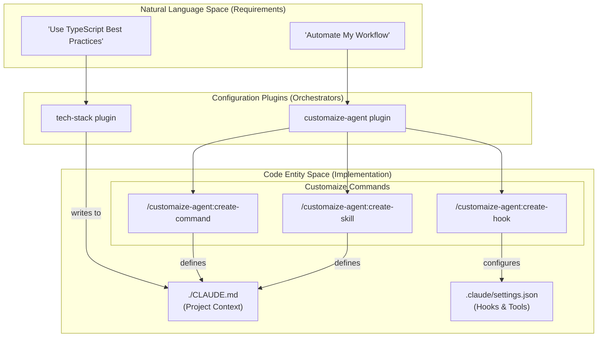
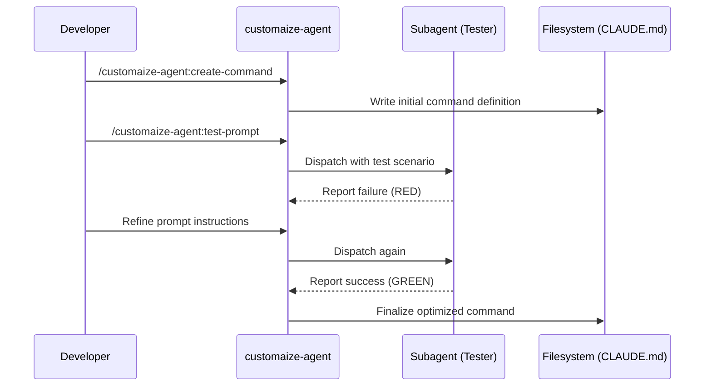

<!-- source: DeepWiki mcp.deepwiki.com · repo neolabhq/context-engineering-kit · page 3.5 Configuration Plugins · fetched 2026-10-27 -->

# Configuration Plugins

Relevant source files

The following files were used as context for generating this wiki page:

- [docs/plugins/customaize-agent/README.md](docs/plugins/customaize-agent/README.md)
- [plugins/customaize-agent/README.md](plugins/customaize-agent/README.md)
- [plugins/tech-stack/.claude-plugin/plugin.json](plugins/tech-stack/.claude-plugin/plugin.json)

Configuration plugins establish project-level standards and enable custom plugin development. Unlike productivity plugins that perform development tasks, configuration plugins **modify project configuration files** (like `CLAUDE.md` or `.claude/settings.json`) to set persistent context that affects all future Claude Code sessions.

This page documents the **Tech Stack** and **Customaize Agent** plugins.

---

## Overview

Configuration plugins serve two distinct purposes in the Context Engineering Kit:

1.  **Tech Stack Plugin**: Injects language/framework-specific best practices into `CLAUDE.md` to guide Claude's code generation and analysis.
2.  **Customaize Agent Plugin**: Provides a framework for creating, testing, and optimizing project-specific commands, skills, and hooks using Anthropic best practices. [plugins/customaize-agent/README.md:1-10]()

Both plugins modify the persistent context that Claude Code loads at the start of every session, making their effects project-wide and durable.

| Aspect | Configuration Plugins | Other Plugin Types (e.g., Code Review) |
| :--- | :--- | :--- |
| **Primary Action** | Write to `CLAUDE.md` / Configs | Execute commands / Analyze code |
| **Effect Duration** | Permanent (until manually removed) | Session-scoped or Task-scoped |
| **Usage Frequency** | Once during project setup/update | Repeatedly during development |
| **Target Files** | `CLAUDE.md`, `.claude/settings.json` | Source code, Tests, PRs |

Sources: [plugins/tech-stack/.claude-plugin/plugin.json:1-9](), [plugins/customaize-agent/README.md:18-22]()

---

## Configuration Architecture

The following diagram illustrates how Configuration Plugins bridge the gap between high-level project requirements and the specific code entities that govern Claude's behavior.

### From Standards to Code Entities

**Sources:** [plugins/tech-stack/.claude-plugin/plugin.json:1-4](), [plugins/customaize-agent/README.md:48-57]()

---

## Tech Stack Plugin

The Tech Stack plugin provides commands for the initial setup or update of the `CLAUDE.md` file with industry-standard best practices for specific languages or frameworks. [plugins/tech-stack/.claude-plugin/plugin.json:1-4]()

### Purpose and Scope
By running tech-stack commands, developers ensure that Claude Code understands the specific constraints of their environment (e.g., TypeScript strict mode, React hooks patterns, or specific library preferences). This reduces the need for repetitive prompting during feature development.

For detailed command references and supported stacks, see **[Tech Stack Plugin (#3.5.1)]**.

---

## Customaize Agent Plugin

The Customaize Agent plugin is a comprehensive framework for extending Claude Code's capabilities. It applies **Test-Driven Development (TDD)** principles to prompt engineering. [plugins/customaize-agent/README.md:1-10]()

### Core Capabilities
- **Extension Creation**: Interactive assistants for building commands, skills, and hooks with proper structure. [plugins/customaize-agent/README.md:7-7]()
- **Prompt TDD**: A RED-GREEN-REFACTOR cycle for prompts where you write test scenarios, watch agents fail, and iterate until the prompt is bulletproof. [plugins/customaize-agent/README.md:20-22]()
- **Anthropic Best Practices**: Built-in adherence to official guidelines for skill authoring and discoverability. [plugins/customaize-agent/README.md:9-9]()
- **Persuasion Optimization**: Incorporates research-backed persuasion principles to increase agent compliance rates. [plugins/customaize-agent/README.md:22-22]()

### Extension Lifecycle Management

**Sources:** [plugins/customaize-agent/README.md:20-22](), [plugins/customaize-agent/README.md:50-57]()

### Key Commands
- `/customaize-agent:create-command`: Create new interactive commands. [plugins/customaize-agent/README.md:51-51]()
- `/customaize-agent:create-workflow-command`: Orchestrate multi-step workflows using sub-agents to solve **context bloat**. [plugins/customaize-agent/README.md:52-52]()
- `/customaize-agent:test-skill`: Verify skills resist rationalization and follow discipline-enforcing rules. [plugins/customaize-agent/README.md:56-56]()
- `/customaize-agent:apply-anthropic-skill-best-practices`: Optimize existing skills for better performance. [plugins/customaize-agent/README.md:57-57]()

For details on creating custom extensions and prompt engineering techniques, see **[Customaize Agent Plugin (#3.5.2)]**.

---

## Summary of Configuration Impacts

| Plugin | Primary Target | Key Benefit |
| :--- | :--- | :--- |
| **Tech Stack** | `CLAUDE.md` | Consistent code quality across the team by codifying language standards. |
| **Customaize Agent** | `CLAUDE.md` & `.claude/` | Custom workflow automation and verified prompt reliability via TDD. |

**Sources:** [plugins/tech-stack/.claude-plugin/plugin.json:4-4](), [plugins/customaize-agent/README.md:14-17]()

---

