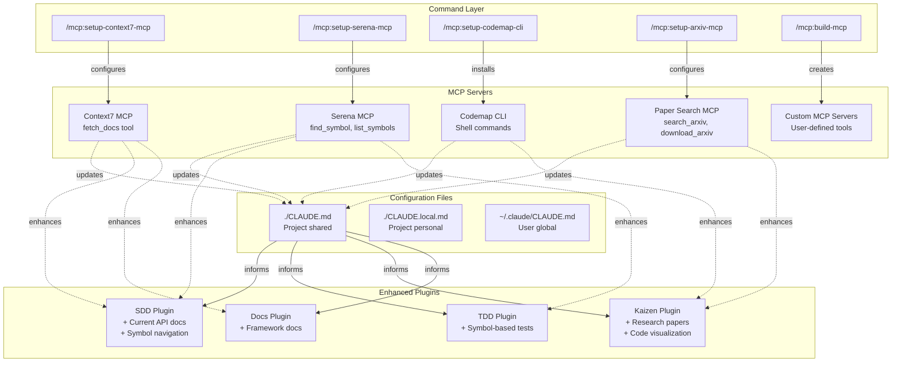
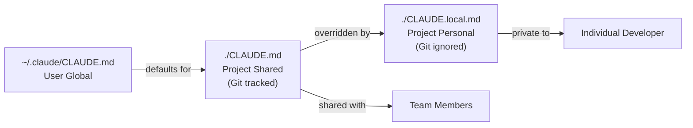
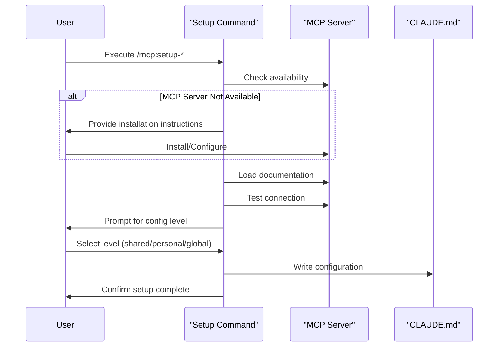
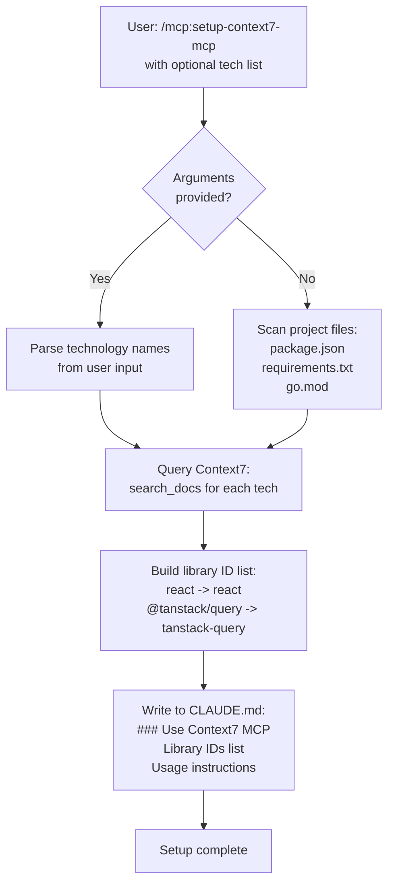
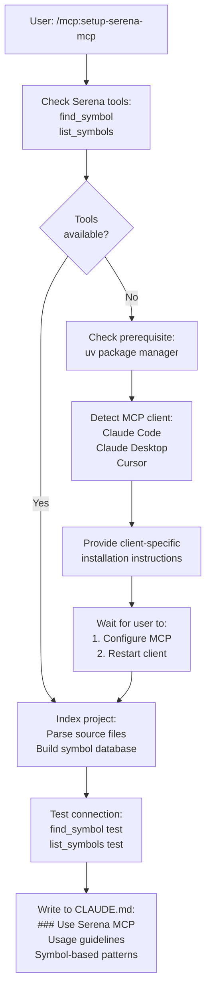
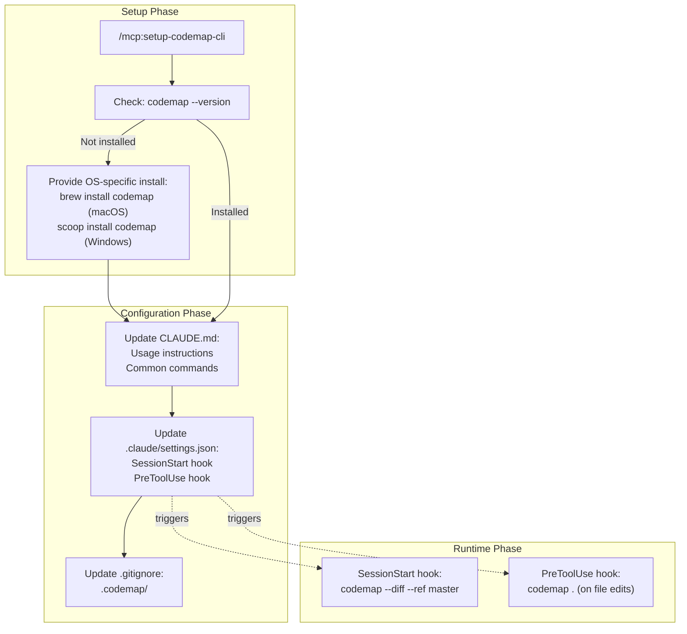
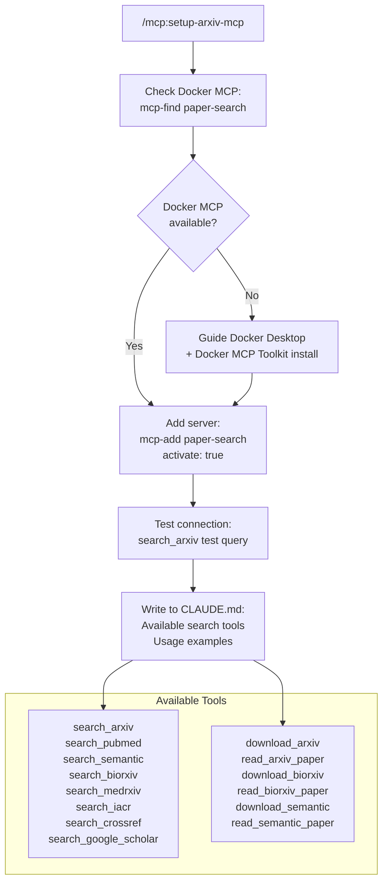
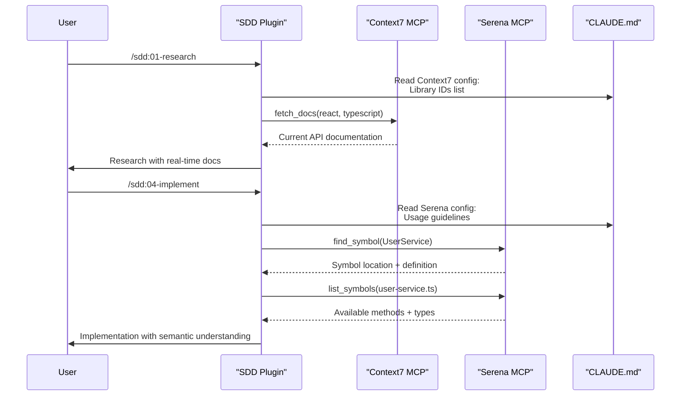

<!-- source: DeepWiki mcp.deepwiki.com · repo neolabhq/context-engineering-kit · page 4 MCP Integration Deep Dive · fetched 2026-10-27 -->

# MCP Integration Deep Dive

<details>
<summary>Relevant source files</summary>

The following files were used as context for generating this wiki page:

- [docs/guides/README.md](docs/guides/README.md)
- [docs/plugins/mcp/README.md](docs/plugins/mcp/README.md)
- [docs/plugins/mcp/recommended-mcp.md](docs/plugins/mcp/recommended-mcp.md)
- [docs/plugins/mcp/usage-examples.md](docs/plugins/mcp/usage-examples.md)
- [plugins/mcp/.claude-plugin/plugin.json](plugins/mcp/.claude-plugin/plugin.json)
- [plugins/mcp/README.md](plugins/mcp/README.md)

</details>


## Purpose and Scope

This document provides comprehensive technical documentation for Model Context Protocol (MCP) integration within the Context Engineering Kit. It covers the architecture of the MCP plugin, the five setup commands, configuration management, and integration patterns with other CEK plugins.

For basic MCP plugin usage and command reference, see [MCP Plugin Overview](#3.3.2). For practical workflow examples combining MCP with other plugins, see [Development Guides](#5).

**Sources:** [plugins/mcp/README.md:1-10](), [docs/plugins/mcp/README.md:1-10]()

---

## MCP Protocol Overview

Model Context Protocol is a standardized interface that enables LLMs to interact with external services, databases, and tools. MCP servers expose three types of capabilities to Claude:

| Capability | Purpose | Example Use Cases |
|------------|---------|-------------------|
| **Resources** | External data Claude can read | Documentation files, API responses, database records |
| **Tools** | Actions Claude can execute | Search operations, data transformations, API calls |
| **Prompts** | Reusable templates with dynamic inputs | Formatted queries, structured analysis requests |

MCP eliminates the need to load all external context upfront. Instead, Claude requests specific information on-demand, reducing token consumption while expanding available knowledge.

**Sources:** [docs/plugins/mcp/recommended-mcp.md:6-13]()

---

## MCP Plugin Architecture



**MCP Plugin Architecture Diagram** - The MCP plugin provides five setup commands that configure external MCP servers. Each command updates configuration files (CLAUDE.md) with usage instructions. MCP servers then enhance other CEK plugins by providing specialized capabilities.

**Sources:** [plugins/mcp/README.md:13-20](), [docs/plugins/mcp/README.md:13-20]()

---

## Three-Tier Configuration System

The MCP plugin uses Claude's hierarchical configuration system to manage MCP server settings at three levels:

### Configuration Hierarchy



**Configuration Hierarchy Diagram** - User-global settings provide defaults, project-shared settings establish team standards, and project-personal settings allow individual customization.

| Configuration Level | File Path | Git Tracked | Use Case |
|---------------------|-----------|-------------|----------|
| User Global | `~/.claude/CLAUDE.md` | No | Personal defaults across all projects |
| Project Shared | `./CLAUDE.md` | Yes | Team-wide MCP server configuration |
| Project Personal | `./CLAUDE.local.md` | No | Individual overrides, API keys |

### Configuration Selection Process

Each setup command prompts for configuration level:

```
Where should this configuration be saved?
1. Project level (shared) - ./CLAUDE.md (tracked in git)
2. Project level (personal) - ./CLAUDE.local.md (not tracked)
3. User level (global) - ~/.claude/CLAUDE.md (applies to all projects)
```

**Sources:** [plugins/mcp/README.md:21-27](), [docs/plugins/mcp/README.md:21-27]()

---

## Setup Commands Reference

### Command Mapping to MCP Servers

| Command | MCP Server | Primary Capability | Configuration Output |
|---------|------------|-------------------|---------------------|
| `/mcp:setup-context7-mcp` | Context7 | Documentation fetching | Library IDs in CLAUDE.md |
| `/mcp:setup-serena-mcp` | Serena | Semantic code analysis | Usage guidelines in CLAUDE.md |
| `/mcp:setup-codemap-cli` | Codemap | Codebase visualization | Session hooks in `.claude/settings.json` |
| `/mcp:setup-arxiv-mcp` | Paper Search | Academic paper search | Docker MCP configuration |
| `/mcp:build-mcp` | Custom | User-defined tools | Four-phase development guide |

### Setup Command Workflow



**Setup Command Workflow Diagram** - Standard flow for all MCP setup commands: availability check, installation guidance, connection testing, configuration level selection, and CLAUDE.md update.

**Sources:** [plugins/mcp/README.md:80-88](), [docs/plugins/mcp/README.md:80-88]()

---

## Context7 MCP Integration

Context7 provides real-time access to library and framework documentation, eliminating hallucinations from outdated training data. For details, see [Context7 MCP Setup](#4.2).

### Technology Detection Flow



**Context7 Setup Flow Diagram** - The command either parses provided technology names or auto-detects from project files, queries Context7 for documentation IDs, and updates CLAUDE.md with the configuration.

**Sources:** [docs/plugins/mcp/usage-examples.md:50-80](), [docs/plugins/mcp/README.md:51]()

---

## Serena MCP Integration

Serena provides semantic understanding of codebases through symbol-based operations, enabling precise code navigation and refactoring. For details, see [Serena MCP Setup](#4.3).

### Serena Tool Mapping

| Serena Tool | Purpose | Use Case |
|-------------|---------|----------|
| `find_symbol` | Locate functions, classes, types by name | Finding function definitions across large codebases |
| `list_symbols` | List available symbols in file/module | Exploring module structure before editing |
| `read_file` | Read file contents with semantic context | Understanding code in context of symbols |

### Serena Setup Prerequisites



**Serena Setup Flow Diagram** - Complex setup process involving prerequisite checks, client-specific configuration, project indexing, and connection testing.

**Sources:** [docs/plugins/mcp/usage-examples.md:146-208](), [docs/plugins/mcp/README.md:52]()

---

## Codemap CLI Integration

Codemap provides intelligent codebase visualization through tree views, dependency analysis, and change tracking. Unlike other MCP servers, Codemap is a CLI tool that integrates via session hooks. For details, see [Codemap CLI Setup](#4.4).

### Codemap Integration Architecture



**Codemap Integration Architecture Diagram** - Codemap setup installs the CLI, configures session hooks in `.claude/settings.json`, and updates CLAUDE.md with usage patterns.

**Sources:** [docs/plugins/mcp/usage-examples.md:82-143](), [docs/plugins/mcp/README.md:53]()

---

## Paper Search MCP Integration

Paper Search MCP provides access to academic literature across multiple sources via Docker MCP. For details, see [Paper Search MCP Setup](#4.5).

### Paper Search Architecture



**Paper Search MCP Architecture Diagram** - Docker MCP-based setup that provides comprehensive academic paper search and download capabilities across 8 sources.

**Sources:** [docs/plugins/mcp/README.md:54](), [docs/plugins/mcp/recommended-mcp.md:28]()

---

## Building Custom MCP Servers

The `/mcp:build-mcp` command guides users through a four-phase process for creating production-ready MCP servers. For details, see [Building Custom MCP Servers](#4.6).

### Four-Phase Development Process

```mermaid
graph TD
    Start["/mcp:build-mcp"]
    
    subgraph "Phase 1: Research & Planning"
        Principles["Agent-Centric Design:<br/>- Workflow tools not API wrappers<br/>- Optimize for limited context<br/>- Actionable error messages<br/>- Natural task subdivisions"]
        LoadSpec["Load MCP spec from<br/>modelcontextprotocol.io"]
        Framework["Select framework:<br/>FastMCP (Python)<br/>MCP SDK (TypeScript)"]
        APIResearch["Exhaustive API research:<br/>Study target API docs"]
        Plan["Implementation plan:<br/>Tool selection<br/>Shared utilities<br/>Schema design<br/>Error handling"]
        
        Start --> Principles
        Principles --> LoadSpec
        LoadSpec --> Framework
        Framework --> APIResearch
        APIResearch --> Plan
    end
    
    subgraph "Phase 2: Implementation"
        Structure["Project structure:<br/>Language-specific best practices"]
        Infrastructure["Core infrastructure:<br/>API helpers<br/>Error handling<br/>Formatting utilities"]
        Tools["Implement tools:<br/>Systematic implementation<br/>Proper annotations"]
        
        Plan --> Structure
        Structure --> Infrastructure
        Infrastructure --> Tools
    end
    
    subgraph "Phase 3: Review & Refine"
        CodeReview["Code quality review:<br/>DRY principle<br/>Composability<br/>Consistency"]
        Testing["Testing:<br/>Syntax verification<br/>Import checks<br/>Use evaluation harness"]
        Checklist["Language-specific<br/>quality checklist"]
        
        Tools --> CodeReview
        CodeReview --> Testing
        Testing --> Checklist
    end
    
    subgraph "Phase 4: Create Evaluations"
        Inspect["Tool inspection:<br/>Understand capabilities"]
        Explore["Content exploration:<br/>Read-only operations"]
        Questions["Generate 10 complex<br/>evaluation questions"]
        Verify["Verify answers:<br/>Correctness & stability"]
        
        Checklist --> Inspect
        Inspect --> Explore
        Explore --> Questions
        Questions --> Verify
    end
```



**Custom MCP Server Development Process Diagram** - Four phases ensure high-quality MCP servers: research and planning, implementation, review and refinement, and evaluation creation.

**Sources:** [docs/plugins/mcp/README.md:55](), [docs/plugins/mcp/usage-examples.md:327-503]()

---

## MCP Enhancement Patterns

MCP servers enhance other CEK plugins by providing external capabilities. This section maps enhancement patterns across the plugin ecosystem.

### Integration Flow Example: SDD + Context7 + Serena



**SDD Enhanced by MCP Servers** - Spec-Driven Development workflow benefits from Context7 during research (current docs) and Serena during implementation (semantic code navigation).

**Sources:** [docs/plugins/mcp/usage-examples.md:211-254](), [docs/plugins/mcp/recommended-mcp.md:15-22]()

---

