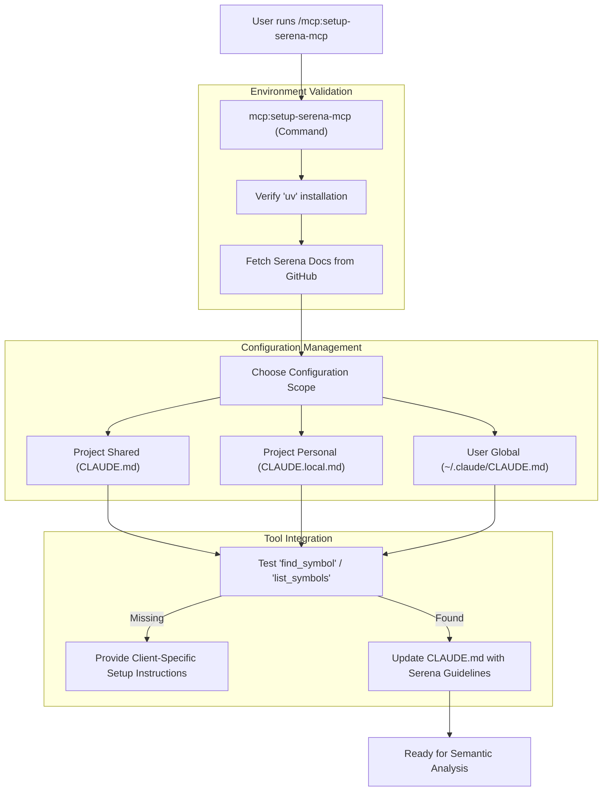
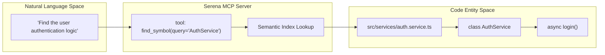

<!-- source: DeepWiki mcp.deepwiki.com · repo neolabhq/context-engineering-kit · page 4.3 Serena MCP Setup · fetched 2026-10-27 -->

# Serena MCP Setup

<details>
<summary>Relevant source files</summary>

The following files were used as context for generating this wiki page:

- [docs/guides/README.md](docs/guides/README.md)
- [docs/plugins/mcp/README.md](docs/plugins/mcp/README.md)
- [plugins/mcp/.claude-plugin/plugin.json](plugins/mcp/.claude-plugin/plugin.json)
- [plugins/mcp/README.md](plugins/mcp/README.md)

</details>


This page documents the setup and configuration of the Serena MCP server for semantic code analysis and symbol-based operations within the Context Engineering Kit. Serena provides intelligent code navigation through semantic understanding rather than text-based search, enabling precise code manipulation in large codebases.

## Overview

Serena is an MCP server that provides a semantic layer over codebases. Unlike traditional text-based tools like `grep`, Serena understands code structures—functions, classes, types, and their relationships. This allows AI assistants to perform operations based on language semantics.

### Core Capabilities
- **Symbol Discovery**: Locate functions, classes, and types by name across the entire project.
- **Structural Navigation**: Explore available symbols within specific files or modules.
- **Semantic Editing**: Make precise code changes while maintaining reference integrity.
- **Contextual Guidelines**: Project-specific usage guidelines via `initial_instructions`.

Sources: [docs/plugins/mcp/README.md:16-17](), [plugins/mcp/README.md:16-17](), [docs/plugins/mcp/README.md:52-53]()

---

## Setup Command

The setup process is initiated through the `/mcp:setup-serena-mcp` command. This command is designed to guide the user through environment verification, client configuration, and `CLAUDE.md` integration.

```bash
/mcp:setup-serena-mcp
```

### Data Flow and Implementation
The command follows a structured workflow to ensure the MCP server is correctly registered and indexed for the current project.

#### Serena Setup Logic Flow
"Natural Language Space" (User Intent) to "Code Entity Space" (Implementation)



Sources: [docs/plugins/mcp/README.md:40-42](), [plugins/mcp/README.md:40-42](), [docs/plugins/mcp/README.md:21-27]()

---

## Configuration Hierarchy

The setup command supports a three-tier configuration system to manage how the AI uses Serena.

| Tier | File Path | Scope | Use Case |
| :--- | :--- | :--- | :--- |
| **Project (Shared)** | `./CLAUDE.md` | Team/Repo | Standardized semantic search patterns for all contributors. |
| **Project (Personal)** | `./CLAUDE.local.md` | Local/Project | Personal indexing preferences or local-only paths. |
| **User (Global)** | `~/.claude/CLAUDE.md` | All Projects | Global fallback for Serena tools across different codebases. |

Sources: [docs/plugins/mcp/README.md:21-27](), [plugins/mcp/README.md:21-27]()

---

## Semantic Toolset

Once configured, Serena exposes specific tools that bridge the gap between file-system strings and semantic entities.

### Key Tools and Functions

| Code Entity (Tool Name) | Description | Primary Use Case |
| :--- | :--- | :--- |
| `find_symbol` | Locates specific code entities (classes, methods, interfaces). | Jumping to a definition without knowing the file path. |
| `list_symbols` | Lists all semantic entities within a scope. | Understanding the public API of a module or file. |
| `initial_instructions` | Provides project-specific guidance for the AI. | Learning how the specific project prefers to use Serena. |

### Semantic Mapping Diagram
This diagram shows how Serena maps natural language queries to specific code entities within the project structure.



Sources: [docs/plugins/mcp/README.md:52-53](), [plugins/mcp/README.md:52-53]()

---

## Client-Specific Setup

The `/mcp:setup-serena-mcp` command detects the environment and provides tailored instructions for various MCP clients:

1.  **Claude Code**: Direct integration via command line.
2.  **Claude Desktop**: Configuration via `claude_desktop_config.json`.
3.  **Cursor**: Integration via the Cursor MCP settings pane.
4.  **VSCode**: Configuration via the MCP extension settings.

The setup ensures that `uv` (the Python package installer/runner) is used to execute Serena, providing a lightweight, isolated environment for the server.

Sources: [docs/plugins/mcp/README.md:11-19](), [plugins/mcp/README.md:11-19]()

---

## Best Practices for Serena Integration

To maximize the effectiveness of semantic analysis, the following patterns are recommended:

1.  **Prefer Symbols Over Grep**: Always use `find_symbol` before falling back to `grep` or `ls`. It provides better context regarding the type and role of the code entity.
2.  **Indexing**: Ensure the project is indexed by running the initialization commands provided during setup.
3.  **Contextual Updates**: The setup command automatically appends usage requirements to `CLAUDE.md`. Do not remove these, as they instruct the LLM on when and how to invoke Serena tools effectively.

Sources: [docs/plugins/mcp/README.md:27](), [plugins/mcp/README.md:27]()

---

