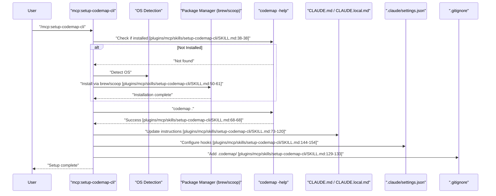
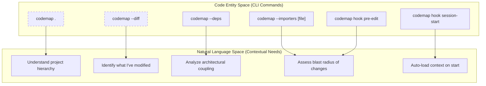

<!-- source: DeepWiki mcp.deepwiki.com · repo neolabhq/context-engineering-kit · page 4.4 Codemap CLI Setup · fetched 2026-10-27 -->

# Codemap CLI Setup

<details>
<summary>Relevant source files</summary>

The following files were used as context for generating this wiki page:

- [docs/guides/README.md](docs/guides/README.md)
- [docs/plugins/mcp/README.md](docs/plugins/mcp/README.md)
- [plugins/mcp/.claude-plugin/plugin.json](plugins/mcp/.claude-plugin/plugin.json)
- [plugins/mcp/README.md](plugins/mcp/README.md)
- [plugins/mcp/skills/setup-codemap-cli/SKILL.md](plugins/mcp/skills/setup-codemap-cli/SKILL.md)

</details>


This document covers the installation and configuration of Codemap CLI for codebase visualization and navigation within Claude Code sessions. Codemap provides tree views, dependency analysis, change tracking, and automatic context injection through session hooks.

**Scope**: This page focuses specifically on Codemap CLI setup via the `/mcp:setup-codemap-cli` command. For general MCP architecture concepts, see [4.1](). For other MCP server setups, see Context7 ([4.2]()), Serena ([4.3]()), or Paper Search ([4.5]()).

**Note**: Codemap is a CLI tool, not an MCP server. It integrates with Claude Code through the MCP plugin's setup command and session hooks configured in `.claude/settings.json`.

Sources: [docs/plugins/mcp/README.md:17-17](), [plugins/mcp/README.md:17-17](), [plugins/mcp/skills/setup-codemap-cli/SKILL.md:144-161]()

## What is Codemap CLI

Codemap CLI is a command-line tool that provides intelligent codebase visualization and navigation capabilities. Unlike MCP servers that expose tools through the Model Context Protocol, Codemap operates as a standard CLI tool that integrates with Claude Code through session hooks.

**Key Capabilities**:

| Feature | Description | Command Example |
|---------|-------------|-----------------|
| Tree Visualization | Generate project structure with file sizes and types | `codemap .` |
| Change Tracking | Compare current state against branch reference | `codemap --diff --ref master` |
| Dependency Analysis | Analyze import relationships and module dependencies | `codemap --deps .` |
| Hub Detection | Identify files with high import/export centrality | `codemap hook session-start` |
| Importer Tracking | Find all files that import a specific module | `codemap --importers <file>` |
| City Skyline | Visual representation of codebase size/structure | `codemap --skyline .` |

Sources: [plugins/mcp/skills/setup-codemap-cli/SKILL.md:84-105](), [plugins/mcp/skills/setup-codemap-cli/SKILL.md:164-171]()

## Installation Process

### Setup Command Flow

The setup process is orchestrated by the `mcp:setup-codemap-cli` skill, which handles environment detection and configuration.

Title: Codemap Setup Sequence


**OS-Specific Installation Commands**:
- **macOS/Linux (Homebrew)**: `brew tap JordanCoin/tap && brew install codemap` [plugins/mcp/skills/setup-codemap-cli/SKILL.md:50-54]()
- **Windows (Scoop)**: `scoop bucket add codemap https://github.com/JordanCoin/scoop-codemap && scoop install codemap` [plugins/mcp/skills/setup-codemap-cli/SKILL.md:56-61]()

Sources: [plugins/mcp/skills/setup-codemap-cli/SKILL.md:36-71]()

## Configuration System

### Multi-Level Configuration

The setup command allows users to choose the storage level for both instructions and hooks.

| Level | CLAUDE.md Path | Hook Settings Path | Purpose |
|-------|----------------|--------------------|---------|
| **Project (shared)** | `./CLAUDE.md` | `./.claude/settings.json` | Team-wide standards |
| **Project (personal)** | `./CLAUDE.local.md` | `./.claude/settings.local.json` | Local overrides (gitignored) |
| **User (global)** | `~/.claude/CLAUDE.md` | `~/.claude/settings.json` | Cross-project defaults |

Sources: [plugins/mcp/skills/setup-codemap-cli/SKILL.md:15-34]()

### CLAUDE.md Content

Once installed, the selected `CLAUDE.md` file is updated with a section titled "Use Codemap CLI for Codebase Navigation". This section mandates the use of `codemap --diff --ref master` for researching branch changes.

Sources: [plugins/mcp/skills/setup-codemap-cli/SKILL.md:73-81]()

### Session Hooks Configuration

The primary integration mechanism is through `.claude/settings.json` hooks. The default configuration enables the `SessionStart` hook to provide immediate context.

**Basic Hook Implementation**:
```json
{
    "hooks": {
        "session-start": "codemap hook session-start && echo 'git diff:' && git diff --stat && echo 'git status:' && git status"
    }
}
```

If the default branch is `master`, the command is adjusted to `codemap hook session-start --ref=master`.

Sources: [plugins/mcp/skills/setup-codemap-cli/SKILL.md:148-158]()

## Codemap Command Reference

### Command Types and Logic

Title: Codemap CLI Functional Mapping


Sources: [plugins/mcp/skills/setup-codemap-cli/SKILL.md:84-105](), [plugins/mcp/skills/setup-codemap-cli/SKILL.md:164-171]()

### Core Command Options

| Flag | Description |
|------|-------------|
| `--depth, -d <n>` | Limit tree depth (0 = unlimited) |
| `--only <exts>` | Only show files with these extensions |
| `--exclude <patterns>` | Exclude files matching patterns |
| `--diff` | Show files changed vs main branch |
| `--ref <branch>` | Branch to compare against (with --diff) |
| `--deps` | Dependency flow mode |
| `--importers <file>` | Check who imports a file |
| `--skyline` | City skyline visualization |

Sources: [plugins/mcp/skills/setup-codemap-cli/SKILL.md:95-105]()

## Advanced Hook Integration

Claude Code supports granular hooks that trigger during different lifecycle events. The `mcp:setup-codemap-cli` skill provides a template for full automation.

| Hook | Trigger Event | Codemap Command | Context Provided |
|------|---------------|-----------------|------------------|
| `SessionStart` | Session initialization | `codemap hook session-start` | Full tree, hubs, branch diff |
| `PreToolUse` | Before `Edit` or `Write` | `codemap hook pre-edit` | Importers of target file + hubs |
| `PostToolUse` | After `Edit` or `Write` | `codemap hook post-edit` | Impact analysis of the change |
| `UserPromptSubmit`| User sends prompt | `codemap hook prompt-submit` | Hub context for mentioned files |
| `PreCompact` | Context compaction | `codemap hook pre-compact` | Persists hub state to `.codemap/hubs.txt` |
| `SessionEnd` | Session termination | `codemap hook session-stop` | Edit timeline and line count stats |

Sources: [plugins/mcp/skills/setup-codemap-cli/SKILL.md:164-171](), [plugins/mcp/skills/setup-codemap-cli/SKILL.md:176-242]()

### Complete Configuration Example

```json
{
  "hooks": {
    "SessionStart": [{ "hooks": [{ "type": "command", "command": "codemap hook session-start" }] }],
    "PreToolUse": [{ "matcher": "Edit|Write", "hooks": [{ "type": "command", "command": "codemap hook pre-edit" }] }],
    "PostToolUse": [{ "matcher": "Edit|Write", "hooks": [{ "type": "command", "command": "codemap hook post-edit" }] }],
    "SessionEnd": [{ "hooks": [{ "type": "command", "command": "codemap hook session-stop" }] }]
  }
}
```

Sources: [plugins/mcp/skills/setup-codemap-cli/SKILL.md:176-242]()

---

