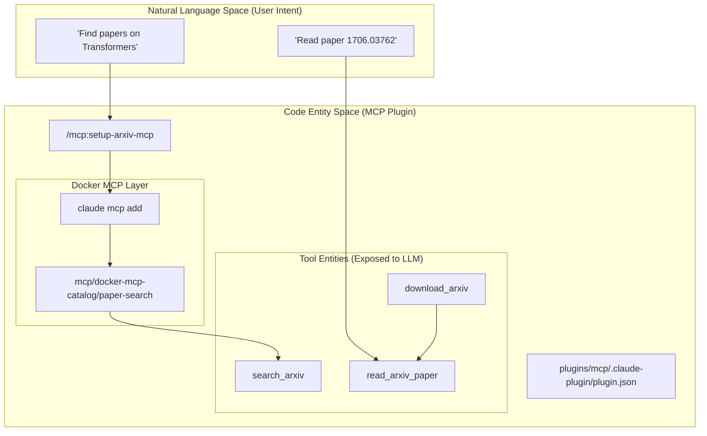
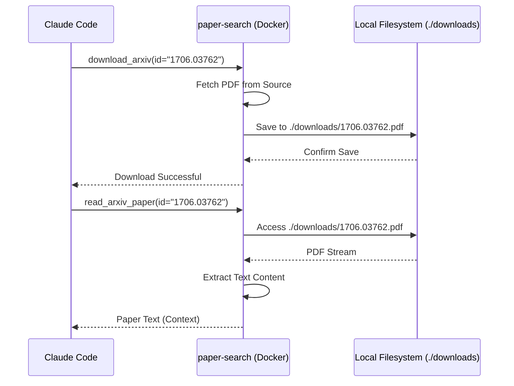

<!-- source: DeepWiki mcp.deepwiki.com · repo neolabhq/context-engineering-kit · page 4.5 Paper Search MCP Setup · fetched 2026-10-27 -->

# Paper Search MCP Setup

<details>
<summary>Relevant source files</summary>

The following files were used as context for generating this wiki page:

- [.devcontainer/Dockerfile](.devcontainer/Dockerfile)
- [.devcontainer/configure-claude.sh](.devcontainer/configure-claude.sh)
- [.devcontainer/devcontainer.json](.devcontainer/devcontainer.json)
- [.devcontainer/install-mcps.sh](.devcontainer/install-mcps.sh)
- [.devcontainer/statusline.sh](.devcontainer/statusline.sh)
- [docs/guides/README.md](docs/guides/README.md)
- [docs/plugins/mcp/README.md](docs/plugins/mcp/README.md)
- [plugins/mcp/.claude-plugin/plugin.json](plugins/mcp/.claude-plugin/plugin.json)
- [plugins/mcp/README.md](plugins/mcp/README.md)

</details>


This document describes the configuration and usage of the Paper Search MCP server within the Context Engineering Kit. This integration provides academic literature search and retrieval capabilities across eight major academic sources using the Model Context Protocol (MCP).

## Purpose and Scope

The Paper Search MCP is a Docker-based server that enables searching and downloading academic papers from sources including arXiv, PubMed, bioRxiv, medRxiv, Semantic Scholar, Google Scholar, IACR, and CrossRef. The setup is managed via the `/mcp:setup-arxiv-mcp` command, which:
- Configures Docker MCP integration.
- Updates the appropriate `CLAUDE.md` file (Project, Personal, or Global).
- Provides tools for searching, downloading, and reading paper content directly within the AI development workflow.

Sources: [docs/plugins/mcp/README.md:18-19](), [plugins/mcp/README.md:18-19](), [plugins/mcp/README.md:54-55]()

---

## Architecture and Data Flow

The Paper Search integration relies on the Docker MCP infrastructure. Unlike standard MCP servers that run as local Node.js or Python processes, this server is pulled from the Docker MCP catalog and runs within a containerized environment managed by Docker Desktop.

### System Component Mapping

The following diagram maps the high-level research intent to the specific code entities and tools used in the implementation.

**Research Intent to Code Entity Mapping**

Sources: [plugins/mcp/.claude-plugin/plugin.json:1-4](), [.devcontainer/install-mcps.sh:7-10](), [plugins/mcp/README.md:54-55]()

---

## Setup Process

### Automated Container Setup
In the sandbox environment, MCP servers can be pre-configured during container creation. The `install-mcps.sh` script demonstrates how the Docker MCP catalog is utilized to pull and connect the paper-search server to the Claude Code client.

```bash
# Example from .devcontainer/install-mcps.sh
docker mcp catalog pull mcp/docker-mcp-catalog
docker mcp profile create --name dev-tools --server catalog://mcp/docker-mcp-catalog/paper-search --connect claude-code
```
Sources: [.devcontainer/install-mcps.sh:7-10](), [.devcontainer/devcontainer.json:61-64]()

### Manual Setup Command
Users can trigger the setup manually using the plugin command:
```bash
/mcp:setup-arxiv-mcp [optional: topics]
```
This command guides the user through selecting a configuration tier:
1.  **Project-shared**: Updates `./CLAUDE.md` (tracked in Git).
2.  **Project-personal**: Updates `./CLAUDE.local.md` (ignored by Git).
3.  **User-global**: Updates `~/.claude/CLAUDE.md` (all projects).

Sources: [docs/plugins/mcp/README.md:21-27](), [plugins/mcp/README.md:21-27]()

---

## Academic Sources and Tools

The Paper Search MCP exposes a comprehensive suite of tools for the research lifecycle.

### Search Tools
| Tool Name | Source | Focus Area |
| :--- | :--- | :--- |
| `search_arxiv` | arXiv | Physics, Math, Computer Science |
| `search_pubmed` | PubMed | Biomedical and Life Sciences |
| `search_biorxiv` | bioRxiv | Biological Sciences Preprints |
| `search_medrxiv` | medRxiv | Health Sciences Preprints |
| `search_semantic` | Semantic Scholar | AI-powered cross-disciplinary search |
| `search_google_scholar` | Google Scholar | Broad academic coverage |
| `search_iacr` | IACR | Cryptology Research |
| `search_crossref` | CrossRef | DOI and Metadata search |

Sources: [docs/plugins/mcp/README.md:54-55](), [plugins/mcp/README.md:54-55]()

### Content Retrieval Workflow
The data flow for retrieving and processing paper content involves local storage synchronization.

**Paper Retrieval Data Flow**

Sources: [docs/plugins/mcp/README.md:54-55](), [plugins/mcp/README.md:54-55]()

---

## Configuration Management

The setup command ensures that the LLM is aware of these tools by appending instructions to the `CLAUDE.md` hierarchy. This follows the standard three-tier configuration pattern used across the Context Engineering Kit.

### Environment Configuration
The devcontainer environment sets `DOCKER_MCP_IN_CONTAINER=1` to ensure the Docker-outside-of-Docker (DinD) feature correctly routes MCP requests from the workspace to the host's Docker daemon.

Sources: [.devcontainer/Dockerfile:118](), [.devcontainer/devcontainer.json:12-18]()

### Tiered Persistence
| Tier | File | Usage |
| :--- | :--- | :--- |
| **Global** | `~/.claude/CLAUDE.md` | Persistent academic search for the developer. |
| **Shared** | `./CLAUDE.md` | Research requirements for a specific team project. |
| **Local** | `./CLAUDE.local.md` | Private research for a specific project. |

Sources: [docs/plugins/mcp/README.md:21-27](), [plugins/mcp/README.md:21-27]()

---

